# src/backend/core/connectors 架构

## 目录定位

链接器定义、查询与唯一身份检查；另定义 GitHub 反馈字段、公开登录状态与可信端口，纯协议不发网络请求或授予权限。

本文描述当前实现。通过分析目录边界后维护的 [源码架构脚本](../../../../scripts/source-architecture.mjs) 同步清单和声明；代码变更时仍须核对职责、关键成员与关系。

## 代码清单

| 文件 | 当前职责 |
| --- | --- |
| [definition.ts](definition.ts) | 链接器静态定义的纯协议，供知识校验、桌面连接管理与注册查询共用。 |
| [github-feedback.ts](github-feedback.ts) | CBIM 反馈 Skill、可信 GitHub 端口和桌面登录共用的纯协议。 |
| [registry.ts](registry.ts) | 链接器领域封装，管理插件或资源仓库的静态身份、查询与重复校验。 |
| [repository-connection.ts](repository-connection.ts) | 桌面资源仓库链接器的输入、静态登记、独立只读授权与 HTTP 核验回执协议。 |
| [repository-tools.ts](repository-tools.ts) | 主 Loop 资源仓库只读工具的严格分页、正文分块协议和可信捕获端口。 |
| [web-tools.ts](web-tools.ts) | 公开网页读取与搜索的有界工具协议，以及桌面搜索设置契约。 |

## 架构类图

### definition.ts

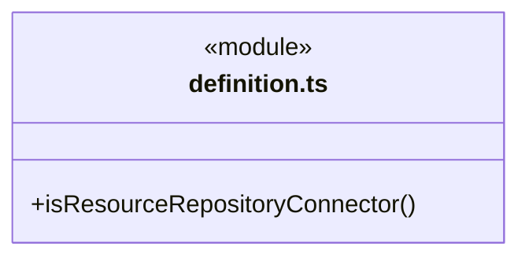

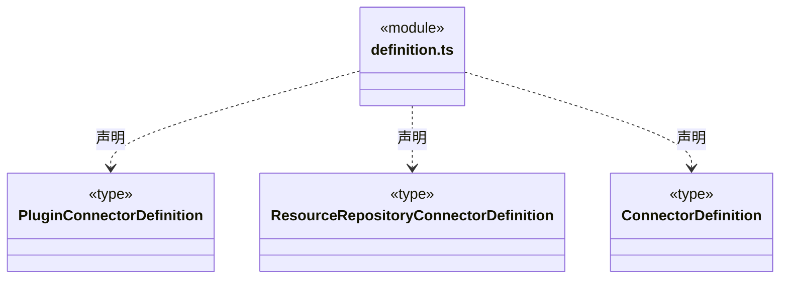

### github-feedback.ts

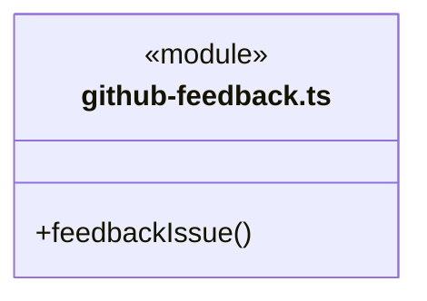

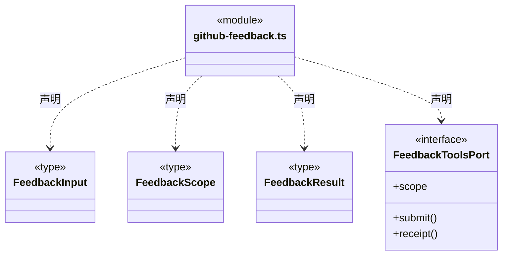

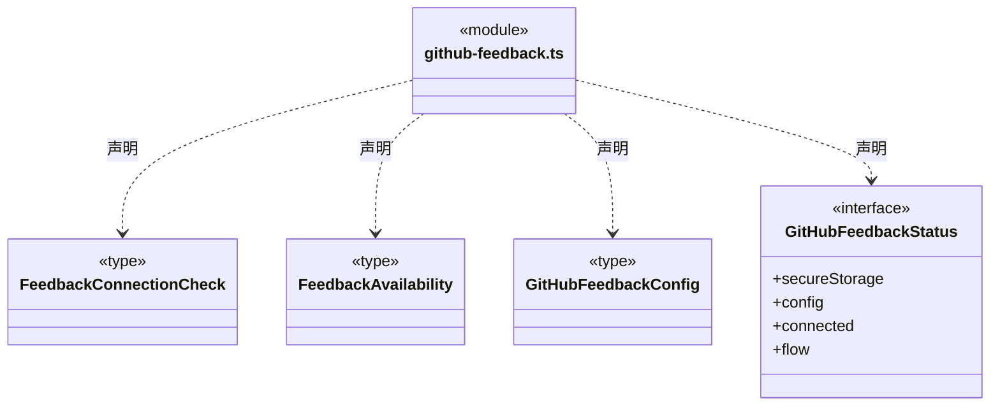

直接依赖：[../tools/scope-schema.ts](../tools/scope-schema.ts)。

### registry.ts

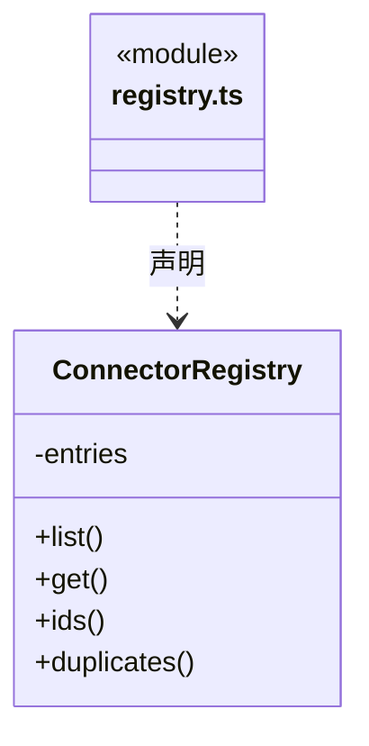

直接依赖：[definition.ts](definition.ts)。

### repository-connection.ts

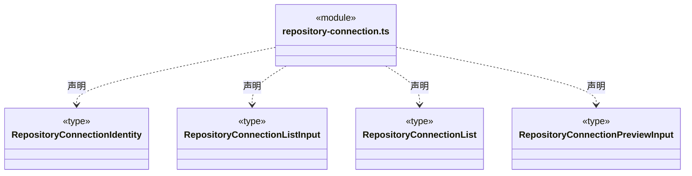

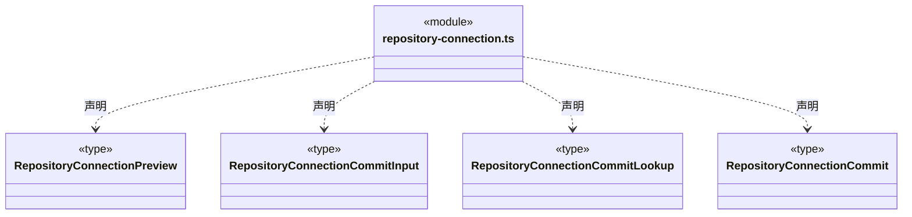

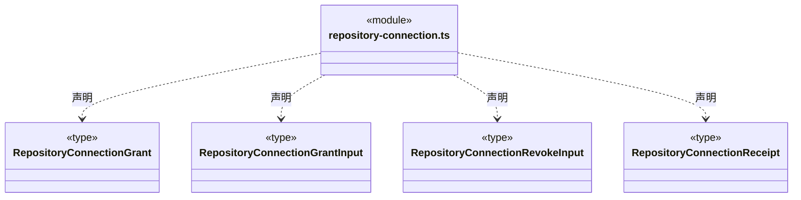

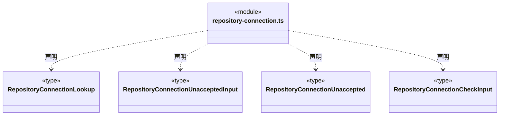

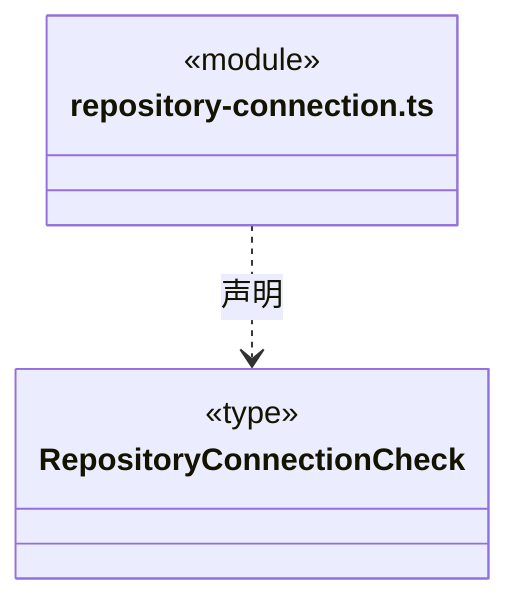

直接依赖：[definition.ts](definition.ts)。

### repository-tools.ts

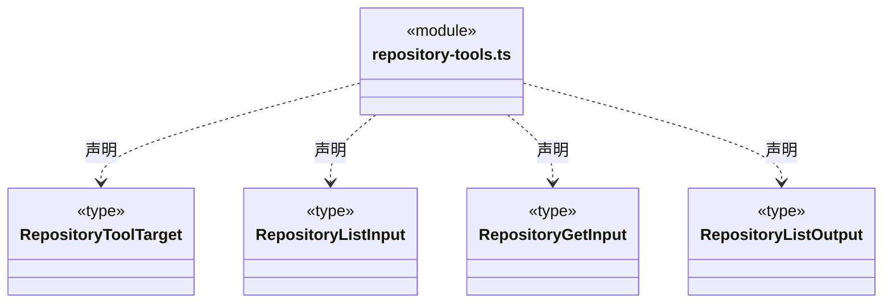

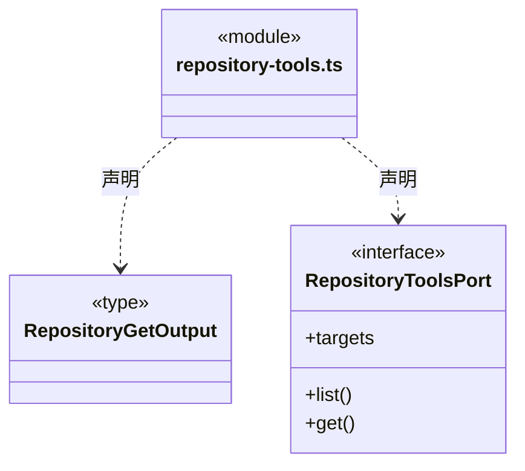

直接依赖：[definition.ts](definition.ts)、[../tools/scope-schema.ts](../tools/scope-schema.ts)。

### web-tools.ts

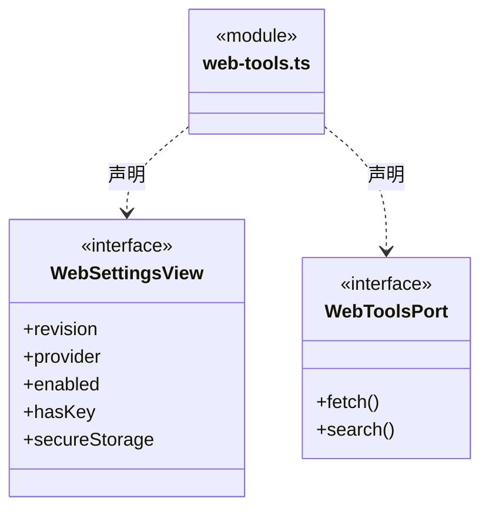

### 本目录调用边界

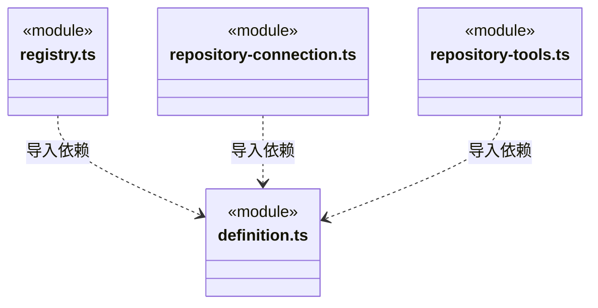

## 子目录导航

无子目录。

[返回上层](../ARCHITECTURE.md)。

每次修改本目录代码，同步维护文件头、关键契约说明及本图。未实现的治理、证据验收和自动编排能力不列入当前类图。

## 设计契约 v1 与落地范围

以下内容区分已接通能力与后续设计；以各节的实现状态为准，不将目标图当作现状图。维护源：[CONTRACT.md](CONTRACT.md)；生成类图时同步附加，勿直接修改本附录。

### 公开网页工具

`web-tools.ts` 固定 cbim_web_fetch/url/maxChars 与 cbim_web_search/query/count，严格拒绝多余字段。正文上限 20000 Unicode 字符，默认12000；搜索默认5条、最多10条，只返回标题、URL、摘要。结果标记 untrusted；资料不是指令或验收证据。设置只公开版本、Brave、开关、是否有密钥与安全存储状态。

### GitHub 反馈纯协议

`github-feedback.ts` 定义 BUG／需求的严格字段、最小 submitted 回执、已绑定目标端口及公开设置类型。`feedbackIssue` 只排版本次用户字段，保留标记不接受模型指定；不从本层发 HTTP、读凭据或授予权限。实际外部写由主进程实现，GitHub 工具不混入静态链接器注册或知识目录。

反馈输入仅 `kind/summary` 必填，简述不能为空；其他字段可缺省或空白，仍限制类型、长度、保留标记和未知字段。缺失主栏目统一排成“用户未提供”，补充上下文只在非空时输出；已完整填写的旧标题/正文不变。规范化发生在指纹之前，主栏目省略、空白或显式占位可复用同一回执，不自动采集环境或编造事实。

`FeedbackConnectionCheck` 仅表达本机保存的连接、尚待授权回包、过期、代际变化或设置／安全存储故障；不含凭据、设备码或提交记录。`FeedbackAvailability` 由调度层合成本轮实际装配与本机连接事实，两项操作工具必须同时存在或同时缺失。READY 不证明网络可达、权限允许或 Issue 已创建；诊断也不能把原未知提交改判为未发送。

### 静态定义与提供方身份

`definition.ts` 定义严格的链接器联合协议。旧 `plugin:{ghost_id,namespace}` 原样保留，不补造 provider 或运行能力；资源仓库使用 `provider:"resource_repository_v1"` 与 `repository:{repositoryId}`，仓库 ID 是 UUID。两个分支均拒绝未知字段、混合身份以及 URL、token 等连接信息。链接器 ID 沿用 `.cbim/connectors/` 下单叶 `[A-Za-z0-9_-]+` 格式。

`ConnectorRegistry` 在已经通过结构校验的定义上查询与检查唯一性：链接器 ID 不区分大小写；插件以 ghost ID 与 namespace 二元组区分；仓库按 UUID 身份区分。提供方标签参与比较，不以 JSON 属性顺序或缺少 plugin 来判断相同目标。

`design/connector/registry.schema.json` 为完整知识事务提供等价结构规则；知识校验继续检查 Agent、Module 对登记链接器的引用。定义可在其他工作区重新使用，但不会复制本机授权；保存或查询静态定义不发 HTTP、不启共享、不注册模型工具。真实连接与工作区授权由本机适配层单独管理。

### 桌面资源仓库连接协议

`repository-connection.ts` 是桌面连接与原请求核对共同消费的纯输入/输出协议，不导入知识事务实现或主进程服务。输入绑定明确工作区和实例；历史回执查询保留原实例身份。列表区分旧插件、不再存在的定义、定义变化、无授权、无共享及就绪状态。缺失定义的历史授权可列出供显式撤销，不自动重建知识。

`preview` 返回固定的知识变更计划与共享连接身份；`commit` 只提交定义。`grant`/`revoke` 使用独立工作区授权版本 CAS 和命令 ID，回执绑定链接器、仓库、定义指纹与原命令；`receipt` 只查询原回执。协议不接受 URL、token、actor、资源正文或调用方声明的授权结果。仓库共享服务的 `connectionId` 表示本机服务提供的连接身份，不是账户身份或网络地址。

`commitReceipt` 以工作区和原 planId 查询知识提交凭据，返回时仍保留原实例身份；没有凭据保持未知，不从当前定义相同推断该计划已提交，也不重放提交。此只读查询可用于页面卸载或工作区重开后的原请求核对。

`unaccepted` 请求固定原工作区、原实例、操作类型与命令/计划 ID。只有后端串行核实原实例已退役、没有原授权命令或知识事务凭据时，才能返回明确未受理；当前实例查不到回执、存储损坏或不明事务状态不构成该结论。此接口只读，不取消、重放或重新授权。界面必须严格匹配原请求并获得 `unaccepted:true` 才能清除待确认记录。

`check` 回执明确记录真实 HTTP、只读、仓库版本、授权版本和核验时刻，最多包含 20 个资源目录摘要，并报告总数与截断标志。它不包含资源正文，也不承诺导入资源、下载文件、模型工具调用或业务验收。授权的持久化、共享关闭及重开失效、并发重新核对和网络取消由本机实现负责，不能仅凭本协议对象作权限判断。

### 主运行中的真实只读仓库工具

`repository-tools.ts` 定义 `cbim_repository_list/get` 的模型输入、业务输出和可信 `RepositoryToolsPort`。主进程在本轮创建时捕获已就绪链接器的固定目标；公开目标只有工作区、链接器、仓库、共享连接身份和有界名称/简介，授权版本、定义指纹及网络凭据留在闭包。捕获不读取 HTTP；实际端口调用须在网络前后核实原目标、原授权与共享代际，不因变化换源或自动重新授权。

模型输入只选择 connectorId、资源、原仓库版本及分页范围，拒绝工作区、仓库身份、共享身份、地址、token 和权限。目录每页至多 50 条，后续页必须指定原 revision，返回精确 totalItems/nextOffset；单项名称至多 100 字符、简介至多 1000 字符，不能以原始超长字段撑大工具结果。正文按 Unicode codepoint 分块，每块至多 4096 个 codepoint，必须指定 expectedRevision 和 resourceId。contentHash 始终代表原完整 UTF-8 正文，complete 仅在本块从 0 开始且包含全部正文时为 true；最后一页不等于完整正文。严格输出拒绝错误范围、重复目录项、未知字段和矛盾分页，不补造无效资源事实。

该协议只让主运行读取已授权资料，不授予成员工具、安装资源、执行正文或使用资料作为文件交付证据。工具回执使用独立 repository scope；当前输出仍须通过共同工具结果边界，Schema 通过不代表业务验收或整个外部仓库已读取。
