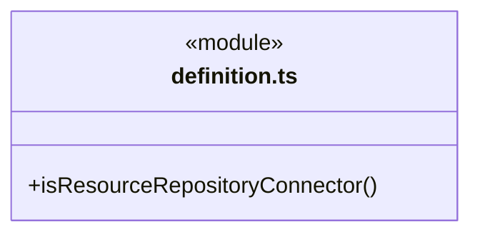
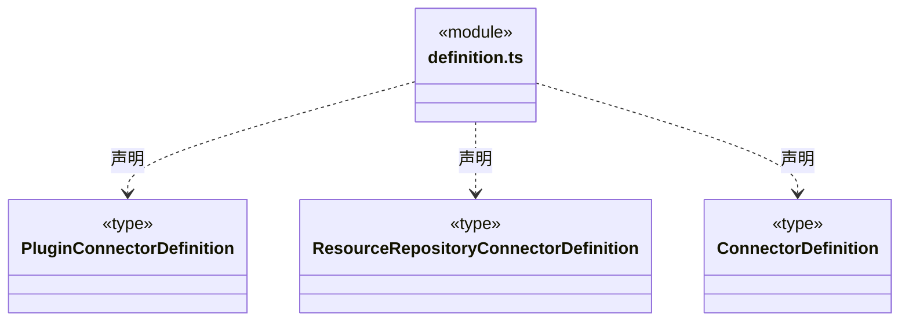
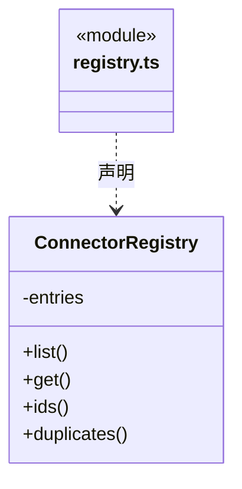
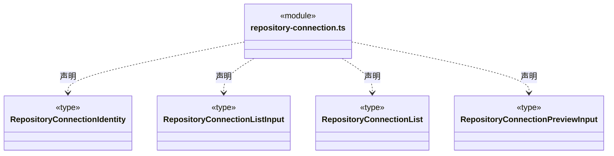
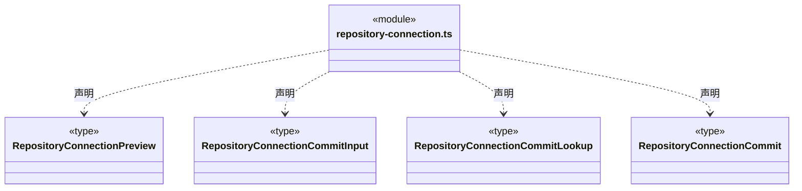
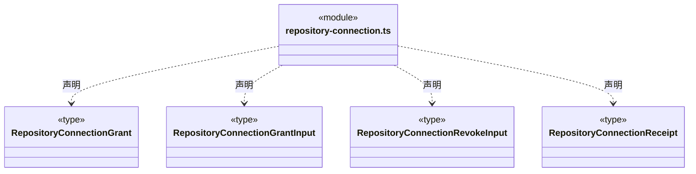
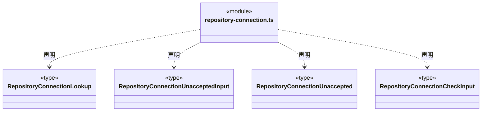
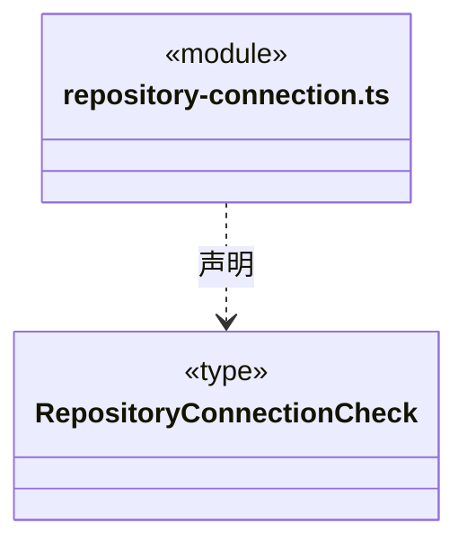
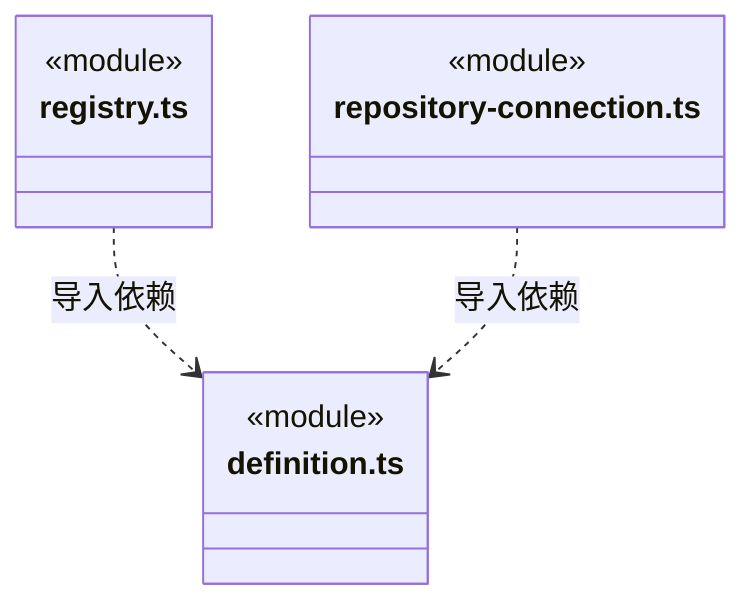

# src/backend/core/connectors 架构

## 目录定位

链接器定义、查询与唯一身份检查；当前不执行外部插件。

本文描述当前实现。通过分析目录边界后维护的 [源码架构脚本](../../../../scripts/source-architecture.mjs) 同步清单和声明；代码变更时仍须核对职责、关键成员与关系。

## 代码清单

| 文件 | 当前职责 |
| --- | --- |
| [definition.ts](definition.ts) | 链接器静态定义的纯协议，供知识校验、桌面连接管理与注册查询共用。 |
| [registry.ts](registry.ts) | 链接器领域封装，管理插件或资源仓库的静态身份、查询与重复校验。 |
| [repository-connection.ts](repository-connection.ts) | 桌面资源仓库链接器的输入、静态登记、独立只读授权与 HTTP 核验回执协议。 |

## 架构类图

### definition.ts

### registry.ts

直接依赖：[definition.ts](definition.ts)。

### repository-connection.ts

直接依赖：[definition.ts](definition.ts)。

### 本目录调用边界

## 子目录导航

无子目录。

[返回上层](../ARCHITECTURE.md)。

每次修改本目录代码，同步维护文件头、关键契约说明及本图。未实现的治理、证据验收和自动编排能力不列入当前类图。

## 设计契约 v1 与落地范围

以下内容区分已接通能力与后续设计；以各节的实现状态为准，不将目标图当作现状图。维护源：[CONTRACT.md](CONTRACT.md)；生成类图时同步附加，勿直接修改本附录。

### 静态定义与提供方身份

`definition.ts` 定义严格的链接器联合协议。旧 `plugin:{ghost_id,namespace}` 原样保留，不补造 provider 或运行能力；资源仓库使用 `provider:"resource_repository_v1"` 与 `repository:{repositoryId}`，仓库 ID 是 UUID。两个分支均拒绝未知字段、混合身份以及 URL、token 等连接信息。链接器 ID 沿用 `.cbim/connectors/` 下单叶 `[A-Za-z0-9_-]+` 格式。

`ConnectorRegistry` 在已经通过结构校验的定义上查询与检查唯一性：链接器 ID 不区分大小写；插件以 ghost ID 与 namespace 二元组区分；仓库按 UUID 身份区分。提供方标签参与比较，不以 JSON 属性顺序或缺少 plugin 来判断相同目标。

`design/connector/registry.schema.json` 为完整知识事务提供等价结构规则；知识校验继续检查 Agent、Module 对登记链接器的引用。定义可在其他工作区重新使用，但不会复制本机授权；保存或查询静态定义不发 HTTP、不启共享、不注册模型工具。真实连接与工作区授权由本机适配层单独管理。

### 桌面资源仓库连接协议

`repository-connection.ts` 是桌面连接与原请求核对共同消费的纯输入/输出协议，不导入知识事务实现或主进程服务。输入绑定明确工作区和实例；历史回执查询保留原实例身份。列表区分旧插件、不再存在的定义、定义变化、无授权、无共享及就绪状态。缺失定义的历史授权可列出供显式撤销，不自动重建知识。

`preview` 返回固定的知识变更计划与共享连接身份；`commit` 只提交定义。`grant`/`revoke` 使用独立工作区授权版本 CAS 和命令 ID，回执绑定链接器、仓库、定义指纹与原命令；`receipt` 只查询原回执。协议不接受 URL、token、actor、资源正文或调用方声明的授权结果。仓库共享服务的 `connectionId` 表示本机服务提供的连接身份，不是账户身份或网络地址。

`commitReceipt` 以工作区和原 planId 查询知识提交凭据，返回时仍保留原实例身份；没有凭据保持未知，不从当前定义相同推断该计划已提交，也不重放提交。此只读查询可用于页面卸载或工作区重开后的原请求核对。

`unaccepted` 请求固定原工作区、原实例、操作类型与命令/计划 ID。只有后端串行核实原实例已退役、没有原授权命令或知识事务凭据时，才能返回明确未受理；当前实例查不到回执、存储损坏或不明事务状态不构成该结论。此接口只读，不取消、重放或重新授权。界面必须严格匹配原请求并获得 `unaccepted:true` 才能清除待确认记录。

`check` 回执明确记录真实 HTTP、只读、仓库版本、授权版本和核验时刻，最多包含 20 个资源目录摘要，并报告总数与截断标志。它不包含资源正文，也不承诺导入资源、下载文件、模型工具调用或业务验收。授权的持久化、共享关闭及重开失效、并发重新核对和网络取消由本机实现负责，不能仅凭本协议对象作权限判断。
