# src/backend/core/evidence 架构

## 目录定位

证据领域：输出清单、产物、命令/人工/效果观察与完成报告规则。记录、有效性和业务验收分别核实；平台读取在 main/evidence，编排在 scheduler-engine/evidence。

本文描述当前实现。通过分析目录边界后维护的 [源码架构脚本](../../../../scripts/source-architecture.mjs) 同步清单和声明；代码变更时仍须核对职责、关键成员与关系。

## 代码清单

| 文件 | 当前职责 |
| --- | --- |
| [artifact-baseline.ts](artifact-baseline.ts) | 显式文件基线、工具输入及独立只读核实报告的序列化契约。 |
| [artifact-evidence.ts](artifact-evidence.ts) | 从本轮已提交事件核实文件采集来源与不可变基线，供运行时和只读报告共用。 |
| [artifact-tools.ts](artifact-tools.ts) | 正式成员的显式文件基线工具包装，校验模型输入并委托本轮可信采集端口。 |
| [code-check.ts](code-check.ts) | 代码检查的可信事实、摘要和交付证明，连接冻结 Workflow 与原始运行日志。 |
| [complete-output-evidence.ts](complete-output-evidence.ts) | 完整产物出口共用的清单选择、身份投影和当前集合比较，供运行、交付及人工核实复用。 |
| [output-manifest-evidence.ts](output-manifest-evidence.ts) | 计算完整产物清单身份，并从原 canonical 核实采集、授权和真实成功回执的对应关系。 |
| [output-manifest-identity.ts](output-manifest-identity.ts) | 完整清单的确定性范围/内容指纹及引用投影，作为清单和原操作证明共用的单向基础。 |
| [output-manifest-tools.ts](output-manifest-tools.ts) | 正式成员的完整清单采集与原记录查询工具；输入没有路径、哈希、模块或运行身份。 |
| [output-manifest.ts](output-manifest.ts) | 声明范围完整清单、可信采集事件和独立复核的公开序列化契约。 |
| [progress-schema.ts](progress-schema.ts) | 执行计划、Workflow 命中证明与进度查询的严格公开结构。 |
| [progress-tools.ts](progress-tools.ts) | 内部 Loop 的任务计划、步骤证据和交付工具，状态通过注入的持久化回调保存。 |
| [progress.ts](progress.ts) | 单 Agent 执行计划及交付候选的领域状态，独立于 Pi、磁盘和界面。 |
| [validation-evidence.ts](validation-evidence.ts) | 从可信冻结 Workflow 与本轮日志核实 JSON/CSV/PNG 验证事实，供 Runtime、交付和主目标复核共同使用。 |
| [validation-tools.ts](validation-tools.ts) | 为已装配 JSON/CSV/PNG 验证要求的正式成员提供严格输入、唯一 wire 输出及真实能力说明。 |
| [validation.ts](validation.ts) | JSON/CSV/PNG 产物验证工具、不可变检查事实及 Workflow 精确出口的叶子契约。 |
| [workflow-evidence.ts](workflow-evidence.ts) | 核实可选 Workflow 的计划前置、工具回执及精确 必验文件结构出口，供运行时与调度结算共用。 |

## 架构类图

### artifact-baseline.ts

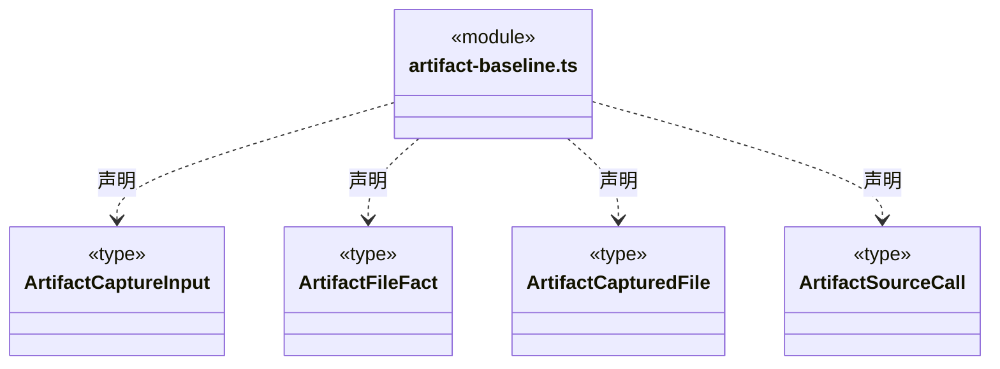

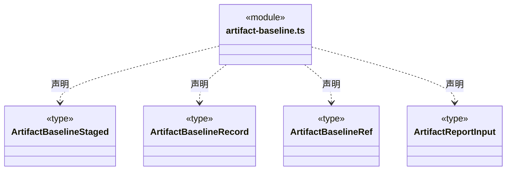

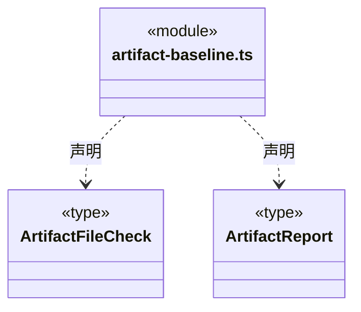


### artifact-evidence.ts

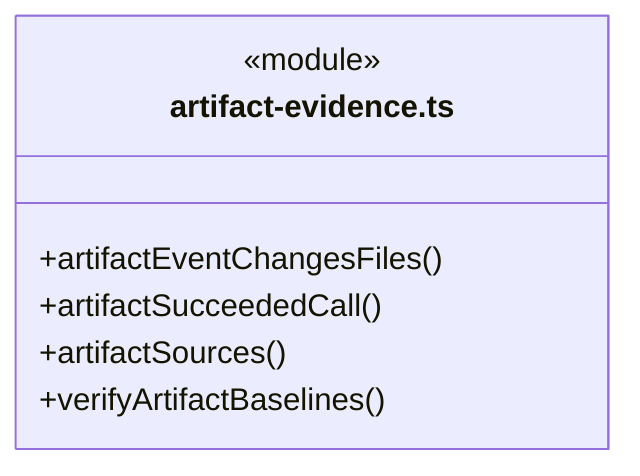

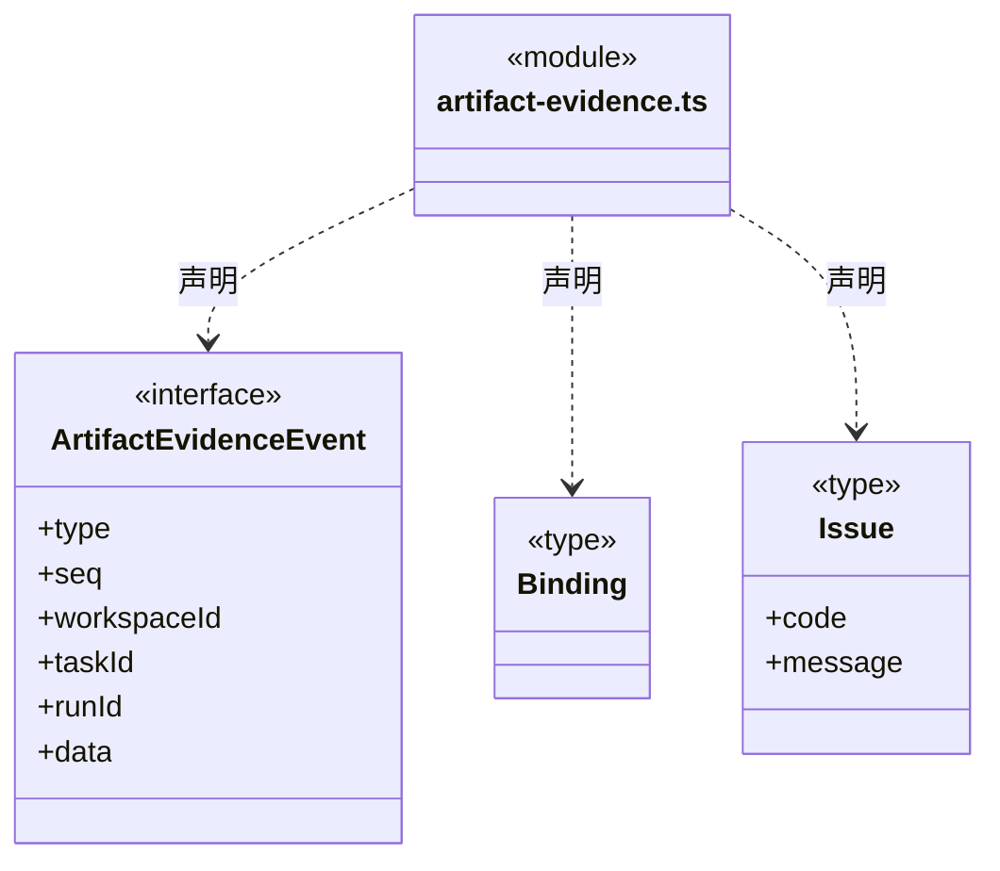

直接依赖：[../file-operations/scoped-execution.ts](../file-operations/scoped-execution.ts)、[../foundation/errors.ts](../foundation/errors.ts)、[../foundation/serialization.ts](../foundation/serialization.ts)、[../tools/scope-schema.ts](../tools/scope-schema.ts)、[artifact-baseline.ts](artifact-baseline.ts)。

### artifact-tools.ts

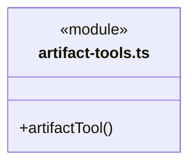

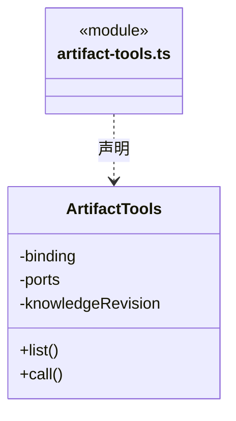

直接依赖：[../tools/results.ts](../tools/results.ts)、[artifact-baseline.ts](artifact-baseline.ts)、[../tasks/member-tool-output.ts](../tasks/member-tool-output.ts)。

### code-check.ts

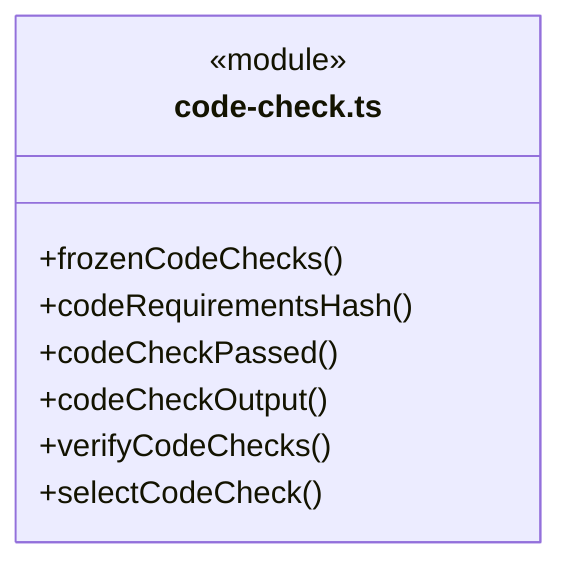

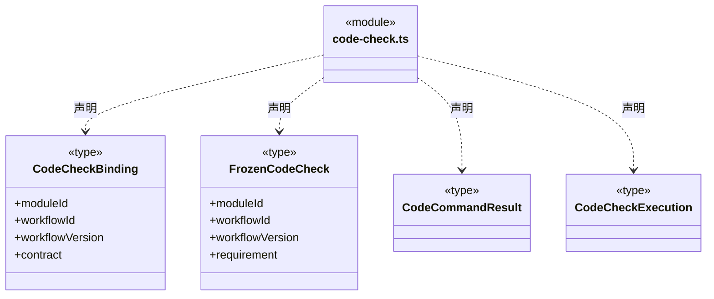

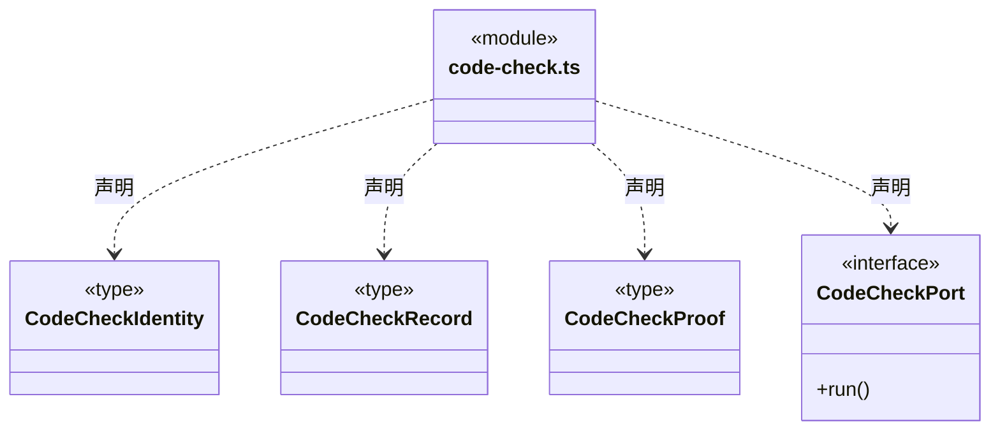

直接依赖：[../foundation/serialization.ts](../foundation/serialization.ts)、[../foundation/errors.ts](../foundation/errors.ts)、[../workspace/code-check.ts](../workspace/code-check.ts)、[../workspace/workflow-contract.ts](../workspace/workflow-contract.ts)、[../workspace/artifact-scope.ts](../workspace/artifact-scope.ts)、[output-manifest.ts](output-manifest.ts)、[output-manifest-evidence.ts](output-manifest-evidence.ts)、[artifact-evidence.ts](artifact-evidence.ts)、[../tools/types.ts](../tools/types.ts)。

### complete-output-evidence.ts

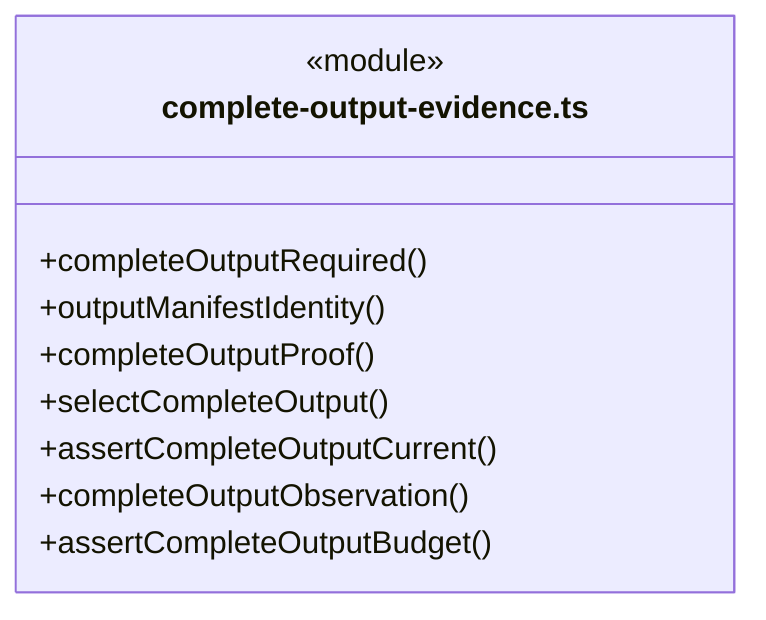

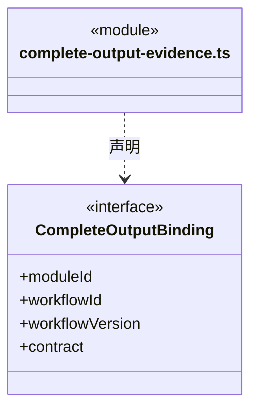

直接依赖：[../foundation/errors.ts](../foundation/errors.ts)、[../workspace/artifact-scope.ts](../workspace/artifact-scope.ts)、[artifact-baseline.ts](artifact-baseline.ts)、[output-manifest.ts](output-manifest.ts)、[output-manifest-evidence.ts](output-manifest-evidence.ts)。

### output-manifest-evidence.ts

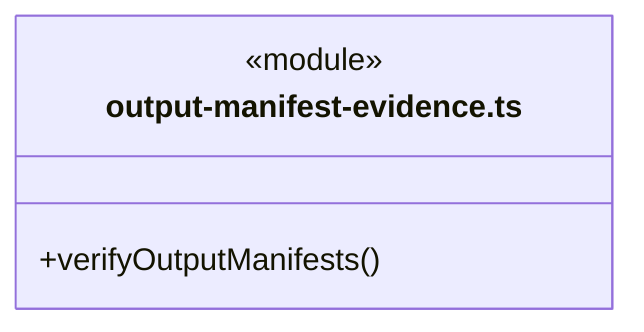

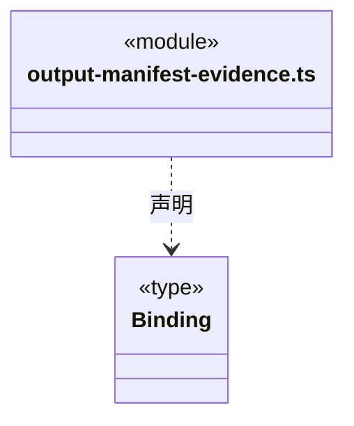

直接依赖：[../workspace/artifact-scope.ts](../workspace/artifact-scope.ts)、[artifact-evidence.ts](artifact-evidence.ts)、[output-manifest.ts](output-manifest.ts)、[output-manifest-identity.ts](output-manifest-identity.ts)、[../file-operations/artifact-transition-evidence.ts](../file-operations/artifact-transition-evidence.ts)。

### output-manifest-identity.ts

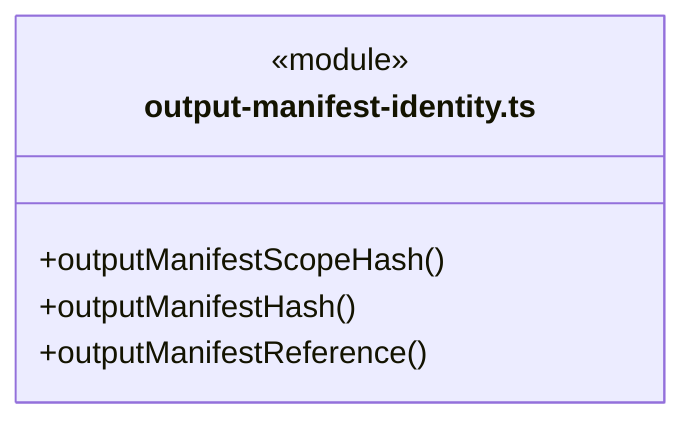

直接依赖：[../foundation/serialization.ts](../foundation/serialization.ts)、[../workspace/artifact-scope.ts](../workspace/artifact-scope.ts)、[output-manifest.ts](output-manifest.ts)。

### output-manifest-tools.ts

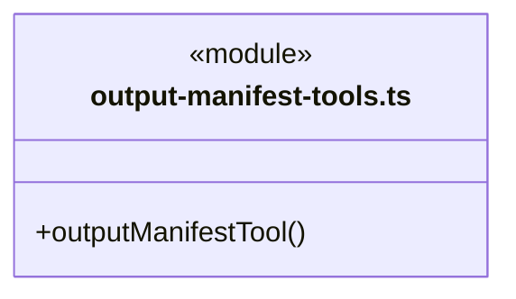

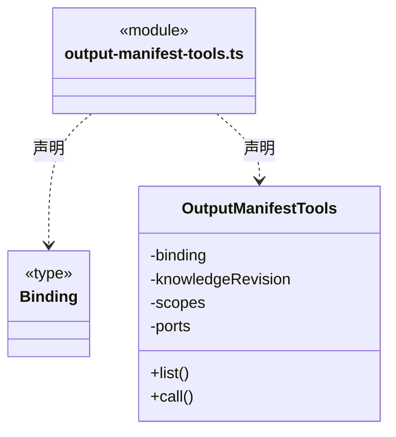

直接依赖：[../tools/results.ts](../tools/results.ts)、[../workspace/artifact-scope.ts](../workspace/artifact-scope.ts)、[output-manifest.ts](output-manifest.ts)、[output-manifest-evidence.ts](output-manifest-evidence.ts)。

### output-manifest.ts

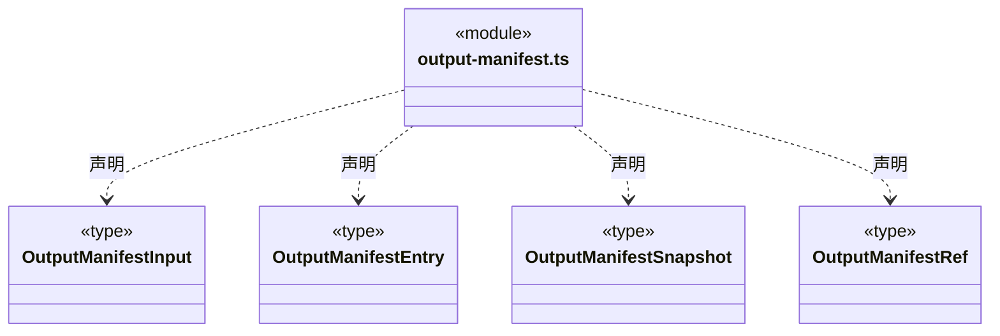

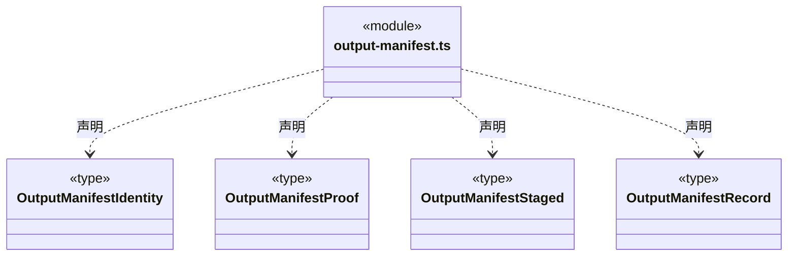

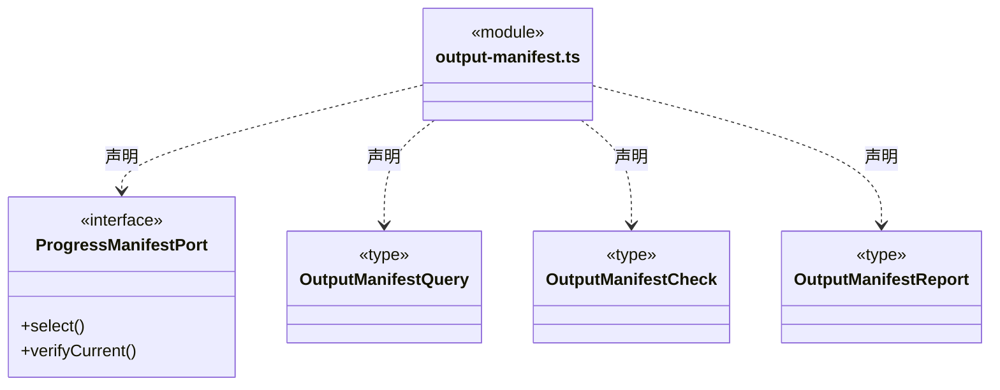

直接依赖：[../workspace/artifact-scope.ts](../workspace/artifact-scope.ts)、[artifact-baseline.ts](artifact-baseline.ts)、[../file-operations/artifact-transition.ts](../file-operations/artifact-transition.ts)。

### progress-schema.ts

```mermaid
classDiagram
class N_src_backend_core_evidence_progress_schema_ts["progress-schema.ts"] {
  <<module>>
}
class N_src_backend_core_evidence_progress_schema_ts_ProgressPlanInput["ProgressPlanInput"] {
  <<type>>

}
N_src_backend_core_evidence_progress_schema_ts ..> N_src_backend_core_evidence_progress_schema_ts_ProgressPlanInput : 声明
class N_src_backend_core_evidence_progress_schema_ts_ProgressStepInput["ProgressStepInput"] {
  <<type>>

}
N_src_backend_core_evidence_progress_schema_ts ..> N_src_backend_core_evidence_progress_schema_ts_ProgressStepInput : 声明
class N_src_backend_core_evidence_progress_schema_ts_ProgressDeliveryInput["ProgressDeliveryInput"] {
  <<type>>

}
N_src_backend_core_evidence_progress_schema_ts ..> N_src_backend_core_evidence_progress_schema_ts_ProgressDeliveryInput : 声明
class N_src_backend_core_evidence_progress_schema_ts_TaskProgressInspect["TaskProgressInspect"] {
  <<type>>

}
N_src_backend_core_evidence_progress_schema_ts ..> N_src_backend_core_evidence_progress_schema_ts_TaskProgressInspect : 声明
```

直接依赖：[code-check.ts](code-check.ts)、[../workspace/workflow-contract.ts](../workspace/workflow-contract.ts)、[../tools/receipt-schema.ts](../tools/receipt-schema.ts)、[artifact-baseline.ts](artifact-baseline.ts)、[validation.ts](validation.ts)、[../workspace/json-validation-schema.ts](../workspace/json-validation-schema.ts)、[output-manifest.ts](output-manifest.ts)。

### progress-tools.ts

```mermaid
classDiagram
class N_src_backend_core_evidence_progress_tools_ts["progress-tools.ts"] {
  <<module>>
  +progressTool()
}
```

成员 1/2（同名节点为同一声明，跨图合并阅读）。

```mermaid
classDiagram
class N_src_backend_core_evidence_progress_tools_ts["progress-tools.ts"] {
  <<module>>
}
class N_src_backend_core_evidence_progress_tools_ts_TaskProgressTools["TaskProgressTools"] {
  +list()
  +generation
  +current()
  +beforeEffects()
  +invalidate()
  +record()
  +call()
  -save
  -ports
  -state
  -evidence
  -tail
  -planEstablished
  -workflow
  -identity
  -serial()
}
N_src_backend_core_evidence_progress_tools_ts ..> N_src_backend_core_evidence_progress_tools_ts_TaskProgressTools : 声明
```

成员 2/2（同名节点为同一声明，跨图合并阅读）。

```mermaid
classDiagram
class N_src_backend_core_evidence_progress_tools_ts["progress-tools.ts"] {
  <<module>>
}
class N_src_backend_core_evidence_progress_tools_ts_TaskProgressTools["TaskProgressTools"] {
  -persist()
}
N_src_backend_core_evidence_progress_tools_ts ..> N_src_backend_core_evidence_progress_tools_ts_TaskProgressTools : 声明
```

直接依赖：[code-check.ts](code-check.ts)、[progress.ts](progress.ts)、[../tools/types.ts](../tools/types.ts)、[artifact-baseline.ts](artifact-baseline.ts)、[../tools/results.ts](../tools/results.ts)、[../foundation/errors.ts](../foundation/errors.ts)、[workflow-evidence.ts](workflow-evidence.ts)、[validation.ts](validation.ts)、[output-manifest.ts](output-manifest.ts)、[complete-output-evidence.ts](complete-output-evidence.ts)、[progress-schema.ts](progress-schema.ts)、[../tasks/member-tool-output.ts](../tasks/member-tool-output.ts)。

### progress.ts

```mermaid
classDiagram
class N_src_backend_core_evidence_progress_ts["progress.ts"] {
  <<module>>
}
class N_src_backend_core_evidence_progress_ts_TaskStep["TaskStep"] {
  <<interface>>
  +id
  +title
  +owner
  +state
  +evidence
}
N_src_backend_core_evidence_progress_ts ..> N_src_backend_core_evidence_progress_ts_TaskStep : 声明
class N_src_backend_core_evidence_progress_ts_WorkflowEvidenceProof["WorkflowEvidenceProof"] {
  <<interface>>
  +codeCheck
  +version
  +bindingsHash
  +checks
  +validationChecks
  +manifest
}
N_src_backend_core_evidence_progress_ts ..> N_src_backend_core_evidence_progress_ts_WorkflowEvidenceProof : 声明
class N_src_backend_core_evidence_progress_ts_TaskProgress["TaskProgress"] {
  <<interface>>
  +version
  +goal
  +acceptance
  +steps
  +state
  +reason
  +delivery
}
N_src_backend_core_evidence_progress_ts ..> N_src_backend_core_evidence_progress_ts_TaskProgress : 声明
```

直接依赖：[validation.ts](validation.ts)、[output-manifest.ts](output-manifest.ts)、[code-check.ts](code-check.ts)。

### validation-evidence.ts

```mermaid
classDiagram
class N_src_backend_core_evidence_validation_evidence_ts["validation-evidence.ts"] {
  <<module>>
  +validationRequirement()
  +verifyValidationRecords()
}
```

```mermaid
classDiagram
class N_src_backend_core_evidence_validation_evidence_ts["validation-evidence.ts"] {
  <<module>>
}
class N_src_backend_core_evidence_validation_evidence_ts_ValidationWorkflowBinding["ValidationWorkflowBinding"] {
  <<interface>>
  +moduleId
  +workflowId
  +workflowVersion
  +contract
}
N_src_backend_core_evidence_validation_evidence_ts ..> N_src_backend_core_evidence_validation_evidence_ts_ValidationWorkflowBinding : 声明
```

直接依赖：[../foundation/errors.ts](../foundation/errors.ts)、[../foundation/serialization.ts](../foundation/serialization.ts)、[../workspace/workflow-contract.ts](../workspace/workflow-contract.ts)、[../workspace/json-validation-schema.ts](../workspace/json-validation-schema.ts)、[artifact-evidence.ts](artifact-evidence.ts)、[../workspace/artifact-scope.ts](../workspace/artifact-scope.ts)、[output-manifest-evidence.ts](output-manifest-evidence.ts)、[complete-output-evidence.ts](complete-output-evidence.ts)、[artifact-baseline.ts](artifact-baseline.ts)、[validation.ts](validation.ts)。

### validation-tools.ts

```mermaid
classDiagram
class N_src_backend_core_evidence_validation_tools_ts["validation-tools.ts"] {
  <<module>>
  +validationTool()
}
```

```mermaid
classDiagram
class N_src_backend_core_evidence_validation_tools_ts["validation-tools.ts"] {
  <<module>>
}
class N_src_backend_core_evidence_validation_tools_ts_ValidationTools["ValidationTools"] {
  +list()
  +call()
  -binding
  -port
  -knowledgeRevision
  -bindings
}
N_src_backend_core_evidence_validation_tools_ts ..> N_src_backend_core_evidence_validation_tools_ts_ValidationTools : 声明
```

直接依赖：[../tools/results.ts](../tools/results.ts)、[validation.ts](validation.ts)、[validation-evidence.ts](validation-evidence.ts)、[complete-output-evidence.ts](complete-output-evidence.ts)、[output-manifest.ts](output-manifest.ts)。

### validation.ts

```mermaid
classDiagram
class N_src_backend_core_evidence_validation_ts["validation.ts"] {
  <<module>>
}
class N_src_backend_core_evidence_validation_ts_ValidationInput["ValidationInput"] {
  <<type>>

}
N_src_backend_core_evidence_validation_ts ..> N_src_backend_core_evidence_validation_ts_ValidationInput : 声明
class N_src_backend_core_evidence_validation_ts_ValidationResult["ValidationResult"] {
  <<type>>

}
N_src_backend_core_evidence_validation_ts ..> N_src_backend_core_evidence_validation_ts_ValidationResult : 声明
class N_src_backend_core_evidence_validation_ts_ValidationBinding["ValidationBinding"] {
  <<type>>

}
N_src_backend_core_evidence_validation_ts ..> N_src_backend_core_evidence_validation_ts_ValidationBinding : 声明
class N_src_backend_core_evidence_validation_ts_ValidationRecord["ValidationRecord"] {
  <<type>>

}
N_src_backend_core_evidence_validation_ts ..> N_src_backend_core_evidence_validation_ts_ValidationRecord : 声明
```

```mermaid
classDiagram
class N_src_backend_core_evidence_validation_ts["validation.ts"] {
  <<module>>
}
class N_src_backend_core_evidence_validation_ts_WorkflowValidationCheck["WorkflowValidationCheck"] {
  <<type>>

}
N_src_backend_core_evidence_validation_ts ..> N_src_backend_core_evidence_validation_ts_WorkflowValidationCheck : 声明
class N_src_backend_core_evidence_validation_ts_ProgressValidationPort["ProgressValidationPort"] {
  <<interface>>
  +records()
  +verifyCurrent()
}
N_src_backend_core_evidence_validation_ts ..> N_src_backend_core_evidence_validation_ts_ProgressValidationPort : 声明
```

直接依赖：[artifact-baseline.ts](artifact-baseline.ts)、[../tools/receipt-schema.ts](../tools/receipt-schema.ts)、[../workspace/json-validation-schema.ts](../workspace/json-validation-schema.ts)、[output-manifest.ts](output-manifest.ts)。

### workflow-evidence.ts

```mermaid
classDiagram
class N_src_backend_core_evidence_workflow_evidence_ts["workflow-evidence.ts"] {
  <<module>>
  +workflowHasEffects()
  +assertWorkflowPlan()
  +evaluateWorkflowDelivery()
  +selectWorkflowValidations()
  +validateWorkflowEvidence()
}
```

```mermaid
classDiagram
class N_src_backend_core_evidence_workflow_evidence_ts["workflow-evidence.ts"] {
  <<module>>
}
class N_src_backend_core_evidence_workflow_evidence_ts_WorkflowRunIdentity["WorkflowRunIdentity"] {
  <<interface>>
  +workspaceId
  +taskId
  +runId
}
N_src_backend_core_evidence_workflow_evidence_ts ..> N_src_backend_core_evidence_workflow_evidence_ts_WorkflowRunIdentity : 声明
class N_src_backend_core_evidence_workflow_evidence_ts_WorkflowProgressContext["WorkflowProgressContext"] {
  <<interface>>
  +bindings
  +task
  +identity
}
N_src_backend_core_evidence_workflow_evidence_ts ..> N_src_backend_core_evidence_workflow_evidence_ts_WorkflowProgressContext : 声明
```

直接依赖：[code-check.ts](code-check.ts)、[../foundation/errors.ts](../foundation/errors.ts)、[../foundation/serialization.ts](../foundation/serialization.ts)、[../workspace/workflow-contract.ts](../workspace/workflow-contract.ts)、[../tasks/execution-context.ts](../tasks/execution-context.ts)、[progress.ts](progress.ts)、[../tasks/types.ts](../tasks/types.ts)、[../tools/types.ts](../tools/types.ts)、[../tools/native-tools.ts](../tools/native-tools.ts)、[../tools/questions.ts](../tools/questions.ts)、[../tasks/command-verification.ts](../tasks/command-verification.ts)、[artifact-evidence.ts](artifact-evidence.ts)、[validation.ts](validation.ts)、[validation-evidence.ts](validation-evidence.ts)、[../workspace/json-validation-schema.ts](../workspace/json-validation-schema.ts)、[complete-output-evidence.ts](complete-output-evidence.ts)、[output-manifest.ts](output-manifest.ts)、[output-manifest-evidence.ts](output-manifest-evidence.ts)、[../workspace/artifact-scope.ts](../workspace/artifact-scope.ts)。

### 本目录调用边界

```mermaid
classDiagram
class N_src_backend_core_evidence_artifact_evidence_ts["artifact-evidence.ts"] {
  <<module>>
}
class N_src_backend_core_evidence_artifact_baseline_ts["artifact-baseline.ts"] {
  <<module>>
}
class N_src_backend_core_evidence_artifact_tools_ts["artifact-tools.ts"] {
  <<module>>
}
class N_src_backend_core_evidence_code_check_ts["code-check.ts"] {
  <<module>>
}
class N_src_backend_core_evidence_output_manifest_ts["output-manifest.ts"] {
  <<module>>
}
class N_src_backend_core_evidence_output_manifest_evidence_ts["output-manifest-evidence.ts"] {
  <<module>>
}
N_src_backend_core_evidence_artifact_evidence_ts ..> N_src_backend_core_evidence_artifact_baseline_ts : 导入依赖
N_src_backend_core_evidence_artifact_tools_ts ..> N_src_backend_core_evidence_artifact_baseline_ts : 导入依赖
N_src_backend_core_evidence_code_check_ts ..> N_src_backend_core_evidence_output_manifest_ts : 导入依赖
N_src_backend_core_evidence_code_check_ts ..> N_src_backend_core_evidence_output_manifest_evidence_ts : 导入依赖
```

```mermaid
classDiagram
class N_src_backend_core_evidence_code_check_ts["code-check.ts"] {
  <<module>>
}
class N_src_backend_core_evidence_artifact_evidence_ts["artifact-evidence.ts"] {
  <<module>>
}
class N_src_backend_core_evidence_complete_output_evidence_ts["complete-output-evidence.ts"] {
  <<module>>
}
class N_src_backend_core_evidence_artifact_baseline_ts["artifact-baseline.ts"] {
  <<module>>
}
class N_src_backend_core_evidence_output_manifest_ts["output-manifest.ts"] {
  <<module>>
}
class N_src_backend_core_evidence_output_manifest_evidence_ts["output-manifest-evidence.ts"] {
  <<module>>
}
N_src_backend_core_evidence_code_check_ts ..> N_src_backend_core_evidence_artifact_evidence_ts : 导入依赖
N_src_backend_core_evidence_complete_output_evidence_ts ..> N_src_backend_core_evidence_artifact_baseline_ts : 导入依赖
N_src_backend_core_evidence_complete_output_evidence_ts ..> N_src_backend_core_evidence_output_manifest_ts : 导入依赖
N_src_backend_core_evidence_complete_output_evidence_ts ..> N_src_backend_core_evidence_output_manifest_evidence_ts : 导入依赖
```

```mermaid
classDiagram
class N_src_backend_core_evidence_output_manifest_evidence_ts["output-manifest-evidence.ts"] {
  <<module>>
}
class N_src_backend_core_evidence_artifact_evidence_ts["artifact-evidence.ts"] {
  <<module>>
}
class N_src_backend_core_evidence_output_manifest_ts["output-manifest.ts"] {
  <<module>>
}
class N_src_backend_core_evidence_output_manifest_identity_ts["output-manifest-identity.ts"] {
  <<module>>
}
N_src_backend_core_evidence_output_manifest_evidence_ts ..> N_src_backend_core_evidence_artifact_evidence_ts : 导入依赖
N_src_backend_core_evidence_output_manifest_evidence_ts ..> N_src_backend_core_evidence_output_manifest_ts : 导入依赖
N_src_backend_core_evidence_output_manifest_evidence_ts ..> N_src_backend_core_evidence_output_manifest_identity_ts : 导入依赖
N_src_backend_core_evidence_output_manifest_identity_ts ..> N_src_backend_core_evidence_output_manifest_ts : 导入依赖
```

```mermaid
classDiagram
class N_src_backend_core_evidence_output_manifest_tools_ts["output-manifest-tools.ts"] {
  <<module>>
}
class N_src_backend_core_evidence_output_manifest_ts["output-manifest.ts"] {
  <<module>>
}
class N_src_backend_core_evidence_output_manifest_evidence_ts["output-manifest-evidence.ts"] {
  <<module>>
}
class N_src_backend_core_evidence_artifact_baseline_ts["artifact-baseline.ts"] {
  <<module>>
}
class N_src_backend_core_evidence_progress_schema_ts["progress-schema.ts"] {
  <<module>>
}
class N_src_backend_core_evidence_code_check_ts["code-check.ts"] {
  <<module>>
}
N_src_backend_core_evidence_output_manifest_tools_ts ..> N_src_backend_core_evidence_output_manifest_ts : 导入依赖
N_src_backend_core_evidence_output_manifest_tools_ts ..> N_src_backend_core_evidence_output_manifest_evidence_ts : 导入依赖
N_src_backend_core_evidence_output_manifest_ts ..> N_src_backend_core_evidence_artifact_baseline_ts : 导入依赖
N_src_backend_core_evidence_progress_schema_ts ..> N_src_backend_core_evidence_code_check_ts : 导入依赖
```

```mermaid
classDiagram
class N_src_backend_core_evidence_progress_schema_ts["progress-schema.ts"] {
  <<module>>
}
class N_src_backend_core_evidence_artifact_baseline_ts["artifact-baseline.ts"] {
  <<module>>
}
class N_src_backend_core_evidence_validation_ts["validation.ts"] {
  <<module>>
}
class N_src_backend_core_evidence_output_manifest_ts["output-manifest.ts"] {
  <<module>>
}
class N_src_backend_core_evidence_progress_tools_ts["progress-tools.ts"] {
  <<module>>
}
class N_src_backend_core_evidence_code_check_ts["code-check.ts"] {
  <<module>>
}
N_src_backend_core_evidence_progress_schema_ts ..> N_src_backend_core_evidence_artifact_baseline_ts : 导入依赖
N_src_backend_core_evidence_progress_schema_ts ..> N_src_backend_core_evidence_validation_ts : 导入依赖
N_src_backend_core_evidence_progress_schema_ts ..> N_src_backend_core_evidence_output_manifest_ts : 导入依赖
N_src_backend_core_evidence_progress_tools_ts ..> N_src_backend_core_evidence_code_check_ts : 导入依赖
```

```mermaid
classDiagram
class N_src_backend_core_evidence_progress_tools_ts["progress-tools.ts"] {
  <<module>>
}
class N_src_backend_core_evidence_progress_ts["progress.ts"] {
  <<module>>
}
class N_src_backend_core_evidence_artifact_baseline_ts["artifact-baseline.ts"] {
  <<module>>
}
class N_src_backend_core_evidence_workflow_evidence_ts["workflow-evidence.ts"] {
  <<module>>
}
class N_src_backend_core_evidence_validation_ts["validation.ts"] {
  <<module>>
}
N_src_backend_core_evidence_progress_tools_ts ..> N_src_backend_core_evidence_progress_ts : 导入依赖
N_src_backend_core_evidence_progress_tools_ts ..> N_src_backend_core_evidence_artifact_baseline_ts : 导入依赖
N_src_backend_core_evidence_progress_tools_ts ..> N_src_backend_core_evidence_workflow_evidence_ts : 导入依赖
N_src_backend_core_evidence_progress_tools_ts ..> N_src_backend_core_evidence_validation_ts : 导入依赖
```

```mermaid
classDiagram
class N_src_backend_core_evidence_progress_tools_ts["progress-tools.ts"] {
  <<module>>
}
class N_src_backend_core_evidence_output_manifest_ts["output-manifest.ts"] {
  <<module>>
}
class N_src_backend_core_evidence_complete_output_evidence_ts["complete-output-evidence.ts"] {
  <<module>>
}
class N_src_backend_core_evidence_progress_schema_ts["progress-schema.ts"] {
  <<module>>
}
class N_src_backend_core_evidence_progress_ts["progress.ts"] {
  <<module>>
}
class N_src_backend_core_evidence_validation_ts["validation.ts"] {
  <<module>>
}
N_src_backend_core_evidence_progress_tools_ts ..> N_src_backend_core_evidence_output_manifest_ts : 导入依赖
N_src_backend_core_evidence_progress_tools_ts ..> N_src_backend_core_evidence_complete_output_evidence_ts : 导入依赖
N_src_backend_core_evidence_progress_tools_ts ..> N_src_backend_core_evidence_progress_schema_ts : 导入依赖
N_src_backend_core_evidence_progress_ts ..> N_src_backend_core_evidence_validation_ts : 导入依赖
```

```mermaid
classDiagram
class N_src_backend_core_evidence_progress_ts["progress.ts"] {
  <<module>>
}
class N_src_backend_core_evidence_output_manifest_ts["output-manifest.ts"] {
  <<module>>
}
class N_src_backend_core_evidence_code_check_ts["code-check.ts"] {
  <<module>>
}
class N_src_backend_core_evidence_validation_evidence_ts["validation-evidence.ts"] {
  <<module>>
}
class N_src_backend_core_evidence_artifact_evidence_ts["artifact-evidence.ts"] {
  <<module>>
}
class N_src_backend_core_evidence_output_manifest_evidence_ts["output-manifest-evidence.ts"] {
  <<module>>
}
N_src_backend_core_evidence_progress_ts ..> N_src_backend_core_evidence_output_manifest_ts : 导入依赖
N_src_backend_core_evidence_progress_ts ..> N_src_backend_core_evidence_code_check_ts : 导入依赖
N_src_backend_core_evidence_validation_evidence_ts ..> N_src_backend_core_evidence_artifact_evidence_ts : 导入依赖
N_src_backend_core_evidence_validation_evidence_ts ..> N_src_backend_core_evidence_output_manifest_evidence_ts : 导入依赖
```

```mermaid
classDiagram
class N_src_backend_core_evidence_validation_evidence_ts["validation-evidence.ts"] {
  <<module>>
}
class N_src_backend_core_evidence_complete_output_evidence_ts["complete-output-evidence.ts"] {
  <<module>>
}
class N_src_backend_core_evidence_artifact_baseline_ts["artifact-baseline.ts"] {
  <<module>>
}
class N_src_backend_core_evidence_validation_ts["validation.ts"] {
  <<module>>
}
class N_src_backend_core_evidence_validation_tools_ts["validation-tools.ts"] {
  <<module>>
}
N_src_backend_core_evidence_validation_evidence_ts ..> N_src_backend_core_evidence_complete_output_evidence_ts : 导入依赖
N_src_backend_core_evidence_validation_evidence_ts ..> N_src_backend_core_evidence_artifact_baseline_ts : 导入依赖
N_src_backend_core_evidence_validation_evidence_ts ..> N_src_backend_core_evidence_validation_ts : 导入依赖
N_src_backend_core_evidence_validation_tools_ts ..> N_src_backend_core_evidence_validation_ts : 导入依赖
```

```mermaid
classDiagram
class N_src_backend_core_evidence_validation_tools_ts["validation-tools.ts"] {
  <<module>>
}
class N_src_backend_core_evidence_validation_evidence_ts["validation-evidence.ts"] {
  <<module>>
}
class N_src_backend_core_evidence_complete_output_evidence_ts["complete-output-evidence.ts"] {
  <<module>>
}
class N_src_backend_core_evidence_output_manifest_ts["output-manifest.ts"] {
  <<module>>
}
class N_src_backend_core_evidence_validation_ts["validation.ts"] {
  <<module>>
}
class N_src_backend_core_evidence_artifact_baseline_ts["artifact-baseline.ts"] {
  <<module>>
}
N_src_backend_core_evidence_validation_tools_ts ..> N_src_backend_core_evidence_validation_evidence_ts : 导入依赖
N_src_backend_core_evidence_validation_tools_ts ..> N_src_backend_core_evidence_complete_output_evidence_ts : 导入依赖
N_src_backend_core_evidence_validation_tools_ts ..> N_src_backend_core_evidence_output_manifest_ts : 导入依赖
N_src_backend_core_evidence_validation_ts ..> N_src_backend_core_evidence_artifact_baseline_ts : 导入依赖
```

```mermaid
classDiagram
class N_src_backend_core_evidence_validation_ts["validation.ts"] {
  <<module>>
}
class N_src_backend_core_evidence_output_manifest_ts["output-manifest.ts"] {
  <<module>>
}
class N_src_backend_core_evidence_workflow_evidence_ts["workflow-evidence.ts"] {
  <<module>>
}
class N_src_backend_core_evidence_code_check_ts["code-check.ts"] {
  <<module>>
}
class N_src_backend_core_evidence_progress_ts["progress.ts"] {
  <<module>>
}
class N_src_backend_core_evidence_artifact_evidence_ts["artifact-evidence.ts"] {
  <<module>>
}
N_src_backend_core_evidence_validation_ts ..> N_src_backend_core_evidence_output_manifest_ts : 导入依赖
N_src_backend_core_evidence_workflow_evidence_ts ..> N_src_backend_core_evidence_code_check_ts : 导入依赖
N_src_backend_core_evidence_workflow_evidence_ts ..> N_src_backend_core_evidence_progress_ts : 导入依赖
N_src_backend_core_evidence_workflow_evidence_ts ..> N_src_backend_core_evidence_artifact_evidence_ts : 导入依赖
```

```mermaid
classDiagram
class N_src_backend_core_evidence_workflow_evidence_ts["workflow-evidence.ts"] {
  <<module>>
}
class N_src_backend_core_evidence_validation_ts["validation.ts"] {
  <<module>>
}
class N_src_backend_core_evidence_validation_evidence_ts["validation-evidence.ts"] {
  <<module>>
}
class N_src_backend_core_evidence_complete_output_evidence_ts["complete-output-evidence.ts"] {
  <<module>>
}
class N_src_backend_core_evidence_output_manifest_ts["output-manifest.ts"] {
  <<module>>
}
N_src_backend_core_evidence_workflow_evidence_ts ..> N_src_backend_core_evidence_validation_ts : 导入依赖
N_src_backend_core_evidence_workflow_evidence_ts ..> N_src_backend_core_evidence_validation_evidence_ts : 导入依赖
N_src_backend_core_evidence_workflow_evidence_ts ..> N_src_backend_core_evidence_complete_output_evidence_ts : 导入依赖
N_src_backend_core_evidence_workflow_evidence_ts ..> N_src_backend_core_evidence_output_manifest_ts : 导入依赖
```

```mermaid
classDiagram
class N_src_backend_core_evidence_workflow_evidence_ts["workflow-evidence.ts"] {
  <<module>>
}
class N_src_backend_core_evidence_output_manifest_evidence_ts["output-manifest-evidence.ts"] {
  <<module>>
}
N_src_backend_core_evidence_workflow_evidence_ts ..> N_src_backend_core_evidence_output_manifest_evidence_ts : 导入依赖
```


## 子目录导航

无子目录。

[返回上层](../ARCHITECTURE.md)。

每次修改本目录代码，同步维护文件头、关键契约说明及本图。未实现的治理、证据验收和自动编排能力不列入当前类图。

## 设计契约 v1 与落地范围

以下内容区分已接通能力与后续设计；以各节的实现状态为准，不将目标图当作现状图。维护源：[CONTRACT.md](CONTRACT.md)；生成类图时同步附加，勿直接修改本附录。

# 代码检查与交付

Workflow 的 `delivery.requiredCodeChecks` 冻结检查 ID、目的、program、args、cwd、timeoutMs 和 success。必须同时声明 `artifactScope` 和 `requireCompleteManifest`，暂不支持 `executionScope` 混用。旧 Workflow 无此字段时行为不变。

`cbim_code_check_run` 只接受空对象，运行时经 command 权限执行整组检查并保存 `code.validation_checked`。同一组绑定同一份输入快照；非零退出、超时、输出超限、源码在检查期间变化均拒绝通过。test-summary-json 要求 stdout 唯一一行 `CBIM_TEST_SUMMARY {"passed":1,"failed":0,"skipped":0}`，通过数不得低于 minPassed；摘要由项目测试适配脚本输出，其真实性取决于冻结脚本，系统不推断测试覆盖了全部需求。

检查后重新 inspect 进度、用检查调用 ID 更新步骤，再采集完整清单并准备交付。交付证明绑定命令要求摘要、源码集合摘要和知识版本；历史结算从授权、可信事件和完成回包重算，当前源码由已有完整清单机制复核。

范围必须显式包含相关源码、测试、构建配置和锁文件；未声明的依赖、环境和外部服务不在证明范围。沿用完整清单上限：16 个根、512 条目、单文件 8 MiB、总计 32 MiB。构建输出应放在输入范围之外。每组最多 8 项，每项最长 5 分钟，输出最多 256 KiB。平台执行是宿主进程，不提供沙箱隔离。

阅读顺序：workspace/code-check.ts 定义要求，evidence/code-check.ts 核验事实，execution/capabilities/run-code-check.ts 管理生命周期，main/platform/files/code-check-runner.ts 执行真实进程。新增项目检查优先修改 Workflow 和项目适配脚本；新增成功判据才修改契约与平台解析，并补充失败回归。
