# src/backend/core/execution/capabilities 架构

## 目录定位

执行模块内部的成员能力组合与受控工具门面。把冻结 Workflow、身份、证据和平台端口投影为可调用能力；不把工具发现或模型完成当作授权与业务验收。

本文描述当前实现。通过分析目录边界后维护的 [源码架构脚本](../../../../../scripts/source-architecture.mjs) 同步清单和声明；代码变更时仍须核对职责、关键成员与关系。

## 代码清单

| 文件 | 当前职责 |
| --- | --- |
| [artifact-capture.ts](artifact-capture.ts) | 成员运行的短时文件采集门闩，绑定真实授权、进度、知识基线与 canonical 事件。 |
| [member-checkpoint.ts](member-checkpoint.ts) | 成员单次合作式停泊的运行时门闩，沿真实工具授权保存非终结检查点请求。 |
| [member-tool-capabilities.ts](member-tool-capabilities.ts) | 把本轮真实任务、产物、验证及受控执行能力适配为引擎统一端口。 |
| [output-manifest-capture.ts](output-manifest-capture.ts) | 成员本轮完整产物采集的短期门闩，冻结 Workflow 范围并将真实观察可靠写入 canonical。 |
| [run-artifact-transition.ts](run-artifact-transition.ts) | 正式成员删除/移动工具的唯一授权、写前核实和可靠阶段记录，平台副作用只通过此运行端口。 |
| [run-code-check.ts](run-code-check.ts) | 单轮成员的代码检查门闩，连接冻结命令、权限完成后的真实平台与可信日志。 |
| [run-controlled-file.ts](run-controlled-file.ts) | 正式成员受控文件工具的单次授权与短门闩，平台写入只经过此可信运行端口。 |
| [run-scoped-execution.ts](run-scoped-execution.ts) | 冻结范围工具的 Runtime 一次授权、短门闩和实际退出屏障。 |
| [run-validation.ts](run-validation.ts) | 正式成员的 JSON/CSV/PNG 验证短门闩，连接冻结要求、原文件或完整集合身份及平台同字节读取。 |

## 架构类图

### artifact-capture.ts

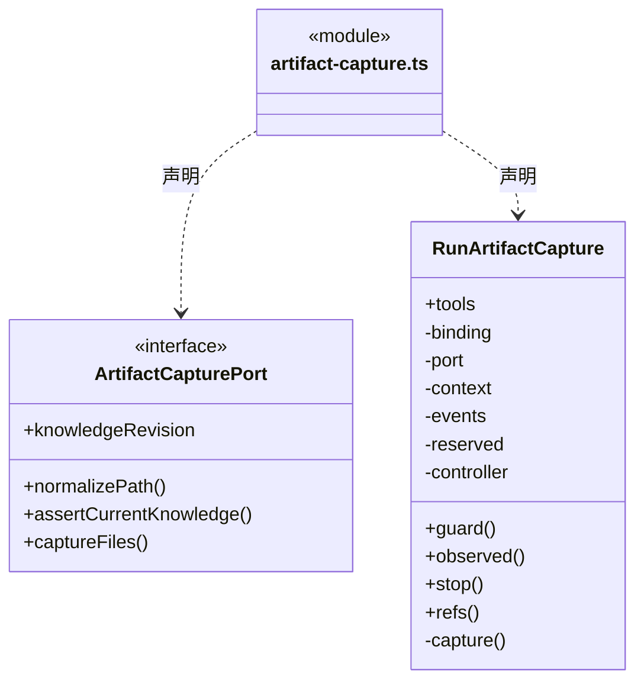

直接依赖：[../../foundation/errors.ts](../../foundation/errors.ts)、[../../evidence/artifact-tools.ts](../../evidence/artifact-tools.ts)、[../../evidence/artifact-baseline.ts](../../evidence/artifact-baseline.ts)、[../../evidence/artifact-evidence.ts](../../evidence/artifact-evidence.ts)、[../../evidence/progress.ts](../../evidence/progress.ts)、[../member-run.ts](../member-run.ts)、[../types.ts](../types.ts)。

### member-checkpoint.ts

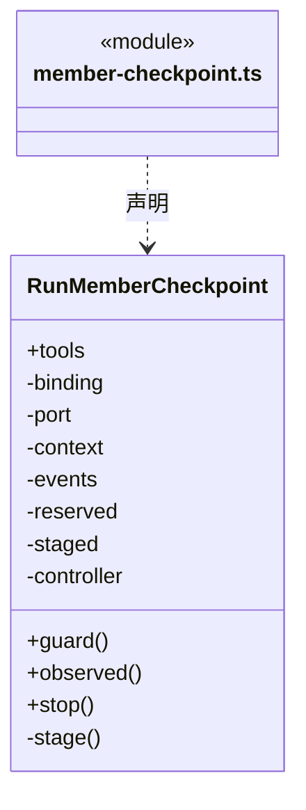

直接依赖：[../../foundation/errors.ts](../../foundation/errors.ts)、[../../tasks/member-checkpoint-tools.ts](../../tasks/member-checkpoint-tools.ts)、[../../tasks/member-checkpoint.ts](../../tasks/member-checkpoint.ts)、[../../tasks/member-checkpoint-evidence.ts](../../tasks/member-checkpoint-evidence.ts)、[../member-run.ts](../member-run.ts)、[../types.ts](../types.ts)、[artifact-capture.ts](artifact-capture.ts)、[../../evidence/progress.ts](../../evidence/progress.ts)。

### member-tool-capabilities.ts

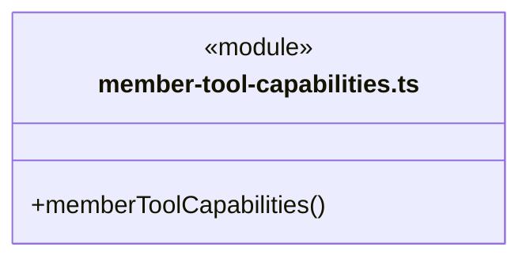

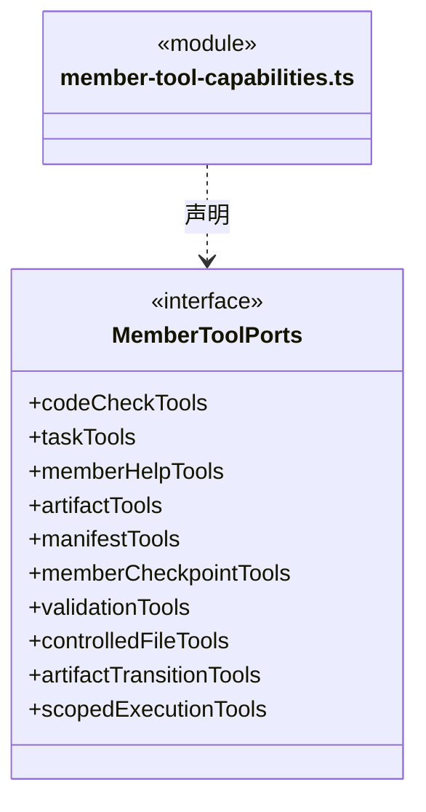

直接依赖：[../engine-tools.ts](../engine-tools.ts)、[run-code-check.ts](run-code-check.ts)、[../../evidence/progress-tools.ts](../../evidence/progress-tools.ts)、[../../tasks/member-help-tools.ts](../../tasks/member-help-tools.ts)、[../../evidence/artifact-tools.ts](../../evidence/artifact-tools.ts)、[../../evidence/output-manifest-tools.ts](../../evidence/output-manifest-tools.ts)、[../../tasks/member-checkpoint-tools.ts](../../tasks/member-checkpoint-tools.ts)、[../../evidence/validation-tools.ts](../../evidence/validation-tools.ts)、[run-controlled-file.ts](run-controlled-file.ts)、[../../file-operations/artifact-transition.ts](../../file-operations/artifact-transition.ts)、[run-scoped-execution.ts](run-scoped-execution.ts)。

### output-manifest-capture.ts

成员 1/2（同名节点为同一声明，跨图合并阅读）。

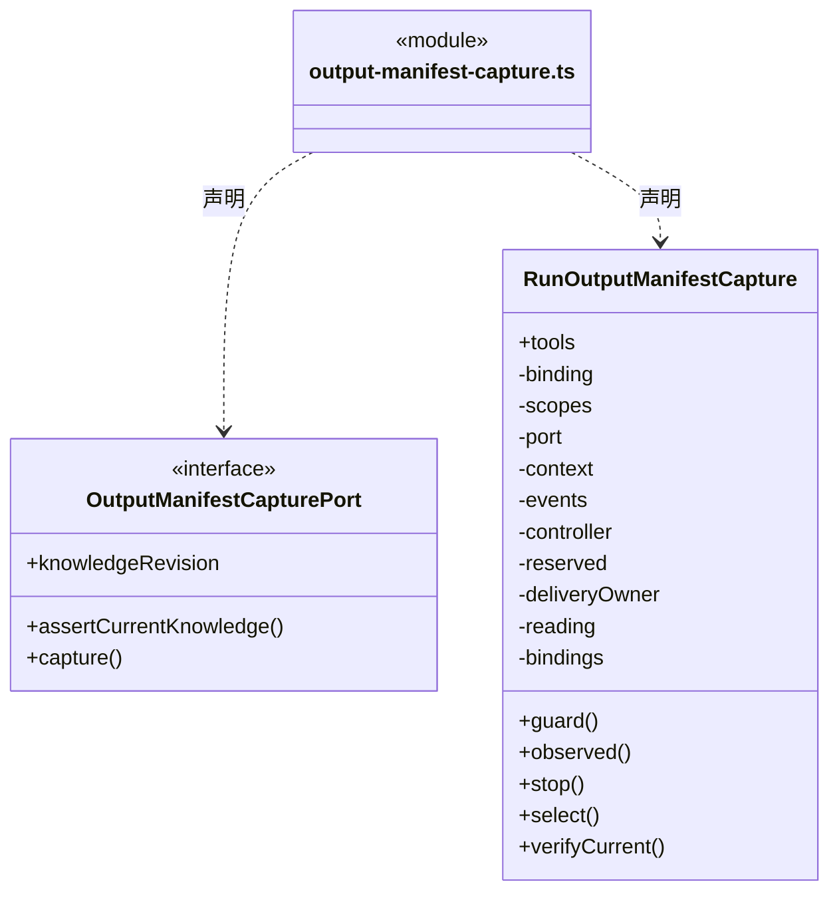

成员 2/2（同名节点为同一声明，跨图合并阅读）。

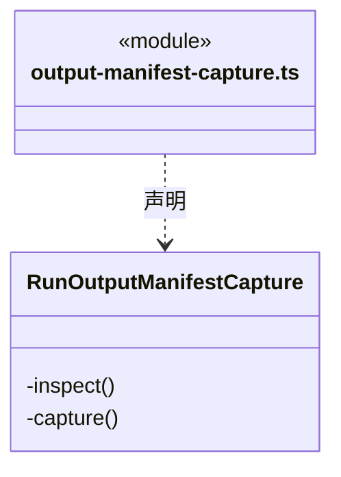

直接依赖：[../../foundation/errors.ts](../../foundation/errors.ts)、[../../workspace/artifact-scope.ts](../../workspace/artifact-scope.ts)、[../../evidence/output-manifest-tools.ts](../../evidence/output-manifest-tools.ts)、[../../evidence/output-manifest.ts](../../evidence/output-manifest.ts)、[../../evidence/complete-output-evidence.ts](../../evidence/complete-output-evidence.ts)、[../../evidence/output-manifest-evidence.ts](../../evidence/output-manifest-evidence.ts)、[../../file-operations/artifact-transition-evidence.ts](../../file-operations/artifact-transition-evidence.ts)、[../../evidence/artifact-evidence.ts](../../evidence/artifact-evidence.ts)、[../../evidence/progress.ts](../../evidence/progress.ts)、[../member-run.ts](../member-run.ts)、[../types.ts](../types.ts)。

### run-artifact-transition.ts

成员 1/2（同名节点为同一声明，跨图合并阅读）。

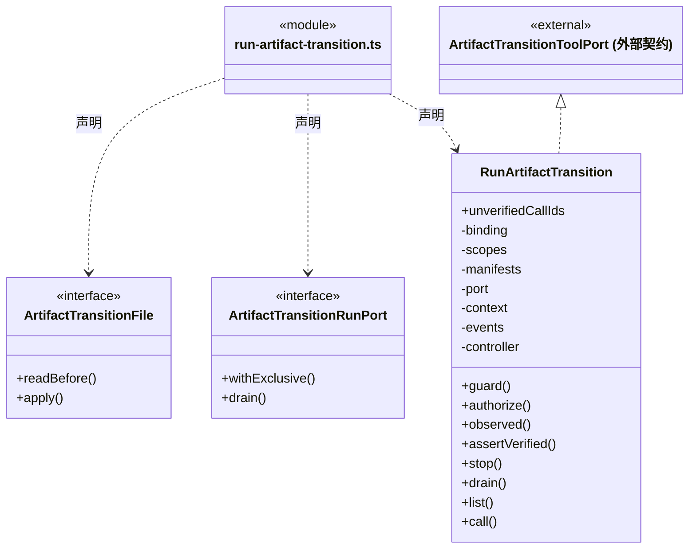

成员 2/2（同名节点为同一声明，跨图合并阅读）。

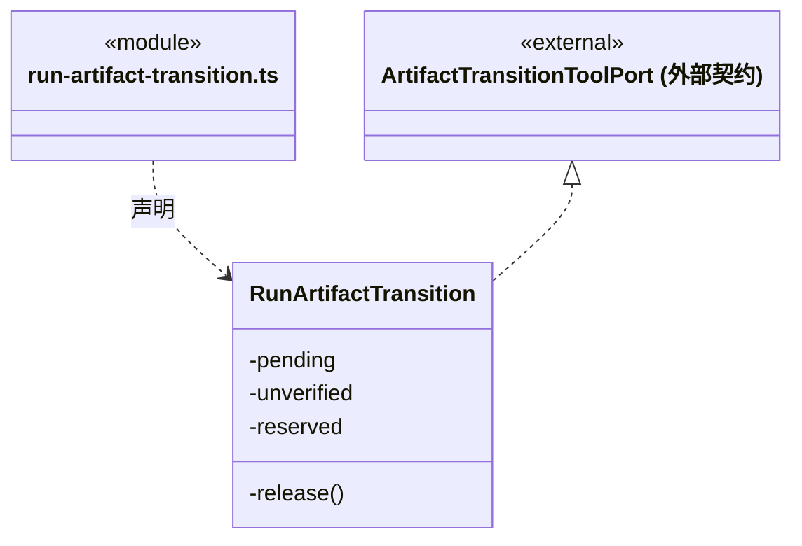

直接依赖：[../../../../foundations/utility/index.ts](../../../../foundations/utility/index.ts)、[../../foundation/serialization.ts](../../foundation/serialization.ts)、[../../foundation/errors.ts](../../foundation/errors.ts)、[../../tools/results.ts](../../tools/results.ts)、[../../workspace/artifact-scope.ts](../../workspace/artifact-scope.ts)、[../../file-operations/artifact-transition.ts](../../file-operations/artifact-transition.ts)、[../../file-operations/artifact-transition-evidence.ts](../../file-operations/artifact-transition-evidence.ts)、[../../evidence/output-manifest-evidence.ts](../../evidence/output-manifest-evidence.ts)、[../../evidence/output-manifest.ts](../../evidence/output-manifest.ts)、[output-manifest-capture.ts](output-manifest-capture.ts)、[../member-run.ts](../member-run.ts)、[../types.ts](../types.ts)。

### run-code-check.ts

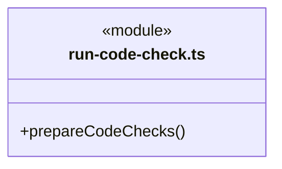

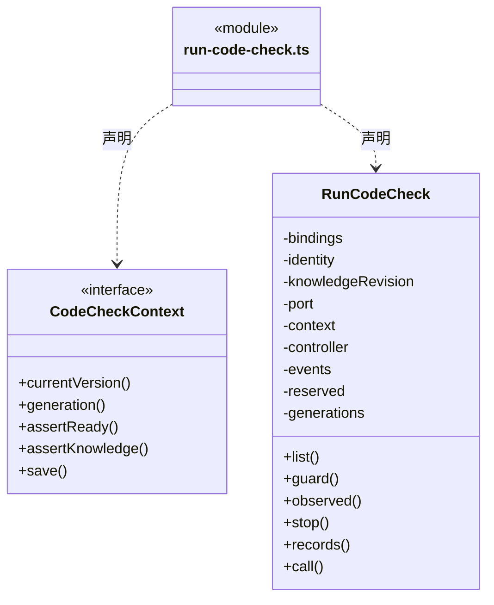

直接依赖：[../../foundation/errors.ts](../../foundation/errors.ts)、[../../workspace/code-check.ts](../../workspace/code-check.ts)、[../../workspace/artifact-scope.ts](../../workspace/artifact-scope.ts)、[../../evidence/output-manifest-evidence.ts](../../evidence/output-manifest-evidence.ts)、[../../evidence/code-check.ts](../../evidence/code-check.ts)、[../types.ts](../types.ts)。

### run-controlled-file.ts

成员 1/2（同名节点为同一声明，跨图合并阅读）。

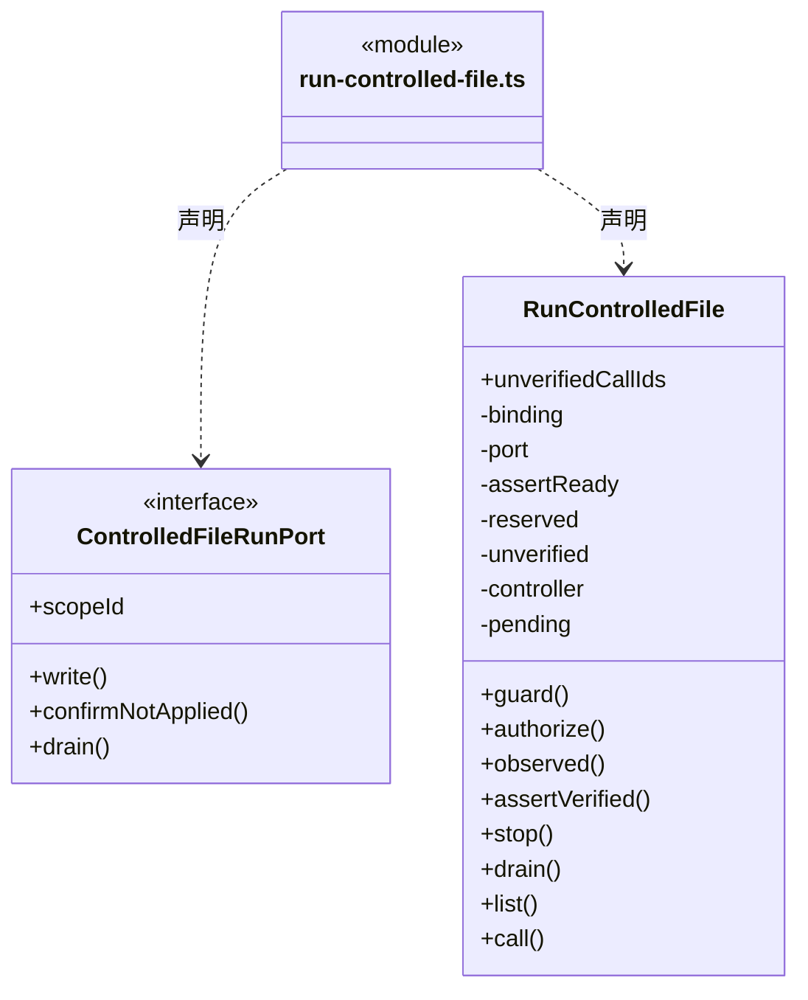

成员 2/2（同名节点为同一声明，跨图合并阅读）。

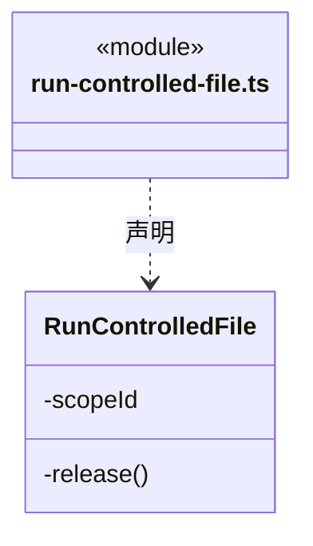

直接依赖：[../../../../foundations/utility/index.ts](../../../../foundations/utility/index.ts)、[../../foundation/serialization.ts](../../foundation/serialization.ts)、[../../foundation/errors.ts](../../foundation/errors.ts)、[../../tools/results.ts](../../tools/results.ts)、[../../file-operations/controlled-file-operation.ts](../../file-operations/controlled-file-operation.ts)、[../../file-operations/controlled-file-rules.ts](../../file-operations/controlled-file-rules.ts)。

### run-scoped-execution.ts

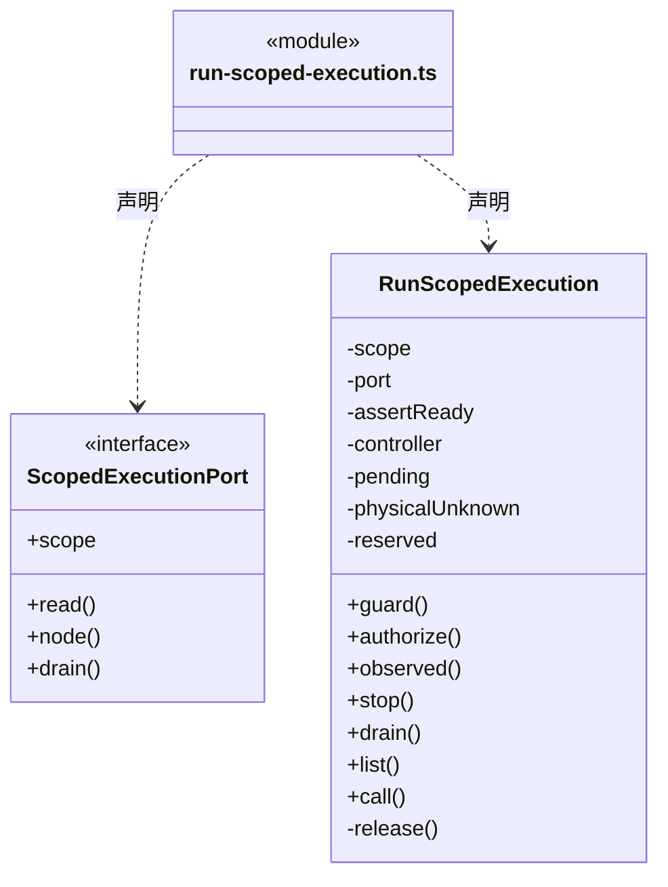

直接依赖：[../../../../foundations/utility/index.ts](../../../../foundations/utility/index.ts)、[../../foundation/serialization.ts](../../foundation/serialization.ts)、[../../foundation/errors.ts](../../foundation/errors.ts)、[../../tools/results.ts](../../tools/results.ts)、[../../file-operations/scoped-execution.ts](../../file-operations/scoped-execution.ts)、[../../workspace/execution-scope.ts](../../workspace/execution-scope.ts)、[../../file-operations/controlled-file-operation.ts](../../file-operations/controlled-file-operation.ts)、[../../file-operations/isolated-execution-recovery.ts](../../file-operations/isolated-execution-recovery.ts)。

### run-validation.ts

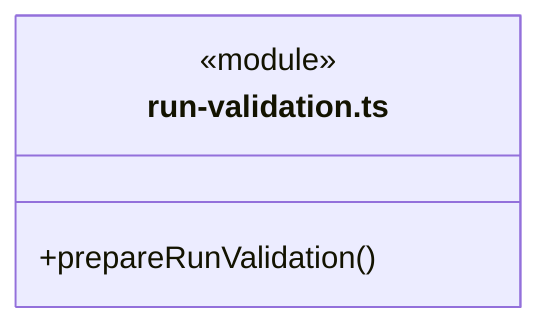

成员 1/2（同名节点为同一声明，跨图合并阅读）。

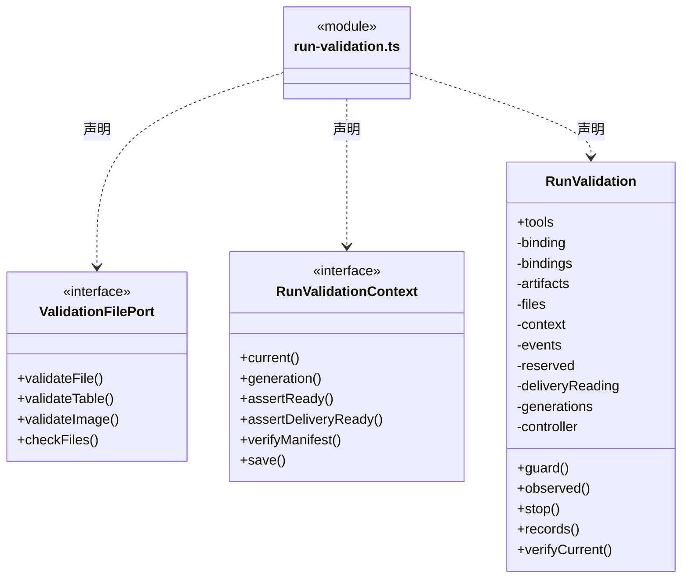

成员 2/2（同名节点为同一声明，跨图合并阅读）。

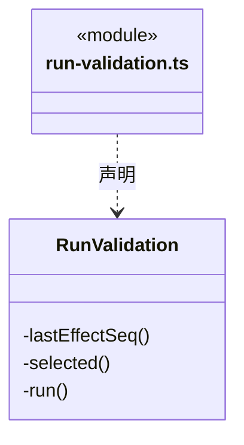

直接依赖：[../../foundation/errors.ts](../../foundation/errors.ts)、[../../workspace/json-validation-schema.ts](../../workspace/json-validation-schema.ts)、[../../workspace/csv-validation-schema.ts](../../workspace/csv-validation-schema.ts)、[../../workspace/png-validation-schema.ts](../../workspace/png-validation-schema.ts)、[../../evidence/artifact-baseline.ts](../../evidence/artifact-baseline.ts)、[../../evidence/artifact-evidence.ts](../../evidence/artifact-evidence.ts)、[../../evidence/output-manifest-evidence.ts](../../evidence/output-manifest-evidence.ts)、[../../evidence/output-manifest.ts](../../evidence/output-manifest.ts)、[../../evidence/complete-output-evidence.ts](../../evidence/complete-output-evidence.ts)、[../../workspace/artifact-scope.ts](../../workspace/artifact-scope.ts)、[../../evidence/validation.ts](../../evidence/validation.ts)、[../../evidence/validation-tools.ts](../../evidence/validation-tools.ts)、[../../evidence/validation-evidence.ts](../../evidence/validation-evidence.ts)、[../../tasks/execution-context.ts](../../tasks/execution-context.ts)、[../../evidence/progress.ts](../../evidence/progress.ts)、[artifact-capture.ts](artifact-capture.ts)、[../member-run.ts](../member-run.ts)、[../types.ts](../types.ts)。

### 本目录调用边界

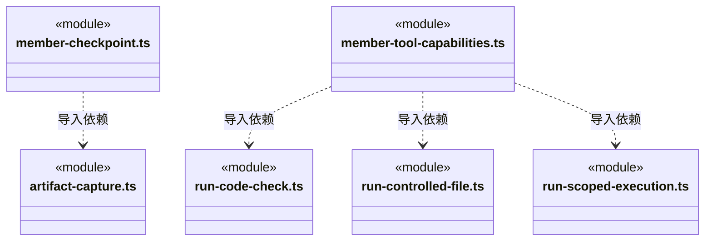

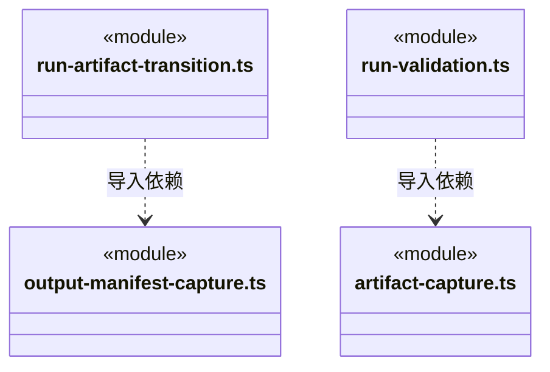

## 子目录导航

无子目录。

[返回上层](../ARCHITECTURE.md)。

每次修改本目录代码，同步维护文件头、关键契约说明及本图。未实现的治理、证据验收和自动编排能力不列入当前类图。

## 设计契约 v1 与落地范围

以下内容区分已接通能力与后续设计；以各节的实现状态为准，不将目标图当作现状图。维护源：[CONTRACT.md](CONTRACT.md)；生成类图时同步附加，勿直接修改本附录。

# 运行能力的在途与退出边界

RunControlledFile、RunScopedExecution、RunArtifactTransition 分别持有 utility.InFlightOperations，跟踪已经发出的原端口 Promise，drain 等待调用时快照。基础集合不改变一次性授权、原参数 hash、事件顺序、短门闩或 unknown 写屏障，也不接管取消控制器。

Promise settled 仅代表调用返回。三种能力继续执行各自平台 drain，保持物理退出未确认时的错误与占用；RunScopedExecution 的 physicalUnknown、受控写 confirmNotApplied、产物阶段及验收规则留在原能力。基础库不得自动重发、补偿或释放工作区租约。
