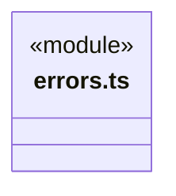
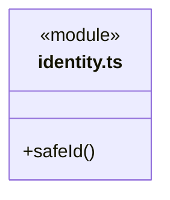
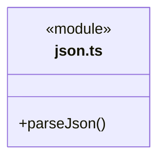
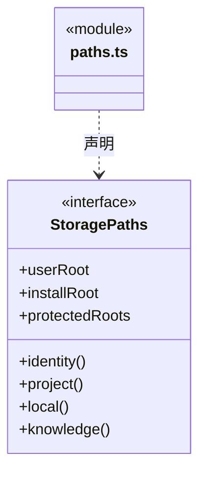
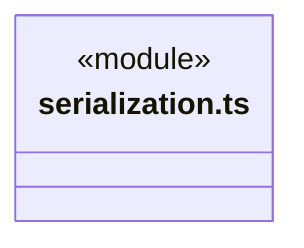
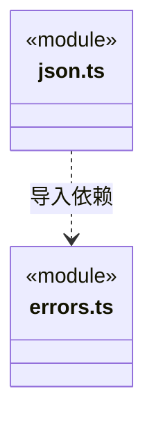

# src/backend/core/foundation 架构

## 目录定位

迁移期领域标识、路径、JSON Fault 与摘要兼容适配；算法、文件和网页基础机制已迁入共享 Core，不再包含技术子库。

本文描述当前实现。通过分析目录边界后维护的 [源码架构脚本](../../../../scripts/source-architecture.mjs) 同步清单和声明；代码变更时仍须核对职责、关键成员与关系。

## 代码清单

| 文件 | 当前职责 |
| --- | --- |
| [errors.ts](errors.ts) | 旧后端调用方使用的错误兼容出口，统一指向共享 Core。 |
| [identity.ts](identity.ts) | 运行记录路径中任务和执行标识的格式检查。 |
| [json.ts](json.ts) | 将 utility 的严格 JSON 解析事实适配为 Core 原有 JSON 错误协议。 |
| [paths.ts](paths.ts) | 工作区身份与受控路径解析端口。 |
| [serialization.ts](serialization.ts) | 后端既有 hash/json 名称的兼容适配，格式化来自共享 Core utility，摘要来自独立 Node 入口。 |

## 架构类图

### errors.ts

直接依赖：[../../../core/errors.ts](../../../core/errors.ts)。

### identity.ts

### json.ts

直接依赖：[../../../core/utility/index.ts](../../../core/utility/index.ts)、[errors.ts](errors.ts)。

### paths.ts

### serialization.ts

直接依赖：[../../../core/platform/node/digest.ts](../../../core/platform/node/digest.ts)、[../../../core/utility/index.ts](../../../core/utility/index.ts)。

### 本目录调用边界

## 子目录导航

无子目录。

[返回上层](../ARCHITECTURE.md)。

每次修改本目录代码，同步维护文件头、关键契约说明及本图。未实现的治理、证据验收和自动编排能力不列入当前类图。

## 设计契约 v1 与落地范围

以下内容区分已接通能力与后续设计；以各节的实现状态为准，不将目标图当作现状图。维护源：[CONTRACT.md](CONTRACT.md)；生成类图时同步附加，勿直接修改本附录。

# 旧后端领域约定

本目录只保留 identity、paths、JSON 错误适配及 hash/json 兼容出口。errors.ts 重导出共享 Core Fault，旧调用者仍使用同一个构造器。utility、文件和网页基础机制已迁出；新 Logic 直接消费共享 Core，不依赖本目录。

通用入口见 [utility](../../../core/utility/CONTRACT.md)、[文件](../../../core/platform/node/files/CONTRACT.md)、[网页](../../../core/platform/node/web/CONTRACT.md)。路径权限、工作区身份、事务、历史指纹和错误码策略继续归业务所有。
