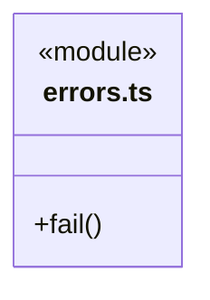
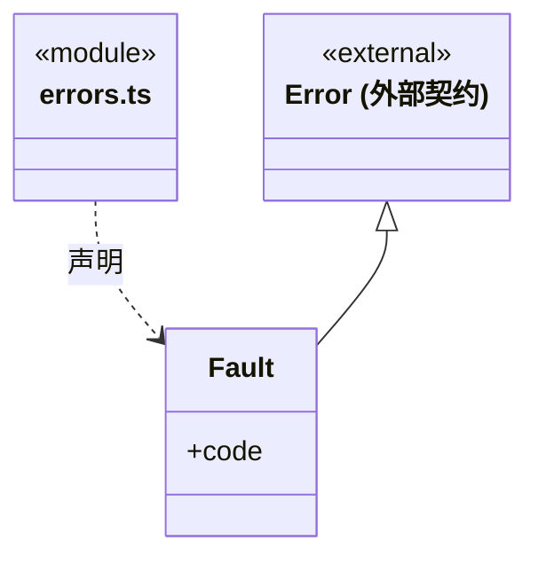
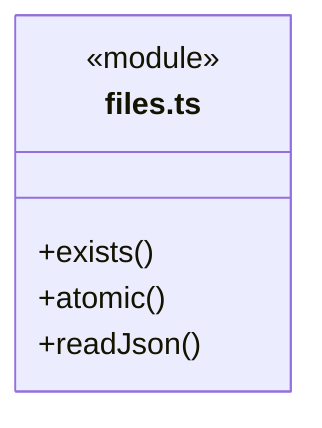
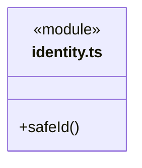
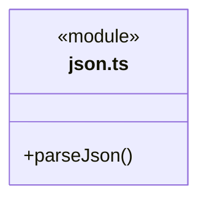
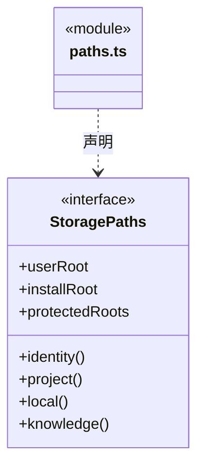
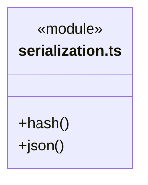
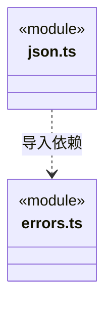

# src/backend/core/foundation 架构

## 目录定位

少量跨领域基础：错误、序列化、严格 JSON、标识及路径端口。files.ts 是 Node 文件原语，不管理应用目录、事务或账户。 StoragePaths 的可选 protectedRoots 标明安装目录之外的程序缓存，实际路径核验仍归平台。

本文描述当前实现。通过分析目录边界后维护的 [源码架构脚本](../../../../scripts/source-architecture.mjs) 同步清单和声明；代码变更时仍须核对职责、关键成员与关系。

## 代码清单

| 文件 | 当前职责 |
| --- | --- |
| [errors.ts](errors.ts) | 跨领域统一错误码与失败出口。 |
| [files.ts](files.ts) | Node 运行环境下的最小文件原语：存在检查、原子文本提交与 JSON 读取。 |
| [identity.ts](identity.ts) | 运行记录路径中任务和执行标识的格式检查。 |
| [json.ts](json.ts) | 严格 JSON 解析，拒绝重复字段与无效语法。 |
| [paths.ts](paths.ts) | 工作区身份与受控路径解析端口。 |
| [serialization.ts](serialization.ts) | 一致的内容哈希与 JSON 序列化。 |

## 架构类图

### errors.ts

### files.ts

### identity.ts

### json.ts

直接依赖：[errors.ts](errors.ts)。

### paths.ts

### serialization.ts

### 本目录调用边界

## 子目录导航

无子目录。

[返回上层](../ARCHITECTURE.md)。

每次修改本目录代码，同步维护文件头、关键契约说明及本图。未实现的治理、证据验收和自动编排能力不列入当前类图。
