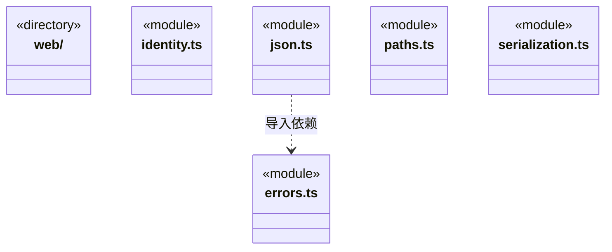
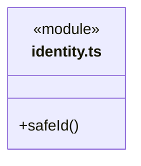
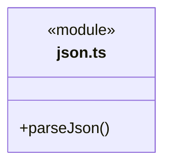

# src/backend/core/foundation 架构

## 目录定位

迁移期后端领域约定与适配：标识、路径、JSON Fault 和 hash/json 保留；errors.ts 为共享 Core Fault 的在用兼容出口。utility 与 Node files 已迁出，web 暂留原独立边界。

本文描述当前实现。通过分析目录边界后维护的 [源码架构脚本](../../../../scripts/source-architecture.mjs) 同步清单和声明；代码变更时仍须核对职责、关键成员与关系。

## 代码清单

| 文件 | 当前职责 |
| --- | --- |
| [errors.ts](errors.ts) | 旧后端调用方使用的错误兼容出口，统一指向共享 Core。 |
| [identity.ts](identity.ts) | 运行记录路径中任务和执行标识的格式检查。 |
| [json.ts](json.ts) | 将 utility 的严格 JSON 解析事实适配为 Core 原有 JSON 错误协议。 |
| [paths.ts](paths.ts) | 工作区身份与受控路径解析端口。 |
| [serialization.ts](serialization.ts) | 后端既有 hash/json 名称的兼容适配，格式化来自共享 Core utility，摘要来自独立 Node 入口。 |

## 架构类图

各图中的同名节点表示同一目录边界；跨组及完整直接依赖如下（无边不代表继承）：

- `json.ts` → `errors.ts`：导入。

### identity.ts 公开入口

### json.ts 公开入口

## 子目录导航

- [web/](web/ARCHITECTURE.md)：独立网页读取方案：安全公网 HTTP、正文提取、robots/缓存/限速与可注入浏览器兜底；Node 公共入口不加载 Electron，具体 Chromium 适配有独立入口。

[返回上层](../ARCHITECTURE.md)。

每次修改本目录代码，同步维护文件头、关键契约说明及本图。未实现的治理、证据验收和自动编排能力不列入当前类图。

## 设计契约 v1 与落地范围

以下内容区分已接通能力与后续设计；以各节的实现状态为准，不将目标图当作现状图。维护源：[CONTRACT.md](CONTRACT.md)；生成类图时同步附加，勿直接修改本附录。

# 后端公共库边界

本目录暂保留后端领域约定与适配，前后端通用机制已开始归入共享 src/core。前端可组合共享 Core，不直接引用本目录业务约定，也不经 Bridge 转发工具。

本层的错误协议、标识约束、路径端口及兼容适配仍按原行为服务业务；web 子目录尚未迁移。原 utility 已整体移出，Node 摘要归 src/core/platform/node/digest.ts，不保留旧路径转发。

web 仍是独立逻辑基础层：不依赖父目录领域约定、旧 Core 业务或上层，包含类型依赖。只使用自身及获准外部库；检查器中的 foundations 现仅标识待迁移网页子库。

本层 `errors.ts` 重导出共享 Core Fault，保持旧调用者的异常身份，`identity.ts` 定义运行标识约束，`paths.ts` 声明 StoragePaths 端口；`json.ts` 将严格解析错误适配为 JSON Fault，`serialization.ts` 保留 hash/json 兼容名称。适配单向引用 utility，utility 不知道这些领域语义。原顶层基础库入口已迁移到本目录，调用者直接使用各子库公开入口。

当前能力为 [utility](../../../core/utility/CONTRACT.md)、[files](../../../core/platform/node/files/CONTRACT.md) 与 [web](web/CONTRACT.md)。utility 收纳领域无关算法与数据结构，SerialQueue 已从原 concurrency 目录迁入；各能力按明确契约独立组织，不把业务辅助代码机械归并。调用者通过公开入口单向使用；utility 通用入口不加载 Node，Node 摘要算法使用独立入口，网页平台实现也单独加载。

utility 同时提供严格 JSON 与传入 Web 字节流的有界消费。接管 reader 不等于负责建立网络连接：地址、授权、期限、编码和业务错误仍属于消费者。Updater 仅获准组合 utility 通用入口，不能借基础层依赖权引用其他方案、Main 或业务运行时。

网页消费者是 Main 的 WebService 和桌面装配；文件原语服务 Core 知识探测及 Main 存储；utility 队列服务 Main 设置/模型，摘要和格式化经 Core 兼容出口服务现有消费者。业务层仍拥有 Agent 工具注册、用户设置、凭据、事务及来源信任标记。Core 可单向消费基础类库，但不因此获得 Main、平台装配或具体引擎的依赖权。新增消费者须核实环境；不能让基础类库反向引用消费者实现。分层检查器和每项能力的公开入口检查共同约束以上方向。

## 共性选择与退出边界

utility 的对象键递归排序保留调用方比较器及 undefined 规则；在途集合只等 Promise 快照；LF 分帧只管理文本尾部。Core/Main/Engines 组合这些能力，原历史指纹、关闭门禁、物理退出和协议限额仍由所属模块拥有。Engines 只获准 utility 通用入口，不因此获得 web 或 Node 私有实现的访问权。

文件 I/O、实例排队、摘要和固定格式化有真实消费者，契约仍应随缺陷和真实扩展验证；不因抽取一次即宣称永久稳定。JSON 的领域错误码、字段选取与 canonical 排序、运行日志失败屏障、原生文件身份校验及引擎协议差异仍由所属模块维护。不能把这些差异压成万能工具或让基础库依赖业务识别分支。

新增解决方案前须核实真实消费者、共同不变量、变化点及失败/资源语义；新增同类业务应主要组合机制并实现本地策略。文件和队列的独立单元在 `tests/unit/foundations`，公共基础能力不得依赖完整应用夹具。
