# src/backend/core/foundation/utility 架构

## 目录定位

通用工具函数与数据结构按类别内聚组织：json.ts 提供 JSON 格式化、严格解析和键排序；async.ts 提供独立实例的串行队列、在途集合及请求关联表；strings.ts 提供文本分帧与精确脱敏；bytes.ts 提供有界字节流收集；graphs.ts 提供后端无环判断。index.ts 是通用公开入口，node.ts 独立承载 SHA-256。不按函数数量拆文件，不发起文件/网络访问，不拥有业务身份、事务或权限。排序比较器与字段规则由消费者指定；Promise 快照不代表物理退出，文本帧不代表协议校验，生命周期和业务策略留在适配器。

本文描述当前实现。通过分析目录边界后维护的 [源码架构脚本](../../../../../scripts/source-architecture.mjs) 同步清单和声明；代码变更时仍须核对职责、关键成员与关系。

## 代码清单

| 文件 | 当前职责 |
| --- | --- |
| [async.ts](async.ts) | 异步执行工具，提供实例内串行队列、在途 Promise 集合与有时限的请求关联表。 |
| [bytes.ts](bytes.ts) | 字节处理工具，当前提供传入 Web ReadableStream 的有界收集。 |
| [graphs.ts](graphs.ts) | 后端有向图的纯结构算法，不认识任务、权限、等待状态或前端布局。 |
| [index.ts](index.ts) | 通用数据处理算法与实例内数据结构的公开入口，无 Node 或业务依赖。 |
| [json.ts](json.ts) | JSON 数据处理工具，集中提供格式化、严格解析和递归键排序。 |
| [node.ts](node.ts) | utility 的 Node 专属公开入口，当前提供 SHA-256 摘要。 |
| [strings.ts](strings.ts) | 字符串处理工具，提供精确文本脱敏与已解码文本的 LF 增量分帧。 |

## 架构类图

### async.ts

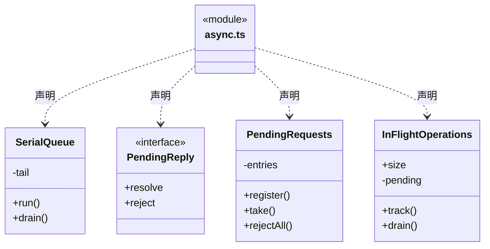

### bytes.ts

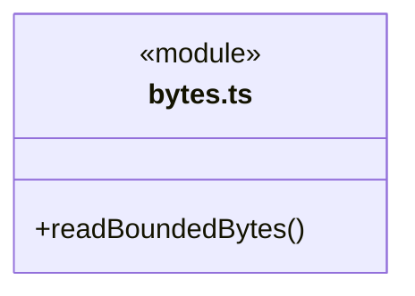

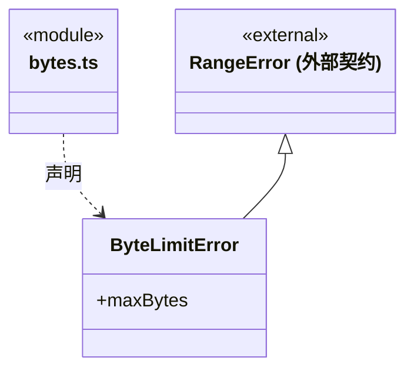

### graphs.ts

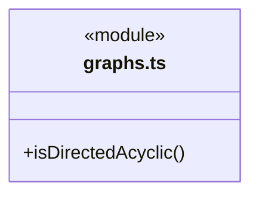

### index.ts

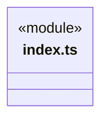
直接依赖：[json.ts](json.ts)、[async.ts](async.ts)、[bytes.ts](bytes.ts)、[strings.ts](strings.ts)、[graphs.ts](graphs.ts)。

### json.ts

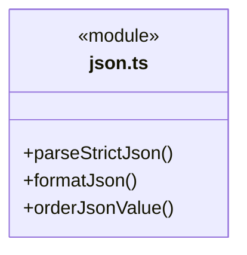

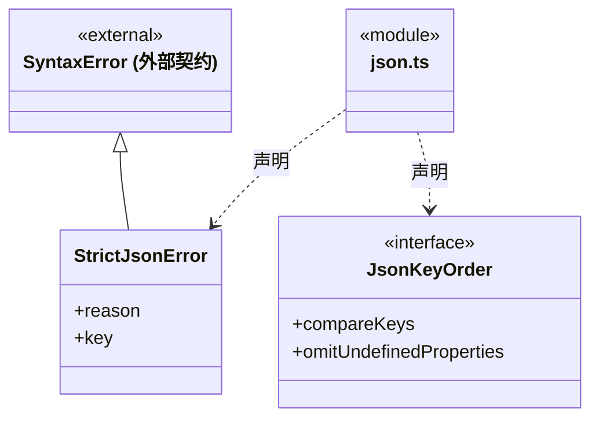

### node.ts

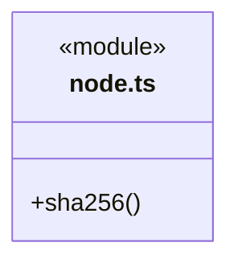

### strings.ts

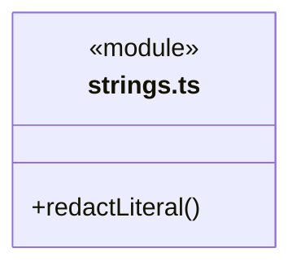

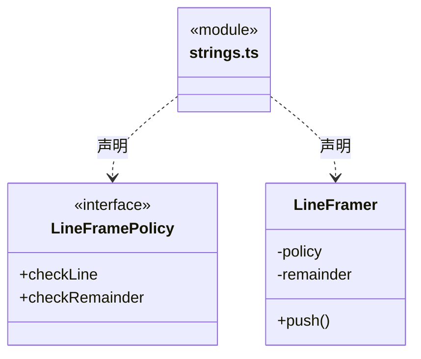

### 本目录调用边界

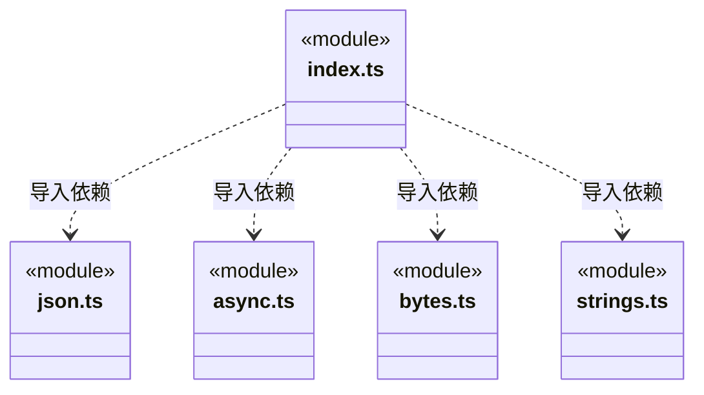

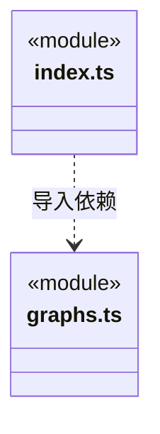

## 子目录导航

无子目录。

[返回上层](../ARCHITECTURE.md)。

每次修改本目录代码，同步维护文件头、关键契约说明及本图。未实现的治理、证据验收和自动编排能力不列入当前类图。

## 设计契约 v1 与落地范围

以下内容区分已接通能力与后续设计；以各节的实现状态为准，不将目标图当作现状图。维护源：[CONTRACT.md](CONTRACT.md)；生成类图时同步附加，勿直接修改本附录。

# 通用算法与数据结构

本目录归档于后端 core/foundation，但保持独立逻辑基础库：不导入父目录的 errors、identity、paths、json 或 serialization；业务适配单向组合本库。目录位置不赋予任何业务依赖权。

本模块提供领域无关的数据处理算法、传入字节流的有界消费及实例内执行结构，不依赖 Core、Main、Scheduler、Bridge、Frontend 或其他 foundations 能力。工具函数与数据结构按数据类别和问题种类内聚组织，具名导出，不采用一函数一文件，也不建立万能 Utility 类、全局实例或服务定位器。不发起文件/网络访问，不拥有平台进程、权限和业务事务；流消费者只接管调用者传入流的 reader。

## 入口与真实消费者

- `index.ts`：公开 `SerialQueue`、`InFlightOperations`、`PendingRequests`、`isDirectedAcyclic`、`redactLiteral`、`LineFramer`、`orderJsonValue`、`formatJson`、`readBoundedBytes`/`ByteLimitError`、`parseStrictJson`/`StrictJsonError`；使用语言/Web Streams 原语和 jsonc-parser，没有 Node 加载。
- `node.ts`：公开 `sha256`，仅依赖 `node:crypto`；调用者明确选择运行环境。
- `json.ts`：JSON 格式化、严格解析及键排序，按 JSON 数据类别合并；各算法保留自己的输入输出和失败契约，不隐式串联。
- `async.ts`：SerialQueue、InFlightOperations 和 PendingRequests，按异步协调类别合并；各类、各实例独立持有状态，执行队列与在途跟踪不互相替代。
- `strings.ts`：字符串处理，当前承载 LF 增量分帧及精确文本脱敏；`bytes.ts`：字节处理，当前承载有界流收集。文本与原始字节的计量和生命周期不同，保持分别归属。
- `graphs.ts` 提供后端有向图无环判断。上述五个类别文件是私有实现，消费者只导入公开入口。`node.ts` 直接实现 SHA-256，保持 Node 依赖隔离，不额外建立只有一项算法的转发层。
- WebSettings、BudgetSettings、AdmissionSettings、MainAgentSettings、LlmProfiles 直接组合 SerialQueue。旧 `foundations/concurrency` 目录及入口已移除。
- Core `foundation/serialization.ts` 保留 `hash/json` 名称兼容，直接重导出 utility 的算法；实现只有一份。现有知识版本、证据及配置消费者保持原调用和输出字节。该适配出口尚未退役，后续迁移须核对其真实消费者及逻辑边界，不机械批量改路径。
- Core `foundation/json.ts` 只将 StrictJsonError 转回原 JSON Fault；知识与产物验证保留原提示、字段和限制。Main 的资源仓库、GitHub 请求、网页资料，以及 Updater 的 Release 列表和小清单组合有界字节消费；URL、凭据、期限、编码、JSON 协议和错误脱敏仍由消费者负责。

## SerialQueue

每实例独立持有 Promise 尾链，同实例按 run 提交顺序串行执行。本次结果或错误原样返回，同步抛错、异步拒绝均不阻断后续任务；无重试、取消或自动关闭。

`drain` 只等待调用时的队尾，不汇总错误、不封闭队列；错误由各次 run 的调用者处理。任务内等待同队列的后续任务会自锁，禁止重入等待。业务 revision、模型短锁、当前工作区验证、写后发布顺序仍归消费者。RunJournal、IsolationRecords 的失败屏障不能用此队列替换。

## 数据算法

`formatJson` 保持原两空格缩进、末尾 LF 和 JSON.stringify 的属性顺序/异常行为；不做严格 JSON 解析或规范排序。顶层 undefined、函数、Symbol 沿兼容行为形成 `undefined\n`，不能作为有效 JSON 输入使用。调用者负责约束值，不能在抽取中暗改历史文本或指纹。

`sha256` 接受 UTF-8 字符串或 Uint8Array（含 Buffer），返回小写十六进制；字节视图不扩大到背后的整个 ArrayBuffer。业务选择哪些字段、如何序列化、是否接受摘要仍在原模块；该算法不承担验签或可信来源判断。

## 扩展与验证

### 有界字节流

`readBoundedBytes(body, {maxBytes, signal})` 仅完整成功时返回 Uint8Array。maxBytes 为非负安全整数，按字节累计，不相信 Content-Length；超限抛 ByteLimitError，流错误与 signal.reason 原样传出，null 正文为空。非法上限/预先取消在取得 reader 前拒绝，流仍由调用者持有；已接管后，失败请求一次 cancel，正常或失败均移除监听并释放 reader 锁。

取消显式唤醒挂起 read，且不等待不合作的底层 cancel Promise，避免取消自己再次挂起；清理失败不覆盖原错误。这证明本次读取不再等待，不证明网络/进程物理退出，相关屏障仍归原宿主。分块按可见视图显式复制（含 Buffer），生产者后续复用存储不改变已读取字节；最终合并的内存与字节上限同阶，不返回截断前缀。大安装包流式落盘、模型字符上限、Node 原始 HTTP 传输及其他协议不强行套用该内存收集器。

### 严格 JSON

`parseStrictJson` 保留原 jsonc-parser 行为，拒绝注释、尾逗号、无效语法和同对象重复键；转义后同名也重复，不同对象可以有同名键。StrictJsonError 分别给出 invalid-syntax、duplicate-key 与重复 key，不包含业务 code。

解析不进行危险键裁剪、Schema 校验、字段排序或大小/深度限制；资源预算、原字节身份与错误对外映射由消费者决定。远端 HTTP 的普通 JSON 解码未擅自改成严格解析，避免改变已有协议。

### 对象键递归排序

`orderJsonValue(value, policy)` 只递归复制并排序自身可枚举字符串键，比较器必须显式传入；`omitUndefinedProperties` 只决定对象 undefined 属性是否省略。数组顺序、空位和元素保持原义，整数键仍按 JS 对象枚举规则输出。只处理既有 JSON 形状快照，不验证 Schema、危险键、循环或深度，不承担序列化、摘要、身份和业务验收。

15 个 Core 适配保留四种历史组合：artifact-evidence、预算/周期运行、检查点和依赖替换/任务取消沿用 localeCompare 并省略 undefined；portable-package、dispatch-invariants 沿用 localeCompare 并保留属性；workflow-evidence、validation-evidence、scope-goal 沿用字符序并省略；output-manifest-identity、execution-context 沿用字符序并保留。最终 JSON 字节与历史指纹不升级，localeCompare 不保证跨语言环境统一。图重放/治理的手写字符串 canonical、工具失败参数及调度内部比较未整体替换；它们须另核序列化和边界，不能仅凭函数名相同统一。

### 在途操作集合

`InFlightOperations.track(promise)` 按 Promise 身份去重、原样返回，成功或失败后移除；不启动任务、不重试，不生成未处理的清理拒绝。`size` 是当前集合大小，`drain()` 等调用时快照全部 settled 后返回，后来加入的任务不延长本次等待。它不封闭集合、不取消任务、不聚合历史错误，也不证明进程退出。

ControlledFiles、ChatMaterialImports、三种 Run 能力、Codex 工具及 RPC 处理分别拥有实例。业务继续先停止接单/发出取消，再等待集合及平台 drain/真实 child exit，最后按原规则释放占用。未知写屏障、短门闩、授权和物理退出失败不因 Promise 已 settled 而解除；动态新增任务或循环排空场景不能机械替换成快照等待。

### LF 文本分帧

`LineFramer` 只持有单输入流的尾部字符串，`push` 同步依次交付 LF 终止帧（不含 LF）；不 trim、解析消息或在 EOF 交付尾部。完整帧与未终止尾部由两个显式检查函数限定，异常原样传出。检查/消费者异常停止本次处理，已交付消息不回滚，后续帧仍留在实例；回调不得重入 push。按输入字符串缓冲，无全局共享状态，不声称对传入整个 chunk 有额外内存上限。

Pi/Codex 都保留 32×1024×1024 的原限额值，但 Pi 用 UTF-16 code unit 数、完整行先去单个 CR，Codex 用 UTF-8 字节数且保留 CR；两者忽略完整空白行，尾部仍检查。错误文案、请求关联、通知顺序、超时、凭据脱敏与进程终止留在适配器，不能借公共拆行统一协议策略。

### 扩展入口

新增算法或数据结构须先给出真实用途、状态归属、输入输出、复杂度及失败语义；标准库已足够时直接使用，不为预想需求添加集合、缓存或调度框架。优先放入既有的 JSON、异步、字符串或字节类别，不按函数数量拆文件；只有出现不同变化原因、运行环境或明确独立契约边界时再拆分。类别合并不合并实例状态，也不统一不同协议的算法语义；通用入口不得导入 Node 入口。

模块单元在 `tests/unit/foundations/utility/`，按队列、集合、分帧、键排序、格式化、摘要、严格 JSON、字节流分别验证；Core 指纹/名称/字节/错误兼容、流消费业务映射及 RPC 策略另做契约测试。模块测试不加载 Application；消费者保留真实 HTTP/RPC、取消/排空、资料快照、知识校验、版本冲突和原指纹规则。

### 后端 JSON 补齐迁移

岗位登记、知识来源、负责人执行绑定、人工决定依据及调度执行上下文复用 orderJsonValue。前两项和人工依据省略对象 undefined，绑定与上下文保留；均使用字符比较器 a<b/-1、a>b/1，其余 0，不改为 localeCompare。手工拼接的 graph-reducer/module-governance 与按 Object.keys 排序后读取属性的 repeated-tool-failures 保留不同语义。调度器仅获通用 index 入口依赖，不开放 Node/files/web。

### 精确文本脱敏

strings.ts 的 redactLiteral 使用非重叠 split/join，将非空精确凭据替换为 [REDACTED]，空或 undefined 不改输入；不解释正则、大小写或 JSON 转义。Pi/Claude/Codex 为真实消费者，凭据选择、认证判断和事件编码顺序属于各引擎；不保证识别编码/变形后的凭据。

### 有时限的请求关联表

async.ts 的 PendingRequests 保存实例 ID→结算回调/定时器。register 拒绝覆盖重复 ID，take 移除并清计时器，未知 ID 无副作用；rejectAll 按登记顺序拒绝并清理，可传错误工厂保留每请求独立错误身份，表不封闭。调用方使用不抛错的 Promise resolve/reject。超时回调仍决定单项或整体失败；计时器触发不自动删除项，须由适配器 take/rejectAll。表不创建协议 ID、发送、重试、杀进程或确认退出。

### 后端有向图校验

graphs.ts 的 isDirectedAcyclic 对唯一节点、完整端点执行无环判断；重复节点或缺端点抛错，自环返回 false，平行边逐条处理，空图为 true。Core 图规则已先校验节点和端点，用它分别核验派发/依赖图与等待图，领域边选择及 GRAPH_CYCLE/GRAPH_WAIT_CYCLE 保留。此实现不依赖前端，也不提供授权或任务可执行保证。
