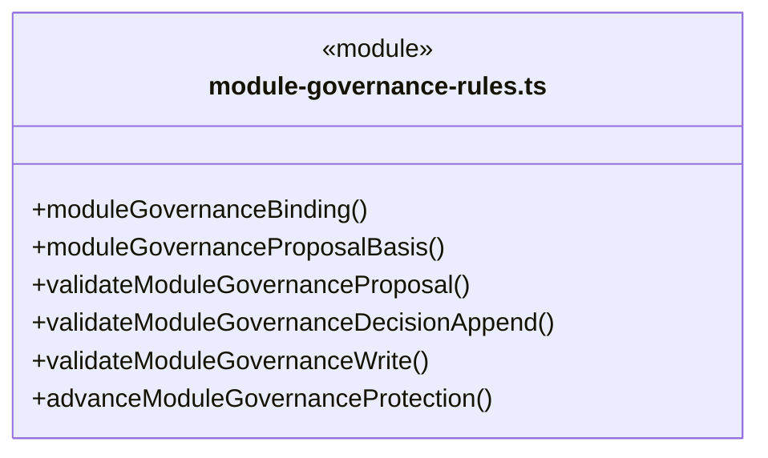
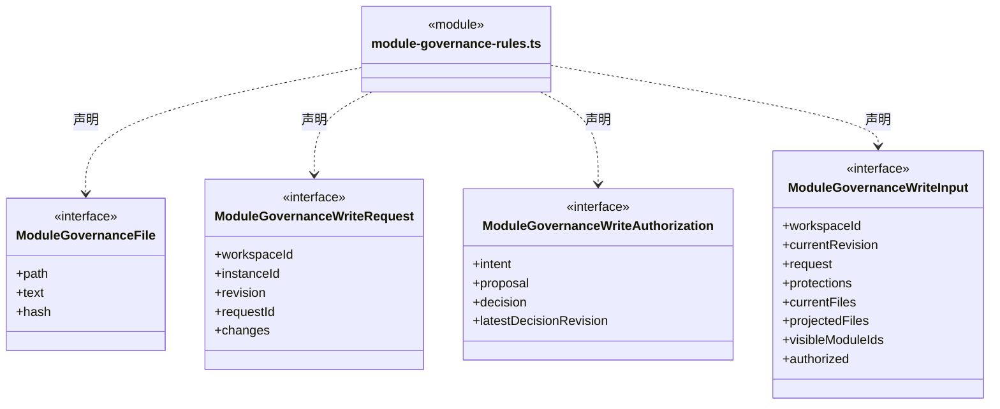
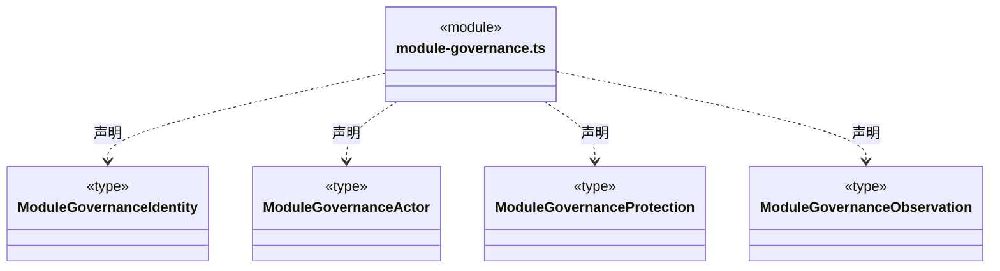
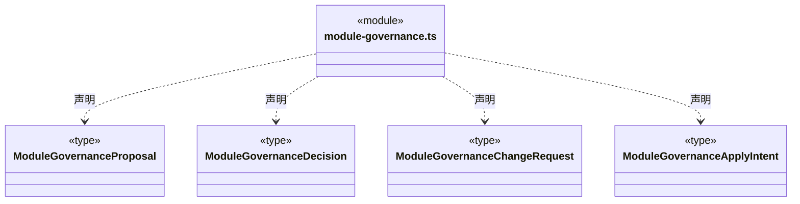
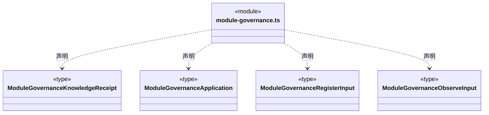
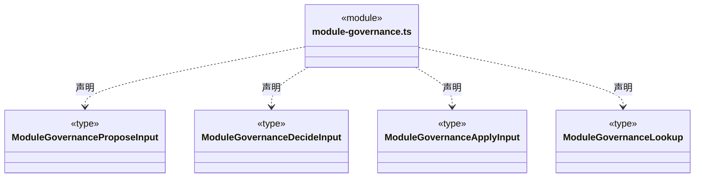
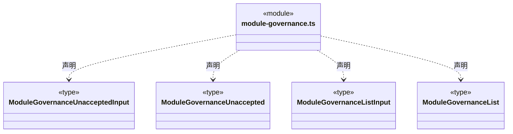
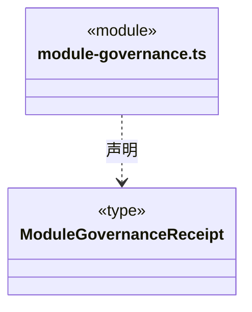
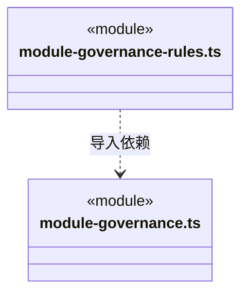

# src/backend/core/governance 架构

## 目录定位

模块知识治理的纯协议和保护规则。观察、提案、人工决定与真实实施分开；不持有存储、模型或 IPC，不把知识结构验证当业务验收。

本文描述当前实现。通过分析目录边界后维护的 [源码架构脚本](../../../../scripts/source-architecture.mjs) 同步清单和声明；代码变更时仍须核对职责、关键成员与关系。

## 代码清单

| 文件 | 当前职责 |
| --- | --- |
| [module-governance-rules.ts](module-governance-rules.ts) | 模块知识治理的纯事实投影、提案依据、决定追加和知识写入门禁。 |
| [module-governance.ts](module-governance.ts) | 单个 Module 正式知识治理的严格输入、不可变提案、本机决定及实施回执协议。 |

## 架构类图

### module-governance-rules.ts

直接依赖：[../foundation/serialization.ts](../foundation/serialization.ts)、[../foundation/errors.ts](../foundation/errors.ts)、[module-governance.ts](module-governance.ts)。

### module-governance.ts

### 本目录调用边界

## 子目录导航

无子目录。

[返回上层](../ARCHITECTURE.md)。

每次修改本目录代码，同步维护文件头、关键契约说明及本图。未实现的治理、证据验收和自动编排能力不列入当前类图。

## 设计契约 v1 与落地范围

以下内容区分已接通能力与后续设计；以各节的实现状态为准，不将目标图当作现状图。维护源：[CONTRACT.md](CONTRACT.md)；生成类图时同步附加，勿直接修改本附录。

### 模块正式知识治理的纯领域边界

本目录保存工作区级 Module 知识治理的严格协议和纯保护规则，不持有存储、网络、模型、运行租约或 Electron 身份。其依赖只指向 Core 基础能力；知识存储通过结构兼容的文件/请求快照调用规则，避免知识端口与治理实现互相引用。静态保护和治理历史属于工作区，不创建主会话、执行成员或派发节点。

`module-governance.ts` 区分登记、观察、不可变提案、版本化决定和独立实施。请求固定 workspaceId、instanceId 与 commandId，不接受任意知识路径、actor、permit 或批准证明。现行 `design/business/module.schema.json` 将 overview 固定为 `module.md`；规则仍解析实际 `module.json` 并核对 id/overview，不仅凭路径存在猜测 Module。正文使用跨前后端的 UTF-8 字节长度检查，沿用单文件 2 MiB 上限。

保护记录绑定真实 definition 与 overview 的路径/哈希。用户逐个明确登记，不自动冻结全部项目。初始登记历史不改写；保护 revision 和当前 overview 哈希只能由已经核实治理关联的 committed 知识 journal 派生。首片没有修改 definition、移动、删除、解除保护或切换正文绑定的入口。

观察保存当时知识/保护版本、真实文件指纹、overview 原文和确定性知识校验；statement 是操作者解释，不作为程序验收。提案仅接收 newOverviewText，before/after 正文保存一次并派生差异；理由、替代方案、不变量和回退说明进入固定 basis。修改方案必须建立新提案；时钟不参与 basis，方案正文或理由变化会改变依据。目录只返回观察/提案摘要，明确 observationId/proposalId 后才展开对应正文，避免一次读出全部历史正文。

### 决定、实施与原请求核实

`approve/reject/defer` 按同一提案的独立 revision 连续追加，后续决定引用前一条；旧意见保留，不因批准而自动实施。驳回/暂缓须说明原因，暂缓另记录复查条件。可信 IPC 注入 `local_desktop/explicit_submit`，表示本机明确提交，不证明已认证账户或正式维护人身份。每个提案最多 128 条决定；持久账本另负责工作区总量和跨操作命令唯一性。

`ModuleGovernanceApplyIntent` 冻结原 ChangeRequest、指纹、提案、决定和保护身份，requestId 与 intentId 相同。意图不是提交成功。公开 application 区分 pending、not_applied、rolled_back、recovery_required、committed；只有 committed 带真实知识回执。not_applied 只能由原实例退役且同串行边界确认原 journal 完全不存在派生，不能把正在处理或单次查询无结果叫作未实施。跨重开查询保留原身份，不自动换实例重发。

`unaccepted` 仅表达可信服务已核实原实例退役且没有原命令、意图或 journal；缺少普通回执不构成该证明。普通查询和 Schema 校验均不启动执行、不修复知识、不补造 journal，也不签发继续业务工作的许可。

### 共用提交门禁

`moduleGovernanceBinding` 从真实文件快照和完整校验派生的可见模块 ID 核对路径、哈希与绑定。`validateModuleGovernanceProposal` 把提案严格绑定同一观察及保护版本，防止用新版本搭配旧正文；`validateModuleGovernanceDecisionAppend` 核实单提案历史连续性和唯一决定身份。

`validateModuleGovernanceWrite` 必须在原知识提交串行边界消费真实 current/projected 快照、原请求与完整 projected 可见模块集合。普通知识写没有 authorized；正文、定义变化或删除、移动、更换绑定均不能绕过保护，`.cbimignore` 也不能保持文件不变却把受保护模块从派生索引隐藏。已发生的外部改动保持 GOVERNANCE_DRIFT，不由一次普通提交或文字批准追认；未登记对象及正常无关修改保持原知识流程。

专属 authorized 只由持锁的可信存储加载真实私有意图、提案和最新决定。规则再次核对工作区、知识/保护版本、批准依据、完整原请求指纹及唯一 overview 差异；其他正文不可夹带，仅允许既有知识服务生成两个派生注册索引。批准一个 Module 不授权另一个 Module。`advanceModuleGovernanceProtection` 仅在调用方已经核实 journal 的治理关联后推导下一正文基线，普通知识回执或 pending 意图不能单独作为来源。

规则不会替代完整知识结构校验、原事务回滚/恢复或真实 journal 核实。Schema 合格、结构合格、批准、已提交和业务验收是不同事实；本片只核实精确知识实施，业务迁移、专业语义验证、账户认证及模型治理工具不在本目录承诺范围内。
