# src/backend/core/knowledge 架构

## 目录定位

知识快照、校验、领域查询、对象变更和可移植静态包规划。私有v2计划冻结有序操作与整包替换范围，公共变更不能提供来源证明；物理事务与缓存经端口注入。团队能力可独立复用，业务模板必须完整，不携带动态成员或任务。 产品反馈 Skill 只读发布两套上下文格式，不包含 GitHub 创建接口。 SourceSnapshotReader 只提供知识队列外层的同版快照，调用方不得在任务事务内反向获取。 原知识工具和事务观察共用实际输入解析，纯摘要区分未查到、持久阶段及不可核实，不返回正文或私有路径。

本文描述当前实现。通过分析目录边界后维护的 [源码架构脚本](../../../../scripts/source-architecture.mjs) 同步清单和声明；代码变更时仍须核对职责、关键成员与关系。

## 代码清单

| 文件 | 当前职责 |
| --- | --- |
| [builtins.ts](builtins.ts) | Builtins：白名单发布内置 Skill、规范和 Schema，包括 BUG 反馈与需求许愿的上下文收集流程。 |
| [knowledge-queries.ts](knowledge-queries.ts) | 核心知识查询门面，装配团队与业务工作区领域视图并刷新索引。 |
| [knowledge-write-input.ts](knowledge-write-input.ts) | 知识提交工具与后端原事务核实共用的输入解析和原引用构造。 |
| [knowledge-write-observation.ts](knowledge-write-observation.ts) | 原知识事务的有界公开观察协议，供后端与界面共同校验，只有纯 Schema 依赖。 |
| [knowledge.ts](knowledge.ts) | Core 知识规则：校验领域结构、人员与显式模块维护关系，并派生注册索引。 |
| [object-crud.ts](object-crud.ts) | Core 对象治理：规划 Agent/Module/Skill/Workflow 变更，按计划提交受控事务。 |
| [object-storage.ts](object-storage.ts) | 对象 CRUD 所需的目录检查、预览计划存储和空目录清理端口。 |
| [planned-commit.ts](planned-commit.ts) | 对象与资源包私有提交计划的不可变协议，供领域规划和本机固定目录加载共用。 |
| [portable-package.ts](portable-package.ts) | 把工作区静态团队能力或完整业务架构转为可复用资源包，并纯计算目标知识变更。 |
| [ports.ts](ports.ts) | 核心知识领域需要的工作区存取与事务接口。 |
| [snapshot.ts](snapshot.ts) | 已校验知识快照的版本信息、定义读取和受限正文引用解析。 |
| [tool-output-base.ts](tool-output-base.ts) | 知识工具的身份、文件、校验与快照输出协议，供注册边界及具体查询协议复用。 |
| [tool-output-builtins.ts](tool-output-builtins.ts) | 内置资料目录、正文以及 Skill 别名工具共享的业务输出协议。 |
| [tool-output-queries.ts](tool-output-queries.ts) | 团队、模块、人员注册表与详情的纯业务输出协议。 |
| [tool-output-transactions.ts](tool-output-transactions.ts) | 知识预览、提交、刷新及实例内维护任务的业务输出协议。 |
| [types.ts](types.ts) | 知识快照、校验与事务的数据契约，维护任务与业务任务分开。 |

## 架构类图

### builtins.ts

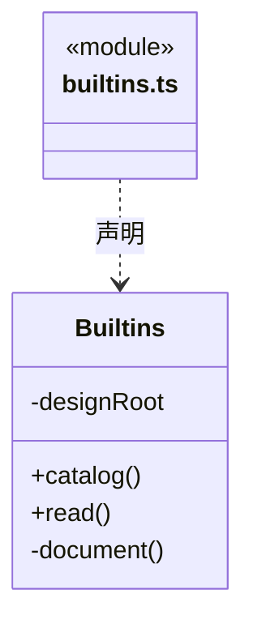

直接依赖：[../foundation/errors.ts](../foundation/errors.ts)、[../foundation/serialization.ts](../foundation/serialization.ts)。

### knowledge-queries.ts

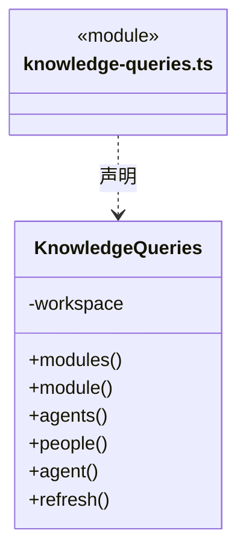

直接依赖：[../foundation/errors.ts](../foundation/errors.ts)、[knowledge-write-input.ts](knowledge-write-input.ts)、[ports.ts](ports.ts)、[snapshot.ts](snapshot.ts)、[../team/model.ts](../team/model.ts)、[../workspace/model.ts](../workspace/model.ts)。

### knowledge-write-input.ts

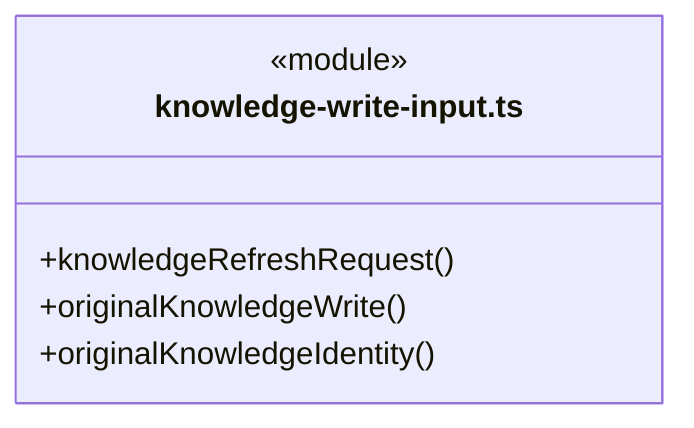

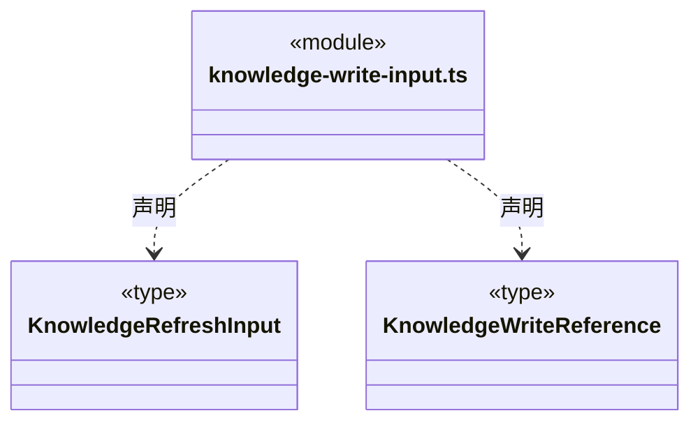

直接依赖：[planned-commit.ts](planned-commit.ts)、[types.ts](types.ts)。

### knowledge-write-observation.ts

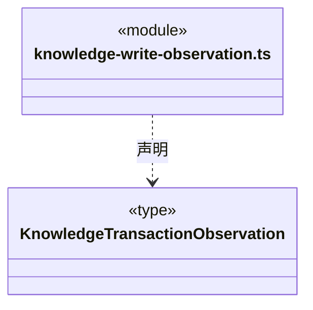


### knowledge.ts

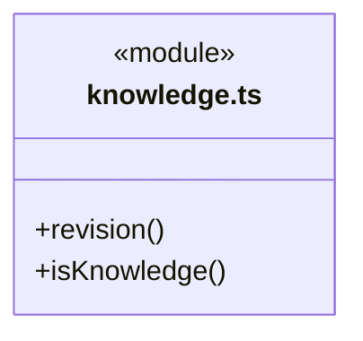

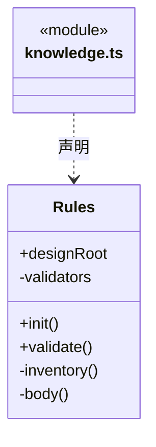

直接依赖：[../connectors/registry.ts](../connectors/registry.ts)、[../foundation/serialization.ts](../foundation/serialization.ts)、[../foundation/files.ts](../foundation/files.ts)、[../workspace/workflow-contract.ts](../workspace/workflow-contract.ts)、[types.ts](types.ts)、[../foundation/json.ts](../foundation/json.ts)。

### object-crud.ts

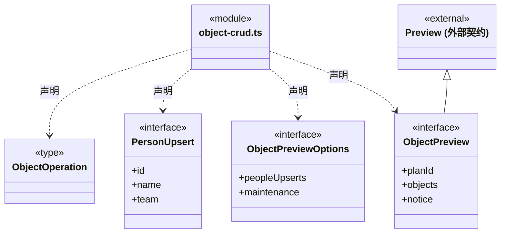

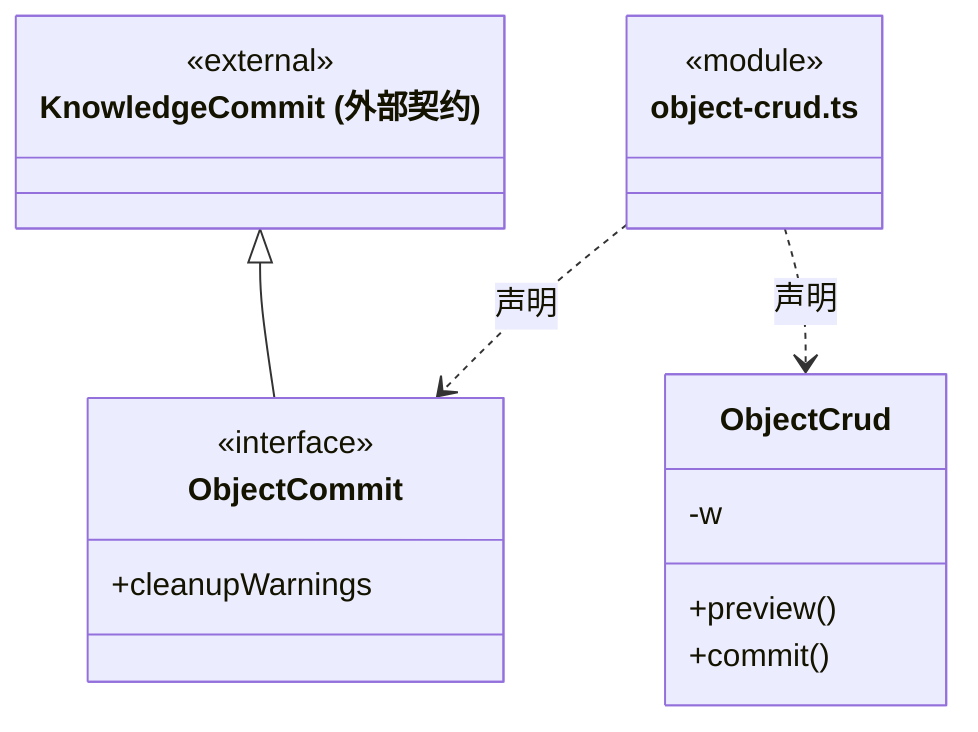

直接依赖：[ports.ts](ports.ts)、[../foundation/errors.ts](../foundation/errors.ts)、[../foundation/serialization.ts](../foundation/serialization.ts)、[knowledge.ts](knowledge.ts)、[../foundation/json.ts](../foundation/json.ts)、[types.ts](types.ts)、[../workspace/maintenance.ts](../workspace/maintenance.ts)、[../workspace/workflow-contract.ts](../workspace/workflow-contract.ts)、[planned-commit.ts](planned-commit.ts)。

### object-storage.ts

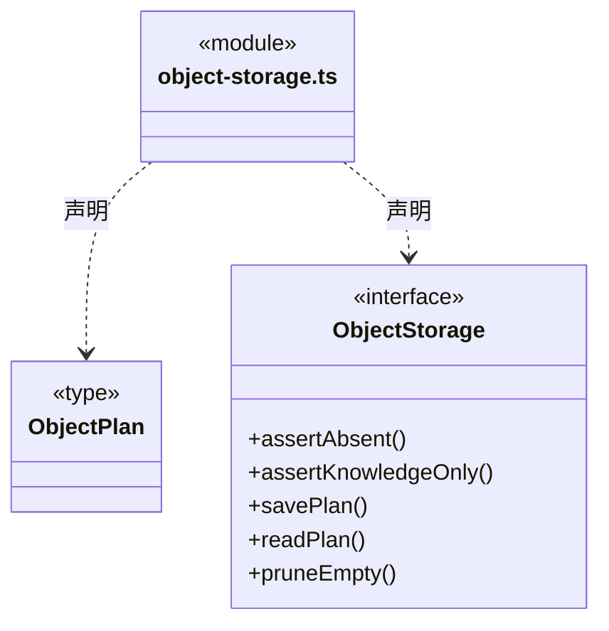

直接依赖：[types.ts](types.ts)、[planned-commit.ts](planned-commit.ts)。

### planned-commit.ts

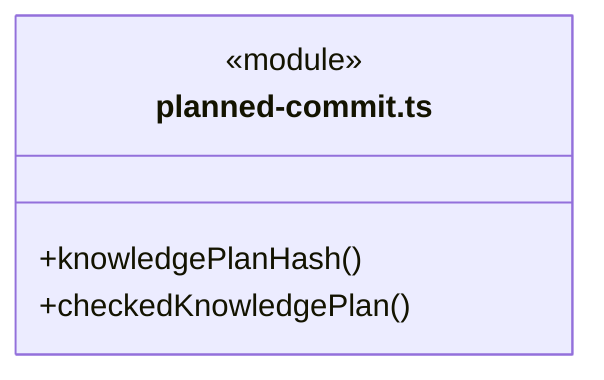

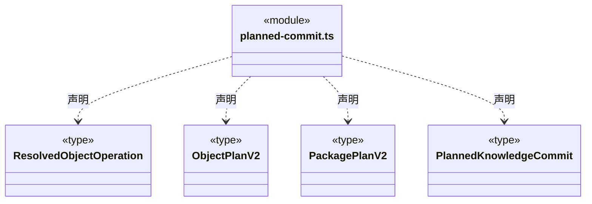

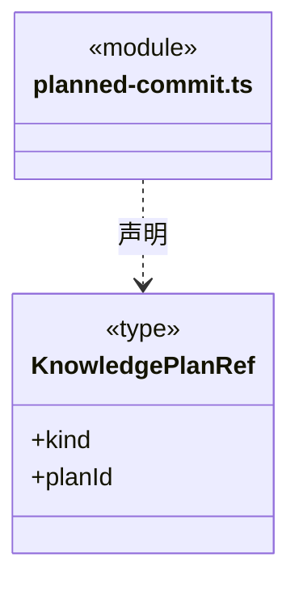

直接依赖：[../foundation/serialization.ts](../foundation/serialization.ts)、[../foundation/errors.ts](../foundation/errors.ts)。

### portable-package.ts

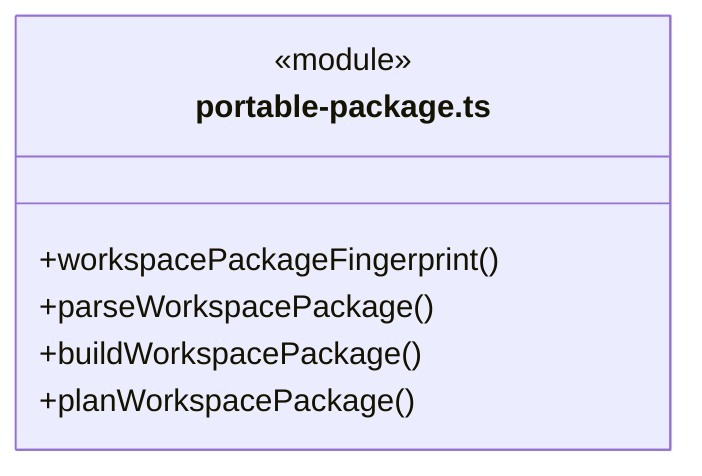

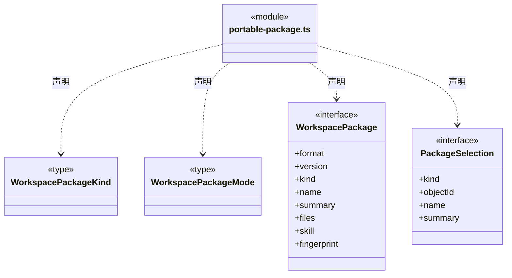

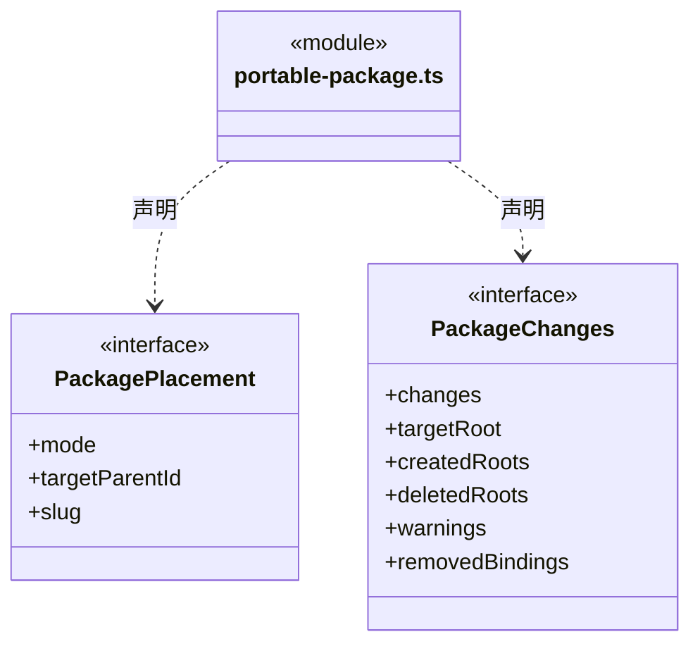

直接依赖：[../foundation/serialization.ts](../foundation/serialization.ts)、[../foundation/json.ts](../foundation/json.ts)、[../foundation/errors.ts](../foundation/errors.ts)、[../workspace/workflow-contract.ts](../workspace/workflow-contract.ts)、[knowledge.ts](knowledge.ts)、[types.ts](types.ts)。

### ports.ts

成员 1/2（同名节点为同一声明，跨图合并阅读）。

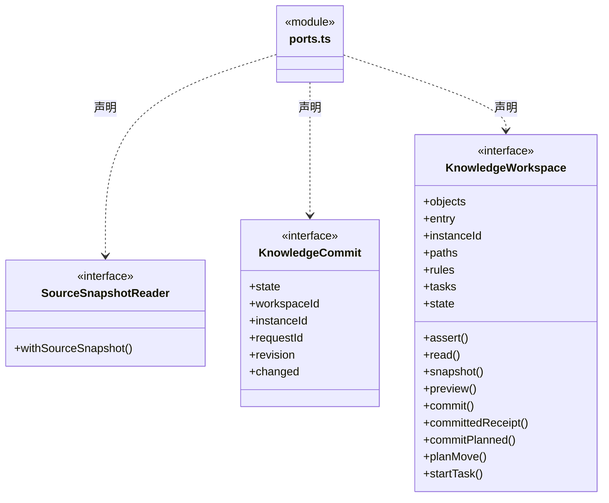

成员 2/2（同名节点为同一声明，跨图合并阅读）。

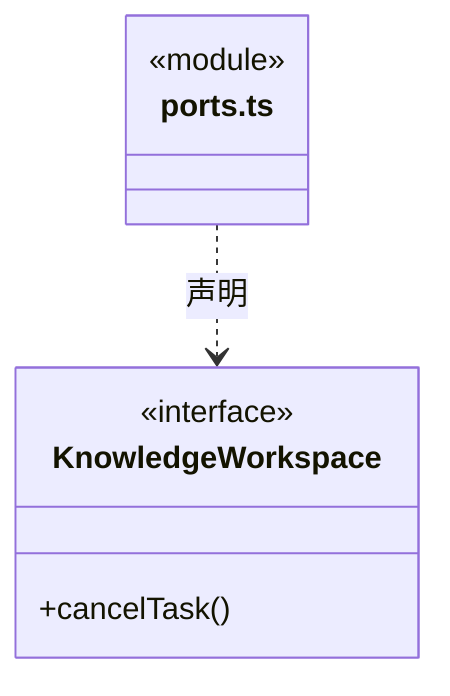

直接依赖：[../foundation/paths.ts](../foundation/paths.ts)、[types.ts](types.ts)、[object-storage.ts](object-storage.ts)、[planned-commit.ts](planned-commit.ts)。

### snapshot.ts

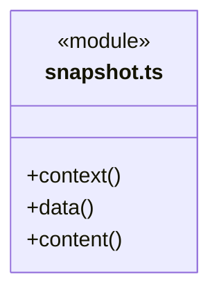

直接依赖：[../foundation/errors.ts](../foundation/errors.ts)、[../foundation/json.ts](../foundation/json.ts)、[types.ts](types.ts)。

### tool-output-base.ts

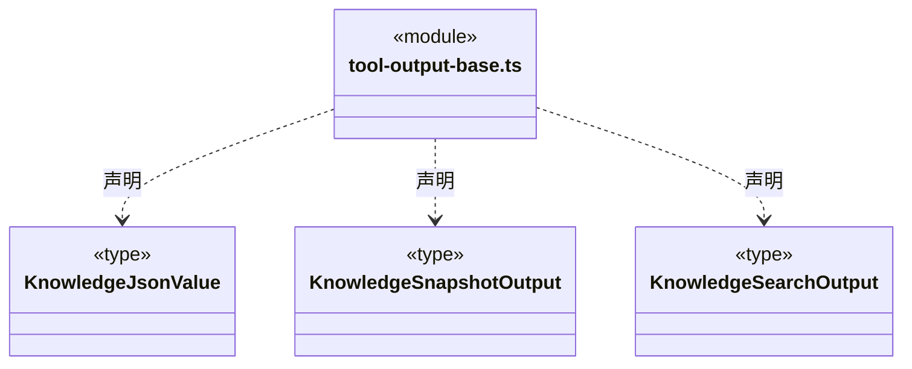


### tool-output-builtins.ts

```mermaid
classDiagram
class N_src_backend_core_knowledge_tool_output_builtins_ts["tool-output-builtins.ts"] {
  <<module>>
}
class N_src_backend_core_knowledge_tool_output_builtins_ts_BuiltinCatalogOutput["BuiltinCatalogOutput"] {
  <<type>>

}
N_src_backend_core_knowledge_tool_output_builtins_ts ..> N_src_backend_core_knowledge_tool_output_builtins_ts_BuiltinCatalogOutput : 声明
class N_src_backend_core_knowledge_tool_output_builtins_ts_BuiltinReadOutput["BuiltinReadOutput"] {
  <<type>>

}
N_src_backend_core_knowledge_tool_output_builtins_ts ..> N_src_backend_core_knowledge_tool_output_builtins_ts_BuiltinReadOutput : 声明
```

直接依赖：[tool-output-base.ts](tool-output-base.ts)。

### tool-output-queries.ts

```mermaid
classDiagram
class N_src_backend_core_knowledge_tool_output_queries_ts["tool-output-queries.ts"] {
  <<module>>
}
class N_src_backend_core_knowledge_tool_output_queries_ts_ModuleGetOutput["ModuleGetOutput"] {
  <<type>>

}
N_src_backend_core_knowledge_tool_output_queries_ts ..> N_src_backend_core_knowledge_tool_output_queries_ts_ModuleGetOutput : 声明
class N_src_backend_core_knowledge_tool_output_queries_ts_AgentGetOutput["AgentGetOutput"] {
  <<type>>

}
N_src_backend_core_knowledge_tool_output_queries_ts ..> N_src_backend_core_knowledge_tool_output_queries_ts_AgentGetOutput : 声明
```

直接依赖：[tool-output-base.ts](tool-output-base.ts)。

### tool-output-transactions.ts

```mermaid
classDiagram
class N_src_backend_core_knowledge_tool_output_transactions_ts["tool-output-transactions.ts"] {
  <<module>>
}
class N_src_backend_core_knowledge_tool_output_transactions_ts_KnowledgePreviewOutput["KnowledgePreviewOutput"] {
  <<type>>

}
N_src_backend_core_knowledge_tool_output_transactions_ts ..> N_src_backend_core_knowledge_tool_output_transactions_ts_KnowledgePreviewOutput : 声明
class N_src_backend_core_knowledge_tool_output_transactions_ts_KnowledgeCommitOutput["KnowledgeCommitOutput"] {
  <<type>>

}
N_src_backend_core_knowledge_tool_output_transactions_ts ..> N_src_backend_core_knowledge_tool_output_transactions_ts_KnowledgeCommitOutput : 声明
class N_src_backend_core_knowledge_tool_output_transactions_ts_MaintenanceTaskOutput["MaintenanceTaskOutput"] {
  <<type>>

}
N_src_backend_core_knowledge_tool_output_transactions_ts ..> N_src_backend_core_knowledge_tool_output_transactions_ts_MaintenanceTaskOutput : 声明
```

直接依赖：[tool-output-base.ts](tool-output-base.ts)。

### types.ts

```mermaid
classDiagram
class N_src_backend_core_knowledge_types_ts["types.ts"] {
  <<module>>
}
class N_src_backend_core_knowledge_types_ts_TaskView["TaskView"] {
  <<interface>>
  +id
  +workspaceId
  +name
  +state
  +progress
  +result
  +error
}
N_src_backend_core_knowledge_types_ts ..> N_src_backend_core_knowledge_types_ts_TaskView : 声明
class N_src_backend_core_knowledge_types_ts_KnowledgeFile["KnowledgeFile"] {
  <<interface>>
  +path
  +text
  +hash
}
N_src_backend_core_knowledge_types_ts ..> N_src_backend_core_knowledge_types_ts_KnowledgeFile : 声明
class N_src_backend_core_knowledge_types_ts_Change["Change"] {
  <<interface>>
  +path
  +text
}
N_src_backend_core_knowledge_types_ts ..> N_src_backend_core_knowledge_types_ts_Change : 声明
class N_src_backend_core_knowledge_types_ts_ChangeRequest["ChangeRequest"] {
  <<interface>>
  +workspaceId
  +instanceId
  +revision
  +requestId
  +changes
}
N_src_backend_core_knowledge_types_ts ..> N_src_backend_core_knowledge_types_ts_ChangeRequest : 声明
```

```mermaid
classDiagram
class N_src_backend_core_knowledge_types_ts["types.ts"] {
  <<module>>
}
class N_src_backend_core_knowledge_types_ts_Issue["Issue"] {
  <<interface>>
  +severity
  +code
  +message
  +path
}
N_src_backend_core_knowledge_types_ts ..> N_src_backend_core_knowledge_types_ts_Issue : 声明
class N_src_backend_core_knowledge_types_ts_Validation["Validation"] {
  <<interface>>
  +issues
  +indexes
  +tree
  +skills
  +structural
  +architecture
  +business
}
N_src_backend_core_knowledge_types_ts ..> N_src_backend_core_knowledge_types_ts_Validation : 声明
class N_src_backend_core_knowledge_types_ts_ModuleNode["ModuleNode"] {
  <<interface>>
  +id
  +name
  +summary
  +sources
  +children
  +virtual
}
N_src_backend_core_knowledge_types_ts ..> N_src_backend_core_knowledge_types_ts_ModuleNode : 声明
class N_src_backend_core_knowledge_types_ts_Snapshot["Snapshot"] {
  <<interface>>
  +workspaceId
  +instanceId
  +revision
  +files
  +validation
}
N_src_backend_core_knowledge_types_ts ..> N_src_backend_core_knowledge_types_ts_Snapshot : 声明
```

```mermaid
classDiagram
class N_src_backend_core_knowledge_types_ts["types.ts"] {
  <<module>>
}
class N_src_backend_core_knowledge_types_ts_Preview["Preview"] {
  <<interface>>
  +request
  +changes
  +validation
  +affected
  +diff
  +fingerprint
}
N_src_backend_core_knowledge_types_ts ..> N_src_backend_core_knowledge_types_ts_Preview : 声明
```


### 本目录调用边界

```mermaid
classDiagram
class N_src_backend_core_knowledge_knowledge_queries_ts["knowledge-queries.ts"] {
  <<module>>
}
class N_src_backend_core_knowledge_knowledge_write_input_ts["knowledge-write-input.ts"] {
  <<module>>
}
class N_src_backend_core_knowledge_ports_ts["ports.ts"] {
  <<module>>
}
class N_src_backend_core_knowledge_snapshot_ts["snapshot.ts"] {
  <<module>>
}
class N_src_backend_core_knowledge_planned_commit_ts["planned-commit.ts"] {
  <<module>>
}
N_src_backend_core_knowledge_knowledge_queries_ts ..> N_src_backend_core_knowledge_knowledge_write_input_ts : 导入依赖
N_src_backend_core_knowledge_knowledge_queries_ts ..> N_src_backend_core_knowledge_ports_ts : 导入依赖
N_src_backend_core_knowledge_knowledge_queries_ts ..> N_src_backend_core_knowledge_snapshot_ts : 导入依赖
N_src_backend_core_knowledge_knowledge_write_input_ts ..> N_src_backend_core_knowledge_planned_commit_ts : 导入依赖
```

```mermaid
classDiagram
class N_src_backend_core_knowledge_knowledge_write_input_ts["knowledge-write-input.ts"] {
  <<module>>
}
class N_src_backend_core_knowledge_types_ts["types.ts"] {
  <<module>>
}
class N_src_backend_core_knowledge_knowledge_ts["knowledge.ts"] {
  <<module>>
}
class N_src_backend_core_knowledge_object_crud_ts["object-crud.ts"] {
  <<module>>
}
class N_src_backend_core_knowledge_ports_ts["ports.ts"] {
  <<module>>
}
N_src_backend_core_knowledge_knowledge_write_input_ts ..> N_src_backend_core_knowledge_types_ts : 导入依赖
N_src_backend_core_knowledge_knowledge_ts ..> N_src_backend_core_knowledge_types_ts : 导入依赖
N_src_backend_core_knowledge_object_crud_ts ..> N_src_backend_core_knowledge_ports_ts : 导入依赖
N_src_backend_core_knowledge_object_crud_ts ..> N_src_backend_core_knowledge_knowledge_ts : 导入依赖
```

```mermaid
classDiagram
class N_src_backend_core_knowledge_object_crud_ts["object-crud.ts"] {
  <<module>>
}
class N_src_backend_core_knowledge_types_ts["types.ts"] {
  <<module>>
}
class N_src_backend_core_knowledge_planned_commit_ts["planned-commit.ts"] {
  <<module>>
}
class N_src_backend_core_knowledge_object_storage_ts["object-storage.ts"] {
  <<module>>
}
N_src_backend_core_knowledge_object_crud_ts ..> N_src_backend_core_knowledge_types_ts : 导入依赖
N_src_backend_core_knowledge_object_crud_ts ..> N_src_backend_core_knowledge_planned_commit_ts : 导入依赖
N_src_backend_core_knowledge_object_storage_ts ..> N_src_backend_core_knowledge_types_ts : 导入依赖
N_src_backend_core_knowledge_object_storage_ts ..> N_src_backend_core_knowledge_planned_commit_ts : 导入依赖
```

```mermaid
classDiagram
class N_src_backend_core_knowledge_portable_package_ts["portable-package.ts"] {
  <<module>>
}
class N_src_backend_core_knowledge_knowledge_ts["knowledge.ts"] {
  <<module>>
}
class N_src_backend_core_knowledge_types_ts["types.ts"] {
  <<module>>
}
class N_src_backend_core_knowledge_ports_ts["ports.ts"] {
  <<module>>
}
class N_src_backend_core_knowledge_object_storage_ts["object-storage.ts"] {
  <<module>>
}
N_src_backend_core_knowledge_portable_package_ts ..> N_src_backend_core_knowledge_knowledge_ts : 导入依赖
N_src_backend_core_knowledge_portable_package_ts ..> N_src_backend_core_knowledge_types_ts : 导入依赖
N_src_backend_core_knowledge_ports_ts ..> N_src_backend_core_knowledge_types_ts : 导入依赖
N_src_backend_core_knowledge_ports_ts ..> N_src_backend_core_knowledge_object_storage_ts : 导入依赖
```

```mermaid
classDiagram
class N_src_backend_core_knowledge_ports_ts["ports.ts"] {
  <<module>>
}
class N_src_backend_core_knowledge_planned_commit_ts["planned-commit.ts"] {
  <<module>>
}
class N_src_backend_core_knowledge_snapshot_ts["snapshot.ts"] {
  <<module>>
}
class N_src_backend_core_knowledge_types_ts["types.ts"] {
  <<module>>
}
class N_src_backend_core_knowledge_tool_output_builtins_ts["tool-output-builtins.ts"] {
  <<module>>
}
class N_src_backend_core_knowledge_tool_output_base_ts["tool-output-base.ts"] {
  <<module>>
}
class N_src_backend_core_knowledge_tool_output_queries_ts["tool-output-queries.ts"] {
  <<module>>
}
N_src_backend_core_knowledge_ports_ts ..> N_src_backend_core_knowledge_planned_commit_ts : 导入依赖
N_src_backend_core_knowledge_snapshot_ts ..> N_src_backend_core_knowledge_types_ts : 导入依赖
N_src_backend_core_knowledge_tool_output_builtins_ts ..> N_src_backend_core_knowledge_tool_output_base_ts : 导入依赖
N_src_backend_core_knowledge_tool_output_queries_ts ..> N_src_backend_core_knowledge_tool_output_base_ts : 导入依赖
```

```mermaid
classDiagram
class N_src_backend_core_knowledge_tool_output_transactions_ts["tool-output-transactions.ts"] {
  <<module>>
}
class N_src_backend_core_knowledge_tool_output_base_ts["tool-output-base.ts"] {
  <<module>>
}
N_src_backend_core_knowledge_tool_output_transactions_ts ..> N_src_backend_core_knowledge_tool_output_base_ts : 导入依赖
```


## 子目录导航

无子目录。

[返回上层](../ARCHITECTURE.md)。

每次修改本目录代码，同步维护文件头、关键契约说明及本图。未实现的治理、证据验收和自动编排能力不列入当前类图。

## 设计契约 v1 与落地范围

以下内容区分已接通能力与后续设计；以各节的实现状态为准，不将目标图当作现状图。维护源：[CONTRACT.md](CONTRACT.md)；生成类图时同步附加，勿直接修改本附录。

### 产品反馈内置流程

`builtinSkills` 发布 `bug-feedback` 与 `feature-wish`，正文来自应用打包资源 `design/runtime/`，通过只读别名及 `Builtins.read` 返回内容哈希和解析引用。两套正文定义格式与直接提交流程；读取正文不产生 Issue，实际提交由桌面已授权的独立 `FeedbackTools` 执行，不创建业务任务或修改知识。

```mermaid
classDiagram
class Builtins {
  +catalog()
  +read(id, expectedVersion)
}
note for Builtins "只读反馈流程与版本；GitHub 实际写入属于独立主会话工具"
```

### 链接器静态定义校验

`Rules` 读取更新后的链接器 Schema，按稳定链接器标识及带提供方种类的目标身份检查重复；兼容旧 Cindy 映射和资源仓库身份。模块/角色的链接器引用继续只指向静态声明，知识校验通过、知识事务提交或资源包导入都不会授予网络访问权限。重复提示使用“提供方身份”，不再把所有来源称为插件。

### 知识工具业务输出协议

`tool-output-base.ts` 定义身份、知识文件、问题、派生校验及快照协议；`tool-output-queries.ts` 定义模块、团队、人员注册表与详情；`tool-output-builtins.ts` 定义内置目录、正文与 Skill 别名返回；`tool-output-transactions.ts` 定义知识/对象预览、提交、刷新及维护任务状态。四份协议只依赖 Zod 和本目录纯协议，不依赖 Team/Workspace 查询实现、Scheduler、IPC 或运行权限。

服务生成对象使用严格字段结构，不以默认值、类型转换或裁剪字段修补返回。原始知识定义保留为 JSON 对象，人员条目、作者条目及不可用正文的原引用保留 JSON 值；这些位置允许结构无效的知识事实，不再次套用有效知识定义 Schema。原始值使用无转换谓词检查，避免 Zod record 删除合法 JSON 自有 `__proto__` 键；按需 JSON Schema 中它们是带说明的开放 JSON 事实槽，不能把它们解释为执行参数或知识有效性证明。

完整快照包含 Validation；搜索仅筛选 files，版本仍属于完整读取，不从子集补造校验或重新计算版本。`structural:false`、空正文、缺失引用、继承冲突和原人员定义错误均为合法诊断。自定义 Agent 与内置 `cbim:executor` 使用独立形状，后者没有项目定义文件或正文文件哈希，不伪造项目来源。内置资料保持只读、版本和引用状态，读取 Skill 资料不表示已执行流程。

Preview 的实际 changes 可以包含请求之外的派生索引；空正文、删除和空提交保持领域语义。已提交结果只能声明 `committed`，对象空目录清理警告不等于回滚。Refresh 区分未提交的 invalid 与已更新索引后观察到的 refreshed/invalid，不能把索引更新当作结构或业务验收。维护任务只包含 validate/reindex，运行中取消仍可返回 running；完成结果分别为 Validation/Commit，失败或取消保留错误，只有查询允许独立 not_found 分支。

这些 Schema 校验的是执行后唯一 JSON 传输快照，标准文本封装、协议错误和原样发送由 Core tools 与 Scheduler 边界负责。校验通过不签署业务验收，校验失败不表示事务已回滚；原幂等请求、预览版本、实例隔离和取消边界不由输出协议改写。原生工具、派发及人工决定的输出不因此宣称已迁入本协议。

### 对象治理与桌面维护声明

`ObjectCrud.preview(revision, operations, options?)` 从同一个知识快照规划 Agent、Module、Skill、Workflow 的增删改，维护所属清单、模块父子关系及受控正文。`ObjectOperation` 不接受自定义知识路径或模块 `maintenance`，创建必须提供正文，原内部工具 schema 与逐次写授权保持不变。

可信桌面可单独传入 `ObjectPreviewOptions.peopleUpserts` 与明确确认的 `maintenance`。真人花名册与模块文件先合入候选快照，再运行完整 Schema/引用/正文校验；预览只存计划，正式知识到 `commit(planId)` 才由原串行事务一次性提交。后端生成维护绑定 ID、确认记录 ID 和 UTC 时间；编辑保留关系 ID、递增版本并重新确认。`local_user` 表示本机用户声明，不是已认证身份、执行授权或业务验收。

模块删除含子模块/方法时必须显式 `cascade`；有非知识资源则拒绝删除。提交只删除计划中的知识文件，后续目录清理仅处理空目录，不删除业务源码。旧实例、旧知识版本、结构校验失败或计划被改动均不能提交；同计划成功提交保持原幂等回执。

Workflow 可在原 `workflow.md` 中声明一个严格的 `cbim-workflow` JSON 块；具体协议由纯 [workflow-contract.ts](../workspace/workflow-contract.ts) 定义。对象创建/更新在预览前解析新正文；完整 `Rules.validate` 也校验所有业务 Workflow，错误以 `workflow_contract` 结构问题阻止知识提交，因此原始文件 preview/commit 不能绕过对象入口。未声明的旧自然语言正文不被补造条件。条件保存不启动执行或授予工具权限。

`Rules` 仅在 Ajv 入口使用 `structuredClone` 兼容副本，以支持严格 JSON 解析器产生的无原型对象及真实多 Workflow 清单。唯一性校验仍生效，重复项、未知字段和危险 own key 不裁剪；第三方比较器无法处理的畸形结构返回 Schema 诊断并阻止提交。原解析对象与 JSON 重复字段规则不变，也不通过 JSON 再编码把无效数值变成其它事实。

### 可复用静态架构包

`portable-package.ts` 纯计算构建、解析和整包映射，不读取磁盘或直接写知识。`WorkspacePackage` 使用版本 1 严格清单与完整内容指纹；只允许已知 Agent/模块/Skill 清单和被原则、方法或概览引用到的 Markdown 正文。路径穿越、大小写重复、孤儿模块、未登记方法、未归属正文、未知配置字段与常见显式凭据均拒绝；包最多 512 个文件、序列化后 2 MiB，单份正文最多 200,000 字符。正文仍须发布者 review，模式检测不宣称能识别所有秘密。

人才资源支持完整 Team、单 Agent、单 Skill。完整 Team 保留静态树和各层 Skill；独立 Agent 将当前可用祖先 Skill 冻结为自身 Skill，导入后仍受目标继承同名检查。能力资源不能携带业务模块；业务资源必须包含完整 workspace 下所有模块及各自 Workflow，不允许单模块/单 Workflow 应用或指定子树目标。

完整业务包原样携带 Workflow 正文中的可选程序条件。构建后复验、外部包解析与导入差异规划均走同一条件解析器；即使重算包指纹，无效声明仍以 `RESOURCE_PACKAGE` 拒绝，不能借旧源的 structural 标记绕过。条件不被复制进其他模块，也不把自然语言中的代码示例转换为生效条件。

导出清除人员、作者、连接器、模块维护确认和源码定位绑定；不携带账号、连接器配置、会话、动态成员实例或任务图。每个工作区各有一张静态团队图和静态业务图；多个主会话各自的调度图不属于包。目标项目的真人花名册保持原样，维护责任必须在目标重新确认，导入能力不产生任何执行授权。

能力新增要求显式父节点和未占用 slug；完整 Team 可显式整体替换。完整业务架构可用于空目标，非空目标必须显式 `replace`。替换差异不修改索引、项目版本、人员目录或业务源码；派生索引由知识事务维护。引用或目标结构冲突以 `KnowledgeWorkspace.preview/commit` 的实际完整校验为准，不静默改名或修复目标。

### 私有提交计划与来源意图

`planned-commit.ts` 固定 v2 对象/包计划：完整原请求、按顺序解析后的对象操作、删除根或整包替换目标均参与不可变指纹。`ObjectCrud` 只传 planId 给固定私有加载器；公共 `ChangeRequest` 不接来源证明。净差异相同不能抹掉同计划先删后建的事实；未提交旧 request-only 计划须重新预览，已提交旧计划仅核原 journal。

对象同事务重建只允许之前已通过知识专用删除核验的根，不允许覆盖未知资源。包的全零差异仍拒绝；实际 replace 的同字节对象仍属于可信替换域。Schema 严格核原 wire，不以字段重排改变既有请求或计划指纹。


### 原知识事务的有界观察

knowledge-write-input.ts 让真实知识工具与后端历史观察复用同一字段解析和顺序，保留既有 strip 行为；knowledge-write-observation.ts 仅导出纯公开 Schema，不引用请求/计划规则或 Node 哈希。只有知识提交完整原请求或对象提交固定 planId 可以形成原引用；旧 refresh 缺少事务绑定时不猜测。公共摘要严格区分 absent、prepared、committing、committed、rolled_back、recovery_required 与 unverifiable，仅 committed 携带原结果版本和变更数量；缺计划不补 requestHash，摘要不含正文、文件清单或私有路径。解析不是授权，原实例只能查历史。

### 刷新原事务与契约版本

knowledgeRefreshInputSchema 要求 workspace/instance、revision 和 requestId，knowledgeRefreshRequest 固定顺序构造空 changes。KnowledgeQueries.refresh 先查精确原成功 journal，再按原版本校验/提交；重复不再写，但返回校验来自当前快照。原 v1 不从今日状态推断请求。originalKnowledgeWrite 仅在可信 contractVersion=2 时适配 refresh，查询不初始化或推进事务。
