# src/backend/core/knowledge 架构

## 目录定位

知识快照、校验、领域查询、对象变更和可移植静态包规划。团队能力可独立复用，业务模板必须完整；物理事务与预览缓存经端口注入，不携带动态成员或任务。Team/Workspace 只依赖快照辅助，不依赖查询门面。

本文描述当前实现。通过分析目录边界后维护的 [源码架构脚本](../../../../scripts/source-architecture.mjs) 同步清单和声明；代码变更时仍须核对职责、关键成员与关系。

## 代码清单

| 文件 | 当前职责 |
| --- | --- |
| [builtins.ts](builtins.ts) | Builtins：白名单发布内置 Skill、规范和 Schema，返回正文、版本与解析引用。 |
| [knowledge-queries.ts](knowledge-queries.ts) | 核心知识查询门面，装配团队与业务工作区领域视图并刷新索引。 |
| [knowledge.ts](knowledge.ts) | Core 知识规则：校验领域结构、人员与显式模块维护关系，并派生注册索引。 |
| [object-crud.ts](object-crud.ts) | Core 对象治理：规划 Agent/Module/Skill/Workflow 变更，按计划提交受控事务。 |
| [object-storage.ts](object-storage.ts) | 对象 CRUD 所需的目录检查、预览计划存储和空目录清理端口。 |
| [portable-package.ts](portable-package.ts) | 把工作区静态团队能力或完整业务架构转为可复用资源包，并纯计算目标知识变更。 |
| [ports.ts](ports.ts) | 核心知识领域需要的工作区存取与事务接口。 |
| [snapshot.ts](snapshot.ts) | 已校验知识快照的版本信息、定义读取和受限正文引用解析。 |
| [types.ts](types.ts) | 知识快照、校验与事务的数据契约，维护任务与业务任务分开。 |

## 架构类图

### builtins.ts

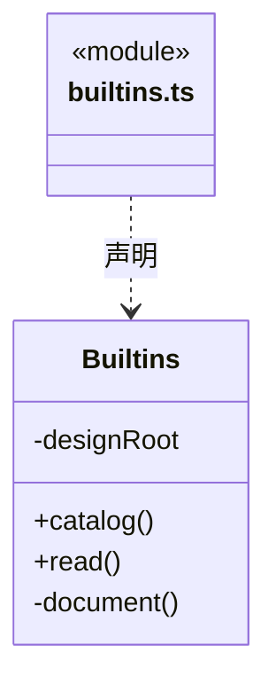

直接依赖：[../foundation/errors.ts](../foundation/errors.ts)、[../foundation/serialization.ts](../foundation/serialization.ts)。

### knowledge-queries.ts

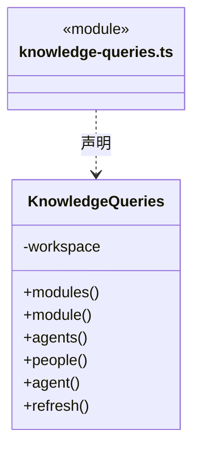

直接依赖：[ports.ts](ports.ts)、[snapshot.ts](snapshot.ts)、[../team/model.ts](../team/model.ts)、[../workspace/model.ts](../workspace/model.ts)。

### knowledge.ts

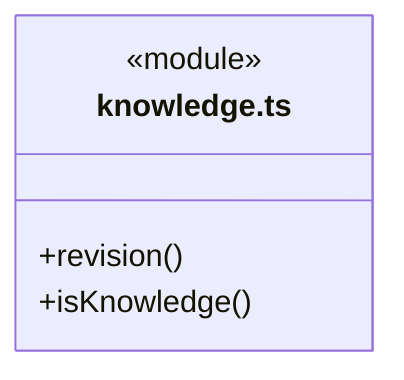

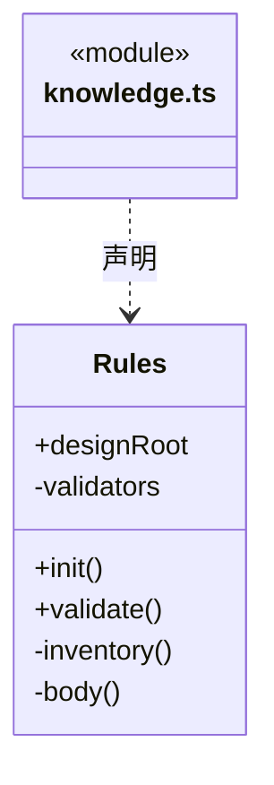

直接依赖：[../connectors/registry.ts](../connectors/registry.ts)、[../foundation/serialization.ts](../foundation/serialization.ts)、[../foundation/files.ts](../foundation/files.ts)、[types.ts](types.ts)、[../foundation/json.ts](../foundation/json.ts)。

### object-crud.ts

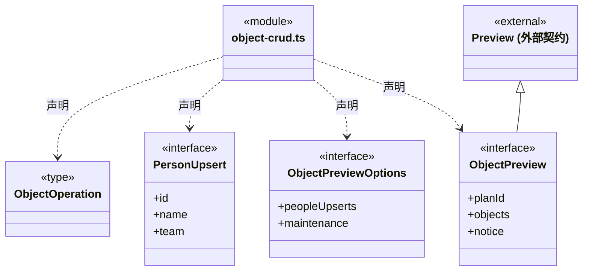

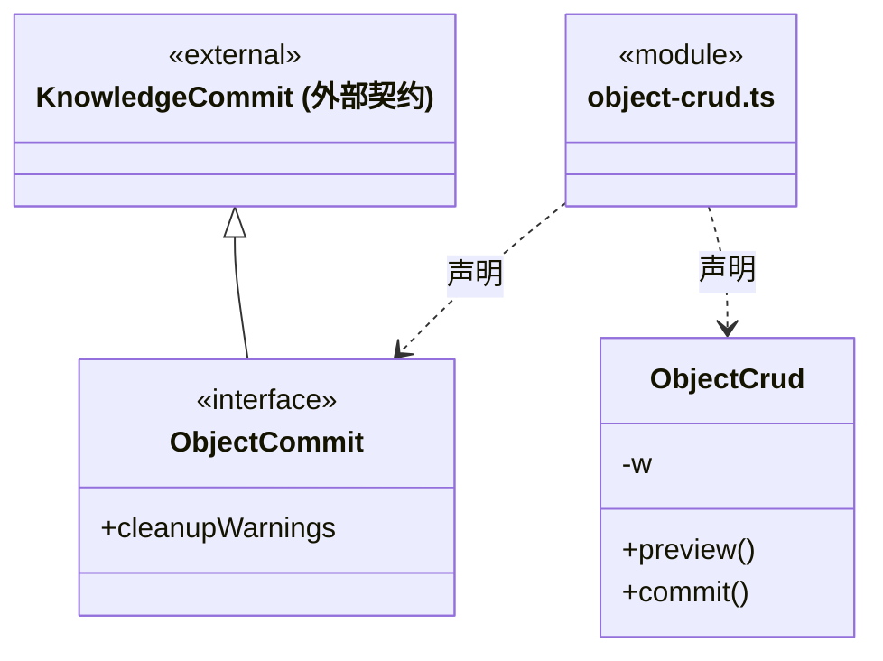

直接依赖：[ports.ts](ports.ts)、[../foundation/errors.ts](../foundation/errors.ts)、[../foundation/serialization.ts](../foundation/serialization.ts)、[knowledge.ts](knowledge.ts)、[../foundation/json.ts](../foundation/json.ts)、[types.ts](types.ts)、[../workspace/maintenance.ts](../workspace/maintenance.ts)。

### object-storage.ts

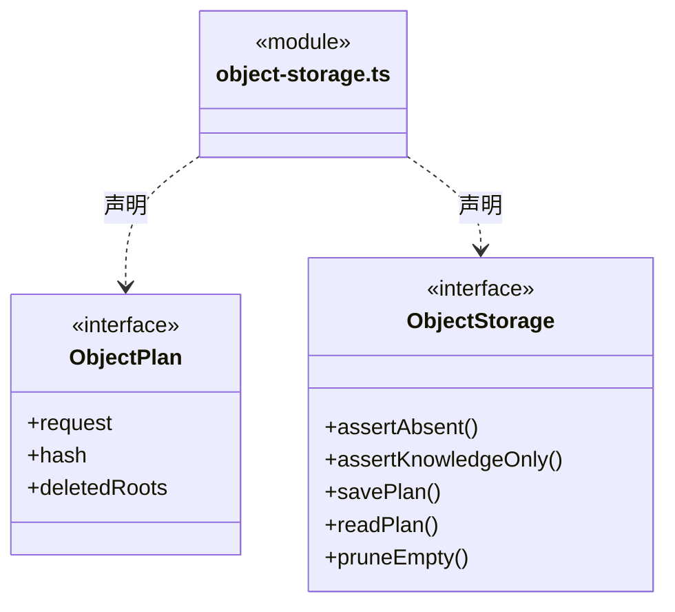

直接依赖：[types.ts](types.ts)。

### portable-package.ts

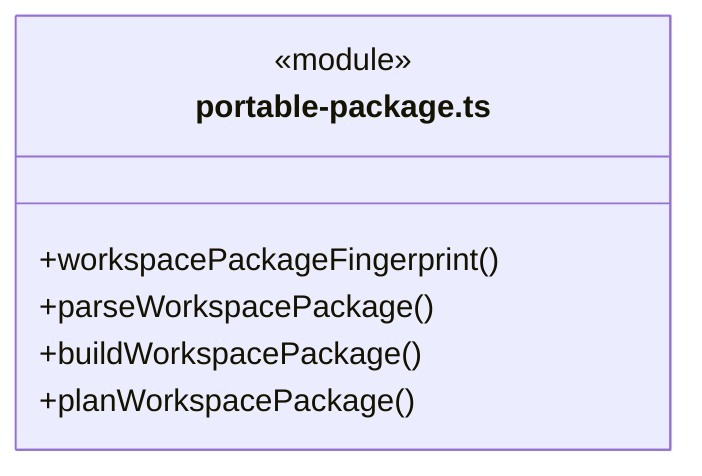

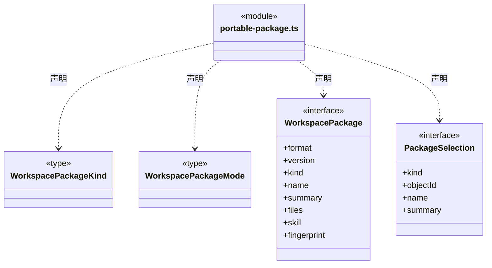

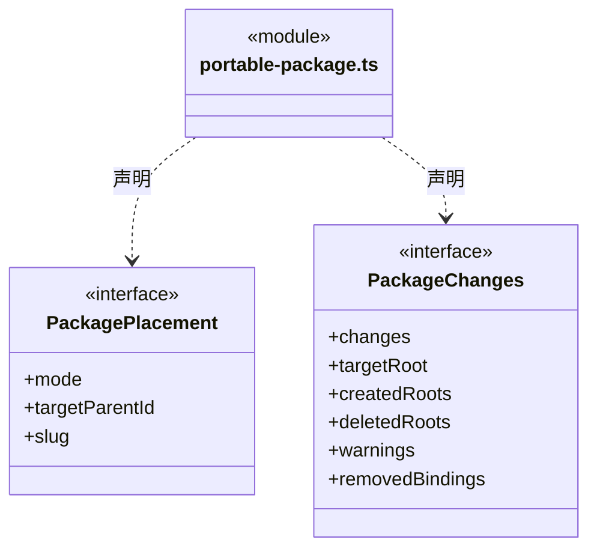

直接依赖：[../foundation/serialization.ts](../foundation/serialization.ts)、[../foundation/json.ts](../foundation/json.ts)、[../foundation/errors.ts](../foundation/errors.ts)、[knowledge.ts](knowledge.ts)、[types.ts](types.ts)。

### ports.ts

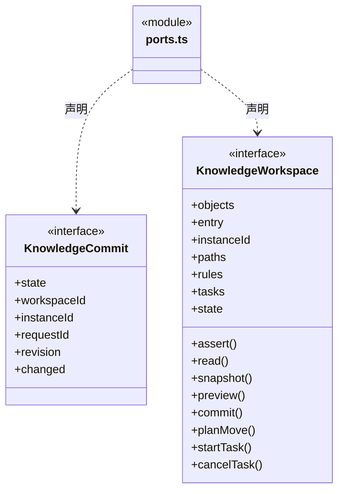

直接依赖：[../foundation/paths.ts](../foundation/paths.ts)、[types.ts](types.ts)、[object-storage.ts](object-storage.ts)。

### snapshot.ts

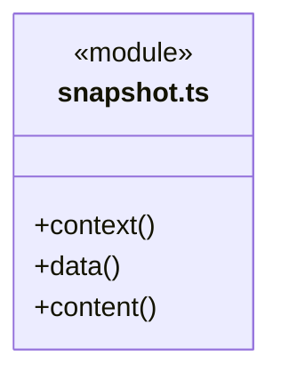

直接依赖：[../foundation/errors.ts](../foundation/errors.ts)、[../foundation/json.ts](../foundation/json.ts)、[types.ts](types.ts)。

### types.ts

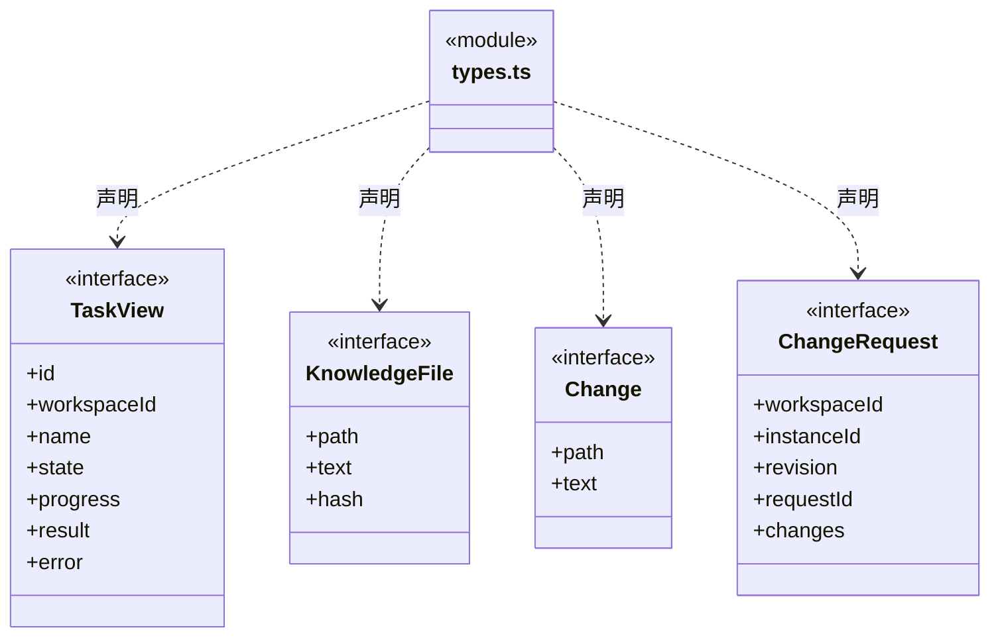

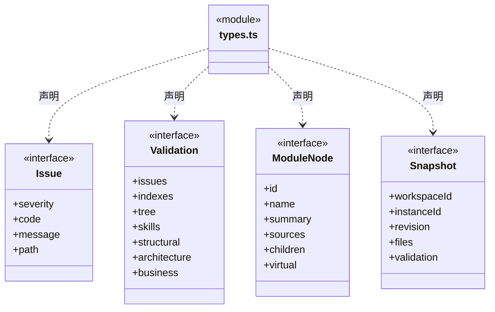

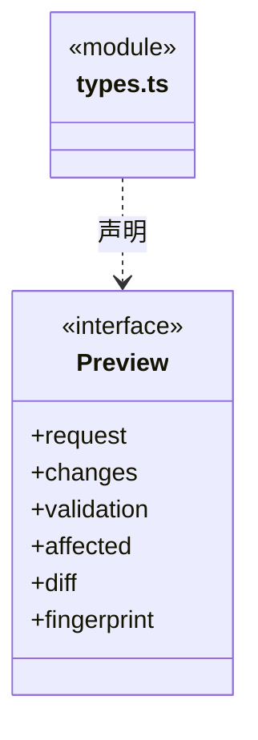

### 本目录调用边界

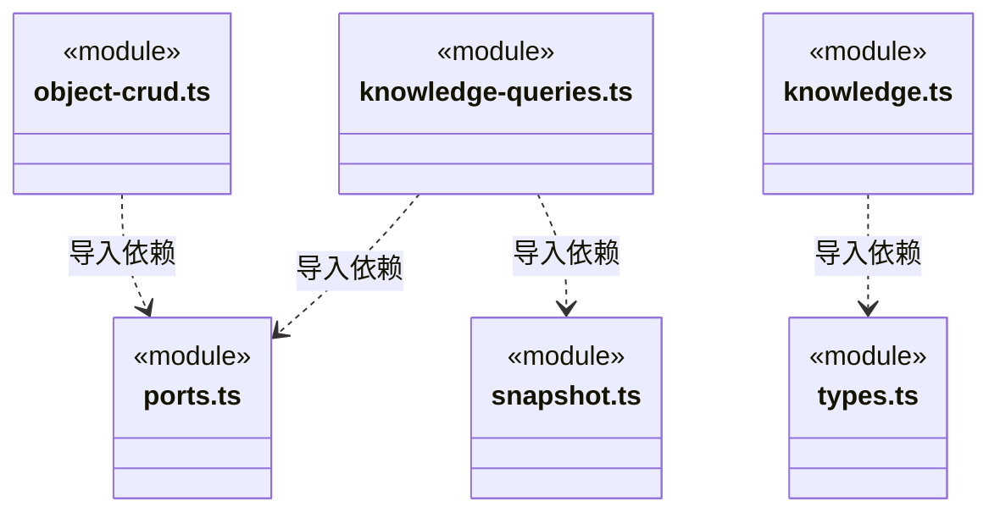

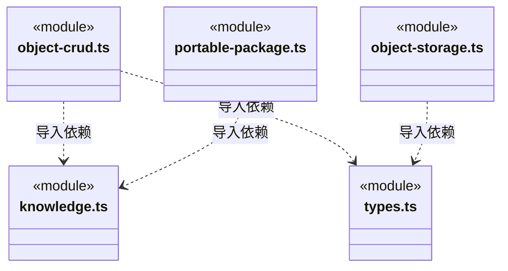

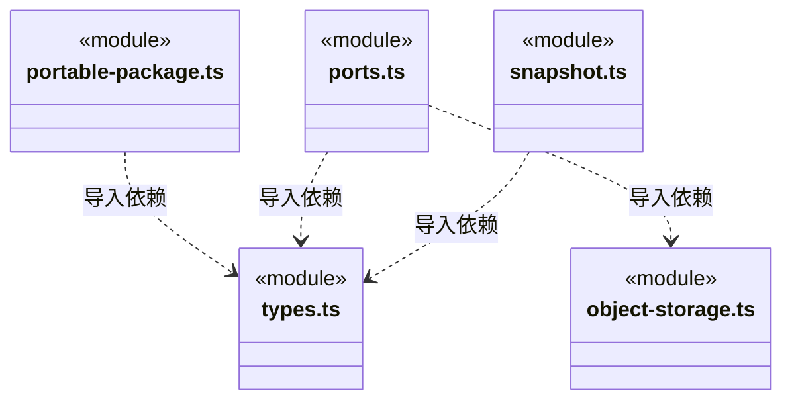

## 子目录导航

无子目录。

[返回上层](../ARCHITECTURE.md)。

每次修改本目录代码，同步维护文件头、关键契约说明及本图。未实现的治理、证据验收和自动编排能力不列入当前类图。

## 设计契约 v1 与落地范围

以下内容区分已接通能力与后续设计；以各节的实现状态为准，不将目标图当作现状图。维护源：[CONTRACT.md](CONTRACT.md)；生成类图时同步附加，勿直接修改本附录。

### 对象治理与桌面维护声明

`ObjectCrud.preview(revision, operations, options?)` 从同一个知识快照规划 Agent、Module、Skill、Workflow 的增删改，维护所属清单、模块父子关系及受控正文。`ObjectOperation` 不接受自定义知识路径或模块 `maintenance`，创建必须提供正文，原内部工具 schema 与逐次写授权保持不变。

可信桌面可单独传入 `ObjectPreviewOptions.peopleUpserts` 与明确确认的 `maintenance`。真人花名册与模块文件先合入候选快照，再运行完整 Schema/引用/正文校验；预览只存计划，正式知识到 `commit(planId)` 才由原串行事务一次性提交。后端生成维护绑定 ID、确认记录 ID 和 UTC 时间；编辑保留关系 ID、递增版本并重新确认。`local_user` 表示本机用户声明，不是已认证身份、执行授权或业务验收。

模块删除含子模块/方法时必须显式 `cascade`；有非知识资源则拒绝删除。提交只删除计划中的知识文件，后续目录清理仅处理空目录，不删除业务源码。旧实例、旧知识版本、结构校验失败或计划被改动均不能提交；同计划成功提交保持原幂等回执。

### 可复用静态架构包

`portable-package.ts` 纯计算构建、解析和整包映射，不读取磁盘或直接写知识。`WorkspacePackage` 使用版本 1 严格清单与完整内容指纹；只允许已知 Agent/模块/Skill 清单和被原则、方法或概览引用到的 Markdown 正文。路径穿越、大小写重复、孤儿模块、未登记方法、未归属正文、未知配置字段与常见显式凭据均拒绝；包最多 512 个文件、序列化后 2 MiB，单份正文最多 200,000 字符。正文仍须发布者 review，模式检测不宣称能识别所有秘密。

人才资源支持完整 Team、单 Agent、单 Skill。完整 Team 保留静态树和各层 Skill；独立 Agent 将当前可用祖先 Skill 冻结为自身 Skill，导入后仍受目标继承同名检查。能力资源不能携带业务模块；业务资源必须包含完整 workspace 下所有模块及各自 Workflow，不允许单模块/单 Workflow 应用或指定子树目标。

导出清除人员、作者、连接器、模块维护确认和源码定位绑定；不携带账号、连接器配置、会话、动态成员实例或任务图。每个工作区各有一张静态团队图和静态业务图；多个主会话各自的调度图不属于包。目标项目的真人花名册保持原样，维护责任必须在目标重新确认，导入能力不产生任何执行授权。

能力新增要求显式父节点和未占用 slug；完整 Team 可显式整体替换。完整业务架构可用于空目标，非空目标必须显式 `replace`。替换差异不修改索引、项目版本、人员目录或业务源码；派生索引由知识事务维护。引用或目标结构冲突以 `KnowledgeWorkspace.preview/commit` 的实际完整校验为准，不静默改名或修复目标。
