# src/backend/core/knowledge 架构

## 目录定位

知识快照、校验、领域查询和对象变更规划。物理事务通过 KnowledgeWorkspace 注入，预览缓存通过 ObjectStorage 注入。Team/Workspace 仅依赖本目录的只读快照辅助，不依赖查询门面或工具注册。

本文描述当前实现。通过分析目录边界后维护的 [源码架构脚本](../../../../scripts/source-architecture.mjs) 同步清单和声明；代码变更时仍须核对职责、关键成员与关系。

## 代码清单

| 文件 | 当前职责 |
| --- | --- |
| [builtins.ts](builtins.ts) | Builtins：白名单发布内置 Skill、规范和 Schema，返回正文、版本与解析引用。 |
| [knowledge-queries.ts](knowledge-queries.ts) | 核心知识查询门面，装配团队与业务工作区领域视图并刷新索引。 |
| [knowledge.ts](knowledge.ts) | Core 知识规则：解析 JSON、校验三个领域的结构与引用并派生索引。 |
| [object-crud.ts](object-crud.ts) | Core 对象治理：规划 Agent/Module/Skill/Workflow 变更，按计划提交受控事务。 |
| [object-storage.ts](object-storage.ts) | 对象 CRUD 所需的目录检查、预览计划存储和空目录清理端口。 |
| [ports.ts](ports.ts) | 核心知识领域需要的工作区存取与事务接口。 |
| [snapshot.ts](snapshot.ts) | 已校验知识快照的版本信息、定义读取和受限正文引用解析。 |
| [types.ts](types.ts) | 知识快照、校验与事务的数据契约，维护任务与业务任务分开。 |

## 架构类图

### builtins.ts

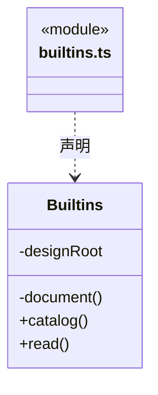

直接依赖：[../foundation/errors.ts](../foundation/errors.ts)、[../foundation/serialization.ts](../foundation/serialization.ts)。

### knowledge-queries.ts

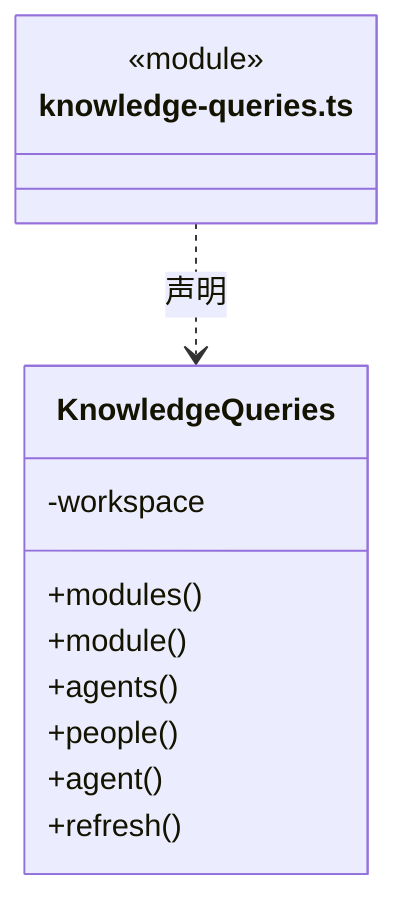

直接依赖：[ports.ts](ports.ts)、[snapshot.ts](snapshot.ts)、[../team/model.ts](../team/model.ts)、[../workspace/model.ts](../workspace/model.ts)。

### knowledge.ts

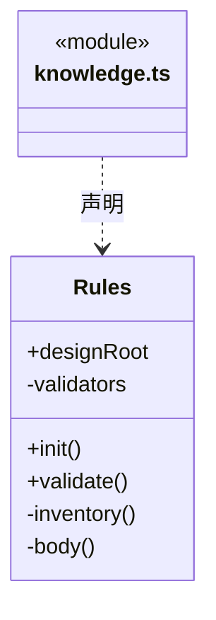

直接依赖：[../connectors/registry.ts](../connectors/registry.ts)、[../foundation/serialization.ts](../foundation/serialization.ts)、[../foundation/files.ts](../foundation/files.ts)、[types.ts](types.ts)、[../foundation/json.ts](../foundation/json.ts)。

### object-crud.ts

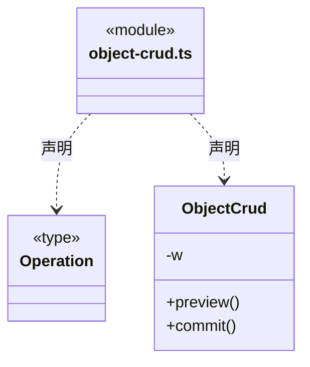

直接依赖：[ports.ts](ports.ts)、[../foundation/errors.ts](../foundation/errors.ts)、[../foundation/serialization.ts](../foundation/serialization.ts)、[knowledge.ts](knowledge.ts)、[../foundation/json.ts](../foundation/json.ts)、[types.ts](types.ts)。

### object-storage.ts

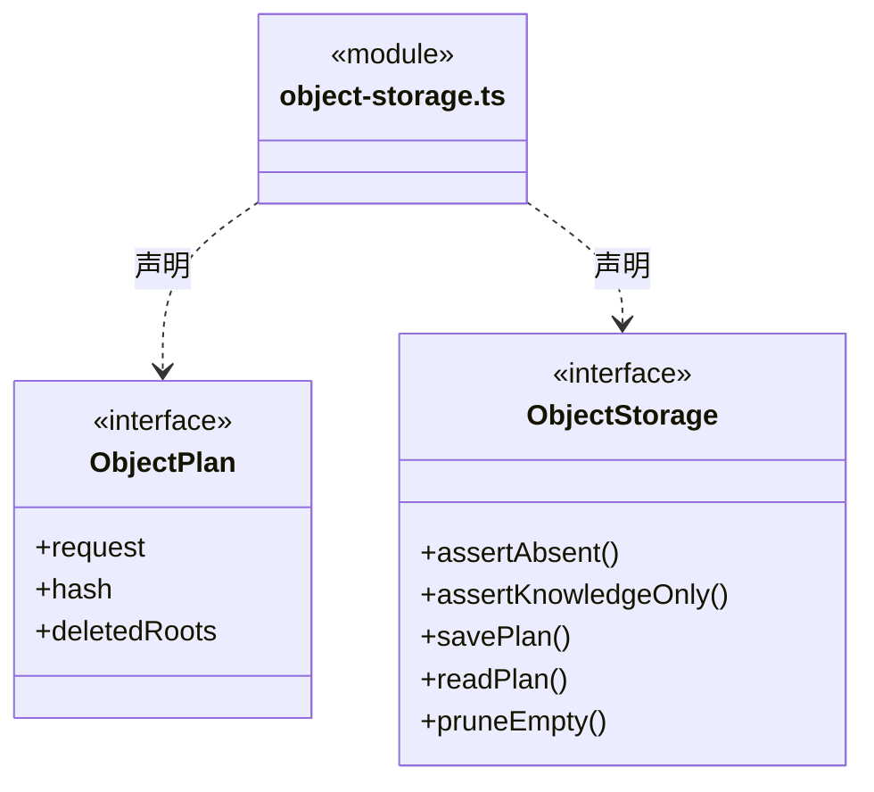

直接依赖：[types.ts](types.ts)。

### ports.ts

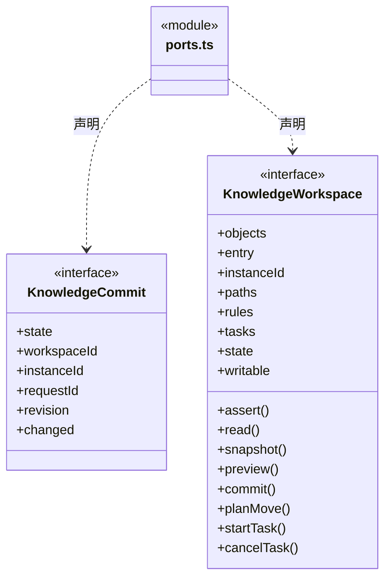

直接依赖：[../foundation/paths.ts](../foundation/paths.ts)、[types.ts](types.ts)、[object-storage.ts](object-storage.ts)。

### snapshot.ts

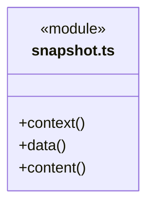
直接依赖：[../foundation/errors.ts](../foundation/errors.ts)、[../foundation/json.ts](../foundation/json.ts)、[types.ts](types.ts)。

### types.ts

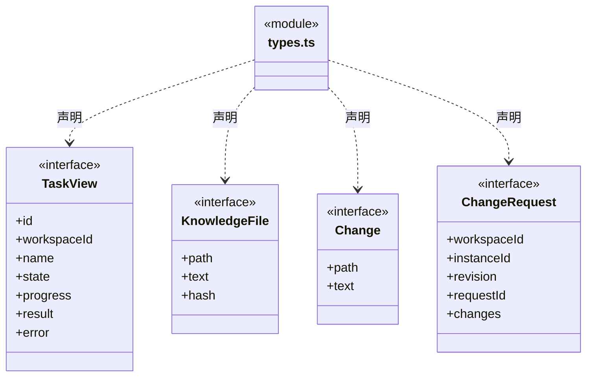

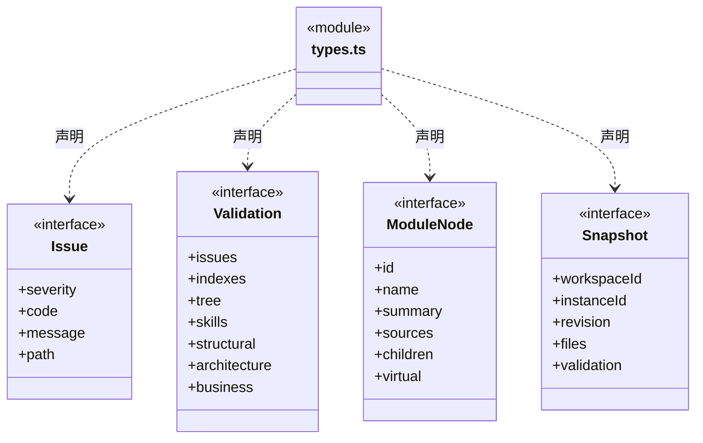

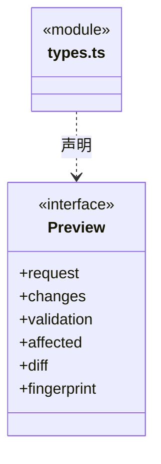

### 本目录调用边界

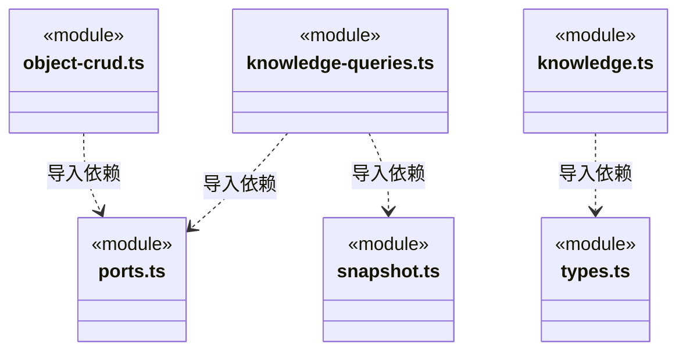

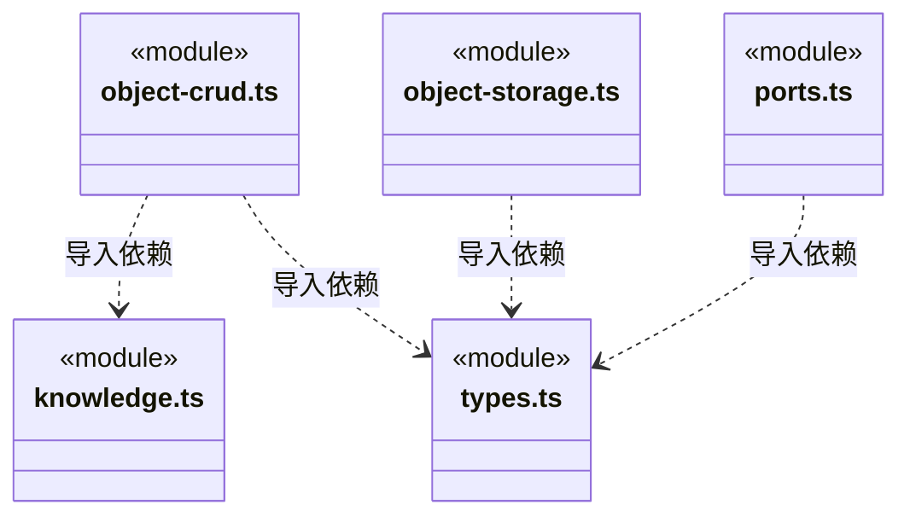

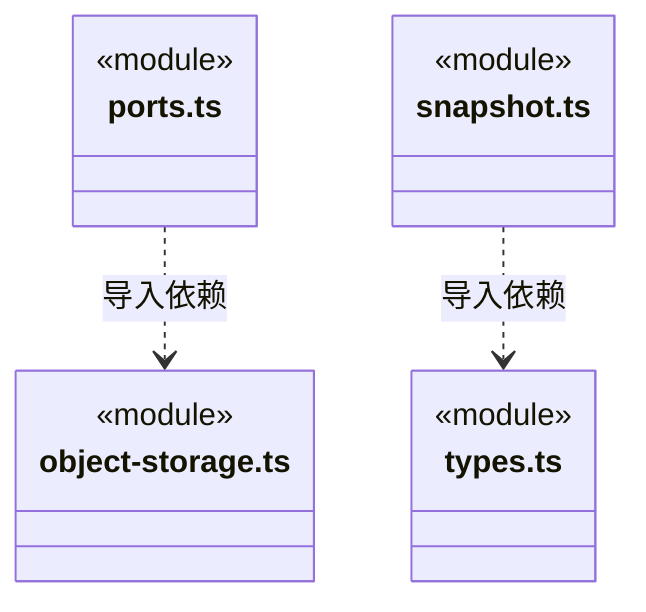

## 子目录导航

无子目录。

[返回上层](../ARCHITECTURE.md)。

每次修改本目录代码，同步维护文件头、关键契约说明及本图。未实现的治理、证据验收和自动编排能力不列入当前类图。
