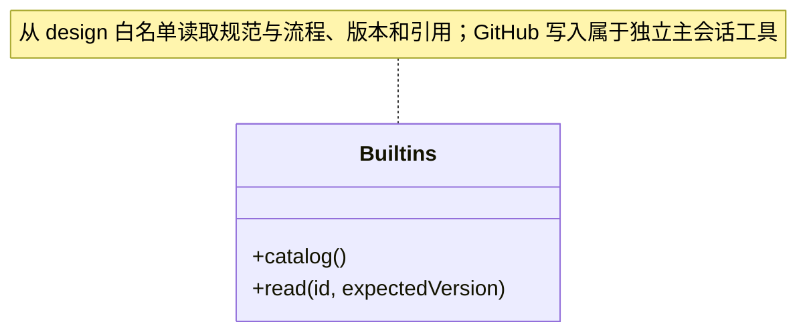

### 快照契约、领域视图与查询编排

知识快照属于 Core 的公开数据，跨域查询属于调度层编排。当前保护的是下表中的查询链，不代表整个 `team/`、`workspace/` 或其他 Core 子模块已经完成逻辑分层治理。

| 边界及公共入口 | 允许的项目内依赖 | 状态与副作用 |
| --- | --- | --- |
| `types.ts`：Snapshot/Validation 等传输数据 | 无 | 数据形状，不持有服务实例 |
| `snapshot.ts`：KnowledgeSnapshotReader、context/data/content | types、Foundation | 读取/解析一个完整版本，不暴露写入或生命周期 |
| `team/model.ts`：Team | 快照契约、Foundation | 固定快照上的 Agent/Skill 视图，不读取新版本 |
| `workspace/model.ts`：BusinessWorkspace | 快照契约、Foundation、project-root | 固定快照上的模块/本模块 Workflow 视图 |
| `scheduler-engine/context/knowledge-queries.ts`：KnowledgeQueries | 快照读取端口、两个领域视图 | 每次查询取新快照，跨查询同版要求由组合用例核对 |
| `knowledge-refresh.ts`：refreshKnowledgeIndexes | 知识刷新端口、原请求解析、快照契约、Foundation | 复用原 journal，委托同一知识事务刷新索引 |

`scripts/check-dependencies.mjs` 对快照、领域视图、查询编排和 Foundation 的出边执行严格约束，包含类型导入与重导出；视图不能取得完整 `KnowledgeWorkspace` 或反向依赖另一领域视图。Foundation 不依赖业务。旧 Core `knowledge-queries.ts` 无静态或动态注册消费者，已移除，不保留反向重导出。

读取能力与写入能力分开：`KnowledgeSnapshotReader` 仅含 `snapshot()`；`KnowledgeRefreshWorkspace` 只增加 assert、原回执读取与 commit；完整 `KnowledgeWorkspace` 继续由 Main 的 Workspace 实现，拥有实例、锁、监听、任务、存储及恢复。端口收窄没有移动权威状态或拆开原子事务。Tools 仍逐调用校验身份、写授权、取消和输出，不由查询服务授予权限。

本片保持外部工具版本/输入输出、Skill 继承、本模块 Workflow、内置根、刷新错误和幂等语义。查询实现与刷新实现分开后，未来增加只读字段主要修改所属视图及公开输出协议；改变刷新策略才修改 `knowledge-refresh.ts`。这些边界是当前约束和稳定候选，不宣称一次重构已证明长期稳定。

领域测试从 `tests/knowledge-data.ts` 取得纯数据，从 `tests/knowledge-fixture.ts` 取得真实 Rules 与临时源目录；两者有独立依赖约束。`core-domains`、`rules` 不加载 Application。完整事务、权限及任务准备仍由 `knowledge-refresh`、`knowledge-tool-output`、`team-workflow` 的真实应用测试覆盖；其余旧测试暂保留 `tests/helpers.ts` 的兼容重导出。

### 项目根查询协议

模块 registry/get 的工具协议升为 v2：registry 必须提供 `projectRoot`；详情为真实文件模块与 builtin 根的严格判别联合。内置根没有 definitionFile，以内联正文表达来源；原真实模块字段保持。输出校验不授予写入或正式委派资格。

### 内置资料与产品反馈流程

内置标准 `shared-skills-workflows` 从随应用打包的 `design/runtime/shared-skills-workflows.md` 读取，Agent 与 Module 规范通过相对链接解析到同一白名单 ID。迁移只改变资源位置，资料 ID 与只读边界保持；正文版本仍按实际内容计算，目录版本包含来源路径。`docs/` 中的四份概念设计不参与内置资料加载。

`builtinSkills` 发布 `bug-feedback` 与 `feature-wish`，正文来自应用打包资源 `design/runtime/`，通过只读别名及 `Builtins.read` 返回内容哈希和解析引用。两套正文只要求一句简述，参考格式的其余内容均自愿，缺项不追问；读取正文不产生 Issue，实际提交由桌面已授权的独立 `FeedbackTools` 执行，不创建业务任务或修改知识。

### 链接器静态定义校验

`Rules` 读取更新后的链接器 Schema，按稳定链接器标识及带提供方种类的目标身份检查重复；兼容旧 Cindy 映射和资源仓库身份。模块/角色的链接器引用继续只指向静态声明，知识校验通过、知识事务提交或资源包导入都不会授予网络访问权限。重复提示使用“提供方身份”，不再把所有来源称为插件。

### 知识工具业务输出协议

`tool-output-base.ts` 定义身份、知识文件、问题、派生校验及快照协议；`tool-output-queries.ts` 定义模块、团队注册表与详情；`tool-output-builtins.ts` 定义内置目录、正文与 Skill 别名返回；`tool-output-transactions.ts` 定义知识/对象预览、提交、刷新及维护任务状态。四份协议只依赖 Zod 和本目录纯协议，不依赖 Team/Workspace 查询实现、Scheduler、IPC 或运行权限。

服务生成对象使用严格字段结构，不以默认值、类型转换或裁剪字段修补返回。原始知识定义保留为 JSON 对象，作者来源及不可用正文的原引用保留 JSON 值；这些位置允许结构无效的知识事实，不再次套用有效知识定义 Schema。原始值使用无转换谓词检查，避免 Zod record 删除合法 JSON 自有 `__proto__` 键；按需 JSON Schema 中它们是带说明的开放 JSON 事实槽，不能把它们解释为执行参数或知识有效性证明。

完整快照包含 Validation；搜索仅筛选 files，版本仍属于完整读取，不从子集补造校验或重新计算版本。`structural:false`、空正文、缺失引用、继承冲突均为合法诊断；旧 people.json 不再解析或产生结构诊断。自定义 Agent 使用项目定义形状。已退役的内置 `cbim:executor` 不再有独立公开查询形状，也不伪造项目来源。内置资料保持只读、版本和引用状态，读取 Skill 资料不表示已执行流程。

Preview 的实际 changes 可以包含请求之外的派生索引；空正文、删除和空提交保持领域语义。已提交结果只能声明 `committed`，对象空目录清理警告不等于回滚。Refresh 区分未提交的 invalid 与已更新索引后观察到的 refreshed/invalid，不能把索引更新当作结构或业务验收。维护任务只包含 validate/reindex，运行中取消仍可返回 running；完成结果分别为 Validation/Commit，失败或取消保留错误，只有查询允许独立 not_found 分支。

这些 Schema 校验的是执行后唯一 JSON 传输快照，标准文本封装、协议错误和原样发送由 Core tools 与 Scheduler 边界负责。校验通过不签署业务验收，校验失败不表示事务已回滚；原幂等请求、预览版本、实例隔离和取消边界不由输出协议改写。原生工具、派发及人工决定的输出不因此宣称已迁入本协议。

### 对象治理与历史兼容

`ObjectCrud.preview(revision, operations)` 从同一个知识快照规划 Agent、Module、Skill、Workflow 的增删改，维护所属清单、模块父子关系及受控正文。`ObjectOperation` 不接受自定义知识路径或模块 `maintenance`，创建必须提供正文，原内部工具 schema 与逐次写授权保持不变。

桌面与工具使用相同对象操作，不接受 peopleUpserts 或真人维护确认。旧 people.json 不解析、不重建；authors 仅校验字符串数组与唯一性，不做人员或组关联。新模块不要求 maintenance，原历史对象保留。预览只存计划，正式知识到 commit(planId) 才由串行事务提交；岗位与负责人仍通过各自受控服务配置。

模块删除含子模块/方法时必须显式 `cascade`；有非知识资源则拒绝删除。提交只删除计划中的知识文件，后续目录清理仅处理空目录，不删除业务源码。旧实例、旧知识版本、结构校验失败或计划被改动均不能提交；同计划成功提交保持原幂等回执。

Workflow 可在原 `workflow.md` 中声明一个严格的 `cbim-workflow` JSON 块；具体协议由纯 [workflow-contract.ts](../workspace/workflow-contract.ts) 定义。对象创建/更新在预览前解析新正文；完整 `Rules.validate` 也校验所有业务 Workflow，错误以 `workflow_contract` 结构问题阻止知识提交，因此原始文件 preview/commit 不能绕过对象入口。未声明的旧自然语言正文不被补造条件。条件保存不启动执行或授予工具权限。

`Rules` 仅在 Ajv 入口使用 `structuredClone` 兼容副本，以支持严格 JSON 解析器产生的无原型对象及真实多 Workflow 清单。唯一性校验仍生效，重复项、未知字段和危险 own key 不裁剪；第三方比较器无法处理的畸形结构返回 Schema 诊断并阻止提交。原解析对象与 JSON 重复字段规则不变，也不通过 JSON 再编码把无效数值变成其它事实。

### 可复用静态架构包

`portable-package.ts` 纯计算构建、解析和整包映射，不读取磁盘或直接写知识。`WorkspacePackage` 使用版本 1 严格清单与完整内容指纹；只允许已知 Agent/模块/Skill 清单和被原则、方法或概览引用到的 Markdown 正文。路径穿越、大小写重复、孤儿模块、未登记方法、未归属正文、未知配置字段与常见显式凭据均拒绝；包最多 512 个文件、序列化后 2 MiB，单份正文最多 200,000 字符。正文仍须发布者 review，模式检测不宣称能识别所有秘密。

人才资源支持完整 Team、单 Agent、单 Skill。完整 Team 保留静态树和各层 Skill；独立 Agent 将当前可用祖先 Skill 冻结为自身 Skill，导入后仍受目标继承同名检查。能力资源不能携带业务模块；业务资源必须包含完整 workspace 下所有模块及各自 Workflow，不允许单模块/单 Workflow 应用或指定子树目标。

完整业务包原样携带 Workflow 正文中的可选程序条件。构建后复验、外部包解析与导入差异规划均走同一条件解析器；即使重算包指纹，无效声明仍以 `RESOURCE_PACKAGE` 拒绝，不能借旧源的 structural 标记绕过。条件不被复制进其他模块，也不把自然语言中的代码示例转换为生效条件。

导出清除人员、作者、连接器、模块维护确认和源码定位绑定；不携带账号、连接器配置、会话、动态成员实例或任务图。每个工作区各有一张静态团队图和静态业务图；多个主会话各自的调度图不属于包。目标项目的旧 people.json 保持原样，但不再校验其组引用；岗位及模块负责人须通过目标工作区服务明确配置，导入能力不产生任何执行授权。

能力新增要求显式父节点和未占用 slug；完整 Team 可显式整体替换。完整业务架构可用于空目标，非空目标必须显式 `replace`。替换差异不修改索引、项目版本、人员目录或业务源码；派生索引由知识事务维护。引用或目标结构冲突以 `KnowledgeWorkspace.preview/commit` 的实际完整校验为准，不静默改名或修复目标。

### 私有提交计划与来源意图

`planned-commit.ts` 固定 v2 对象/包计划：完整原请求、按顺序解析后的对象操作、删除根或整包替换目标均参与不可变指纹。`ObjectCrud` 只传 planId 给固定私有加载器；公共 `ChangeRequest` 不接来源证明。净差异相同不能抹掉同计划先删后建的事实；未提交旧 request-only 计划须重新预览，已提交旧计划仅核原 journal。

对象同事务重建只允许之前已通过知识专用删除核验的根，不允许覆盖未知资源。包的全零差异仍拒绝；实际 replace 的同字节对象仍属于可信替换域。Schema 严格核原 wire，不以字段重排改变既有请求或计划指纹。

### 原知识事务的有界观察

knowledge-write-input.ts 让真实知识工具与后端历史观察复用同一字段解析和顺序，保留既有 strip 行为；knowledge-write-observation.ts 仅导出纯公开 Schema，不引用请求/计划规则或 Node 哈希。只有知识提交完整原请求或对象提交固定 planId 可以形成原引用；旧 refresh 缺少事务绑定时不猜测。公共摘要严格区分 absent、prepared、committing、committed、rolled_back、recovery_required 与 unverifiable，仅 committed 携带原结果版本和变更数量；缺计划不补 requestHash，摘要不含正文、文件清单或私有路径。解析不是授权，原实例只能查历史。

### 刷新原事务与契约版本

knowledgeRefreshInputSchema 要求 workspace/instance、revision 和 requestId，knowledgeRefreshRequest 固定顺序构造空 changes。refreshKnowledgeIndexes 先查精确原成功 journal，再按原版本校验/提交；重复不再写，但返回校验来自当前快照。原 v1 不从今日状态推断请求。originalKnowledgeWrite 仅在可信 contractVersion=2 时适配 refresh，查询不初始化或推进事务。

### 对象输入与模块正文诊断

ObjectOperation 使用 kind 判别的严格 data Schema，objectDataSchemas 同时提供运行时可写字段，不再给 Agent 暴露 purpose 或给模块暴露 name。模块标识名从 slug 派生，中文名属于正文 H1。Rules 使用 workspace/module-outline 的同一固定章节；章节、空正文或图错误返回精确标题和一份可复制模板，不自动写入专业内容。

### Agent 本机运行默认值

对象 CRUD 只允许 Agent 数据声明可选 runtime（engine/profileId/modelId，或 null）。它是新岗位登记的默认选择，不修改已采纳岗位。导出 Team/Agent 静态资源时剔除该本机引用，目标机器重新选型；业务原则与 Skill 继续可复用。
