# src/backend/core/models 架构

## 目录定位

公开模型参数、能力元数据、计量与请求预算端口；实际 HTTP 传输在 backend/engines/transport，配置和加密凭据在 main/models。Core 不认识具体 SDK。

本文描述当前实现。通过分析目录边界后维护的 [源码架构脚本](../../../../scripts/source-architecture.mjs) 同步清单和声明；代码变更时仍须核对职责、关键成员与关系。

## 代码清单

| 文件 | 当前职责 |
| --- | --- |
| [catalog.ts](catalog.ts) | 解析供应商模型目录的能力资料，供新增模型和显式同步容量使用。 |
| [config.ts](config.ts) | 定义自定义供应商及其模型目录的持久化与界面契约。 |
| [engine.ts](engine.ts) | 用户模型目录和 Agent 运行选型共用的引擎标识与纯选择规则。 |
| [ports.ts](ports.ts) | 模型运行快照与凭据加解密端口。 |
| [provider-connections.ts](provider-connections.ts) | 供应商到引擎的纯接口选择规则，供界面筛选、岗位采纳和实际启动共同使用。 |
| [provider-presets.ts](provider-presets.ts) | 模型设置与接口解析共用的官方供应商地址预设，属于模型配置的纯数据策略。 |
| [request-budget.ts](request-budget.ts) | 定义各引擎共用传输与工作区请求账本之间的可信窄端口。 |

## 架构类图

### catalog.ts

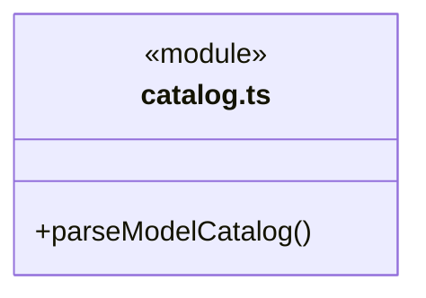

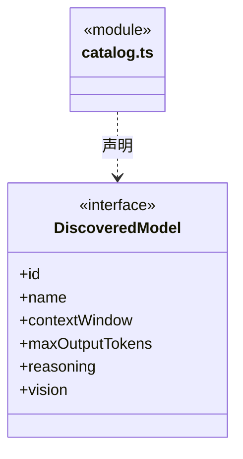

### config.ts

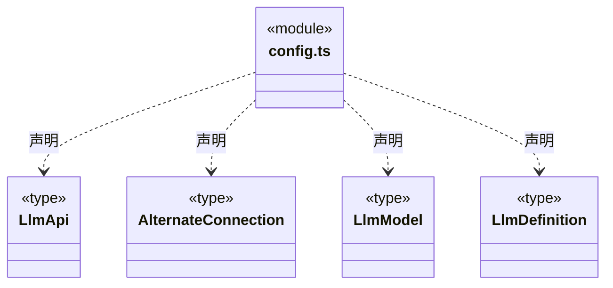

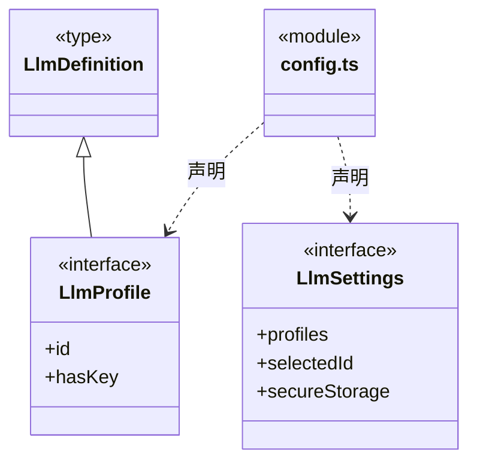

直接依赖：[engine.ts](engine.ts)。

### engine.ts

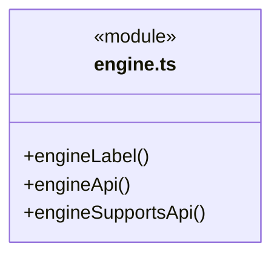

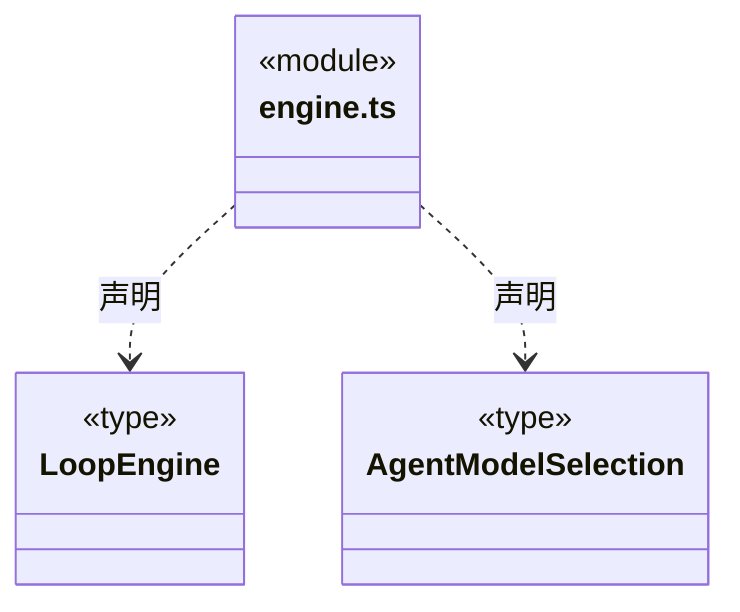

### ports.ts

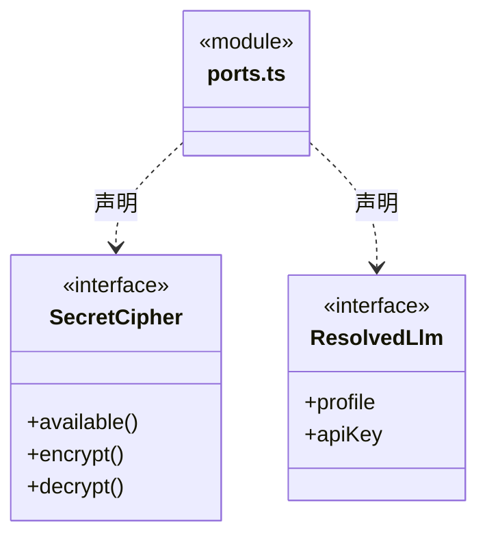

直接依赖：[config.ts](config.ts)、[engine.ts](engine.ts)。

### provider-connections.ts

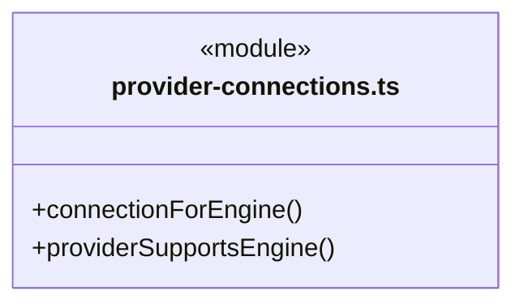

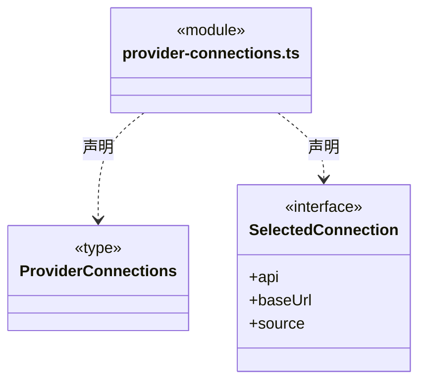

直接依赖：[config.ts](config.ts)、[engine.ts](engine.ts)、[provider-presets.ts](provider-presets.ts)。

### provider-presets.ts

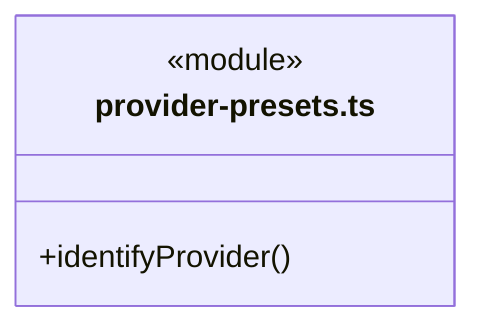

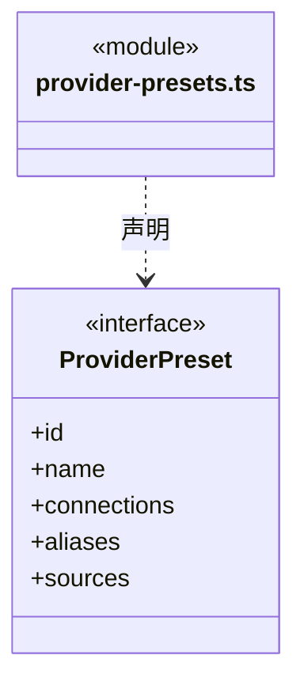

直接依赖：[config.ts](config.ts)。

### request-budget.ts

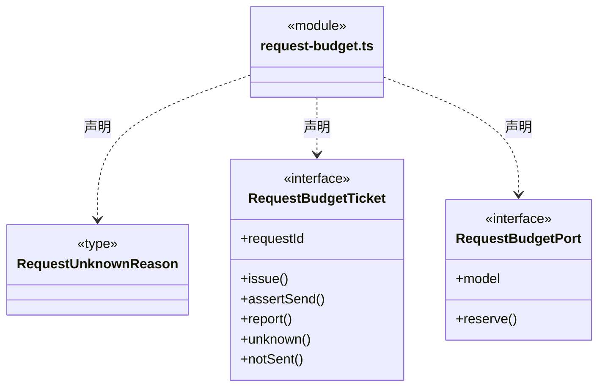

直接依赖：[../budget/model-request-budget.ts](../budget/model-request-budget.ts)。

### 本目录调用边界

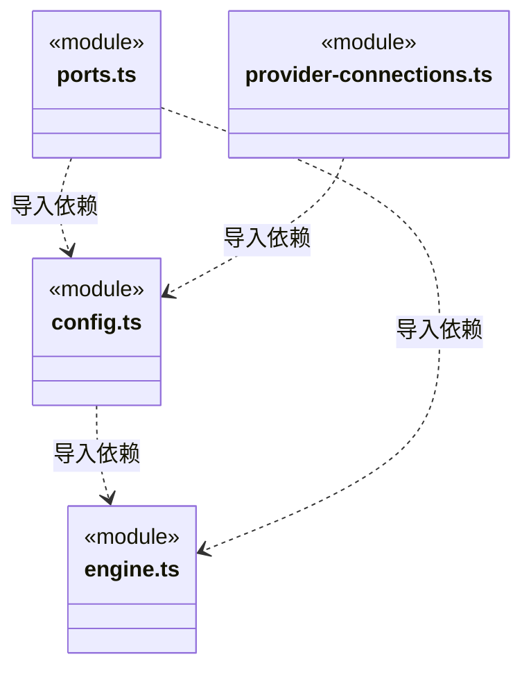

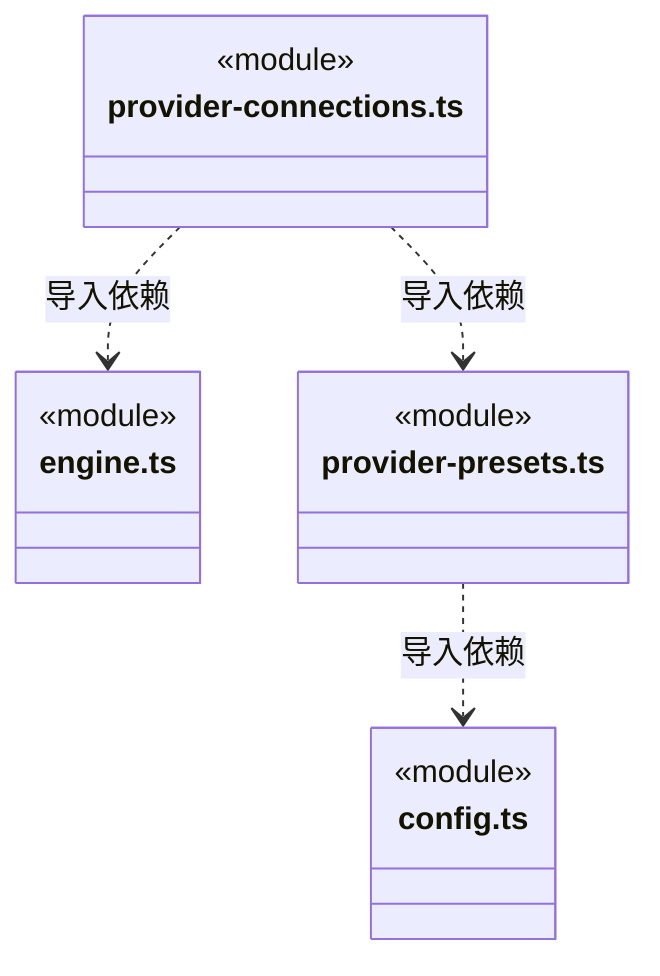

## 子目录导航

无子目录。

[返回上层](../ARCHITECTURE.md)。

每次修改本目录代码，同步维护文件头、关键契约说明及本图。未实现的治理、证据验收和自动编排能力不列入当前类图。

## 设计契约 v1 与落地范围

以下内容区分已接通能力与后续设计；以各节的实现状态为准，不将目标图当作现状图。维护源：[CONTRACT.md](CONTRACT.md)；生成类图时同步附加，勿直接修改本附录。

# llm 维护契约

## 逐请求预算（R06）

`RequestBudgetPort` 仅由可信工厂提供，模型只能生成原协议正文。ticket 的 reserve / issue 分别可靠保存申请与发送意图；实际发送前同步 assertSend，报告、明确未发送和未知各有独立事实，不提供模型可调用写入入口。

## 引擎配置与共享请求传输

engine.ts 定义始终存在的 Pi / Claude Code / Codex、显示名与 Agent 选型。engineSupportsApi 仅判断原生引擎支持的协议：Pi 支持三种协议，Claude Code 支持 Anthropic Messages，Codex 支持 OpenAI Responses。旧 definition.engine 只兼容解析，不再决定或限制运行。

provider-connections.ts 的 connectionForEngine 是界面、岗位和运行共用的供应商接口解析：主接口兼容时保持原地址；否则先选择显式 alternateConnections，再根据精确官方 HTTPS 地址选择 provider-presets.ts 中的预设。autoDetect 缺省开启但不回写旧文件；false 关闭自动补充。显式接口的 modelIds 缺省共用目录，指定时只允许列出的原始型号，不绕过限制回退预设。每种协议只能配置一个地址。预设单独保存供应商地址、型号限制与官方来源，新增供应商只改这份数据及对应验证，不改引擎实现；域名、地区、端口和套餐路径不模糊匹配。

同一供应商只保存一份加密凭据；不进行协议翻译、模型 ID 替换或运行失败后自动切换。公开目录读取和界面筛选不联网，配置兼容不表示凭据、额度、工具或流式已经验证。运行快照只冻结选中的 api/baseUrl，候选接口、预设来源和 autoDetect 不进入 ResolvedLlm.profile 或岗位哈希；历史缺省 engine 及原 Pi 配置字节保持不变。新岗位采纳与运行使用相同投影，后续配置修改不热替换已捕获快照。

request-budget-transport.ts 与 request-budget-usage.ts 从 pi/ 移至本目录。Pi 仍需启动握手；Claude SDK 使用随机令牌的 Anthropic 路由。Codex 在冻结模型/输出上限代理后复用同一 /request 入口。所有入口固定同一供应商与模型，实际请求均先 reserve/issue，终态用量可靠保存后才交付；不接受任意转发地址。

Claude/Codex 原生流式调用可早于响应结束；request-budget-transport 的 assertSettled 等待当前实际请求全部结算，供工具授权前调用。停止或结算失败时拒绝，不能把“终态尚未转发”当作工具尚未启动的证明。
