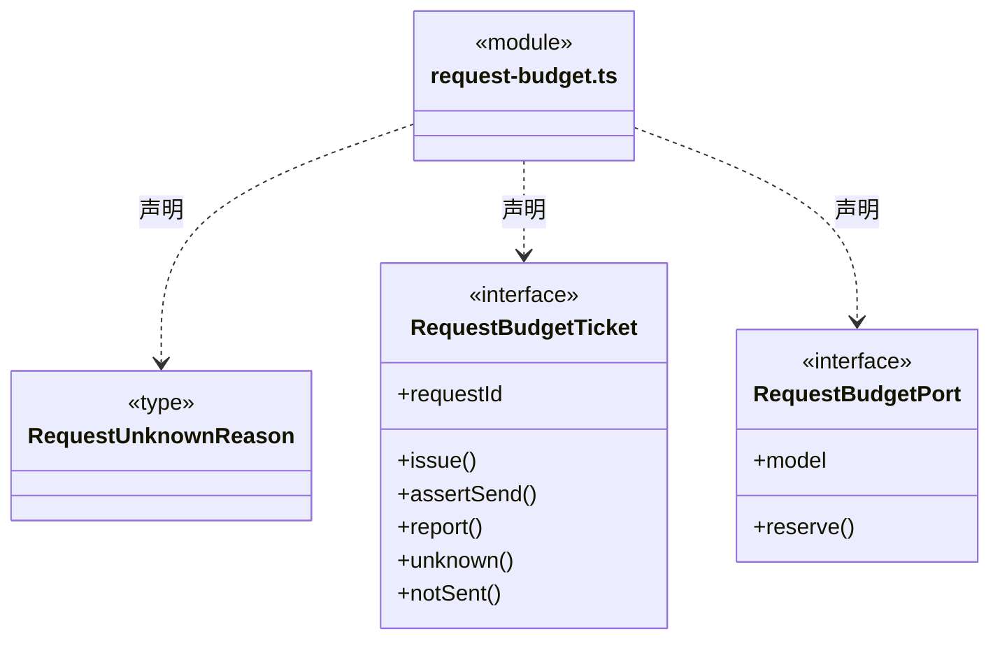

# src/backend/core/models 架构

## 目录定位

仅保留逐请求预算窄端口；模型目录、配置契约和选型已迁至 logic/models，具体传输仍由 engines/transport 实现。

本文描述当前实现。通过分析目录边界后维护的 [源码架构脚本](../../../../scripts/source-architecture.mjs) 同步清单和声明；代码变更时仍须核对职责、关键成员与关系。

## 代码清单

| 文件 | 当前职责 |
| --- | --- |
| [request-budget.ts](request-budget.ts) | 定义各引擎共用传输与工作区请求账本之间的可信窄端口。 |

## 架构类图

### request-budget.ts

直接依赖：[../budget/model-request-budget.ts](../budget/model-request-budget.ts)。

## 子目录导航

无子目录。

[返回上层](../ARCHITECTURE.md)。

每次修改本目录代码，同步维护文件头、关键契约说明及本图。未实现的治理、证据验收和自动编排能力不列入当前类图。

## 设计契约 v1 与落地范围

以下内容区分已接通能力与后续设计；以各节的实现状态为准，不将目标图当作现状图。维护源：[CONTRACT.md](CONTRACT.md)；生成类图时同步附加，勿直接修改本附录。

# 迁移期请求预算端口

本目录仅保留 request-budget.ts 的 RequestBudgetPort、RequestBudgetTicket 与未知原因契约；依赖旧 budget 的请求账本类型。reserve/issue 分别保存申请与发送意图，实际发送前同步 assertSend；报告、明确未发送与未知分别保留事实。

模型目录、配置 Schema、供应商连接与引擎选型已迁入 [Logic 模型](../../../logic/models/CONTRACT.md)。配置服务在 [Logic 模型服务](../../../logic/models/service/CONTRACT.md)，不保留旧模型规则转发。

实际请求传输仍位于 backend/engines/transport，预算服务仍在 scheduler-engine/budget；本批没有迁移预算所有权或改变账本、结算与工具授权顺序。
