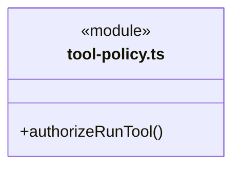
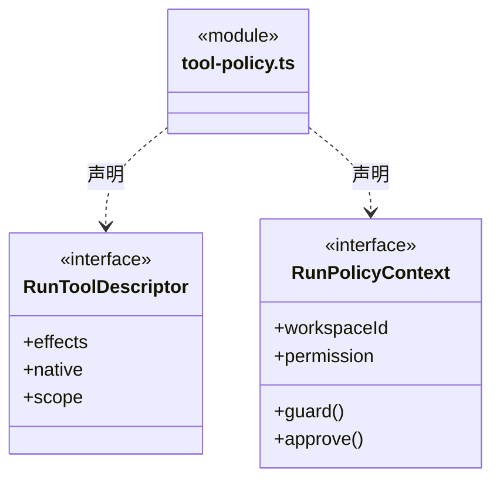
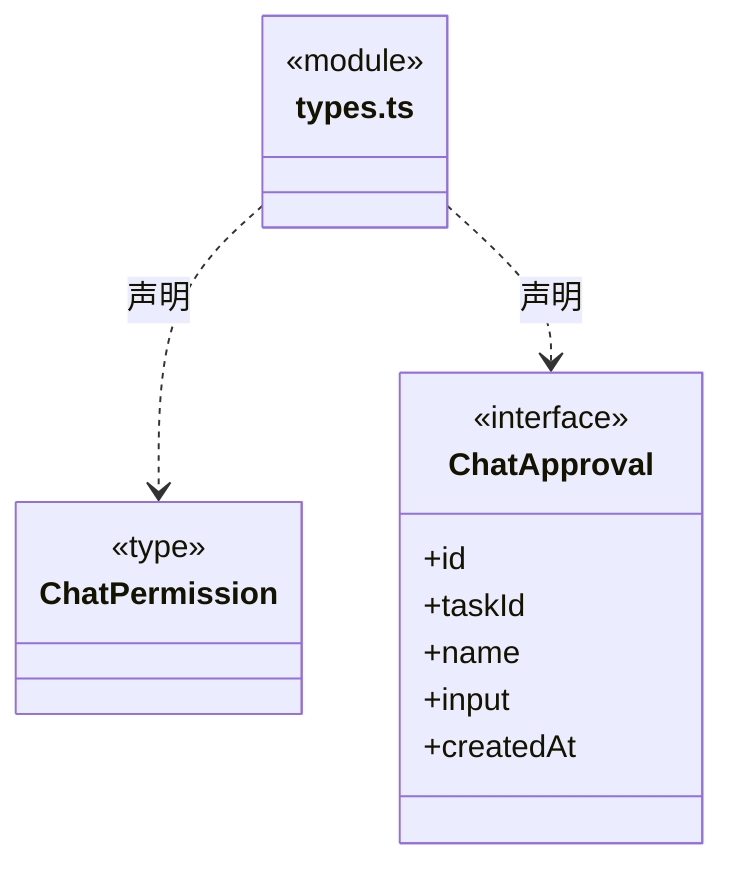
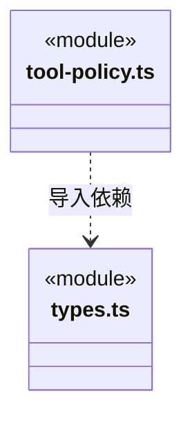

# src/backend/core/policy 架构

## 目录定位

内部运行的统一授权：业务与知识写入共用 read/ask/execute，平台边界不可豁免；不声称操作系统隔离。

本文描述当前实现。通过分析目录边界后维护的 [源码架构脚本](../../../../scripts/source-architecture.mjs) 同步清单和声明；代码变更时仍须核对职责、关键成员与关系。

## 代码清单

| 文件 | 当前职责 |
| --- | --- |
| [tool-policy.ts](tool-policy.ts) | 内部 Loop 的统一工具授权策略，同时处理业务文件与正式知识写入。 |
| [types.ts](types.ts) | 对话权限模式和单次人工确认契约。 |

## 架构类图

### tool-policy.ts

直接依赖：[types.ts](types.ts)、[../tools/types.ts](../tools/types.ts)、[../tools/scope-schema.ts](../tools/scope-schema.ts)、[../governance/module-governance-tools.ts](../governance/module-governance-tools.ts)。

### types.ts

### 本目录调用边界

## 子目录导航

无子目录。

[返回上层](../ARCHITECTURE.md)。

每次修改本目录代码，同步维护文件头、关键契约说明及本图。未实现的治理、证据验收和自动编排能力不列入当前类图。

## 设计契约 v1 与落地范围

以下内容区分已接通能力与后续设计；以各节的实现状态为准，不将目标图当作现状图。维护源：[CONTRACT.md](CONTRACT.md)；生成类图时同步附加，勿直接修改本附录。

### 可信工具范围与逐次权限评估

四个主治理工具由 `module-governance-tools.ts` 的精确效果表分类。只有非原生、单一匹配效果、严格 `knowledge` scope 且工作区一致的可信描述可用；缺作用域、额外效果、未知治理名、伪原生或跨工作区全部拒绝。这个例外不扩展到其他 read/preview 工具，模型不能传 scope。观察/提案保存私有记录，不产生正式知识写入权限，不触发 ask 模式的知识提交批准；原正式写入门禁保持不变。

`tool-policy.ts` 只消费调度层已识别的工具描述与可信运行权限。副作用决定 read/ask/execute 行为；原生路径守卫先于 ask 审批，拒绝或缺失审批不能放行。命令被标记为 unknown 范围，不据此承诺目录沙箱或已知副作用集合。

`RunToolDescriptor.scope` 为可选的可信装配范围。repository 范围必须匹配本轮 workspaceId、实际 cbim_repository_list/get 名称、connectorId 和操作；仅允许非原生且恰好 read 的工具。缺少捕获范围、跨工作区、混合副作用或模型伪造目标均拒绝。旧工具没有新范围时保持原分类行为；策略只核形状和绑定，真实仓库授权与共享代际仍由主进程端口在网络前后复核。

每次调用独立产生决定；策略不存储凭据、不缓存业务批准、不复制外部资源，也不把只读回执转成任务验收。
