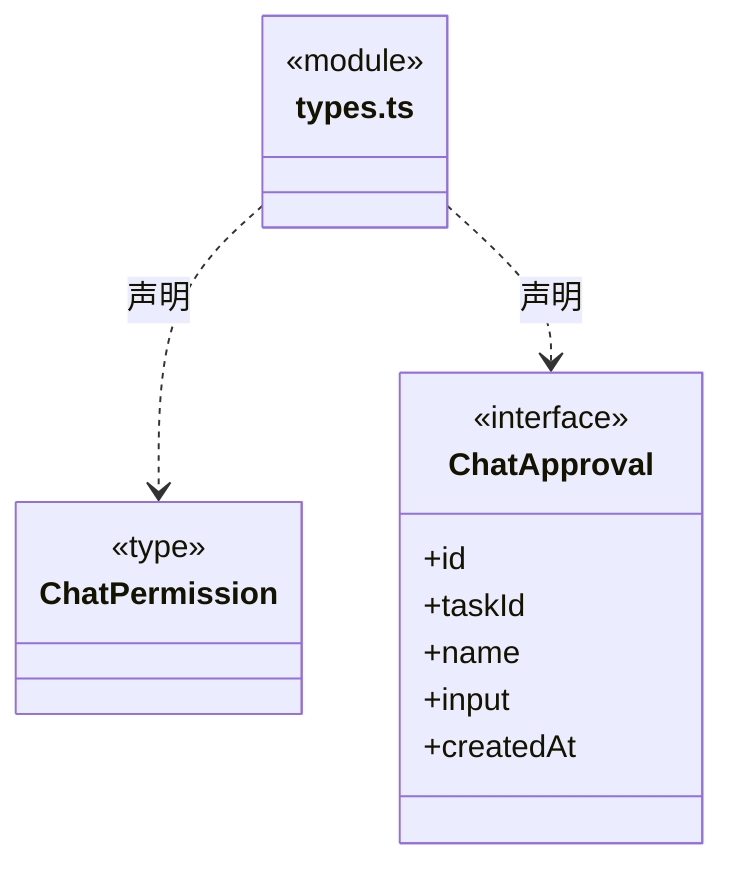

# src/backend/core/policy 架构

## 目录定位

现有对话权限与确认的数据契约。尚未统一知识写开关和原生权限，不将目录存在视为权限重构完成。

本文描述当前实现。通过分析目录边界后维护的 [源码架构脚本](../../../../scripts/source-architecture.mjs) 同步清单和声明；代码变更时仍须核对职责、关键成员与关系。

## 代码清单

| 文件 | 当前职责 |
| --- | --- |
| [types.ts](types.ts) | 对话权限模式和单次人工确认契约。 |

## 架构类图

### types.ts

## 子目录导航

无子目录。

[返回上层](../ARCHITECTURE.md)。

每次修改本目录代码，同步维护文件头、关键契约说明及本图。未实现的治理、证据验收和自动编排能力不列入当前类图。
