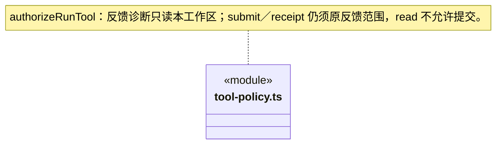

### 固定 GitHub 自动提交许可

只有本轮可信 `feedbackGrant`、完整相等的 `github-feedback` 范围、版本 1、非原生和精确工具效果同时成立时，`cbim_feedback_submit` 才能以 external-write 执行。read 始终拒绝；ask/execute 采用桌面连接时明确授予的该仓库自动提交许可，不再逐 Issue 弹审批。`cbim_feedback_receipt` 只读原提交。其它名字、伪效果、未知 external-write、变更连接或目标都拒绝，不能把该窄授权用于命令、业务写或知识写。

`cbim_feedback_status` 是独立只读诊断，只接受精确名称、版本 1、非原生、单一 read 效果和本工作区 scope；不要求 GitHub 写授权，也不授予该授权。缺 scope、跨工作区、额外效果或伪原生均拒绝。它不是对 `cbim_feedback_*` 前缀的通用放行规则。

### 可信工具范围与逐次权限评估

四个主治理工具由 `module-governance-tools.ts` 的精确效果表分类。只有非原生、单一匹配效果、严格 `knowledge` scope 且工作区一致的可信描述可用；缺作用域、额外效果、未知治理名、伪原生或跨工作区全部拒绝。这个例外不扩展到其他 read/preview 工具，模型不能传 scope。观察/提案保存私有记录，不产生正式知识写入权限，不触发 ask 模式的知识提交批准；原正式写入门禁保持不变。

`tool-policy.ts` 只消费调度层已识别的工具描述与可信运行权限。副作用决定 read/ask/execute 行为；原生路径守卫先于 ask 审批，拒绝或缺失审批不能放行。命令被标记为 unknown 范围，不据此承诺目录沙箱或已知副作用集合。

`RunToolDescriptor.scope` 为可选的可信装配范围。repository 范围必须匹配本轮 workspaceId、实际 cbim_repository_list/get 名称、connectorId 和操作；仅允许非原生且恰好 read 的工具。缺少捕获范围、跨工作区、混合副作用或模型伪造目标均拒绝。旧工具没有新范围时保持原分类行为；策略只核形状和绑定，真实仓库授权与共享代际仍由主进程端口在网络前后复核。

JSON/CSV/PNG 验证仅允许准确的 `cbim_validation_run` 名称、非原生且单一 `read` 效果，不因验证取得命令或知识写入权。真实注册仍须由正式成员的冻结要求及平台能力决定；策略不按模型提供的路径或 Schema 授权，不将成功回执当作验证通过。

每次调用独立产生决定；策略不存储凭据、不缓存业务批准、不复制外部资源，也不把只读回执转成任务验收。

### 模块岗位负责人逐次授权

`module-ownership-tool-policy.ts` 的四项精确工具表独立于知识目录。inspect/receipt 为 read，change_preview 为 preview，change_commit 为 knowledge-write；只有非原生、单一匹配效果和当前工作区 knowledge scope 才可分类。未知同前缀、模型传入范围或混合效果不能取得例外。提交在 read 下拒绝，在 ask 下沿真实审批，在 execute 下仍须通过来源、版本和串行事务门禁；授权不代表业务验收或已经按该岗位派发。

## 受控业务写权限

`cbim_file_write_controlled` 只能按准确的内部 business-write 和本工作区 scope 分类。read 拒绝，ask 逐次批准，execute 仍需要正式成员工厂和 Runtime 的一次授权；主调度在上层始终拒绝业务写。native:false 不进入原 native guard，因此实际平台独立核完整路径和句柄，不能据工具名字推断沙箱。

### 刷新原事务与契约版本

RunToolDescriptor.contractVersion 是实际注册表的可选元数据，供 Runtime 原授权记录；不参与权限授予，缺省表示未声明，不从 input 补齐。已有 read/ask/execute、守卫与审批顺序保持。

CSV 表格条件不增加工具权限：仍为一次受控只读检查；公式文本不执行，验证器声明不授予命令能力或访问外部服务。

PNG验证仍只允许同一非原生read工具；解压器只在平台处理已安全读取的字节，没有用户命令、网络或图像程序调用权限。生成图片本身仍由执行成员使用原任务授权，不因验证能力获得额外写入或命令权。

## 冻结范围成员执行

cbim_scoped_read 固定read、cbim_scoped_node固定command，两者要求内部注册及contractVersion=1。command沿read拒绝/ask逐次批准；隔离配置不扩大原权限。
