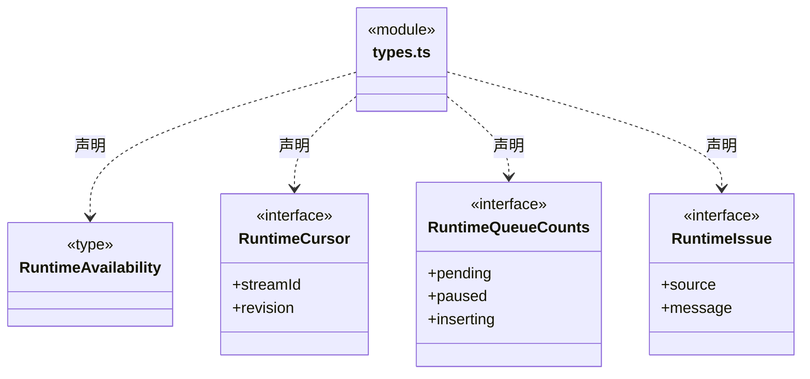
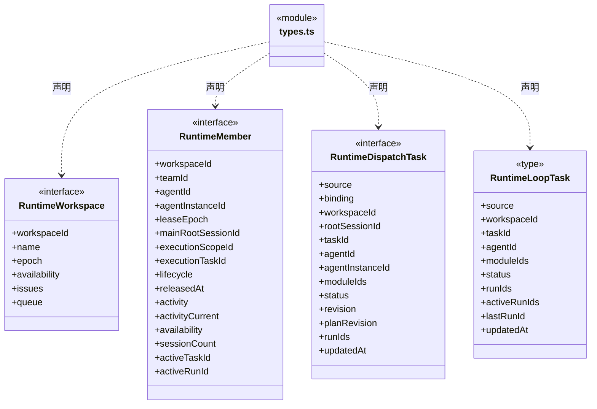
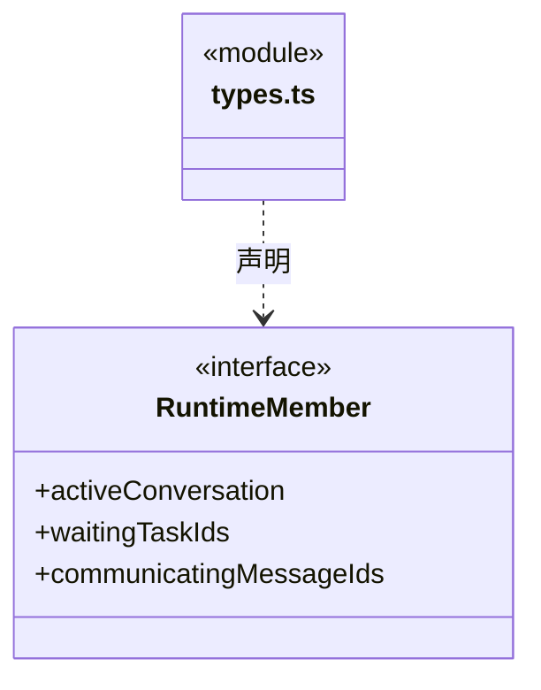
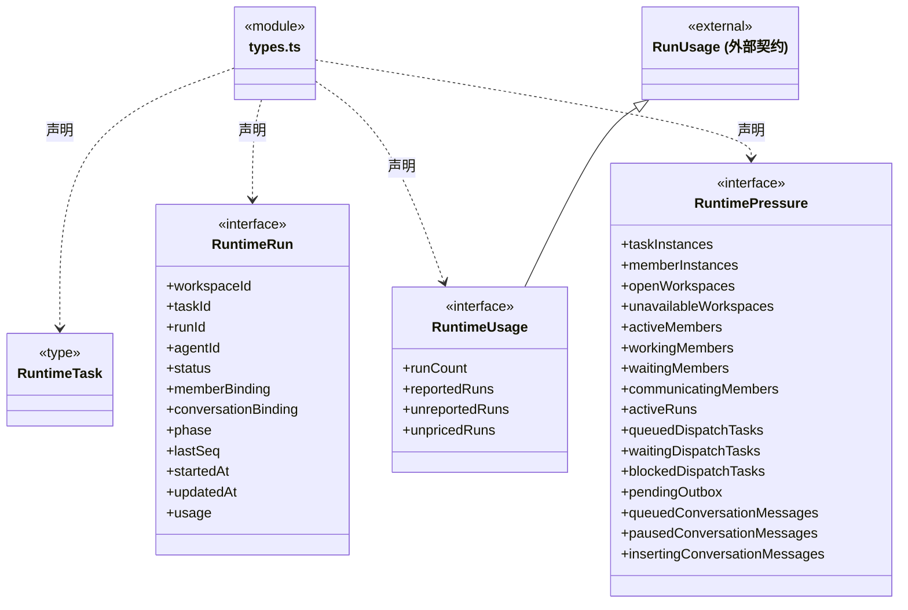
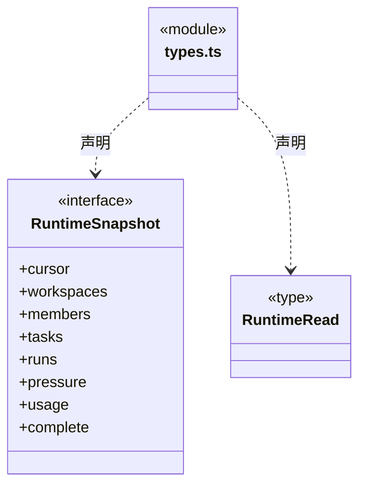

# src/backend/core/runtime 架构

## 目录定位

应用级运行监管契约：主会话和正式任务按可信绑定归属实例，旧 Loop 无绑定保留 role-only；实时对话占用、轮次用量和负载分开表达，只读投影不签发执行权。

本文描述当前实现。通过分析目录边界后维护的 [源码架构脚本](../../../../scripts/source-architecture.mjs) 同步清单和声明；代码变更时仍须核对职责、关键成员与关系。

## 代码清单

| 文件 | 当前职责 |
| --- | --- |
| [types.ts](types.ts) | 定义应用级人员、任务与运行消耗的只读监管契约，供调度索引和桌面桥接共同使用。 |

## 架构类图

### types.ts

成员 1/2（同名节点为同一声明，跨图合并阅读）。

成员 2/2（同名节点为同一声明，跨图合并阅读）。

直接依赖：[../brain/types.ts](../brain/types.ts)、[../brain/usage.ts](../brain/usage.ts)、[../tasks/graph-types.ts](../tasks/graph-types.ts)、[../team/agent-types.ts](../team/agent-types.ts)、[../brain/member-run.ts](../brain/member-run.ts)、[../brain/conversation-binding.ts](../brain/conversation-binding.ts)。

## 子目录导航

无子目录。

[返回上层](../ARCHITECTURE.md)。

每次修改本目录代码，同步维护文件头、关键契约说明及本图。未实现的治理、证据验收和自动编排能力不列入当前类图。

## 设计契约 v1 与落地范围

以下内容区分已接通能力与后续设计；以各节的实现状态为准，不将目标图当作现状图。维护源：[CONTRACT.md](CONTRACT.md)；生成类图时同步附加，勿直接修改本附录。

### 全局运行监管契约（已实现）

`types.ts` 公开工作区、成员、两种任务来源、执行轮次、负载和消耗 DTO。静态 Agent 定义仍归 Team；运行索引管理器在调度层实现。

- `activityCurrent` 区分当前观察与历史活动；工作区不可用/关闭时不计活跃人员。
- `RuntimeMember.mainRootSessionId` 保留已登记主实例的会话归属，空闲时也可区分不同会话的主实例；普通成员和无归属字段的旧实例不补造值。
- 派发任务携带实例身份；成员轮次的 `RuntimeRun.memberBinding` 来自已核验的起始事件/恢复摘要，归属原派发任务，不再合成重复 Loop 任务。
- 普通主对话使用互斥的 `RuntimeRun.conversationBinding`，其 Loop 任务为 `binding=instance`，包含 `agentInstanceId/rootSessionId/agentSessionId`。不同主会话默认使用独立主调度实例，正式业务节点使用独立执行实例。旧 Loop 无绑定时保留 `binding=role-only`，禁止按角色名猜实例。
- `executionScopeId/executionTaskId/lifecycle/releasedAt` 公开执行实例的周期归属和释放事实。`members` 保留历史；`pressure.memberInstances` 仅计未释放实例，released 不再计活跃运行或排队/等待/阻塞压力。累计用量仍按真实日志保留，不因释放删除或重复计费。主调度实例随会话保留。
- `RuntimeMember.activeConversation` 仅来自本代际真实活跃的对话运行，不借用 `activeTaskId` 冒充派发业务任务。等待工具授权映射为 waiting，其余运行阶段映射为 working；运行终态移除此活动投影，工作区关闭/不可用和历史恢复均不产生假活跃。
- 邮箱负载只统计 `delivery=pending`；claimed/processed 留在权威日志用于审计，不重复计待消费数量。
- RuntimeUsage 是累计报告消费；上下文占用不计入总数，未知用量/价格有显式字段。
- `complete=false` 表示存在未加载/损坏来源，部分数字不是全系统精确值。
- RuntimeRead 无变化只返回游标，有变化返回快照。投影不签发调度、租约、权限或验收。
- 成员日志与对话日志均纳入累计消费，按 workspace/task/run/seq 去重；公开成员绑定只有身份和版本，不包含原生会话文件、知识正文或授权。

详见[全局管理设计与实际范围](../../../../docs/global-runtime-management.md)。
