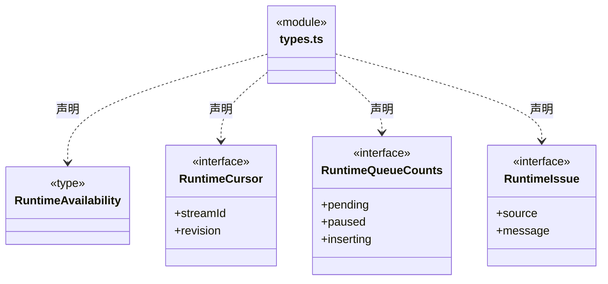
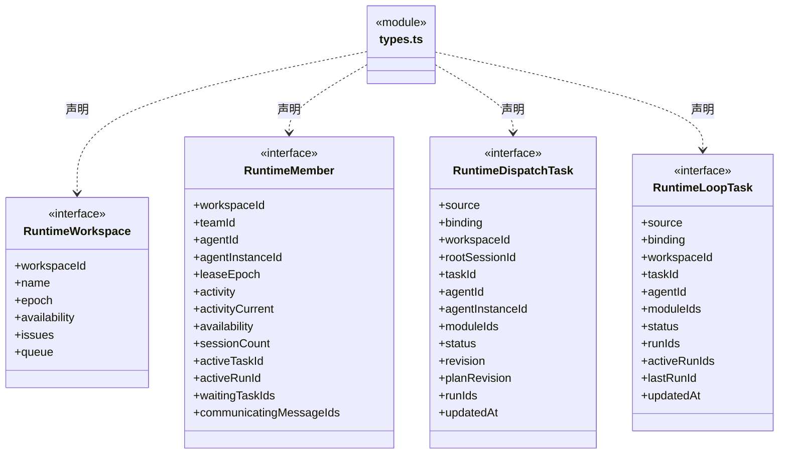
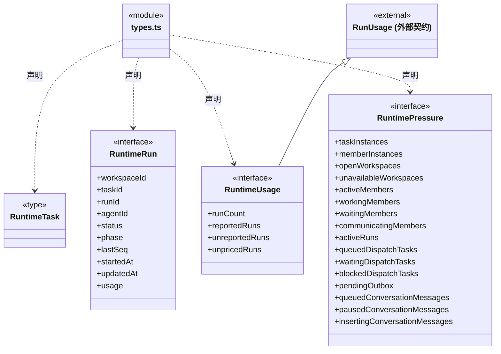
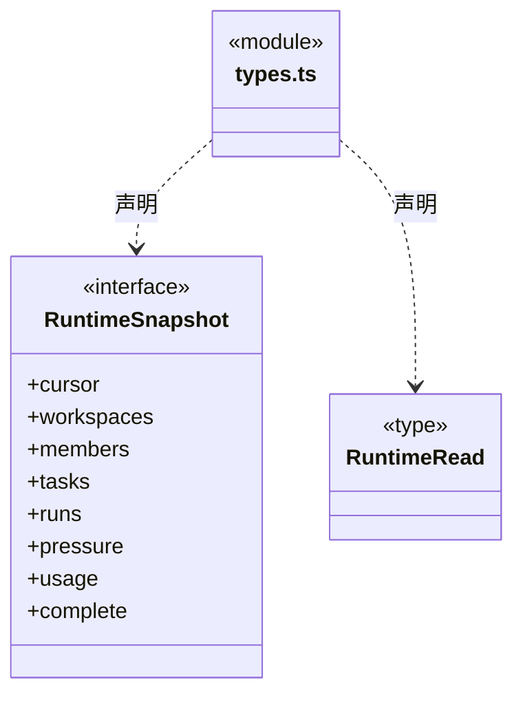

# src/backend/core/runtime 架构

## 目录定位

应用级运行监管契约：动态成员、派发任务、旧 Loop 任务、轮次用量和负载分开表达；只读投影不签发调度、租约或权限。

本文描述当前实现。通过分析目录边界后维护的 [源码架构脚本](../../../../scripts/source-architecture.mjs) 同步清单和声明；代码变更时仍须核对职责、关键成员与关系。

## 代码清单

| 文件 | 当前职责 |
| --- | --- |
| [types.ts](types.ts) | 定义应用级人员、任务与运行消耗的只读监管契约，供调度索引和桌面桥接共同使用。 |

## 架构类图

### types.ts

直接依赖：[../brain/types.ts](../brain/types.ts)、[../brain/usage.ts](../brain/usage.ts)、[../tasks/graph-types.ts](../tasks/graph-types.ts)、[../team/agent-types.ts](../team/agent-types.ts)。

## 子目录导航

无子目录。

[返回上层](../ARCHITECTURE.md)。

每次修改本目录代码，同步维护文件头、关键契约说明及本图。未实现的治理、证据验收和自动编排能力不列入当前类图。

## 设计契约 v1 与落地范围

以下内容区分已接通能力与后续设计；以各节的实现状态为准，不将目标图当作现状图。维护源：[CONTRACT.md](CONTRACT.md)；生成类图时同步附加，勿直接修改本附录。

### 全局运行监管契约（已实现）

`types.ts` 公开工作区、成员、两种任务来源、执行轮次、负载和消耗 DTO。静态 Agent 定义仍归 Team；运行索引管理器在调度层实现。

- `activityCurrent` 区分当前观察与历史活动；工作区不可用/关闭时不计活跃人员。
- 派发任务携带实例身份，旧 Loop 只知道角色，保留 `binding=role-only`，两种任务 ID 不混用。
- RuntimeUsage 是累计报告消费；上下文占用不计入总数，未知用量/价格有显式字段。
- `complete=false` 表示存在未加载/损坏来源，部分数字不是全系统精确值。
- RuntimeRead 无变化只返回游标，有变化返回快照。投影不签发调度、租约、权限或验收。

详见[全局管理设计与实际范围](../../../../docs/global-runtime-management.md)。
