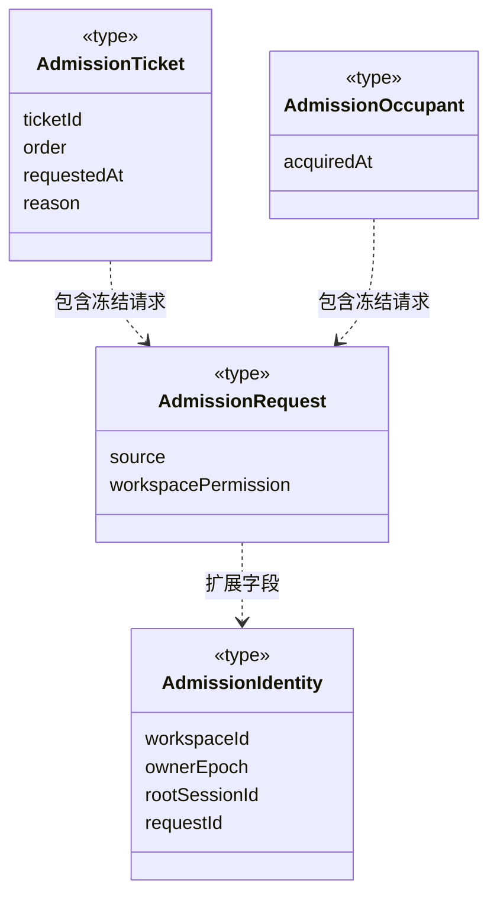
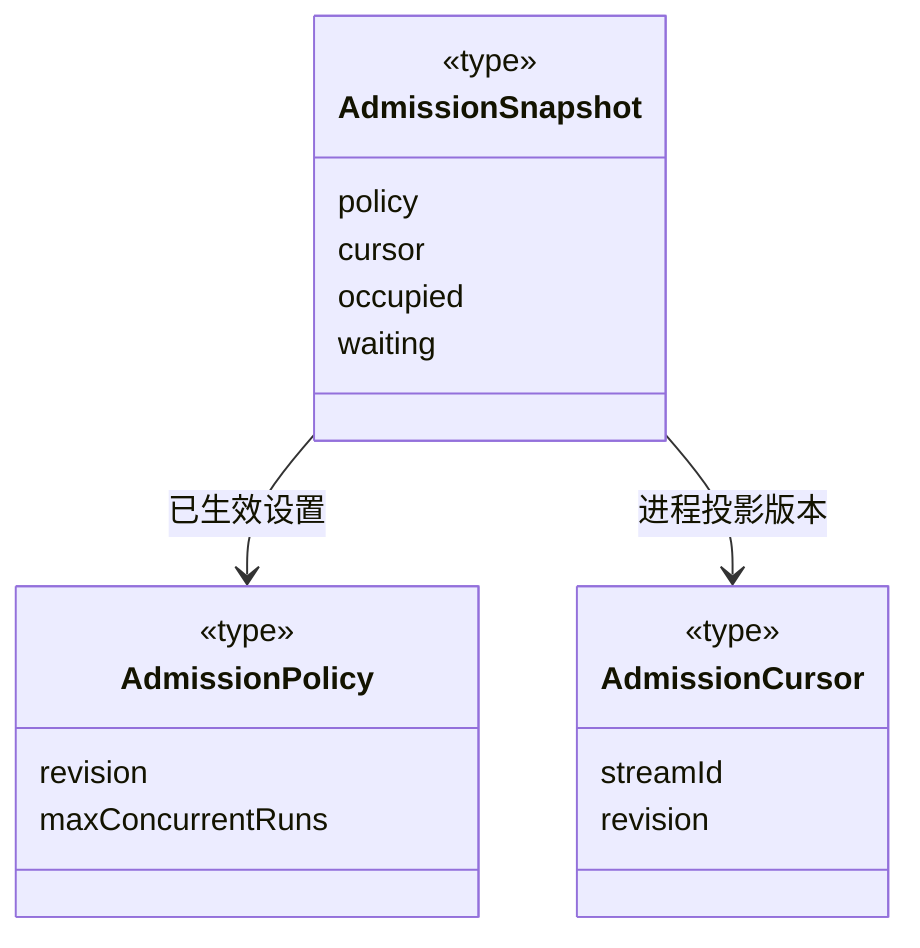

### 全局运行监管契约（已实现）

`types.ts` 公开工作区、成员、两种任务来源、执行轮次、负载和消耗 DTO。静态 Agent 定义仍归 Team；运行索引管理器在调度层实现。

- `activityCurrent` 区分当前观察与历史活动；工作区不可用/关闭时不计活跃人员。
- `RuntimeMember.mainRootSessionId` 保留已登记主实例的会话归属，空闲时也可区分不同会话的主实例；普通成员和无归属字段的旧实例不补造值。
- 派发任务携带实例身份；成员轮次的 `RuntimeRun.memberBinding` 来自已核验的起始事件/恢复摘要，归属原派发任务，不再合成重复 Loop 任务。
- 普通主对话使用互斥的 `RuntimeRun.conversationBinding`，其 Loop 任务为 `binding=instance`，包含 `agentInstanceId/rootSessionId/agentSessionId`。不同主会话默认使用独立主调度实例，正式业务节点使用独立执行实例。旧 Loop 无绑定时保留 `binding=role-only`，禁止按角色名猜实例。
- `executionScopeId/executionTaskId/lifecycle/releasedAt` 公开执行实例的周期归属和释放事实。`members` 保留历史；`pressure.memberInstances` 仅计未释放实例，released 不再计活跃运行或排队/等待/阻塞压力。累计用量仍按真实日志保留，不因释放删除或重复计费。主调度实例随会话保留。
- `RuntimeMember.activeConversation` 仅来自本代际真实活跃的对话运行，不借用 `activeTaskId` 冒充派发业务任务。等待工具授权映射为 waiting，其余运行阶段映射为 working；运行终态移除此活动投影，工作区关闭/不可用和历史恢复均不产生假活跃。
- 邮箱负载只统计 `delivery=pending`；claimed/processed 留在权威日志用于审计，不重复计待消费数量。
- RuntimeUsage 是累计报告消费；上下文占用不计入总数，未知用量/价格有显式字段。
- `complete=false` 表示存在未加载/损坏来源，部分数字不是全系统精确值。
- RuntimeRead 无变化只返回游标，有变化返回快照。投影不签发调度、租约、权限或验收。
- `RuntimeSnapshot.scopes` 始终存在，按真实工作区和主会话区分目标周期；旧无周期记录保持空集，不按角色、时间或运行日志补造。派发任务的可选 `scopeId` 只复制原节点归属。
- `RuntimeScope` 公开 active/waiting/closed、关闭结果、目标版本和审阅申请，以及最多 240 字符的等待/阻塞原因。`reviewDecision=complete` 不是目标完成；只有原周期的 closed/outcome 表示已提交结算。关闭后的 wait 是历史，不能自动恢复。预算阻塞只公开原因，不带额度、证明或新的准入许可。
- `runtime-scope.ts` 显式投影白名单，排除目标正文、完整审阅、人工记录、原生检查点和运行清单。`runtime-validation.ts` 严格校验传输字段、引用身份、唯一集合及外层/快照游标；无 default、transform 或缺省计量补值。工作区来源完整与用量完整是两件事，`complete=true` 不能当成全额计量或业务验收。
- 成员日志与对话日志均纳入累计消费，按 workspace/task/run/seq 去重；公开成员绑定只有身份和版本，不包含原生会话文件、知识正文或授权。

详见[全局管理设计与实际范围](../../../../docs/global-runtime-management.md)。

### 全局运行准入契约

`admission.ts` 与只读负载索引分开定义运行准入。`AdmissionIdentity` 固定 workspaceId、ownerEpoch、rootSessionId、requestId，可附本次 agentInstanceId/scopeId/taskId；ownerEpoch 是进程内工作区装配代际，不是成员 leaseEpoch。身份只含安全 ID，不接收路径、正文、模型密钥或用户授权。

`AdmissionRequest` 冻结 source（direct/member/main-result）和 workspacePermission（read/ask/execute）；ask 与 execute 均按工作区独占处理。direct 没有已受理首轮意图，容量不足不留下票据。其余请求的 `AdmissionTicket` 保存固定 ticketId/order/requestedAt 和当前等待原因 global_capacity/workspace_conflict/agent_busy/fairness；等待不代表运行启动，不增加时间、Token 或费用。

`AdmissionPolicy` 默认 revision=1、maxConcurrentRuns=4，上限范围 1～32。configure 请求使用当前 revision 做 CAS，成功保存的新版本递增；降低额度不驱逐已占用运行。完整持久策略仅能在启动恢复阶段安装，不能在准入已开始后回滚版本。

`AdmissionSnapshot` 暴露独立 cursor/policy/occupied/waiting，Occupant 只增加 acquiredAt；不混入历史统计。`AdmissionRead` 同游标返回 noop，不同或未来游标返回 snapshot。所有传输 schema 严格校验未知字段和身份。票据仅属于当前进程；重启不能凭快照恢复模型或工具执行。

以下展开由严格 Schema 推导、自动声明图未展开的关键字段；全部是 `admission.ts` 的传输类型，不是运行服务。

