# src/backend/core/tasks 架构

## 目录定位

任务计划、派发图、目标与等待。资料清单保留旧文件v1，新增严格v2来源并核同序与字节；快照不等于当前来源或业务验收。依赖追加核实两端及后继未领取、当前计划与真实图，完整审计验证后才放行精确新边；保留原任务/实例，领取时绑定真实结果。运行内补充以pending/accepted/rejected/unknown分开，接受与waiting共享连续输入版本，未知阻止完成。流程选择共用叶子契约，缺省与显式分开匹配，已派发选择不可改写；严格输出区分保存与交付，历史不补造授权或证据。 model-request-budget-storage 只公开请求预算状态、追加命令及准入能力，不授予其它领域写入。 正式协议将目标分配、任务、准备、模型和历史审计相互核对；岗位绑定不可重写，旧在途仅按原事实收束。 检查点显式放弃有独立严格协议与精确联合变更校验；原任务和检查点证据不可重写，纯 ACK 与后续周期释放保持可用。 原主命令核实定义八工具的有界报告；原工具结果、事务保存和业务验收分开，查询回执不能成为交付证据。 主／成员影响来源使用严格联合；观察、不可变处置和新核实／修复引用分别表达，当前文件不补造成功基线或业务验收。纯 scope-public 白名单供主工具与会话详情共用，保留安全恢复来源并隐藏原生上下文。 影响报告的可选知识事务摘要保留原工具状态并参与观察依据；旧处置缺省不补字段。 单文件操作公开协议不含正文备份；私有意图与阶段严格绑定原成员运行和原授权，补偿引用可靠 applied 与真实 before，终态不可改写。 保守产物时序包含外部写，GitHub 回执不能充当文件基线来源。

本文描述当前实现。通过分析目录边界后维护的 [源码架构脚本](../../../../scripts/source-architecture.mjs) 同步清单和声明；代码变更时仍须核对职责、关键成员与关系。

## 代码清单

| 文件 | 当前职责 |
| --- | --- |
| [automatic-execution-rules.ts](automatic-execution-rules.ts) | 在同一派发存储前缀核实自动兜底与可信周期的关联。 |
| [automatic-return.ts](automatic-return.ts) | 定义已结算主轮等待成员结果的不可变批次，供调度存储与重启接收共用。 |
| [checkpoint-handoff-invariants.ts](checkpoint-handoff-invariants.ts) | 核实检查点放弃的不可变历史和精确联合事务，返回仅供检查点状态机使用的任务许可。 |
| [checkpoint-handoff-rules.ts](checkpoint-handoff-rules.ts) | 从同一派发快照选择可明确终止的检查点，或核实已放弃来源供后继换边。 |
| [checkpoint-handoff.ts](checkpoint-handoff.ts) | 定义主调度明确放弃未消费检查点的严格请求、不可变处置审计和回执。 |
| [command-verification-output.ts](command-verification-output.ts) | 后端原命令报告的回执归属校验与紧凑公共投影，复用现有主工具输出契约。 |
| [command-verification.ts](command-verification.ts) | 声明原主命令只读核实的严格请求、有界报告及写工具支持矩阵，含多边前置修订摘要。 |
| [continuation-source-snapshot.ts](continuation-source-snapshot.ts) | 安全等待资料导入的严格来源摘要与私有文本快照协议，供 Main 保存及 Core 清单校验共用。 |
| [coordination-preview.ts](coordination-preview.ts) | 从一次派发存储读取投影目标版本、可引用候选和撤销/等待清单。 |
| [dispatch-commands.ts](dispatch-commands.ts) | 第一阶段成员注册与主会话派发的命令及回执契约。 |
| [dispatch-execution.ts](dispatch-execution.ts) | 声明成员任务执行的后端持久化记录，连接已派发任务与同一大脑内核的运行身份。 |
| [dispatch-invariants.ts](dispatch-invariants.ts) | 在派发事务提交和日志恢复时校验成员执行、任务图和邮箱的联合约束。 |
| [dispatch-receipt.ts](dispatch-receipt.ts) | 主调度与桌面内联任务共用的纯派发回执结构，不包含 IO、哈希或原命令核实。 |
| [dispatch-scope-invariants.ts](dispatch-scope-invariants.ts) | 校验调度周期、不可变回传批次、等待检查点、运行中补充和显式接续的持久状态及原子变更，供派发存储提交与重放共用。 |
| [dispatch-scope.ts](dispatch-scope.ts) | 定义一次用户任务的调度周期及不可变待回传批次，与长期主会话和单次模型运行区分。 |
| [effect-observation-invariants.ts](effect-observation-invariants.ts) | 在唯一派发 Store 的实时提交与原日志重放中核实影响处置附录及新周期引用。 |
| [effect-observation-rules.ts](effect-observation-rules.ts) | 计算影响观察的事实依据与处置命令，并构造原不可变回执/摘要。 |
| [effect-observation.ts](effect-observation.ts) | 定义原成员/主调用的影响观察、本机处置附录及后续周期关系的公开叶子契约。 |
| [execution-context.ts](execution-context.ts) | 成员业务执行所需的可持久化知识快照，以及存储与调度共用的完整性校验。 |
| [execution-report.ts](execution-report.ts) | 成员执行异常核实的只读报告协议，供调度服务与界面共享。 |
| [fresh-context.ts](fresh-context.ts) | 定义显式新周期共用的原生上下文隔离边界。 |
| [graph-reducer.ts](graph-reducer.ts) | 把已提交的图事件原子转换为内存投影，并按游标输出增量读取结果。 |
| [graph-rules.ts](graph-rules.ts) | 任务图的纯领域校验，完整图与单项公开查询共用节点状态规则，并检查身份、派发父关系及依赖/等待无环。 |
| [graph-types.ts](graph-types.ts) | 任务派发图的可序列化领域契约，供调度、持久化和 Bridge 共同引用。 |
| [human-continuation-invariants.ts](human-continuation-invariants.ts) | 保护人工意见的一次消费、主体冻结及返工引用；独立业务拒绝仅绑定精确旧候选，不能替代人工接受。 |
| [human-continuation-rules.ts](human-continuation-rules.ts) | 提供人工接续的最新记录选择、当前输入版本定位和业务主体比较。 |
| [human-continue.ts](human-continue.ts) | 定义按本机已保存人工决定显式继续原目标的严格协议与业务主体快照。 |
| [human-decision-invariants.ts](human-decision-invariants.ts) | 保护人工决定在周期联合事务及重放中的追加历史、当前依据和无执行副作用边界。 |
| [human-decision-proof.ts](human-decision-proof.ts) | 将人工决定预览收敛为有界的真实依据，并生成与读取时间、并发序列无关的内容指纹。 |
| [human-decisions.ts](human-decisions.ts) | 定义本机显式人工决定的请求、精确依据和只读历史，供调度与桌面共同校验。 |
| [human-reconsideration.ts](human-reconsideration.ts) | 比较原人工意见与当前等待的真实预览，给出逐项差异和明确重新决定资格。 |
| [knowledge-source-invariants.ts](knowledge-source-invariants.ts) | 来源事件与岗位/责任采纳的同事务许可，连接纯来源日志和 DispatchStore。 |
| [main-tool-output.ts](main-tool-output.ts) | 主调度工具的公开业务输出契约与可信调用归属校验，前置修订严格对应原增删请求；派发的纯回执结构由 dispatch-receipt 共用，业务核实仍留在此处。 |
| [main-tool-scope.ts](main-tool-scope.ts) | 主调度工具读取周期的公开白名单投影，保留规划、审阅和显式接续实际需要的事实。 |
| [member-checkpoint-chain.ts](member-checkpoint-chain.ts) | 读取同任务的有序检查点和预约历史，供图、调度及公开视图选择当前段。 |
| [member-checkpoint-evidence.ts](member-checkpoint-evidence.ts) | 运行时和结算端共用成员检查点的纯证据门禁，核实文件来源全集、暂存/结束回执和正常终态。 |
| [member-checkpoint-invariants.ts](member-checkpoint-invariants.ts) | 检查成员逐段检查点、不可变预约历史和每段唯一消费在图/运行/邮箱联合事务中的一致性。 |
| [member-checkpoint-ledger.ts](member-checkpoint-ledger.ts) | 从同一派发快照核实已完成且最新段未消费的检查点链，供等待、预约与交接共用。 |
| [member-checkpoint-tools.ts](member-checkpoint-tools.ts) | 包装正式执行成员的检查点工具，限制模型输入并将真实调用 ID 交给运行时。 |
| [member-checkpoint.ts](member-checkpoint.ts) | 定义成员有界文件任务的合作式检查点请求、可信交接记录和后端原生历史证明。 |
| [member-commands.ts](member-commands.ts) | 可信桌面入口启动、观察和停止成员任务，以及读取和确认结果信封的序列化契约。 |
| [member-events.ts](member-events.ts) | 成员运行的公开事件分页协议，供主对话和任务节点详情复用现有消息渲染。 |
| [member-help-tools.ts](member-help-tools.ts) | 为正式执行成员提供一次性求助工具，并在求助授权至本轮结束期间封住后续工具调用。 |
| [member-help.ts](member-help.ts) | 定义执行成员向主调度单向提交的结构化求助，以及安全结算后的不可变交接记录。 |
| [member-pause-rules.ts](member-pause-rules.ts) | 在同一派发快照中选择可持久等待的原检查点与未领取后继，供服务和 Store 重放独立裁决。 |
| [member-pause.ts](member-pause.ts) | 定义可靠成员检查点及未领取后继的显式持久等待清单，供目标审阅与等待归档共用。 |
| [member-tool-output.ts](member-tool-output.ts) | 执行进度四工具及正式成员三工具的严格输出、真实归属和公开恢复说明。 |
| [module-ownership-invariants.ts](module-ownership-invariants.ts) | 将负责人控制面接到同一派发事务，重算关联任务影响并核实真实主运行来源。 |
| [owner-execution-invariants.ts](owner-execution-invariants.ts) | 校验负责人协议下的新计划、任务、前置增删闭包、预约和领取，以及历史冻结身份。 |
| [persistent-write-input.ts](persistent-write-input.ts) | 后端从可信主 canonical 与唯一周期重建三项持久写命令的原查询引用。 |
| [persistent-write-observation.ts](persistent-write-observation.ts) | 原治理观察、提案及责任变更的有界保存摘要，供影响报告与桌面共同读取。 |
| [queue.ts](queue.ts) | 待执行用户消息的校验结构与增量同步契约。 |
| [queued-dependency-addition-invariants.ts](queued-dependency-addition-invariants.ts) | 核实追加依赖的不可变审计与精确原子变更，并向统一边门禁返回本批已验证的新边许可。 |
| [queued-dependency-addition-rules.ts](queued-dependency-addition-rules.ts) | 从同一派发快照选取可追加前置的两端及其完整未领取后继，供提交与重放共用。 |
| [queued-dependency-addition.ts](queued-dependency-addition.ts) | 声明主调度为未领取任务追加单条结果前置的严格输入、不可变审计和提交回执。 |
| [queued-dependency-replacement-invariants.ts](queued-dependency-replacement-invariants.ts) | 校验前置替换的原子审计，以及所有依赖边变更的持久化边界。 |
| [queued-dependency-replacement-rules.ts](queued-dependency-replacement-rules.ts) | 纯选取单条前置替换的目标、可靠候选及完整未启动后继集合，供提交服务和重放校验共用。 |
| [queued-dependency-replacement.ts](queued-dependency-replacement.ts) | 定义主调度替换未启动任务单条前置的严格输入、不可变审计和可靠提交回执。 |
| [queued-dependency-revision-invariants.ts](queued-dependency-revision-invariants.ts) | 验证多边前置修订的原审计、精确节点/成员/边变更，返回本批新增与退役许可。 |
| [queued-dependency-revision-rules.ts](queued-dependency-revision-rules.ts) | 计算同一未领取目标的前置原子修订及完整受影响后继，供真实提交与重放校验。 |
| [queued-dependency-revision.ts](queued-dependency-revision.ts) | 声明未领取目标多条前置增删的输入、不可变审计和原命令回执，供图与工具共享。 |
| [queued-member-resume-rules.ts](queued-member-resume-rules.ts) | 在已提交状态中选择唯一可预约的成员检查点与尚未启动的依赖后继。 |
| [queued-member-resume.ts](queued-member-resume.ts) | 主调度为同一活动任务预约一次检查点续执行的纯协议。 |
| [queued-task-cancel-rules.ts](queued-task-cancel-rules.ts) | 在存储屏障内检查未启动任务及启用依赖的完整撤销集合。 |
| [queued-task-cancel.ts](queued-task-cancel.ts) | 定义主调度显式撤销未启动任务的输入、冻结记录及原子提交回执。 |
| [scope-active-input-rules.ts](scope-active-input-rules.ts) | 校验运行中补充的可靠尝试、唯一结算和目标增版，供事务提交与重放共用。 |
| [scope-active-input.ts](scope-active-input.ts) | 运行中用户补充的持久尝试、可信发送令牌及公开输入版本关系。 |
| [scope-continuation-attachments.ts](scope-continuation-attachments.ts) | 安全等待补充的附件 ID、紧凑快照清单及可信受理参数，供 Main、调度事务和公开回执共用。 |
| [scope-continuation-record.ts](scope-continuation-record.ts) | 组合真实文本补充与人工决定接续的共同有序持久历史。 |
| [scope-continuation.ts](scope-continuation.ts) | 定义安全等待检查点、用户显式补充原目标的请求和一次性启动意图。 |
| [scope-goal.ts](scope-goal.ts) | 定义目标输入、版本化计划、审阅证据及转换规则；业务拒绝精确绑定旧候选，新候选仍须独立验收。 |
| [scope-public.ts](scope-public.ts) | 提供周期详情与主工具共用的纯公开 Schema、类型和白名单投影。 |
| [scope-recovery.ts](scope-recovery.ts) | 定义用户显式新建只读核实周期的请求、冻结启动意图及公开回执。 |
| [scope-replan.ts](scope-replan.ts) | 定义完成只读核实后显式创建业务新周期的预览、启动意图和公开回执。 |
| [scope-run-invariants.ts](scope-run-invariants.ts) | 在派发事务提交和重放时核验周期主运行清单的完整归属及追加边界。 |
| [scope-run-tracking.ts](scope-run-tracking.ts) | 定义新调度周期从创建起登记的主运行清单及纯追加规则。 |
| [scope-view.ts](scope-view.ts) | 定义主会话调度周期的公开摘要、选中详情和独立增量投影，供存储与界面共享。 |
| [types.ts](types.ts) | 业务目标和冻结上下文的任务定义。 |
| [workflow-selection.ts](workflow-selection.ts) | 目标分配、派发和任务历史共用的 Workflow 选择叶子协议，不依赖知识或调度实现。 |
| [workspace-member-invariants.ts](workspace-member-invariants.ts) | 将岗位登记的单条审计规则接到工作区 DispatchStore 的提交与重放边界。 |

## 架构类图

### automatic-execution-rules.ts

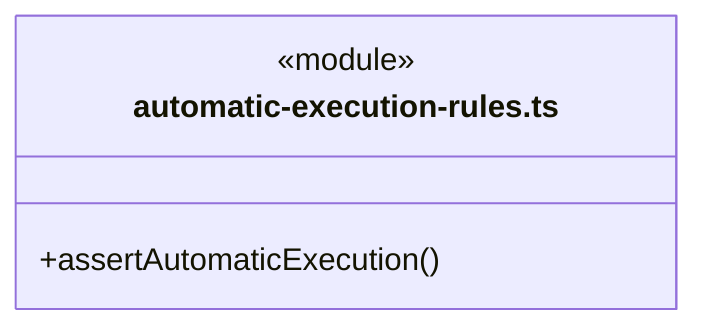

直接依赖：[../foundation/errors.ts](../foundation/errors.ts)、[../team/automatic-execution.ts](../team/automatic-execution.ts)、[../dispatch/dispatch-storage.ts](../dispatch/dispatch-storage.ts)。

### automatic-return.ts

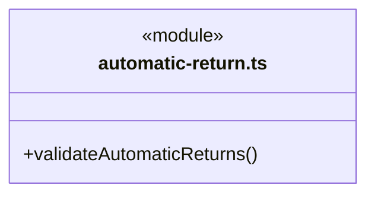

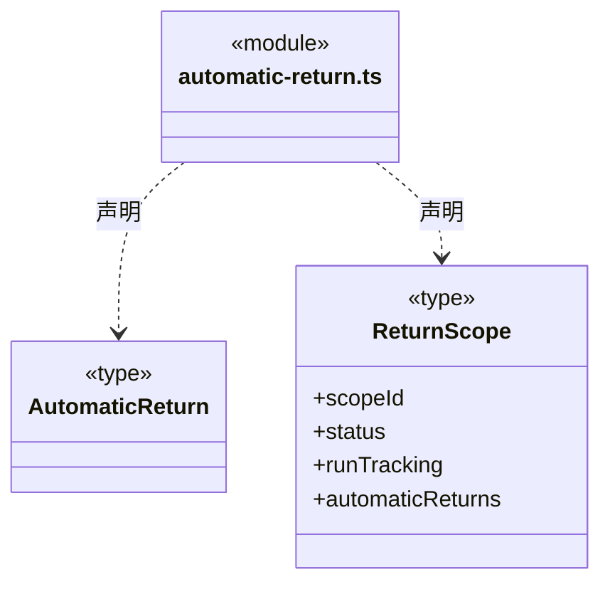

直接依赖：[../foundation/errors.ts](../foundation/errors.ts)、[graph-types.ts](graph-types.ts)、[scope-goal.ts](scope-goal.ts)、[../models/engine.ts](../models/engine.ts)。

### checkpoint-handoff-invariants.ts

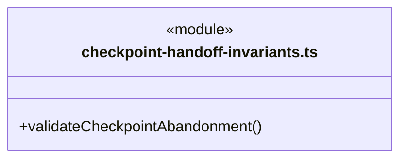

直接依赖：[../foundation/errors.ts](../foundation/errors.ts)、[../dispatch/dispatch-storage.ts](../dispatch/dispatch-storage.ts)、[graph-types.ts](graph-types.ts)、[checkpoint-handoff.ts](checkpoint-handoff.ts)、[checkpoint-handoff-rules.ts](checkpoint-handoff-rules.ts)、[scope-goal.ts](scope-goal.ts)、[member-checkpoint-chain.ts](member-checkpoint-chain.ts)。

### checkpoint-handoff-rules.ts

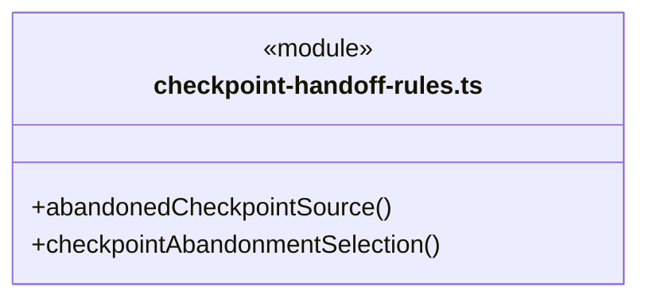

直接依赖：[../foundation/errors.ts](../foundation/errors.ts)、[../dispatch/dispatch-storage.ts](../dispatch/dispatch-storage.ts)、[graph-types.ts](graph-types.ts)、[checkpoint-handoff.ts](checkpoint-handoff.ts)、[member-checkpoint-ledger.ts](member-checkpoint-ledger.ts)、[member-checkpoint-chain.ts](member-checkpoint-chain.ts)、[scope-goal.ts](scope-goal.ts)、[scope-active-input.ts](scope-active-input.ts)。

### checkpoint-handoff.ts

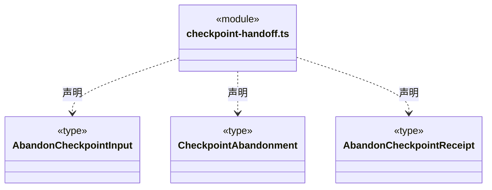


### command-verification-output.ts

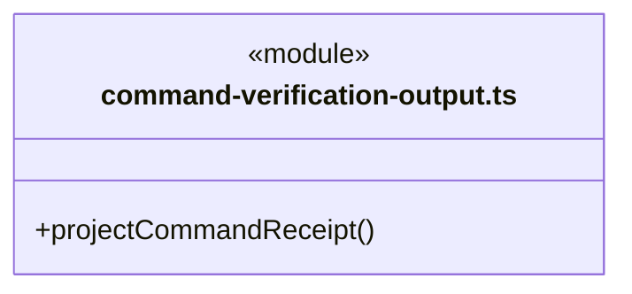

直接依赖：[../foundation/errors.ts](../foundation/errors.ts)、[dispatch-scope.ts](dispatch-scope.ts)、[scope-goal.ts](scope-goal.ts)、[main-tool-output.ts](main-tool-output.ts)、[command-verification.ts](command-verification.ts)。

### command-verification.ts

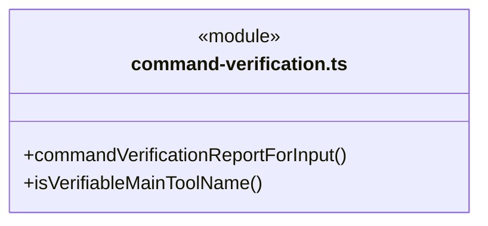

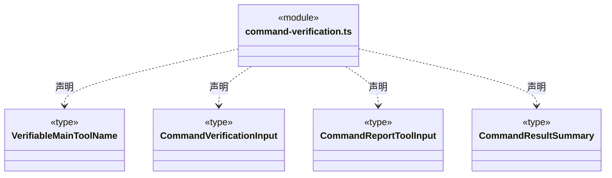

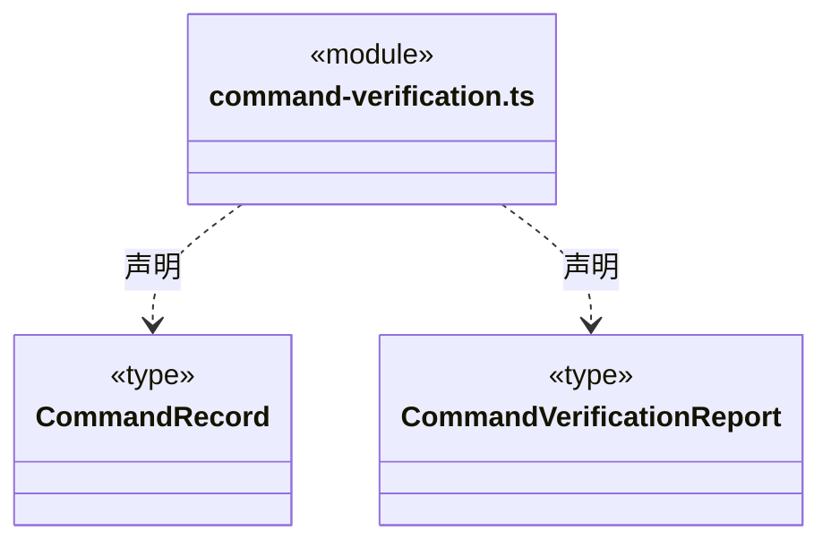


### continuation-source-snapshot.ts

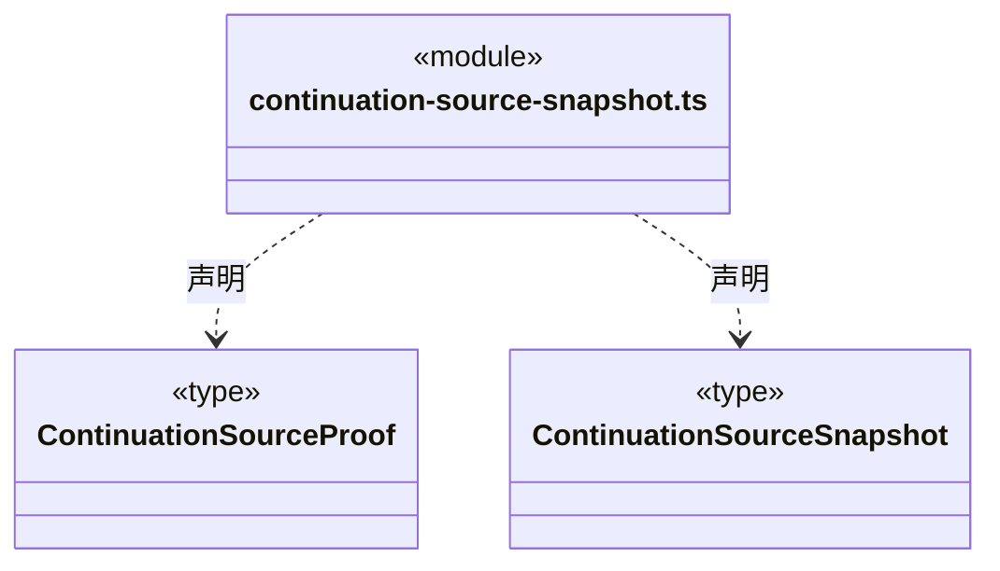


### coordination-preview.ts

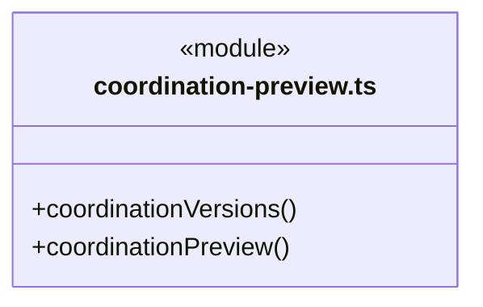

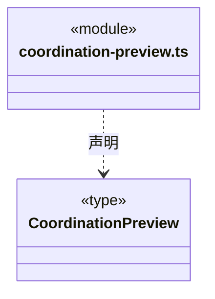

直接依赖：[../foundation/errors.ts](../foundation/errors.ts)、[../dispatch/dispatch-storage.ts](../dispatch/dispatch-storage.ts)、[dispatch-scope.ts](dispatch-scope.ts)、[graph-types.ts](graph-types.ts)、[queued-task-cancel.ts](queued-task-cancel.ts)、[queued-task-cancel-rules.ts](queued-task-cancel-rules.ts)、[member-pause.ts](member-pause.ts)、[member-pause-rules.ts](member-pause-rules.ts)、[main-tool-scope.ts](main-tool-scope.ts)。

### dispatch-commands.ts

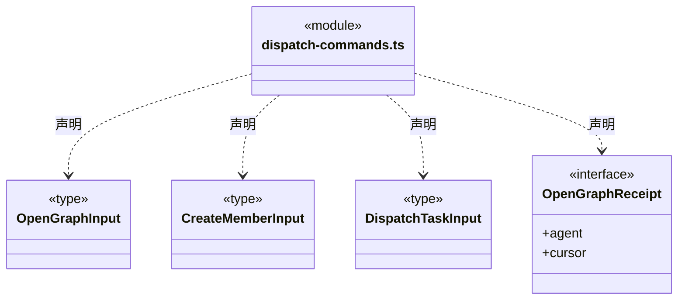

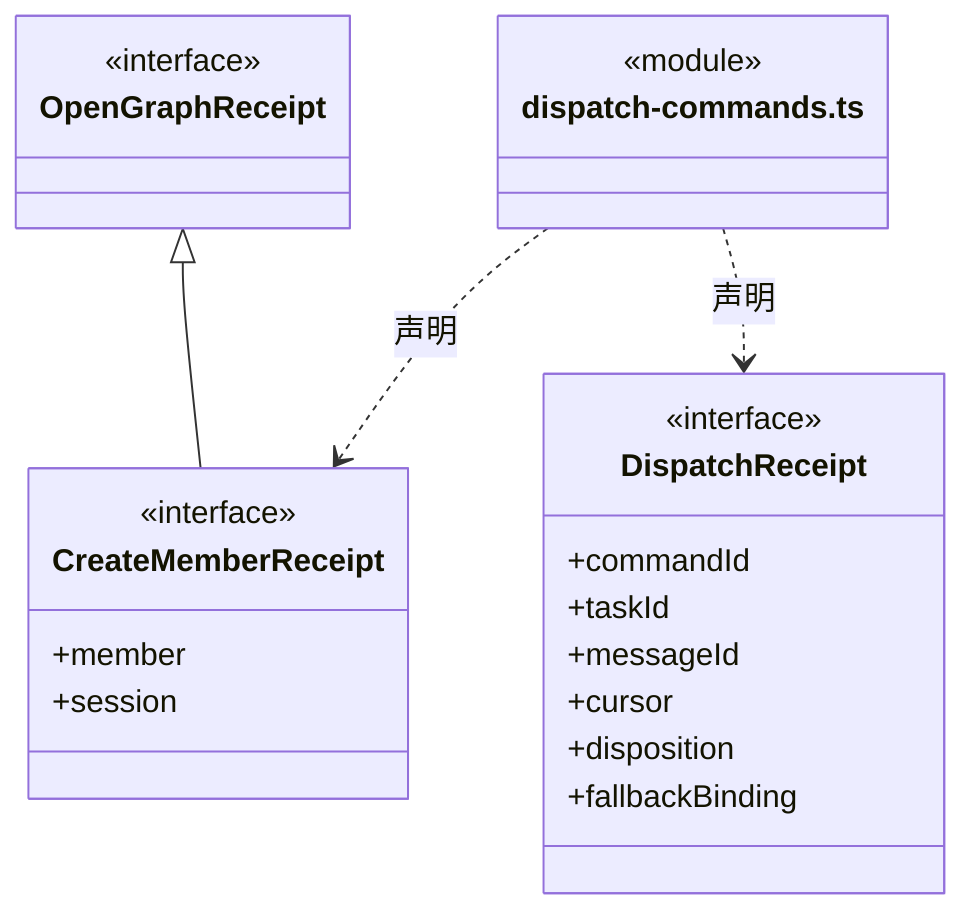

直接依赖：[../team/automatic-execution.ts](../team/automatic-execution.ts)、[../team/agent-types.ts](../team/agent-types.ts)、[graph-types.ts](graph-types.ts)、[workflow-selection.ts](workflow-selection.ts)、[../team/member-execution-binding.ts](../team/member-execution-binding.ts)。

### dispatch-execution.ts

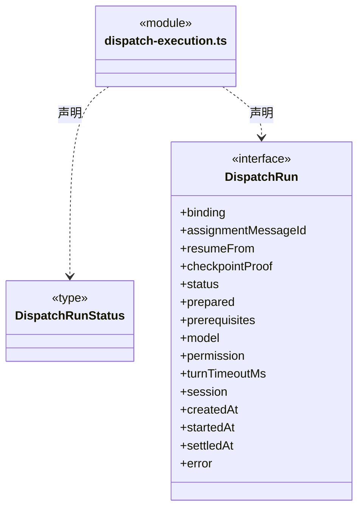

直接依赖：[../execution/member-run.ts](../execution/member-run.ts)、[../models/ports.ts](../models/ports.ts)、[../tools/policy/types.ts](../tools/policy/types.ts)、[execution-context.ts](execution-context.ts)、[graph-types.ts](graph-types.ts)、[member-checkpoint.ts](member-checkpoint.ts)。

### dispatch-invariants.ts

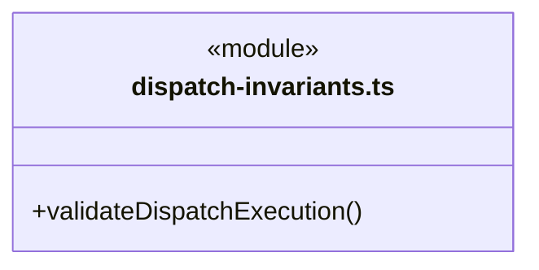

直接依赖：[../foundation/errors.ts](../foundation/errors.ts)、[../models/config.ts](../models/config.ts)、[../models/engine.ts](../models/engine.ts)、[execution-context.ts](execution-context.ts)、[../dispatch/dispatch-storage.ts](../dispatch/dispatch-storage.ts)、[dispatch-execution.ts](dispatch-execution.ts)、[graph-types.ts](graph-types.ts)、[queued-task-cancel-rules.ts](queued-task-cancel-rules.ts)、[queued-dependency-replacement-invariants.ts](queued-dependency-replacement-invariants.ts)、[queued-dependency-addition-invariants.ts](queued-dependency-addition-invariants.ts)、[queued-dependency-revision-invariants.ts](queued-dependency-revision-invariants.ts)、[member-checkpoint.ts](member-checkpoint.ts)、[member-checkpoint-invariants.ts](member-checkpoint-invariants.ts)、[checkpoint-handoff-invariants.ts](checkpoint-handoff-invariants.ts)、[human-decision-invariants.ts](human-decision-invariants.ts)、[human-continuation-invariants.ts](human-continuation-invariants.ts)。

### dispatch-receipt.ts

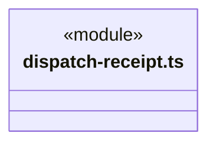
直接依赖：[../team/automatic-execution.ts](../team/automatic-execution.ts)、[graph-rules.ts](graph-rules.ts)。

### dispatch-scope-invariants.ts

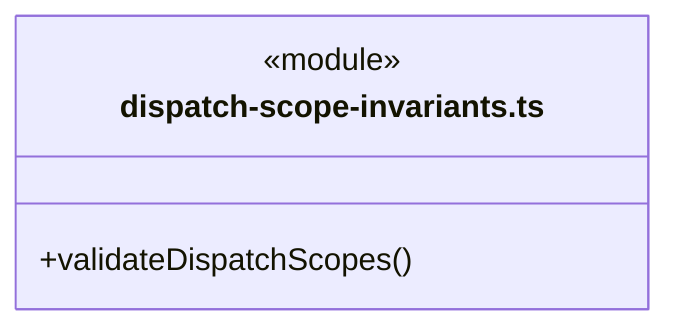

直接依赖：[../team/automatic-execution.ts](../team/automatic-execution.ts)、[../foundation/errors.ts](../foundation/errors.ts)、[../dispatch/dispatch-storage.ts](../dispatch/dispatch-storage.ts)、[dispatch-scope.ts](dispatch-scope.ts)、[scope-goal.ts](scope-goal.ts)、[scope-continuation.ts](scope-continuation.ts)、[scope-continuation-record.ts](scope-continuation-record.ts)、[scope-active-input.ts](scope-active-input.ts)、[scope-active-input-rules.ts](scope-active-input-rules.ts)、[scope-continuation-attachments.ts](scope-continuation-attachments.ts)、[scope-recovery.ts](scope-recovery.ts)、[effect-observation-invariants.ts](effect-observation-invariants.ts)、[scope-replan.ts](scope-replan.ts)、[fresh-context.ts](fresh-context.ts)、[scope-run-tracking.ts](scope-run-tracking.ts)、[automatic-return.ts](automatic-return.ts)、[scope-run-invariants.ts](scope-run-invariants.ts)、[../budget/scope-budget.ts](../budget/scope-budget.ts)、[../budget/scope-budget-invariants.ts](../budget/scope-budget-invariants.ts)、[member-checkpoint.ts](member-checkpoint.ts)、[human-decisions.ts](human-decisions.ts)、[human-decision-invariants.ts](human-decision-invariants.ts)、[human-continuation-invariants.ts](human-continuation-invariants.ts)、[member-pause-rules.ts](member-pause-rules.ts)。

### dispatch-scope.ts

成员 1/2（同名节点为同一声明，跨图合并阅读）。

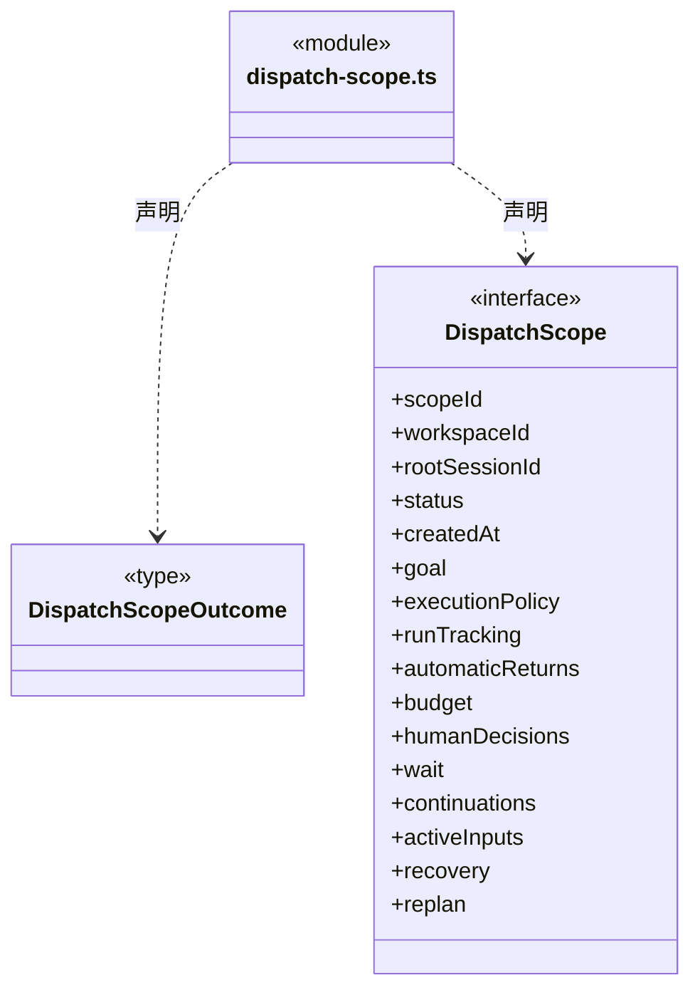

成员 2/2（同名节点为同一声明，跨图合并阅读）。

```mermaid
classDiagram
class N_src_backend_core_tasks_dispatch_scope_ts["dispatch-scope.ts"] {
  <<module>>
}
class N_src_backend_core_tasks_dispatch_scope_ts_DispatchScope["DispatchScope"] {
  <<interface>>
  +closedAt
  +outcome
}
N_src_backend_core_tasks_dispatch_scope_ts ..> N_src_backend_core_tasks_dispatch_scope_ts_DispatchScope : 声明
```

直接依赖：[../team/automatic-execution.ts](../team/automatic-execution.ts)、[scope-goal.ts](scope-goal.ts)、[scope-continuation.ts](scope-continuation.ts)、[scope-continuation-record.ts](scope-continuation-record.ts)、[scope-recovery.ts](scope-recovery.ts)、[scope-replan.ts](scope-replan.ts)、[scope-run-tracking.ts](scope-run-tracking.ts)、[../budget/scope-budget.ts](../budget/scope-budget.ts)、[human-decisions.ts](human-decisions.ts)、[scope-active-input.ts](scope-active-input.ts)、[automatic-return.ts](automatic-return.ts)。

### effect-observation-invariants.ts

```mermaid
classDiagram
class N_src_backend_core_tasks_effect_observation_invariants_ts["effect-observation-invariants.ts"] {
  <<module>>
  +projectEffectDispositionMutation()
  +validateEffectDispositionLink()
}
```

直接依赖：[../foundation/errors.ts](../foundation/errors.ts)、[effect-observation.ts](effect-observation.ts)、[effect-observation-rules.ts](effect-observation-rules.ts)、[../dispatch/dispatch-storage.ts](../dispatch/dispatch-storage.ts)、[dispatch-scope.ts](dispatch-scope.ts)、[scope-recovery.ts](scope-recovery.ts)。

### effect-observation-rules.ts

```mermaid
classDiagram
class N_src_backend_core_tasks_effect_observation_rules_ts["effect-observation-rules.ts"] {
  <<module>>
  +effectObservationBasis()
  +effectDispositionCommand()
  +effectDispositionRevision()
  +effectDispositionReceipt()
  +summarizeEffectDisposition()
}
```

直接依赖：[../foundation/serialization.ts](../foundation/serialization.ts)、[effect-observation.ts](effect-observation.ts)。

### effect-observation.ts

```mermaid
classDiagram
class N_src_backend_core_tasks_effect_observation_ts["effect-observation.ts"] {
  <<module>>
  +sameEffectSubject()
}
```

```mermaid
classDiagram
class N_src_backend_core_tasks_effect_observation_ts["effect-observation.ts"] {
  <<module>>
}
class N_src_backend_core_tasks_effect_observation_ts_EffectSubject["EffectSubject"] {
  <<type>>

}
N_src_backend_core_tasks_effect_observation_ts ..> N_src_backend_core_tasks_effect_observation_ts_EffectSubject : 声明
class N_src_backend_core_tasks_effect_observation_ts_EffectObservationInput["EffectObservationInput"] {
  <<type>>

}
N_src_backend_core_tasks_effect_observation_ts ..> N_src_backend_core_tasks_effect_observation_ts_EffectObservationInput : 声明
class N_src_backend_core_tasks_effect_observation_ts_EffectFileObservation["EffectFileObservation"] {
  <<type>>

}
N_src_backend_core_tasks_effect_observation_ts ..> N_src_backend_core_tasks_effect_observation_ts_EffectFileObservation : 声明
class N_src_backend_core_tasks_effect_observation_ts_EffectCallObservation["EffectCallObservation"] {
  <<type>>

}
N_src_backend_core_tasks_effect_observation_ts ..> N_src_backend_core_tasks_effect_observation_ts_EffectCallObservation : 声明
```

```mermaid
classDiagram
class N_src_backend_core_tasks_effect_observation_ts["effect-observation.ts"] {
  <<module>>
}
class N_src_backend_core_tasks_effect_observation_ts_EffectObservationReport["EffectObservationReport"] {
  <<type>>

}
N_src_backend_core_tasks_effect_observation_ts ..> N_src_backend_core_tasks_effect_observation_ts_EffectObservationReport : 声明
class N_src_backend_core_tasks_effect_observation_ts_EffectDispositionInput["EffectDispositionInput"] {
  <<type>>

}
N_src_backend_core_tasks_effect_observation_ts ..> N_src_backend_core_tasks_effect_observation_ts_EffectDispositionInput : 声明
class N_src_backend_core_tasks_effect_observation_ts_EffectDispositionRequest["EffectDispositionRequest"] {
  <<type>>

}
N_src_backend_core_tasks_effect_observation_ts ..> N_src_backend_core_tasks_effect_observation_ts_EffectDispositionRequest : 声明
class N_src_backend_core_tasks_effect_observation_ts_EffectDispositionLookup["EffectDispositionLookup"] {
  <<type>>

}
N_src_backend_core_tasks_effect_observation_ts ..> N_src_backend_core_tasks_effect_observation_ts_EffectDispositionLookup : 声明
```

```mermaid
classDiagram
class N_src_backend_core_tasks_effect_observation_ts["effect-observation.ts"] {
  <<module>>
}
class N_src_backend_core_tasks_effect_observation_ts_EffectDispositionRecord["EffectDispositionRecord"] {
  <<type>>

}
N_src_backend_core_tasks_effect_observation_ts ..> N_src_backend_core_tasks_effect_observation_ts_EffectDispositionRecord : 声明
class N_src_backend_core_tasks_effect_observation_ts_EffectDispositionReceipt["EffectDispositionReceipt"] {
  <<type>>

}
N_src_backend_core_tasks_effect_observation_ts ..> N_src_backend_core_tasks_effect_observation_ts_EffectDispositionReceipt : 声明
class N_src_backend_core_tasks_effect_observation_ts_EffectDispositionListInput["EffectDispositionListInput"] {
  <<type>>

}
N_src_backend_core_tasks_effect_observation_ts ..> N_src_backend_core_tasks_effect_observation_ts_EffectDispositionListInput : 声明
class N_src_backend_core_tasks_effect_observation_ts_EffectDispositionSummary["EffectDispositionSummary"] {
  <<type>>

}
N_src_backend_core_tasks_effect_observation_ts ..> N_src_backend_core_tasks_effect_observation_ts_EffectDispositionSummary : 声明
```

```mermaid
classDiagram
class N_src_backend_core_tasks_effect_observation_ts["effect-observation.ts"] {
  <<module>>
}
class N_src_backend_core_tasks_effect_observation_ts_EffectDispositionList["EffectDispositionList"] {
  <<type>>

}
N_src_backend_core_tasks_effect_observation_ts ..> N_src_backend_core_tasks_effect_observation_ts_EffectDispositionList : 声明
class N_src_backend_core_tasks_effect_observation_ts_EffectRelationsInput["EffectRelationsInput"] {
  <<type>>

}
N_src_backend_core_tasks_effect_observation_ts ..> N_src_backend_core_tasks_effect_observation_ts_EffectRelationsInput : 声明
class N_src_backend_core_tasks_effect_observation_ts_EffectRelations["EffectRelations"] {
  <<type>>

}
N_src_backend_core_tasks_effect_observation_ts ..> N_src_backend_core_tasks_effect_observation_ts_EffectRelations : 声明
```

直接依赖：[../evidence/artifact-baseline.ts](../evidence/artifact-baseline.ts)、[command-verification.ts](command-verification.ts)、[../tools/scope-schema.ts](../tools/scope-schema.ts)、[../tools/receipt-schema.ts](../tools/receipt-schema.ts)、[../knowledge/knowledge-write-observation.ts](../knowledge/knowledge-write-observation.ts)、[persistent-write-observation.ts](persistent-write-observation.ts)、[../file-operations/controlled-file-operation.ts](../file-operations/controlled-file-operation.ts)。

### execution-context.ts

```mermaid
classDiagram
class N_src_backend_core_tasks_execution_context_ts["execution-context.ts"] {
  <<module>>
  +preparedWorkflowContracts()
  +dispatchKnowledgeFingerprint()
  +validatePreparedDispatchKnowledge()
}
```

```mermaid
classDiagram
class N_src_backend_core_tasks_execution_context_ts["execution-context.ts"] {
  <<module>>
}
class N_src_backend_core_tasks_execution_context_ts_PreparedDispatchModule["PreparedDispatchModule"] {
  <<interface>>
  +binding
  +definition
  +overview
  +workflowText
  +workflowContract
}
N_src_backend_core_tasks_execution_context_ts ..> N_src_backend_core_tasks_execution_context_ts_PreparedDispatchModule : 声明
class N_src_backend_core_tasks_execution_context_ts_WorkflowContractBinding["WorkflowContractBinding"] {
  <<interface>>
  +moduleId
  +workflowId
  +workflowVersion
  +contract
}
N_src_backend_core_tasks_execution_context_ts ..> N_src_backend_core_tasks_execution_context_ts_WorkflowContractBinding : 声明
class N_src_backend_core_tasks_execution_context_ts_PreparedDispatchKnowledge["PreparedDispatchKnowledge"] {
  <<interface>>
  +version
  +workspaceId
  +knowledgeRevision
  +agent
  +agentDefinition
  +modules
  +standards
  +memberContext
  +fallbackBinding
  +fingerprint
}
N_src_backend_core_tasks_execution_context_ts ..> N_src_backend_core_tasks_execution_context_ts_PreparedDispatchKnowledge : 声明
```

直接依赖：[../team/automatic-execution.ts](../team/automatic-execution.ts)、[../foundation/serialization.ts](../foundation/serialization.ts)、[../foundation/errors.ts](../foundation/errors.ts)、[../team/agent-types.ts](../team/agent-types.ts)、[graph-types.ts](graph-types.ts)、[../workspace/workflow-contract.ts](../workspace/workflow-contract.ts)、[../workspace/artifact-scope.ts](../workspace/artifact-scope.ts)、[../workspace/execution-scope.ts](../workspace/execution-scope.ts)、[../team/member-execution-binding.ts](../team/member-execution-binding.ts)、[../team/workspace-member.ts](../team/workspace-member.ts)、[../team/workspace-member-rules.ts](../team/workspace-member-rules.ts)。

### execution-report.ts

```mermaid
classDiagram
class N_src_backend_core_tasks_execution_report_ts["execution-report.ts"] {
  <<module>>
}
class N_src_backend_core_tasks_execution_report_ts_ExecutionReportInput["ExecutionReportInput"] {
  <<type>>

}
N_src_backend_core_tasks_execution_report_ts ..> N_src_backend_core_tasks_execution_report_ts_ExecutionReportInput : 声明
class N_src_backend_core_tasks_execution_report_ts_ExecutionReport["ExecutionReport"] {
  <<type>>

}
N_src_backend_core_tasks_execution_report_ts ..> N_src_backend_core_tasks_execution_report_ts_ExecutionReport : 声明
```

直接依赖：[member-commands.ts](member-commands.ts)、[dispatch-commands.ts](dispatch-commands.ts)、[../tools/scope-schema.ts](../tools/scope-schema.ts)、[../tools/receipt-schema.ts](../tools/receipt-schema.ts)。

### fresh-context.ts

```mermaid
classDiagram
class N_src_backend_core_tasks_fresh_context_ts["fresh-context.ts"] {
  <<module>>
  +scopeFreshContext()
}
```

```mermaid
classDiagram
class N_src_backend_core_tasks_fresh_context_ts["fresh-context.ts"] {
  <<module>>
}
class N_src_backend_core_tasks_fresh_context_ts_FreshContext["FreshContext"] {
  <<type>>

}
N_src_backend_core_tasks_fresh_context_ts ..> N_src_backend_core_tasks_fresh_context_ts_FreshContext : 声明
```


### graph-reducer.ts

```mermaid
classDiagram
class N_src_backend_core_tasks_graph_reducer_ts["graph-reducer.ts"] {
  <<module>>
  +applyGraphBatch()
  +readGraphDelta()
}
```

```mermaid
classDiagram
class N_src_backend_core_tasks_graph_reducer_ts["graph-reducer.ts"] {
  <<module>>
}
class N_src_backend_core_tasks_graph_reducer_ts_SeenBatch["SeenBatch"] {
  <<type>>
  +fingerprint
  +eventId
  +commandId
}
N_src_backend_core_tasks_graph_reducer_ts ..> N_src_backend_core_tasks_graph_reducer_ts_SeenBatch : 声明
```

直接依赖：[../foundation/errors.ts](../foundation/errors.ts)、[graph-rules.ts](graph-rules.ts)、[graph-types.ts](graph-types.ts)、[member-checkpoint-chain.ts](member-checkpoint-chain.ts)。

### graph-rules.ts

```mermaid
classDiagram
class N_src_backend_core_tasks_graph_rules_ts["graph-rules.ts"] {
  <<module>>
  +validateGraphIdentity()
  +validateGraphBatch()
  +assertGraphIdentity()
  +validateGraphCursor()
  +usableResult()
  +validateTaskNode()
  +validateGraph()
}
```

直接依赖：[../team/automatic-execution.ts](../team/automatic-execution.ts)、[queued-task-cancel.ts](queued-task-cancel.ts)、[../foundation/errors.ts](../foundation/errors.ts)、[graph-types.ts](graph-types.ts)、[member-help.ts](member-help.ts)、[queued-dependency-replacement.ts](queued-dependency-replacement.ts)、[queued-dependency-addition.ts](queued-dependency-addition.ts)、[queued-dependency-revision.ts](queued-dependency-revision.ts)、[member-checkpoint.ts](member-checkpoint.ts)、[member-checkpoint-chain.ts](member-checkpoint-chain.ts)、[queued-member-resume.ts](queued-member-resume.ts)、[checkpoint-handoff.ts](checkpoint-handoff.ts)、[workflow-selection.ts](workflow-selection.ts)、[../team/member-execution-binding.ts](../team/member-execution-binding.ts)。

### graph-types.ts

```mermaid
classDiagram
class N_src_backend_core_tasks_graph_types_ts["graph-types.ts"] {
  <<module>>
}
class N_src_backend_core_tasks_graph_types_ts_GraphIdentity["GraphIdentity"] {
  <<type>>
  +workspaceId
  +rootSessionId
}
N_src_backend_core_tasks_graph_types_ts ..> N_src_backend_core_tasks_graph_types_ts_GraphIdentity : 声明
class N_src_backend_core_tasks_graph_types_ts_AgentRef["AgentRef"] {
  <<type>>
  +agentId
  +agentInstanceId
  +agentSessionId
  +name
}
N_src_backend_core_tasks_graph_types_ts ..> N_src_backend_core_tasks_graph_types_ts_AgentRef : 声明
class N_src_backend_core_tasks_graph_types_ts_ModuleBinding["ModuleBinding"] {
  <<type>>
  +moduleId
  +name
  +knowledgeRevision
  +maintenanceBindingId
  +maintainerPersonIds
  +workflow
}
N_src_backend_core_tasks_graph_types_ts ..> N_src_backend_core_tasks_graph_types_ts_ModuleBinding : 声明
class N_src_backend_core_tasks_graph_types_ts_SessionRootNode["SessionRootNode"] {
  <<type>>
  +kind
  +nodeId
  +identity
  +agent
  +revision
  +createdAt
}
N_src_backend_core_tasks_graph_types_ts ..> N_src_backend_core_tasks_graph_types_ts_SessionRootNode : 声明
```

成员 1/3（同名节点为同一声明，跨图合并阅读）。

```mermaid
classDiagram
class N_src_backend_core_tasks_graph_types_ts["graph-types.ts"] {
  <<module>>
}
class N_src_backend_core_tasks_graph_types_ts_TaskStatus["TaskStatus"] {
  <<type>>

}
N_src_backend_core_tasks_graph_types_ts ..> N_src_backend_core_tasks_graph_types_ts_TaskStatus : 声明
class N_src_backend_core_tasks_graph_types_ts_TaskNode["TaskNode"] {
  <<type>>
  +kind
  +nodeId
  +taskId
  +identity
  +scopeId
  +parentTaskId
  +requester
  +assignee
  +modules
  +workflowSelections
  +ownerBinding
  +fallbackBinding
  +goal
  +acceptance
  +revision
  +planRevision
}
N_src_backend_core_tasks_graph_types_ts ..> N_src_backend_core_tasks_graph_types_ts_TaskNode : 声明
class N_src_backend_core_tasks_graph_types_ts_GraphEdge["GraphEdge"] {
  <<type>>
  +edgeId
  +identity
  +fromNodeId
  +toNodeId
  +revision
  +enabled
}
N_src_backend_core_tasks_graph_types_ts ..> N_src_backend_core_tasks_graph_types_ts_GraphEdge : 声明
class N_src_backend_core_tasks_graph_types_ts_GraphCursor["GraphCursor"] {
  <<type>>
  +streamId
  +seq
}
N_src_backend_core_tasks_graph_types_ts ..> N_src_backend_core_tasks_graph_types_ts_GraphCursor : 声明
```

成员 2/3（同名节点为同一声明，跨图合并阅读）。

```mermaid
classDiagram
class N_src_backend_core_tasks_graph_types_ts["graph-types.ts"] {
  <<module>>
}
class N_src_backend_core_tasks_graph_types_ts_TaskNode["TaskNode"] {
  <<type>>
  +status
  +awaitedChildren
  +waitReason
  +runIds
  +activeRunId
  +result
  +help
  +checkpoints
  +resumeRequest
  +resumeHistory
  +checkpointAbandonment
  +cancelledBeforeStart
  +dependencyReplacements
  +dependencyAdditions
  +dependencyRevisions
  +createdAt
}
N_src_backend_core_tasks_graph_types_ts ..> N_src_backend_core_tasks_graph_types_ts_TaskNode : 声明
```

成员 3/3（同名节点为同一声明，跨图合并阅读）。

```mermaid
classDiagram
class N_src_backend_core_tasks_graph_types_ts["graph-types.ts"] {
  <<module>>
}
class N_src_backend_core_tasks_graph_types_ts_TaskNode["TaskNode"] {
  <<type>>
  +updatedAt
}
N_src_backend_core_tasks_graph_types_ts ..> N_src_backend_core_tasks_graph_types_ts_TaskNode : 声明
```

```mermaid
classDiagram
class N_src_backend_core_tasks_graph_types_ts["graph-types.ts"] {
  <<module>>
}
class N_src_backend_core_tasks_graph_types_ts_AgentGraphView["AgentGraphView"] {
  <<type>>
  +agentInstanceId
  +agentId
  +name
  +revision
  +state
  +runningTaskId
  +waitingTaskIds
}
N_src_backend_core_tasks_graph_types_ts ..> N_src_backend_core_tasks_graph_types_ts_AgentGraphView : 声明
class N_src_backend_core_tasks_graph_types_ts_GraphChange["GraphChange"] {
  <<type>>

}
N_src_backend_core_tasks_graph_types_ts ..> N_src_backend_core_tasks_graph_types_ts_GraphChange : 声明
class N_src_backend_core_tasks_graph_types_ts_GraphCause["GraphCause"] {
  <<type>>

}
N_src_backend_core_tasks_graph_types_ts ..> N_src_backend_core_tasks_graph_types_ts_GraphCause : 声明
class N_src_backend_core_tasks_graph_types_ts_GraphEventBatch["GraphEventBatch"] {
  <<type>>
  +version
  +identity
  +streamId
  +seq
  +eventId
  +commandId
  +cause
  +committedAt
  +changes
}
N_src_backend_core_tasks_graph_types_ts ..> N_src_backend_core_tasks_graph_types_ts_GraphEventBatch : 声明
```

```mermaid
classDiagram
class N_src_backend_core_tasks_graph_types_ts["graph-types.ts"] {
  <<module>>
}
class N_src_backend_core_tasks_graph_types_ts_GraphSnapshot["GraphSnapshot"] {
  <<type>>
  +version
  +identity
  +cursor
  +root
  +tasks
  +edges
  +agents
}
N_src_backend_core_tasks_graph_types_ts ..> N_src_backend_core_tasks_graph_types_ts_GraphSnapshot : 声明
class N_src_backend_core_tasks_graph_types_ts_GraphDelta["GraphDelta"] {
  <<type>>

}
N_src_backend_core_tasks_graph_types_ts ..> N_src_backend_core_tasks_graph_types_ts_GraphDelta : 声明
```

直接依赖：[../team/automatic-execution.ts](../team/automatic-execution.ts)、[member-help.ts](member-help.ts)、[queued-task-cancel.ts](queued-task-cancel.ts)、[queued-dependency-replacement.ts](queued-dependency-replacement.ts)、[queued-dependency-addition.ts](queued-dependency-addition.ts)、[queued-dependency-revision.ts](queued-dependency-revision.ts)、[member-checkpoint.ts](member-checkpoint.ts)、[queued-member-resume.ts](queued-member-resume.ts)、[checkpoint-handoff.ts](checkpoint-handoff.ts)、[workflow-selection.ts](workflow-selection.ts)、[../team/member-execution-binding.ts](../team/member-execution-binding.ts)。

### human-continuation-invariants.ts

```mermaid
classDiagram
class N_src_backend_core_tasks_human_continuation_invariants_ts["human-continuation-invariants.ts"] {
  <<module>>
  +validateHumanContinuations()
  +validateHumanContinuationCommand()
}
```

直接依赖：[../foundation/errors.ts](../foundation/errors.ts)、[../dispatch/dispatch-storage.ts](../dispatch/dispatch-storage.ts)、[scope-continuation-record.ts](scope-continuation-record.ts)、[human-continue.ts](human-continue.ts)、[human-continuation-rules.ts](human-continuation-rules.ts)、[scope-goal.ts](scope-goal.ts)。

### human-continuation-rules.ts

```mermaid
classDiagram
class N_src_backend_core_tasks_human_continuation_rules_ts["human-continuation-rules.ts"] {
  <<module>>
  +waitingHumanDecisions()
  +currentHumanContinuation()
  +referencedHumanDecision()
  +humanContinuationSubjectMatches()
}
```

直接依赖：[dispatch-scope.ts](dispatch-scope.ts)、[human-decisions.ts](human-decisions.ts)、[human-continue.ts](human-continue.ts)、[scope-continuation-record.ts](scope-continuation-record.ts)、[scope-goal.ts](scope-goal.ts)。

### human-continue.ts

```mermaid
classDiagram
class N_src_backend_core_tasks_human_continue_ts["human-continue.ts"] {
  <<module>>
  +humanContinuationSubject()
}
```

```mermaid
classDiagram
class N_src_backend_core_tasks_human_continue_ts["human-continue.ts"] {
  <<module>>
}
class N_src_backend_core_tasks_human_continue_ts_HumanContinuationSubject["HumanContinuationSubject"] {
  <<type>>

}
N_src_backend_core_tasks_human_continue_ts ..> N_src_backend_core_tasks_human_continue_ts_HumanContinuationSubject : 声明
class N_src_backend_core_tasks_human_continue_ts_HumanContinuationRequest["HumanContinuationRequest"] {
  <<type>>

}
N_src_backend_core_tasks_human_continue_ts ..> N_src_backend_core_tasks_human_continue_ts_HumanContinuationRequest : 声明
class N_src_backend_core_tasks_human_continue_ts_HumanContinuationLookup["HumanContinuationLookup"] {
  <<type>>

}
N_src_backend_core_tasks_human_continue_ts ..> N_src_backend_core_tasks_human_continue_ts_HumanContinuationLookup : 声明
class N_src_backend_core_tasks_human_continue_ts_ScopeHumanContinuation["ScopeHumanContinuation"] {
  <<type>>

}
N_src_backend_core_tasks_human_continue_ts ..> N_src_backend_core_tasks_human_continue_ts_ScopeHumanContinuation : 声明
```

```mermaid
classDiagram
class N_src_backend_core_tasks_human_continue_ts["human-continue.ts"] {
  <<module>>
}
class N_src_backend_core_tasks_human_continue_ts_HumanContinuationReceipt["HumanContinuationReceipt"] {
  <<type>>

}
N_src_backend_core_tasks_human_continue_ts ..> N_src_backend_core_tasks_human_continue_ts_HumanContinuationReceipt : 声明
```

直接依赖：[../team/automatic-execution.ts](../team/automatic-execution.ts)、[scope-continuation.ts](scope-continuation.ts)、[human-decisions.ts](human-decisions.ts)、[workflow-selection.ts](workflow-selection.ts)、[../team/member-execution-binding.ts](../team/member-execution-binding.ts)。

### human-decision-invariants.ts

```mermaid
classDiagram
class N_src_backend_core_tasks_human_decision_invariants_ts["human-decision-invariants.ts"] {
  <<module>>
  +validateHumanDecisions()
  +validateHumanDecisionCommand()
}
```

直接依赖：[../foundation/errors.ts](../foundation/errors.ts)、[../dispatch/dispatch-storage.ts](../dispatch/dispatch-storage.ts)、[human-decisions.ts](human-decisions.ts)、[human-decision-proof.ts](human-decision-proof.ts)、[scope-goal.ts](scope-goal.ts)、[workflow-selection.ts](workflow-selection.ts)、[../evidence/complete-output-evidence.ts](../evidence/complete-output-evidence.ts)、[execution-context.ts](execution-context.ts)、[../workspace/artifact-scope.ts](../workspace/artifact-scope.ts)、[../evidence/output-manifest-evidence.ts](../evidence/output-manifest-evidence.ts)。

### human-decision-proof.ts

```mermaid
classDiagram
class N_src_backend_core_tasks_human_decision_proof_ts["human-decision-proof.ts"] {
  <<module>>
  +humanDecisionProof()
  +humanDecisionBasis()
}
```

直接依赖：[../foundation/serialization.ts](../foundation/serialization.ts)、[human-decisions.ts](human-decisions.ts)。

### human-decisions.ts

```mermaid
classDiagram
class N_src_backend_core_tasks_human_decisions_ts["human-decisions.ts"] {
  <<module>>
}
class N_src_backend_core_tasks_human_decisions_ts_HumanDecisionKind["HumanDecisionKind"] {
  <<type>>

}
N_src_backend_core_tasks_human_decisions_ts ..> N_src_backend_core_tasks_human_decisions_ts_HumanDecisionKind : 声明
class N_src_backend_core_tasks_human_decisions_ts_HumanDecisionBaselineSelection["HumanDecisionBaselineSelection"] {
  <<type>>

}
N_src_backend_core_tasks_human_decisions_ts ..> N_src_backend_core_tasks_human_decisions_ts_HumanDecisionBaselineSelection : 声明
class N_src_backend_core_tasks_human_decisions_ts_HumanDecisionManifestSelection["HumanDecisionManifestSelection"] {
  <<type>>

}
N_src_backend_core_tasks_human_decisions_ts ..> N_src_backend_core_tasks_human_decisions_ts_HumanDecisionManifestSelection : 声明
class N_src_backend_core_tasks_human_decisions_ts_HumanDecisionPreviewInput["HumanDecisionPreviewInput"] {
  <<type>>

}
N_src_backend_core_tasks_human_decisions_ts ..> N_src_backend_core_tasks_human_decisions_ts_HumanDecisionPreviewInput : 声明
```

```mermaid
classDiagram
class N_src_backend_core_tasks_human_decisions_ts["human-decisions.ts"] {
  <<module>>
}
class N_src_backend_core_tasks_human_decisions_ts_HumanDecisionRequest["HumanDecisionRequest"] {
  <<type>>

}
N_src_backend_core_tasks_human_decisions_ts ..> N_src_backend_core_tasks_human_decisions_ts_HumanDecisionRequest : 声明
class N_src_backend_core_tasks_human_decisions_ts_HumanDecisionLookup["HumanDecisionLookup"] {
  <<type>>

}
N_src_backend_core_tasks_human_decisions_ts ..> N_src_backend_core_tasks_human_decisions_ts_HumanDecisionLookup : 声明
class N_src_backend_core_tasks_human_decisions_ts_HumanDecisionHistoryInput["HumanDecisionHistoryInput"] {
  <<type>>

}
N_src_backend_core_tasks_human_decisions_ts ..> N_src_backend_core_tasks_human_decisions_ts_HumanDecisionHistoryInput : 声明
class N_src_backend_core_tasks_human_decisions_ts_HumanDecisionActor["HumanDecisionActor"] {
  <<type>>

}
N_src_backend_core_tasks_human_decisions_ts ..> N_src_backend_core_tasks_human_decisions_ts_HumanDecisionActor : 声明
```

```mermaid
classDiagram
class N_src_backend_core_tasks_human_decisions_ts["human-decisions.ts"] {
  <<module>>
}
class N_src_backend_core_tasks_human_decisions_ts_HumanDecisionSource["HumanDecisionSource"] {
  <<type>>

}
N_src_backend_core_tasks_human_decisions_ts ..> N_src_backend_core_tasks_human_decisions_ts_HumanDecisionSource : 声明
class N_src_backend_core_tasks_human_decisions_ts_HumanDecisionArtifactObservation["HumanDecisionArtifactObservation"] {
  <<type>>

}
N_src_backend_core_tasks_human_decisions_ts ..> N_src_backend_core_tasks_human_decisions_ts_HumanDecisionArtifactObservation : 声明
class N_src_backend_core_tasks_human_decisions_ts_HumanDecisionCandidateProof["HumanDecisionCandidateProof"] {
  <<type>>

}
N_src_backend_core_tasks_human_decisions_ts ..> N_src_backend_core_tasks_human_decisions_ts_HumanDecisionCandidateProof : 声明
class N_src_backend_core_tasks_human_decisions_ts_HumanDecisionCandidate["HumanDecisionCandidate"] {
  <<type>>

}
N_src_backend_core_tasks_human_decisions_ts ..> N_src_backend_core_tasks_human_decisions_ts_HumanDecisionCandidate : 声明
```

```mermaid
classDiagram
class N_src_backend_core_tasks_human_decisions_ts["human-decisions.ts"] {
  <<module>>
}
class N_src_backend_core_tasks_human_decisions_ts_HumanReconsideration["HumanReconsideration"] {
  <<type>>

}
N_src_backend_core_tasks_human_decisions_ts ..> N_src_backend_core_tasks_human_decisions_ts_HumanReconsideration : 声明
class N_src_backend_core_tasks_human_decisions_ts_HumanDecisionPreview["HumanDecisionPreview"] {
  <<type>>

}
N_src_backend_core_tasks_human_decisions_ts ..> N_src_backend_core_tasks_human_decisions_ts_HumanDecisionPreview : 声明
class N_src_backend_core_tasks_human_decisions_ts_HumanDecisionProof["HumanDecisionProof"] {
  <<type>>

}
N_src_backend_core_tasks_human_decisions_ts ..> N_src_backend_core_tasks_human_decisions_ts_HumanDecisionProof : 声明
class N_src_backend_core_tasks_human_decisions_ts_HumanDecisionRecord["HumanDecisionRecord"] {
  <<type>>

}
N_src_backend_core_tasks_human_decisions_ts ..> N_src_backend_core_tasks_human_decisions_ts_HumanDecisionRecord : 声明
```

```mermaid
classDiagram
class N_src_backend_core_tasks_human_decisions_ts["human-decisions.ts"] {
  <<module>>
}
class N_src_backend_core_tasks_human_decisions_ts_ScopeHumanDecisions["ScopeHumanDecisions"] {
  <<type>>

}
N_src_backend_core_tasks_human_decisions_ts ..> N_src_backend_core_tasks_human_decisions_ts_ScopeHumanDecisions : 声明
class N_src_backend_core_tasks_human_decisions_ts_HumanDecisionReceipt["HumanDecisionReceipt"] {
  <<type>>

}
N_src_backend_core_tasks_human_decisions_ts ..> N_src_backend_core_tasks_human_decisions_ts_HumanDecisionReceipt : 声明
class N_src_backend_core_tasks_human_decisions_ts_HumanDecisionHistory["HumanDecisionHistory"] {
  <<type>>

}
N_src_backend_core_tasks_human_decisions_ts ..> N_src_backend_core_tasks_human_decisions_ts_HumanDecisionHistory : 声明
```

直接依赖：[../evidence/artifact-baseline.ts](../evidence/artifact-baseline.ts)、[../evidence/output-manifest.ts](../evidence/output-manifest.ts)、[../workspace/artifact-scope.ts](../workspace/artifact-scope.ts)。

### human-reconsideration.ts

```mermaid
classDiagram
class N_src_backend_core_tasks_human_reconsideration_ts["human-reconsideration.ts"] {
  <<module>>
  +compareHumanReconsideration()
}
```

直接依赖：[human-decisions.ts](human-decisions.ts)。

### knowledge-source-invariants.ts

```mermaid
classDiagram
class N_src_backend_core_tasks_knowledge_source_invariants_ts["knowledge-source-invariants.ts"] {
  <<module>>
  +projectKnowledgeSourceMutation()
}
```

```mermaid
classDiagram
class N_src_backend_core_tasks_knowledge_source_invariants_ts["knowledge-source-invariants.ts"] {
  <<module>>
}
class N_src_backend_core_tasks_knowledge_source_invariants_ts_KnowledgeSourceCapturePermit["KnowledgeSourceCapturePermit"] {
  <<interface>>
  +kind
  +changeId
  +captureChangeId
}
N_src_backend_core_tasks_knowledge_source_invariants_ts ..> N_src_backend_core_tasks_knowledge_source_invariants_ts_KnowledgeSourceCapturePermit : 声明
```

直接依赖：[../foundation/errors.ts](../foundation/errors.ts)、[../team/workspace-member.ts](../team/workspace-member.ts)、[../team/workspace-member-rules.ts](../team/workspace-member-rules.ts)、[../workspace/module-ownership.ts](../workspace/module-ownership.ts)、[../workspace/knowledge-source.ts](../workspace/knowledge-source.ts)、[../workspace/knowledge-source-rules.ts](../workspace/knowledge-source-rules.ts)、[../dispatch/dispatch-storage.ts](../dispatch/dispatch-storage.ts)。

### main-tool-output.ts

```mermaid
classDiagram
class N_src_backend_core_tasks_main_tool_output_ts["main-tool-output.ts"] {
  <<module>>
  +mainToolOutputSchema()
}
```

```mermaid
classDiagram
class N_src_backend_core_tasks_main_tool_output_ts["main-tool-output.ts"] {
  <<module>>
}
class N_src_backend_core_tasks_main_tool_output_ts_MainToolName["MainToolName"] {
  <<type>>

}
N_src_backend_core_tasks_main_tool_output_ts ..> N_src_backend_core_tasks_main_tool_output_ts_MainToolName : 声明
class N_src_backend_core_tasks_main_tool_output_ts_MainToolOutput["MainToolOutput"] {
  <<type>>

}
N_src_backend_core_tasks_main_tool_output_ts ..> N_src_backend_core_tasks_main_tool_output_ts_MainToolOutput : 声明
class N_src_backend_core_tasks_main_tool_output_ts_MainToolOutputBinding["MainToolOutputBinding"] {
  <<interface>>
  +workspaceId
  +rootSessionId
  +scopeId
  +runId
}
N_src_backend_core_tasks_main_tool_output_ts ..> N_src_backend_core_tasks_main_tool_output_ts_MainToolOutputBinding : 声明
class N_src_backend_core_tasks_main_tool_output_ts_MainToolOutputExpectation["MainToolOutputExpectation"] {
  <<interface>>
  +binding
  +input
  +expectedCommandId
}
N_src_backend_core_tasks_main_tool_output_ts ..> N_src_backend_core_tasks_main_tool_output_ts_MainToolOutputExpectation : 声明
```

直接依赖：[../team/automatic-execution.ts](../team/automatic-execution.ts)、[graph-rules.ts](graph-rules.ts)、[graph-types.ts](graph-types.ts)、[main-tool-scope.ts](main-tool-scope.ts)、[scope-goal.ts](scope-goal.ts)、[queued-dependency-replacement.ts](queued-dependency-replacement.ts)、[queued-dependency-addition.ts](queued-dependency-addition.ts)、[queued-dependency-revision.ts](queued-dependency-revision.ts)、[queued-task-cancel.ts](queued-task-cancel.ts)、[queued-member-resume.ts](queued-member-resume.ts)、[checkpoint-handoff.ts](checkpoint-handoff.ts)、[dispatch-receipt.ts](dispatch-receipt.ts)。

### main-tool-scope.ts

```mermaid
classDiagram
class N_src_backend_core_tasks_main_tool_scope_ts["main-tool-scope.ts"] {
  <<module>>
}
class N_src_backend_core_tasks_main_tool_scope_ts_MainToolScope["MainToolScope"] {
  <<type>>

}
N_src_backend_core_tasks_main_tool_scope_ts ..> N_src_backend_core_tasks_main_tool_scope_ts_MainToolScope : 声明
```

直接依赖：[../team/automatic-execution.ts](../team/automatic-execution.ts)、[../foundation/serialization.ts](../foundation/serialization.ts)、[scope-goal.ts](scope-goal.ts)、[scope-active-input.ts](scope-active-input.ts)、[../team/member-execution-binding.ts](../team/member-execution-binding.ts)、[scope-public.ts](scope-public.ts)。

### member-checkpoint-chain.ts

```mermaid
classDiagram
class N_src_backend_core_tasks_member_checkpoint_chain_ts["member-checkpoint-chain.ts"] {
  <<module>>
  +memberResumeRequests()
  +currentMemberResumeRequest()
  +validMemberCheckpointChain()
}
```

```mermaid
classDiagram
class N_src_backend_core_tasks_member_checkpoint_chain_ts["member-checkpoint-chain.ts"] {
  <<module>>
}
class N_src_backend_core_tasks_member_checkpoint_chain_ts_MemberCheckpointChain["MemberCheckpointChain"] {
  <<interface>>
  +checkpoints
  +resumeRequest
  +resumeHistory
  +runIds
}
N_src_backend_core_tasks_member_checkpoint_chain_ts ..> N_src_backend_core_tasks_member_checkpoint_chain_ts_MemberCheckpointChain : 声明
```

直接依赖：[member-checkpoint.ts](member-checkpoint.ts)、[queued-member-resume.ts](queued-member-resume.ts)。

### member-checkpoint-evidence.ts

```mermaid
classDiagram
class N_src_backend_core_tasks_member_checkpoint_evidence_ts["member-checkpoint-evidence.ts"] {
  <<module>>
  +validateCheckpointEligibility()
  +verifyMemberCheckpoint()
}
```

```mermaid
classDiagram
class N_src_backend_core_tasks_member_checkpoint_evidence_ts["member-checkpoint-evidence.ts"] {
  <<module>>
}
class N_src_backend_core_tasks_member_checkpoint_evidence_ts_Binding["Binding"] {
  <<type>>

}
N_src_backend_core_tasks_member_checkpoint_evidence_ts ..> N_src_backend_core_tasks_member_checkpoint_evidence_ts_Binding : 声明
```

直接依赖：[../foundation/errors.ts](../foundation/errors.ts)、[../foundation/serialization.ts](../foundation/serialization.ts)、[../tools/receipts.ts](../tools/receipts.ts)、[../tools/types.ts](../tools/types.ts)、[../evidence/artifact-evidence.ts](../evidence/artifact-evidence.ts)、[member-checkpoint.ts](member-checkpoint.ts)。

### member-checkpoint-invariants.ts

```mermaid
classDiagram
class N_src_backend_core_tasks_member_checkpoint_invariants_ts["member-checkpoint-invariants.ts"] {
  <<module>>
  +validateMemberCheckpoints()
}
```

直接依赖：[../foundation/errors.ts](../foundation/errors.ts)、[../dispatch/dispatch-storage.ts](../dispatch/dispatch-storage.ts)、[graph-types.ts](graph-types.ts)、[member-checkpoint.ts](member-checkpoint.ts)、[queued-member-resume.ts](queued-member-resume.ts)、[queued-member-resume-rules.ts](queued-member-resume-rules.ts)、[scope-goal.ts](scope-goal.ts)、[member-checkpoint-chain.ts](member-checkpoint-chain.ts)、[workflow-selection.ts](workflow-selection.ts)。

### member-checkpoint-ledger.ts

```mermaid
classDiagram
class N_src_backend_core_tasks_member_checkpoint_ledger_ts["member-checkpoint-ledger.ts"] {
  <<module>>
  +completedCheckpointLedger()
}
```

直接依赖：[../foundation/errors.ts](../foundation/errors.ts)、[../dispatch/dispatch-storage.ts](../dispatch/dispatch-storage.ts)、[graph-types.ts](graph-types.ts)、[member-checkpoint.ts](member-checkpoint.ts)、[member-checkpoint-chain.ts](member-checkpoint-chain.ts)、[scope-goal.ts](scope-goal.ts)。

### member-checkpoint-tools.ts

```mermaid
classDiagram
class N_src_backend_core_tasks_member_checkpoint_tools_ts["member-checkpoint-tools.ts"] {
  <<module>>
  +memberCheckpointTool()
}
```

```mermaid
classDiagram
class N_src_backend_core_tasks_member_checkpoint_tools_ts["member-checkpoint-tools.ts"] {
  <<module>>
}
class N_src_backend_core_tasks_member_checkpoint_tools_ts_MemberCheckpointTools["MemberCheckpointTools"] {
  +list()
  +call()
  -binding
  -ports
  -knowledgeRevision
}
N_src_backend_core_tasks_member_checkpoint_tools_ts ..> N_src_backend_core_tasks_member_checkpoint_tools_ts_MemberCheckpointTools : 声明
```

直接依赖：[../tools/results.ts](../tools/results.ts)、[member-checkpoint.ts](member-checkpoint.ts)、[member-tool-output.ts](member-tool-output.ts)。

### member-checkpoint.ts

```mermaid
classDiagram
class N_src_backend_core_tasks_member_checkpoint_ts["member-checkpoint.ts"] {
  <<module>>
  +isMemberCheckpointPending()
}
```

```mermaid
classDiagram
class N_src_backend_core_tasks_member_checkpoint_ts["member-checkpoint.ts"] {
  <<module>>
}
class N_src_backend_core_tasks_member_checkpoint_ts_MemberCheckpointInput["MemberCheckpointInput"] {
  <<type>>

}
N_src_backend_core_tasks_member_checkpoint_ts ..> N_src_backend_core_tasks_member_checkpoint_ts_MemberCheckpointInput : 声明
class N_src_backend_core_tasks_member_checkpoint_ts_MemberCheckpointStaged["MemberCheckpointStaged"] {
  <<type>>

}
N_src_backend_core_tasks_member_checkpoint_ts ..> N_src_backend_core_tasks_member_checkpoint_ts_MemberCheckpointStaged : 声明
class N_src_backend_core_tasks_member_checkpoint_ts_MemberCheckpointRecord["MemberCheckpointRecord"] {
  <<type>>

}
N_src_backend_core_tasks_member_checkpoint_ts ..> N_src_backend_core_tasks_member_checkpoint_ts_MemberCheckpointRecord : 声明
class N_src_backend_core_tasks_member_checkpoint_ts_MemberCheckpointProof["MemberCheckpointProof"] {
  <<type>>

}
N_src_backend_core_tasks_member_checkpoint_ts ..> N_src_backend_core_tasks_member_checkpoint_ts_MemberCheckpointProof : 声明
```

```mermaid
classDiagram
class N_src_backend_core_tasks_member_checkpoint_ts["member-checkpoint.ts"] {
  <<module>>
}
class N_src_backend_core_tasks_member_checkpoint_ts_MemberResumeFrom["MemberResumeFrom"] {
  <<type>>

}
N_src_backend_core_tasks_member_checkpoint_ts ..> N_src_backend_core_tasks_member_checkpoint_ts_MemberResumeFrom : 声明
```


### member-commands.ts

```mermaid
classDiagram
class N_src_backend_core_tasks_member_commands_ts["member-commands.ts"] {
  <<module>>
}
class N_src_backend_core_tasks_member_commands_ts_MemberStartOptions["MemberStartOptions"] {
  <<type>>

}
N_src_backend_core_tasks_member_commands_ts ..> N_src_backend_core_tasks_member_commands_ts_MemberStartOptions : 声明
class N_src_backend_core_tasks_member_commands_ts_MemberStartReceipt["MemberStartReceipt"] {
  <<interface>>
  +taskId
  +runId
  +cursor
}
N_src_backend_core_tasks_member_commands_ts ..> N_src_backend_core_tasks_member_commands_ts_MemberStartReceipt : 声明
class N_src_backend_core_tasks_member_commands_ts_MemberExecutionView["MemberExecutionView"] {
  <<interface>>
  +task
  +runs
}
N_src_backend_core_tasks_member_commands_ts ..> N_src_backend_core_tasks_member_commands_ts_MemberExecutionView : 声明
```

直接依赖：[dispatch-commands.ts](dispatch-commands.ts)、[graph-types.ts](graph-types.ts)、[dispatch-execution.ts](dispatch-execution.ts)、[../execution/member-run.ts](../execution/member-run.ts)。

### member-events.ts

```mermaid
classDiagram
class N_src_backend_core_tasks_member_events_ts["member-events.ts"] {
  <<module>>
}
class N_src_backend_core_tasks_member_events_ts_MemberEventCursor["MemberEventCursor"] {
  <<interface>>
  +runId
  +seq
}
N_src_backend_core_tasks_member_events_ts ..> N_src_backend_core_tasks_member_events_ts_MemberEventCursor : 声明
class N_src_backend_core_tasks_member_events_ts_MemberEventsInput["MemberEventsInput"] {
  <<type>>

}
N_src_backend_core_tasks_member_events_ts ..> N_src_backend_core_tasks_member_events_ts_MemberEventsInput : 声明
class N_src_backend_core_tasks_member_events_ts_MemberRunView["MemberRunView"] {
  <<interface>>
  +task
  +runId
  +status
  +acceptance
  +unresolvedTools
  +taskProgress
}
N_src_backend_core_tasks_member_events_ts ..> N_src_backend_core_tasks_member_events_ts_MemberRunView : 声明
class N_src_backend_core_tasks_member_events_ts_MemberEventsRead["MemberEventsRead"] {
  <<type>>

}
N_src_backend_core_tasks_member_events_ts ..> N_src_backend_core_tasks_member_events_ts_MemberEventsRead : 声明
```

直接依赖：[../execution/types.ts](../execution/types.ts)、[types.ts](types.ts)、[../evidence/progress.ts](../evidence/progress.ts)、[member-commands.ts](member-commands.ts)。

### member-help-tools.ts

```mermaid
classDiagram
class N_src_backend_core_tasks_member_help_tools_ts["member-help-tools.ts"] {
  <<module>>
  +memberHelpTool()
}
```

```mermaid
classDiagram
class N_src_backend_core_tasks_member_help_tools_ts["member-help-tools.ts"] {
  <<module>>
}
class N_src_backend_core_tasks_member_help_tools_ts_MemberHelpTools["MemberHelpTools"] {
  +list()
  +guard()
  +denied()
  +call()
  -binding
  -ports
  -reserved
  -consumed
}
N_src_backend_core_tasks_member_help_tools_ts ..> N_src_backend_core_tasks_member_help_tools_ts_MemberHelpTools : 声明
```

直接依赖：[member-help.ts](member-help.ts)、[../tools/results.ts](../tools/results.ts)、[member-tool-output.ts](member-tool-output.ts)。

### member-help.ts

```mermaid
classDiagram
class N_src_backend_core_tasks_member_help_ts["member-help.ts"] {
  <<module>>
}
class N_src_backend_core_tasks_member_help_ts_MemberHelpInput["MemberHelpInput"] {
  <<type>>

}
N_src_backend_core_tasks_member_help_ts ..> N_src_backend_core_tasks_member_help_ts_MemberHelpInput : 声明
class N_src_backend_core_tasks_member_help_ts_MemberHelpStaged["MemberHelpStaged"] {
  <<type>>

}
N_src_backend_core_tasks_member_help_ts ..> N_src_backend_core_tasks_member_help_ts_MemberHelpStaged : 声明
class N_src_backend_core_tasks_member_help_ts_MemberHelpRecord["MemberHelpRecord"] {
  <<type>>

}
N_src_backend_core_tasks_member_help_ts ..> N_src_backend_core_tasks_member_help_ts_MemberHelpRecord : 声明
```


### member-pause-rules.ts

```mermaid
classDiagram
class N_src_backend_core_tasks_member_pause_rules_ts["member-pause-rules.ts"] {
  <<module>>
  +assertMemberPausePermission()
  +memberPauseSelection()
}
```

直接依赖：[../foundation/errors.ts](../foundation/errors.ts)、[../dispatch/dispatch-storage.ts](../dispatch/dispatch-storage.ts)、[dispatch-scope.ts](dispatch-scope.ts)、[dispatch-execution.ts](dispatch-execution.ts)、[member-pause.ts](member-pause.ts)、[member-checkpoint-chain.ts](member-checkpoint-chain.ts)、[member-checkpoint-ledger.ts](member-checkpoint-ledger.ts)、[scope-goal.ts](scope-goal.ts)、[scope-active-input.ts](scope-active-input.ts)。

### member-pause.ts

```mermaid
classDiagram
class N_src_backend_core_tasks_member_pause_ts["member-pause.ts"] {
  <<module>>
}
class N_src_backend_core_tasks_member_pause_ts_MemberPause["MemberPause"] {
  <<type>>

}
N_src_backend_core_tasks_member_pause_ts ..> N_src_backend_core_tasks_member_pause_ts_MemberPause : 声明
```


### member-tool-output.ts

```mermaid
classDiagram
class N_src_backend_core_tasks_member_tool_output_ts["member-tool-output.ts"] {
  <<module>>
  +isProgressEvidence()
  +memberToolContract()
  +memberToolOutputSchema()
}
```

```mermaid
classDiagram
class N_src_backend_core_tasks_member_tool_output_ts["member-tool-output.ts"] {
  <<module>>
}
class N_src_backend_core_tasks_member_tool_output_ts_ProgressToolIdentity["ProgressToolIdentity"] {
  <<interface>>
  +workspaceId
  +taskId
  +runId
}
N_src_backend_core_tasks_member_tool_output_ts ..> N_src_backend_core_tasks_member_tool_output_ts_ProgressToolIdentity : 声明
class N_src_backend_core_tasks_member_tool_output_ts_MemberToolOutputBinding["MemberToolOutputBinding"] {
  <<type>>

}
N_src_backend_core_tasks_member_tool_output_ts ..> N_src_backend_core_tasks_member_tool_output_ts_MemberToolOutputBinding : 声明
class N_src_backend_core_tasks_member_tool_output_ts_MemberToolName["MemberToolName"] {
  <<type>>

}
N_src_backend_core_tasks_member_tool_output_ts ..> N_src_backend_core_tasks_member_tool_output_ts_MemberToolName : 声明
class N_src_backend_core_tasks_member_tool_output_ts_MemberToolOutput["MemberToolOutput"] {
  <<type>>

}
N_src_backend_core_tasks_member_tool_output_ts ..> N_src_backend_core_tasks_member_tool_output_ts_MemberToolOutput : 声明
```

```mermaid
classDiagram
class N_src_backend_core_tasks_member_tool_output_ts["member-tool-output.ts"] {
  <<module>>
}
class N_src_backend_core_tasks_member_tool_output_ts_ProgressOutputBasis["ProgressOutputBasis"] {
  <<interface>>
  +codeChecks
  +previous
  +expected
  +evidence
  +workflow
  +artifactsAvailable
  +validations
  +manifest
}
N_src_backend_core_tasks_member_tool_output_ts ..> N_src_backend_core_tasks_member_tool_output_ts_ProgressOutputBasis : 声明
class N_src_backend_core_tasks_member_tool_output_ts_MemberToolOutputExpectation["MemberToolOutputExpectation"] {
  <<interface>>
  +binding
  +input
  +toolCallId
  +knowledgeRevision
  +expectedStaged
  +progress
}
N_src_backend_core_tasks_member_tool_output_ts ..> N_src_backend_core_tasks_member_tool_output_ts_MemberToolOutputExpectation : 声明
```

直接依赖：[../foundation/identity.ts](../foundation/identity.ts)、[../tools/contracts.ts](../tools/contracts.ts)、[../tools/receipt-schema.ts](../tools/receipt-schema.ts)、[../tools/questions.ts](../tools/questions.ts)、[../tools/types.ts](../tools/types.ts)、[../evidence/progress-schema.ts](../evidence/progress-schema.ts)、[../evidence/progress.ts](../evidence/progress.ts)、[member-help.ts](member-help.ts)、[../evidence/artifact-baseline.ts](../evidence/artifact-baseline.ts)、[member-checkpoint.ts](member-checkpoint.ts)、[scope-goal.ts](scope-goal.ts)、[../evidence/code-check.ts](../evidence/code-check.ts)、[../evidence/workflow-evidence.ts](../evidence/workflow-evidence.ts)、[../evidence/output-manifest.ts](../evidence/output-manifest.ts)、[../evidence/validation.ts](../evidence/validation.ts)。

### module-ownership-invariants.ts

```mermaid
classDiagram
class N_src_backend_core_tasks_module_ownership_invariants_ts["module-ownership-invariants.ts"] {
  <<module>>
  +checkModuleOwnershipActor()
  +moduleOwnershipImpact()
  +projectModuleOwnershipMutation()
}
```

直接依赖：[../foundation/errors.ts](../foundation/errors.ts)、[member-checkpoint.ts](member-checkpoint.ts)、[../foundation/serialization.ts](../foundation/serialization.ts)、[../workspace/module-ownership-rules.ts](../workspace/module-ownership-rules.ts)、[../workspace/module-ownership.ts](../workspace/module-ownership.ts)、[../dispatch/dispatch-storage.ts](../dispatch/dispatch-storage.ts)、[knowledge-source-invariants.ts](knowledge-source-invariants.ts)。

### owner-execution-invariants.ts

```mermaid
classDiagram
class N_src_backend_core_tasks_owner_execution_invariants_ts["owner-execution-invariants.ts"] {
  <<module>>
  +validateOwnerExecutionMutation()
}
```

```mermaid
classDiagram
class N_src_backend_core_tasks_owner_execution_invariants_ts["owner-execution-invariants.ts"] {
  <<module>>
}
class N_src_backend_core_tasks_owner_execution_invariants_ts_DispatchExecutionProtocol["DispatchExecutionProtocol"] {
  <<type>>

}
N_src_backend_core_tasks_owner_execution_invariants_ts ..> N_src_backend_core_tasks_owner_execution_invariants_ts_DispatchExecutionProtocol : 声明
```

直接依赖：[automatic-execution-rules.ts](automatic-execution-rules.ts)、[../team/automatic-execution.ts](../team/automatic-execution.ts)、[../foundation/errors.ts](../foundation/errors.ts)、[../team/member-execution-binding.ts](../team/member-execution-binding.ts)、[../team/member-execution-rules.ts](../team/member-execution-rules.ts)、[../team/workspace-member-rules.ts](../team/workspace-member-rules.ts)、[../dispatch/dispatch-storage.ts](../dispatch/dispatch-storage.ts)、[graph-types.ts](graph-types.ts)、[scope-goal.ts](scope-goal.ts)、[workflow-selection.ts](workflow-selection.ts)、[scope-active-input.ts](scope-active-input.ts)、[../workspace/knowledge-source-rules.ts](../workspace/knowledge-source-rules.ts)。

### persistent-write-input.ts

```mermaid
classDiagram
class N_src_backend_core_tasks_persistent_write_input_ts["persistent-write-input.ts"] {
  <<module>>
  +originalPersistentWrite()
  +persistentWriteIdentity()
  +persistentWriteSourceHash()
}
```

```mermaid
classDiagram
class N_src_backend_core_tasks_persistent_write_input_ts["persistent-write-input.ts"] {
  <<module>>
}
class N_src_backend_core_tasks_persistent_write_input_ts_PersistentMainSource["PersistentMainSource"] {
  <<interface>>
  +workspaceId
  +rootSessionId
  +scopeId
  +agentInstanceId
  +agentSessionId
  +runId
  +toolCallId
}
N_src_backend_core_tasks_persistent_write_input_ts ..> N_src_backend_core_tasks_persistent_write_input_ts_PersistentMainSource : 声明
class N_src_backend_core_tasks_persistent_write_input_ts_PersistentWriteReference["PersistentWriteReference"] {
  <<type>>

}
N_src_backend_core_tasks_persistent_write_input_ts ..> N_src_backend_core_tasks_persistent_write_input_ts_PersistentWriteReference : 声明
```

直接依赖：[../foundation/serialization.ts](../foundation/serialization.ts)、[../governance/module-governance-tools.ts](../governance/module-governance-tools.ts)、[../governance/module-governance.ts](../governance/module-governance.ts)、[../governance/module-governance-rules.ts](../governance/module-governance-rules.ts)、[../workspace/module-ownership-tools.ts](../workspace/module-ownership-tools.ts)、[../workspace/module-ownership.ts](../workspace/module-ownership.ts)、[../workspace/module-ownership-rules.ts](../workspace/module-ownership-rules.ts)、[persistent-write-observation.ts](persistent-write-observation.ts)。

### persistent-write-observation.ts

```mermaid
classDiagram
class N_src_backend_core_tasks_persistent_write_observation_ts["persistent-write-observation.ts"] {
  <<module>>
}
class N_src_backend_core_tasks_persistent_write_observation_ts_PersistentWriteName["PersistentWriteName"] {
  <<type>>

}
N_src_backend_core_tasks_persistent_write_observation_ts ..> N_src_backend_core_tasks_persistent_write_observation_ts_PersistentWriteName : 声明
class N_src_backend_core_tasks_persistent_write_observation_ts_PersistentWriteObservation["PersistentWriteObservation"] {
  <<type>>

}
N_src_backend_core_tasks_persistent_write_observation_ts ..> N_src_backend_core_tasks_persistent_write_observation_ts_PersistentWriteObservation : 声明
```


### queue.ts

```mermaid
classDiagram
class N_src_backend_core_tasks_queue_ts["queue.ts"] {
  <<module>>
}
class N_src_backend_core_tasks_queue_ts_QueuedMessage["QueuedMessage"] {
  <<type>>

}
N_src_backend_core_tasks_queue_ts ..> N_src_backend_core_tasks_queue_ts_QueuedMessage : 声明
class N_src_backend_core_tasks_queue_ts_QueueCursor["QueueCursor"] {
  <<interface>>
  +epoch
  +revision
  +items
}
N_src_backend_core_tasks_queue_ts ..> N_src_backend_core_tasks_queue_ts_QueueCursor : 声明
class N_src_backend_core_tasks_queue_ts_QueueDelta["QueueDelta"] {
  <<interface>>
  +epoch
  +revision
  +reset
  +order
  +upserts
}
N_src_backend_core_tasks_queue_ts ..> N_src_backend_core_tasks_queue_ts_QueueDelta : 声明
```

直接依赖：[../models/engine.ts](../models/engine.ts)。

### queued-dependency-addition-invariants.ts

```mermaid
classDiagram
class N_src_backend_core_tasks_queued_dependency_addition_invariants_ts["queued-dependency-addition-invariants.ts"] {
  <<module>>
  +validateQueuedDependencyAddition()
}
```

直接依赖：[../foundation/errors.ts](../foundation/errors.ts)、[../dispatch/dispatch-storage.ts](../dispatch/dispatch-storage.ts)、[graph-types.ts](graph-types.ts)、[scope-goal.ts](scope-goal.ts)、[queued-dependency-addition.ts](queued-dependency-addition.ts)、[queued-dependency-addition-rules.ts](queued-dependency-addition-rules.ts)。

### queued-dependency-addition-rules.ts

```mermaid
classDiagram
class N_src_backend_core_tasks_queued_dependency_addition_rules_ts["queued-dependency-addition-rules.ts"] {
  <<module>>
  +queuedDependencyAdditionSelection()
}
```

直接依赖：[../foundation/errors.ts](../foundation/errors.ts)、[../dispatch/dispatch-storage.ts](../dispatch/dispatch-storage.ts)、[graph-types.ts](graph-types.ts)、[queued-dependency-addition.ts](queued-dependency-addition.ts)、[scope-goal.ts](scope-goal.ts)、[scope-active-input.ts](scope-active-input.ts)、[workflow-selection.ts](workflow-selection.ts)。

### queued-dependency-addition.ts

```mermaid
classDiagram
class N_src_backend_core_tasks_queued_dependency_addition_ts["queued-dependency-addition.ts"] {
  <<module>>
}
class N_src_backend_core_tasks_queued_dependency_addition_ts_AddQueuedDependencyInput["AddQueuedDependencyInput"] {
  <<type>>

}
N_src_backend_core_tasks_queued_dependency_addition_ts ..> N_src_backend_core_tasks_queued_dependency_addition_ts_AddQueuedDependencyInput : 声明
class N_src_backend_core_tasks_queued_dependency_addition_ts_DependencyAddition["DependencyAddition"] {
  <<type>>

}
N_src_backend_core_tasks_queued_dependency_addition_ts ..> N_src_backend_core_tasks_queued_dependency_addition_ts_DependencyAddition : 声明
class N_src_backend_core_tasks_queued_dependency_addition_ts_AddQueuedDependencyReceipt["AddQueuedDependencyReceipt"] {
  <<type>>
  +workspaceId
  +rootSessionId
  +scopeId
  +mainRunId
  +commandId
  +taskId
  +status
  +trackedTaskIds
  +addition
  +graphCursor
}
N_src_backend_core_tasks_queued_dependency_addition_ts ..> N_src_backend_core_tasks_queued_dependency_addition_ts_AddQueuedDependencyReceipt : 声明
```


### queued-dependency-replacement-invariants.ts

```mermaid
classDiagram
class N_src_backend_core_tasks_queued_dependency_replacement_invariants_ts["queued-dependency-replacement-invariants.ts"] {
  <<module>>
  +validateQueuedDependencyReplacement()
}
```

直接依赖：[../foundation/errors.ts](../foundation/errors.ts)、[../dispatch/dispatch-storage.ts](../dispatch/dispatch-storage.ts)、[graph-types.ts](graph-types.ts)、[queued-dependency-replacement.ts](queued-dependency-replacement.ts)、[queued-dependency-replacement-rules.ts](queued-dependency-replacement-rules.ts)。

### queued-dependency-replacement-rules.ts

```mermaid
classDiagram
class N_src_backend_core_tasks_queued_dependency_replacement_rules_ts["queued-dependency-replacement-rules.ts"] {
  <<module>>
  +queuedDependencyReplacementSelection()
}
```

直接依赖：[../foundation/errors.ts](../foundation/errors.ts)、[../dispatch/dispatch-storage.ts](../dispatch/dispatch-storage.ts)、[graph-types.ts](graph-types.ts)、[queued-dependency-replacement.ts](queued-dependency-replacement.ts)、[scope-goal.ts](scope-goal.ts)、[workflow-selection.ts](workflow-selection.ts)、[checkpoint-handoff-rules.ts](checkpoint-handoff-rules.ts)。

### queued-dependency-replacement.ts

```mermaid
classDiagram
class N_src_backend_core_tasks_queued_dependency_replacement_ts["queued-dependency-replacement.ts"] {
  <<module>>
}
class N_src_backend_core_tasks_queued_dependency_replacement_ts_ReplaceQueuedDependencyInput["ReplaceQueuedDependencyInput"] {
  <<type>>

}
N_src_backend_core_tasks_queued_dependency_replacement_ts ..> N_src_backend_core_tasks_queued_dependency_replacement_ts_ReplaceQueuedDependencyInput : 声明
class N_src_backend_core_tasks_queued_dependency_replacement_ts_DependencyReplacement["DependencyReplacement"] {
  <<type>>

}
N_src_backend_core_tasks_queued_dependency_replacement_ts ..> N_src_backend_core_tasks_queued_dependency_replacement_ts_DependencyReplacement : 声明
class N_src_backend_core_tasks_queued_dependency_replacement_ts_ReplaceQueuedDependencyReceipt["ReplaceQueuedDependencyReceipt"] {
  <<type>>
  +workspaceId
  +rootSessionId
  +scopeId
  +mainRunId
  +commandId
  +taskId
  +status
  +trackedTaskIds
  +replacement
  +graphCursor
}
N_src_backend_core_tasks_queued_dependency_replacement_ts ..> N_src_backend_core_tasks_queued_dependency_replacement_ts_ReplaceQueuedDependencyReceipt : 声明
```


### queued-dependency-revision-invariants.ts

```mermaid
classDiagram
class N_src_backend_core_tasks_queued_dependency_revision_invariants_ts["queued-dependency-revision-invariants.ts"] {
  <<module>>
  +validateQueuedDependencyRevision()
}
```

直接依赖：[../foundation/errors.ts](../foundation/errors.ts)、[../dispatch/dispatch-storage.ts](../dispatch/dispatch-storage.ts)、[graph-types.ts](graph-types.ts)、[scope-goal.ts](scope-goal.ts)、[queued-dependency-revision.ts](queued-dependency-revision.ts)、[queued-dependency-revision-rules.ts](queued-dependency-revision-rules.ts)。

### queued-dependency-revision-rules.ts

```mermaid
classDiagram
class N_src_backend_core_tasks_queued_dependency_revision_rules_ts["queued-dependency-revision-rules.ts"] {
  <<module>>
  +queuedDependencyRevisionSelection()
}
```

直接依赖：[../foundation/errors.ts](../foundation/errors.ts)、[../dispatch/dispatch-storage.ts](../dispatch/dispatch-storage.ts)、[graph-types.ts](graph-types.ts)、[queued-dependency-revision.ts](queued-dependency-revision.ts)、[scope-goal.ts](scope-goal.ts)、[scope-active-input.ts](scope-active-input.ts)、[workflow-selection.ts](workflow-selection.ts)、[graph-rules.ts](graph-rules.ts)。

### queued-dependency-revision.ts

```mermaid
classDiagram
class N_src_backend_core_tasks_queued_dependency_revision_ts["queued-dependency-revision.ts"] {
  <<module>>
}
class N_src_backend_core_tasks_queued_dependency_revision_ts_ReviseQueuedDependenciesInput["ReviseQueuedDependenciesInput"] {
  <<type>>

}
N_src_backend_core_tasks_queued_dependency_revision_ts ..> N_src_backend_core_tasks_queued_dependency_revision_ts_ReviseQueuedDependenciesInput : 声明
class N_src_backend_core_tasks_queued_dependency_revision_ts_DependencyRevision["DependencyRevision"] {
  <<type>>

}
N_src_backend_core_tasks_queued_dependency_revision_ts ..> N_src_backend_core_tasks_queued_dependency_revision_ts_DependencyRevision : 声明
class N_src_backend_core_tasks_queued_dependency_revision_ts_ReviseQueuedDependenciesReceipt["ReviseQueuedDependenciesReceipt"] {
  <<type>>

}
N_src_backend_core_tasks_queued_dependency_revision_ts ..> N_src_backend_core_tasks_queued_dependency_revision_ts_ReviseQueuedDependenciesReceipt : 声明
```


### queued-member-resume-rules.ts

```mermaid
classDiagram
class N_src_backend_core_tasks_queued_member_resume_rules_ts["queued-member-resume-rules.ts"] {
  <<module>>
  +memberResumeSelection()
}
```

直接依赖：[../team/automatic-execution.ts](../team/automatic-execution.ts)、[../foundation/errors.ts](../foundation/errors.ts)、[member-checkpoint-ledger.ts](member-checkpoint-ledger.ts)、[../dispatch/dispatch-storage.ts](../dispatch/dispatch-storage.ts)、[graph-types.ts](graph-types.ts)、[queued-member-resume.ts](queued-member-resume.ts)、[scope-goal.ts](scope-goal.ts)、[workflow-selection.ts](workflow-selection.ts)、[../team/member-execution-binding.ts](../team/member-execution-binding.ts)、[member-checkpoint-chain.ts](member-checkpoint-chain.ts)。

### queued-member-resume.ts

```mermaid
classDiagram
class N_src_backend_core_tasks_queued_member_resume_ts["queued-member-resume.ts"] {
  <<module>>
}
class N_src_backend_core_tasks_queued_member_resume_ts_ResumeMemberInput["ResumeMemberInput"] {
  <<type>>

}
N_src_backend_core_tasks_queued_member_resume_ts ..> N_src_backend_core_tasks_queued_member_resume_ts_ResumeMemberInput : 声明
class N_src_backend_core_tasks_queued_member_resume_ts_MemberResumeRequest["MemberResumeRequest"] {
  <<type>>

}
N_src_backend_core_tasks_queued_member_resume_ts ..> N_src_backend_core_tasks_queued_member_resume_ts_MemberResumeRequest : 声明
class N_src_backend_core_tasks_queued_member_resume_ts_ResumeMemberReceipt["ResumeMemberReceipt"] {
  <<type>>
  +taskId
  +checkpointId
  +requestId
  +trackedTaskIds
  +cursor
}
N_src_backend_core_tasks_queued_member_resume_ts ..> N_src_backend_core_tasks_queued_member_resume_ts_ResumeMemberReceipt : 声明
```


### queued-task-cancel-rules.ts

```mermaid
classDiagram
class N_src_backend_core_tasks_queued_task_cancel_rules_ts["queued-task-cancel-rules.ts"] {
  <<module>>
  +queuedCancellationSelection()
  +validateQueuedTaskCancellation()
}
```

直接依赖：[../foundation/errors.ts](../foundation/errors.ts)、[../dispatch/dispatch-storage.ts](../dispatch/dispatch-storage.ts)、[graph-types.ts](graph-types.ts)、[queued-task-cancel.ts](queued-task-cancel.ts)。

### queued-task-cancel.ts

```mermaid
classDiagram
class N_src_backend_core_tasks_queued_task_cancel_ts["queued-task-cancel.ts"] {
  <<module>>
}
class N_src_backend_core_tasks_queued_task_cancel_ts_CancelQueuedTasksInput["CancelQueuedTasksInput"] {
  <<type>>

}
N_src_backend_core_tasks_queued_task_cancel_ts ..> N_src_backend_core_tasks_queued_task_cancel_ts_CancelQueuedTasksInput : 声明
class N_src_backend_core_tasks_queued_task_cancel_ts_QueuedTaskCancellation["QueuedTaskCancellation"] {
  <<type>>

}
N_src_backend_core_tasks_queued_task_cancel_ts ..> N_src_backend_core_tasks_queued_task_cancel_ts_QueuedTaskCancellation : 声明
class N_src_backend_core_tasks_queued_task_cancel_ts_CancelQueuedTasksReceipt["CancelQueuedTasksReceipt"] {
  <<type>>
  +workspaceId
  +rootSessionId
  +scopeId
  +mainRunId
  +commandId
  +cancelledTaskIds
  +graphCursor
}
N_src_backend_core_tasks_queued_task_cancel_ts ..> N_src_backend_core_tasks_queued_task_cancel_ts_CancelQueuedTasksReceipt : 声明
```


### scope-active-input-rules.ts

```mermaid
classDiagram
class N_src_backend_core_tasks_scope_active_input_rules_ts["scope-active-input-rules.ts"] {
  <<module>>
  +scopedActiveInputHash()
  +validateScopeActiveInputs()
}
```

直接依赖：[../foundation/errors.ts](../foundation/errors.ts)、[../foundation/serialization.ts](../foundation/serialization.ts)、[../dispatch/dispatch-storage.ts](../dispatch/dispatch-storage.ts)、[scope-goal.ts](scope-goal.ts)、[scope-continuation.ts](scope-continuation.ts)、[scope-continuation-record.ts](scope-continuation-record.ts)、[scope-active-input.ts](scope-active-input.ts)。

### scope-active-input.ts

```mermaid
classDiagram
class N_src_backend_core_tasks_scope_active_input_ts["scope-active-input.ts"] {
  <<module>>
  +scopeActiveInputStatus()
  +scopeHasUnresolvedActiveInput()
  +validateScopeInputHistory()
}
```

```mermaid
classDiagram
class N_src_backend_core_tasks_scope_active_input_ts["scope-active-input.ts"] {
  <<module>>
}
class N_src_backend_core_tasks_scope_active_input_ts_ScopeActiveInputPayload["ScopeActiveInputPayload"] {
  <<type>>

}
N_src_backend_core_tasks_scope_active_input_ts ..> N_src_backend_core_tasks_scope_active_input_ts_ScopeActiveInputPayload : 声明
class N_src_backend_core_tasks_scope_active_input_ts_ScopeActiveInputToken["ScopeActiveInputToken"] {
  <<type>>

}
N_src_backend_core_tasks_scope_active_input_ts ..> N_src_backend_core_tasks_scope_active_input_ts_ScopeActiveInputToken : 声明
class N_src_backend_core_tasks_scope_active_input_ts_ScopeActiveInputSendReceipt["ScopeActiveInputSendReceipt"] {
  <<type>>

}
N_src_backend_core_tasks_scope_active_input_ts ..> N_src_backend_core_tasks_scope_active_input_ts_ScopeActiveInputSendReceipt : 声明
class N_src_backend_core_tasks_scope_active_input_ts_ScopeActiveInput["ScopeActiveInput"] {
  <<type>>

}
N_src_backend_core_tasks_scope_active_input_ts ..> N_src_backend_core_tasks_scope_active_input_ts_ScopeActiveInput : 声明
```

```mermaid
classDiagram
class N_src_backend_core_tasks_scope_active_input_ts["scope-active-input.ts"] {
  <<module>>
}
class N_src_backend_core_tasks_scope_active_input_ts_AcceptedScopeActiveInput["AcceptedScopeActiveInput"] {
  <<type>>

}
N_src_backend_core_tasks_scope_active_input_ts ..> N_src_backend_core_tasks_scope_active_input_ts_AcceptedScopeActiveInput : 声明
```

直接依赖：[../foundation/errors.ts](../foundation/errors.ts)。

### scope-continuation-attachments.ts

```mermaid
classDiagram
class N_src_backend_core_tasks_scope_continuation_attachments_ts["scope-continuation-attachments.ts"] {
  <<module>>
  +continuationSourceItemFromSnapshot()
  +assertContinuationAttachmentManifest()
}
```

```mermaid
classDiagram
class N_src_backend_core_tasks_scope_continuation_attachments_ts["scope-continuation-attachments.ts"] {
  <<module>>
}
class N_src_backend_core_tasks_scope_continuation_attachments_ts_ContinuationSourceItem["ContinuationSourceItem"] {
  <<type>>

}
N_src_backend_core_tasks_scope_continuation_attachments_ts ..> N_src_backend_core_tasks_scope_continuation_attachments_ts_ContinuationSourceItem : 声明
class N_src_backend_core_tasks_scope_continuation_attachments_ts_ContinuationAttachmentItem["ContinuationAttachmentItem"] {
  <<type>>

}
N_src_backend_core_tasks_scope_continuation_attachments_ts ..> N_src_backend_core_tasks_scope_continuation_attachments_ts_ContinuationAttachmentItem : 声明
class N_src_backend_core_tasks_scope_continuation_attachments_ts_ContinuationAttachmentManifestV1["ContinuationAttachmentManifestV1"] {
  <<type>>

}
N_src_backend_core_tasks_scope_continuation_attachments_ts ..> N_src_backend_core_tasks_scope_continuation_attachments_ts_ContinuationAttachmentManifestV1 : 声明
class N_src_backend_core_tasks_scope_continuation_attachments_ts_ContinuationAttachmentManifestV2["ContinuationAttachmentManifestV2"] {
  <<type>>

}
N_src_backend_core_tasks_scope_continuation_attachments_ts ..> N_src_backend_core_tasks_scope_continuation_attachments_ts_ContinuationAttachmentManifestV2 : 声明
```

```mermaid
classDiagram
class N_src_backend_core_tasks_scope_continuation_attachments_ts["scope-continuation-attachments.ts"] {
  <<module>>
}
class N_src_backend_core_tasks_scope_continuation_attachments_ts_ContinuationAttachmentManifest["ContinuationAttachmentManifest"] {
  <<type>>

}
N_src_backend_core_tasks_scope_continuation_attachments_ts ..> N_src_backend_core_tasks_scope_continuation_attachments_ts_ContinuationAttachmentManifest : 声明
class N_src_backend_core_tasks_scope_continuation_attachments_ts_TrustedContinuationInput["TrustedContinuationInput"] {
  <<interface>>
  +attachmentManifest
  +signal
}
N_src_backend_core_tasks_scope_continuation_attachments_ts ..> N_src_backend_core_tasks_scope_continuation_attachments_ts_TrustedContinuationInput : 声明
```

直接依赖：[../foundation/errors.ts](../foundation/errors.ts)、[continuation-source-snapshot.ts](continuation-source-snapshot.ts)。

### scope-continuation-record.ts

```mermaid
classDiagram
class N_src_backend_core_tasks_scope_continuation_record_ts["scope-continuation-record.ts"] {
  <<module>>
  +isHumanContinuation()
}
```

```mermaid
classDiagram
class N_src_backend_core_tasks_scope_continuation_record_ts["scope-continuation-record.ts"] {
  <<module>>
}
class N_src_backend_core_tasks_scope_continuation_record_ts_ScopeContinuationRecord["ScopeContinuationRecord"] {
  <<type>>

}
N_src_backend_core_tasks_scope_continuation_record_ts ..> N_src_backend_core_tasks_scope_continuation_record_ts_ScopeContinuationRecord : 声明
```

直接依赖：[scope-continuation.ts](scope-continuation.ts)、[human-continue.ts](human-continue.ts)。

### scope-continuation.ts

```mermaid
classDiagram
class N_src_backend_core_tasks_scope_continuation_ts["scope-continuation.ts"] {
  <<module>>
}
class N_src_backend_core_tasks_scope_continuation_ts_DispatchScopeWait["DispatchScopeWait"] {
  <<type>>

}
N_src_backend_core_tasks_scope_continuation_ts ..> N_src_backend_core_tasks_scope_continuation_ts_DispatchScopeWait : 声明
class N_src_backend_core_tasks_scope_continuation_ts_ScopeContinuationOptions["ScopeContinuationOptions"] {
  <<type>>

}
N_src_backend_core_tasks_scope_continuation_ts ..> N_src_backend_core_tasks_scope_continuation_ts_ScopeContinuationOptions : 声明
class N_src_backend_core_tasks_scope_continuation_ts_GoalContinuationRequest["GoalContinuationRequest"] {
  <<type>>

}
N_src_backend_core_tasks_scope_continuation_ts ..> N_src_backend_core_tasks_scope_continuation_ts_GoalContinuationRequest : 声明
class N_src_backend_core_tasks_scope_continuation_ts_ScopeContinuationLookup["ScopeContinuationLookup"] {
  <<type>>

}
N_src_backend_core_tasks_scope_continuation_ts ..> N_src_backend_core_tasks_scope_continuation_ts_ScopeContinuationLookup : 声明
```

```mermaid
classDiagram
class N_src_backend_core_tasks_scope_continuation_ts["scope-continuation.ts"] {
  <<module>>
}
class N_src_backend_core_tasks_scope_continuation_ts_ScopeContinuation["ScopeContinuation"] {
  <<type>>

}
N_src_backend_core_tasks_scope_continuation_ts ..> N_src_backend_core_tasks_scope_continuation_ts_ScopeContinuation : 声明
class N_src_backend_core_tasks_scope_continuation_ts_GoalContinuationReceipt["GoalContinuationReceipt"] {
  <<type>>

}
N_src_backend_core_tasks_scope_continuation_ts ..> N_src_backend_core_tasks_scope_continuation_ts_GoalContinuationReceipt : 声明
```

直接依赖：[../models/engine.ts](../models/engine.ts)、[scope-continuation-attachments.ts](scope-continuation-attachments.ts)、[member-pause.ts](member-pause.ts)。

### scope-goal.ts

```mermaid
classDiagram
class N_src_backend_core_tasks_scope_goal_ts["scope-goal.ts"] {
  <<module>>
  +goalInputRevision()
  +goalNeedsReplan()
  +sameGoalValue()
  +validateScopeGoalTransition()
}
```

```mermaid
classDiagram
class N_src_backend_core_tasks_scope_goal_ts["scope-goal.ts"] {
  <<module>>
}
class N_src_backend_core_tasks_scope_goal_ts_DispatchScopeInput["DispatchScopeInput"] {
  <<interface>>
  +message
  +attachmentIds
}
N_src_backend_core_tasks_scope_goal_ts ..> N_src_backend_core_tasks_scope_goal_ts_DispatchScopeInput : 声明
class N_src_backend_core_tasks_scope_goal_ts_GoalPlanInput["GoalPlanInput"] {
  <<type>>

}
N_src_backend_core_tasks_scope_goal_ts ..> N_src_backend_core_tasks_scope_goal_ts_GoalPlanInput : 声明
class N_src_backend_core_tasks_scope_goal_ts_GoalReviewInput["GoalReviewInput"] {
  <<type>>

}
N_src_backend_core_tasks_scope_goal_ts ..> N_src_backend_core_tasks_scope_goal_ts_GoalReviewInput : 声明
class N_src_backend_core_tasks_scope_goal_ts_GoalEvidence["GoalEvidence"] {
  <<type>>

}
N_src_backend_core_tasks_scope_goal_ts ..> N_src_backend_core_tasks_scope_goal_ts_GoalEvidence : 声明
```

```mermaid
classDiagram
class N_src_backend_core_tasks_scope_goal_ts["scope-goal.ts"] {
  <<module>>
}
class N_src_backend_core_tasks_scope_goal_ts_DispatchScopeGoal["DispatchScopeGoal"] {
  <<type>>

}
N_src_backend_core_tasks_scope_goal_ts ..> N_src_backend_core_tasks_scope_goal_ts_DispatchScopeGoal : 声明
class N_src_backend_core_tasks_scope_goal_ts_ScopeGoalPlan["ScopeGoalPlan"] {
  <<type>>

}
N_src_backend_core_tasks_scope_goal_ts ..> N_src_backend_core_tasks_scope_goal_ts_ScopeGoalPlan : 声明
class N_src_backend_core_tasks_scope_goal_ts_ScopeGoalReview["ScopeGoalReview"] {
  <<type>>

}
N_src_backend_core_tasks_scope_goal_ts ..> N_src_backend_core_tasks_scope_goal_ts_ScopeGoalReview : 声明
```

直接依赖：[../team/automatic-execution.ts](../team/automatic-execution.ts)、[workflow-selection.ts](workflow-selection.ts)、[../foundation/errors.ts](../foundation/errors.ts)、[../team/member-execution-binding.ts](../team/member-execution-binding.ts)、[member-pause.ts](member-pause.ts)。

### scope-public.ts

```mermaid
classDiagram
class N_src_backend_core_tasks_scope_public_ts["scope-public.ts"] {
  <<module>>
  +projectMainScope()
}
```

```mermaid
classDiagram
class N_src_backend_core_tasks_scope_public_ts["scope-public.ts"] {
  <<module>>
}
class N_src_backend_core_tasks_scope_public_ts_PublicDispatchScope["PublicDispatchScope"] {
  <<type>>

}
N_src_backend_core_tasks_scope_public_ts ..> N_src_backend_core_tasks_scope_public_ts_PublicDispatchScope : 声明
```

直接依赖：[../team/automatic-execution.ts](../team/automatic-execution.ts)、[dispatch-scope.ts](dispatch-scope.ts)、[scope-goal.ts](scope-goal.ts)、[scope-continuation.ts](scope-continuation.ts)、[scope-continuation-record.ts](scope-continuation-record.ts)、[scope-run-tracking.ts](scope-run-tracking.ts)、[../budget/scope-budget.ts](../budget/scope-budget.ts)、[human-decisions.ts](human-decisions.ts)、[scope-recovery.ts](scope-recovery.ts)、[scope-replan.ts](scope-replan.ts)、[scope-active-input.ts](scope-active-input.ts)。

### scope-recovery.ts

```mermaid
classDiagram
class N_src_backend_core_tasks_scope_recovery_ts["scope-recovery.ts"] {
  <<module>>
  +isMainRecoverySource()
  +recoveryRequestSource()
  +recoverySourceKey()
  +recoverySourceSelection()
}
```

```mermaid
classDiagram
class N_src_backend_core_tasks_scope_recovery_ts["scope-recovery.ts"] {
  <<module>>
}
class N_src_backend_core_tasks_scope_recovery_ts_RecoveryRequestSource["RecoveryRequestSource"] {
  <<type>>

}
N_src_backend_core_tasks_scope_recovery_ts ..> N_src_backend_core_tasks_scope_recovery_ts_RecoveryRequestSource : 声明
class N_src_backend_core_tasks_scope_recovery_ts_RecoverySourceSelection["RecoverySourceSelection"] {
  <<type>>

}
N_src_backend_core_tasks_scope_recovery_ts ..> N_src_backend_core_tasks_scope_recovery_ts_RecoverySourceSelection : 声明
class N_src_backend_core_tasks_scope_recovery_ts_RecoveryRequest["RecoveryRequest"] {
  <<type>>

}
N_src_backend_core_tasks_scope_recovery_ts ..> N_src_backend_core_tasks_scope_recovery_ts_RecoveryRequest : 声明
class N_src_backend_core_tasks_scope_recovery_ts_RecoveryLookup["RecoveryLookup"] {
  <<type>>

}
N_src_backend_core_tasks_scope_recovery_ts ..> N_src_backend_core_tasks_scope_recovery_ts_RecoveryLookup : 声明
```

```mermaid
classDiagram
class N_src_backend_core_tasks_scope_recovery_ts["scope-recovery.ts"] {
  <<module>>
}
class N_src_backend_core_tasks_scope_recovery_ts_RecoveryContext["RecoveryContext"] {
  <<type>>

}
N_src_backend_core_tasks_scope_recovery_ts ..> N_src_backend_core_tasks_scope_recovery_ts_RecoveryContext : 声明
class N_src_backend_core_tasks_scope_recovery_ts_ScopeRecovery["ScopeRecovery"] {
  <<type>>

}
N_src_backend_core_tasks_scope_recovery_ts ..> N_src_backend_core_tasks_scope_recovery_ts_ScopeRecovery : 声明
class N_src_backend_core_tasks_scope_recovery_ts_RecoveryReceipt["RecoveryReceipt"] {
  <<type>>

}
N_src_backend_core_tasks_scope_recovery_ts ..> N_src_backend_core_tasks_scope_recovery_ts_RecoveryReceipt : 声明
```

直接依赖：[dispatch-commands.ts](dispatch-commands.ts)、[scope-continuation.ts](scope-continuation.ts)、[execution-report.ts](execution-report.ts)、[fresh-context.ts](fresh-context.ts)、[effect-observation.ts](effect-observation.ts)。

### scope-replan.ts

```mermaid
classDiagram
class N_src_backend_core_tasks_scope_replan_ts["scope-replan.ts"] {
  <<module>>
  +inspectionProofSource()
}
```

```mermaid
classDiagram
class N_src_backend_core_tasks_scope_replan_ts["scope-replan.ts"] {
  <<module>>
}
class N_src_backend_core_tasks_scope_replan_ts_ReplanPreviewInput["ReplanPreviewInput"] {
  <<type>>

}
N_src_backend_core_tasks_scope_replan_ts ..> N_src_backend_core_tasks_scope_replan_ts_ReplanPreviewInput : 声明
class N_src_backend_core_tasks_scope_replan_ts_ReplanPreview["ReplanPreview"] {
  <<type>>

}
N_src_backend_core_tasks_scope_replan_ts ..> N_src_backend_core_tasks_scope_replan_ts_ReplanPreview : 声明
class N_src_backend_core_tasks_scope_replan_ts_ReplanRequest["ReplanRequest"] {
  <<type>>

}
N_src_backend_core_tasks_scope_replan_ts ..> N_src_backend_core_tasks_scope_replan_ts_ReplanRequest : 声明
class N_src_backend_core_tasks_scope_replan_ts_ReplanLookup["ReplanLookup"] {
  <<type>>

}
N_src_backend_core_tasks_scope_replan_ts ..> N_src_backend_core_tasks_scope_replan_ts_ReplanLookup : 声明
```

```mermaid
classDiagram
class N_src_backend_core_tasks_scope_replan_ts["scope-replan.ts"] {
  <<module>>
}
class N_src_backend_core_tasks_scope_replan_ts_InspectionProof["InspectionProof"] {
  <<type>>

}
N_src_backend_core_tasks_scope_replan_ts ..> N_src_backend_core_tasks_scope_replan_ts_InspectionProof : 声明
class N_src_backend_core_tasks_scope_replan_ts_ScopeReplan["ScopeReplan"] {
  <<type>>

}
N_src_backend_core_tasks_scope_replan_ts ..> N_src_backend_core_tasks_scope_replan_ts_ScopeReplan : 声明
class N_src_backend_core_tasks_scope_replan_ts_ReplanReceipt["ReplanReceipt"] {
  <<type>>

}
N_src_backend_core_tasks_scope_replan_ts ..> N_src_backend_core_tasks_scope_replan_ts_ReplanReceipt : 声明
```

直接依赖：[dispatch-commands.ts](dispatch-commands.ts)、[scope-continuation.ts](scope-continuation.ts)、[fresh-context.ts](fresh-context.ts)。

### scope-run-invariants.ts

```mermaid
classDiagram
class N_src_backend_core_tasks_scope_run_invariants_ts["scope-run-invariants.ts"] {
  <<module>>
  +validateScopeRunTracking()
}
```

直接依赖：[../foundation/errors.ts](../foundation/errors.ts)、[../dispatch/dispatch-storage.ts](../dispatch/dispatch-storage.ts)、[dispatch-scope.ts](dispatch-scope.ts)、[scope-run-tracking.ts](scope-run-tracking.ts)、[fresh-context.ts](fresh-context.ts)。

### scope-run-tracking.ts

```mermaid
classDiagram
class N_src_backend_core_tasks_scope_run_tracking_ts["scope-run-tracking.ts"] {
  <<module>>
  +createScopeRunTracking()
  +appendScopeMainRun()
}
```

```mermaid
classDiagram
class N_src_backend_core_tasks_scope_run_tracking_ts["scope-run-tracking.ts"] {
  <<module>>
}
class N_src_backend_core_tasks_scope_run_tracking_ts_ScopeRunTracking["ScopeRunTracking"] {
  <<type>>

}
N_src_backend_core_tasks_scope_run_tracking_ts ..> N_src_backend_core_tasks_scope_run_tracking_ts_ScopeRunTracking : 声明
class N_src_backend_core_tasks_scope_run_tracking_ts_TrackingScope["TrackingScope"] {
  <<type>>
  +status
  +runTracking
}
N_src_backend_core_tasks_scope_run_tracking_ts ..> N_src_backend_core_tasks_scope_run_tracking_ts_TrackingScope : 声明
```

直接依赖：[../foundation/errors.ts](../foundation/errors.ts)。

### scope-view.ts

```mermaid
classDiagram
class N_src_backend_core_tasks_scope_view_ts["scope-view.ts"] {
  <<module>>
  +emptyScopeSnapshot()
  +summarizeScope()
  +validateScopeSnapshot()
  +applyScopeBatch()
  +readScopeDelta()
  +readScopeDetail()
}
```

```mermaid
classDiagram
class N_src_backend_core_tasks_scope_view_ts["scope-view.ts"] {
  <<module>>
}
class N_src_backend_core_tasks_scope_view_ts_DispatchSessionReadInput["DispatchSessionReadInput"] {
  <<type>>

}
N_src_backend_core_tasks_scope_view_ts ..> N_src_backend_core_tasks_scope_view_ts_DispatchSessionReadInput : 声明
class N_src_backend_core_tasks_scope_view_ts_ScopeCursor["ScopeCursor"] {
  <<type>>

}
N_src_backend_core_tasks_scope_view_ts ..> N_src_backend_core_tasks_scope_view_ts_ScopeCursor : 声明
class N_src_backend_core_tasks_scope_view_ts_ScopeDetailStamp["ScopeDetailStamp"] {
  <<type>>

}
N_src_backend_core_tasks_scope_view_ts ..> N_src_backend_core_tasks_scope_view_ts_ScopeDetailStamp : 声明
class N_src_backend_core_tasks_scope_view_ts_ScopeSummary["ScopeSummary"] {
  <<type>>

}
N_src_backend_core_tasks_scope_view_ts ..> N_src_backend_core_tasks_scope_view_ts_ScopeSummary : 声明
```

```mermaid
classDiagram
class N_src_backend_core_tasks_scope_view_ts["scope-view.ts"] {
  <<module>>
}
class N_src_backend_core_tasks_scope_view_ts_ScopeSnapshot["ScopeSnapshot"] {
  <<interface>>
  +identity
  +cursor
  +scopes
}
N_src_backend_core_tasks_scope_view_ts ..> N_src_backend_core_tasks_scope_view_ts_ScopeSnapshot : 声明
class N_src_backend_core_tasks_scope_view_ts_ScopeEventBatch["ScopeEventBatch"] {
  <<interface>>
  +identity
  +streamId
  +seq
  +scopes
}
N_src_backend_core_tasks_scope_view_ts ..> N_src_backend_core_tasks_scope_view_ts_ScopeEventBatch : 声明
class N_src_backend_core_tasks_scope_view_ts_ScopeResetReason["ScopeResetReason"] {
  <<type>>

}
N_src_backend_core_tasks_scope_view_ts ..> N_src_backend_core_tasks_scope_view_ts_ScopeResetReason : 声明
class N_src_backend_core_tasks_scope_view_ts_ScopeDelta["ScopeDelta"] {
  <<type>>

}
N_src_backend_core_tasks_scope_view_ts ..> N_src_backend_core_tasks_scope_view_ts_ScopeDelta : 声明
```

```mermaid
classDiagram
class N_src_backend_core_tasks_scope_view_ts["scope-view.ts"] {
  <<module>>
}
class N_src_backend_core_tasks_scope_view_ts_ScopeDetailRead["ScopeDetailRead"] {
  <<type>>

}
N_src_backend_core_tasks_scope_view_ts ..> N_src_backend_core_tasks_scope_view_ts_ScopeDetailRead : 声明
class N_src_backend_core_tasks_scope_view_ts_DispatchSessionRead["DispatchSessionRead"] {
  <<interface>>
  +graph
  +scopes
  +detail
}
N_src_backend_core_tasks_scope_view_ts ..> N_src_backend_core_tasks_scope_view_ts_DispatchSessionRead : 声明
```

直接依赖：[../foundation/errors.ts](../foundation/errors.ts)、[dispatch-commands.ts](dispatch-commands.ts)、[dispatch-scope.ts](dispatch-scope.ts)、[graph-types.ts](graph-types.ts)、[graph-rules.ts](graph-rules.ts)、[scope-goal.ts](scope-goal.ts)、[scope-active-input.ts](scope-active-input.ts)、[../budget/scope-budget.ts](../budget/scope-budget.ts)、[scope-public.ts](scope-public.ts)。

### types.ts

```mermaid
classDiagram
class N_src_backend_core_tasks_types_ts["types.ts"] {
  <<module>>
}
class N_src_backend_core_tasks_types_ts_TaskSpec["TaskSpec"] {
  <<interface>>
  +mode
  +taskId
  +workspaceId
  +root
  +goal
  +moduleIds
  +agentId
  +ownerBinding
  +fallbackBinding
  +responsiblePerson
  +acceptance
  +workflowContext
}
N_src_backend_core_tasks_types_ts ..> N_src_backend_core_tasks_types_ts_TaskSpec : 声明
```

直接依赖：[../team/automatic-execution.ts](../team/automatic-execution.ts)、[../team/member-execution-binding.ts](../team/member-execution-binding.ts)。

### workflow-selection.ts

```mermaid
classDiagram
class N_src_backend_core_tasks_workflow_selection_ts["workflow-selection.ts"] {
  <<module>>
  +validateWorkflowSelections()
  +sameWorkflowSelectionsForModules()
  +validateTaskWorkflowSelections()
}
```

```mermaid
classDiagram
class N_src_backend_core_tasks_workflow_selection_ts["workflow-selection.ts"] {
  <<module>>
}
class N_src_backend_core_tasks_workflow_selection_ts_WorkflowSelection["WorkflowSelection"] {
  <<type>>

}
N_src_backend_core_tasks_workflow_selection_ts ..> N_src_backend_core_tasks_workflow_selection_ts_WorkflowSelection : 声明
```

直接依赖：[../foundation/errors.ts](../foundation/errors.ts)。

### workspace-member-invariants.ts

```mermaid
classDiagram
class N_src_backend_core_tasks_workspace_member_invariants_ts["workspace-member-invariants.ts"] {
  <<module>>
  +projectWorkspaceMemberMutation()
}
```

直接依赖：[../foundation/errors.ts](../foundation/errors.ts)、[../team/workspace-member-rules.ts](../team/workspace-member-rules.ts)、[../team/workspace-member.ts](../team/workspace-member.ts)、[../dispatch/dispatch-storage.ts](../dispatch/dispatch-storage.ts)、[knowledge-source-invariants.ts](knowledge-source-invariants.ts)。

### 本目录调用边界

```mermaid
classDiagram
class N_src_backend_core_tasks_automatic_return_ts["automatic-return.ts"] {
  <<module>>
}
class N_src_backend_core_tasks_graph_types_ts["graph-types.ts"] {
  <<module>>
}
class N_src_backend_core_tasks_scope_goal_ts["scope-goal.ts"] {
  <<module>>
}
class N_src_backend_core_tasks_checkpoint_handoff_invariants_ts["checkpoint-handoff-invariants.ts"] {
  <<module>>
}
class N_src_backend_core_tasks_checkpoint_handoff_ts["checkpoint-handoff.ts"] {
  <<module>>
}
N_src_backend_core_tasks_automatic_return_ts ..> N_src_backend_core_tasks_graph_types_ts : 导入依赖
N_src_backend_core_tasks_automatic_return_ts ..> N_src_backend_core_tasks_scope_goal_ts : 导入依赖
N_src_backend_core_tasks_checkpoint_handoff_invariants_ts ..> N_src_backend_core_tasks_graph_types_ts : 导入依赖
N_src_backend_core_tasks_checkpoint_handoff_invariants_ts ..> N_src_backend_core_tasks_checkpoint_handoff_ts : 导入依赖
```

```mermaid
classDiagram
class N_src_backend_core_tasks_checkpoint_handoff_invariants_ts["checkpoint-handoff-invariants.ts"] {
  <<module>>
}
class N_src_backend_core_tasks_checkpoint_handoff_rules_ts["checkpoint-handoff-rules.ts"] {
  <<module>>
}
class N_src_backend_core_tasks_scope_goal_ts["scope-goal.ts"] {
  <<module>>
}
class N_src_backend_core_tasks_member_checkpoint_chain_ts["member-checkpoint-chain.ts"] {
  <<module>>
}
class N_src_backend_core_tasks_graph_types_ts["graph-types.ts"] {
  <<module>>
}
N_src_backend_core_tasks_checkpoint_handoff_invariants_ts ..> N_src_backend_core_tasks_checkpoint_handoff_rules_ts : 导入依赖
N_src_backend_core_tasks_checkpoint_handoff_invariants_ts ..> N_src_backend_core_tasks_scope_goal_ts : 导入依赖
N_src_backend_core_tasks_checkpoint_handoff_invariants_ts ..> N_src_backend_core_tasks_member_checkpoint_chain_ts : 导入依赖
N_src_backend_core_tasks_checkpoint_handoff_rules_ts ..> N_src_backend_core_tasks_graph_types_ts : 导入依赖
```

```mermaid
classDiagram
class N_src_backend_core_tasks_checkpoint_handoff_rules_ts["checkpoint-handoff-rules.ts"] {
  <<module>>
}
class N_src_backend_core_tasks_checkpoint_handoff_ts["checkpoint-handoff.ts"] {
  <<module>>
}
class N_src_backend_core_tasks_member_checkpoint_ledger_ts["member-checkpoint-ledger.ts"] {
  <<module>>
}
class N_src_backend_core_tasks_member_checkpoint_chain_ts["member-checkpoint-chain.ts"] {
  <<module>>
}
class N_src_backend_core_tasks_scope_goal_ts["scope-goal.ts"] {
  <<module>>
}
N_src_backend_core_tasks_checkpoint_handoff_rules_ts ..> N_src_backend_core_tasks_checkpoint_handoff_ts : 导入依赖
N_src_backend_core_tasks_checkpoint_handoff_rules_ts ..> N_src_backend_core_tasks_member_checkpoint_ledger_ts : 导入依赖
N_src_backend_core_tasks_checkpoint_handoff_rules_ts ..> N_src_backend_core_tasks_member_checkpoint_chain_ts : 导入依赖
N_src_backend_core_tasks_checkpoint_handoff_rules_ts ..> N_src_backend_core_tasks_scope_goal_ts : 导入依赖
```

```mermaid
classDiagram
class N_src_backend_core_tasks_checkpoint_handoff_rules_ts["checkpoint-handoff-rules.ts"] {
  <<module>>
}
class N_src_backend_core_tasks_scope_active_input_ts["scope-active-input.ts"] {
  <<module>>
}
class N_src_backend_core_tasks_command_verification_output_ts["command-verification-output.ts"] {
  <<module>>
}
class N_src_backend_core_tasks_dispatch_scope_ts["dispatch-scope.ts"] {
  <<module>>
}
class N_src_backend_core_tasks_scope_goal_ts["scope-goal.ts"] {
  <<module>>
}
class N_src_backend_core_tasks_main_tool_output_ts["main-tool-output.ts"] {
  <<module>>
}
N_src_backend_core_tasks_checkpoint_handoff_rules_ts ..> N_src_backend_core_tasks_scope_active_input_ts : 导入依赖
N_src_backend_core_tasks_command_verification_output_ts ..> N_src_backend_core_tasks_dispatch_scope_ts : 导入依赖
N_src_backend_core_tasks_command_verification_output_ts ..> N_src_backend_core_tasks_scope_goal_ts : 导入依赖
N_src_backend_core_tasks_command_verification_output_ts ..> N_src_backend_core_tasks_main_tool_output_ts : 导入依赖
```

```mermaid
classDiagram
class N_src_backend_core_tasks_command_verification_output_ts["command-verification-output.ts"] {
  <<module>>
}
class N_src_backend_core_tasks_command_verification_ts["command-verification.ts"] {
  <<module>>
}
class N_src_backend_core_tasks_coordination_preview_ts["coordination-preview.ts"] {
  <<module>>
}
class N_src_backend_core_tasks_dispatch_scope_ts["dispatch-scope.ts"] {
  <<module>>
}
class N_src_backend_core_tasks_graph_types_ts["graph-types.ts"] {
  <<module>>
}
class N_src_backend_core_tasks_queued_task_cancel_ts["queued-task-cancel.ts"] {
  <<module>>
}
N_src_backend_core_tasks_command_verification_output_ts ..> N_src_backend_core_tasks_command_verification_ts : 导入依赖
N_src_backend_core_tasks_coordination_preview_ts ..> N_src_backend_core_tasks_dispatch_scope_ts : 导入依赖
N_src_backend_core_tasks_coordination_preview_ts ..> N_src_backend_core_tasks_graph_types_ts : 导入依赖
N_src_backend_core_tasks_coordination_preview_ts ..> N_src_backend_core_tasks_queued_task_cancel_ts : 导入依赖
```

```mermaid
classDiagram
class N_src_backend_core_tasks_coordination_preview_ts["coordination-preview.ts"] {
  <<module>>
}
class N_src_backend_core_tasks_queued_task_cancel_rules_ts["queued-task-cancel-rules.ts"] {
  <<module>>
}
class N_src_backend_core_tasks_member_pause_ts["member-pause.ts"] {
  <<module>>
}
class N_src_backend_core_tasks_member_pause_rules_ts["member-pause-rules.ts"] {
  <<module>>
}
class N_src_backend_core_tasks_main_tool_scope_ts["main-tool-scope.ts"] {
  <<module>>
}
N_src_backend_core_tasks_coordination_preview_ts ..> N_src_backend_core_tasks_queued_task_cancel_rules_ts : 导入依赖
N_src_backend_core_tasks_coordination_preview_ts ..> N_src_backend_core_tasks_member_pause_ts : 导入依赖
N_src_backend_core_tasks_coordination_preview_ts ..> N_src_backend_core_tasks_member_pause_rules_ts : 导入依赖
N_src_backend_core_tasks_coordination_preview_ts ..> N_src_backend_core_tasks_main_tool_scope_ts : 导入依赖
```

```mermaid
classDiagram
class N_src_backend_core_tasks_dispatch_commands_ts["dispatch-commands.ts"] {
  <<module>>
}
class N_src_backend_core_tasks_graph_types_ts["graph-types.ts"] {
  <<module>>
}
class N_src_backend_core_tasks_workflow_selection_ts["workflow-selection.ts"] {
  <<module>>
}
class N_src_backend_core_tasks_dispatch_execution_ts["dispatch-execution.ts"] {
  <<module>>
}
class N_src_backend_core_tasks_execution_context_ts["execution-context.ts"] {
  <<module>>
}
N_src_backend_core_tasks_dispatch_commands_ts ..> N_src_backend_core_tasks_graph_types_ts : 导入依赖
N_src_backend_core_tasks_dispatch_commands_ts ..> N_src_backend_core_tasks_workflow_selection_ts : 导入依赖
N_src_backend_core_tasks_dispatch_execution_ts ..> N_src_backend_core_tasks_execution_context_ts : 导入依赖
N_src_backend_core_tasks_dispatch_execution_ts ..> N_src_backend_core_tasks_graph_types_ts : 导入依赖
```

```mermaid
classDiagram
class N_src_backend_core_tasks_dispatch_execution_ts["dispatch-execution.ts"] {
  <<module>>
}
class N_src_backend_core_tasks_member_checkpoint_ts["member-checkpoint.ts"] {
  <<module>>
}
class N_src_backend_core_tasks_dispatch_invariants_ts["dispatch-invariants.ts"] {
  <<module>>
}
class N_src_backend_core_tasks_execution_context_ts["execution-context.ts"] {
  <<module>>
}
class N_src_backend_core_tasks_graph_types_ts["graph-types.ts"] {
  <<module>>
}
N_src_backend_core_tasks_dispatch_execution_ts ..> N_src_backend_core_tasks_member_checkpoint_ts : 导入依赖
N_src_backend_core_tasks_dispatch_invariants_ts ..> N_src_backend_core_tasks_execution_context_ts : 导入依赖
N_src_backend_core_tasks_dispatch_invariants_ts ..> N_src_backend_core_tasks_dispatch_execution_ts : 导入依赖
N_src_backend_core_tasks_dispatch_invariants_ts ..> N_src_backend_core_tasks_graph_types_ts : 导入依赖
```

```mermaid
classDiagram
class N_src_backend_core_tasks_dispatch_invariants_ts["dispatch-invariants.ts"] {
  <<module>>
}
class N_src_backend_core_tasks_queued_task_cancel_rules_ts["queued-task-cancel-rules.ts"] {
  <<module>>
}
class N_src_backend_core_tasks_queued_dependency_replacement_invariants_ts["queued-dependency-replacement-invariants.ts"] {
  <<module>>
}
class N_src_backend_core_tasks_queued_dependency_addition_invariants_ts["queued-dependency-addition-invariants.ts"] {
  <<module>>
}
class N_src_backend_core_tasks_queued_dependency_revision_invariants_ts["queued-dependency-revision-invariants.ts"] {
  <<module>>
}
N_src_backend_core_tasks_dispatch_invariants_ts ..> N_src_backend_core_tasks_queued_task_cancel_rules_ts : 导入依赖
N_src_backend_core_tasks_dispatch_invariants_ts ..> N_src_backend_core_tasks_queued_dependency_replacement_invariants_ts : 导入依赖
N_src_backend_core_tasks_dispatch_invariants_ts ..> N_src_backend_core_tasks_queued_dependency_addition_invariants_ts : 导入依赖
N_src_backend_core_tasks_dispatch_invariants_ts ..> N_src_backend_core_tasks_queued_dependency_revision_invariants_ts : 导入依赖
```

```mermaid
classDiagram
class N_src_backend_core_tasks_dispatch_invariants_ts["dispatch-invariants.ts"] {
  <<module>>
}
class N_src_backend_core_tasks_member_checkpoint_ts["member-checkpoint.ts"] {
  <<module>>
}
class N_src_backend_core_tasks_member_checkpoint_invariants_ts["member-checkpoint-invariants.ts"] {
  <<module>>
}
class N_src_backend_core_tasks_checkpoint_handoff_invariants_ts["checkpoint-handoff-invariants.ts"] {
  <<module>>
}
class N_src_backend_core_tasks_human_decision_invariants_ts["human-decision-invariants.ts"] {
  <<module>>
}
N_src_backend_core_tasks_dispatch_invariants_ts ..> N_src_backend_core_tasks_member_checkpoint_ts : 导入依赖
N_src_backend_core_tasks_dispatch_invariants_ts ..> N_src_backend_core_tasks_member_checkpoint_invariants_ts : 导入依赖
N_src_backend_core_tasks_dispatch_invariants_ts ..> N_src_backend_core_tasks_checkpoint_handoff_invariants_ts : 导入依赖
N_src_backend_core_tasks_dispatch_invariants_ts ..> N_src_backend_core_tasks_human_decision_invariants_ts : 导入依赖
```

```mermaid
classDiagram
class N_src_backend_core_tasks_dispatch_invariants_ts["dispatch-invariants.ts"] {
  <<module>>
}
class N_src_backend_core_tasks_human_continuation_invariants_ts["human-continuation-invariants.ts"] {
  <<module>>
}
class N_src_backend_core_tasks_dispatch_receipt_ts["dispatch-receipt.ts"] {
  <<module>>
}
class N_src_backend_core_tasks_graph_rules_ts["graph-rules.ts"] {
  <<module>>
}
class N_src_backend_core_tasks_dispatch_scope_invariants_ts["dispatch-scope-invariants.ts"] {
  <<module>>
}
class N_src_backend_core_tasks_dispatch_scope_ts["dispatch-scope.ts"] {
  <<module>>
}
class N_src_backend_core_tasks_scope_goal_ts["scope-goal.ts"] {
  <<module>>
}
N_src_backend_core_tasks_dispatch_invariants_ts ..> N_src_backend_core_tasks_human_continuation_invariants_ts : 导入依赖
N_src_backend_core_tasks_dispatch_receipt_ts ..> N_src_backend_core_tasks_graph_rules_ts : 导入依赖
N_src_backend_core_tasks_dispatch_scope_invariants_ts ..> N_src_backend_core_tasks_dispatch_scope_ts : 导入依赖
N_src_backend_core_tasks_dispatch_scope_invariants_ts ..> N_src_backend_core_tasks_scope_goal_ts : 导入依赖
```

```mermaid
classDiagram
class N_src_backend_core_tasks_dispatch_scope_invariants_ts["dispatch-scope-invariants.ts"] {
  <<module>>
}
class N_src_backend_core_tasks_scope_continuation_ts["scope-continuation.ts"] {
  <<module>>
}
class N_src_backend_core_tasks_scope_continuation_record_ts["scope-continuation-record.ts"] {
  <<module>>
}
class N_src_backend_core_tasks_scope_active_input_ts["scope-active-input.ts"] {
  <<module>>
}
class N_src_backend_core_tasks_scope_active_input_rules_ts["scope-active-input-rules.ts"] {
  <<module>>
}
N_src_backend_core_tasks_dispatch_scope_invariants_ts ..> N_src_backend_core_tasks_scope_continuation_ts : 导入依赖
N_src_backend_core_tasks_dispatch_scope_invariants_ts ..> N_src_backend_core_tasks_scope_continuation_record_ts : 导入依赖
N_src_backend_core_tasks_dispatch_scope_invariants_ts ..> N_src_backend_core_tasks_scope_active_input_ts : 导入依赖
N_src_backend_core_tasks_dispatch_scope_invariants_ts ..> N_src_backend_core_tasks_scope_active_input_rules_ts : 导入依赖
```

```mermaid
classDiagram
class N_src_backend_core_tasks_dispatch_scope_invariants_ts["dispatch-scope-invariants.ts"] {
  <<module>>
}
class N_src_backend_core_tasks_scope_continuation_attachments_ts["scope-continuation-attachments.ts"] {
  <<module>>
}
class N_src_backend_core_tasks_scope_recovery_ts["scope-recovery.ts"] {
  <<module>>
}
class N_src_backend_core_tasks_effect_observation_invariants_ts["effect-observation-invariants.ts"] {
  <<module>>
}
class N_src_backend_core_tasks_scope_replan_ts["scope-replan.ts"] {
  <<module>>
}
N_src_backend_core_tasks_dispatch_scope_invariants_ts ..> N_src_backend_core_tasks_scope_continuation_attachments_ts : 导入依赖
N_src_backend_core_tasks_dispatch_scope_invariants_ts ..> N_src_backend_core_tasks_scope_recovery_ts : 导入依赖
N_src_backend_core_tasks_dispatch_scope_invariants_ts ..> N_src_backend_core_tasks_effect_observation_invariants_ts : 导入依赖
N_src_backend_core_tasks_dispatch_scope_invariants_ts ..> N_src_backend_core_tasks_scope_replan_ts : 导入依赖
```

```mermaid
classDiagram
class N_src_backend_core_tasks_dispatch_scope_invariants_ts["dispatch-scope-invariants.ts"] {
  <<module>>
}
class N_src_backend_core_tasks_fresh_context_ts["fresh-context.ts"] {
  <<module>>
}
class N_src_backend_core_tasks_scope_run_tracking_ts["scope-run-tracking.ts"] {
  <<module>>
}
class N_src_backend_core_tasks_automatic_return_ts["automatic-return.ts"] {
  <<module>>
}
class N_src_backend_core_tasks_scope_run_invariants_ts["scope-run-invariants.ts"] {
  <<module>>
}
N_src_backend_core_tasks_dispatch_scope_invariants_ts ..> N_src_backend_core_tasks_fresh_context_ts : 导入依赖
N_src_backend_core_tasks_dispatch_scope_invariants_ts ..> N_src_backend_core_tasks_scope_run_tracking_ts : 导入依赖
N_src_backend_core_tasks_dispatch_scope_invariants_ts ..> N_src_backend_core_tasks_automatic_return_ts : 导入依赖
N_src_backend_core_tasks_dispatch_scope_invariants_ts ..> N_src_backend_core_tasks_scope_run_invariants_ts : 导入依赖
```

```mermaid
classDiagram
class N_src_backend_core_tasks_dispatch_scope_invariants_ts["dispatch-scope-invariants.ts"] {
  <<module>>
}
class N_src_backend_core_tasks_member_checkpoint_ts["member-checkpoint.ts"] {
  <<module>>
}
class N_src_backend_core_tasks_human_decisions_ts["human-decisions.ts"] {
  <<module>>
}
class N_src_backend_core_tasks_human_decision_invariants_ts["human-decision-invariants.ts"] {
  <<module>>
}
class N_src_backend_core_tasks_human_continuation_invariants_ts["human-continuation-invariants.ts"] {
  <<module>>
}
N_src_backend_core_tasks_dispatch_scope_invariants_ts ..> N_src_backend_core_tasks_member_checkpoint_ts : 导入依赖
N_src_backend_core_tasks_dispatch_scope_invariants_ts ..> N_src_backend_core_tasks_human_decisions_ts : 导入依赖
N_src_backend_core_tasks_dispatch_scope_invariants_ts ..> N_src_backend_core_tasks_human_decision_invariants_ts : 导入依赖
N_src_backend_core_tasks_dispatch_scope_invariants_ts ..> N_src_backend_core_tasks_human_continuation_invariants_ts : 导入依赖
```

```mermaid
classDiagram
class N_src_backend_core_tasks_dispatch_scope_invariants_ts["dispatch-scope-invariants.ts"] {
  <<module>>
}
class N_src_backend_core_tasks_member_pause_rules_ts["member-pause-rules.ts"] {
  <<module>>
}
class N_src_backend_core_tasks_dispatch_scope_ts["dispatch-scope.ts"] {
  <<module>>
}
class N_src_backend_core_tasks_scope_goal_ts["scope-goal.ts"] {
  <<module>>
}
class N_src_backend_core_tasks_scope_continuation_ts["scope-continuation.ts"] {
  <<module>>
}
class N_src_backend_core_tasks_scope_continuation_record_ts["scope-continuation-record.ts"] {
  <<module>>
}
N_src_backend_core_tasks_dispatch_scope_invariants_ts ..> N_src_backend_core_tasks_member_pause_rules_ts : 导入依赖
N_src_backend_core_tasks_dispatch_scope_ts ..> N_src_backend_core_tasks_scope_goal_ts : 导入依赖
N_src_backend_core_tasks_dispatch_scope_ts ..> N_src_backend_core_tasks_scope_continuation_ts : 导入依赖
N_src_backend_core_tasks_dispatch_scope_ts ..> N_src_backend_core_tasks_scope_continuation_record_ts : 导入依赖
```

```mermaid
classDiagram
class N_src_backend_core_tasks_dispatch_scope_ts["dispatch-scope.ts"] {
  <<module>>
}
class N_src_backend_core_tasks_scope_recovery_ts["scope-recovery.ts"] {
  <<module>>
}
class N_src_backend_core_tasks_scope_replan_ts["scope-replan.ts"] {
  <<module>>
}
class N_src_backend_core_tasks_scope_run_tracking_ts["scope-run-tracking.ts"] {
  <<module>>
}
class N_src_backend_core_tasks_human_decisions_ts["human-decisions.ts"] {
  <<module>>
}
N_src_backend_core_tasks_dispatch_scope_ts ..> N_src_backend_core_tasks_scope_recovery_ts : 导入依赖
N_src_backend_core_tasks_dispatch_scope_ts ..> N_src_backend_core_tasks_scope_replan_ts : 导入依赖
N_src_backend_core_tasks_dispatch_scope_ts ..> N_src_backend_core_tasks_scope_run_tracking_ts : 导入依赖
N_src_backend_core_tasks_dispatch_scope_ts ..> N_src_backend_core_tasks_human_decisions_ts : 导入依赖
```

```mermaid
classDiagram
class N_src_backend_core_tasks_dispatch_scope_ts["dispatch-scope.ts"] {
  <<module>>
}
class N_src_backend_core_tasks_scope_active_input_ts["scope-active-input.ts"] {
  <<module>>
}
class N_src_backend_core_tasks_automatic_return_ts["automatic-return.ts"] {
  <<module>>
}
class N_src_backend_core_tasks_effect_observation_invariants_ts["effect-observation-invariants.ts"] {
  <<module>>
}
class N_src_backend_core_tasks_effect_observation_ts["effect-observation.ts"] {
  <<module>>
}
class N_src_backend_core_tasks_effect_observation_rules_ts["effect-observation-rules.ts"] {
  <<module>>
}
N_src_backend_core_tasks_dispatch_scope_ts ..> N_src_backend_core_tasks_scope_active_input_ts : 导入依赖
N_src_backend_core_tasks_dispatch_scope_ts ..> N_src_backend_core_tasks_automatic_return_ts : 导入依赖
N_src_backend_core_tasks_effect_observation_invariants_ts ..> N_src_backend_core_tasks_effect_observation_ts : 导入依赖
N_src_backend_core_tasks_effect_observation_invariants_ts ..> N_src_backend_core_tasks_effect_observation_rules_ts : 导入依赖
```

```mermaid
classDiagram
class N_src_backend_core_tasks_effect_observation_invariants_ts["effect-observation-invariants.ts"] {
  <<module>>
}
class N_src_backend_core_tasks_dispatch_scope_ts["dispatch-scope.ts"] {
  <<module>>
}
class N_src_backend_core_tasks_scope_recovery_ts["scope-recovery.ts"] {
  <<module>>
}
class N_src_backend_core_tasks_effect_observation_rules_ts["effect-observation-rules.ts"] {
  <<module>>
}
class N_src_backend_core_tasks_effect_observation_ts["effect-observation.ts"] {
  <<module>>
}
class N_src_backend_core_tasks_command_verification_ts["command-verification.ts"] {
  <<module>>
}
N_src_backend_core_tasks_effect_observation_invariants_ts ..> N_src_backend_core_tasks_dispatch_scope_ts : 导入依赖
N_src_backend_core_tasks_effect_observation_invariants_ts ..> N_src_backend_core_tasks_scope_recovery_ts : 导入依赖
N_src_backend_core_tasks_effect_observation_rules_ts ..> N_src_backend_core_tasks_effect_observation_ts : 导入依赖
N_src_backend_core_tasks_effect_observation_ts ..> N_src_backend_core_tasks_command_verification_ts : 导入依赖
```

```mermaid
classDiagram
class N_src_backend_core_tasks_effect_observation_ts["effect-observation.ts"] {
  <<module>>
}
class N_src_backend_core_tasks_persistent_write_observation_ts["persistent-write-observation.ts"] {
  <<module>>
}
class N_src_backend_core_tasks_execution_context_ts["execution-context.ts"] {
  <<module>>
}
class N_src_backend_core_tasks_graph_types_ts["graph-types.ts"] {
  <<module>>
}
class N_src_backend_core_tasks_execution_report_ts["execution-report.ts"] {
  <<module>>
}
class N_src_backend_core_tasks_member_commands_ts["member-commands.ts"] {
  <<module>>
}
class N_src_backend_core_tasks_dispatch_commands_ts["dispatch-commands.ts"] {
  <<module>>
}
N_src_backend_core_tasks_effect_observation_ts ..> N_src_backend_core_tasks_persistent_write_observation_ts : 导入依赖
N_src_backend_core_tasks_execution_context_ts ..> N_src_backend_core_tasks_graph_types_ts : 导入依赖
N_src_backend_core_tasks_execution_report_ts ..> N_src_backend_core_tasks_member_commands_ts : 导入依赖
N_src_backend_core_tasks_execution_report_ts ..> N_src_backend_core_tasks_dispatch_commands_ts : 导入依赖
```

```mermaid
classDiagram
class N_src_backend_core_tasks_graph_reducer_ts["graph-reducer.ts"] {
  <<module>>
}
class N_src_backend_core_tasks_graph_rules_ts["graph-rules.ts"] {
  <<module>>
}
class N_src_backend_core_tasks_graph_types_ts["graph-types.ts"] {
  <<module>>
}
class N_src_backend_core_tasks_member_checkpoint_chain_ts["member-checkpoint-chain.ts"] {
  <<module>>
}
class N_src_backend_core_tasks_queued_task_cancel_ts["queued-task-cancel.ts"] {
  <<module>>
}
N_src_backend_core_tasks_graph_reducer_ts ..> N_src_backend_core_tasks_graph_rules_ts : 导入依赖
N_src_backend_core_tasks_graph_reducer_ts ..> N_src_backend_core_tasks_graph_types_ts : 导入依赖
N_src_backend_core_tasks_graph_reducer_ts ..> N_src_backend_core_tasks_member_checkpoint_chain_ts : 导入依赖
N_src_backend_core_tasks_graph_rules_ts ..> N_src_backend_core_tasks_queued_task_cancel_ts : 导入依赖
```

```mermaid
classDiagram
class N_src_backend_core_tasks_graph_rules_ts["graph-rules.ts"] {
  <<module>>
}
class N_src_backend_core_tasks_graph_types_ts["graph-types.ts"] {
  <<module>>
}
class N_src_backend_core_tasks_member_help_ts["member-help.ts"] {
  <<module>>
}
class N_src_backend_core_tasks_queued_dependency_replacement_ts["queued-dependency-replacement.ts"] {
  <<module>>
}
class N_src_backend_core_tasks_queued_dependency_addition_ts["queued-dependency-addition.ts"] {
  <<module>>
}
N_src_backend_core_tasks_graph_rules_ts ..> N_src_backend_core_tasks_graph_types_ts : 导入依赖
N_src_backend_core_tasks_graph_rules_ts ..> N_src_backend_core_tasks_member_help_ts : 导入依赖
N_src_backend_core_tasks_graph_rules_ts ..> N_src_backend_core_tasks_queued_dependency_replacement_ts : 导入依赖
N_src_backend_core_tasks_graph_rules_ts ..> N_src_backend_core_tasks_queued_dependency_addition_ts : 导入依赖
```

```mermaid
classDiagram
class N_src_backend_core_tasks_graph_rules_ts["graph-rules.ts"] {
  <<module>>
}
class N_src_backend_core_tasks_queued_dependency_revision_ts["queued-dependency-revision.ts"] {
  <<module>>
}
class N_src_backend_core_tasks_member_checkpoint_ts["member-checkpoint.ts"] {
  <<module>>
}
class N_src_backend_core_tasks_member_checkpoint_chain_ts["member-checkpoint-chain.ts"] {
  <<module>>
}
class N_src_backend_core_tasks_queued_member_resume_ts["queued-member-resume.ts"] {
  <<module>>
}
N_src_backend_core_tasks_graph_rules_ts ..> N_src_backend_core_tasks_queued_dependency_revision_ts : 导入依赖
N_src_backend_core_tasks_graph_rules_ts ..> N_src_backend_core_tasks_member_checkpoint_ts : 导入依赖
N_src_backend_core_tasks_graph_rules_ts ..> N_src_backend_core_tasks_member_checkpoint_chain_ts : 导入依赖
N_src_backend_core_tasks_graph_rules_ts ..> N_src_backend_core_tasks_queued_member_resume_ts : 导入依赖
```

```mermaid
classDiagram
class N_src_backend_core_tasks_graph_rules_ts["graph-rules.ts"] {
  <<module>>
}
class N_src_backend_core_tasks_checkpoint_handoff_ts["checkpoint-handoff.ts"] {
  <<module>>
}
class N_src_backend_core_tasks_workflow_selection_ts["workflow-selection.ts"] {
  <<module>>
}
class N_src_backend_core_tasks_graph_types_ts["graph-types.ts"] {
  <<module>>
}
class N_src_backend_core_tasks_member_help_ts["member-help.ts"] {
  <<module>>
}
class N_src_backend_core_tasks_queued_task_cancel_ts["queued-task-cancel.ts"] {
  <<module>>
}
N_src_backend_core_tasks_graph_rules_ts ..> N_src_backend_core_tasks_checkpoint_handoff_ts : 导入依赖
N_src_backend_core_tasks_graph_rules_ts ..> N_src_backend_core_tasks_workflow_selection_ts : 导入依赖
N_src_backend_core_tasks_graph_types_ts ..> N_src_backend_core_tasks_member_help_ts : 导入依赖
N_src_backend_core_tasks_graph_types_ts ..> N_src_backend_core_tasks_queued_task_cancel_ts : 导入依赖
```

```mermaid
classDiagram
class N_src_backend_core_tasks_graph_types_ts["graph-types.ts"] {
  <<module>>
}
class N_src_backend_core_tasks_queued_dependency_replacement_ts["queued-dependency-replacement.ts"] {
  <<module>>
}
class N_src_backend_core_tasks_queued_dependency_addition_ts["queued-dependency-addition.ts"] {
  <<module>>
}
class N_src_backend_core_tasks_queued_dependency_revision_ts["queued-dependency-revision.ts"] {
  <<module>>
}
class N_src_backend_core_tasks_member_checkpoint_ts["member-checkpoint.ts"] {
  <<module>>
}
N_src_backend_core_tasks_graph_types_ts ..> N_src_backend_core_tasks_queued_dependency_replacement_ts : 导入依赖
N_src_backend_core_tasks_graph_types_ts ..> N_src_backend_core_tasks_queued_dependency_addition_ts : 导入依赖
N_src_backend_core_tasks_graph_types_ts ..> N_src_backend_core_tasks_queued_dependency_revision_ts : 导入依赖
N_src_backend_core_tasks_graph_types_ts ..> N_src_backend_core_tasks_member_checkpoint_ts : 导入依赖
```

```mermaid
classDiagram
class N_src_backend_core_tasks_graph_types_ts["graph-types.ts"] {
  <<module>>
}
class N_src_backend_core_tasks_queued_member_resume_ts["queued-member-resume.ts"] {
  <<module>>
}
class N_src_backend_core_tasks_checkpoint_handoff_ts["checkpoint-handoff.ts"] {
  <<module>>
}
class N_src_backend_core_tasks_workflow_selection_ts["workflow-selection.ts"] {
  <<module>>
}
class N_src_backend_core_tasks_human_continuation_invariants_ts["human-continuation-invariants.ts"] {
  <<module>>
}
class N_src_backend_core_tasks_scope_continuation_record_ts["scope-continuation-record.ts"] {
  <<module>>
}
N_src_backend_core_tasks_graph_types_ts ..> N_src_backend_core_tasks_queued_member_resume_ts : 导入依赖
N_src_backend_core_tasks_graph_types_ts ..> N_src_backend_core_tasks_checkpoint_handoff_ts : 导入依赖
N_src_backend_core_tasks_graph_types_ts ..> N_src_backend_core_tasks_workflow_selection_ts : 导入依赖
N_src_backend_core_tasks_human_continuation_invariants_ts ..> N_src_backend_core_tasks_scope_continuation_record_ts : 导入依赖
```

```mermaid
classDiagram
class N_src_backend_core_tasks_human_continuation_invariants_ts["human-continuation-invariants.ts"] {
  <<module>>
}
class N_src_backend_core_tasks_human_continue_ts["human-continue.ts"] {
  <<module>>
}
class N_src_backend_core_tasks_human_continuation_rules_ts["human-continuation-rules.ts"] {
  <<module>>
}
class N_src_backend_core_tasks_scope_goal_ts["scope-goal.ts"] {
  <<module>>
}
class N_src_backend_core_tasks_dispatch_scope_ts["dispatch-scope.ts"] {
  <<module>>
}
N_src_backend_core_tasks_human_continuation_invariants_ts ..> N_src_backend_core_tasks_human_continue_ts : 导入依赖
N_src_backend_core_tasks_human_continuation_invariants_ts ..> N_src_backend_core_tasks_human_continuation_rules_ts : 导入依赖
N_src_backend_core_tasks_human_continuation_invariants_ts ..> N_src_backend_core_tasks_scope_goal_ts : 导入依赖
N_src_backend_core_tasks_human_continuation_rules_ts ..> N_src_backend_core_tasks_dispatch_scope_ts : 导入依赖
```

```mermaid
classDiagram
class N_src_backend_core_tasks_human_continuation_rules_ts["human-continuation-rules.ts"] {
  <<module>>
}
class N_src_backend_core_tasks_human_decisions_ts["human-decisions.ts"] {
  <<module>>
}
class N_src_backend_core_tasks_human_continue_ts["human-continue.ts"] {
  <<module>>
}
class N_src_backend_core_tasks_scope_continuation_record_ts["scope-continuation-record.ts"] {
  <<module>>
}
class N_src_backend_core_tasks_scope_goal_ts["scope-goal.ts"] {
  <<module>>
}
N_src_backend_core_tasks_human_continuation_rules_ts ..> N_src_backend_core_tasks_human_decisions_ts : 导入依赖
N_src_backend_core_tasks_human_continuation_rules_ts ..> N_src_backend_core_tasks_human_continue_ts : 导入依赖
N_src_backend_core_tasks_human_continuation_rules_ts ..> N_src_backend_core_tasks_scope_continuation_record_ts : 导入依赖
N_src_backend_core_tasks_human_continuation_rules_ts ..> N_src_backend_core_tasks_scope_goal_ts : 导入依赖
```

```mermaid
classDiagram
class N_src_backend_core_tasks_human_continue_ts["human-continue.ts"] {
  <<module>>
}
class N_src_backend_core_tasks_scope_continuation_ts["scope-continuation.ts"] {
  <<module>>
}
class N_src_backend_core_tasks_human_decisions_ts["human-decisions.ts"] {
  <<module>>
}
class N_src_backend_core_tasks_workflow_selection_ts["workflow-selection.ts"] {
  <<module>>
}
class N_src_backend_core_tasks_human_decision_invariants_ts["human-decision-invariants.ts"] {
  <<module>>
}
N_src_backend_core_tasks_human_continue_ts ..> N_src_backend_core_tasks_scope_continuation_ts : 导入依赖
N_src_backend_core_tasks_human_continue_ts ..> N_src_backend_core_tasks_human_decisions_ts : 导入依赖
N_src_backend_core_tasks_human_continue_ts ..> N_src_backend_core_tasks_workflow_selection_ts : 导入依赖
N_src_backend_core_tasks_human_decision_invariants_ts ..> N_src_backend_core_tasks_human_decisions_ts : 导入依赖
```

```mermaid
classDiagram
class N_src_backend_core_tasks_human_decision_invariants_ts["human-decision-invariants.ts"] {
  <<module>>
}
class N_src_backend_core_tasks_human_decision_proof_ts["human-decision-proof.ts"] {
  <<module>>
}
class N_src_backend_core_tasks_scope_goal_ts["scope-goal.ts"] {
  <<module>>
}
class N_src_backend_core_tasks_workflow_selection_ts["workflow-selection.ts"] {
  <<module>>
}
class N_src_backend_core_tasks_execution_context_ts["execution-context.ts"] {
  <<module>>
}
N_src_backend_core_tasks_human_decision_invariants_ts ..> N_src_backend_core_tasks_human_decision_proof_ts : 导入依赖
N_src_backend_core_tasks_human_decision_invariants_ts ..> N_src_backend_core_tasks_scope_goal_ts : 导入依赖
N_src_backend_core_tasks_human_decision_invariants_ts ..> N_src_backend_core_tasks_workflow_selection_ts : 导入依赖
N_src_backend_core_tasks_human_decision_invariants_ts ..> N_src_backend_core_tasks_execution_context_ts : 导入依赖
```

```mermaid
classDiagram
class N_src_backend_core_tasks_human_decision_proof_ts["human-decision-proof.ts"] {
  <<module>>
}
class N_src_backend_core_tasks_human_decisions_ts["human-decisions.ts"] {
  <<module>>
}
class N_src_backend_core_tasks_human_reconsideration_ts["human-reconsideration.ts"] {
  <<module>>
}
class N_src_backend_core_tasks_main_tool_output_ts["main-tool-output.ts"] {
  <<module>>
}
class N_src_backend_core_tasks_graph_rules_ts["graph-rules.ts"] {
  <<module>>
}
class N_src_backend_core_tasks_graph_types_ts["graph-types.ts"] {
  <<module>>
}
N_src_backend_core_tasks_human_decision_proof_ts ..> N_src_backend_core_tasks_human_decisions_ts : 导入依赖
N_src_backend_core_tasks_human_reconsideration_ts ..> N_src_backend_core_tasks_human_decisions_ts : 导入依赖
N_src_backend_core_tasks_main_tool_output_ts ..> N_src_backend_core_tasks_graph_rules_ts : 导入依赖
N_src_backend_core_tasks_main_tool_output_ts ..> N_src_backend_core_tasks_graph_types_ts : 导入依赖
```

```mermaid
classDiagram
class N_src_backend_core_tasks_main_tool_output_ts["main-tool-output.ts"] {
  <<module>>
}
class N_src_backend_core_tasks_main_tool_scope_ts["main-tool-scope.ts"] {
  <<module>>
}
class N_src_backend_core_tasks_scope_goal_ts["scope-goal.ts"] {
  <<module>>
}
class N_src_backend_core_tasks_queued_dependency_replacement_ts["queued-dependency-replacement.ts"] {
  <<module>>
}
class N_src_backend_core_tasks_queued_dependency_addition_ts["queued-dependency-addition.ts"] {
  <<module>>
}
N_src_backend_core_tasks_main_tool_output_ts ..> N_src_backend_core_tasks_main_tool_scope_ts : 导入依赖
N_src_backend_core_tasks_main_tool_output_ts ..> N_src_backend_core_tasks_scope_goal_ts : 导入依赖
N_src_backend_core_tasks_main_tool_output_ts ..> N_src_backend_core_tasks_queued_dependency_replacement_ts : 导入依赖
N_src_backend_core_tasks_main_tool_output_ts ..> N_src_backend_core_tasks_queued_dependency_addition_ts : 导入依赖
```

```mermaid
classDiagram
class N_src_backend_core_tasks_main_tool_output_ts["main-tool-output.ts"] {
  <<module>>
}
class N_src_backend_core_tasks_queued_dependency_revision_ts["queued-dependency-revision.ts"] {
  <<module>>
}
class N_src_backend_core_tasks_queued_task_cancel_ts["queued-task-cancel.ts"] {
  <<module>>
}
class N_src_backend_core_tasks_queued_member_resume_ts["queued-member-resume.ts"] {
  <<module>>
}
class N_src_backend_core_tasks_checkpoint_handoff_ts["checkpoint-handoff.ts"] {
  <<module>>
}
N_src_backend_core_tasks_main_tool_output_ts ..> N_src_backend_core_tasks_queued_dependency_revision_ts : 导入依赖
N_src_backend_core_tasks_main_tool_output_ts ..> N_src_backend_core_tasks_queued_task_cancel_ts : 导入依赖
N_src_backend_core_tasks_main_tool_output_ts ..> N_src_backend_core_tasks_queued_member_resume_ts : 导入依赖
N_src_backend_core_tasks_main_tool_output_ts ..> N_src_backend_core_tasks_checkpoint_handoff_ts : 导入依赖
```

```mermaid
classDiagram
class N_src_backend_core_tasks_main_tool_output_ts["main-tool-output.ts"] {
  <<module>>
}
class N_src_backend_core_tasks_dispatch_receipt_ts["dispatch-receipt.ts"] {
  <<module>>
}
class N_src_backend_core_tasks_main_tool_scope_ts["main-tool-scope.ts"] {
  <<module>>
}
class N_src_backend_core_tasks_scope_goal_ts["scope-goal.ts"] {
  <<module>>
}
class N_src_backend_core_tasks_scope_active_input_ts["scope-active-input.ts"] {
  <<module>>
}
class N_src_backend_core_tasks_scope_public_ts["scope-public.ts"] {
  <<module>>
}
N_src_backend_core_tasks_main_tool_output_ts ..> N_src_backend_core_tasks_dispatch_receipt_ts : 导入依赖
N_src_backend_core_tasks_main_tool_scope_ts ..> N_src_backend_core_tasks_scope_goal_ts : 导入依赖
N_src_backend_core_tasks_main_tool_scope_ts ..> N_src_backend_core_tasks_scope_active_input_ts : 导入依赖
N_src_backend_core_tasks_main_tool_scope_ts ..> N_src_backend_core_tasks_scope_public_ts : 导入依赖
```

```mermaid
classDiagram
class N_src_backend_core_tasks_member_checkpoint_chain_ts["member-checkpoint-chain.ts"] {
  <<module>>
}
class N_src_backend_core_tasks_member_checkpoint_ts["member-checkpoint.ts"] {
  <<module>>
}
class N_src_backend_core_tasks_queued_member_resume_ts["queued-member-resume.ts"] {
  <<module>>
}
class N_src_backend_core_tasks_member_checkpoint_evidence_ts["member-checkpoint-evidence.ts"] {
  <<module>>
}
class N_src_backend_core_tasks_member_checkpoint_invariants_ts["member-checkpoint-invariants.ts"] {
  <<module>>
}
class N_src_backend_core_tasks_graph_types_ts["graph-types.ts"] {
  <<module>>
}
N_src_backend_core_tasks_member_checkpoint_chain_ts ..> N_src_backend_core_tasks_member_checkpoint_ts : 导入依赖
N_src_backend_core_tasks_member_checkpoint_chain_ts ..> N_src_backend_core_tasks_queued_member_resume_ts : 导入依赖
N_src_backend_core_tasks_member_checkpoint_evidence_ts ..> N_src_backend_core_tasks_member_checkpoint_ts : 导入依赖
N_src_backend_core_tasks_member_checkpoint_invariants_ts ..> N_src_backend_core_tasks_graph_types_ts : 导入依赖
```

```mermaid
classDiagram
class N_src_backend_core_tasks_member_checkpoint_invariants_ts["member-checkpoint-invariants.ts"] {
  <<module>>
}
class N_src_backend_core_tasks_member_checkpoint_ts["member-checkpoint.ts"] {
  <<module>>
}
class N_src_backend_core_tasks_queued_member_resume_ts["queued-member-resume.ts"] {
  <<module>>
}
class N_src_backend_core_tasks_queued_member_resume_rules_ts["queued-member-resume-rules.ts"] {
  <<module>>
}
class N_src_backend_core_tasks_scope_goal_ts["scope-goal.ts"] {
  <<module>>
}
N_src_backend_core_tasks_member_checkpoint_invariants_ts ..> N_src_backend_core_tasks_member_checkpoint_ts : 导入依赖
N_src_backend_core_tasks_member_checkpoint_invariants_ts ..> N_src_backend_core_tasks_queued_member_resume_ts : 导入依赖
N_src_backend_core_tasks_member_checkpoint_invariants_ts ..> N_src_backend_core_tasks_queued_member_resume_rules_ts : 导入依赖
N_src_backend_core_tasks_member_checkpoint_invariants_ts ..> N_src_backend_core_tasks_scope_goal_ts : 导入依赖
```

```mermaid
classDiagram
class N_src_backend_core_tasks_member_checkpoint_invariants_ts["member-checkpoint-invariants.ts"] {
  <<module>>
}
class N_src_backend_core_tasks_member_checkpoint_chain_ts["member-checkpoint-chain.ts"] {
  <<module>>
}
class N_src_backend_core_tasks_workflow_selection_ts["workflow-selection.ts"] {
  <<module>>
}
class N_src_backend_core_tasks_member_checkpoint_ledger_ts["member-checkpoint-ledger.ts"] {
  <<module>>
}
class N_src_backend_core_tasks_graph_types_ts["graph-types.ts"] {
  <<module>>
}
class N_src_backend_core_tasks_member_checkpoint_ts["member-checkpoint.ts"] {
  <<module>>
}
N_src_backend_core_tasks_member_checkpoint_invariants_ts ..> N_src_backend_core_tasks_member_checkpoint_chain_ts : 导入依赖
N_src_backend_core_tasks_member_checkpoint_invariants_ts ..> N_src_backend_core_tasks_workflow_selection_ts : 导入依赖
N_src_backend_core_tasks_member_checkpoint_ledger_ts ..> N_src_backend_core_tasks_graph_types_ts : 导入依赖
N_src_backend_core_tasks_member_checkpoint_ledger_ts ..> N_src_backend_core_tasks_member_checkpoint_ts : 导入依赖
```

```mermaid
classDiagram
class N_src_backend_core_tasks_member_checkpoint_ledger_ts["member-checkpoint-ledger.ts"] {
  <<module>>
}
class N_src_backend_core_tasks_member_checkpoint_chain_ts["member-checkpoint-chain.ts"] {
  <<module>>
}
class N_src_backend_core_tasks_scope_goal_ts["scope-goal.ts"] {
  <<module>>
}
class N_src_backend_core_tasks_member_checkpoint_tools_ts["member-checkpoint-tools.ts"] {
  <<module>>
}
class N_src_backend_core_tasks_member_checkpoint_ts["member-checkpoint.ts"] {
  <<module>>
}
class N_src_backend_core_tasks_member_tool_output_ts["member-tool-output.ts"] {
  <<module>>
}
N_src_backend_core_tasks_member_checkpoint_ledger_ts ..> N_src_backend_core_tasks_member_checkpoint_chain_ts : 导入依赖
N_src_backend_core_tasks_member_checkpoint_ledger_ts ..> N_src_backend_core_tasks_scope_goal_ts : 导入依赖
N_src_backend_core_tasks_member_checkpoint_tools_ts ..> N_src_backend_core_tasks_member_checkpoint_ts : 导入依赖
N_src_backend_core_tasks_member_checkpoint_tools_ts ..> N_src_backend_core_tasks_member_tool_output_ts : 导入依赖
```

```mermaid
classDiagram
class N_src_backend_core_tasks_member_commands_ts["member-commands.ts"] {
  <<module>>
}
class N_src_backend_core_tasks_dispatch_commands_ts["dispatch-commands.ts"] {
  <<module>>
}
class N_src_backend_core_tasks_graph_types_ts["graph-types.ts"] {
  <<module>>
}
class N_src_backend_core_tasks_dispatch_execution_ts["dispatch-execution.ts"] {
  <<module>>
}
class N_src_backend_core_tasks_member_events_ts["member-events.ts"] {
  <<module>>
}
class N_src_backend_core_tasks_types_ts["types.ts"] {
  <<module>>
}
N_src_backend_core_tasks_member_commands_ts ..> N_src_backend_core_tasks_dispatch_commands_ts : 导入依赖
N_src_backend_core_tasks_member_commands_ts ..> N_src_backend_core_tasks_graph_types_ts : 导入依赖
N_src_backend_core_tasks_member_commands_ts ..> N_src_backend_core_tasks_dispatch_execution_ts : 导入依赖
N_src_backend_core_tasks_member_events_ts ..> N_src_backend_core_tasks_types_ts : 导入依赖
```

```mermaid
classDiagram
class N_src_backend_core_tasks_member_events_ts["member-events.ts"] {
  <<module>>
}
class N_src_backend_core_tasks_member_commands_ts["member-commands.ts"] {
  <<module>>
}
class N_src_backend_core_tasks_member_help_tools_ts["member-help-tools.ts"] {
  <<module>>
}
class N_src_backend_core_tasks_member_help_ts["member-help.ts"] {
  <<module>>
}
class N_src_backend_core_tasks_member_tool_output_ts["member-tool-output.ts"] {
  <<module>>
}
class N_src_backend_core_tasks_member_pause_rules_ts["member-pause-rules.ts"] {
  <<module>>
}
class N_src_backend_core_tasks_dispatch_scope_ts["dispatch-scope.ts"] {
  <<module>>
}
N_src_backend_core_tasks_member_events_ts ..> N_src_backend_core_tasks_member_commands_ts : 导入依赖
N_src_backend_core_tasks_member_help_tools_ts ..> N_src_backend_core_tasks_member_help_ts : 导入依赖
N_src_backend_core_tasks_member_help_tools_ts ..> N_src_backend_core_tasks_member_tool_output_ts : 导入依赖
N_src_backend_core_tasks_member_pause_rules_ts ..> N_src_backend_core_tasks_dispatch_scope_ts : 导入依赖
```

```mermaid
classDiagram
class N_src_backend_core_tasks_member_pause_rules_ts["member-pause-rules.ts"] {
  <<module>>
}
class N_src_backend_core_tasks_dispatch_execution_ts["dispatch-execution.ts"] {
  <<module>>
}
class N_src_backend_core_tasks_member_pause_ts["member-pause.ts"] {
  <<module>>
}
class N_src_backend_core_tasks_member_checkpoint_chain_ts["member-checkpoint-chain.ts"] {
  <<module>>
}
class N_src_backend_core_tasks_member_checkpoint_ledger_ts["member-checkpoint-ledger.ts"] {
  <<module>>
}
N_src_backend_core_tasks_member_pause_rules_ts ..> N_src_backend_core_tasks_dispatch_execution_ts : 导入依赖
N_src_backend_core_tasks_member_pause_rules_ts ..> N_src_backend_core_tasks_member_pause_ts : 导入依赖
N_src_backend_core_tasks_member_pause_rules_ts ..> N_src_backend_core_tasks_member_checkpoint_chain_ts : 导入依赖
N_src_backend_core_tasks_member_pause_rules_ts ..> N_src_backend_core_tasks_member_checkpoint_ledger_ts : 导入依赖
```

```mermaid
classDiagram
class N_src_backend_core_tasks_member_pause_rules_ts["member-pause-rules.ts"] {
  <<module>>
}
class N_src_backend_core_tasks_scope_goal_ts["scope-goal.ts"] {
  <<module>>
}
class N_src_backend_core_tasks_scope_active_input_ts["scope-active-input.ts"] {
  <<module>>
}
class N_src_backend_core_tasks_member_tool_output_ts["member-tool-output.ts"] {
  <<module>>
}
class N_src_backend_core_tasks_member_help_ts["member-help.ts"] {
  <<module>>
}
class N_src_backend_core_tasks_member_checkpoint_ts["member-checkpoint.ts"] {
  <<module>>
}
N_src_backend_core_tasks_member_pause_rules_ts ..> N_src_backend_core_tasks_scope_goal_ts : 导入依赖
N_src_backend_core_tasks_member_pause_rules_ts ..> N_src_backend_core_tasks_scope_active_input_ts : 导入依赖
N_src_backend_core_tasks_member_tool_output_ts ..> N_src_backend_core_tasks_member_help_ts : 导入依赖
N_src_backend_core_tasks_member_tool_output_ts ..> N_src_backend_core_tasks_member_checkpoint_ts : 导入依赖
```

```mermaid
classDiagram
class N_src_backend_core_tasks_member_tool_output_ts["member-tool-output.ts"] {
  <<module>>
}
class N_src_backend_core_tasks_scope_goal_ts["scope-goal.ts"] {
  <<module>>
}
class N_src_backend_core_tasks_module_ownership_invariants_ts["module-ownership-invariants.ts"] {
  <<module>>
}
class N_src_backend_core_tasks_member_checkpoint_ts["member-checkpoint.ts"] {
  <<module>>
}
class N_src_backend_core_tasks_knowledge_source_invariants_ts["knowledge-source-invariants.ts"] {
  <<module>>
}
class N_src_backend_core_tasks_owner_execution_invariants_ts["owner-execution-invariants.ts"] {
  <<module>>
}
class N_src_backend_core_tasks_automatic_execution_rules_ts["automatic-execution-rules.ts"] {
  <<module>>
}
N_src_backend_core_tasks_member_tool_output_ts ..> N_src_backend_core_tasks_scope_goal_ts : 导入依赖
N_src_backend_core_tasks_module_ownership_invariants_ts ..> N_src_backend_core_tasks_member_checkpoint_ts : 导入依赖
N_src_backend_core_tasks_module_ownership_invariants_ts ..> N_src_backend_core_tasks_knowledge_source_invariants_ts : 导入依赖
N_src_backend_core_tasks_owner_execution_invariants_ts ..> N_src_backend_core_tasks_automatic_execution_rules_ts : 导入依赖
```

```mermaid
classDiagram
class N_src_backend_core_tasks_owner_execution_invariants_ts["owner-execution-invariants.ts"] {
  <<module>>
}
class N_src_backend_core_tasks_graph_types_ts["graph-types.ts"] {
  <<module>>
}
class N_src_backend_core_tasks_scope_goal_ts["scope-goal.ts"] {
  <<module>>
}
class N_src_backend_core_tasks_workflow_selection_ts["workflow-selection.ts"] {
  <<module>>
}
class N_src_backend_core_tasks_scope_active_input_ts["scope-active-input.ts"] {
  <<module>>
}
N_src_backend_core_tasks_owner_execution_invariants_ts ..> N_src_backend_core_tasks_graph_types_ts : 导入依赖
N_src_backend_core_tasks_owner_execution_invariants_ts ..> N_src_backend_core_tasks_scope_goal_ts : 导入依赖
N_src_backend_core_tasks_owner_execution_invariants_ts ..> N_src_backend_core_tasks_workflow_selection_ts : 导入依赖
N_src_backend_core_tasks_owner_execution_invariants_ts ..> N_src_backend_core_tasks_scope_active_input_ts : 导入依赖
```

```mermaid
classDiagram
class N_src_backend_core_tasks_persistent_write_input_ts["persistent-write-input.ts"] {
  <<module>>
}
class N_src_backend_core_tasks_persistent_write_observation_ts["persistent-write-observation.ts"] {
  <<module>>
}
class N_src_backend_core_tasks_queued_dependency_addition_invariants_ts["queued-dependency-addition-invariants.ts"] {
  <<module>>
}
class N_src_backend_core_tasks_graph_types_ts["graph-types.ts"] {
  <<module>>
}
class N_src_backend_core_tasks_scope_goal_ts["scope-goal.ts"] {
  <<module>>
}
class N_src_backend_core_tasks_queued_dependency_addition_ts["queued-dependency-addition.ts"] {
  <<module>>
}
N_src_backend_core_tasks_persistent_write_input_ts ..> N_src_backend_core_tasks_persistent_write_observation_ts : 导入依赖
N_src_backend_core_tasks_queued_dependency_addition_invariants_ts ..> N_src_backend_core_tasks_graph_types_ts : 导入依赖
N_src_backend_core_tasks_queued_dependency_addition_invariants_ts ..> N_src_backend_core_tasks_scope_goal_ts : 导入依赖
N_src_backend_core_tasks_queued_dependency_addition_invariants_ts ..> N_src_backend_core_tasks_queued_dependency_addition_ts : 导入依赖
```

```mermaid
classDiagram
class N_src_backend_core_tasks_queued_dependency_addition_invariants_ts["queued-dependency-addition-invariants.ts"] {
  <<module>>
}
class N_src_backend_core_tasks_queued_dependency_addition_rules_ts["queued-dependency-addition-rules.ts"] {
  <<module>>
}
class N_src_backend_core_tasks_graph_types_ts["graph-types.ts"] {
  <<module>>
}
class N_src_backend_core_tasks_queued_dependency_addition_ts["queued-dependency-addition.ts"] {
  <<module>>
}
class N_src_backend_core_tasks_scope_goal_ts["scope-goal.ts"] {
  <<module>>
}
N_src_backend_core_tasks_queued_dependency_addition_invariants_ts ..> N_src_backend_core_tasks_queued_dependency_addition_rules_ts : 导入依赖
N_src_backend_core_tasks_queued_dependency_addition_rules_ts ..> N_src_backend_core_tasks_graph_types_ts : 导入依赖
N_src_backend_core_tasks_queued_dependency_addition_rules_ts ..> N_src_backend_core_tasks_queued_dependency_addition_ts : 导入依赖
N_src_backend_core_tasks_queued_dependency_addition_rules_ts ..> N_src_backend_core_tasks_scope_goal_ts : 导入依赖
```

```mermaid
classDiagram
class N_src_backend_core_tasks_queued_dependency_addition_rules_ts["queued-dependency-addition-rules.ts"] {
  <<module>>
}
class N_src_backend_core_tasks_scope_active_input_ts["scope-active-input.ts"] {
  <<module>>
}
class N_src_backend_core_tasks_workflow_selection_ts["workflow-selection.ts"] {
  <<module>>
}
class N_src_backend_core_tasks_queued_dependency_replacement_invariants_ts["queued-dependency-replacement-invariants.ts"] {
  <<module>>
}
class N_src_backend_core_tasks_graph_types_ts["graph-types.ts"] {
  <<module>>
}
class N_src_backend_core_tasks_queued_dependency_replacement_ts["queued-dependency-replacement.ts"] {
  <<module>>
}
N_src_backend_core_tasks_queued_dependency_addition_rules_ts ..> N_src_backend_core_tasks_scope_active_input_ts : 导入依赖
N_src_backend_core_tasks_queued_dependency_addition_rules_ts ..> N_src_backend_core_tasks_workflow_selection_ts : 导入依赖
N_src_backend_core_tasks_queued_dependency_replacement_invariants_ts ..> N_src_backend_core_tasks_graph_types_ts : 导入依赖
N_src_backend_core_tasks_queued_dependency_replacement_invariants_ts ..> N_src_backend_core_tasks_queued_dependency_replacement_ts : 导入依赖
```

```mermaid
classDiagram
class N_src_backend_core_tasks_queued_dependency_replacement_invariants_ts["queued-dependency-replacement-invariants.ts"] {
  <<module>>
}
class N_src_backend_core_tasks_queued_dependency_replacement_rules_ts["queued-dependency-replacement-rules.ts"] {
  <<module>>
}
class N_src_backend_core_tasks_graph_types_ts["graph-types.ts"] {
  <<module>>
}
class N_src_backend_core_tasks_queued_dependency_replacement_ts["queued-dependency-replacement.ts"] {
  <<module>>
}
class N_src_backend_core_tasks_scope_goal_ts["scope-goal.ts"] {
  <<module>>
}
N_src_backend_core_tasks_queued_dependency_replacement_invariants_ts ..> N_src_backend_core_tasks_queued_dependency_replacement_rules_ts : 导入依赖
N_src_backend_core_tasks_queued_dependency_replacement_rules_ts ..> N_src_backend_core_tasks_graph_types_ts : 导入依赖
N_src_backend_core_tasks_queued_dependency_replacement_rules_ts ..> N_src_backend_core_tasks_queued_dependency_replacement_ts : 导入依赖
N_src_backend_core_tasks_queued_dependency_replacement_rules_ts ..> N_src_backend_core_tasks_scope_goal_ts : 导入依赖
```

```mermaid
classDiagram
class N_src_backend_core_tasks_queued_dependency_replacement_rules_ts["queued-dependency-replacement-rules.ts"] {
  <<module>>
}
class N_src_backend_core_tasks_workflow_selection_ts["workflow-selection.ts"] {
  <<module>>
}
class N_src_backend_core_tasks_checkpoint_handoff_rules_ts["checkpoint-handoff-rules.ts"] {
  <<module>>
}
class N_src_backend_core_tasks_queued_dependency_revision_invariants_ts["queued-dependency-revision-invariants.ts"] {
  <<module>>
}
class N_src_backend_core_tasks_graph_types_ts["graph-types.ts"] {
  <<module>>
}
class N_src_backend_core_tasks_scope_goal_ts["scope-goal.ts"] {
  <<module>>
}
N_src_backend_core_tasks_queued_dependency_replacement_rules_ts ..> N_src_backend_core_tasks_workflow_selection_ts : 导入依赖
N_src_backend_core_tasks_queued_dependency_replacement_rules_ts ..> N_src_backend_core_tasks_checkpoint_handoff_rules_ts : 导入依赖
N_src_backend_core_tasks_queued_dependency_revision_invariants_ts ..> N_src_backend_core_tasks_graph_types_ts : 导入依赖
N_src_backend_core_tasks_queued_dependency_revision_invariants_ts ..> N_src_backend_core_tasks_scope_goal_ts : 导入依赖
```

```mermaid
classDiagram
class N_src_backend_core_tasks_queued_dependency_revision_invariants_ts["queued-dependency-revision-invariants.ts"] {
  <<module>>
}
class N_src_backend_core_tasks_queued_dependency_revision_ts["queued-dependency-revision.ts"] {
  <<module>>
}
class N_src_backend_core_tasks_queued_dependency_revision_rules_ts["queued-dependency-revision-rules.ts"] {
  <<module>>
}
class N_src_backend_core_tasks_graph_types_ts["graph-types.ts"] {
  <<module>>
}
N_src_backend_core_tasks_queued_dependency_revision_invariants_ts ..> N_src_backend_core_tasks_queued_dependency_revision_ts : 导入依赖
N_src_backend_core_tasks_queued_dependency_revision_invariants_ts ..> N_src_backend_core_tasks_queued_dependency_revision_rules_ts : 导入依赖
N_src_backend_core_tasks_queued_dependency_revision_rules_ts ..> N_src_backend_core_tasks_graph_types_ts : 导入依赖
N_src_backend_core_tasks_queued_dependency_revision_rules_ts ..> N_src_backend_core_tasks_queued_dependency_revision_ts : 导入依赖
```

```mermaid
classDiagram
class N_src_backend_core_tasks_queued_dependency_revision_rules_ts["queued-dependency-revision-rules.ts"] {
  <<module>>
}
class N_src_backend_core_tasks_scope_goal_ts["scope-goal.ts"] {
  <<module>>
}
class N_src_backend_core_tasks_scope_active_input_ts["scope-active-input.ts"] {
  <<module>>
}
class N_src_backend_core_tasks_workflow_selection_ts["workflow-selection.ts"] {
  <<module>>
}
class N_src_backend_core_tasks_graph_rules_ts["graph-rules.ts"] {
  <<module>>
}
N_src_backend_core_tasks_queued_dependency_revision_rules_ts ..> N_src_backend_core_tasks_scope_goal_ts : 导入依赖
N_src_backend_core_tasks_queued_dependency_revision_rules_ts ..> N_src_backend_core_tasks_scope_active_input_ts : 导入依赖
N_src_backend_core_tasks_queued_dependency_revision_rules_ts ..> N_src_backend_core_tasks_workflow_selection_ts : 导入依赖
N_src_backend_core_tasks_queued_dependency_revision_rules_ts ..> N_src_backend_core_tasks_graph_rules_ts : 导入依赖
```

```mermaid
classDiagram
class N_src_backend_core_tasks_queued_member_resume_rules_ts["queued-member-resume-rules.ts"] {
  <<module>>
}
class N_src_backend_core_tasks_member_checkpoint_ledger_ts["member-checkpoint-ledger.ts"] {
  <<module>>
}
class N_src_backend_core_tasks_graph_types_ts["graph-types.ts"] {
  <<module>>
}
class N_src_backend_core_tasks_queued_member_resume_ts["queued-member-resume.ts"] {
  <<module>>
}
class N_src_backend_core_tasks_scope_goal_ts["scope-goal.ts"] {
  <<module>>
}
N_src_backend_core_tasks_queued_member_resume_rules_ts ..> N_src_backend_core_tasks_member_checkpoint_ledger_ts : 导入依赖
N_src_backend_core_tasks_queued_member_resume_rules_ts ..> N_src_backend_core_tasks_graph_types_ts : 导入依赖
N_src_backend_core_tasks_queued_member_resume_rules_ts ..> N_src_backend_core_tasks_queued_member_resume_ts : 导入依赖
N_src_backend_core_tasks_queued_member_resume_rules_ts ..> N_src_backend_core_tasks_scope_goal_ts : 导入依赖
```

```mermaid
classDiagram
class N_src_backend_core_tasks_queued_member_resume_rules_ts["queued-member-resume-rules.ts"] {
  <<module>>
}
class N_src_backend_core_tasks_workflow_selection_ts["workflow-selection.ts"] {
  <<module>>
}
class N_src_backend_core_tasks_member_checkpoint_chain_ts["member-checkpoint-chain.ts"] {
  <<module>>
}
class N_src_backend_core_tasks_queued_task_cancel_rules_ts["queued-task-cancel-rules.ts"] {
  <<module>>
}
class N_src_backend_core_tasks_graph_types_ts["graph-types.ts"] {
  <<module>>
}
class N_src_backend_core_tasks_queued_task_cancel_ts["queued-task-cancel.ts"] {
  <<module>>
}
N_src_backend_core_tasks_queued_member_resume_rules_ts ..> N_src_backend_core_tasks_workflow_selection_ts : 导入依赖
N_src_backend_core_tasks_queued_member_resume_rules_ts ..> N_src_backend_core_tasks_member_checkpoint_chain_ts : 导入依赖
N_src_backend_core_tasks_queued_task_cancel_rules_ts ..> N_src_backend_core_tasks_graph_types_ts : 导入依赖
N_src_backend_core_tasks_queued_task_cancel_rules_ts ..> N_src_backend_core_tasks_queued_task_cancel_ts : 导入依赖
```

```mermaid
classDiagram
class N_src_backend_core_tasks_scope_active_input_rules_ts["scope-active-input-rules.ts"] {
  <<module>>
}
class N_src_backend_core_tasks_scope_goal_ts["scope-goal.ts"] {
  <<module>>
}
class N_src_backend_core_tasks_scope_continuation_ts["scope-continuation.ts"] {
  <<module>>
}
class N_src_backend_core_tasks_scope_continuation_record_ts["scope-continuation-record.ts"] {
  <<module>>
}
class N_src_backend_core_tasks_scope_active_input_ts["scope-active-input.ts"] {
  <<module>>
}
N_src_backend_core_tasks_scope_active_input_rules_ts ..> N_src_backend_core_tasks_scope_goal_ts : 导入依赖
N_src_backend_core_tasks_scope_active_input_rules_ts ..> N_src_backend_core_tasks_scope_continuation_ts : 导入依赖
N_src_backend_core_tasks_scope_active_input_rules_ts ..> N_src_backend_core_tasks_scope_continuation_record_ts : 导入依赖
N_src_backend_core_tasks_scope_active_input_rules_ts ..> N_src_backend_core_tasks_scope_active_input_ts : 导入依赖
```

```mermaid
classDiagram
class N_src_backend_core_tasks_scope_continuation_attachments_ts["scope-continuation-attachments.ts"] {
  <<module>>
}
class N_src_backend_core_tasks_continuation_source_snapshot_ts["continuation-source-snapshot.ts"] {
  <<module>>
}
class N_src_backend_core_tasks_scope_continuation_record_ts["scope-continuation-record.ts"] {
  <<module>>
}
class N_src_backend_core_tasks_scope_continuation_ts["scope-continuation.ts"] {
  <<module>>
}
class N_src_backend_core_tasks_human_continue_ts["human-continue.ts"] {
  <<module>>
}
N_src_backend_core_tasks_scope_continuation_attachments_ts ..> N_src_backend_core_tasks_continuation_source_snapshot_ts : 导入依赖
N_src_backend_core_tasks_scope_continuation_record_ts ..> N_src_backend_core_tasks_scope_continuation_ts : 导入依赖
N_src_backend_core_tasks_scope_continuation_record_ts ..> N_src_backend_core_tasks_human_continue_ts : 导入依赖
N_src_backend_core_tasks_scope_continuation_ts ..> N_src_backend_core_tasks_scope_continuation_attachments_ts : 导入依赖
```

```mermaid
classDiagram
class N_src_backend_core_tasks_scope_continuation_ts["scope-continuation.ts"] {
  <<module>>
}
class N_src_backend_core_tasks_member_pause_ts["member-pause.ts"] {
  <<module>>
}
class N_src_backend_core_tasks_scope_goal_ts["scope-goal.ts"] {
  <<module>>
}
class N_src_backend_core_tasks_workflow_selection_ts["workflow-selection.ts"] {
  <<module>>
}
class N_src_backend_core_tasks_scope_public_ts["scope-public.ts"] {
  <<module>>
}
class N_src_backend_core_tasks_dispatch_scope_ts["dispatch-scope.ts"] {
  <<module>>
}
N_src_backend_core_tasks_scope_continuation_ts ..> N_src_backend_core_tasks_member_pause_ts : 导入依赖
N_src_backend_core_tasks_scope_goal_ts ..> N_src_backend_core_tasks_workflow_selection_ts : 导入依赖
N_src_backend_core_tasks_scope_goal_ts ..> N_src_backend_core_tasks_member_pause_ts : 导入依赖
N_src_backend_core_tasks_scope_public_ts ..> N_src_backend_core_tasks_dispatch_scope_ts : 导入依赖
```

```mermaid
classDiagram
class N_src_backend_core_tasks_scope_public_ts["scope-public.ts"] {
  <<module>>
}
class N_src_backend_core_tasks_scope_goal_ts["scope-goal.ts"] {
  <<module>>
}
class N_src_backend_core_tasks_scope_continuation_ts["scope-continuation.ts"] {
  <<module>>
}
class N_src_backend_core_tasks_scope_continuation_record_ts["scope-continuation-record.ts"] {
  <<module>>
}
class N_src_backend_core_tasks_scope_run_tracking_ts["scope-run-tracking.ts"] {
  <<module>>
}
N_src_backend_core_tasks_scope_public_ts ..> N_src_backend_core_tasks_scope_goal_ts : 导入依赖
N_src_backend_core_tasks_scope_public_ts ..> N_src_backend_core_tasks_scope_continuation_ts : 导入依赖
N_src_backend_core_tasks_scope_public_ts ..> N_src_backend_core_tasks_scope_continuation_record_ts : 导入依赖
N_src_backend_core_tasks_scope_public_ts ..> N_src_backend_core_tasks_scope_run_tracking_ts : 导入依赖
```

```mermaid
classDiagram
class N_src_backend_core_tasks_scope_public_ts["scope-public.ts"] {
  <<module>>
}
class N_src_backend_core_tasks_human_decisions_ts["human-decisions.ts"] {
  <<module>>
}
class N_src_backend_core_tasks_scope_recovery_ts["scope-recovery.ts"] {
  <<module>>
}
class N_src_backend_core_tasks_scope_replan_ts["scope-replan.ts"] {
  <<module>>
}
class N_src_backend_core_tasks_scope_active_input_ts["scope-active-input.ts"] {
  <<module>>
}
N_src_backend_core_tasks_scope_public_ts ..> N_src_backend_core_tasks_human_decisions_ts : 导入依赖
N_src_backend_core_tasks_scope_public_ts ..> N_src_backend_core_tasks_scope_recovery_ts : 导入依赖
N_src_backend_core_tasks_scope_public_ts ..> N_src_backend_core_tasks_scope_replan_ts : 导入依赖
N_src_backend_core_tasks_scope_public_ts ..> N_src_backend_core_tasks_scope_active_input_ts : 导入依赖
```

```mermaid
classDiagram
class N_src_backend_core_tasks_scope_recovery_ts["scope-recovery.ts"] {
  <<module>>
}
class N_src_backend_core_tasks_dispatch_commands_ts["dispatch-commands.ts"] {
  <<module>>
}
class N_src_backend_core_tasks_scope_continuation_ts["scope-continuation.ts"] {
  <<module>>
}
class N_src_backend_core_tasks_execution_report_ts["execution-report.ts"] {
  <<module>>
}
class N_src_backend_core_tasks_fresh_context_ts["fresh-context.ts"] {
  <<module>>
}
N_src_backend_core_tasks_scope_recovery_ts ..> N_src_backend_core_tasks_dispatch_commands_ts : 导入依赖
N_src_backend_core_tasks_scope_recovery_ts ..> N_src_backend_core_tasks_scope_continuation_ts : 导入依赖
N_src_backend_core_tasks_scope_recovery_ts ..> N_src_backend_core_tasks_execution_report_ts : 导入依赖
N_src_backend_core_tasks_scope_recovery_ts ..> N_src_backend_core_tasks_fresh_context_ts : 导入依赖
```

```mermaid
classDiagram
class N_src_backend_core_tasks_scope_recovery_ts["scope-recovery.ts"] {
  <<module>>
}
class N_src_backend_core_tasks_effect_observation_ts["effect-observation.ts"] {
  <<module>>
}
class N_src_backend_core_tasks_scope_replan_ts["scope-replan.ts"] {
  <<module>>
}
class N_src_backend_core_tasks_dispatch_commands_ts["dispatch-commands.ts"] {
  <<module>>
}
class N_src_backend_core_tasks_scope_continuation_ts["scope-continuation.ts"] {
  <<module>>
}
class N_src_backend_core_tasks_fresh_context_ts["fresh-context.ts"] {
  <<module>>
}
N_src_backend_core_tasks_scope_recovery_ts ..> N_src_backend_core_tasks_effect_observation_ts : 导入依赖
N_src_backend_core_tasks_scope_replan_ts ..> N_src_backend_core_tasks_dispatch_commands_ts : 导入依赖
N_src_backend_core_tasks_scope_replan_ts ..> N_src_backend_core_tasks_scope_continuation_ts : 导入依赖
N_src_backend_core_tasks_scope_replan_ts ..> N_src_backend_core_tasks_fresh_context_ts : 导入依赖
```

```mermaid
classDiagram
class N_src_backend_core_tasks_scope_run_invariants_ts["scope-run-invariants.ts"] {
  <<module>>
}
class N_src_backend_core_tasks_dispatch_scope_ts["dispatch-scope.ts"] {
  <<module>>
}
class N_src_backend_core_tasks_scope_run_tracking_ts["scope-run-tracking.ts"] {
  <<module>>
}
class N_src_backend_core_tasks_fresh_context_ts["fresh-context.ts"] {
  <<module>>
}
class N_src_backend_core_tasks_scope_view_ts["scope-view.ts"] {
  <<module>>
}
class N_src_backend_core_tasks_dispatch_commands_ts["dispatch-commands.ts"] {
  <<module>>
}
N_src_backend_core_tasks_scope_run_invariants_ts ..> N_src_backend_core_tasks_dispatch_scope_ts : 导入依赖
N_src_backend_core_tasks_scope_run_invariants_ts ..> N_src_backend_core_tasks_scope_run_tracking_ts : 导入依赖
N_src_backend_core_tasks_scope_run_invariants_ts ..> N_src_backend_core_tasks_fresh_context_ts : 导入依赖
N_src_backend_core_tasks_scope_view_ts ..> N_src_backend_core_tasks_dispatch_commands_ts : 导入依赖
```

```mermaid
classDiagram
class N_src_backend_core_tasks_scope_view_ts["scope-view.ts"] {
  <<module>>
}
class N_src_backend_core_tasks_dispatch_scope_ts["dispatch-scope.ts"] {
  <<module>>
}
class N_src_backend_core_tasks_graph_types_ts["graph-types.ts"] {
  <<module>>
}
class N_src_backend_core_tasks_graph_rules_ts["graph-rules.ts"] {
  <<module>>
}
class N_src_backend_core_tasks_scope_goal_ts["scope-goal.ts"] {
  <<module>>
}
N_src_backend_core_tasks_scope_view_ts ..> N_src_backend_core_tasks_dispatch_scope_ts : 导入依赖
N_src_backend_core_tasks_scope_view_ts ..> N_src_backend_core_tasks_graph_types_ts : 导入依赖
N_src_backend_core_tasks_scope_view_ts ..> N_src_backend_core_tasks_graph_rules_ts : 导入依赖
N_src_backend_core_tasks_scope_view_ts ..> N_src_backend_core_tasks_scope_goal_ts : 导入依赖
```

```mermaid
classDiagram
class N_src_backend_core_tasks_scope_view_ts["scope-view.ts"] {
  <<module>>
}
class N_src_backend_core_tasks_scope_active_input_ts["scope-active-input.ts"] {
  <<module>>
}
class N_src_backend_core_tasks_scope_public_ts["scope-public.ts"] {
  <<module>>
}
class N_src_backend_core_tasks_workspace_member_invariants_ts["workspace-member-invariants.ts"] {
  <<module>>
}
class N_src_backend_core_tasks_knowledge_source_invariants_ts["knowledge-source-invariants.ts"] {
  <<module>>
}
N_src_backend_core_tasks_scope_view_ts ..> N_src_backend_core_tasks_scope_active_input_ts : 导入依赖
N_src_backend_core_tasks_scope_view_ts ..> N_src_backend_core_tasks_scope_public_ts : 导入依赖
N_src_backend_core_tasks_workspace_member_invariants_ts ..> N_src_backend_core_tasks_knowledge_source_invariants_ts : 导入依赖
```


## 子目录导航

无子目录。

[返回上层](../ARCHITECTURE.md)。

每次修改本目录代码，同步维护文件头、关键契约说明及本图。未实现的治理、证据验收和自动编排能力不列入当前类图。

## 设计契约 v1 与落地范围

以下内容区分已接通能力与后续设计；以各节的实现状态为准，不将目标图当作现状图。维护源：[CONTRACT.md](CONTRACT.md)；生成类图时同步附加，勿直接修改本附录。

### 重启后自动接收已完成的成员结果

主轮结算后、成员启动前，`AutomaticReturnService.record` 在原派发日志追加 `automaticReturns`，冻结主 run、精确成员集合、日志/模型指纹及原公开运行选项。`automatic-return.ts` 负责严格结构与只追加不变量；缺省旧记录不补造恢复资格，不保存密钥、临时批准或附件字节。最多 32 个批次，与主轮上限一致。

启动时，`WorkspaceDispatchService.recoverScopes` 只保留通过 `AutomaticReturnService.inspect` 的活动周期；`AutoCollaboration.initialize` 重建原批次，真正回传前再次核实。必须全部成员已交付、无活动运行、原完整主/成员日志可核实、模型配置及当前声明的知识/文件验证仍有效，且精确结果信封尚未消费。恢复只运行新的主接收轮，不启动历史成员；等待目标仍需用户显式继续，正常退出或用户停止不自动复活。

回传沿用原 continuationId、权限、预算及累计主轮，启动意图先登记，实际启动后才确认信封。若崩溃发生在意图登记后，即使缺少启动日志，也不再次发送；未知、损坏、过期、模型变化及旧未登记批次中断封存，保留理由和原成果。此范围不覆盖执行中恢复、网络重试或任意命令重放；文件有效性只覆盖原交付声明的验证范围。

恢复策略留在调度服务，Core 只负责不可变协议，执行管理器继续拥有去重、停止与原生会话。后续扩展可恢复场景应改 `AutomaticReturnService.inspect` 并增加真实崩溃用例，不能放宽 Store、权限或未知事实约束。返工策略与恢复策略分别变化，复用同一可信日志核验和启动入口；变化频率尚无统计证据。

### 最终验收的有界自动返工

最终关闭遇到明确可修复的 `GOAL_*` 拒绝时，协调器先重读完整主链及成员 canonical 日志，排除未知、未授权和未结算操作，再以 `goal-repair` 系统来源启动原周期的新主轮。原用户输入、权限及人工验收项不变；新运行继续使用原预算与 32 主轮上限。最多三次返工，相同错误且任务成果没有变化最多两次；只增加目标版本不算进展。容量等待不重复扣次数，停止阻断迟到启动。旧日志不修改，反馈正文与来源保存在新运行日志中。

`goal-repair.ts` 负责失败分类、指纹和反馈；`ScopeGoalService.repairContext` 负责可信核实；`WorkspaceExecutionManager` 负责来源去重、原生会话与停止屏障；各引擎及公开投影保持系统来源。缺失日志、未知副作用、权限问题、明确人工等待和预算耗尽不进入自动返工。此机制不保证模型一定修好问题。

对执行成功但业务不合格或当前文件变化的旧候选，`superseded.rejectedCandidate` 须精确引用原 `runId/resultId/planRevision`，并核实原历史交付。新任务须在同周期后创建、覆盖原模块并通过当前证据核验；旧候选及日志保留。该字段是业务拒绝，不能与人工决定混用，更不能代替人工接受。

### 负责人派发协议

目标业务分配、TaskNode、TaskSpec 与运行冻结上下文关联同一 `OwnerExecutionBinding`。新计划、派发、领取和检查点预约须匹配当前岗位/责任/来源；旧在途结算和历史结果只核原冻结身份，不按后来换人改写。旧字段缺省仅为历史兼容，不能成为新业务的通配许可。

`owner-execution-invariants.ts` 由 Store 在既有图、scope 和运行规则之后调用。新业务许可使用当前岗位、责任和来源登记，目标计划必须仍对应当前输入、模块和 Workflow；新派发节点须精确覆盖所选分配的完整模块集合，不能借通用事务缩减为子集。既有任务领取、依赖修订与检查点预约按其原模块投影核对当前分配，保持原绑定；旧 queued 任务、过期岗位、未采纳来源、source pending 均不能领取，也不能以补字段方式升级旧任务。新输入 Schema 保留缺省仅供原命令查回执；新工具、服务与 Store 的许可门禁独立强制实际选择。

每个绑定必须能定位原岗位版本和责任版本审计；任务负责人名称、目标分配名称与运行 memberContext 的名称/岗位/适配来自原登记，不随当前改名刷新。PreparedContext 的角色原则和 effectiveSkills 内容须重新计算能力指纹，公开模型须与原岗位配置指纹相同；重算上下文自身 fingerprint 不能掩盖未采纳内容。TaskBinding 创建后不可删改，human 业务主体及 Workflow canonical 保留同一冻结岗位。

Store 自己标记新事务协议并按历史前缀选择校验，控制面与执行 mutation 不得混合。完整旧前缀、原回执及旧已领取运行可读并按原事实收束；旧任务不会因读取或新事务自动获得岗位身份。此模块仅保证纯协议与持久一致性，知识/模型外部时效、实际启动和在线效果仍由调度与真实运行验收负责。

应用的新成员启动必须经过权威 Store 的持久 claim，再交给可信 Runtime。`checkedMemberRunBinding` 等通用历史检查器保留旧字段缺省以读取原日志，本身不授予新业务许可；Runtime 内部适配 API 不建设另一套岗位裁决。

### 任务图节点与事件 v1

状态：已实现图类型、纯结构校验、原子批次投影与游标增量读取，以及成员领取、启动、结算和结果信封的持久化契约与联合校验。实际启动、停止、恢复与结果读取由调度层实现；主调度按独立周期派发、回注及有界返工，可靠已完成结果可跨重启自动接收，检查点等待仍须显式接续；执行成员没有派发权。图身份与派发协议以本目录 [graph-types.ts](./graph-types.ts) 及下方契约为准。本模块不拥有进程、磁盘、在线模型或 UI。

`TaskProgressTools` 不将 `cbim_task_*`、`cbim_dispatch_*`、`cbim_goal_*` 或 `cbim_delivery_prepare` 的回执纳入业务完成证据。派发成功、读到候选或登记审阅只说明协作记录存在；步骤完成仍须关联当前运行真实且有效的业务工具回执，成员候选也不等于人工验收。

### 可选 Workflow 稳定条件

`workflow-selection.ts` 是目标分配、派发输入和公开任务节点共用的叶子协议。可选 `workflowSelections` 只传 `{moduleId, workflowId}`，存在时必须非空、有界且每模块唯一，不能携带正文、版本或路径覆盖。每项必须属于当前 assignment/task 的模块；未列模块保留旧默认模式。缺省与显式指定首项仍是不同输入事实，缺省不是通配，旧记录不补空字段。`cbim:main` 的目标分配继续允许原模块知识治理范围，但输入、保存目标和人工主体均拒绝其声明 `workflowSelections`；主知识回执不执行成员业务 Workflow 的验证条件。

派发节点永久保留原始选择；`ModuleBinding.workflow` 另外冻结真实解析的 ID、正文版本和通用回退原因。单任务与完整图校验均要求显式选择对应 `kind:module` 及相同 ID，图更新不能增删或改变已有选择，即使尚未启动或提高 `planRevision`。改选须建立新计划和新任务。主工具唯一 wire 校验同时比较保存后的选择与原请求，不能漏回或补造该字段。

计划匹配按本次目标模块投影比较选择模式，保留调用者原有角色和模块集合/子集规则；检查点预约、实际消费、未启动前置替换和人工候选不能沿已改选的计划使用旧任务。人工业务主体仅在原计划明确有选择时保存并按模块排序，缺省历史主体及原 Workflow proof 形状保持不变。知识目录挂载、正文版本及当前时效仍由调度解析器核实，纯 ID 比较不代替这些检查。

`PreparedDispatchModule.workflowContract` 保存与同份 `workflowText` 解析完全一致的程序约定；专属流程仍按正文 SHA-256 固定版本，整体快照仍复核稳定指纹。没有声明不补规则，不继承父模块；`preparedWorkflowContracts` 提取所有绑定，保留每个模块及其 Workflow 身份，不能合并成无来源的全局要求。声明结构由 workspace 层的 `workflow-contract.ts` 校验。

`WorkflowProgressContext` 由可信运行时注入冻结绑定、原始 TaskSpec 目标/验收项和工作区/任务/运行身份。`TaskProgressTools.beforeEffects()` 对声明了 `beforeEffects.requirePlan` 的运行检查本轮已保存且与原要求一致的计划；它返回审批前版本，`invalidate(reason, expectedPlanVersion)` 在串行持久化队列中再核对，审批期间版本变化则拒绝，不能沿旧批准执行。知识写、业务写及命令仍使旧回执代次失效；计划门禁只覆盖业务写/命令，不新增任何操作权限。新运行不能把旧计划当成本轮计划。

含约定的运行还注入同步 `assertDeliveryReady` 端口，工具门禁及实际交付的串行持久化入口均检查在途副作用。读取与副作用执行窗口重叠时，真实回执仍保存，但不进入可引用证据；必须在窗口结束后新读取。该端口不负责停止工具或回滚，也不改变旧无约定运行的计划版本与采集代次。

交付时只检查各已完成步骤实际引用的当前成功回执。`evaluateWorkflowDelivery` 必须同时满足全部模块的工具证据要求，生成 `TaskProgress.delivery.workflow`；模型输入 Schema 没有该字段。证明包含绑定哈希和每个条件对应的调用 ID，只表示真实工具调用事实，不证明命令是专业测试，也不证明整个模块已覆盖。同一调用可以满足多个相同工具条件，保留分别对应的模块来源。

`validateWorkflowEvidence` 在成员结算与主目标复核时从 canonical 重新计算：冻结来源、连续日志身份、本轮计划、成功交付与候选匹配、真实 proposed→allowed→finished 链、输入/返回哈希，以及最后副作用实际结束后的当前证据。原生工具副作用必须匹配 `core/tools/native-tools.ts` 的真实注册表；`bash` 保持 unknown 范围。所有副作用须在交付之前明确结束，读取验证必须在最后一次结束之后才发起；写入自身成功回执仍可证明该次操作。失败副作用的完整结束记录仅用于判断时间边界，随后可重新读取验证，失败本身不能作成功证据。失败的交付重试不能遮蔽先前有效候选，但后续副作用会使旧候选失效。缺声明的历史运行保留既有行为；声明存在而来源/证据不完整时明确拒绝，不降级为旧流程。

`artifactSucceededCall` 是采集和 Workflow 共用的真实工具链校验，只依赖工作区、任务、运行三层身份；原生会话/成员/正式快照由调用该函数的外层各自核实。这里不创建文件、不启动模型、不签署人工验收，不提供任意 DSL、脚本求值或跨重启自动恢复。

### 用户任务调度周期

`dispatch-scope.ts` 定义 `DispatchScope {scopeId, workspaceId, rootSessionId, status, createdAt, goal?, wait?, continuations?, closedAt?, outcome?}`。status 为 active/waiting/closed，outcome 为 completed/failed/cancelled/interrupted；它表达整轮用户任务的生命周期，completed 不替代业务验收。一轮包含多次主模型回合、成员执行和结果回注，不能因一次 LLM 返回就关闭。waiting 表示所有模型与成员工作已安全结算、目标尚未结束的持久检查点；用户可显式补充同一目标后继续，或取消/失败/中断关闭，不自动恢复模型。

`scope-goal.ts` 定义 `goal:{revision,input:{message,attachmentIds},plan?,review?,blocked?}`。新周期从 revision 1 开始；每次计划或审阅原子增加一个版本，派发不增加目标版本；最多 64 次决策。message 以非空白和最多 1,000,000 字符校验，保留原始空白与换行；attachmentIds 为最多 12 个 UUID，缺省输入规范化为空数组。原始 input 永远不可改写或移除；旧记录整个 goal 缺省，不能从旧 TaskSpec.goal、首轮消息或后续请求补造。

计划保存 objective、constraints、criteria、assignments、reason，以及可信运行、时间、知识基线与图游标。criteria 区分 evidence / human；assignments 将真实静态角色及模块集合映射到验收项，主角色治理可使用空模块集合。审阅保存 complete / replan / blocked / awaiting_user 决策、逐项 checks、superseded 关系、gaps、reason，以及当前计划版本、运行、知识、图游标和副作用日志界限。member-result 证据引用 taskId/runId/resultId/planRevision/toolCallIds；main-knowledge 仅引用当前可信审阅运行的 toolCallIds，不能传入其他运行路径。Schema 和提交/重放不变量要求版本逐次增加；重规划清除旧审阅，但不能删除、改名或降级既有 human 项。人工决定通过独立历史保存；只有本输入版本显式消费的真实接受，且原业务主体、候选、知识及所选文件仍有效时，才可通过 human-decision 引用申请 satisfied，模型不能自行签署。

`complete` 只表示模型提交了结构化完成申请。调度服务在主运行实际结束后复核日志和全周期状态，再决定是否允许 completed 关闭；原有成员候选仍保持 `acceptance:not_evaluated`。可信协调器可以单独写入 blocked 理由，保留最后计划和版本，之后不允许继续决策。旧快照保存在同一派发事务日志中，不另复制历史数组。

`DispatchState.scopes` 与 `DispatchMutation.scopes` 是 v1 日志的可选扩展；缺省为旧历史，不伪造迁移。`TaskNode.scopeId` 来自可信主调度入口，模型请求不允许填写。每个新的自定义岗位任务固定一个非主执行实例；同一个静态角色对应多个任务时实例也不同。未配置自定义岗位的工作由主 Agent 在原会话执行，不接受把 `cbim:main` 或已退役的 `cbim:executor` 派成新的正式成员任务。

`dispatch-scope-invariants.ts` 在提交和恢复时验证：每主会话最多一个未关闭周期（active 或 waiting）；主根长期保留；执行实例固定周期和任务；关闭前没有 starting/running；未执行任务和派发信封原子取消，执行实例同批 released 并递增租约。已关闭周期及其任务不再修改，已释放实例和通道不能复活；候选、图节点、会话与证据历史仍保留，结果信封可在之后确认收件。每周期最多 500 个任务，以确保关闭所需的任务取消和实例状态变更不超过现有单批 1000 变更限制。

`DispatchScopeWait` 保存 waitId、原因、UTC createdAt、当前主 runId、goalRevision、graphCursor、knowledgeRevision，以及可信协调器传入的 mainRunIds。mainRunIds 非空、唯一、最多 32 个且包含当前运行，冻结跨等待的已消耗主轮预算；并非用户或模型提供的恢复授权。进入 waiting 必须匹配当前 awaiting_user 审阅及图/知识基线；仅显式 memberPause 可保留完整的可靠检查点及未领取后继，仍禁止活动成员租约或同主会话在途运行。waiting 期间禁止改写目标、检查点、成员、任务及原生通道；关闭后保留 wait 历史。检查点结构和演进在日志重放时再次校验，不能以重新计算日志哈希绕过；canonical 工具日志与实际资源释放由调度服务核实。

`scope-continuation.ts` 定义等待检查点及 `GoalContinuationRequest / GoalContinuationReceipt / ScopeContinuation`。纯文本请求携带 workspaceId/rootSessionId/scopeId、waitId、预期 goal/input 版本、稳定 UUID commandId、`input:{message}` 和公开模型配置；不接受附件、原生路径、人工批准或权限额外字段。每次补充最多 64,000 字符，每目标累计最多 256,000 字符，超限拒绝，不 trim 或截断已接收原文。

`continuations` 只追加，每项保存 continuationId=commandId、acceptedAt、完整旧 wait、新 inputRevision、真实补充、可信 runId 和选定 options。`waiting→active` 只能与追加一个意图、移除当前 wait、goal.revision/inputRevision 各加 1 同事务发生，不能附带图、成员、运行或其他周期变更。原始 goal.input 不变，旧 plan 保留，review 清除。新计划/审阅的 inputRevision 由服务注入；历史字段缺省解释为 1，不补写历史。计划输入版本落后即 needsReplan，不能沿旧计划派工、审阅或完成；human 项仍必须保留，用户补充不等同人工签署。

补充前至少剩余三个目标版本（接收本次输入、随后 plan 和 review），既有 64 次总版本变更与 32 次主运行预算均不重置。新 runId 不得已在旧检查点出现，每个后续 wait.mainRunIds 必须包含此前所有检查点预算和补充运行。已消费 wait 和补充原文不可改写；closed/goal.blocked 不能恢复。新作用只发布 scope 摘要增量，不推进 graph cursor。

首次创建、审阅事实核验、关闭和恢复均由调度服务负责；Core 只约束目标结构和合法演进，不推断业务语义，也不停止运行。旧无周期显式入口仍兼容原记录，新自动流程必须提供可信 scope。

### 主会话目标周期的独立公开投影

`scope-view.ts` 定义 `ScopeCursor / ScopeSummary / ScopeSnapshot / ScopeEventBatch / ScopeDelta / ScopeDetailStamp / ScopeDetailRead` 及联合 `DispatchSessionRead`。周期变化从已提交 `DispatchMutation.scopes` 推导；不会写入 `GraphEventBatch`，也不会推进审阅证据引用的 graph cursor。两条流按相同主会话身份隔离，但序号不可互换。scope cursor 带 `kind:'scopes'`，streamId 为 `scopes:` 加对应持久化 graph streamId；首次无周期时序号 0。

每次含周期变化的持久化事务在对应会话内递增一次 scope seq。摘要仅含生命周期、目标/计划存在性、目标与输入版本、needsReplan、审阅决策、最长 240 字符的输入/目标/阻塞预览及 stamp。等待摘要仅公开 waitId、最长 240 字符 reason、goalRevision、createdAt；完整运行清单、补充历史和基线只在选中详情读取。stamp 绑定 scopeId、独立 streamId 与该周期最后更新 seq；可信 block、park 和 close 不增加 goal.revision，但会改变 stamp。review.decision=complete 只保留为完成申请，不派生 outcome；awaiting_user 也不等同于已经安全进入 waiting。旧 goal 缺省保持缺省。

`applyScopeBatch` 校验连续性并原子归并，未变化的摘要保留引用；重复批次证明最多保留 256 批，不能无条件接受旧序号。`readScopeDelta` 返回 reset/delta/noop，缺省、换流、超前或超出保留窗口时返回当前摘要快照，串会话游标拒绝。`readScopeDetail` 默认选择未关闭周期（active 或 waiting），否则最后创建的周期；显式 ID 不属于本会话时拒绝。stamp 相同时返回 noop，不复制完整目标；详情按公开字段白名单返回原始输入、计划、审阅、阻塞及完整等待检查点。

`dispatchSessionReadInput` 严格校验 `{identity, graphCursor?, scopeCursor?, selectedScopeId?, detailStamp?, limit?}`。`DispatchStore.sessionRead` 在同一已提交屏障返回 `{graph, scopes, detail}`。limit 为每条流完整批次上限，范围 1–500；分页 delta 可能尚未追到存储头部，选中 detail 已反映屏障的最新版本，消费者不能把 detail.stamp 与本页末尾 cursor 当成同一位置。完整同步前须继续请求后续页。

### 成员运行的公开事件流

`member-events.ts` 定义 `MemberEventsInput / MemberEventCursor / MemberRunView / MemberEventsRead`。输入同时指定工作区、主会话、业务任务和运行；cursor 绑定单个 run 的原始日志序号。首次读取或游标超前返回 reset；增量返回 delta；无新事件返回 noop。每页默认 200、最多 500 条，响应 cursor 只推进到本页最后一条，hasMore 时继续分页。

事件保持连续 seq：原生 Session 绑定替换为“成员会话已连接”公开状态，其余受限字段在后端删除，不能过滤整条记录导致断档。run 快照只含最小业务 TaskSpec、运行终态、未决工具及结构化计划；TaskSpec 包括本机工作区根路径，但没有 workflowContext、sessionFile 或冻结知识。noop 仍带 run，因为最后一个事件之后调度终态可能才完成。图事件 seq 与这里的运行 seq 是两条独立序列，运行 cursor.seq=0 表示空日志前缀；游标属于其他 run 时拒绝读取。

### 可信成员命令

`member-commands.ts` 只声明桌面调用的输入与公开回执；解析通过不代替调度的身份、任务状态或执行授权核验。

- `memberTaskInput` 用工作区、主会话和业务 taskId 定位，供观察、停止和任务内交互复用。
- `memberStartInput` 的 `commandId` 是幂等身份，`expectedRevision` 对应当前 `TaskNode.revision`，不是 `planRevision` 或步骤计划版本。`options.permission` 缺省为 `read`，`turnTimeoutMs` 以毫秒计，允许 1 秒至 1 小时；缺省超时由引擎决定。
- `memberMessageInput` 指定当前主会话内的 `agentSessionId`，不能用原生 sessionId 或其他主会话通道读取邮箱。
- `memberAcknowledgeInput` 只显式确认 result 信封的消费，不领取 assignment、不启动模型、不改变候选的验收状态。
- `MemberStartReceipt` 只证明启动意图已提交；实际运行和最终结果由 `MemberExecutionView`、任务图或成员事件流观察。公开回执不包含模型凭据、原生会话文件或冻结知识正文。

### 节点结构

以下 TypeScript 对应 `graph-types.ts` 的公开协议；字段均为可序列化数据，不能直接复用当前兼任会话 ID 的 `TaskSpec.taskId`。

```ts
type GraphIdentity = { workspaceId: string; rootSessionId: string };
type AgentRef = {
  agentId: string; agentInstanceId: string; agentSessionId: string;
  name: string; // 展示快照；身份仍以 ID 为准
};
type ModuleBinding = {
  moduleId: string; name: string;
  knowledgeRevision: string;
  maintenanceBindingId?: string; // 仅兼容旧记录，新任务不生成、不作为资格
  maintainerPersonIds?: string[]; // 旧历史来源，允许空，不再关联花名册
  workflow: { kind: 'module'; id: string; version: string }
          | { kind: 'general'; id: string; version: string; reason: string };
};
type SessionRootNode = {
  kind: 'session-root'; nodeId: string; identity: GraphIdentity;
  agent: AgentRef; revision: number; createdAt: string;
};
type TaskStatus = 'planned' | 'queued' | 'running' | 'waiting' | 'checkpointed'
  | 'result_ready' | 'blocked' | 'failed' | 'cancelled' | 'interrupted';
type TaskNode = {
  kind: 'task'; nodeId: string; taskId: string; identity: GraphIdentity;
  scopeId?: string; // 新自动流程绑定用户任务周期，创建后不可改；旧历史缺省
  parentTaskId?: string; // 缺省表示从主会话根派发
  requester: AgentRef;
  assignee: AgentRef; // 每个任务恰好一个责任成员
  modules: ModuleBinding[]; // 至少一个；多成员工作拆成多个 Task
  goal: string; acceptance: { id: string; text: string }[];
  revision: number; // 每次节点事实变化递增，用于条件更新
  planRevision: number; // 目标/范围/责任/验收变化才递增
  status: TaskStatus;
  awaitedChildren: { taskId: string; planRevision: number }[];
  // 保留旧协议字段；当前执行者不派发子任务，不生成递归执行子树
  waitReason?: string; // 等待、阻塞或中断的可展示原因
  runIds: string[]; activeRunId?: string;
  result?: {
    resultId: string; runId: string; planRevision: number;
    summary: string; evidenceRefs: string[]; limitations: string[];
    acceptance: 'not_evaluated';
  };
  createdAt: string; updatedAt: string; // UTC ISO 8601，由调度器生成
};
type GraphEdge = {
  edgeId: string; identity: GraphIdentity;
  fromNodeId: string; toNodeId: string;
  revision: number; enabled: boolean;
} & (
  | { kind: 'dispatch' }
  | { kind: 'dependency'; condition: {
      kind: 'result_ready'; planRevision: number;
      resultId?: string; // 放行时固定实际消费的结果，未满足前可缺省
    } }
);
```

`nodeId` 区分根锚点与任务：根为 `session:<rootSessionId>`，任务为 `task:<taskId>`。同一静态 Agent 可有多个任务实例；只有明确保存且尚未消费的检查点允许原 task/实例追加一次 run，其余失败、取消、求助或关闭历史不能直接重启。AgentRef 由调度器从真实成员绑定填入，不允许模型冒充 requester。Team 模块无岗位负责人或岗位不可执行时拒绝正式派发，返回缺口；旧维护字段不再构成门禁；普通对话与定位过程仍可继续。

派发边创建后不移动父节点、不删除历史。依赖边可在任务未运行时用带版本的修订禁用；旧边保留 `enabled:false`。失效结果须清除为当前有效结果，旧结果仍在事件历史中，不可因存在旧 result 字段就满足依赖。

### 图不变量与任务状态

- 每图恰好一个 SessionRootNode，根必须绑定主 Agent；根不是业务任务，也不计入任务完成率。
- 建图以 seq=1 的 graph.created 批次原子提交根和主成员投影；seq=0 只是内部空前缀，公开 Snapshot 始终有根。读取未建图返回 GRAPH_NOT_FOUND。
- 每个任务恰好一条入向 dispatch 边，父节点必须已存在且在同图；边的 parentTaskId 必须与节点字段一致。
- 每个模块的岗位负责人、Agent 身份及版本在派发前核实；未定位到模块不能伪造节点。Workflow 属于模块，不继承其他模块的流程。
- 启用的 dispatch 与 dependency 边合并检查有向无环；拒绝自环、缺失端点、跨工作区/跨图依赖。dependency 的两端必须是任务，方向为前置 → 后续。
- dependency.condition 固定前置计划版本；允许放行前须固定实际 resultId。v1 只支持有效交付候选作为前置，不宣称该候选已通过业务验收；结果修订使引用失效时必须复核消费方基线。
- 子任务返回通过消息解除 `awaitedChildren`；结果必须匹配所等的 taskId 与 planRevision，修订后的同 ID 结果不能静默唤醒旧计划。父子等待不添加反向 dependency 边，消息也不自动让父任务完成。
- 显示图无环不等于没有等待死锁。另建仅供检查的等待关系：等待方 → 未满足前置，以及父任务 → 正在等待的子任务。派发、登记等待、依赖或计划修订均检查该关系无环；拒绝“A 派 B，B 等 A 的结果，A 又等 B”。该检查图不加入可视化派发边。
- `planned → queued → running`；运行可进入 waiting、result_ready、failed、interrupted，取消须经过实际停止确认后才记 cancelled。
- waiting 在依赖满足且收到恢复调度后回 queued；依赖失败进入 blocked，不能因为收到“回复”就运行。blocked / failed / interrupted 的继续或重试须显式命令及当前版本，未知副作用先核实。
- result_ready 只表示可交接候选，不表示验收通过；新计划修订撤销旧候选的有效性，并重新核验已绑定该结果的下游基线。不能自动重放已经执行过的下游任务。
- 终态节点保留。上游取消不默认回滚磁盘、不隐式取消全部子树；取消范围必须显式给定并逐项追踪。

### 增量协议

```ts
type GraphCursor = GraphIdentity & { streamId: string; seq: number };
type AgentGraphView = {
  agentInstanceId: string; agentId: string; name: string; revision: number;
  state: 'idle' | 'working' | 'waiting' | 'communicating';
  // 状态与任务引用均是当前图局部投影；全局成员状态另走授权接口
  runningTaskId?: string; waitingTaskIds: string[];
};
type GraphChange =
  | { type: 'root.upserted'; root: SessionRootNode }
  | { type: 'task.upserted'; task: TaskNode }
  | { type: 'edge.upserted'; edge: GraphEdge }
  | { type: 'agent.upserted'; agent: AgentGraphView };
type GraphCause = 'graph.created' | 'task.created' | 'task.dispatched'
  | 'task.started' | 'task.waiting' | 'task.result_ready' | 'task.blocked'
  | 'task.checkpointed' | 'task.resume_requested'
  | 'task.failed' | 'task.cancelled' | 'task.interrupted' | 'task.revised'
  | 'task.reconciled' | 'dependency.changed' | 'message.accepted'
  | 'message.processed' | 'agent.state_changed';
type GraphEventBatch = {
  version: 1; identity: GraphIdentity; streamId: string; seq: number;
  eventId: string; commandId: string; cause: GraphCause;
  committedAt: string; changes: GraphChange[];
};
type GraphSnapshot = {
  version: 1; identity: GraphIdentity; cursor: GraphCursor;
  root: SessionRootNode; tasks: TaskNode[]; edges: GraphEdge[];
  agents: AgentGraphView[];
};
type GraphDelta =
  | { mode: 'noop'; cursor: GraphCursor }
  | { mode: 'delta'; from: GraphCursor; cursor: GraphCursor;
      batches: GraphEventBatch[]; hasMore: boolean }
  | { mode: 'reset'; reason: 'initial' | 'stream_changed' | 'cursor_ahead'
      | 'history_compacted'; snapshot: GraphSnapshot; cursor: GraphCursor };
```

seq 是**原子提交批次**的序号，从 1 开始连续；一次派发中的节点、边、成员状态在同一批次展示，不能拆开应用。changes 只包含变化对象，但 upsert 携带对象完整新快照，避免部分字段清空或乱序补丁产生歧义。同一批次同一对象最多一次 upsert；所有端点允许在本批次一起创建，按整个批次验证，不逐条暂时判缺失。

streamId 正常重启不变；只有明确重建或不兼容迁移才换流。重复 eventId / seq 不重复应用，断档先补读，不跳过；同 seq 不同内容是损坏或协议错误，不能当重复忽略。seq 和 revision 必须是非负安全整数；首节点 revision=1。

GraphDelta 不包含私有推理、模型凭据、完整工具正文、绝对文件路径或其他会话消息；evidenceRefs 指向需单独授权读取的记录。无变化只返回 noop，不重读全图或替换前端对象引用。成员状态按本图事实依 working > communicating > waiting > idle 投影，不能用本图 idle 声称成员在全工作区空闲。

### 已实现的节点与事件关系

```mermaid
classDiagram
class SessionRootNode {
  identity
  agent
}
class TaskNode {
  taskId
  assignee
  modules
  goal
  status
  planRevision
}
class GraphEdge {
  kind
  fromNodeId
  toNodeId
  condition
}
class GraphEventBatch {
  seq
  commandId
  changes
}
class GraphSnapshot {
  cursor
  tasks
  edges
  agents
}
class GraphDelta {
  mode
  cursor
}
SessionRootNode --> TaskNode : 派发锚点
GraphEdge --> TaskNode : 连接任务
GraphEventBatch --> TaskNode : 更新快照
GraphSnapshot o-- TaskNode : 投影
GraphSnapshot o-- GraphEdge : 投影
GraphDelta --> GraphEventBatch : 连续批次
GraphDelta --> GraphSnapshot : reset
```

`graph-types.ts` 定义公开契约，`graph-reducer.ts` 负责原子投影与增量读取，`graph-rules.ts` 检查结构、DAG 与等待约束。这些纯函数不签发权限、不运行 Agent、不自行把候选变成验收通过。内存投影保留已验证批次的重放证明，重复批次返回原对象；单独反序列化 Snapshot 后没有历史证明时拒绝旧批次，持久化从日志重放可重建证明。

### 成员运行、执行知识与邮箱

`scope-recovery.ts` 规定显式只读核实的新周期意图。公开请求严格固定 workspace/root、commandId、已关闭来源 scope/task/可选 run 与报告 basis，并区分用户观察和新核实目标；只接受 `inspect_effects` 与 `permission:read`，不接收主运行 ID、原生会话 ID、私有路径或隔离清单。已有运行必须明确选中，只有从未登记运行的任务可以省略 runId。用户观察是待核实输入，不能当作人工业务验收。

新 scopeId 等于 commandId，`scope.recovery` 原子冻结来源版本、未知事实、原始输入/配置、可信 initialRunId/nativeSessionId 和 excludedRunIds。创建仅追加一个新周期，不更改旧 scope、图或成员。重放验证来源早已关闭、上下文标识唯一、旧无日志启动意图仍被隔离；后续不可删除或修改 recovery。核实成员运行与该周期的显式补充均只能 read，即使直接写持久事务也不能扩大权限；等待与补充检查点必须保留 initialRunId，不得丢失首轮预算。旧 closed 周期与已释放执行实例保持不可复活。

公开恢复回执只提供新 scope 状态、来源和输入以及初始 runId，不公开 private context。周期摘要只派生 `readOnly:true`，详情白名单也不传 private context；它表示程序权限边界，不表示执行已经完成或核实已通过。当前仅支持只读核实，新业务重规划和改派仍为下一步。

`execution-report.ts` 定义手动核实请求与只读 `ExecutionReport`。请求固定工作区、主会话、任务和可选运行；缺少 runId 只核实领取事实，不猜选最新日志。报告分别展示派发/日志状态、已授权工具回执和未验收候选；失败、取消与中断均不能解释为没有副作用。候选必须匹配所选 run，历史轮次不能借用后来结果。

报告使用任务版本、图游标、周期状态/目标版本及日志顺序号组成读取基线；读取期间状态变化返回 `changed_during_read` 与未知，不拼接不同时间的事实。工具摘要每页最多 100 条，下一页必须携带同基线 `{basis,offset}`；基线变化返回当前第一页并标记 `paginationReset`。`available:false` 时 `total:0` 只代表无法取得回执集合，不能显示成“没有执行工具”。已知截断尾行是 `incomplete`，完整可读前缀不能证明完成；无日志、损坏或绑定不符保持未知。报告不包含原始工具参数/结果、原生路径或私有知识，不修改任务、不授权重试、不代签业务验收。

`dispatch-storage.ts` 声明内部原子事务端口；`dispatch-execution.ts` 声明后端私有 `DispatchRun`；`execution-context.ts` 声明并校验 `PreparedDispatchKnowledge`；`dispatch-invariants.ts` 共同检查任务、成员、运行与信封的关系。主进程持久化适配器在追加和恢复日志时调用同一组校验，不复制领域规则。

```ts
type DispatchRunStatus = 'starting' | 'running' | 'completed'
  | 'failed' | 'cancelled' | 'interrupted';
interface DispatchRun {
  binding: MemberRunBinding; // workspace/team/agent/instance/channel/root/task/run/lease/plan
  assignmentMessageId: string;
  status: DispatchRunStatus;
  prepared: PreparedDispatchKnowledge;
  prerequisites?: Array<{taskId: string; planRevision: number;
    result: NonNullable<TaskNode['result']>}>;
  model: ResolvedLlm['profile']; // 无 apiKey，拒绝额外字段
  permission: ChatPermission;
  turnTimeoutMs?: number;
  session: { nativeSessionId: string; sessionFile?: string }; // 后端私有
  createdAt: string;
  startedAt?: string;
  settledAt?: string;
  error?: string;
}
```

运行绑定与输入在 starting 提交时冻结，运行期间不可改换角色、计划、知识、模型或权限。知识快照保存有效 Skill、Agent 定义、模块定义/概览/Workflow 和通用规范；结构、版本与稳定指纹共同验证，指纹不代替可信知识来源。prerequisites 在领取时完整对应当前入向 dependency，锁定来源 taskId、planRevision、resultId 和候选内容；旧记录或无依赖任务缺省为空。执行和结算继续使用冻结结果，不随上游的新结果漂移。原生会话路径只能从未知补为确定值，不能把已知路径换成另一个会话；它不出现在公开成员通道和任务图中。

- 领取：assignment pending → claimed，并保存 `claim:{runId,leaseEpoch}`、starting 与成员/任务活动占用。任务仍 queued，成员 communicating，不把准备阶段当实际执行。
- 启动：真实 ready 事实保存 startedAt，运行变 running，任务 running、成员 working。全工作区同一个 agentInstanceId 只有一个活动运行，包括不同根会话。
- 结算：保存 settledAt，清理活动占用，assignment processed 并保留 claim。运行 completed 且有有效候选时原子保存 task.result_ready 和反向 result 消息；无候选则 task.blocked，不能宣称业务完成。failed/cancelled/interrupted 映射为同名任务事实。
- 消息：相同 messageId 只可更新 delivery/claim。result 含 replyTo、resultId、runId、planRevision，仅引用候选，不复制正文；pending → processed 由可信接收入口确认，不创建假 run 或反向任务图边。
- 恢复：读取只是重建事实。调度接管未确定终态的 starting/running，原子改为 interrupted、释放占用、消费 assignment、提升成员 leaseEpoch。终态和旧租约不能被迟到回调修改，未知副作用不得自动重放。
- 兼容：DispatchState/Mutation 的 runs 可缺省，以兼容旧版本调用者和 v1 日志。真实存储 read() 始终返回数组；旧日志恢复为空运行集合，保留原哈希链。

```mermaid
classDiagram
class DispatchStore {
  <<interface>>
  read()
  transact(command, prepare)
}
class DispatchMutation {
  members
  sessions
  batch
  messages
  runs
}
class DispatchRun {
  binding
  status
  assignmentMessageId
  prepared
  session
}
class PreparedDispatchKnowledge {
  agent
  modules
  standards
  fingerprint
}
class DispatchMessage {
  <<union>>
  kind
  delivery
  claim
}
class DispatchInvariants {
  <<module>>
  validateDispatchExecution()
}
DispatchStore --> DispatchMutation : 原子提交
DispatchMutation --> DispatchRun : 执行事实
DispatchMutation --> DispatchMessage : 信封变化
DispatchRun --> PreparedDispatchKnowledge : 冻结输入
DispatchInvariants --> DispatchMutation : 校验联合投影
DispatchInvariants --> DispatchRun : 校验状态与身份
```

### 完成核实后的独立业务新周期

`scope-replan.ts` 定义与 `scope.recovery` 互斥的 `scope.replan`。原业务周期必须保存可信 goal/plan，已完成的只读核实须覆盖其完整模块集合；缺少旧计划的 legacy 来源不能被解释为“没有人工条件”。新意图冻结来源核实周期、联合 basis、证据摘要、原业务人工项、用户新目标及明确 ask/execute 权限，不复制旧工具参数、不更正旧未知回执。

`fresh-context.ts` 提供两类新周期共享的结构边界。初始主 run、原生身份与排除集合来自可信运行时；命令/主运行/原生身份不能跨两类周期或补充历史重复。等待和补充保留 initialRunId 的累计预算，旧 closed 周期不重开。上下文隔离集合必须包含此前已登记意图，即使尚未产生日志。

持久不变量原样保护 replan；首个及每个后续计划都须保留 inheritedHuman 的 id/text/kind，并完整覆盖且不超出 requiredModules。核实完成、用户新目标和明确业务权限均不签发人工验收。公开摘要 `origin:inspection|business_replan` 只标明真实意图来源；完整上下文仍不进入 sessionRead 白名单详情。

来源 inspection 必须是同一 root 最后提交的周期，且已经完成。当前没有产物指纹，任何后续周期（包括普通对话、已取消或新业务周期）都不能被假设未改变业务；换新命令必须重新完成只读核实。同命令旧回执查询/幂等返回不受此准入限制。

### 成员求助的单向交接

`member-help.ts` 定义严格的模型输入 `kind/reason/question/attemptedToolCallIds`。成员只能描述问题与已尝试的调用；运行身份、helpId、toolCallId 和时间由可信运行工具注入。`MemberHelpStaged` 仅表示运行日志中已暂存请求，不是任务交接、业务交付或用户授权。

`TaskNode.help` 只保存正常结束后核实的 `MemberHelpRecord`：完整绑定、原输入、requestedAt 及 canonical 的 requestedSeq/finishedSeq/lastEffectSeq。它必须和 `status:blocked`、释放活动占用及唯一 `HelpMessage` 原子提交，不能与 result 共存。相同 helpId/run 只能交接一次，后续图增量不能移除、改写或替换求助。任务计划和成员身份仍固定，已运行任务不能再次启动。

`HelpMessage` 继承原派发的身份和接收方，以 replyTo/helpId/runId 引用冻结问题，不能产生反向执行边。pending → processed 仅表示主调度收到问题；它不恢复旧运行、不批准操作或签发验收。正常结算前的取消、异常、未知工具或旧日志恢复不能补发安全求助。已关闭周期允许确认旧求助收件，不能产生新求助或改写冻结任务。

### 显式撤销尚未启动的依赖待办

`queued-task-cancel.ts` 定义严格输入 `{expectedGraphCursor:{streamId,seq},targets:[{taskId,expectedRevision}],reason}`；每次 1 至 100 个唯一任务。scope、主 run 和 command 来自可信主调度闭包，模型不能提供身份或静默扩大目标。

`queued-task-cancel-rules.ts` 在同一存储屏障验证 active 周期、图/任务版本、从未登记 run 或领取信封、没有活动占用/候选/求助；只有 planned/queued/waiting 任务可撤销。按启用 dependency 遍历全部后继，漏掉尚未启动的后继则返回明确 taskId 并整体拒绝。遍历仍穿过已撤销节点；已领取、执行或跨周期的后继使请求失败，绝不顺便 abort。

提交保留原目标、模块、角色和计划版本，原子保存 `TaskNode.cancelledBeforeStart`、cancelled、assignment processed、成员及图投影 idle。记录冻结 commandId/scopeId/mainRunId、reason、cancelledAt、previousRevision 和撤销前 graphCursor；整个已撤销节点随后不可改写，实例仍 active，周期关闭才 released。普通运行停止或周期关闭不能补造此记录。

提交与重放均核对完整撤销集合及精确变更对象，不能顺带编辑目标/边/周期/运行/原生会话。重复命令返回原提交回执，不推进图；领取和撤销共用串行事务，只能有一方受理。图更新使旧目标审阅失效，取消任务仍须由真实成功的新任务候选 superseded 才能完成目标。

### 周期运行归属与只读消耗

`scope-run-tracking.ts` 定义 `DispatchScope.runTracking={version:1,mainRunIds}`。新周期在创建事务登记一个可信首轮；后续只允许有序追加一轮、总数最多 32。同 run 重复登记不改变清单。version 只声明自创建起完整登记启动意图，不证明运行已经启动、日志完整或费用已全部报告。旧周期缺省，后续不能补造、升级或删除该字段。

`scope-run-invariants.ts` 与周期生命周期验证一起用于提交和重放：主 run 在工作区内唯一，不与成员运行、其它周期旧意图或已隔离历史重复；清单不可缩短、替换或重排。active 周期追加只更新本周期，waiting 只能在合法补充事务中追加，closed 原样冻结。fresh 初始运行等于首项，补充必须紧接旧等待前缀，当前等待必须保存完整清单；计划、审阅及未启动撤销只引用所属清单。新上下文的隔离集合包括此前登记但尚无日志的主运行。

成员沿用 `TaskNode.scopeId/runIds` 与 `DispatchRun.binding`，不复制第二份清单。`scope-usage.ts` 只定义指定周期的公开读取契约，区分 tracked/legacy 归属、稳定/变化中的读取、逐运行日志状态、已报告/部分/缺失 Token、已计价/部分/未知费用。报告不携带正文、密钥或原生路径，也不修改周期或授权执行。完整归属不等于完整计量；旧周期可展示已确认成员数字，但不能把它们称为完整周期总额。

### 周期冻结的运行间软限额

`scope-budget.ts` 定义 `ScopeBudgetPolicy`，默认 revision 1、关闭、空 limits。启用时至少明确一个正数 Token 或估算美元额度；设置中的额度不等于真实供应商账单上限。`DispatchScope.budget` 在创建时冻结策略，旧周期缺省不能升级；主运行、成员和显式补充共用原策略，新核实或正式重规划使用各自新周期的策略。

`ScopeBudgetObservation` 只记录候选运行之前的完整归属数量、可信在途身份、严格计量及基线。纯 `evaluateScopeBudget` 先等待现有运行，再核实配置维度是否完整，达到任一阈值阻止下一次运行；Token-only 不因缺价格拒绝。新周期空集合可开始首轮，缺损旧记录不能冒充空集合。观察不含正文或凭据，调用方必须在权威提交屏障内生成，公开统计或前端参数不具有准入效力。

Token 使用安全整数严格比较；估算金额比较只容忍同量级约四个浮点尾差，避免 `0.00041999999999999996` 和 `0.00042` 的表示差异多启动一轮。容差不以 1 作下限，也不把极小正额度按整数金额四舍五入，已知零费用不会因此被判超额。

`scope-budget-invariants.ts` 要求每个 enabled 周期的新增主 run 或成员 claim 与 `lastAdmission` 同事务保存，且一次至多一个新运行。证明绑定真实 run/kind/task、冻结策略版本及所有既有运行的计量基线；不能独立更新证明或顺带修改目标。既有成员仍 starting/running 时不得受理另一轮。证明只保留当前最后一项，历史继续保存在已有派发事务日志，不另建计费累计存储。

预算拒绝保存不可改写的 `budget.blocked`，独立于 `goal.blocked`。它只能给未关闭周期追加原因，不能消费 waiting、增加运行、改写任务或批准结果；拒绝后不再启动新运行。纯结算、原目标完成核验、安全停泊或停止仍使用原生命周期，不因最后一轮超额而伪造失败。已关闭周期永久冻结，调高全局设置不会修改旧额度或恢复旧周期。

`scope-view.ts` 摘要公开 policy/blocked，完整准入证明留在选中详情。单独预算拒绝推进周期增量与详情 stamp，不推进用于业务审阅的任务图游标，也不改变 goal.revision。所有数字仅用于运行间软门禁；一次模型运行中的请求、摘要与重试仍可能超过额度。

### 未启动任务的单条前置替换

`queued-dependency-replacement.ts` 定义严格输入 `expectedGraphCursor/expectedGoalRevision/target/replace/with/reason`。模型明确选择 B 的原边及 A2 当前计划、运行和候选身份；scope、主运行及命令来自可信入口。新操作要求周期有完整 `runTracking` 且包含该主运行；旧周期仍可读取，但不能猜造主运行来源来追加替换审计。

`queued-dependency-replacement-rules.ts` 在同一状态选取原失败/安全求助来源、后创建的同周期候选及 B 的全部启用依赖后继。B/C 必须从未领取或登记运行，原角色、模块和知识基线仍匹配当前有效目标计划。A2 覆盖 A 的模块，不能位于 B 的后继中或已是 B 的另一条前置。纯结构检查不代替 Scheduler 对 canonical 日志、完整证据、知识和最后副作用的核实。

提交原子保存四项 `dependency.changed` 图变化：原边 revision +1 并禁用、新边固定 A2 的 planRevision/resultId、B revision +1 并追加 `dependencyReplacements`、B 成员等待投影。B 的 goal/modules/acceptance/assignee/planRevision、原 assignment 与成员通道不变。只有其余全部前置也满足时 B 才转 queued；回执 `trackedTaskIds` 是 B 及全部未启动后继，不是立即执行许可。A 保留原失败或求助，最终完成仍须显式 superseded 与真实候选审阅。

每条不可变审计冻结主命令、周期/主运行、提交前游标、目标/计划/知识版本、B 原版本、退役边与来源、新边与候选、原因和后继集合。每任务最多 32 次、逐次追加。`queued-dependency-replacement-invariants.ts` 在新提交及日志重放核对完整原子形状；普通事务不得给已有任务新增依赖或禁用前置。新任务创建仍可设初始依赖，真实首次领取仍可原子固定所有前置候选；已退役边永远不可再修改或启用。图投影和 Schema 同时验证历史引用与顺序，不能改删审计或顺带修改计划。后续权限、工作区租约、软限额及全局准入保持独立检查。

### 显式文件基线与独立只读复核

`artifact-baseline.ts` 定义严格输入、文件事实、暂存/可引用记录及 `ArtifactReport`。`cbim_task_artifact_capture` 只接收当前 `expectedTaskProgressVersion` 和 1～16 个唯一 `sourceToolCallIds`，不接受模型路径、哈希、运行身份或完整覆盖声明。每轮最多 8 份成功基线，每份至多 16 个普通文件，单文件 8 MiB、合计 32 MiB；路径格式校验不代替平台的真实路径、链接、类型和读取竞争核实。

`artifact-tools.ts` 只包装协议和可信 capture 端口，不自行读取文件或签发运行回执。运行时先保存 `artifact.baseline_captured` 的 `{baseline:ArtifactBaselineStaged}`，再由统一工具完成事件签发实际回执。暂存对象含固定成员绑定、知识/进度版本、来源调用、文件指纹及最后副作用序号，不预造自身事件序号。`ArtifactBaselineRecord` 是 `{baseline,capturedSeq,finishedSeq}`，只能从已核实的实际事件派生；失败、缺失或重复记录不能从模型正文补造。

`artifact-evidence.ts` 提供 Runtime 与报告共用的纯来源/记录核实：只接受本轮 read/write/edit 或 cbim_scoped_read 或 cbim_scoped_read 单文件参数，核对唯一 proposed→allowed→finished、工具名称、输入/结果哈希、成功状态、作用域、真实进度及采集事件正文。路径规范化由可信词法端口注入，删除文件不能抹掉已保存历史；source 与 file 必须完整对应。运行时可以省略消息等无关事件，仍检查递增序号与固定身份；磁盘读取方另须核实完整日志的连续性和完整性，不能用过滤缓存替代 canonical。

采集中其它工具放行或停止使基线无法核实；采集后的写入、命令、知识修改或新计划把引用标为 invalidated，历史字节保留。命令、未知结果、失败/未终结写入及未覆盖写入保持影响未知；无关调用的授权范围或工作区身份缺失、损坏也不能按无副作用处理。选定基线的影响核实只能使用该份文件集合，不能借其它基线洗白遗漏范围。任何指纹都只证明采集时所列文件字节，不追认此前测试针对这些字节，不证明整个工作区未变。

`TaskProgressTools.current()` 返回计划副本供可信运行时检查，`inspect` 的可选只读 artifacts 端口返回基线引用。采集名称归 `cbim_task_`，保持既有业务 evidence 排除规则，不能用哈希工具自证步骤完成或业务验收。

独立 `artifactReportInputSchema` 固定 workspace/root/task/run，省略 baselineId 只列引用，不选择最新或读取业务文件；明确选择后才有界复核。报告返回独立 basis、一致性、日志状态及逐文件 matches/changed/missing/unverifiable，不修改既有执行报告分页或恢复证明。旧日志不补造基线，读取不修改任务或原记录，也不启动模型、批准人工验收或恢复旧成员。

### 同任务逐段检查点与一次消费

`member-checkpoint.ts` 区分模型输入、暂存请求、公开已核实记录与后端私有证明。`cbim_task_checkpoint` 仅接收当前进度版本、已有 baselineId 和原因；运行身份、checkpointId、toolCallId 及时间由可信运行时提供。工具包装 `MemberCheckpointTools` 只校验输入和返回，不自行放行、停止或读取业务文件。暂存 `task.checkpoint_requested` 不等于已停泊，必须正常完成工具、正常 completed、成功关闭引擎、无停止/未知调用后才提交 task.checkpointed。

`member-checkpoint-evidence.ts` 共用真实 artifact 来源链核实所有本轮工具。首片只允许成功的单文件 read/write/edit 与明确的任务 plan/step/inspect/artifact_capture 维护操作；bash、目录/搜索集合、外部工具及额外知识查询不具备检查点资格。所选当前基线必须覆盖全部输入及输出路径，进度版本和最后副作用保持不变；相同路径较后的成功读取可覆盖此前成功写入，但不追认此前测试验证了采集后的字节。孤立或未决调用、损坏否决回执、放行失败及未知副作用不能被文件哈希洗白。明确未放行的后续工具保留可信否决事实，不当成已执行操作。

公开 `TaskNode.checkpoints` 最多16条且只追加，保存固定绑定、原因、基线引用及实际请求/结束/终态序号；不包含原生路径或日志指纹。私有 `DispatchRun.checkpointProof` 保存相同记录、完整 canonical 哈希以及关闭后的原生文件字节数/哈希，原生文件上限 64 MiB。磁盘完整性、TaskSpec、原生结构及当前文件字节仍由可信运行和调度端核实，纯函数不把模型声明当成证明。检查点不是 result/help，旧 completed 源运行只描述已封存执行段，不要求后来的任务始终停在 checkpointed。

`queued-member-resume.ts` 定义 `cbim_dispatch_resume` 的严格图游标、目标版本、任务版本、checkpointId 和原因。`memberResumeSelection` 要求同一 active scope、已登记主 run、当前有效目标计划保留原角色/模块/知识、原实例空闲，并完整追踪目标的所有未启动依赖后继。预约只原子更新原任务为 queued、追加不可变 resumeRequest 和一个 pending assignment，不修改实例、通道、边、周期或运行。回执 trackedTaskIds 表示主调度必须继续追踪的集合，不表示已消费检查点或已开始模型。

真正领取时在新 `DispatchRun.resumeFrom` 和 assignment claim 中一次消费原 checkpoint，原 task/实例/逻辑通道/原生通道保留，runId 更新、leaseEpoch 恰好加一。领取事务再次要求当前目标版本等于预约版本、尚无审阅/阻塞/重规划要求，且当前计划仍保留原角色、模块和知识；不能用预约之前的核实绕过主轮后续改动。旧目标、验收、模块、planRevision、知识快照、模型、权限、超时和已消费前置候选全部冻结；每 task 最多16个检查点和17个 run；每轮只保存一个检查点，每段只消费一次，达到上限后不再注册检查点工具但可正常交付。续执行使用新运行的真实业务证据，旧工具回执不能移植为本轮交付。

`member-checkpoint-invariants.ts` 与 graph reducer、运行和周期校验共同保护提交及重放：新检查点必须与原正常结算、释放占用及唯一 CheckpointMessage 同事务；预约与消费分开，历史记录和私有证明永久冻结。goal 完成不能跳过未消费检查点和 pending 续执行；用户等待仅可通过显式 memberPause 保留未预约的可靠检查点，停止/关闭须将其封存为 cancelled/interrupted 并处理信封。closed/released、失败、求助或已消费历史不能复活；安全 waiting 可逐段跨重启并经用户明确继续重核，任意工作区状态或未知操作恢复仍不支持。

### 独立持久化的本机人工决定

`human-decisions.ts` 定义严格的单项预览、显式提交、回执与历史协议。请求只含工作区/主会话/周期/人工项身份、当前候选的明确 baseline 选择、预期 basis、独立决定版本、UUID commandId、accept/reject/request_evidence 与 comment；拒绝或补证须有非空意见。actor 不属于模型或界面请求，可信桌面入口只注入 `local_desktop/explicit_submit`，它不是账号认证或实名签署。每项最多核实 16 个成员候选，所选文件并集最多 16 个、单文件 8 MiB、合计 32 MiB。

`human-decision-proof.ts` 从可信预览提取主体身份、原等待/计划/审阅/知识与图版本、成员候选及回执引用、日志指纹、明确选择的基线和逐文件观察、不可移除限制及可提交决定。basis 规范化对象键并排除读取时钟、独立决定版本、显示正文与基线菜单；服务稳定构造数组顺序，提交时必须重建同一事实。哈希不认证数据来源，真实日志和文件检查仍由调度服务负责。

accept 必须覆盖此人工项当前审阅的全部真实成员候选，为每个候选明确选择有效基线，且全部文件 matches、知识基线一致；失效基线或缺失/变化/无法核实的文件不能接受。reject/request_evidence 可无文件选择，也可保留 changed/missing 等观察，不能冒称已有可信接受证明。已成功命令的影响范围不能枚举时必须保留范围限制，但不等同于工具结果未知；未知或未决的真实工具结果仍不得进入可信候选。任何决定仅针对所述人工项与所选成果，不证明整个工作区或所有副作用已核实，也不授予继续执行权限。

`DispatchScope.humanDecisions={revision,records}` 最多 64 条，版本从 1 连续追加；旧字段缺省不补造。`human-decision-invariants.ts` 同时保护提交与重放：仅同一安全 waiting 周期可一次追加一条，保留原 goal/review/wait/budget/图/任务/实例/信封/运行不变；使用专属 `human-decision-<decisionId>` 命令。proof 必须绑定保存它的主体身份、当前全部成员候选和对应责任模块；旧记录、意见和证明不可改删。decisionId 跨周期唯一且不能复用恢复、重规划或补充命令；只有同人工项、同 basis 的最近决定可被新记录显式 supersedes，旧记录仍保留。

人工决定摘要仅包含 revision/count/lastDecisionAt，完整历史在选中周期详情中返回。追加推进独立 scope stamp，不推进业务审阅 graph cursor 或 goal.revision；纯读取与重启不会触发模型或消费等待。单纯保存接受不能令人工项 satisfied；只有下面的独立接续与当前证据复核可支持完成申请。

### 按人工决定显式继续原目标

`human-continue.ts` 定义 `HumanContinuationRequest/Lookup/Receipt/ScopeHumanContinuation`。请求只携带本会话/周期/等待、预期 goal/input/decision 版本、稳定 UUID 命令、1～50 个唯一决定 ID 与明确模型/权限；严格拒绝自由正文、actor、主体和证明。服务须重新核实所选全集，模型工具不能构造这类受理来源。

`scope-continuation-record.ts` 单向组合旧无 kind 的真实文本补充与新 `kind:human_decisions`，不引入协议类型环。两者共用有序 inputRevision、32 次主运行及原决策额度；新人工分支没有 input.message。可信记录保存完整旧 wait、实际新 run、决定序列及 ID、受理时原业务 subject，以及最多 500 个 priorTaskIds。subject 只包含 objective、constraints、验收原文与角色/模块/验收责任，排除解释和运行时钟，并稳定排序；priorTaskIds 是本周期受理前真实任务全集，不能由客户端声明。

`human-continuation-rules.ts` 先跨 basis 选每个 criterion 最新意见，再限制当前 wait。必须消费这个全集，不能遗漏拒绝/补证、选择更旧接受或借其他等待。没有记录的人工项仍未满足。`human-continuation-invariants.ts` 核对独立命令、原子等待消费和原主体；意图不修改原输入或决定历史，inputRevision +1、旧 review 清除，主调度必须重新规划。当前输入的最后一条接续不是人工来源时，旧接受不可引用；之后另一等待也不自动继承批准。

`GoalEvidence` 新分支是 `{kind:'human-decision',decisionId,continuationId}`，模型只引用记录。human satisfied 的形状必须恰有一个此类引用；普通 evidence 项、未满足项不能借它替代工具证据。人工引用可独立使用；同项额外列出的 member-result 必须属于该接受的精确候选和证据集合，不能混入未被接受的新成果。纯提交不变量要求当前意图、最新接受、同 criterion、原业务主体、知识及候选身份；真正 canonical 和文件有效性由服务在审阅与最终完成分别重核。记录存在或 Schema 通过都不代表已完成。

`superseded.humanDecision` 显式引用本次消费的拒绝/补证，允许对其原 result_ready 候选安排返工。原任务版本、运行、结果及证据引用仍须与决定精确一致；替代结果必须来自 priorTaskIds 之外的本周期新任务，真实成功且覆盖原模块；原结果与人工历史不改写。接受不能使用此例外，单纯文字 reason 也不能替代引用；原失败/阻塞/过期知识替代协议保持独立。

### 外部仓库读取不作为文件与交付证明

执行记录共用 `toolScopeSchema`，因此主运行 canonical 和历史保留真实 repository 目标及操作，不将合法外部 read 误报为日志损坏。`TaskProgressTools.record` 排除 repository 范围及 cbim_repository_ 名称；Workflow 交付核实同样拒绝此类引用，不能借本地工具名称或外部资料充当本轮业务文件证据。

`artifactSources` 仍仅接受 workspace 范围的 read/write/edit 或 cbim_scoped_read 单文件调用；基线采集自身也必须属于 workspace。同轮出现外部仓库读取时，基线核实保留 `ARTIFACT_EXTERNAL_SOURCE` 范围限制：所列文件指纹不能证明外部资料或整个运行的闭合状态。成员检查点明确拒绝 repository 来源，即使本地文件全部 matches 也不扩大恢复白名单。这些限制不把成功的外部 read 回执伪称为工具结果未知，只限制它能够证明的业务事实。
### 治理记录与业务证据

`TaskProgressTools.record` 与 `evaluateWorkflowDelivery` 排除全部 `cbim_governance_*` 回执。真实观察、精确提案或其成功回包仅证明治理记录已保存，不能替代业务文件、模块交付或人工验收。既有产物采集仍只接受真实 read/write/edit 或 cbim_scoped_read 单文件调用；可恢复成员检查点的窄工具白名单不含治理工具，不能凭知识作用域或同文件 hash 放宽恢复。运行报告仍可展示实际工具事实，排除证据不删除日志。

### 主调度八项工具的公开业务输出

`main-tool-scope.ts` 将 `DispatchScope` 投影为公开白名单。保留原目标、计划与审阅、主运行清单、预算事实、等待、文本及人工接续、人工决定原证明。只读核实和正式重规划保留 `operation/source/input/options`，包括未知来源、明确只读限制、已核实模块与继承人工项；仅剔除 `recovery.context/replan.context` 的私有原生身份和旧链隔离集合。旧字段缺省保持缺省，畸形已存在字段不能通过真假判断变成缺省。投影不解析或补默认值，不授权恢复。

`main-tool-output.ts` 提供 `mainToolOutputSchemas`、`mainToolOutputSchema` 和可信 `MainToolOutputBinding`。三项目标工具与五项派发工具在领域调用之后，对 `checkedJsonToolResult` 生成的唯一 JSON wire 同时验证严格结构和本次调用归属；不采用 Schema 改写后的输出，不再序列化另一份对象。既有领域文本 Schema 中的规范化不得改变实际 wire，发生改变会由统一边界拒绝。模型不能声明工作区、主会话、周期、主运行或可信命令。

目标查询返回同一权威存储屏障中的公开周期与任务图；计划和审阅回执须对应请求版本、正文及当前主运行。`review.decision=complete` 仍是活动周期中的完成申请，不接受用关闭状态伪装本次审阅。完整图复用 `validateGraph`，单项任务与完整图共用 `validateTaskNode` 的局部状态、候选、求助、检查点、撤销和替换审计规则；边、后继和 DAG 关系仅在完整图中核实。同一主会话的历史周期任务仍可查询，不把全部历史节点误限为当前周期。

派发回执只证明队列信封已提交；撤销回执必须恰好对应明确目标集合；换边须固定请求中的原边、真实新候选和后继集合；续执行回执只证明原任务检查点已预约，不返回或猜造新运行。含图基线的变更回执必须是该基线的单次原子后继。归属核验仅比较协议实际存在的字段：派发通过真实命令和主图游标绑定，预约没有 command/scope/run 字段，不能假装从不存在的字段证明身份。

输出错误可能发生于领域事务已提交之后，只报告 `TOOL_OUTPUT_INVALID` 与脱敏结构位置；不会回滚、重放、自动重试或签发执行/验收许可。真实持久记录与原工具调用命令仍是核实既有操作的依据。

### 成员七项工具与执行进度的真实输出

`progress-schema.ts` 定义已有四项进度输入、TaskProgress、Workflow 证明和查询结构；输出不补造 workspace/run 等计划正文原本没有的字段。`member-tool-output.ts` 汇集四项进度和 help/artifact/checkpoint 三项输出，发布实际版本、maintenance 分类、取消及恢复限制，并在唯一 JSON wire 上校验严格结构和可信归属。TaskProgress 四工具也用于普通和主运行，由 Runtime 注入真实 workspaceId/taskId/runId；成员三项使用完整静态角色、动态实例、逻辑会话、根会话、任务、运行、租约和计划版本绑定。

`TaskProgressTools` 在保存前独立冻结严格输入、原状态、当前证据和预期结果。save 成功后保留已知提交快照作为内存状态，将原返回交 `checkedJsonToolResult`；回包被改写、缺字段、toJSON 变化或序列化失败都只报告输出无效，不回滚记录、不再次保存、不让旧 expectedVersion 覆盖已提交版本。纯归属校验另从原请求和前态重建计划、步骤及交付，不能拿同一可变对象自比。查询的 artifacts 外部端口不预先 parse/clone 或规范化，能力是否配置与原 wire 必须一致；可信计划与证据单独冻结。

`record` 只保存当前代次的真实三身份、相同工作区作用域、明确成功且带结果哈希的可引用回执，并隔离其副本。历史报告仍可读取缺哈希或空工具名的旧事实，但它们不能成为本轮步骤证据。Workflow 继续在实际交付边界复核在途操作、全部模块条件及当前所选回执，保存后的输出证明须与重新计算的证明一致；awaiting_review 仅是交付候选。

三项成员工具保持已有暂存结构和工具调用身份。捕获核对明确来源集合、进度及可信知识版本；求助和检查点核对原输入及独立冻结的暂存事实，不能把 staged 变为 completed。开始保存后失败可能已有记录：artifact 的短门闩只在真实 finished/denied 后释放；help/checkpoint 的交接门闩不因坏回包解锁，模型须结束当前轮，由主调度或界面核实原记录，不能继续查询或自动重复暂存。

### 指定 JSON/CSV/PNG 产物的精确结构出口

`validation.ts` 保留严格的要求引用输入、完整成员绑定结果与 canonical 记录。`cbim_validation_run` 仅在有冻结 JSON/CSV/PNG 要求的正式成员中装配；输入只有 moduleId/requirementId、互斥的 baselineId/manifestId 与 expectedTaskProgressVersion，真实路径、Schema、知识和结论不能来自模型。`validation-tools.ts` 独立冻结完整绑定、要求及输入后调用端口一次，输出按原唯一 wire 核验；错误不删除检查事件或自动重试。

`validation-evidence.ts` 复用成功工具链与文件基线核验：要求是唯一冻结模块声明，文件路径与指纹须精确匹配所选本轮有效基线；检查当时进度、知识、最后副作用序号和调用窗口一致。基线进度可早于后来步骤版本，但计划修订或业务/知识副作用后失效。`validation.checked` 只有匹配的实际成功结束回执才派生 `ValidationRecord`；失败/未结束暂存不会变成证明，成功却没有事件、坏身份/哈希/正文/重复记录均拒绝。运行缓存可省略无关事件，外层仍须核完整 canonical 顺序、头、原生会话与终态。

工具成功和结构通过分别表达。rejected 保留真实已执行事实，也可被步骤引用；`selectWorkflowValidations` 只接受步骤明确引用、属于该条件的唯一 passed 记录。`WorkflowEvidenceProof.validationChecks` 固定验证/调用/Schema/基线/文件身份，每个模块条件独立匹配；一次成员最多16项 JSON/CSV/PNG 条件，旧无此声明不补空字段。`TaskProgressTools` 的可选验证端口提供当前代次记录，并在保存交付之前异步复核实际选定 passed 文件；旧 rejected 或未选记录不会被偷偷当作出口，普通步骤更新不清同代证据。

Progress 保存前独立冻结验证记录，原 wire 证明必须能由这些事实重算；成员结算、主目标审阅和最终完成还须通过可信平台再次核实当前文件字节，不能仅信历史 passed。文件变化不重写旧检查结论，取消不表示回滚；该能力不扩大 checkpoint 工具白名单、主 Agent 业务执行权限、整个工作区覆盖或人工验收语义。

### 安全等待的附件快照意图

`scope-continuation-attachments.ts` 是纯叶子协议：普通补充可明确提供同序唯一的 1–12 个已保存文件 ID；只有可信启动闭包能提供 `ContinuationAttachmentManifest`。清单保存名称、快照类别、字节数与哈希，不保存正文、图片字节或源文件绝对路径。文本和 reference 只说明保存的快照，不证明原文件完整或当前仍一致。单图最多 5 MiB、图合计 20 MiB、展开正文最多 512 KiB；原补充正文仍遵循原字符及累计额度。

有附件必须有同序同身份的完整清单，无附件不得补清单；旧文本和人工接续分支的 wire 保持不变。清单随一次受理意图追加，旧记录不能通过普通图事务改写或删除，重放使用同一严格约束。输入版本、主运行 32 次上限和等待历史不因附件重置。清单只记录用户参考资料，不提供业务证据、人工决定或恢复权限。

### 结构化问答的证据边界

`isProgressEvidence` 使用共享 `questionToolName` 排除 `cbim_ask_user_question`。普通答案与取消即使具有真实身份、成功回执和结果哈希，也只证明发生过交互，不进入步骤证据或交付查询的可引用集合。历史回执仍能解析和展示，求助的尝试记录也可保留它；这些事实不表示工具批准、人工验收或目标接续。

`evaluateWorkflowDelivery` 对实际引用的问答回执独立拒绝，覆盖只有计划条件的 Workflow 和混合真实文件回执的情况；canonical 交付重算使用同一规则，不能借旧版或合成的进度记录绕过运行时过滤。未引用的问答不影响本轮有效业务回执，提问之后读取真实文件仍可按原条件交付。原生工具要求的白名单不包含问答，不因此新增任何专业通过保证。

### 运行中补充的持久尝试与输入版本

`scope-active-input.ts` 是前后端共享的纯协议。`ScopeActiveInput` 按 `pending → accepted | rejected | unknown` 仅结算一次；固定周期/运行/队列与正文指纹，真实 `queued` 接收后才保存完整实际发送文本和请求/接收日志序号。正文可能是附件展开后的队列快照，不假称用户原始措辞。可信 token 由后端生成，公开队列请求和模型不提供 token、接受状态或序号。

`scope-active-input-rules.ts` 用于原子提交与重放，校验稳定插入 ID、同运行队列唯一、正文哈希与大小、主运行归属、唯一递增日志序号和不可变历史。准备或结算一次只改变所属周期的尝试及必要目标版本，不夹带图、成员、消息、权限、预算或运行。只有 `accepted` 同事务推进 `goal.revision/inputRevision`、清除旧 review 并原样保留旧计划；原始 `goal.input` 永远不变。旧无计划普通对话允许 `revision=inputRevision`，不为补充伪造计划；已有计划过期时不能领取旧排队任务或沿旧计划完成。

输入版本由 accepted 尝试和文本/人工等待接续合并为连续的 2…N，N 最大 32；真实主运行 32 次和目标 64 次决策仍独立累计。每周期最多 64 次尝试，准备时预留接收及后续计划/审阅版本，单次实际正文 UTF-8 最多 512 KiB，等待正文与 accepted/pending/unknown 尝试累计最多 256,000 字符。明确 rejected 释放正文预留；同运行原队列不重复发送，明确拒绝后新运行可以显式准备新的稳定身份。

活动周期的 `pending/unknown` 阻止新计划、审阅、同主根新增任务/成员运行、新主运行登记及安全等待/完成；派发以实际新任务 ID 判断，不信任批次 cause 标签或缺省 scope。异常、停止可以封存并保留未核实事实，旧封存记录不阻断同主根新周期；已有过期计划只阻止本周期领取。未知不能被当作未发送，也不能通过新的模型轮次解释或自动重试。已运行成员的正常结算不因此丢失。状态摘要仅公开全部尝试数及未核实状态，完整历史随选中周期详情同步；主工具严格输出另核本周期运行绑定及混合历史，不以白名单投影替代归属核验。旧无此字段的日志和纯等待接续保持原 wire，不补造历史。
## 未领取任务追加单条结果前置

`queued-dependency-addition.ts` 是独立叶子协议，模型只能提交图/目标/两端任务版本及理由；主运行、周期和命令来自可信闭包。ID 沿既有图与派发协议的 128 字符范围，不套用文件路径专用限制。回执的 `waiting` 只表示边与等待状态已保存，不表示成员已开始或已完成。

`queuedDependencyAdditionSelection` 只允许同一 active 周期的当前计划；运行中输入 pending/unknown、已接收输入使旧计划失效、预算阻塞、已有审阅及知识/Workflow 不匹配都拒绝。新增审计须来自该周期最后登记的主运行。来源、目标及两端 enabled dependency 后继并集必须全部 queued/waiting，且从未领取或运行，不含结果、帮助、检查点或续执行预约。闭包按图的持久任务顺序记录，不能假定目标总在第一项，也不把更早创建的任务视作唯一合法来源。

`validateQueuedDependencyAddition` 从变更前状态重新核验完整闭包，要求唯一目标审计、唯一新边、目标任务和成员视图三个图 changes，以及唯一目标成员等待更新；不得夹带信封、运行、计划、身份或周期变化。新边固定来源 planRevision，首次真实 claim 才 pin resultId。只有该完整校验返回的 edgeId 集合可传给 `validateQueuedDependencyReplacement` 通用边门禁，事件 cause 或模型提供的审计字段不构成许可。已有新任务初始依赖、正式单条替换、首次领取 pin 仍沿原约束。

`TaskNode.dependencyAdditions` 最多 32 条、只追加且不可改删；追加与替换历史的 commandId 和 previousTaskRevision 跨数组唯一。图校验保留 enabled 图的完整环检查；追加边后来真实领取或正式替换退役时仍保留原审计，退役边不能重新启用。历史只要求主运行仍属于原周期，不因随后登记新主轮而失效。

`mainToolOutputSchemas` 纳入第九项 `cbim_dispatch_add_dependency`；唯一 wire 校验绑定当前工作区/根/周期/主运行/命令、原输入两端版本、精确审计以及后继游标。坏回包不撤销已保存事实、不补默认字段、不自动重新追加。
## 安全等待的多来源静态资料快照

`continuation-source-snapshot.ts` 是不访问文件或网络的纯协议。Main 显式导入的目录、链接、网页和资源仓库资料保存独立 `version:1` 私有文本快照，严格匹配来源种类与摘要；无版本、无来源的旧非文件快照不能按新事实自动升级。目录只列首层最多 200 项；URL 指针不等于抓取正文；网页响应 body 最多 1 MiB，保存摘录最多 64 KiB UTF-8，区分纯文本与 HTML 文本提取；资源仓库保留实际授权版本、共享代际、仓库/资源身份和完整正文指纹，七类资源均只是静态资料，不安装或执行。

`continuationAttachmentManifestV1Schema` 保持原 file/text/image/reference 字段与限制。只有包含新来源才使用 v2，允许与旧 file 项混合；新项分别标记 `directory_listing`、`url_reference`、`web_excerpt`、`resource_excerpt`，包含保存正文指纹、字节数及导入时来源摘要，不包含原目录绝对路径、图片字节、正文或网络令牌。仓库截取指纹与完整正文指纹分开；未截取时必须一致。所有版本仍限制 12 项、有序唯一 IDs、原图片总量及 512 KiB 展开正文；Schema 不补默认值、不规范化改写来源。

公开补充请求仍只能提供 message/attachmentIds，不能提供 proof/manifest/path/权限证明。Main 从同次受管快照读取生成展开正文和清单；`RunInputSource.attachmentManifestHash` 继续绑定完整原清单，无新增执行权。ScopeContinuation 及派发持久不变量复用同一严格版本联合，接受后的清单、原等待和原输入完全冻结；重复原命令返回原事实，不重新读取远程来源、不升级旧回执。新资料不绕过预算、停止、待重规划、输入版本或人工验收约束。

### 长期岗位的独立登记事务

`DispatchState.workspaceMembers` 是岗位审计的当前投影，不能与 `members` 执行实例互换；`workspaceMemberChanges` 保存完整不可变 `next`，`registryCursor` 独立于图和周期游标。旧日志缺省按空登记投影，不能从旧角色或执行历史猜测岗位。

`workspace-member-invariants.ts` 在真实提交和重放中只允许每次追加一条岗位审计，核对工作区、独立游标 CAS、原岗位版本/指纹、明确输入、状态迁移、完整快照哈希、本机提交 actor、命令指纹及派生回执。不能直接 upsert 岗位头或游标，不能夹带执行实例、会话、图、消息、运行或周期字段，即使是空集合也拒绝。岗位原审计保留，当前头只由完整合法前缀派生；新登记不改变知识、图或运行事实。

`DispatchStore.commandReceipt` 是必需的内部只读端口，返回原命令的 fingerprint 与 receipt 深拷贝，等待同一提交屏障但不运行 prepare 或新增事务。新岗位命令固定 `workspace-member-` 命名空间；相同 ID 异参拒绝，原回执查询和同请求重送不能读取新来源后覆盖旧采纳或重建身份。容量错误拒绝写入，未知存储结果保留原命令供重新打开后核实。

### 模块岗位责任与执行数据隔离

`DispatchState.moduleOwnerships`、`ownershipChanges`、`ownershipCursor` 分别是责任当前头、不可变事件和独立游标，旧日志缺省为空。`module-ownership-invariants.ts` 在提交及历史前缀重放中只允许恰好一条责任事件和对应回执，拒绝直接头/游标以及任何混合岗位、图、成员、消息、周期或运行变更；空集合也不是例外。原命令指纹、事件身份、版本、关系/岗位 CAS、完整 next、basis 和回执须一致，不能仅靠重算外层日志校验和洗白。

主 Agent actor 必须属于当前 active scope 最后登记的主 run、该根真实主实例和 conversation 通道；本机 actor 由可信桌面入口注入。重放在当时前缀核验，之后关闭周期不否定合法旧事件。`moduleOwnershipImpact` 只统计 TaskNode 显式模块关联，digest 包含任务、真实运行及 assignment 领取状态以令过期预览失效，不从旧 assignee 猜测岗位负责人或转移结果。

责任指派与岗位退休在同一 DispatchStore 队列裁决。`workspace-member-invariants.ts` 遇仍被任一当前关系引用的 retired 变更返回 `MEMBER_OWNERSHIP_ACTIVE`；先解除/更换后才可退休。暂停不清责任，恢复 active 也不表示具备执行条件。本片不接入来源代次或实际派发身份切换。

`cbim_module_owner_*` 回执保留在真实执行日志，但从 `isProgressEvidence`、成员候选、Workflow 交付和目标/人工候选的业务证据入口排除。查询或责任提交不能证明业务文件、知识正文或人工条件已经验收。提交的 knowledge-write 效果仍使旧进度失效并参与审阅后的副作用检查，控制面例外不会绕过已有业务目标。
### 来源日志与登记的精确组合许可

`DispatchState` 增加独立 knowledgeSourceGenerations、knowledgeSourceTransitions、knowledgeSourceChanges 与 sourceCursor，旧缺省按空历史读取。`knowledge-source-invariants.ts` 先核整个来源 mutation，prepare/resolved 只许来源审计和原回执；capture 只许与其明确的一条 workspace_member 或 module_ownership 消费者同事务、同提交时间保存。捕获 source key、工作区、当前不存在的头、预览 observation、next.sourceRef 和消费者 changeId 必须逐项一致。

两个原登记门禁只接受该完整验证返回的精确许可，不能因出现 source 字段就忽略混合写。其他岗位、责任、图、实例、会话、信封、运行或周期集合即使空数组也不能夹带。已有来源采纳不产生 capture；builtin 不产生 workspace generation。任一 pending 阻止新捕获、能力采纳和负责人设置，但不阻止保留原来源的元信息/模型/状态变化或责任解除；退休仍须先解除真实责任引用。

原日志在首次来源追踪前没有 selection/ref 的历史保持原样；来源开始追踪后，新来源消费者必须提供完整选择与当前引用。控制面来源屏障不宣称已经覆盖旧成员派发，实际负责人运行接线属于后续范围。

## 检查点交接放弃（Step34）

`checkpoint-handoff.ts` 定义 `cbim_dispatch_abandon_checkpoint` 的严格请求、`checkpointAbandonment` 和回执。请求只含原图/目标/任务/计划版本、检查点、显式 nullable 恢复预约及理由，不接新负责人或证明。新字段缺省保留旧历史；`abandoned_by_handoff` 只说明原待办已取消，不代表新岗位已执行、业务验收或副作用回滚。

`checkpoint-handoff-rules.ts` 选择同一 active 周期、最新登记主运行下的唯一未消费检查点。原段必须 completed、有完整私有 proof、空闲未释放实例和原通道；已领取预约、第二个 run、结果/求助或未决运行内补充均拒绝。旧岗位、知识、模型或文件当前变化不阻止明确终止；可信服务仍须核原 canonical 与冻结 proof，不能以结构通过代替历史核验。

`checkpoint-handoff-invariants.ts` 先完整核验，再向检查点状态机提供按主会话与任务编码的窄许可。唯一事务只能包含原任务 cancelled/revision+1/不可变审计、原空闲实例 leaseEpoch+1、对应图投影 revision+1、可选原 pending 恢复 assignment processed 及严格回执；未知集合或混合写入拒绝。原 checkpoint 信封不改动，可独立迟到 ACK。放弃后的整个 TaskNode 不再改写，后续周期关闭可以再次提高实例租约，历史审计仍保留原 before/after 值。

Store 继续用同一串行提交、原命令回执和原协议裁决，不增第二份日志或后台恢复。第十项主输出在一次原 wire 上核对真实调用身份及精确请求；坏回包不回滚、不重复提交。`cbim_dispatch_` 的统一证据排除覆盖本工具，其成功回执不能成为业务步骤/交付或人工接受的证明。新任务、领取与 resume 仍受负责人当前资格门禁约束，交接终止不为它们开例外。
# 原命令只读核实（Step35 已实现协议）

`command-verification.ts` 定义八项主写命令的有界公开报告，原工具 outcome、Store committed/absent/不可核实与业务 `not_evaluated` 分开。请求只含 workspace/root/run/toolCall，原 scope 和命令依据由后端推导；报告不传 Prepared、原参数正文、私有恢复上下文或原完整事务，不清 unknown、不作为业务证据、不授予重试或恢复。`cbim_dispatch_command_report` 只读且无写命令，沿 dispatch 前缀排除业务完成证据。

`DispatchStore.commandEvidence` 是内部只读端口，保留原 fingerprint/receipt 并提供原提交序号、校验值、执行协议及图的真实前态根版本/游标；这些内部值必须先严格核原输入与绑定再公开投影。原 `commandReceipt` 形状不变。命令算法与原 parsed 指纹由 Scheduler 的唯一适配器维护；工具协议版本与 Store 执行协议不是一回事。

`command-verification-output.ts` 仅供后端：原回执先按既有主输出 Schema 核输入/身份/版本，并拒绝解析产生的 trim/默认化，再生成八支紧凑摘要。任务列表最多 20 项，明确 total/truncated，完整原集合不能先裁剪再核；公开报告最多 20 条 issue、128 KiB wire，业务验收固定 not_evaluated。Bridge 仅导 `command-verification.ts` 叶子，不能把后端回执读取或原私有上下文导入浏览器。

## 影响观察与处置附录（Step36 Core 协议）

`effect-observation.ts` 分开原主/成员调用、当前文件观察、原提交事实及本机处置；所有公开对象 strict，不接受客户端 scope、参数、文件 hash 或 actor 作为证明。新 source/proof 的 kind 明确区分主与成员；旧无 kind 分支原样读取，不默认升级、不重新编码原 journal。主来源不能借成员任务版本，缺原可信计划只允许只读核实，不签发业务重规划资格。

`effect-observation-rules.ts` 是观察 basis 与处置命令唯一后端算法。新报告先经 strict Schema 固定字段次序，basis 排除 checkedAt 和独立 dispositionRevision；提交仍严格比较 root head，不拿该新算法重算任何旧命令。处置只保存当时观察、限制和本机明确选择，不清 unknown，不作为交付或人工验收证据。首次支持 16 调用/文件、每文件 8 MiB、按路径去重后的读取合计 32 MiB，公开报告 128 KiB；root 64 条、工作区 512 条及 16 MiB 历史上限，达到上限拒新增而不删除旧证据。列表每条理由只展示最多 512 字符并以 reasonTruncated 标明缩略，完整理由保留在原回执。

`effect-observation-invariants.ts` 只允许原周期关闭后的单条独立 append，核原命令指纹、回执、来源版本和观察 hash，禁止混入 scope/图/运行或其它领域写入。新 recovery/replan 创建时仅引用已保存且同源的明确处置；已有意图不可回填。recovery 对应 inspect_more，replan 对应 repair_in_new_cycle，均重核精确 basis 和调用集合；原只读权限、模块覆盖、人工标准及当前负责人执行门禁继续生效。服务取证、界面和最终验收进度以本片正式记录为准。

`scope-public.ts` 是主工具与 `dispatch.sessionRead` 选中详情共用的纯公开白名单；`PublicDispatchScope` 明确区别于私有持久 `DispatchScope`。公开详情保留原 `recovery.source`、`replan.source.proof`、权限、人工约束与可选 `dispositionId`，剔除两类 `context` 及其原生身份/旧运行排除集合，旧未配置字段继续缺省。`readScopeDetail` 在真实同一 Store 读取屏障上校验公开 Schema，再独立复制；stamp 相同仍返回 noop。主工具复用同一基础 Schema，另加后端身份/哈希语义核验，浏览器不引入 Node 哈希实现。前端只持有公开类型，不能据来源投影推断新的恢复许可或业务验收。

## 受控单文件操作（Step37 Core/Store 协议）

`controlled-file-operation.ts` 是纯公共叶子：工具仅输入 path、expectedBefore、content；applied 输出只含原调用/绑定及字节摘要，acceptance 固定 not_evaluated。补偿只接原 operationId、原命令、预期版本、basis 和明确理由，不接 actor、文件身份、正文或备份。公开报告区分不存在/不可核实与已存阶段，不把查无记录当作未执行。正文各 1 MiB UTF-8、参数 JSON 3 MiB、公共 wire 128 KiB；路径只做纯相对结构检查，Windows 平台必须另核文件系统、保留目录和普通单链接身份。

`controlled-file-event.ts` 是私有叶子，只有元数据而无实际字节：before/intendedAfter 是可靠 blob 引用，origin 是正式成员 claim 的完整绑定、原岗位/知识/权限与 Runtime 自身可靠 tool.allowed 序号。模型与引擎 emit 不能签发该授权。`controlled-file-rules.ts` 唯一负责新协议指纹、阶段命令、意图 hash、补偿 basis 与公开白名单投影，不改变任何旧命令算法；Bridge 不导这些后端规则或私有事件。

`controlled-file-invariants.ts` 每次只接受一条阶段与精确回执，不允许空集合或未知字段伪装独立操作。prepared→executing→applied/unknown，或确认 write_not_issued 的 not_applied；终态不可变。新原写需同一真实 running 成员及 active 非只读周期，首次 leaseEpoch=0 合法；executing 前仍复核，终态只核原意图和实际结果，不因运行停止或今日岗位变化丢弃事实。相同授权序号不能转借另一调用，原写 blob 不能重新绑定到新操作。

补偿另建意图及阶段，只能引用原可靠 applied、关闭周期和已结算运行；同文件身份、当前 after 摘要与原两个 blob 必须精确对应，不能对补偿再补偿。原调用记录和所有业务证据不改。每原 run 8 写、root 64 操作、工作区 256 操作、每原写 8 次明确补偿；16 MiB 附录在 prepared 时预留余下阶段空间，超限不删历史。真实 blob 64 MiB 与平台 IO/占用/停止由 Main 执行，Core 不把结构校验冒称物理证明。未结算或未知只能查原记录，重开不自动续写；Workflow、artifact 与 checkpoint 的现有白名单不扩大。


### 原知识事务观察扩展

影响报告可选 knowledge_transaction 覆盖，只接受可信主运行、原 knowledge-write / knowledge 授权及两类已支持知识提交工具。原工具 failed/unknown 与原事务 committed 分开，原回滚或查无记录不证明今天的正文或可重放。知识摘要纳入原观察 basis 和明确处置；旧报告缺省不补字段、不重算旧依据。

## 原治理与责任保存核实（Step39）

`persistent-write-observation.ts` 是纯公开叶子：只记录原命令身份、解析来源摘要、保存状态与有界原记录信息，不含正文或权限。`persistent-write-input.ts` 仅后端使用，复用三项实际严格工具参数与稳定命令算法；原 root/run/call、主实例/通道及负责人 scope 来自已核 canonical。`persistent_record` 为可选观察分支，旧报告及 basis 不补字段；主记录须匹配原工具、knowledge 作用域与其 maintenance/preview/knowledge-write 效果。recorded 仅证明保存，absent 不证明未执行。

## 受控文件统一影响观察（Step40）

受控文件的 `controlledFileLedgerSchema` 从原报告抽出为同形纯协议；影响报告可选 `controlled_file` 分支只保存原阶段/补偿序列，不含 checkedAt、备份路径或平台身份。仅原成员、workspace/business-write 授权可使用，scope/run/task/call 和补偿序列必须一致。旧报告不补字段或改变 basis，not_applied 与 absent 不混同。

### 刷新原事务与契约版本

effectCallObservation 的 knowledge_transaction 可表达 cbim_knowledge_refresh 的原事务。实际接受必须由 Scheduler 先核 canonical 原授权 v2 及精确空变更请求；纯 DTO 不执行查询或信任页面声明版本。旧报告不加默认字段，旧 basis 保持。

## 未领取任务的原子前置修订（Step42）

queued-dependency-revision 是无 IO 叶子协议：一个目标，remove/add 各至多32项，至少一项；固定原图、目标、来源版本及理由。dependencyRevisions 最多32条、只能追加；各类前置历史的命令、目标版本和退役边不能复用。原边封存、新边全新身份且不预填结果；目标只升节点 revision，计划/负责人/Workflow/原信封不变。

纯规则先应用完整增删再判环，闭包覆盖目标及增删两端在修改前后图的全部启用后继，不按创建时间排序；未变化的反向前置不被扩入。闭包全部尚未领取/运行，当前计划与知识一致，原实例无其它占用。删除后的剩余真实结果决定 queued/waiting，已执行来源不能删除以掩盖失败、未知或检查点。

通用 Store 在旧状态重算闭包，精确核原请求、边/任务/成员变化和回执；校验生成的本批新增/退役许可才交统一依赖门禁。不能只改 cause、夹带其它领域、篡改历史或复活退役边。负责人不变量对完整闭包逐一核当前登记。原命令报告新增第九类写命令，只公开原增删数量与有界任务摘要；committed 仍不表示领取或业务验收。

以下补充 `queued-dependency-revision.ts` 中从 Schema 推断的类型成员，与上方自动清单的同名节点对应：

```mermaid
classDiagram
class ReviseQueuedDependenciesInput {
  <<type>>
  +expectedGraphCursor
  +expectedGoalRevision
  +target
  +remove
  +add
  +reason
}
class DependencyRevision {
  <<type>>
  +commandId
  +scopeId
  +mainRunId
  +revisedAt
  +request
  +goalPlanRevision
  +knowledgeRevision
  +removed
  +added
  +trackedTaskIds
}
class ReviseQueuedDependenciesReceipt {
  <<type>>
  +taskId
  +status
  +trackedTaskIds
  +revision
  +graphCursor
}
class TaskNode {
  <<graph-types.ts type>>
  +dependencyRevisions
}
TaskNode *-- DependencyRevision : 不可变历史
DependencyRevision *-- ReviseQueuedDependenciesInput : 原请求
ReviseQueuedDependenciesReceipt *-- DependencyRevision : 原保存审计
```

### 已放弃检查点的依赖来源

abandonedCheckpointSource 在同一活动快照核 cancelled 与严格 checkpointAbandonment、唯一原完成段/冻结证明、原成员租约/通道、原领取信封、已处置且未领取的恢复预约及检查点交接信封。普通 cancelled、未放弃、已恢复、未知或错配来源拒绝；不要求原岗位今日仍是负责人，但后继与新候选仍各走当前资格。queuedDependencyReplacementSelection 仅对该完整来源扩展可靠候选替换，统一换边不变量仍独立选取并保护原任务/检查点/处置及退役边。审计沿用原来源 task/plan 定位不可变历史，不迁移旧实例、不补造新运行。

## 成员检查点持久等待

member-pause 是严格叶子协议；awaiting_user 可显式保留至少一个未预约检查点及其全部未领取后继，最多500项，精确绑定图游标、task/plan版本及checkpointId。memberPauseSelection 独立核原成员/通道/租约、唯一原派发与检查点信封、唯一可靠完成段及依赖可达性；不是文件或原生真实性证明。原失败、未知、已消费/已放弃记录不获得恢复资格。

scope.wait 原样冻结审阅清单，Store 在 waiting 状态独立重算；图/任务/成员/通道/原运行冻结，未领取 assignment 不能被迟到回调消费。等待可保留无执行占用的 idle/waiting 成员。用户补充归档完整旧 wait，原子提升输入版本且清除审阅；原权限不能高于本次用户选择，人工决定入口不能绕过成员重核。关闭仅允许原待办升版封存为 cancelled 并处理信封、释放实例，不复活旧终态。历史清单不可变；只有创建或当前等待时核现状，不用已恢复后的任务状态反驳历史。

```mermaid
classDiagram
class MemberPause {
 <<member-pause.ts type>>
 +version
 +expectedGraphCursor
 +tasks
}
class ScopeGoalReview {
 <<scope-goal.ts type>>
 +memberPause
}
class DispatchScopeWait {
 <<scope-continuation.ts type>>
 +memberPause
}
ScopeGoalReview *-- MemberPause : 显式保留申请
DispatchScopeWait *-- MemberPause : 冻结原清单
```

## 多段检查点的原事务链

`member-checkpoint-chain` 只读取形状，`member-checkpoint-ledger` 核同快照全部完成段、原领取及交接信封。checkpoints 只追加，resumeHistory 不含最新 resumeRequest，第二次预约才出现；旧单段记录不自动补字段。每次预约将原最新项原样转入历史。联合不变量重放全部前缀，原身份、目标、岗位、模型、权限、知识、前置和原生通道不变，租约逐段加一。只有最新且 runIds 数等于 checkpoints 数的段可等待、预约或放弃；历史已消费预约不能被当作最新待办。

## 逐请求预算（R06）

`model-request-budget` 定义不可变请求阶段及只读摘要；规则按完整输入容量与本次输出上限预留，缓存/输出按冻结价格本地估算。Store 单事务验证真实主/成员绑定、唯一申请、阶段前缀、单独回执及有界历史。缺省附录不回填；跨实例未决视为未知，终态可在原运行关闭后记录，不能夹带业务变更。

正金额的单位换算下溢时保留最小正表示，不能因浮点零把非零价格当作免费；已报告用量按原冻结价格结算。

## 声明范围的完整清单（R07-A）

`output-manifest` 保存全部根的存在状态、目录条目及文件指纹，空目录和缺失根也进入集合身份；条目须唯一、有父目录、完整归属并有界。`output-manifest-evidence` 重算范围/内容摘要、数量与原采集授权→canonical暂存→成功回包，失败记录不补造，后续副作用或重规划使旧引用失效。清单只证明原声明范围的观察，不证明删除/移动因果、语义质量或接受资格；旧 selected_files_only 协议不升级。


## R07-A 完整产物清单运行与复核

OutputManifestTools 只接计划版本，范围、运行和知识由构造冻结。完整清单引用须重算范围/内容/数量，并关联唯一 proposed/allowed v1/staged/finished 成功链；采集中插入进度变化同样拒绝证明，后续副作用或重规划获准即使旧清单失效。记录不作业务步骤证据或检查点许可；公开 DTO 不含正文。

## R07-B1 完整集合共同验收

complete-output-evidence统一选择原完整清单、重算证明、比较当前全集合及多候选读取预算。cbim_delivery_prepare明确manifestId，专业验证输入baselineId/manifestId互斥；完整模式只接受与交付相同manifestId/scopeHash/manifestHash，所有必需根存在。交付proof保留原引用与采集/结束序号，canonical重算核原真实调用、知识、范围、版本及早于交付的时序。旧协议不回填新字段。

人工请求可选manifests；完整候选不能改用其它清单或文件子集。记录保存原证明与matches/changed/unverifiable观察，不复制完整条目。basis覆盖明确选择和观察，菜单/读取时钟不参与。旧baselines及历史命令保持兼容；多候选共同上限16根、512条目、32MiB，旧选定文件另仍限16文件。

## R07-B2 原删除与移动证明

artifact-transition 是纯严格协议；artifact-transition-evidence 从原有效清单、真实 allowed v1、prepared/executing/applied 和唯一成功 wire 重建因果证明。阶段顺序、原字节、身份、知识、进度及精确完整集合增减均须一致；普通副作用、重规划或集合变化不能沿用旧操作。output-manifest-identity 抽成单向摘要基础，验证器仍独立核 canonical。交付 proof 必须完整覆盖冻结操作；仅证明对应源根可缺失，唯一文件删除可交付空集合，普通缺失继续拒绝。公开证明不保存文件正文或私有对象身份，也不是恢复备份。

## R08 跨等待人工意见对照

`human-reconsideration.ts` 是只比较可信输入的模块，依赖 `human-decisions` 叶子契约；不读取文件、日志或改变接受资格。八项检查分别说明原来源、最新意见、等待、验收原文、知识、候选/日志、明确选择和当前产物。`evidence_matches` 只表示所比较证据一致，等待变化仍必须新决定；不比较未保存的旧业务正文或声称业务语义等价。缺选择或原来源不可核实不能显示一致；新候选/知识/文件变化分别表达。固定范围、完整清单原身份和原操作证明随选择一起比较。

预览/请求可选 `reconsidersDecisionId`，记录保存同名指针与新的不可变 proof。只允许同 workspace/root/scope/criterion 最新、来自先前等待的意见；`scopeHumanDecisionsSchema` 和提交/重放不变量共同拒绝自引、越过新意见、换项/跨周期及同等待关联。旧无字段记录保持原形，同 basis 的 `supersedesDecisionId` 规则不变。对照结果不进入原 basis 算法，保存的两份 proof 和原引用独立可查；命令指纹仍绑定原引用与全部请求。

```mermaid
classDiagram
class HumanReconsideration {
 <<human-decisions.ts type>>
 +decisionId
 +previousWaitId
 +currentWaitId
 +status
 +canReconsider
 +checks
}
class HumanDecisionRecord {
 <<human-decisions.ts type>>
 +reconsidersDecisionId
 +supersedesDecisionId
 +proof
}
class HumanReconsiderationModule {
 <<human-reconsideration.ts module>>
 +compareHumanReconsideration()
}
HumanReconsiderationModule ..> HumanDecisionRecord : 只读历史与当前预览
HumanReconsiderationModule ..> HumanReconsideration : 返回证据对照
```

### CSV 结果与要求身份

`artifactValidatorSchema` 明确列出 JSON/CSV/PNG；结果诊断必须属于同一验证器。CSV 的 schemaHash 同时覆盖验证器类型与规范化参数，旧 JSON 哈希保持不变。`validation-evidence`、输出 wire 与 `selectWorkflowValidations` 均逐项匹配实际 validator、冻结要求、文件和原基线/清单；不能将 JSON 通过记录改名作为 CSV。公开结果只提供原位置诊断。计划、步骤和交付不因新增 CSV 分支改变真实成功回执及当前字节复核要求。

### PNG 原验证身份

artifactValidatorSchema增加png-raster-v1及固定PNG诊断（损坏、不支持、尺寸、通道）。结果和诊断种类须一致，原要求、唯一wire、canonical及指定出口均核PNG类型与规则指纹；不以原JSON/CSV通过改名替代。PNG的文件身份、基线/完整清单、成功终态及后续写入失效沿原共同协议，不附带像素或元数据正文。

## 冻结范围成员执行

scoped-execution.ts 严格限定入口/文件/参数/输出，无模型可填预算、执行器、环境或运行身份。结果含实际执行器与输入/输出摘要，私有输出不回写。artifactSourceCall与来源核实接受cbim_scoped_read并保留原名称；纯只读范围调用可进入既有文件检查点，命令与受控写仍保持原检查点拒绝域。Workflow证据按真实效果核验，普通命令成功不等于专业检查通过。

## 原隔离执行核实与清理

isolated-execution-recovery只公开原运行、执行ID、报告basis、资源状态与原清理commandId/basis；不公开路径、PID或profile。清理回执只代表原资源回收，不代表业务完成。


### 自动与团队协作模式

DispatchScope.executionPolicy 自创建后不可变；goal assignment、TaskNode、PreparedDispatchKnowledge、TaskSpec 单独保存 fallbackBinding。automatic-execution-rules 核原周期与当前无人负责状态；owner-execution-invariants 在新增计划／派发／领取门禁选真实岗位或兜底分支。回执、日志、Workflow、检查点、依赖及人工接受主体都保留相同执行来源。所有模块均不要求真人维护人；no_modules 根的范围限制及其它岗位/兜底边界保持。受控写沿用 ownerBindingHash 字段名以兼容旧审计，其值取实际绑定严格规范化后的指纹。

### 派发回执的纯结构

dispatch-receipt 承载主工具和界面共用的严格派发输出结构；main-tool-output 保持原导出并继续核对 canonical 命令、原请求及业务归属。将纯 DTO 校验与含哈希的业务校验分开，使界面无需后端实现；queued/waiting 仍只表示待办提交。

### 引擎选型的持久化

队列及 scopeContinuationOptions 保留可选 engine；明确发送后不从当前菜单重选。DispatchRun.model 的公开字段白名单允许 engine，并校验 Claude Code 与 Anthropic 协议一致；旧日志不补默认字段、不改变原指纹。

### Codex 首次原生身份

成员启动意图仍以逻辑 agentSessionId 占位；仅 Codex 首次 starting→running 且没有原生文件/检查点恢复时允许采纳真实线程 ID，与 session 记录同事务提交。新 ID 不得已属于其他成员通道；之后固定输入和原文件不可改绑。fresh-context 的 nativeSessionId 是新链启动意图，Codex 实际身份由独立 session.bound 回执确认，不能将意图当作已存在原生文件。


### 请求预算的领域端口

model-request-budget-storage.ts 定义 RequestBudgetState/Store/Admission。读视图只含周期身份、冻结策略、主运行 ID 与请求记录，不依赖 DispatchScope/DispatchState；提交只允许请求记录和原回执，不提供工作区岗位、任务图、邮箱写入口。模型预算的预留、发送、结算与未知结果规则仍由原请求账本负责。此为请求预算的真实迁移试点，其他跨域原子操作继续由原协调者使用共享事务，未宣称全量 DispatchStore 已拆分。
## 主岗位审计

workspace-member-invariants 在提交与重放当时的前缀上核实主 actor 的活动周期、最新主运行、图根实例及 conversation 通道；不能只因 actor 格式正确而放行。登记仍只追加一条岗位审计及允许的来源捕获，禁止夹带派发或业务变更，退休前仍须解除模块责任。

### 同次版本读取与闭包预览

`coordination-preview.ts` 只从一份 Store 快照生成公开版本/候选和撤销或等待清单。撤销遍历启用依赖（穿过已取消节点），再用 `queuedCancellationSelection` 核领取、成员、信封与范围；等待用 `memberPauseSelection` 核完整检查点和后继。错误返回 issues，不给可提交 draft。预览不写入、不证明外部日志或文件合格，正式 CAS/停泊仍重核；候选证据不等于验收。
