# src/backend/core/tasks 架构

## 目录定位

任务计划、派发图、目标与等待。检查点纯规则核实文件操作全集、成功回执及正常终态，预约与领取消费分别持久化；原任务/实例/会话不变且只续一次。关闭封存待办，历史不冒充验收或恢复授权。

本文描述当前实现。通过分析目录边界后维护的 [源码架构脚本](../../../../scripts/source-architecture.mjs) 同步清单和声明；代码变更时仍须核对职责、关键成员与关系。

## 代码清单

| 文件 | 当前职责 |
| --- | --- |
| [artifact-baseline.ts](artifact-baseline.ts) | 显式文件基线、工具输入及独立只读核实报告的序列化契约。 |
| [artifact-evidence.ts](artifact-evidence.ts) | 从本轮已提交事件核实文件采集来源与不可变基线，供运行时和只读报告共用。 |
| [artifact-tools.ts](artifact-tools.ts) | 正式成员的显式文件基线工具包装，校验模型输入并委托本轮可信采集端口。 |
| [dispatch-commands.ts](dispatch-commands.ts) | 第一阶段成员注册与主会话派发的命令及回执契约。 |
| [dispatch-execution.ts](dispatch-execution.ts) | 声明成员任务执行的后端持久化记录，连接已派发任务与同一大脑内核的运行身份。 |
| [dispatch-invariants.ts](dispatch-invariants.ts) | 在派发事务提交和日志恢复时校验成员执行、任务图和邮箱的联合约束。 |
| [dispatch-scope-invariants.ts](dispatch-scope-invariants.ts) | 校验用户任务周期与执行实例、图任务及运行的跨对象生命周期。 |
| [dispatch-scope.ts](dispatch-scope.ts) | 定义一次用户任务的调度周期，与长期主会话和单次模型运行区分。 |
| [dispatch-storage.ts](dispatch-storage.ts) | 定义工作区成员注册、会话绑定及任务派发的原子持久化端口。 |
| [execution-context.ts](execution-context.ts) | 成员业务执行所需的可持久化知识快照，以及存储与调度共用的完整性校验。 |
| [execution-report.ts](execution-report.ts) | 成员执行异常核实的只读报告协议，供调度服务与界面共享。 |
| [fresh-context.ts](fresh-context.ts) | 定义显式新周期共用的原生上下文隔离边界。 |
| [graph-reducer.ts](graph-reducer.ts) | 把已提交的图事件原子转换为内存投影，并按游标输出增量读取结果。 |
| [graph-rules.ts](graph-rules.ts) | 任务图的纯领域校验，检查序列化形状、身份、派发父关系及依赖/等待无环。 |
| [graph-types.ts](graph-types.ts) | 任务派发图的可序列化领域契约，供调度、持久化和 Bridge 共同引用。 |
| [member-checkpoint-evidence.ts](member-checkpoint-evidence.ts) | 运行时和结算端共用成员检查点的纯证据门禁，核实文件来源全集、暂存/结束回执和正常终态。 |
| [member-checkpoint-invariants.ts](member-checkpoint-invariants.ts) | 检查成员检查点、续执行预约和唯一消费在图/运行/邮箱联合事务中的一致性。 |
| [member-checkpoint-tools.ts](member-checkpoint-tools.ts) | 包装正式执行成员的检查点工具，限制模型输入并将真实调用 ID 交给运行时。 |
| [member-checkpoint.ts](member-checkpoint.ts) | 定义成员有界文件任务的合作式检查点请求、可信交接记录和后端原生历史证明。 |
| [member-commands.ts](member-commands.ts) | 可信桌面入口启动、观察和停止成员任务，以及读取和确认结果信封的序列化契约。 |
| [member-events.ts](member-events.ts) | 成员运行的公开事件分页协议，供主对话和任务节点详情复用现有消息渲染。 |
| [member-help-tools.ts](member-help-tools.ts) | 为正式执行成员提供一次性求助工具，并在求助授权至本轮结束期间封住后续工具调用。 |
| [member-help.ts](member-help.ts) | 定义执行成员向主调度单向提交的结构化求助，以及安全结算后的不可变交接记录。 |
| [progress-tools.ts](progress-tools.ts) | 内部 Loop 的任务计划、步骤证据和交付工具，状态通过注入的持久化回调保存。 |
| [progress.ts](progress.ts) | 单 Agent 执行计划及交付候选的领域状态，独立于 Pi、磁盘和界面。 |
| [queue.ts](queue.ts) | 待执行用户消息的校验结构与增量同步契约。 |
| [queued-dependency-replacement-invariants.ts](queued-dependency-replacement-invariants.ts) | 校验前置替换的原子审计，以及所有依赖边变更的持久化边界。 |
| [queued-dependency-replacement-rules.ts](queued-dependency-replacement-rules.ts) | 纯选取单条前置替换的目标、可靠候选及完整未启动后继集合，供提交服务和重放校验共用。 |
| [queued-dependency-replacement.ts](queued-dependency-replacement.ts) | 定义主调度替换未启动任务单条前置的严格输入、不可变审计和可靠提交回执。 |
| [queued-member-resume-rules.ts](queued-member-resume-rules.ts) | 在已提交状态中选择唯一可预约的成员检查点与尚未启动的依赖后继。 |
| [queued-member-resume.ts](queued-member-resume.ts) | 主调度为同一活动任务预约一次检查点续执行的纯协议。 |
| [queued-task-cancel-rules.ts](queued-task-cancel-rules.ts) | 在存储屏障内检查未启动任务及启用依赖的完整撤销集合。 |
| [queued-task-cancel.ts](queued-task-cancel.ts) | 定义主调度显式撤销未启动任务的输入、冻结记录及原子提交回执。 |
| [scope-budget-invariants.ts](scope-budget-invariants.ts) | 在派发事务提交与重放时保护冻结额度、真实运行准入证明和不可改写的预算拒绝事实。 |
| [scope-budget.ts](scope-budget.ts) | 定义周期冻结的运行间软限额、可信计量观察和启动证明，并提供无副作用的准入判定。 |
| [scope-continuation.ts](scope-continuation.ts) | 定义安全等待检查点、用户显式补充原目标的请求和一次性启动意图。 |
| [scope-goal.ts](scope-goal.ts) | 定义调度周期目标的原始输入、版本化计划、审阅证据和持久化转换规则。 |
| [scope-recovery.ts](scope-recovery.ts) | 定义用户显式新建只读核实周期的请求、冻结启动意图及公开回执。 |
| [scope-replan.ts](scope-replan.ts) | 定义完成只读核实后显式创建业务新周期的预览、启动意图和公开回执。 |
| [scope-run-invariants.ts](scope-run-invariants.ts) | 在派发事务提交和重放时核验周期主运行清单的完整归属及追加边界。 |
| [scope-run-tracking.ts](scope-run-tracking.ts) | 定义新调度周期从创建起登记的主运行清单及纯追加规则。 |
| [scope-usage.ts](scope-usage.ts) | 定义指定调度周期的只读运行计量报告，供调度服务、Bridge 和任务视图共用。 |
| [scope-view.ts](scope-view.ts) | 定义主会话调度周期的公开摘要、选中详情和独立增量投影，供存储与界面共享。 |
| [types.ts](types.ts) | 业务目标和冻结上下文的任务定义。 |

## 架构类图

### artifact-baseline.ts

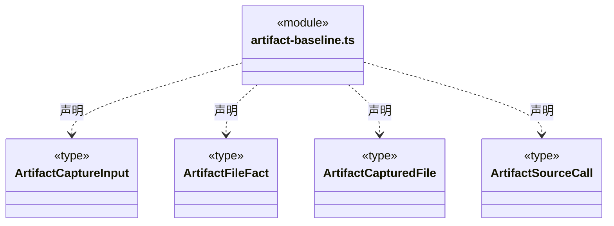

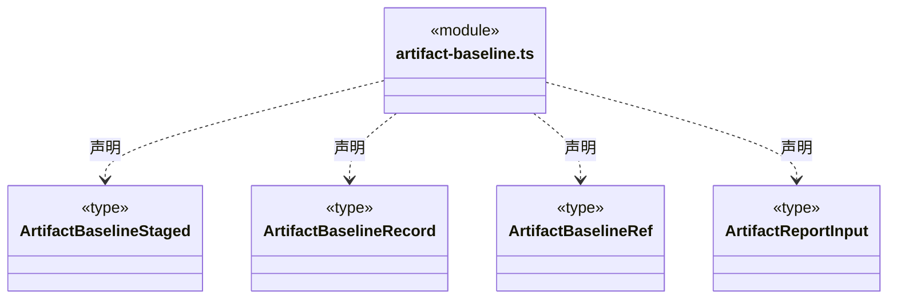

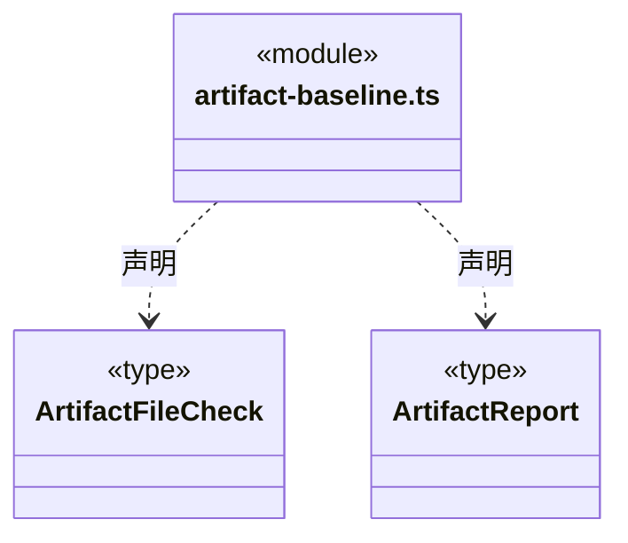


### artifact-evidence.ts

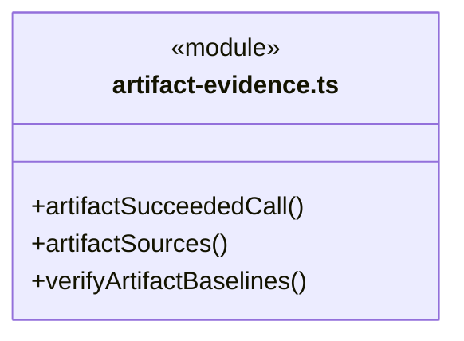

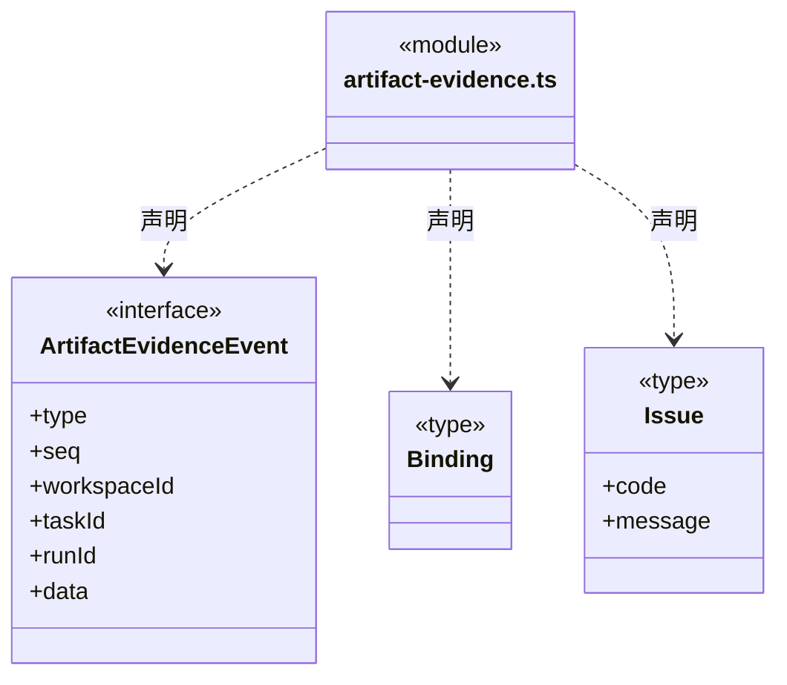

直接依赖：[../foundation/errors.ts](../foundation/errors.ts)、[../foundation/serialization.ts](../foundation/serialization.ts)、[artifact-baseline.ts](artifact-baseline.ts)。

### artifact-tools.ts

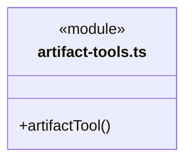

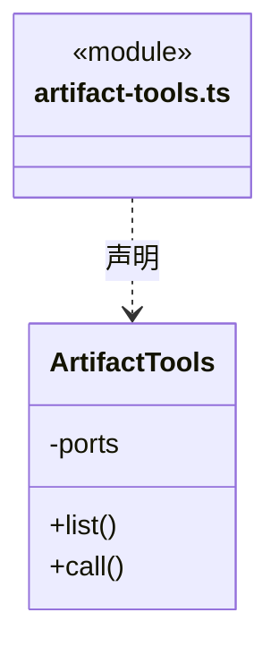

直接依赖：[../tools/results.ts](../tools/results.ts)、[artifact-baseline.ts](artifact-baseline.ts)。

### dispatch-commands.ts

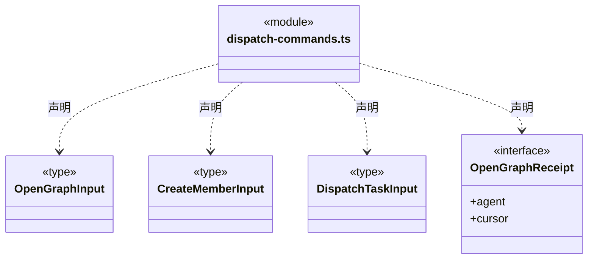

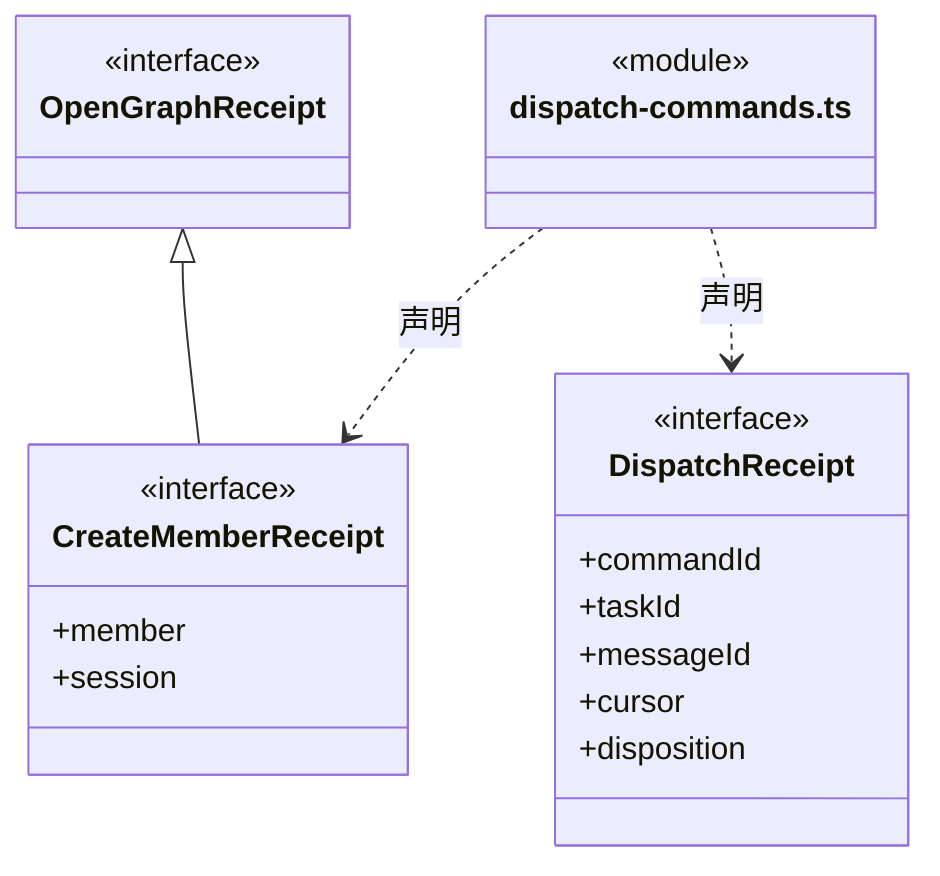

直接依赖：[../team/agent-types.ts](../team/agent-types.ts)、[graph-types.ts](graph-types.ts)。

### dispatch-execution.ts

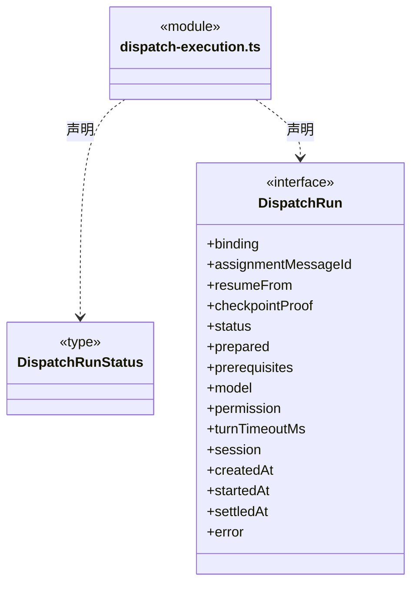

直接依赖：[../brain/member-run.ts](../brain/member-run.ts)、[../brain/llm/ports.ts](../brain/llm/ports.ts)、[../policy/types.ts](../policy/types.ts)、[execution-context.ts](execution-context.ts)、[graph-types.ts](graph-types.ts)、[member-checkpoint.ts](member-checkpoint.ts)。

### dispatch-invariants.ts

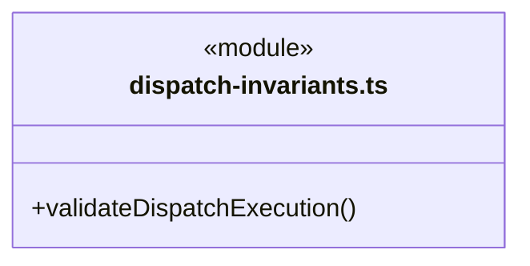

直接依赖：[../foundation/errors.ts](../foundation/errors.ts)、[../brain/llm/config.ts](../brain/llm/config.ts)、[execution-context.ts](execution-context.ts)、[dispatch-storage.ts](dispatch-storage.ts)、[dispatch-execution.ts](dispatch-execution.ts)、[graph-types.ts](graph-types.ts)、[queued-task-cancel-rules.ts](queued-task-cancel-rules.ts)、[queued-dependency-replacement-invariants.ts](queued-dependency-replacement-invariants.ts)、[member-checkpoint.ts](member-checkpoint.ts)、[member-checkpoint-invariants.ts](member-checkpoint-invariants.ts)。

### dispatch-scope-invariants.ts

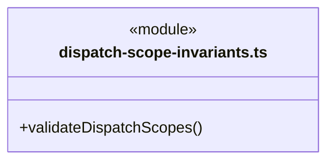

直接依赖：[../foundation/errors.ts](../foundation/errors.ts)、[dispatch-storage.ts](dispatch-storage.ts)、[dispatch-scope.ts](dispatch-scope.ts)、[scope-goal.ts](scope-goal.ts)、[scope-continuation.ts](scope-continuation.ts)、[scope-recovery.ts](scope-recovery.ts)、[scope-replan.ts](scope-replan.ts)、[fresh-context.ts](fresh-context.ts)、[scope-run-tracking.ts](scope-run-tracking.ts)、[scope-run-invariants.ts](scope-run-invariants.ts)、[scope-budget.ts](scope-budget.ts)、[scope-budget-invariants.ts](scope-budget-invariants.ts)、[member-checkpoint.ts](member-checkpoint.ts)。

### dispatch-scope.ts

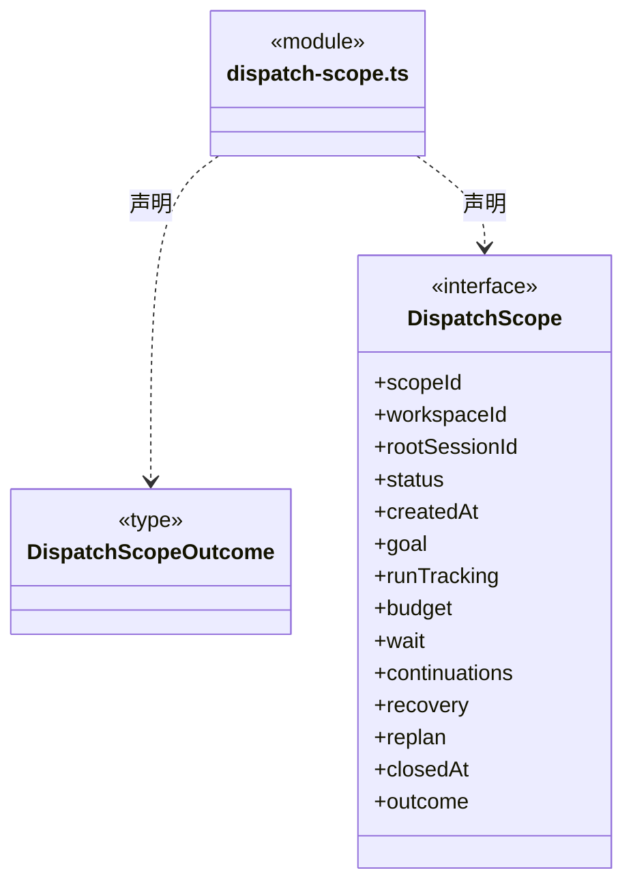

直接依赖：[scope-goal.ts](scope-goal.ts)、[scope-continuation.ts](scope-continuation.ts)、[scope-recovery.ts](scope-recovery.ts)、[scope-replan.ts](scope-replan.ts)、[scope-run-tracking.ts](scope-run-tracking.ts)、[scope-budget.ts](scope-budget.ts)。

### dispatch-storage.ts

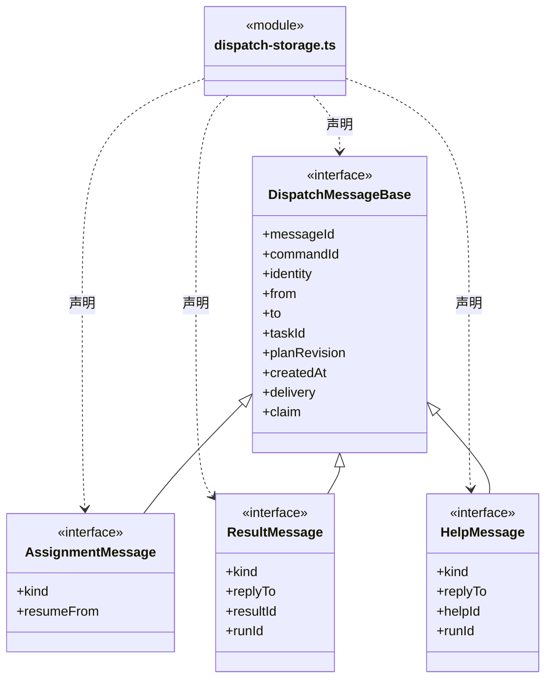

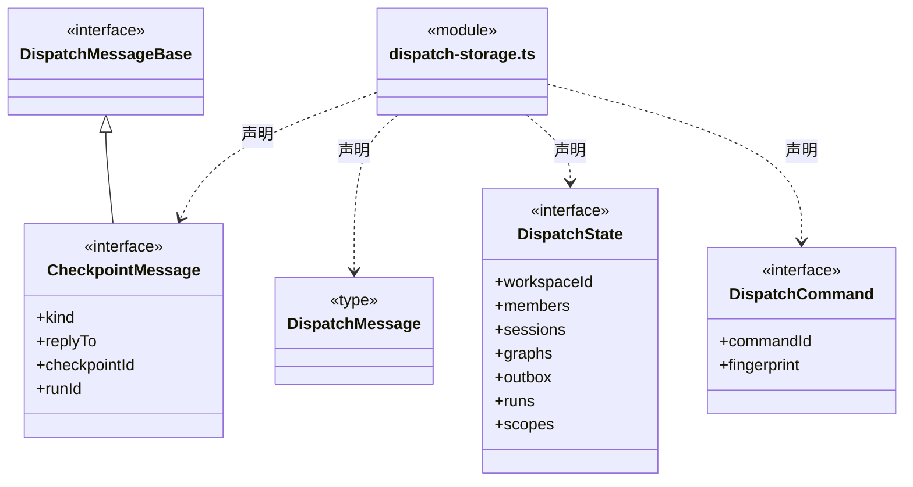

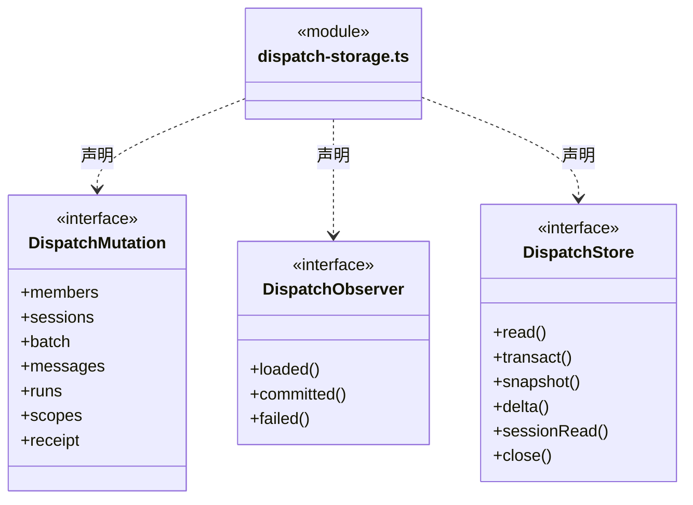

直接依赖：[../team/agent-types.ts](../team/agent-types.ts)、[graph-types.ts](graph-types.ts)、[dispatch-execution.ts](dispatch-execution.ts)、[dispatch-scope.ts](dispatch-scope.ts)、[scope-view.ts](scope-view.ts)、[member-checkpoint.ts](member-checkpoint.ts)。

### execution-context.ts

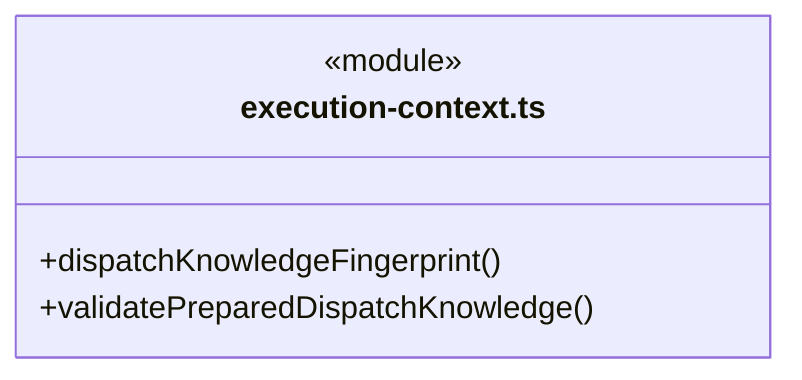

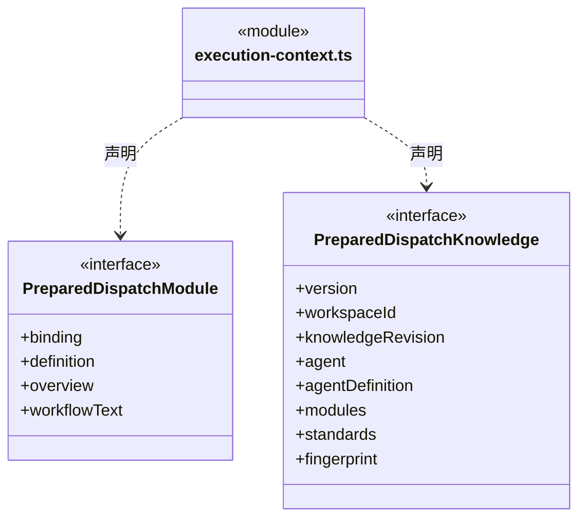

直接依赖：[../foundation/serialization.ts](../foundation/serialization.ts)、[../foundation/errors.ts](../foundation/errors.ts)、[../team/agent-types.ts](../team/agent-types.ts)、[graph-types.ts](graph-types.ts)。

### execution-report.ts

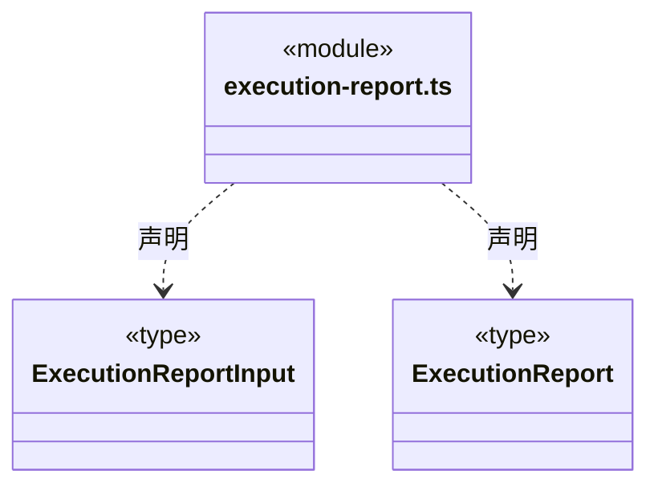

直接依赖：[member-commands.ts](member-commands.ts)、[dispatch-commands.ts](dispatch-commands.ts)。

### fresh-context.ts

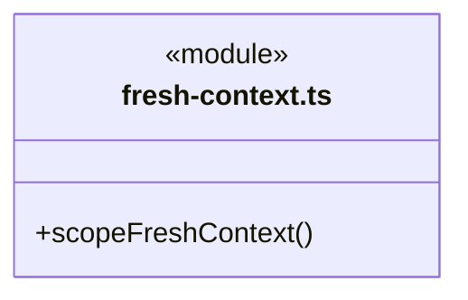

```mermaid
classDiagram
class N_src_backend_core_tasks_fresh_context_ts["fresh-context.ts"] {
  <<module>>
}
class N_src_backend_core_tasks_fresh_context_ts_FreshContext["FreshContext"] {
  <<type>>

}
N_src_backend_core_tasks_fresh_context_ts ..> N_src_backend_core_tasks_fresh_context_ts_FreshContext : 声明
```


### graph-reducer.ts

```mermaid
classDiagram
class N_src_backend_core_tasks_graph_reducer_ts["graph-reducer.ts"] {
  <<module>>
  +applyGraphBatch()
  +readGraphDelta()
}
```

```mermaid
classDiagram
class N_src_backend_core_tasks_graph_reducer_ts["graph-reducer.ts"] {
  <<module>>
}
class N_src_backend_core_tasks_graph_reducer_ts_SeenBatch["SeenBatch"] {
  <<type>>
  +fingerprint
  +eventId
  +commandId
}
N_src_backend_core_tasks_graph_reducer_ts ..> N_src_backend_core_tasks_graph_reducer_ts_SeenBatch : 声明
```

直接依赖：[../foundation/errors.ts](../foundation/errors.ts)、[graph-rules.ts](graph-rules.ts)、[graph-types.ts](graph-types.ts)。

### graph-rules.ts

```mermaid
classDiagram
class N_src_backend_core_tasks_graph_rules_ts["graph-rules.ts"] {
  <<module>>
  +validateGraphIdentity()
  +validateGraphBatch()
  +assertGraphIdentity()
  +validateGraphCursor()
  +validateGraph()
}
```

直接依赖：[queued-task-cancel.ts](queued-task-cancel.ts)、[../foundation/errors.ts](../foundation/errors.ts)、[graph-types.ts](graph-types.ts)、[member-help.ts](member-help.ts)、[queued-dependency-replacement.ts](queued-dependency-replacement.ts)、[member-checkpoint.ts](member-checkpoint.ts)、[queued-member-resume.ts](queued-member-resume.ts)。

### graph-types.ts

```mermaid
classDiagram
class N_src_backend_core_tasks_graph_types_ts["graph-types.ts"] {
  <<module>>
}
class N_src_backend_core_tasks_graph_types_ts_GraphIdentity["GraphIdentity"] {
  <<type>>
  +workspaceId
  +rootSessionId
}
N_src_backend_core_tasks_graph_types_ts ..> N_src_backend_core_tasks_graph_types_ts_GraphIdentity : 声明
class N_src_backend_core_tasks_graph_types_ts_AgentRef["AgentRef"] {
  <<type>>
  +agentId
  +agentInstanceId
  +agentSessionId
  +name
}
N_src_backend_core_tasks_graph_types_ts ..> N_src_backend_core_tasks_graph_types_ts_AgentRef : 声明
class N_src_backend_core_tasks_graph_types_ts_ModuleBinding["ModuleBinding"] {
  <<type>>
  +moduleId
  +name
  +knowledgeRevision
  +maintenanceBindingId
  +maintainerPersonIds
  +workflow
}
N_src_backend_core_tasks_graph_types_ts ..> N_src_backend_core_tasks_graph_types_ts_ModuleBinding : 声明
class N_src_backend_core_tasks_graph_types_ts_SessionRootNode["SessionRootNode"] {
  <<type>>
  +kind
  +nodeId
  +identity
  +agent
  +revision
  +createdAt
}
N_src_backend_core_tasks_graph_types_ts ..> N_src_backend_core_tasks_graph_types_ts_SessionRootNode : 声明
```

成员 1/2（同名节点为同一声明，跨图合并阅读）。

```mermaid
classDiagram
class N_src_backend_core_tasks_graph_types_ts["graph-types.ts"] {
  <<module>>
}
class N_src_backend_core_tasks_graph_types_ts_TaskStatus["TaskStatus"] {
  <<type>>

}
N_src_backend_core_tasks_graph_types_ts ..> N_src_backend_core_tasks_graph_types_ts_TaskStatus : 声明
class N_src_backend_core_tasks_graph_types_ts_TaskNode["TaskNode"] {
  <<type>>
  +kind
  +nodeId
  +taskId
  +identity
  +scopeId
  +parentTaskId
  +requester
  +assignee
  +modules
  +goal
  +acceptance
  +revision
  +planRevision
  +status
  +awaitedChildren
  +waitReason
}
N_src_backend_core_tasks_graph_types_ts ..> N_src_backend_core_tasks_graph_types_ts_TaskNode : 声明
class N_src_backend_core_tasks_graph_types_ts_GraphEdge["GraphEdge"] {
  <<type>>
  +edgeId
  +identity
  +fromNodeId
  +toNodeId
  +revision
  +enabled
}
N_src_backend_core_tasks_graph_types_ts ..> N_src_backend_core_tasks_graph_types_ts_GraphEdge : 声明
class N_src_backend_core_tasks_graph_types_ts_GraphCursor["GraphCursor"] {
  <<type>>
  +streamId
  +seq
}
N_src_backend_core_tasks_graph_types_ts ..> N_src_backend_core_tasks_graph_types_ts_GraphCursor : 声明
```

成员 2/2（同名节点为同一声明，跨图合并阅读）。

```mermaid
classDiagram
class N_src_backend_core_tasks_graph_types_ts["graph-types.ts"] {
  <<module>>
}
class N_src_backend_core_tasks_graph_types_ts_TaskNode["TaskNode"] {
  <<type>>
  +runIds
  +activeRunId
  +result
  +help
  +checkpoints
  +resumeRequest
  +cancelledBeforeStart
  +dependencyReplacements
  +createdAt
  +updatedAt
}
N_src_backend_core_tasks_graph_types_ts ..> N_src_backend_core_tasks_graph_types_ts_TaskNode : 声明
```

```mermaid
classDiagram
class N_src_backend_core_tasks_graph_types_ts["graph-types.ts"] {
  <<module>>
}
class N_src_backend_core_tasks_graph_types_ts_AgentGraphView["AgentGraphView"] {
  <<type>>
  +agentInstanceId
  +agentId
  +name
  +revision
  +state
  +runningTaskId
  +waitingTaskIds
}
N_src_backend_core_tasks_graph_types_ts ..> N_src_backend_core_tasks_graph_types_ts_AgentGraphView : 声明
class N_src_backend_core_tasks_graph_types_ts_GraphChange["GraphChange"] {
  <<type>>

}
N_src_backend_core_tasks_graph_types_ts ..> N_src_backend_core_tasks_graph_types_ts_GraphChange : 声明
class N_src_backend_core_tasks_graph_types_ts_GraphCause["GraphCause"] {
  <<type>>

}
N_src_backend_core_tasks_graph_types_ts ..> N_src_backend_core_tasks_graph_types_ts_GraphCause : 声明
class N_src_backend_core_tasks_graph_types_ts_GraphEventBatch["GraphEventBatch"] {
  <<type>>
  +version
  +identity
  +streamId
  +seq
  +eventId
  +commandId
  +cause
  +committedAt
  +changes
}
N_src_backend_core_tasks_graph_types_ts ..> N_src_backend_core_tasks_graph_types_ts_GraphEventBatch : 声明
```

```mermaid
classDiagram
class N_src_backend_core_tasks_graph_types_ts["graph-types.ts"] {
  <<module>>
}
class N_src_backend_core_tasks_graph_types_ts_GraphSnapshot["GraphSnapshot"] {
  <<type>>
  +version
  +identity
  +cursor
  +root
  +tasks
  +edges
  +agents
}
N_src_backend_core_tasks_graph_types_ts ..> N_src_backend_core_tasks_graph_types_ts_GraphSnapshot : 声明
class N_src_backend_core_tasks_graph_types_ts_GraphDelta["GraphDelta"] {
  <<type>>

}
N_src_backend_core_tasks_graph_types_ts ..> N_src_backend_core_tasks_graph_types_ts_GraphDelta : 声明
```

直接依赖：[member-help.ts](member-help.ts)、[queued-task-cancel.ts](queued-task-cancel.ts)、[queued-dependency-replacement.ts](queued-dependency-replacement.ts)、[member-checkpoint.ts](member-checkpoint.ts)、[queued-member-resume.ts](queued-member-resume.ts)。

### member-checkpoint-evidence.ts

```mermaid
classDiagram
class N_src_backend_core_tasks_member_checkpoint_evidence_ts["member-checkpoint-evidence.ts"] {
  <<module>>
  +validateCheckpointEligibility()
  +verifyMemberCheckpoint()
}
```

```mermaid
classDiagram
class N_src_backend_core_tasks_member_checkpoint_evidence_ts["member-checkpoint-evidence.ts"] {
  <<module>>
}
class N_src_backend_core_tasks_member_checkpoint_evidence_ts_Binding["Binding"] {
  <<type>>

}
N_src_backend_core_tasks_member_checkpoint_evidence_ts ..> N_src_backend_core_tasks_member_checkpoint_evidence_ts_Binding : 声明
```

直接依赖：[../foundation/errors.ts](../foundation/errors.ts)、[../foundation/serialization.ts](../foundation/serialization.ts)、[../tools/receipts.ts](../tools/receipts.ts)、[../tools/types.ts](../tools/types.ts)、[artifact-evidence.ts](artifact-evidence.ts)、[member-checkpoint.ts](member-checkpoint.ts)。

### member-checkpoint-invariants.ts

```mermaid
classDiagram
class N_src_backend_core_tasks_member_checkpoint_invariants_ts["member-checkpoint-invariants.ts"] {
  <<module>>
  +validateMemberCheckpoints()
}
```

直接依赖：[../foundation/errors.ts](../foundation/errors.ts)、[dispatch-storage.ts](dispatch-storage.ts)、[graph-types.ts](graph-types.ts)、[member-checkpoint.ts](member-checkpoint.ts)、[queued-member-resume.ts](queued-member-resume.ts)、[queued-member-resume-rules.ts](queued-member-resume-rules.ts)、[scope-goal.ts](scope-goal.ts)。

### member-checkpoint-tools.ts

```mermaid
classDiagram
class N_src_backend_core_tasks_member_checkpoint_tools_ts["member-checkpoint-tools.ts"] {
  <<module>>
  +memberCheckpointTool()
}
```

```mermaid
classDiagram
class N_src_backend_core_tasks_member_checkpoint_tools_ts["member-checkpoint-tools.ts"] {
  <<module>>
}
class N_src_backend_core_tasks_member_checkpoint_tools_ts_MemberCheckpointTools["MemberCheckpointTools"] {
  +list()
  +call()
  -ports
}
N_src_backend_core_tasks_member_checkpoint_tools_ts ..> N_src_backend_core_tasks_member_checkpoint_tools_ts_MemberCheckpointTools : 声明
```

直接依赖：[../tools/results.ts](../tools/results.ts)、[member-checkpoint.ts](member-checkpoint.ts)。

### member-checkpoint.ts

```mermaid
classDiagram
class N_src_backend_core_tasks_member_checkpoint_ts["member-checkpoint.ts"] {
  <<module>>
  +isMemberCheckpointPending()
}
```

```mermaid
classDiagram
class N_src_backend_core_tasks_member_checkpoint_ts["member-checkpoint.ts"] {
  <<module>>
}
class N_src_backend_core_tasks_member_checkpoint_ts_MemberCheckpointInput["MemberCheckpointInput"] {
  <<type>>

}
N_src_backend_core_tasks_member_checkpoint_ts ..> N_src_backend_core_tasks_member_checkpoint_ts_MemberCheckpointInput : 声明
class N_src_backend_core_tasks_member_checkpoint_ts_MemberCheckpointStaged["MemberCheckpointStaged"] {
  <<type>>

}
N_src_backend_core_tasks_member_checkpoint_ts ..> N_src_backend_core_tasks_member_checkpoint_ts_MemberCheckpointStaged : 声明
class N_src_backend_core_tasks_member_checkpoint_ts_MemberCheckpointRecord["MemberCheckpointRecord"] {
  <<type>>

}
N_src_backend_core_tasks_member_checkpoint_ts ..> N_src_backend_core_tasks_member_checkpoint_ts_MemberCheckpointRecord : 声明
class N_src_backend_core_tasks_member_checkpoint_ts_MemberCheckpointProof["MemberCheckpointProof"] {
  <<type>>

}
N_src_backend_core_tasks_member_checkpoint_ts ..> N_src_backend_core_tasks_member_checkpoint_ts_MemberCheckpointProof : 声明
```

```mermaid
classDiagram
class N_src_backend_core_tasks_member_checkpoint_ts["member-checkpoint.ts"] {
  <<module>>
}
class N_src_backend_core_tasks_member_checkpoint_ts_MemberResumeFrom["MemberResumeFrom"] {
  <<type>>

}
N_src_backend_core_tasks_member_checkpoint_ts ..> N_src_backend_core_tasks_member_checkpoint_ts_MemberResumeFrom : 声明
```


### member-commands.ts

```mermaid
classDiagram
class N_src_backend_core_tasks_member_commands_ts["member-commands.ts"] {
  <<module>>
}
class N_src_backend_core_tasks_member_commands_ts_MemberStartOptions["MemberStartOptions"] {
  <<type>>

}
N_src_backend_core_tasks_member_commands_ts ..> N_src_backend_core_tasks_member_commands_ts_MemberStartOptions : 声明
class N_src_backend_core_tasks_member_commands_ts_MemberStartReceipt["MemberStartReceipt"] {
  <<interface>>
  +taskId
  +runId
  +cursor
}
N_src_backend_core_tasks_member_commands_ts ..> N_src_backend_core_tasks_member_commands_ts_MemberStartReceipt : 声明
class N_src_backend_core_tasks_member_commands_ts_MemberExecutionView["MemberExecutionView"] {
  <<interface>>
  +task
  +runs
}
N_src_backend_core_tasks_member_commands_ts ..> N_src_backend_core_tasks_member_commands_ts_MemberExecutionView : 声明
```

直接依赖：[dispatch-commands.ts](dispatch-commands.ts)、[graph-types.ts](graph-types.ts)、[dispatch-execution.ts](dispatch-execution.ts)、[../brain/member-run.ts](../brain/member-run.ts)。

### member-events.ts

```mermaid
classDiagram
class N_src_backend_core_tasks_member_events_ts["member-events.ts"] {
  <<module>>
}
class N_src_backend_core_tasks_member_events_ts_MemberEventCursor["MemberEventCursor"] {
  <<interface>>
  +runId
  +seq
}
N_src_backend_core_tasks_member_events_ts ..> N_src_backend_core_tasks_member_events_ts_MemberEventCursor : 声明
class N_src_backend_core_tasks_member_events_ts_MemberEventsInput["MemberEventsInput"] {
  <<type>>

}
N_src_backend_core_tasks_member_events_ts ..> N_src_backend_core_tasks_member_events_ts_MemberEventsInput : 声明
class N_src_backend_core_tasks_member_events_ts_MemberRunView["MemberRunView"] {
  <<interface>>
  +task
  +runId
  +status
  +acceptance
  +unresolvedTools
  +taskProgress
}
N_src_backend_core_tasks_member_events_ts ..> N_src_backend_core_tasks_member_events_ts_MemberRunView : 声明
class N_src_backend_core_tasks_member_events_ts_MemberEventsRead["MemberEventsRead"] {
  <<type>>

}
N_src_backend_core_tasks_member_events_ts ..> N_src_backend_core_tasks_member_events_ts_MemberEventsRead : 声明
```

直接依赖：[../brain/types.ts](../brain/types.ts)、[types.ts](types.ts)、[progress.ts](progress.ts)、[member-commands.ts](member-commands.ts)。

### member-help-tools.ts

```mermaid
classDiagram
class N_src_backend_core_tasks_member_help_tools_ts["member-help-tools.ts"] {
  <<module>>
  +memberHelpTool()
}
```

```mermaid
classDiagram
class N_src_backend_core_tasks_member_help_tools_ts["member-help-tools.ts"] {
  <<module>>
}
class N_src_backend_core_tasks_member_help_tools_ts_MemberHelpTools["MemberHelpTools"] {
  +list()
  +guard()
  +denied()
  +call()
  -binding
  -ports
  -reserved
  -consumed
}
N_src_backend_core_tasks_member_help_tools_ts ..> N_src_backend_core_tasks_member_help_tools_ts_MemberHelpTools : 声明
```

直接依赖：[member-help.ts](member-help.ts)、[../tools/results.ts](../tools/results.ts)。

### member-help.ts

```mermaid
classDiagram
class N_src_backend_core_tasks_member_help_ts["member-help.ts"] {
  <<module>>
}
class N_src_backend_core_tasks_member_help_ts_MemberHelpInput["MemberHelpInput"] {
  <<type>>

}
N_src_backend_core_tasks_member_help_ts ..> N_src_backend_core_tasks_member_help_ts_MemberHelpInput : 声明
class N_src_backend_core_tasks_member_help_ts_MemberHelpStaged["MemberHelpStaged"] {
  <<type>>

}
N_src_backend_core_tasks_member_help_ts ..> N_src_backend_core_tasks_member_help_ts_MemberHelpStaged : 声明
class N_src_backend_core_tasks_member_help_ts_MemberHelpRecord["MemberHelpRecord"] {
  <<type>>

}
N_src_backend_core_tasks_member_help_ts ..> N_src_backend_core_tasks_member_help_ts_MemberHelpRecord : 声明
```


### progress-tools.ts

```mermaid
classDiagram
class N_src_backend_core_tasks_progress_tools_ts["progress-tools.ts"] {
  <<module>>
  +progressTool()
}
```

```mermaid
classDiagram
class N_src_backend_core_tasks_progress_tools_ts["progress-tools.ts"] {
  <<module>>
}
class N_src_backend_core_tasks_progress_tools_ts_TaskProgressTools["TaskProgressTools"] {
  +list()
  +generation
  +current()
  +invalidate()
  +record()
  +call()
  -save
  -ports
  -state
  -evidence
  -tail
  -serial()
  -persist()
}
N_src_backend_core_tasks_progress_tools_ts ..> N_src_backend_core_tasks_progress_tools_ts_TaskProgressTools : 声明
```

直接依赖：[progress.ts](progress.ts)、[../tools/types.ts](../tools/types.ts)、[artifact-baseline.ts](artifact-baseline.ts)、[../tools/results.ts](../tools/results.ts)。

### progress.ts

```mermaid
classDiagram
class N_src_backend_core_tasks_progress_ts["progress.ts"] {
  <<module>>
}
class N_src_backend_core_tasks_progress_ts_TaskStep["TaskStep"] {
  <<interface>>
  +id
  +title
  +owner
  +state
  +evidence
}
N_src_backend_core_tasks_progress_ts ..> N_src_backend_core_tasks_progress_ts_TaskStep : 声明
class N_src_backend_core_tasks_progress_ts_TaskProgress["TaskProgress"] {
  <<interface>>
  +version
  +goal
  +acceptance
  +steps
  +state
  +reason
  +delivery
}
N_src_backend_core_tasks_progress_ts ..> N_src_backend_core_tasks_progress_ts_TaskProgress : 声明
```


### queue.ts

```mermaid
classDiagram
class N_src_backend_core_tasks_queue_ts["queue.ts"] {
  <<module>>
}
class N_src_backend_core_tasks_queue_ts_QueuedMessage["QueuedMessage"] {
  <<type>>

}
N_src_backend_core_tasks_queue_ts ..> N_src_backend_core_tasks_queue_ts_QueuedMessage : 声明
class N_src_backend_core_tasks_queue_ts_QueueCursor["QueueCursor"] {
  <<interface>>
  +epoch
  +revision
  +items
}
N_src_backend_core_tasks_queue_ts ..> N_src_backend_core_tasks_queue_ts_QueueCursor : 声明
class N_src_backend_core_tasks_queue_ts_QueueDelta["QueueDelta"] {
  <<interface>>
  +epoch
  +revision
  +reset
  +order
  +upserts
}
N_src_backend_core_tasks_queue_ts ..> N_src_backend_core_tasks_queue_ts_QueueDelta : 声明
```


### queued-dependency-replacement-invariants.ts

```mermaid
classDiagram
class N_src_backend_core_tasks_queued_dependency_replacement_invariants_ts["queued-dependency-replacement-invariants.ts"] {
  <<module>>
  +validateQueuedDependencyReplacement()
}
```

直接依赖：[../foundation/errors.ts](../foundation/errors.ts)、[dispatch-storage.ts](dispatch-storage.ts)、[graph-types.ts](graph-types.ts)、[queued-dependency-replacement.ts](queued-dependency-replacement.ts)、[queued-dependency-replacement-rules.ts](queued-dependency-replacement-rules.ts)。

### queued-dependency-replacement-rules.ts

```mermaid
classDiagram
class N_src_backend_core_tasks_queued_dependency_replacement_rules_ts["queued-dependency-replacement-rules.ts"] {
  <<module>>
  +queuedDependencyReplacementSelection()
}
```

直接依赖：[../foundation/errors.ts](../foundation/errors.ts)、[dispatch-storage.ts](dispatch-storage.ts)、[graph-types.ts](graph-types.ts)、[queued-dependency-replacement.ts](queued-dependency-replacement.ts)、[scope-goal.ts](scope-goal.ts)。

### queued-dependency-replacement.ts

```mermaid
classDiagram
class N_src_backend_core_tasks_queued_dependency_replacement_ts["queued-dependency-replacement.ts"] {
  <<module>>
}
class N_src_backend_core_tasks_queued_dependency_replacement_ts_ReplaceQueuedDependencyInput["ReplaceQueuedDependencyInput"] {
  <<type>>

}
N_src_backend_core_tasks_queued_dependency_replacement_ts ..> N_src_backend_core_tasks_queued_dependency_replacement_ts_ReplaceQueuedDependencyInput : 声明
class N_src_backend_core_tasks_queued_dependency_replacement_ts_DependencyReplacement["DependencyReplacement"] {
  <<type>>

}
N_src_backend_core_tasks_queued_dependency_replacement_ts ..> N_src_backend_core_tasks_queued_dependency_replacement_ts_DependencyReplacement : 声明
class N_src_backend_core_tasks_queued_dependency_replacement_ts_ReplaceQueuedDependencyReceipt["ReplaceQueuedDependencyReceipt"] {
  <<type>>
  +workspaceId
  +rootSessionId
  +scopeId
  +mainRunId
  +commandId
  +taskId
  +status
  +trackedTaskIds
  +replacement
  +graphCursor
}
N_src_backend_core_tasks_queued_dependency_replacement_ts ..> N_src_backend_core_tasks_queued_dependency_replacement_ts_ReplaceQueuedDependencyReceipt : 声明
```


### queued-member-resume-rules.ts

```mermaid
classDiagram
class N_src_backend_core_tasks_queued_member_resume_rules_ts["queued-member-resume-rules.ts"] {
  <<module>>
  +memberResumeSelection()
}
```

直接依赖：[../foundation/errors.ts](../foundation/errors.ts)、[dispatch-storage.ts](dispatch-storage.ts)、[graph-types.ts](graph-types.ts)、[queued-member-resume.ts](queued-member-resume.ts)、[scope-goal.ts](scope-goal.ts)。

### queued-member-resume.ts

```mermaid
classDiagram
class N_src_backend_core_tasks_queued_member_resume_ts["queued-member-resume.ts"] {
  <<module>>
}
class N_src_backend_core_tasks_queued_member_resume_ts_ResumeMemberInput["ResumeMemberInput"] {
  <<type>>

}
N_src_backend_core_tasks_queued_member_resume_ts ..> N_src_backend_core_tasks_queued_member_resume_ts_ResumeMemberInput : 声明
class N_src_backend_core_tasks_queued_member_resume_ts_MemberResumeRequest["MemberResumeRequest"] {
  <<type>>

}
N_src_backend_core_tasks_queued_member_resume_ts ..> N_src_backend_core_tasks_queued_member_resume_ts_MemberResumeRequest : 声明
class N_src_backend_core_tasks_queued_member_resume_ts_ResumeMemberReceipt["ResumeMemberReceipt"] {
  <<type>>
  +taskId
  +checkpointId
  +requestId
  +trackedTaskIds
  +cursor
}
N_src_backend_core_tasks_queued_member_resume_ts ..> N_src_backend_core_tasks_queued_member_resume_ts_ResumeMemberReceipt : 声明
```


### queued-task-cancel-rules.ts

```mermaid
classDiagram
class N_src_backend_core_tasks_queued_task_cancel_rules_ts["queued-task-cancel-rules.ts"] {
  <<module>>
  +queuedCancellationSelection()
  +validateQueuedTaskCancellation()
}
```

直接依赖：[../foundation/errors.ts](../foundation/errors.ts)、[dispatch-storage.ts](dispatch-storage.ts)、[graph-types.ts](graph-types.ts)、[queued-task-cancel.ts](queued-task-cancel.ts)。

### queued-task-cancel.ts

```mermaid
classDiagram
class N_src_backend_core_tasks_queued_task_cancel_ts["queued-task-cancel.ts"] {
  <<module>>
}
class N_src_backend_core_tasks_queued_task_cancel_ts_CancelQueuedTasksInput["CancelQueuedTasksInput"] {
  <<type>>

}
N_src_backend_core_tasks_queued_task_cancel_ts ..> N_src_backend_core_tasks_queued_task_cancel_ts_CancelQueuedTasksInput : 声明
class N_src_backend_core_tasks_queued_task_cancel_ts_QueuedTaskCancellation["QueuedTaskCancellation"] {
  <<type>>

}
N_src_backend_core_tasks_queued_task_cancel_ts ..> N_src_backend_core_tasks_queued_task_cancel_ts_QueuedTaskCancellation : 声明
class N_src_backend_core_tasks_queued_task_cancel_ts_CancelQueuedTasksReceipt["CancelQueuedTasksReceipt"] {
  <<type>>
  +workspaceId
  +rootSessionId
  +scopeId
  +mainRunId
  +commandId
  +cancelledTaskIds
  +graphCursor
}
N_src_backend_core_tasks_queued_task_cancel_ts ..> N_src_backend_core_tasks_queued_task_cancel_ts_CancelQueuedTasksReceipt : 声明
```


### scope-budget-invariants.ts

```mermaid
classDiagram
class N_src_backend_core_tasks_scope_budget_invariants_ts["scope-budget-invariants.ts"] {
  <<module>>
  +validateScopeBudgets()
}
```

直接依赖：[../foundation/errors.ts](../foundation/errors.ts)、[dispatch-storage.ts](dispatch-storage.ts)、[dispatch-scope.ts](dispatch-scope.ts)、[scope-budget.ts](scope-budget.ts)。

### scope-budget.ts

```mermaid
classDiagram
class N_src_backend_core_tasks_scope_budget_ts["scope-budget.ts"] {
  <<module>>
  +createScopeBudget()
  +evaluateScopeBudget()
}
```

```mermaid
classDiagram
class N_src_backend_core_tasks_scope_budget_ts["scope-budget.ts"] {
  <<module>>
}
class N_src_backend_core_tasks_scope_budget_ts_ScopeBudgetPolicy["ScopeBudgetPolicy"] {
  <<type>>

}
N_src_backend_core_tasks_scope_budget_ts ..> N_src_backend_core_tasks_scope_budget_ts_ScopeBudgetPolicy : 声明
class N_src_backend_core_tasks_scope_budget_ts_ScopeBudgetObservation["ScopeBudgetObservation"] {
  <<type>>

}
N_src_backend_core_tasks_scope_budget_ts ..> N_src_backend_core_tasks_scope_budget_ts_ScopeBudgetObservation : 声明
class N_src_backend_core_tasks_scope_budget_ts_ScopeBudgetAdmission["ScopeBudgetAdmission"] {
  <<type>>

}
N_src_backend_core_tasks_scope_budget_ts ..> N_src_backend_core_tasks_scope_budget_ts_ScopeBudgetAdmission : 声明
class N_src_backend_core_tasks_scope_budget_ts_ScopeBudgetReason["ScopeBudgetReason"] {
  <<type>>

}
N_src_backend_core_tasks_scope_budget_ts ..> N_src_backend_core_tasks_scope_budget_ts_ScopeBudgetReason : 声明
```

```mermaid
classDiagram
class N_src_backend_core_tasks_scope_budget_ts["scope-budget.ts"] {
  <<module>>
}
class N_src_backend_core_tasks_scope_budget_ts_ScopeBudgetBlocked["ScopeBudgetBlocked"] {
  <<type>>

}
N_src_backend_core_tasks_scope_budget_ts ..> N_src_backend_core_tasks_scope_budget_ts_ScopeBudgetBlocked : 声明
class N_src_backend_core_tasks_scope_budget_ts_ScopeBudget["ScopeBudget"] {
  <<type>>

}
N_src_backend_core_tasks_scope_budget_ts ..> N_src_backend_core_tasks_scope_budget_ts_ScopeBudget : 声明
class N_src_backend_core_tasks_scope_budget_ts_ScopeBudgetSummary["ScopeBudgetSummary"] {
  <<type>>

}
N_src_backend_core_tasks_scope_budget_ts ..> N_src_backend_core_tasks_scope_budget_ts_ScopeBudgetSummary : 声明
class N_src_backend_core_tasks_scope_budget_ts_ScopeBudgetDecision["ScopeBudgetDecision"] {
  <<type>>

}
N_src_backend_core_tasks_scope_budget_ts ..> N_src_backend_core_tasks_scope_budget_ts_ScopeBudgetDecision : 声明
```


### scope-continuation.ts

```mermaid
classDiagram
class N_src_backend_core_tasks_scope_continuation_ts["scope-continuation.ts"] {
  <<module>>
}
class N_src_backend_core_tasks_scope_continuation_ts_DispatchScopeWait["DispatchScopeWait"] {
  <<type>>

}
N_src_backend_core_tasks_scope_continuation_ts ..> N_src_backend_core_tasks_scope_continuation_ts_DispatchScopeWait : 声明
class N_src_backend_core_tasks_scope_continuation_ts_ScopeContinuationOptions["ScopeContinuationOptions"] {
  <<type>>

}
N_src_backend_core_tasks_scope_continuation_ts ..> N_src_backend_core_tasks_scope_continuation_ts_ScopeContinuationOptions : 声明
class N_src_backend_core_tasks_scope_continuation_ts_GoalContinuationRequest["GoalContinuationRequest"] {
  <<type>>

}
N_src_backend_core_tasks_scope_continuation_ts ..> N_src_backend_core_tasks_scope_continuation_ts_GoalContinuationRequest : 声明
class N_src_backend_core_tasks_scope_continuation_ts_ScopeContinuationLookup["ScopeContinuationLookup"] {
  <<type>>

}
N_src_backend_core_tasks_scope_continuation_ts ..> N_src_backend_core_tasks_scope_continuation_ts_ScopeContinuationLookup : 声明
```

```mermaid
classDiagram
class N_src_backend_core_tasks_scope_continuation_ts["scope-continuation.ts"] {
  <<module>>
}
class N_src_backend_core_tasks_scope_continuation_ts_ScopeContinuation["ScopeContinuation"] {
  <<type>>

}
N_src_backend_core_tasks_scope_continuation_ts ..> N_src_backend_core_tasks_scope_continuation_ts_ScopeContinuation : 声明
class N_src_backend_core_tasks_scope_continuation_ts_GoalContinuationReceipt["GoalContinuationReceipt"] {
  <<type>>

}
N_src_backend_core_tasks_scope_continuation_ts ..> N_src_backend_core_tasks_scope_continuation_ts_GoalContinuationReceipt : 声明
```


### scope-goal.ts

```mermaid
classDiagram
class N_src_backend_core_tasks_scope_goal_ts["scope-goal.ts"] {
  <<module>>
  +goalInputRevision()
  +goalNeedsReplan()
  +sameGoalValue()
  +validateScopeGoalTransition()
}
```

```mermaid
classDiagram
class N_src_backend_core_tasks_scope_goal_ts["scope-goal.ts"] {
  <<module>>
}
class N_src_backend_core_tasks_scope_goal_ts_DispatchScopeInput["DispatchScopeInput"] {
  <<interface>>
  +message
  +attachmentIds
}
N_src_backend_core_tasks_scope_goal_ts ..> N_src_backend_core_tasks_scope_goal_ts_DispatchScopeInput : 声明
class N_src_backend_core_tasks_scope_goal_ts_GoalPlanInput["GoalPlanInput"] {
  <<type>>

}
N_src_backend_core_tasks_scope_goal_ts ..> N_src_backend_core_tasks_scope_goal_ts_GoalPlanInput : 声明
class N_src_backend_core_tasks_scope_goal_ts_GoalReviewInput["GoalReviewInput"] {
  <<type>>

}
N_src_backend_core_tasks_scope_goal_ts ..> N_src_backend_core_tasks_scope_goal_ts_GoalReviewInput : 声明
class N_src_backend_core_tasks_scope_goal_ts_GoalEvidence["GoalEvidence"] {
  <<type>>

}
N_src_backend_core_tasks_scope_goal_ts ..> N_src_backend_core_tasks_scope_goal_ts_GoalEvidence : 声明
```

```mermaid
classDiagram
class N_src_backend_core_tasks_scope_goal_ts["scope-goal.ts"] {
  <<module>>
}
class N_src_backend_core_tasks_scope_goal_ts_DispatchScopeGoal["DispatchScopeGoal"] {
  <<type>>

}
N_src_backend_core_tasks_scope_goal_ts ..> N_src_backend_core_tasks_scope_goal_ts_DispatchScopeGoal : 声明
class N_src_backend_core_tasks_scope_goal_ts_ScopeGoalPlan["ScopeGoalPlan"] {
  <<type>>

}
N_src_backend_core_tasks_scope_goal_ts ..> N_src_backend_core_tasks_scope_goal_ts_ScopeGoalPlan : 声明
class N_src_backend_core_tasks_scope_goal_ts_ScopeGoalReview["ScopeGoalReview"] {
  <<type>>

}
N_src_backend_core_tasks_scope_goal_ts ..> N_src_backend_core_tasks_scope_goal_ts_ScopeGoalReview : 声明
```

直接依赖：[../foundation/errors.ts](../foundation/errors.ts)。

### scope-recovery.ts

```mermaid
classDiagram
class N_src_backend_core_tasks_scope_recovery_ts["scope-recovery.ts"] {
  <<module>>
}
class N_src_backend_core_tasks_scope_recovery_ts_RecoveryRequest["RecoveryRequest"] {
  <<type>>

}
N_src_backend_core_tasks_scope_recovery_ts ..> N_src_backend_core_tasks_scope_recovery_ts_RecoveryRequest : 声明
class N_src_backend_core_tasks_scope_recovery_ts_RecoveryLookup["RecoveryLookup"] {
  <<type>>

}
N_src_backend_core_tasks_scope_recovery_ts ..> N_src_backend_core_tasks_scope_recovery_ts_RecoveryLookup : 声明
class N_src_backend_core_tasks_scope_recovery_ts_RecoveryContext["RecoveryContext"] {
  <<type>>

}
N_src_backend_core_tasks_scope_recovery_ts ..> N_src_backend_core_tasks_scope_recovery_ts_RecoveryContext : 声明
class N_src_backend_core_tasks_scope_recovery_ts_ScopeRecovery["ScopeRecovery"] {
  <<type>>

}
N_src_backend_core_tasks_scope_recovery_ts ..> N_src_backend_core_tasks_scope_recovery_ts_ScopeRecovery : 声明
```

```mermaid
classDiagram
class N_src_backend_core_tasks_scope_recovery_ts["scope-recovery.ts"] {
  <<module>>
}
class N_src_backend_core_tasks_scope_recovery_ts_RecoveryReceipt["RecoveryReceipt"] {
  <<type>>

}
N_src_backend_core_tasks_scope_recovery_ts ..> N_src_backend_core_tasks_scope_recovery_ts_RecoveryReceipt : 声明
```

直接依赖：[dispatch-commands.ts](dispatch-commands.ts)、[scope-continuation.ts](scope-continuation.ts)、[execution-report.ts](execution-report.ts)、[fresh-context.ts](fresh-context.ts)。

### scope-replan.ts

```mermaid
classDiagram
class N_src_backend_core_tasks_scope_replan_ts["scope-replan.ts"] {
  <<module>>
}
class N_src_backend_core_tasks_scope_replan_ts_ReplanPreviewInput["ReplanPreviewInput"] {
  <<type>>

}
N_src_backend_core_tasks_scope_replan_ts ..> N_src_backend_core_tasks_scope_replan_ts_ReplanPreviewInput : 声明
class N_src_backend_core_tasks_scope_replan_ts_ReplanPreview["ReplanPreview"] {
  <<type>>

}
N_src_backend_core_tasks_scope_replan_ts ..> N_src_backend_core_tasks_scope_replan_ts_ReplanPreview : 声明
class N_src_backend_core_tasks_scope_replan_ts_ReplanRequest["ReplanRequest"] {
  <<type>>

}
N_src_backend_core_tasks_scope_replan_ts ..> N_src_backend_core_tasks_scope_replan_ts_ReplanRequest : 声明
class N_src_backend_core_tasks_scope_replan_ts_ReplanLookup["ReplanLookup"] {
  <<type>>

}
N_src_backend_core_tasks_scope_replan_ts ..> N_src_backend_core_tasks_scope_replan_ts_ReplanLookup : 声明
```

```mermaid
classDiagram
class N_src_backend_core_tasks_scope_replan_ts["scope-replan.ts"] {
  <<module>>
}
class N_src_backend_core_tasks_scope_replan_ts_InspectionProof["InspectionProof"] {
  <<type>>

}
N_src_backend_core_tasks_scope_replan_ts ..> N_src_backend_core_tasks_scope_replan_ts_InspectionProof : 声明
class N_src_backend_core_tasks_scope_replan_ts_ScopeReplan["ScopeReplan"] {
  <<type>>

}
N_src_backend_core_tasks_scope_replan_ts ..> N_src_backend_core_tasks_scope_replan_ts_ScopeReplan : 声明
class N_src_backend_core_tasks_scope_replan_ts_ReplanReceipt["ReplanReceipt"] {
  <<type>>

}
N_src_backend_core_tasks_scope_replan_ts ..> N_src_backend_core_tasks_scope_replan_ts_ReplanReceipt : 声明
```

直接依赖：[dispatch-commands.ts](dispatch-commands.ts)、[scope-continuation.ts](scope-continuation.ts)、[fresh-context.ts](fresh-context.ts)。

### scope-run-invariants.ts

```mermaid
classDiagram
class N_src_backend_core_tasks_scope_run_invariants_ts["scope-run-invariants.ts"] {
  <<module>>
  +validateScopeRunTracking()
}
```

直接依赖：[../foundation/errors.ts](../foundation/errors.ts)、[dispatch-storage.ts](dispatch-storage.ts)、[dispatch-scope.ts](dispatch-scope.ts)、[scope-run-tracking.ts](scope-run-tracking.ts)、[fresh-context.ts](fresh-context.ts)。

### scope-run-tracking.ts

```mermaid
classDiagram
class N_src_backend_core_tasks_scope_run_tracking_ts["scope-run-tracking.ts"] {
  <<module>>
  +createScopeRunTracking()
  +appendScopeMainRun()
}
```

```mermaid
classDiagram
class N_src_backend_core_tasks_scope_run_tracking_ts["scope-run-tracking.ts"] {
  <<module>>
}
class N_src_backend_core_tasks_scope_run_tracking_ts_ScopeRunTracking["ScopeRunTracking"] {
  <<type>>

}
N_src_backend_core_tasks_scope_run_tracking_ts ..> N_src_backend_core_tasks_scope_run_tracking_ts_ScopeRunTracking : 声明
class N_src_backend_core_tasks_scope_run_tracking_ts_TrackingScope["TrackingScope"] {
  <<type>>
  +status
  +runTracking
}
N_src_backend_core_tasks_scope_run_tracking_ts ..> N_src_backend_core_tasks_scope_run_tracking_ts_TrackingScope : 声明
```

直接依赖：[../foundation/errors.ts](../foundation/errors.ts)。

### scope-usage.ts

```mermaid
classDiagram
class N_src_backend_core_tasks_scope_usage_ts["scope-usage.ts"] {
  <<module>>
}
class N_src_backend_core_tasks_scope_usage_ts_ScopeUsageInput["ScopeUsageInput"] {
  <<type>>

}
N_src_backend_core_tasks_scope_usage_ts ..> N_src_backend_core_tasks_scope_usage_ts_ScopeUsageInput : 声明
class N_src_backend_core_tasks_scope_usage_ts_ScopeUsageTokens["ScopeUsageTokens"] {
  <<type>>

}
N_src_backend_core_tasks_scope_usage_ts ..> N_src_backend_core_tasks_scope_usage_ts_ScopeUsageTokens : 声明
class N_src_backend_core_tasks_scope_usage_ts_ScopeUsageIssue["ScopeUsageIssue"] {
  <<type>>

}
N_src_backend_core_tasks_scope_usage_ts ..> N_src_backend_core_tasks_scope_usage_ts_ScopeUsageIssue : 声明
class N_src_backend_core_tasks_scope_usage_ts_ScopeRunUsage["ScopeRunUsage"] {
  <<type>>

}
N_src_backend_core_tasks_scope_usage_ts ..> N_src_backend_core_tasks_scope_usage_ts_ScopeRunUsage : 声明
```

```mermaid
classDiagram
class N_src_backend_core_tasks_scope_usage_ts["scope-usage.ts"] {
  <<module>>
}
class N_src_backend_core_tasks_scope_usage_ts_ScopeUsageRun["ScopeUsageRun"] {
  <<type>>

}
N_src_backend_core_tasks_scope_usage_ts ..> N_src_backend_core_tasks_scope_usage_ts_ScopeUsageRun : 声明
class N_src_backend_core_tasks_scope_usage_ts_ScopeUsageTotals["ScopeUsageTotals"] {
  <<type>>

}
N_src_backend_core_tasks_scope_usage_ts ..> N_src_backend_core_tasks_scope_usage_ts_ScopeUsageTotals : 声明
class N_src_backend_core_tasks_scope_usage_ts_ScopeUsageReport["ScopeUsageReport"] {
  <<type>>

}
N_src_backend_core_tasks_scope_usage_ts ..> N_src_backend_core_tasks_scope_usage_ts_ScopeUsageReport : 声明
```


### scope-view.ts

```mermaid
classDiagram
class N_src_backend_core_tasks_scope_view_ts["scope-view.ts"] {
  <<module>>
  +emptyScopeSnapshot()
  +summarizeScope()
  +validateScopeSnapshot()
  +applyScopeBatch()
  +readScopeDelta()
  +readScopeDetail()
}
```

```mermaid
classDiagram
class N_src_backend_core_tasks_scope_view_ts["scope-view.ts"] {
  <<module>>
}
class N_src_backend_core_tasks_scope_view_ts_DispatchSessionReadInput["DispatchSessionReadInput"] {
  <<type>>

}
N_src_backend_core_tasks_scope_view_ts ..> N_src_backend_core_tasks_scope_view_ts_DispatchSessionReadInput : 声明
class N_src_backend_core_tasks_scope_view_ts_ScopeCursor["ScopeCursor"] {
  <<type>>

}
N_src_backend_core_tasks_scope_view_ts ..> N_src_backend_core_tasks_scope_view_ts_ScopeCursor : 声明
class N_src_backend_core_tasks_scope_view_ts_ScopeDetailStamp["ScopeDetailStamp"] {
  <<type>>

}
N_src_backend_core_tasks_scope_view_ts ..> N_src_backend_core_tasks_scope_view_ts_ScopeDetailStamp : 声明
class N_src_backend_core_tasks_scope_view_ts_ScopeSummary["ScopeSummary"] {
  <<type>>

}
N_src_backend_core_tasks_scope_view_ts ..> N_src_backend_core_tasks_scope_view_ts_ScopeSummary : 声明
```

```mermaid
classDiagram
class N_src_backend_core_tasks_scope_view_ts["scope-view.ts"] {
  <<module>>
}
class N_src_backend_core_tasks_scope_view_ts_ScopeSnapshot["ScopeSnapshot"] {
  <<interface>>
  +identity
  +cursor
  +scopes
}
N_src_backend_core_tasks_scope_view_ts ..> N_src_backend_core_tasks_scope_view_ts_ScopeSnapshot : 声明
class N_src_backend_core_tasks_scope_view_ts_ScopeEventBatch["ScopeEventBatch"] {
  <<interface>>
  +identity
  +streamId
  +seq
  +scopes
}
N_src_backend_core_tasks_scope_view_ts ..> N_src_backend_core_tasks_scope_view_ts_ScopeEventBatch : 声明
class N_src_backend_core_tasks_scope_view_ts_ScopeResetReason["ScopeResetReason"] {
  <<type>>

}
N_src_backend_core_tasks_scope_view_ts ..> N_src_backend_core_tasks_scope_view_ts_ScopeResetReason : 声明
class N_src_backend_core_tasks_scope_view_ts_ScopeDelta["ScopeDelta"] {
  <<type>>

}
N_src_backend_core_tasks_scope_view_ts ..> N_src_backend_core_tasks_scope_view_ts_ScopeDelta : 声明
```

```mermaid
classDiagram
class N_src_backend_core_tasks_scope_view_ts["scope-view.ts"] {
  <<module>>
}
class N_src_backend_core_tasks_scope_view_ts_ScopeDetailRead["ScopeDetailRead"] {
  <<type>>

}
N_src_backend_core_tasks_scope_view_ts ..> N_src_backend_core_tasks_scope_view_ts_ScopeDetailRead : 声明
class N_src_backend_core_tasks_scope_view_ts_DispatchSessionRead["DispatchSessionRead"] {
  <<interface>>
  +graph
  +scopes
  +detail
}
N_src_backend_core_tasks_scope_view_ts ..> N_src_backend_core_tasks_scope_view_ts_DispatchSessionRead : 声明
```

直接依赖：[../foundation/errors.ts](../foundation/errors.ts)、[dispatch-commands.ts](dispatch-commands.ts)、[dispatch-scope.ts](dispatch-scope.ts)、[graph-types.ts](graph-types.ts)、[graph-rules.ts](graph-rules.ts)、[scope-goal.ts](scope-goal.ts)、[scope-budget.ts](scope-budget.ts)。

### types.ts

```mermaid
classDiagram
class N_src_backend_core_tasks_types_ts["types.ts"] {
  <<module>>
}
class N_src_backend_core_tasks_types_ts_TaskSpec["TaskSpec"] {
  <<interface>>
  +mode
  +taskId
  +workspaceId
  +root
  +goal
  +moduleIds
  +agentId
  +responsiblePerson
  +acceptance
  +workflowContext
}
N_src_backend_core_tasks_types_ts ..> N_src_backend_core_tasks_types_ts_TaskSpec : 声明
```


### 本目录调用边界

```mermaid
classDiagram
class N_src_backend_core_tasks_artifact_evidence_ts["artifact-evidence.ts"] {
  <<module>>
}
class N_src_backend_core_tasks_artifact_baseline_ts["artifact-baseline.ts"] {
  <<module>>
}
class N_src_backend_core_tasks_artifact_tools_ts["artifact-tools.ts"] {
  <<module>>
}
class N_src_backend_core_tasks_dispatch_commands_ts["dispatch-commands.ts"] {
  <<module>>
}
class N_src_backend_core_tasks_graph_types_ts["graph-types.ts"] {
  <<module>>
}
class N_src_backend_core_tasks_dispatch_execution_ts["dispatch-execution.ts"] {
  <<module>>
}
class N_src_backend_core_tasks_execution_context_ts["execution-context.ts"] {
  <<module>>
}
N_src_backend_core_tasks_artifact_evidence_ts ..> N_src_backend_core_tasks_artifact_baseline_ts : 导入依赖
N_src_backend_core_tasks_artifact_tools_ts ..> N_src_backend_core_tasks_artifact_baseline_ts : 导入依赖
N_src_backend_core_tasks_dispatch_commands_ts ..> N_src_backend_core_tasks_graph_types_ts : 导入依赖
N_src_backend_core_tasks_dispatch_execution_ts ..> N_src_backend_core_tasks_execution_context_ts : 导入依赖
```

```mermaid
classDiagram
class N_src_backend_core_tasks_dispatch_execution_ts["dispatch-execution.ts"] {
  <<module>>
}
class N_src_backend_core_tasks_graph_types_ts["graph-types.ts"] {
  <<module>>
}
class N_src_backend_core_tasks_member_checkpoint_ts["member-checkpoint.ts"] {
  <<module>>
}
class N_src_backend_core_tasks_dispatch_invariants_ts["dispatch-invariants.ts"] {
  <<module>>
}
class N_src_backend_core_tasks_execution_context_ts["execution-context.ts"] {
  <<module>>
}
class N_src_backend_core_tasks_dispatch_storage_ts["dispatch-storage.ts"] {
  <<module>>
}
N_src_backend_core_tasks_dispatch_execution_ts ..> N_src_backend_core_tasks_graph_types_ts : 导入依赖
N_src_backend_core_tasks_dispatch_execution_ts ..> N_src_backend_core_tasks_member_checkpoint_ts : 导入依赖
N_src_backend_core_tasks_dispatch_invariants_ts ..> N_src_backend_core_tasks_execution_context_ts : 导入依赖
N_src_backend_core_tasks_dispatch_invariants_ts ..> N_src_backend_core_tasks_dispatch_storage_ts : 导入依赖
```

```mermaid
classDiagram
class N_src_backend_core_tasks_dispatch_invariants_ts["dispatch-invariants.ts"] {
  <<module>>
}
class N_src_backend_core_tasks_dispatch_execution_ts["dispatch-execution.ts"] {
  <<module>>
}
class N_src_backend_core_tasks_graph_types_ts["graph-types.ts"] {
  <<module>>
}
class N_src_backend_core_tasks_queued_task_cancel_rules_ts["queued-task-cancel-rules.ts"] {
  <<module>>
}
class N_src_backend_core_tasks_queued_dependency_replacement_invariants_ts["queued-dependency-replacement-invariants.ts"] {
  <<module>>
}
N_src_backend_core_tasks_dispatch_invariants_ts ..> N_src_backend_core_tasks_dispatch_execution_ts : 导入依赖
N_src_backend_core_tasks_dispatch_invariants_ts ..> N_src_backend_core_tasks_graph_types_ts : 导入依赖
N_src_backend_core_tasks_dispatch_invariants_ts ..> N_src_backend_core_tasks_queued_task_cancel_rules_ts : 导入依赖
N_src_backend_core_tasks_dispatch_invariants_ts ..> N_src_backend_core_tasks_queued_dependency_replacement_invariants_ts : 导入依赖
```

```mermaid
classDiagram
class N_src_backend_core_tasks_dispatch_invariants_ts["dispatch-invariants.ts"] {
  <<module>>
}
class N_src_backend_core_tasks_member_checkpoint_ts["member-checkpoint.ts"] {
  <<module>>
}
class N_src_backend_core_tasks_member_checkpoint_invariants_ts["member-checkpoint-invariants.ts"] {
  <<module>>
}
class N_src_backend_core_tasks_dispatch_scope_invariants_ts["dispatch-scope-invariants.ts"] {
  <<module>>
}
class N_src_backend_core_tasks_dispatch_storage_ts["dispatch-storage.ts"] {
  <<module>>
}
class N_src_backend_core_tasks_dispatch_scope_ts["dispatch-scope.ts"] {
  <<module>>
}
N_src_backend_core_tasks_dispatch_invariants_ts ..> N_src_backend_core_tasks_member_checkpoint_ts : 导入依赖
N_src_backend_core_tasks_dispatch_invariants_ts ..> N_src_backend_core_tasks_member_checkpoint_invariants_ts : 导入依赖
N_src_backend_core_tasks_dispatch_scope_invariants_ts ..> N_src_backend_core_tasks_dispatch_storage_ts : 导入依赖
N_src_backend_core_tasks_dispatch_scope_invariants_ts ..> N_src_backend_core_tasks_dispatch_scope_ts : 导入依赖
```

```mermaid
classDiagram
class N_src_backend_core_tasks_dispatch_scope_invariants_ts["dispatch-scope-invariants.ts"] {
  <<module>>
}
class N_src_backend_core_tasks_scope_goal_ts["scope-goal.ts"] {
  <<module>>
}
class N_src_backend_core_tasks_scope_continuation_ts["scope-continuation.ts"] {
  <<module>>
}
class N_src_backend_core_tasks_scope_recovery_ts["scope-recovery.ts"] {
  <<module>>
}
class N_src_backend_core_tasks_scope_replan_ts["scope-replan.ts"] {
  <<module>>
}
N_src_backend_core_tasks_dispatch_scope_invariants_ts ..> N_src_backend_core_tasks_scope_goal_ts : 导入依赖
N_src_backend_core_tasks_dispatch_scope_invariants_ts ..> N_src_backend_core_tasks_scope_continuation_ts : 导入依赖
N_src_backend_core_tasks_dispatch_scope_invariants_ts ..> N_src_backend_core_tasks_scope_recovery_ts : 导入依赖
N_src_backend_core_tasks_dispatch_scope_invariants_ts ..> N_src_backend_core_tasks_scope_replan_ts : 导入依赖
```

```mermaid
classDiagram
class N_src_backend_core_tasks_dispatch_scope_invariants_ts["dispatch-scope-invariants.ts"] {
  <<module>>
}
class N_src_backend_core_tasks_fresh_context_ts["fresh-context.ts"] {
  <<module>>
}
class N_src_backend_core_tasks_scope_run_tracking_ts["scope-run-tracking.ts"] {
  <<module>>
}
class N_src_backend_core_tasks_scope_run_invariants_ts["scope-run-invariants.ts"] {
  <<module>>
}
class N_src_backend_core_tasks_scope_budget_ts["scope-budget.ts"] {
  <<module>>
}
N_src_backend_core_tasks_dispatch_scope_invariants_ts ..> N_src_backend_core_tasks_fresh_context_ts : 导入依赖
N_src_backend_core_tasks_dispatch_scope_invariants_ts ..> N_src_backend_core_tasks_scope_run_tracking_ts : 导入依赖
N_src_backend_core_tasks_dispatch_scope_invariants_ts ..> N_src_backend_core_tasks_scope_run_invariants_ts : 导入依赖
N_src_backend_core_tasks_dispatch_scope_invariants_ts ..> N_src_backend_core_tasks_scope_budget_ts : 导入依赖
```

```mermaid
classDiagram
class N_src_backend_core_tasks_dispatch_scope_invariants_ts["dispatch-scope-invariants.ts"] {
  <<module>>
}
class N_src_backend_core_tasks_scope_budget_invariants_ts["scope-budget-invariants.ts"] {
  <<module>>
}
class N_src_backend_core_tasks_member_checkpoint_ts["member-checkpoint.ts"] {
  <<module>>
}
class N_src_backend_core_tasks_dispatch_scope_ts["dispatch-scope.ts"] {
  <<module>>
}
class N_src_backend_core_tasks_scope_goal_ts["scope-goal.ts"] {
  <<module>>
}
class N_src_backend_core_tasks_scope_continuation_ts["scope-continuation.ts"] {
  <<module>>
}
N_src_backend_core_tasks_dispatch_scope_invariants_ts ..> N_src_backend_core_tasks_scope_budget_invariants_ts : 导入依赖
N_src_backend_core_tasks_dispatch_scope_invariants_ts ..> N_src_backend_core_tasks_member_checkpoint_ts : 导入依赖
N_src_backend_core_tasks_dispatch_scope_ts ..> N_src_backend_core_tasks_scope_goal_ts : 导入依赖
N_src_backend_core_tasks_dispatch_scope_ts ..> N_src_backend_core_tasks_scope_continuation_ts : 导入依赖
```

```mermaid
classDiagram
class N_src_backend_core_tasks_dispatch_scope_ts["dispatch-scope.ts"] {
  <<module>>
}
class N_src_backend_core_tasks_scope_recovery_ts["scope-recovery.ts"] {
  <<module>>
}
class N_src_backend_core_tasks_scope_replan_ts["scope-replan.ts"] {
  <<module>>
}
class N_src_backend_core_tasks_scope_run_tracking_ts["scope-run-tracking.ts"] {
  <<module>>
}
class N_src_backend_core_tasks_scope_budget_ts["scope-budget.ts"] {
  <<module>>
}
N_src_backend_core_tasks_dispatch_scope_ts ..> N_src_backend_core_tasks_scope_recovery_ts : 导入依赖
N_src_backend_core_tasks_dispatch_scope_ts ..> N_src_backend_core_tasks_scope_replan_ts : 导入依赖
N_src_backend_core_tasks_dispatch_scope_ts ..> N_src_backend_core_tasks_scope_run_tracking_ts : 导入依赖
N_src_backend_core_tasks_dispatch_scope_ts ..> N_src_backend_core_tasks_scope_budget_ts : 导入依赖
```

```mermaid
classDiagram
class N_src_backend_core_tasks_dispatch_storage_ts["dispatch-storage.ts"] {
  <<module>>
}
class N_src_backend_core_tasks_graph_types_ts["graph-types.ts"] {
  <<module>>
}
class N_src_backend_core_tasks_dispatch_execution_ts["dispatch-execution.ts"] {
  <<module>>
}
class N_src_backend_core_tasks_dispatch_scope_ts["dispatch-scope.ts"] {
  <<module>>
}
class N_src_backend_core_tasks_scope_view_ts["scope-view.ts"] {
  <<module>>
}
N_src_backend_core_tasks_dispatch_storage_ts ..> N_src_backend_core_tasks_graph_types_ts : 导入依赖
N_src_backend_core_tasks_dispatch_storage_ts ..> N_src_backend_core_tasks_dispatch_execution_ts : 导入依赖
N_src_backend_core_tasks_dispatch_storage_ts ..> N_src_backend_core_tasks_dispatch_scope_ts : 导入依赖
N_src_backend_core_tasks_dispatch_storage_ts ..> N_src_backend_core_tasks_scope_view_ts : 导入依赖
```

```mermaid
classDiagram
class N_src_backend_core_tasks_dispatch_storage_ts["dispatch-storage.ts"] {
  <<module>>
}
class N_src_backend_core_tasks_member_checkpoint_ts["member-checkpoint.ts"] {
  <<module>>
}
class N_src_backend_core_tasks_execution_context_ts["execution-context.ts"] {
  <<module>>
}
class N_src_backend_core_tasks_graph_types_ts["graph-types.ts"] {
  <<module>>
}
class N_src_backend_core_tasks_execution_report_ts["execution-report.ts"] {
  <<module>>
}
class N_src_backend_core_tasks_member_commands_ts["member-commands.ts"] {
  <<module>>
}
class N_src_backend_core_tasks_dispatch_commands_ts["dispatch-commands.ts"] {
  <<module>>
}
N_src_backend_core_tasks_dispatch_storage_ts ..> N_src_backend_core_tasks_member_checkpoint_ts : 导入依赖
N_src_backend_core_tasks_execution_context_ts ..> N_src_backend_core_tasks_graph_types_ts : 导入依赖
N_src_backend_core_tasks_execution_report_ts ..> N_src_backend_core_tasks_member_commands_ts : 导入依赖
N_src_backend_core_tasks_execution_report_ts ..> N_src_backend_core_tasks_dispatch_commands_ts : 导入依赖
```

```mermaid
classDiagram
class N_src_backend_core_tasks_graph_reducer_ts["graph-reducer.ts"] {
  <<module>>
}
class N_src_backend_core_tasks_graph_rules_ts["graph-rules.ts"] {
  <<module>>
}
class N_src_backend_core_tasks_graph_types_ts["graph-types.ts"] {
  <<module>>
}
class N_src_backend_core_tasks_queued_task_cancel_ts["queued-task-cancel.ts"] {
  <<module>>
}
N_src_backend_core_tasks_graph_reducer_ts ..> N_src_backend_core_tasks_graph_rules_ts : 导入依赖
N_src_backend_core_tasks_graph_reducer_ts ..> N_src_backend_core_tasks_graph_types_ts : 导入依赖
N_src_backend_core_tasks_graph_rules_ts ..> N_src_backend_core_tasks_queued_task_cancel_ts : 导入依赖
N_src_backend_core_tasks_graph_rules_ts ..> N_src_backend_core_tasks_graph_types_ts : 导入依赖
```

```mermaid
classDiagram
class N_src_backend_core_tasks_graph_rules_ts["graph-rules.ts"] {
  <<module>>
}
class N_src_backend_core_tasks_member_help_ts["member-help.ts"] {
  <<module>>
}
class N_src_backend_core_tasks_queued_dependency_replacement_ts["queued-dependency-replacement.ts"] {
  <<module>>
}
class N_src_backend_core_tasks_member_checkpoint_ts["member-checkpoint.ts"] {
  <<module>>
}
class N_src_backend_core_tasks_queued_member_resume_ts["queued-member-resume.ts"] {
  <<module>>
}
N_src_backend_core_tasks_graph_rules_ts ..> N_src_backend_core_tasks_member_help_ts : 导入依赖
N_src_backend_core_tasks_graph_rules_ts ..> N_src_backend_core_tasks_queued_dependency_replacement_ts : 导入依赖
N_src_backend_core_tasks_graph_rules_ts ..> N_src_backend_core_tasks_member_checkpoint_ts : 导入依赖
N_src_backend_core_tasks_graph_rules_ts ..> N_src_backend_core_tasks_queued_member_resume_ts : 导入依赖
```

```mermaid
classDiagram
class N_src_backend_core_tasks_graph_types_ts["graph-types.ts"] {
  <<module>>
}
class N_src_backend_core_tasks_member_help_ts["member-help.ts"] {
  <<module>>
}
class N_src_backend_core_tasks_queued_task_cancel_ts["queued-task-cancel.ts"] {
  <<module>>
}
class N_src_backend_core_tasks_queued_dependency_replacement_ts["queued-dependency-replacement.ts"] {
  <<module>>
}
class N_src_backend_core_tasks_member_checkpoint_ts["member-checkpoint.ts"] {
  <<module>>
}
N_src_backend_core_tasks_graph_types_ts ..> N_src_backend_core_tasks_member_help_ts : 导入依赖
N_src_backend_core_tasks_graph_types_ts ..> N_src_backend_core_tasks_queued_task_cancel_ts : 导入依赖
N_src_backend_core_tasks_graph_types_ts ..> N_src_backend_core_tasks_queued_dependency_replacement_ts : 导入依赖
N_src_backend_core_tasks_graph_types_ts ..> N_src_backend_core_tasks_member_checkpoint_ts : 导入依赖
```

```mermaid
classDiagram
class N_src_backend_core_tasks_graph_types_ts["graph-types.ts"] {
  <<module>>
}
class N_src_backend_core_tasks_queued_member_resume_ts["queued-member-resume.ts"] {
  <<module>>
}
class N_src_backend_core_tasks_member_checkpoint_evidence_ts["member-checkpoint-evidence.ts"] {
  <<module>>
}
class N_src_backend_core_tasks_artifact_evidence_ts["artifact-evidence.ts"] {
  <<module>>
}
class N_src_backend_core_tasks_member_checkpoint_ts["member-checkpoint.ts"] {
  <<module>>
}
class N_src_backend_core_tasks_member_checkpoint_invariants_ts["member-checkpoint-invariants.ts"] {
  <<module>>
}
class N_src_backend_core_tasks_dispatch_storage_ts["dispatch-storage.ts"] {
  <<module>>
}
N_src_backend_core_tasks_graph_types_ts ..> N_src_backend_core_tasks_queued_member_resume_ts : 导入依赖
N_src_backend_core_tasks_member_checkpoint_evidence_ts ..> N_src_backend_core_tasks_artifact_evidence_ts : 导入依赖
N_src_backend_core_tasks_member_checkpoint_evidence_ts ..> N_src_backend_core_tasks_member_checkpoint_ts : 导入依赖
N_src_backend_core_tasks_member_checkpoint_invariants_ts ..> N_src_backend_core_tasks_dispatch_storage_ts : 导入依赖
```

```mermaid
classDiagram
class N_src_backend_core_tasks_member_checkpoint_invariants_ts["member-checkpoint-invariants.ts"] {
  <<module>>
}
class N_src_backend_core_tasks_graph_types_ts["graph-types.ts"] {
  <<module>>
}
class N_src_backend_core_tasks_member_checkpoint_ts["member-checkpoint.ts"] {
  <<module>>
}
class N_src_backend_core_tasks_queued_member_resume_ts["queued-member-resume.ts"] {
  <<module>>
}
class N_src_backend_core_tasks_queued_member_resume_rules_ts["queued-member-resume-rules.ts"] {
  <<module>>
}
N_src_backend_core_tasks_member_checkpoint_invariants_ts ..> N_src_backend_core_tasks_graph_types_ts : 导入依赖
N_src_backend_core_tasks_member_checkpoint_invariants_ts ..> N_src_backend_core_tasks_member_checkpoint_ts : 导入依赖
N_src_backend_core_tasks_member_checkpoint_invariants_ts ..> N_src_backend_core_tasks_queued_member_resume_ts : 导入依赖
N_src_backend_core_tasks_member_checkpoint_invariants_ts ..> N_src_backend_core_tasks_queued_member_resume_rules_ts : 导入依赖
```

```mermaid
classDiagram
class N_src_backend_core_tasks_member_checkpoint_invariants_ts["member-checkpoint-invariants.ts"] {
  <<module>>
}
class N_src_backend_core_tasks_scope_goal_ts["scope-goal.ts"] {
  <<module>>
}
class N_src_backend_core_tasks_member_checkpoint_tools_ts["member-checkpoint-tools.ts"] {
  <<module>>
}
class N_src_backend_core_tasks_member_checkpoint_ts["member-checkpoint.ts"] {
  <<module>>
}
class N_src_backend_core_tasks_member_commands_ts["member-commands.ts"] {
  <<module>>
}
class N_src_backend_core_tasks_dispatch_commands_ts["dispatch-commands.ts"] {
  <<module>>
}
class N_src_backend_core_tasks_graph_types_ts["graph-types.ts"] {
  <<module>>
}
N_src_backend_core_tasks_member_checkpoint_invariants_ts ..> N_src_backend_core_tasks_scope_goal_ts : 导入依赖
N_src_backend_core_tasks_member_checkpoint_tools_ts ..> N_src_backend_core_tasks_member_checkpoint_ts : 导入依赖
N_src_backend_core_tasks_member_commands_ts ..> N_src_backend_core_tasks_dispatch_commands_ts : 导入依赖
N_src_backend_core_tasks_member_commands_ts ..> N_src_backend_core_tasks_graph_types_ts : 导入依赖
```

```mermaid
classDiagram
class N_src_backend_core_tasks_member_commands_ts["member-commands.ts"] {
  <<module>>
}
class N_src_backend_core_tasks_dispatch_execution_ts["dispatch-execution.ts"] {
  <<module>>
}
class N_src_backend_core_tasks_member_events_ts["member-events.ts"] {
  <<module>>
}
class N_src_backend_core_tasks_types_ts["types.ts"] {
  <<module>>
}
class N_src_backend_core_tasks_progress_ts["progress.ts"] {
  <<module>>
}
N_src_backend_core_tasks_member_commands_ts ..> N_src_backend_core_tasks_dispatch_execution_ts : 导入依赖
N_src_backend_core_tasks_member_events_ts ..> N_src_backend_core_tasks_types_ts : 导入依赖
N_src_backend_core_tasks_member_events_ts ..> N_src_backend_core_tasks_progress_ts : 导入依赖
N_src_backend_core_tasks_member_events_ts ..> N_src_backend_core_tasks_member_commands_ts : 导入依赖
```

```mermaid
classDiagram
class N_src_backend_core_tasks_member_help_tools_ts["member-help-tools.ts"] {
  <<module>>
}
class N_src_backend_core_tasks_member_help_ts["member-help.ts"] {
  <<module>>
}
class N_src_backend_core_tasks_progress_tools_ts["progress-tools.ts"] {
  <<module>>
}
class N_src_backend_core_tasks_progress_ts["progress.ts"] {
  <<module>>
}
class N_src_backend_core_tasks_artifact_baseline_ts["artifact-baseline.ts"] {
  <<module>>
}
class N_src_backend_core_tasks_queued_dependency_replacement_invariants_ts["queued-dependency-replacement-invariants.ts"] {
  <<module>>
}
class N_src_backend_core_tasks_dispatch_storage_ts["dispatch-storage.ts"] {
  <<module>>
}
N_src_backend_core_tasks_member_help_tools_ts ..> N_src_backend_core_tasks_member_help_ts : 导入依赖
N_src_backend_core_tasks_progress_tools_ts ..> N_src_backend_core_tasks_progress_ts : 导入依赖
N_src_backend_core_tasks_progress_tools_ts ..> N_src_backend_core_tasks_artifact_baseline_ts : 导入依赖
N_src_backend_core_tasks_queued_dependency_replacement_invariants_ts ..> N_src_backend_core_tasks_dispatch_storage_ts : 导入依赖
```

```mermaid
classDiagram
class N_src_backend_core_tasks_queued_dependency_replacement_invariants_ts["queued-dependency-replacement-invariants.ts"] {
  <<module>>
}
class N_src_backend_core_tasks_graph_types_ts["graph-types.ts"] {
  <<module>>
}
class N_src_backend_core_tasks_queued_dependency_replacement_ts["queued-dependency-replacement.ts"] {
  <<module>>
}
class N_src_backend_core_tasks_queued_dependency_replacement_rules_ts["queued-dependency-replacement-rules.ts"] {
  <<module>>
}
class N_src_backend_core_tasks_dispatch_storage_ts["dispatch-storage.ts"] {
  <<module>>
}
N_src_backend_core_tasks_queued_dependency_replacement_invariants_ts ..> N_src_backend_core_tasks_graph_types_ts : 导入依赖
N_src_backend_core_tasks_queued_dependency_replacement_invariants_ts ..> N_src_backend_core_tasks_queued_dependency_replacement_ts : 导入依赖
N_src_backend_core_tasks_queued_dependency_replacement_invariants_ts ..> N_src_backend_core_tasks_queued_dependency_replacement_rules_ts : 导入依赖
N_src_backend_core_tasks_queued_dependency_replacement_rules_ts ..> N_src_backend_core_tasks_dispatch_storage_ts : 导入依赖
```

```mermaid
classDiagram
class N_src_backend_core_tasks_queued_dependency_replacement_rules_ts["queued-dependency-replacement-rules.ts"] {
  <<module>>
}
class N_src_backend_core_tasks_graph_types_ts["graph-types.ts"] {
  <<module>>
}
class N_src_backend_core_tasks_queued_dependency_replacement_ts["queued-dependency-replacement.ts"] {
  <<module>>
}
class N_src_backend_core_tasks_scope_goal_ts["scope-goal.ts"] {
  <<module>>
}
class N_src_backend_core_tasks_queued_member_resume_rules_ts["queued-member-resume-rules.ts"] {
  <<module>>
}
class N_src_backend_core_tasks_dispatch_storage_ts["dispatch-storage.ts"] {
  <<module>>
}
N_src_backend_core_tasks_queued_dependency_replacement_rules_ts ..> N_src_backend_core_tasks_graph_types_ts : 导入依赖
N_src_backend_core_tasks_queued_dependency_replacement_rules_ts ..> N_src_backend_core_tasks_queued_dependency_replacement_ts : 导入依赖
N_src_backend_core_tasks_queued_dependency_replacement_rules_ts ..> N_src_backend_core_tasks_scope_goal_ts : 导入依赖
N_src_backend_core_tasks_queued_member_resume_rules_ts ..> N_src_backend_core_tasks_dispatch_storage_ts : 导入依赖
```

```mermaid
classDiagram
class N_src_backend_core_tasks_queued_member_resume_rules_ts["queued-member-resume-rules.ts"] {
  <<module>>
}
class N_src_backend_core_tasks_graph_types_ts["graph-types.ts"] {
  <<module>>
}
class N_src_backend_core_tasks_queued_member_resume_ts["queued-member-resume.ts"] {
  <<module>>
}
class N_src_backend_core_tasks_scope_goal_ts["scope-goal.ts"] {
  <<module>>
}
class N_src_backend_core_tasks_queued_task_cancel_rules_ts["queued-task-cancel-rules.ts"] {
  <<module>>
}
class N_src_backend_core_tasks_dispatch_storage_ts["dispatch-storage.ts"] {
  <<module>>
}
N_src_backend_core_tasks_queued_member_resume_rules_ts ..> N_src_backend_core_tasks_graph_types_ts : 导入依赖
N_src_backend_core_tasks_queued_member_resume_rules_ts ..> N_src_backend_core_tasks_queued_member_resume_ts : 导入依赖
N_src_backend_core_tasks_queued_member_resume_rules_ts ..> N_src_backend_core_tasks_scope_goal_ts : 导入依赖
N_src_backend_core_tasks_queued_task_cancel_rules_ts ..> N_src_backend_core_tasks_dispatch_storage_ts : 导入依赖
```

```mermaid
classDiagram
class N_src_backend_core_tasks_queued_task_cancel_rules_ts["queued-task-cancel-rules.ts"] {
  <<module>>
}
class N_src_backend_core_tasks_graph_types_ts["graph-types.ts"] {
  <<module>>
}
class N_src_backend_core_tasks_queued_task_cancel_ts["queued-task-cancel.ts"] {
  <<module>>
}
class N_src_backend_core_tasks_scope_budget_invariants_ts["scope-budget-invariants.ts"] {
  <<module>>
}
class N_src_backend_core_tasks_dispatch_storage_ts["dispatch-storage.ts"] {
  <<module>>
}
class N_src_backend_core_tasks_dispatch_scope_ts["dispatch-scope.ts"] {
  <<module>>
}
N_src_backend_core_tasks_queued_task_cancel_rules_ts ..> N_src_backend_core_tasks_graph_types_ts : 导入依赖
N_src_backend_core_tasks_queued_task_cancel_rules_ts ..> N_src_backend_core_tasks_queued_task_cancel_ts : 导入依赖
N_src_backend_core_tasks_scope_budget_invariants_ts ..> N_src_backend_core_tasks_dispatch_storage_ts : 导入依赖
N_src_backend_core_tasks_scope_budget_invariants_ts ..> N_src_backend_core_tasks_dispatch_scope_ts : 导入依赖
```

```mermaid
classDiagram
class N_src_backend_core_tasks_scope_budget_invariants_ts["scope-budget-invariants.ts"] {
  <<module>>
}
class N_src_backend_core_tasks_scope_budget_ts["scope-budget.ts"] {
  <<module>>
}
class N_src_backend_core_tasks_scope_recovery_ts["scope-recovery.ts"] {
  <<module>>
}
class N_src_backend_core_tasks_dispatch_commands_ts["dispatch-commands.ts"] {
  <<module>>
}
class N_src_backend_core_tasks_scope_continuation_ts["scope-continuation.ts"] {
  <<module>>
}
class N_src_backend_core_tasks_execution_report_ts["execution-report.ts"] {
  <<module>>
}
N_src_backend_core_tasks_scope_budget_invariants_ts ..> N_src_backend_core_tasks_scope_budget_ts : 导入依赖
N_src_backend_core_tasks_scope_recovery_ts ..> N_src_backend_core_tasks_dispatch_commands_ts : 导入依赖
N_src_backend_core_tasks_scope_recovery_ts ..> N_src_backend_core_tasks_scope_continuation_ts : 导入依赖
N_src_backend_core_tasks_scope_recovery_ts ..> N_src_backend_core_tasks_execution_report_ts : 导入依赖
```

```mermaid
classDiagram
class N_src_backend_core_tasks_scope_recovery_ts["scope-recovery.ts"] {
  <<module>>
}
class N_src_backend_core_tasks_fresh_context_ts["fresh-context.ts"] {
  <<module>>
}
class N_src_backend_core_tasks_scope_replan_ts["scope-replan.ts"] {
  <<module>>
}
class N_src_backend_core_tasks_dispatch_commands_ts["dispatch-commands.ts"] {
  <<module>>
}
class N_src_backend_core_tasks_scope_continuation_ts["scope-continuation.ts"] {
  <<module>>
}
N_src_backend_core_tasks_scope_recovery_ts ..> N_src_backend_core_tasks_fresh_context_ts : 导入依赖
N_src_backend_core_tasks_scope_replan_ts ..> N_src_backend_core_tasks_dispatch_commands_ts : 导入依赖
N_src_backend_core_tasks_scope_replan_ts ..> N_src_backend_core_tasks_scope_continuation_ts : 导入依赖
N_src_backend_core_tasks_scope_replan_ts ..> N_src_backend_core_tasks_fresh_context_ts : 导入依赖
```

```mermaid
classDiagram
class N_src_backend_core_tasks_scope_run_invariants_ts["scope-run-invariants.ts"] {
  <<module>>
}
class N_src_backend_core_tasks_dispatch_storage_ts["dispatch-storage.ts"] {
  <<module>>
}
class N_src_backend_core_tasks_dispatch_scope_ts["dispatch-scope.ts"] {
  <<module>>
}
class N_src_backend_core_tasks_scope_run_tracking_ts["scope-run-tracking.ts"] {
  <<module>>
}
class N_src_backend_core_tasks_fresh_context_ts["fresh-context.ts"] {
  <<module>>
}
N_src_backend_core_tasks_scope_run_invariants_ts ..> N_src_backend_core_tasks_dispatch_storage_ts : 导入依赖
N_src_backend_core_tasks_scope_run_invariants_ts ..> N_src_backend_core_tasks_dispatch_scope_ts : 导入依赖
N_src_backend_core_tasks_scope_run_invariants_ts ..> N_src_backend_core_tasks_scope_run_tracking_ts : 导入依赖
N_src_backend_core_tasks_scope_run_invariants_ts ..> N_src_backend_core_tasks_fresh_context_ts : 导入依赖
```

```mermaid
classDiagram
class N_src_backend_core_tasks_scope_view_ts["scope-view.ts"] {
  <<module>>
}
class N_src_backend_core_tasks_dispatch_commands_ts["dispatch-commands.ts"] {
  <<module>>
}
class N_src_backend_core_tasks_dispatch_scope_ts["dispatch-scope.ts"] {
  <<module>>
}
class N_src_backend_core_tasks_graph_types_ts["graph-types.ts"] {
  <<module>>
}
class N_src_backend_core_tasks_graph_rules_ts["graph-rules.ts"] {
  <<module>>
}
N_src_backend_core_tasks_scope_view_ts ..> N_src_backend_core_tasks_dispatch_commands_ts : 导入依赖
N_src_backend_core_tasks_scope_view_ts ..> N_src_backend_core_tasks_dispatch_scope_ts : 导入依赖
N_src_backend_core_tasks_scope_view_ts ..> N_src_backend_core_tasks_graph_types_ts : 导入依赖
N_src_backend_core_tasks_scope_view_ts ..> N_src_backend_core_tasks_graph_rules_ts : 导入依赖
```

```mermaid
classDiagram
class N_src_backend_core_tasks_scope_view_ts["scope-view.ts"] {
  <<module>>
}
class N_src_backend_core_tasks_scope_goal_ts["scope-goal.ts"] {
  <<module>>
}
class N_src_backend_core_tasks_scope_budget_ts["scope-budget.ts"] {
  <<module>>
}
N_src_backend_core_tasks_scope_view_ts ..> N_src_backend_core_tasks_scope_goal_ts : 导入依赖
N_src_backend_core_tasks_scope_view_ts ..> N_src_backend_core_tasks_scope_budget_ts : 导入依赖
```


## 子目录导航

无子目录。

[返回上层](../ARCHITECTURE.md)。

每次修改本目录代码，同步维护文件头、关键契约说明及本图。未实现的治理、证据验收和自动编排能力不列入当前类图。

## 设计契约 v1 与落地范围

以下内容区分已接通能力与后续设计；以各节的实现状态为准，不将目标图当作现状图。维护源：[CONTRACT.md](CONTRACT.md)；生成类图时同步附加，勿直接修改本附录。

### 任务图节点与事件 v1

状态：已实现图类型、纯结构校验、原子批次投影与游标增量读取，以及成员领取、启动、结算和结果信封的持久化契约与联合校验。实际启动、停止、恢复与结果读取由调度层实现；主调度后续派发与执行者等待唤醒仍按契约逐步接入；执行成员没有派发权。总说明见 [虚拟成员与任务派发图契约](../../../../docs/agent-dispatch-contract.md)。本模块不拥有进程、磁盘、在线模型或 UI。

`TaskProgressTools` 不将 `cbim_task_*`、`cbim_dispatch_*`、`cbim_goal_*` 或 `cbim_delivery_prepare` 的回执纳入业务完成证据。派发成功、读到候选或登记审阅只说明协作记录存在；步骤完成仍须关联当前运行真实且有效的业务工具回执，成员候选也不等于人工验收。

### 用户任务调度周期

`dispatch-scope.ts` 定义 `DispatchScope {scopeId, workspaceId, rootSessionId, status, createdAt, goal?, wait?, continuations?, closedAt?, outcome?}`。status 为 active/waiting/closed，outcome 为 completed/failed/cancelled/interrupted；它表达整轮用户任务的生命周期，completed 不替代业务验收。一轮包含多次主模型回合、成员执行和结果回注，不能因一次 LLM 返回就关闭。waiting 表示所有模型与成员工作已安全结算、目标尚未结束的持久检查点；用户可显式补充同一目标后继续，或取消/失败/中断关闭，不自动恢复模型。

`scope-goal.ts` 定义 `goal:{revision,input:{message,attachmentIds},plan?,review?,blocked?}`。新周期从 revision 1 开始；每次计划或审阅原子增加一个版本，派发不增加目标版本；最多 64 次决策。message 以非空白和最多 1,000,000 字符校验，保留原始空白与换行；attachmentIds 为最多 12 个 UUID，缺省输入规范化为空数组。原始 input 永远不可改写或移除；旧记录整个 goal 缺省，不能从旧 TaskSpec.goal、首轮消息或后续请求补造。

计划保存 objective、constraints、criteria、assignments、reason，以及可信运行、时间、知识基线与图游标。criteria 区分 evidence / human；assignments 将真实静态角色及模块集合映射到验收项，主角色治理可使用空模块集合。审阅保存 complete / replan / blocked / awaiting_user 决策、逐项 checks、superseded 关系、gaps、reason，以及当前计划版本、运行、知识、图游标和副作用日志界限。member-result 证据引用 taskId/runId/resultId/planRevision/toolCallIds；main-knowledge 仅引用当前可信审阅运行的 toolCallIds，不能传入其他运行路径。Schema 和提交/重放不变量要求版本逐次增加；重规划清除旧审阅，但不能删除、改名或降级既有 human 项。本步没有真人批准或显式用户目标修订协议，人工项不能由模型标记 satisfied。

`complete` 只表示模型提交了结构化完成申请。调度服务在主运行实际结束后复核日志和全周期状态，再决定是否允许 completed 关闭；原有成员候选仍保持 `acceptance:not_evaluated`。可信协调器可以单独写入 blocked 理由，保留最后计划和版本，之后不允许继续决策。旧快照保存在同一派发事务日志中，不另复制历史数组。

`DispatchState.scopes` 与 `DispatchMutation.scopes` 是 v1 日志的可选扩展；缺省为旧历史，不伪造迁移。`TaskNode.scopeId` 来自可信主调度入口，模型请求不允许填写。每个新周期任务固定一个非主执行实例；同一个静态角色对应多个任务时实例也不同。无合适自定义角色使用 `cbim:executor`，`cbim:main` 只作为图根调度，不接受新正式执行。

`dispatch-scope-invariants.ts` 在提交和恢复时验证：每主会话最多一个未关闭周期（active 或 waiting）；主根长期保留；执行实例固定周期和任务；关闭前没有 starting/running；未执行任务和派发信封原子取消，执行实例同批 released 并递增租约。已关闭周期及其任务不再修改，已释放实例和通道不能复活；候选、图节点、会话与证据历史仍保留，结果信封可在之后确认收件。每周期最多 500 个任务，以确保关闭所需的任务取消和实例状态变更不超过现有单批 1000 变更限制。

`DispatchScopeWait` 保存 waitId、原因、UTC createdAt、当前主 runId、goalRevision、graphCursor、knowledgeRevision，以及可信协调器传入的 mainRunIds。mainRunIds 非空、唯一、最多 32 个且包含当前运行，冻结跨等待的已消耗主轮预算；并非用户或模型提供的恢复授权。进入 waiting 必须匹配当前 awaiting_user 审阅及图/知识基线，不含 pending/active 任务、活动成员租约或同主会话在途运行。waiting 期间禁止改写目标、检查点、成员、任务及原生通道；关闭后保留 wait 历史。检查点结构和演进在日志重放时再次校验，不能以重新计算日志哈希绕过；canonical 工具日志与实际资源释放由调度服务核实。

`scope-continuation.ts` 定义等待检查点及 `GoalContinuationRequest / GoalContinuationReceipt / ScopeContinuation`。纯文本请求携带 workspaceId/rootSessionId/scopeId、waitId、预期 goal/input 版本、稳定 UUID commandId、`input:{message}` 和公开模型配置；不接受附件、原生路径、人工批准或权限额外字段。每次补充最多 64,000 字符，每目标累计最多 256,000 字符，超限拒绝，不 trim 或截断已接收原文。

`continuations` 只追加，每项保存 continuationId=commandId、acceptedAt、完整旧 wait、新 inputRevision、真实补充、可信 runId 和选定 options。`waiting→active` 只能与追加一个意图、移除当前 wait、goal.revision/inputRevision 各加 1 同事务发生，不能附带图、成员、运行或其他周期变更。原始 goal.input 不变，旧 plan 保留，review 清除。新计划/审阅的 inputRevision 由服务注入；历史字段缺省解释为 1，不补写历史。计划输入版本落后即 needsReplan，不能沿旧计划派工、审阅或完成；human 项仍必须保留，用户补充不等同人工签署。

补充前至少剩余三个目标版本（接收本次输入、随后 plan 和 review），既有 64 次总版本变更与 32 次主运行预算均不重置。新 runId 不得已在旧检查点出现，每个后续 wait.mainRunIds 必须包含此前所有检查点预算和补充运行。已消费 wait 和补充原文不可改写；closed/goal.blocked 不能恢复。新作用只发布 scope 摘要增量，不推进 graph cursor。

首次创建、审阅事实核验、关闭和恢复均由调度服务负责；Core 只约束目标结构和合法演进，不推断业务语义，也不停止运行。旧无周期显式入口仍兼容原记录，新自动流程必须提供可信 scope。

### 主会话目标周期的独立公开投影

`scope-view.ts` 定义 `ScopeCursor / ScopeSummary / ScopeSnapshot / ScopeEventBatch / ScopeDelta / ScopeDetailStamp / ScopeDetailRead` 及联合 `DispatchSessionRead`。周期变化从已提交 `DispatchMutation.scopes` 推导；不会写入 `GraphEventBatch`，也不会推进审阅证据引用的 graph cursor。两条流按相同主会话身份隔离，但序号不可互换。scope cursor 带 `kind:'scopes'`，streamId 为 `scopes:` 加对应持久化 graph streamId；首次无周期时序号 0。

每次含周期变化的持久化事务在对应会话内递增一次 scope seq。摘要仅含生命周期、目标/计划存在性、目标与输入版本、needsReplan、审阅决策、最长 240 字符的输入/目标/阻塞预览及 stamp。等待摘要仅公开 waitId、最长 240 字符 reason、goalRevision、createdAt；完整运行清单、补充历史和基线只在选中详情读取。stamp 绑定 scopeId、独立 streamId 与该周期最后更新 seq；可信 block、park 和 close 不增加 goal.revision，但会改变 stamp。review.decision=complete 只保留为完成申请，不派生 outcome；awaiting_user 也不等同于已经安全进入 waiting。旧 goal 缺省保持缺省。

`applyScopeBatch` 校验连续性并原子归并，未变化的摘要保留引用；重复批次证明最多保留 256 批，不能无条件接受旧序号。`readScopeDelta` 返回 reset/delta/noop，缺省、换流、超前或超出保留窗口时返回当前摘要快照，串会话游标拒绝。`readScopeDetail` 默认选择未关闭周期（active 或 waiting），否则最后创建的周期；显式 ID 不属于本会话时拒绝。stamp 相同时返回 noop，不复制完整目标；详情按公开字段白名单返回原始输入、计划、审阅、阻塞及完整等待检查点。

`dispatchSessionReadInput` 严格校验 `{identity, graphCursor?, scopeCursor?, selectedScopeId?, detailStamp?, limit?}`。`DispatchStore.sessionRead` 在同一已提交屏障返回 `{graph, scopes, detail}`。limit 为每条流完整批次上限，范围 1–500；分页 delta 可能尚未追到存储头部，选中 detail 已反映屏障的最新版本，消费者不能把 detail.stamp 与本页末尾 cursor 当成同一位置。完整同步前须继续请求后续页。

### 成员运行的公开事件流

`member-events.ts` 定义 `MemberEventsInput / MemberEventCursor / MemberRunView / MemberEventsRead`。输入同时指定工作区、主会话、业务任务和运行；cursor 绑定单个 run 的原始日志序号。首次读取或游标超前返回 reset；增量返回 delta；无新事件返回 noop。每页默认 200、最多 500 条，响应 cursor 只推进到本页最后一条，hasMore 时继续分页。

事件保持连续 seq：原生 Session 绑定替换为“成员会话已连接”公开状态，其余受限字段在后端删除，不能过滤整条记录导致断档。run 快照只含最小业务 TaskSpec、运行终态、未决工具及结构化计划；TaskSpec 包括本机工作区根路径，但没有 workflowContext、sessionFile 或冻结知识。noop 仍带 run，因为最后一个事件之后调度终态可能才完成。图事件 seq 与这里的运行 seq 是两条独立序列，运行 cursor.seq=0 表示空日志前缀；游标属于其他 run 时拒绝读取。

### 可信成员命令

`member-commands.ts` 只声明桌面调用的输入与公开回执；解析通过不代替调度的身份、任务状态或执行授权核验。

- `memberTaskInput` 用工作区、主会话和业务 taskId 定位，供观察、停止和任务内交互复用。
- `memberStartInput` 的 `commandId` 是幂等身份，`expectedRevision` 对应当前 `TaskNode.revision`，不是 `planRevision` 或步骤计划版本。`options.permission` 缺省为 `read`，`turnTimeoutMs` 以毫秒计，允许 1 秒至 1 小时；缺省超时由引擎决定。
- `memberMessageInput` 指定当前主会话内的 `agentSessionId`，不能用原生 sessionId 或其他主会话通道读取邮箱。
- `memberAcknowledgeInput` 只显式确认 result 信封的消费，不领取 assignment、不启动模型、不改变候选的验收状态。
- `MemberStartReceipt` 只证明启动意图已提交；实际运行和最终结果由 `MemberExecutionView`、任务图或成员事件流观察。公开回执不包含模型凭据、原生会话文件或冻结知识正文。

### 节点结构

以下 TypeScript 对应 `graph-types.ts` 的公开协议；字段均为可序列化数据，不能直接复用当前兼任会话 ID 的 `TaskSpec.taskId`。

```ts
type GraphIdentity = { workspaceId: string; rootSessionId: string };
type AgentRef = {
  agentId: string; agentInstanceId: string; agentSessionId: string;
  name: string; // 展示快照；身份仍以 ID 为准
};
type ModuleBinding = {
  moduleId: string; name: string;
  knowledgeRevision: string;
  maintenanceBindingId: string; // 已核实维护关系；不能从作者字段自动推断
  maintainerPersonIds: string[]; // 非空，来自真人花名册；不等于已认证登录人
  workflow: { kind: 'module'; id: string; version: string }
          | { kind: 'general'; id: string; version: string; reason: string };
};
type SessionRootNode = {
  kind: 'session-root'; nodeId: string; identity: GraphIdentity;
  agent: AgentRef; revision: number; createdAt: string;
};
type TaskStatus = 'planned' | 'queued' | 'running' | 'waiting' | 'checkpointed'
  | 'result_ready' | 'blocked' | 'failed' | 'cancelled' | 'interrupted';
type TaskNode = {
  kind: 'task'; nodeId: string; taskId: string; identity: GraphIdentity;
  scopeId?: string; // 新自动流程绑定用户任务周期，创建后不可改；旧历史缺省
  parentTaskId?: string; // 缺省表示从主会话根派发
  requester: AgentRef;
  assignee: AgentRef; // 每个任务恰好一个责任成员
  modules: ModuleBinding[]; // 至少一个；多成员工作拆成多个 Task
  goal: string; acceptance: { id: string; text: string }[];
  revision: number; // 每次节点事实变化递增，用于条件更新
  planRevision: number; // 目标/范围/责任/验收变化才递增
  status: TaskStatus;
  awaitedChildren: { taskId: string; planRevision: number }[];
  // 保留旧协议字段；当前执行者不派发子任务，不生成递归执行子树
  waitReason?: string; // 等待、阻塞或中断的可展示原因
  runIds: string[]; activeRunId?: string;
  result?: {
    resultId: string; runId: string; planRevision: number;
    summary: string; evidenceRefs: string[]; limitations: string[];
    acceptance: 'not_evaluated';
  };
  createdAt: string; updatedAt: string; // UTC ISO 8601，由调度器生成
};
type GraphEdge = {
  edgeId: string; identity: GraphIdentity;
  fromNodeId: string; toNodeId: string;
  revision: number; enabled: boolean;
} & (
  | { kind: 'dispatch' }
  | { kind: 'dependency'; condition: {
      kind: 'result_ready'; planRevision: number;
      resultId?: string; // 放行时固定实际消费的结果，未满足前可缺省
    } }
);
```

`nodeId` 区分根锚点与任务：根为 `session:<rootSessionId>`，任务为 `task:<taskId>`。同一静态 Agent 可有多个任务实例；只有明确保存且尚未消费的检查点允许原 task/实例追加一次 run，其余失败、取消、求助或关闭历史不能直接重启。AgentRef 由调度器从真实成员绑定填入，不允许模型冒充 requester。模块无维护关系时拒绝正式派发，返回缺口；普通对话与定位过程仍可继续。

派发边创建后不移动父节点、不删除历史。依赖边可在任务未运行时用带版本的修订禁用；旧边保留 `enabled:false`。失效结果须清除为当前有效结果，旧结果仍在事件历史中，不可因存在旧 result 字段就满足依赖。

### 图不变量与任务状态

- 每图恰好一个 SessionRootNode，根必须绑定主 Agent；根不是业务任务，也不计入任务完成率。
- 建图以 seq=1 的 graph.created 批次原子提交根和主成员投影；seq=0 只是内部空前缀，公开 Snapshot 始终有根。读取未建图返回 GRAPH_NOT_FOUND。
- 每个任务恰好一条入向 dispatch 边，父节点必须已存在且在同图；边的 parentTaskId 必须与节点字段一致。
- 每个模块的维护关系、Agent 身份及版本在派发前核实；未定位到模块不能伪造节点。Workflow 属于模块，不继承其他模块的流程。
- 启用的 dispatch 与 dependency 边合并检查有向无环；拒绝自环、缺失端点、跨工作区/跨图依赖。dependency 的两端必须是任务，方向为前置 → 后续。
- dependency.condition 固定前置计划版本；允许放行前须固定实际 resultId。v1 只支持有效交付候选作为前置，不宣称该候选已通过业务验收；结果修订使引用失效时必须复核消费方基线。
- 子任务返回通过消息解除 `awaitedChildren`；结果必须匹配所等的 taskId 与 planRevision，修订后的同 ID 结果不能静默唤醒旧计划。父子等待不添加反向 dependency 边，消息也不自动让父任务完成。
- 显示图无环不等于没有等待死锁。另建仅供检查的等待关系：等待方 → 未满足前置，以及父任务 → 正在等待的子任务。派发、登记等待、依赖或计划修订均检查该关系无环；拒绝“A 派 B，B 等 A 的结果，A 又等 B”。该检查图不加入可视化派发边。
- `planned → queued → running`；运行可进入 waiting、result_ready、failed、interrupted，取消须经过实际停止确认后才记 cancelled。
- waiting 在依赖满足且收到恢复调度后回 queued；依赖失败进入 blocked，不能因为收到“回复”就运行。blocked / failed / interrupted 的继续或重试须显式命令及当前版本，未知副作用先核实。
- result_ready 只表示可交接候选，不表示验收通过；新计划修订撤销旧候选的有效性，并重新核验已绑定该结果的下游基线。不能自动重放已经执行过的下游任务。
- 终态节点保留。上游取消不默认回滚磁盘、不隐式取消全部子树；取消范围必须显式给定并逐项追踪。

### 增量协议

```ts
type GraphCursor = GraphIdentity & { streamId: string; seq: number };
type AgentGraphView = {
  agentInstanceId: string; agentId: string; name: string; revision: number;
  state: 'idle' | 'working' | 'waiting' | 'communicating';
  // 状态与任务引用均是当前图局部投影；全局成员状态另走授权接口
  runningTaskId?: string; waitingTaskIds: string[];
};
type GraphChange =
  | { type: 'root.upserted'; root: SessionRootNode }
  | { type: 'task.upserted'; task: TaskNode }
  | { type: 'edge.upserted'; edge: GraphEdge }
  | { type: 'agent.upserted'; agent: AgentGraphView };
type GraphCause = 'graph.created' | 'task.created' | 'task.dispatched'
  | 'task.started' | 'task.waiting' | 'task.result_ready' | 'task.blocked'
  | 'task.checkpointed' | 'task.resume_requested'
  | 'task.failed' | 'task.cancelled' | 'task.interrupted' | 'task.revised'
  | 'task.reconciled' | 'dependency.changed' | 'message.accepted'
  | 'message.processed' | 'agent.state_changed';
type GraphEventBatch = {
  version: 1; identity: GraphIdentity; streamId: string; seq: number;
  eventId: string; commandId: string; cause: GraphCause;
  committedAt: string; changes: GraphChange[];
};
type GraphSnapshot = {
  version: 1; identity: GraphIdentity; cursor: GraphCursor;
  root: SessionRootNode; tasks: TaskNode[]; edges: GraphEdge[];
  agents: AgentGraphView[];
};
type GraphDelta =
  | { mode: 'noop'; cursor: GraphCursor }
  | { mode: 'delta'; from: GraphCursor; cursor: GraphCursor;
      batches: GraphEventBatch[]; hasMore: boolean }
  | { mode: 'reset'; reason: 'initial' | 'stream_changed' | 'cursor_ahead'
      | 'history_compacted'; snapshot: GraphSnapshot; cursor: GraphCursor };
```

seq 是**原子提交批次**的序号，从 1 开始连续；一次派发中的节点、边、成员状态在同一批次展示，不能拆开应用。changes 只包含变化对象，但 upsert 携带对象完整新快照，避免部分字段清空或乱序补丁产生歧义。同一批次同一对象最多一次 upsert；所有端点允许在本批次一起创建，按整个批次验证，不逐条暂时判缺失。

streamId 正常重启不变；只有明确重建或不兼容迁移才换流。重复 eventId / seq 不重复应用，断档先补读，不跳过；同 seq 不同内容是损坏或协议错误，不能当重复忽略。seq 和 revision 必须是非负安全整数；首节点 revision=1。

GraphDelta 不包含私有推理、模型凭据、完整工具正文、绝对文件路径或其他会话消息；evidenceRefs 指向需单独授权读取的记录。无变化只返回 noop，不重读全图或替换前端对象引用。成员状态按本图事实依 working > communicating > waiting > idle 投影，不能用本图 idle 声称成员在全工作区空闲。

### 已实现的节点与事件关系

```mermaid
classDiagram
class SessionRootNode {
  identity
  agent
}
class TaskNode {
  taskId
  assignee
  modules
  goal
  status
  planRevision
}
class GraphEdge {
  kind
  fromNodeId
  toNodeId
  condition
}
class GraphEventBatch {
  seq
  commandId
  changes
}
class GraphSnapshot {
  cursor
  tasks
  edges
  agents
}
class GraphDelta {
  mode
  cursor
}
SessionRootNode --> TaskNode : 派发锚点
GraphEdge --> TaskNode : 连接任务
GraphEventBatch --> TaskNode : 更新快照
GraphSnapshot o-- TaskNode : 投影
GraphSnapshot o-- GraphEdge : 投影
GraphDelta --> GraphEventBatch : 连续批次
GraphDelta --> GraphSnapshot : reset
```

`graph-types.ts` 定义公开契约，`graph-reducer.ts` 负责原子投影与增量读取，`graph-rules.ts` 检查结构、DAG 与等待约束。这些纯函数不签发权限、不运行 Agent、不自行把候选变成验收通过。内存投影保留已验证批次的重放证明，重复批次返回原对象；单独反序列化 Snapshot 后没有历史证明时拒绝旧批次，持久化从日志重放可重建证明。

### 成员运行、执行知识与邮箱

`scope-recovery.ts` 规定显式只读核实的新周期意图。公开请求严格固定 workspace/root、commandId、已关闭来源 scope/task/可选 run 与报告 basis，并区分用户观察和新核实目标；只接受 `inspect_effects` 与 `permission:read`，不接收主运行 ID、原生会话 ID、私有路径或隔离清单。已有运行必须明确选中，只有从未登记运行的任务可以省略 runId。用户观察是待核实输入，不能当作人工业务验收。

新 scopeId 等于 commandId，`scope.recovery` 原子冻结来源版本、未知事实、原始输入/配置、可信 initialRunId/nativeSessionId 和 excludedRunIds。创建仅追加一个新周期，不更改旧 scope、图或成员。重放验证来源早已关闭、上下文标识唯一、旧无日志启动意图仍被隔离；后续不可删除或修改 recovery。核实成员运行与该周期的显式补充均只能 read，即使直接写持久事务也不能扩大权限；等待与补充检查点必须保留 initialRunId，不得丢失首轮预算。旧 closed 周期与已释放执行实例保持不可复活。

公开恢复回执只提供新 scope 状态、来源和输入以及初始 runId，不公开 private context。周期摘要只派生 `readOnly:true`，详情白名单也不传 private context；它表示程序权限边界，不表示执行已经完成或核实已通过。当前仅支持只读核实，新业务重规划和改派仍为下一步。

`execution-report.ts` 定义手动核实请求与只读 `ExecutionReport`。请求固定工作区、主会话、任务和可选运行；缺少 runId 只核实领取事实，不猜选最新日志。报告分别展示派发/日志状态、已授权工具回执和未验收候选；失败、取消与中断均不能解释为没有副作用。候选必须匹配所选 run，历史轮次不能借用后来结果。

报告使用任务版本、图游标、周期状态/目标版本及日志顺序号组成读取基线；读取期间状态变化返回 `changed_during_read` 与未知，不拼接不同时间的事实。工具摘要每页最多 100 条，下一页必须携带同基线 `{basis,offset}`；基线变化返回当前第一页并标记 `paginationReset`。`available:false` 时 `total:0` 只代表无法取得回执集合，不能显示成“没有执行工具”。已知截断尾行是 `incomplete`，完整可读前缀不能证明完成；无日志、损坏或绑定不符保持未知。报告不包含原始工具参数/结果、原生路径或私有知识，不修改任务、不授权重试、不代签业务验收。

`dispatch-storage.ts` 声明内部原子事务端口；`dispatch-execution.ts` 声明后端私有 `DispatchRun`；`execution-context.ts` 声明并校验 `PreparedDispatchKnowledge`；`dispatch-invariants.ts` 共同检查任务、成员、运行与信封的关系。主进程持久化适配器在追加和恢复日志时调用同一组校验，不复制领域规则。

```ts
type DispatchRunStatus = 'starting' | 'running' | 'completed'
  | 'failed' | 'cancelled' | 'interrupted';
interface DispatchRun {
  binding: MemberRunBinding; // workspace/team/agent/instance/channel/root/task/run/lease/plan
  assignmentMessageId: string;
  status: DispatchRunStatus;
  prepared: PreparedDispatchKnowledge;
  prerequisites?: Array<{taskId: string; planRevision: number;
    result: NonNullable<TaskNode['result']>}>;
  model: ResolvedLlm['profile']; // 无 apiKey，拒绝额外字段
  permission: ChatPermission;
  turnTimeoutMs?: number;
  session: { nativeSessionId: string; sessionFile?: string }; // 后端私有
  createdAt: string;
  startedAt?: string;
  settledAt?: string;
  error?: string;
}
```

运行绑定与输入在 starting 提交时冻结，运行期间不可改换角色、计划、知识、模型或权限。知识快照保存有效 Skill、Agent 定义、模块定义/概览/Workflow 和通用规范；结构、版本与稳定指纹共同验证，指纹不代替可信知识来源。prerequisites 在领取时完整对应当前入向 dependency，锁定来源 taskId、planRevision、resultId 和候选内容；旧记录或无依赖任务缺省为空。执行和结算继续使用冻结结果，不随上游的新结果漂移。原生会话路径只能从未知补为确定值，不能把已知路径换成另一个会话；它不出现在公开成员通道和任务图中。

- 领取：assignment pending → claimed，并保存 `claim:{runId,leaseEpoch}`、starting 与成员/任务活动占用。任务仍 queued，成员 communicating，不把准备阶段当实际执行。
- 启动：真实 ready 事实保存 startedAt，运行变 running，任务 running、成员 working。全工作区同一个 agentInstanceId 只有一个活动运行，包括不同根会话。
- 结算：保存 settledAt，清理活动占用，assignment processed 并保留 claim。运行 completed 且有有效候选时原子保存 task.result_ready 和反向 result 消息；无候选则 task.blocked，不能宣称业务完成。failed/cancelled/interrupted 映射为同名任务事实。
- 消息：相同 messageId 只可更新 delivery/claim。result 含 replyTo、resultId、runId、planRevision，仅引用候选，不复制正文；pending → processed 由可信接收入口确认，不创建假 run 或反向任务图边。
- 恢复：读取只是重建事实。调度接管未确定终态的 starting/running，原子改为 interrupted、释放占用、消费 assignment、提升成员 leaseEpoch。终态和旧租约不能被迟到回调修改，未知副作用不得自动重放。
- 兼容：DispatchState/Mutation 的 runs 可缺省，以兼容旧版本调用者和 v1 日志。真实存储 read() 始终返回数组；旧日志恢复为空运行集合，保留原哈希链。

```mermaid
classDiagram
class DispatchStore {
  <<interface>>
  read()
  transact(command, prepare)
}
class DispatchMutation {
  members
  sessions
  batch
  messages
  runs
}
class DispatchRun {
  binding
  status
  assignmentMessageId
  prepared
  session
}
class PreparedDispatchKnowledge {
  agent
  modules
  standards
  fingerprint
}
class DispatchMessage {
  <<union>>
  kind
  delivery
  claim
}
class DispatchInvariants {
  <<module>>
  validateDispatchExecution()
}
DispatchStore --> DispatchMutation : 原子提交
DispatchMutation --> DispatchRun : 执行事实
DispatchMutation --> DispatchMessage : 信封变化
DispatchRun --> PreparedDispatchKnowledge : 冻结输入
DispatchInvariants --> DispatchMutation : 校验联合投影
DispatchInvariants --> DispatchRun : 校验状态与身份
```

### 完成核实后的独立业务新周期

`scope-replan.ts` 定义与 `scope.recovery` 互斥的 `scope.replan`。原业务周期必须保存可信 goal/plan，已完成的只读核实须覆盖其完整模块集合；缺少旧计划的 legacy 来源不能被解释为“没有人工条件”。新意图冻结来源核实周期、联合 basis、证据摘要、原业务人工项、用户新目标及明确 ask/execute 权限，不复制旧工具参数、不更正旧未知回执。

`fresh-context.ts` 提供两类新周期共享的结构边界。初始主 run、原生身份与排除集合来自可信运行时；命令/主运行/原生身份不能跨两类周期或补充历史重复。等待和补充保留 initialRunId 的累计预算，旧 closed 周期不重开。上下文隔离集合必须包含此前已登记意图，即使尚未产生日志。

持久不变量原样保护 replan；首个及每个后续计划都须保留 inheritedHuman 的 id/text/kind，并完整覆盖且不超出 requiredModules。核实完成、用户新目标和明确业务权限均不签发人工验收。公开摘要 `origin:inspection|business_replan` 只标明真实意图来源；完整上下文仍不进入 sessionRead 白名单详情。

来源 inspection 必须是同一 root 最后提交的周期，且已经完成。当前没有产物指纹，任何后续周期（包括普通对话、已取消或新业务周期）都不能被假设未改变业务；换新命令必须重新完成只读核实。同命令旧回执查询/幂等返回不受此准入限制。

### 成员求助的单向交接

`member-help.ts` 定义严格的模型输入 `kind/reason/question/attemptedToolCallIds`。成员只能描述问题与已尝试的调用；运行身份、helpId、toolCallId 和时间由可信运行工具注入。`MemberHelpStaged` 仅表示运行日志中已暂存请求，不是任务交接、业务交付或用户授权。

`TaskNode.help` 只保存正常结束后核实的 `MemberHelpRecord`：完整绑定、原输入、requestedAt 及 canonical 的 requestedSeq/finishedSeq/lastEffectSeq。它必须和 `status:blocked`、释放活动占用及唯一 `HelpMessage` 原子提交，不能与 result 共存。相同 helpId/run 只能交接一次，后续图增量不能移除、改写或替换求助。任务计划和成员身份仍固定，已运行任务不能再次启动。

`HelpMessage` 继承原派发的身份和接收方，以 replyTo/helpId/runId 引用冻结问题，不能产生反向执行边。pending → processed 仅表示主调度收到问题；它不恢复旧运行、不批准操作或签发验收。正常结算前的取消、异常、未知工具或旧日志恢复不能补发安全求助。已关闭周期允许确认旧求助收件，不能产生新求助或改写冻结任务。

### 显式撤销尚未启动的依赖待办

`queued-task-cancel.ts` 定义严格输入 `{expectedGraphCursor:{streamId,seq},targets:[{taskId,expectedRevision}],reason}`；每次 1 至 100 个唯一任务。scope、主 run 和 command 来自可信主调度闭包，模型不能提供身份或静默扩大目标。

`queued-task-cancel-rules.ts` 在同一存储屏障验证 active 周期、图/任务版本、从未登记 run 或领取信封、没有活动占用/候选/求助；只有 planned/queued/waiting 任务可撤销。按启用 dependency 遍历全部后继，漏掉尚未启动的后继则返回明确 taskId 并整体拒绝。遍历仍穿过已撤销节点；已领取、执行或跨周期的后继使请求失败，绝不顺便 abort。

提交保留原目标、模块、角色和计划版本，原子保存 `TaskNode.cancelledBeforeStart`、cancelled、assignment processed、成员及图投影 idle。记录冻结 commandId/scopeId/mainRunId、reason、cancelledAt、previousRevision 和撤销前 graphCursor；整个已撤销节点随后不可改写，实例仍 active，周期关闭才 released。普通运行停止或周期关闭不能补造此记录。

提交与重放均核对完整撤销集合及精确变更对象，不能顺带编辑目标/边/周期/运行/原生会话。重复命令返回原提交回执，不推进图；领取和撤销共用串行事务，只能有一方受理。图更新使旧目标审阅失效，取消任务仍须由真实成功的新任务候选 superseded 才能完成目标。

### 周期运行归属与只读消耗

`scope-run-tracking.ts` 定义 `DispatchScope.runTracking={version:1,mainRunIds}`。新周期在创建事务登记一个可信首轮；后续只允许有序追加一轮、总数最多 32。同 run 重复登记不改变清单。version 只声明自创建起完整登记启动意图，不证明运行已经启动、日志完整或费用已全部报告。旧周期缺省，后续不能补造、升级或删除该字段。

`scope-run-invariants.ts` 与周期生命周期验证一起用于提交和重放：主 run 在工作区内唯一，不与成员运行、其它周期旧意图或已隔离历史重复；清单不可缩短、替换或重排。active 周期追加只更新本周期，waiting 只能在合法补充事务中追加，closed 原样冻结。fresh 初始运行等于首项，补充必须紧接旧等待前缀，当前等待必须保存完整清单；计划、审阅及未启动撤销只引用所属清单。新上下文的隔离集合包括此前登记但尚无日志的主运行。

成员沿用 `TaskNode.scopeId/runIds` 与 `DispatchRun.binding`，不复制第二份清单。`scope-usage.ts` 只定义指定周期的公开读取契约，区分 tracked/legacy 归属、稳定/变化中的读取、逐运行日志状态、已报告/部分/缺失 Token、已计价/部分/未知费用。报告不携带正文、密钥或原生路径，也不修改周期或授权执行。完整归属不等于完整计量；旧周期可展示已确认成员数字，但不能把它们称为完整周期总额。

### 周期冻结的运行间软限额

`scope-budget.ts` 定义 `ScopeBudgetPolicy`，默认 revision 1、关闭、空 limits。启用时至少明确一个正数 Token 或估算美元额度；设置中的额度不等于真实供应商账单上限。`DispatchScope.budget` 在创建时冻结策略，旧周期缺省不能升级；主运行、成员和显式补充共用原策略，新核实或正式重规划使用各自新周期的策略。

`ScopeBudgetObservation` 只记录候选运行之前的完整归属数量、可信在途身份、严格计量及基线。纯 `evaluateScopeBudget` 先等待现有运行，再核实配置维度是否完整，达到任一阈值阻止下一次运行；Token-only 不因缺价格拒绝。新周期空集合可开始首轮，缺损旧记录不能冒充空集合。观察不含正文或凭据，调用方必须在权威提交屏障内生成，公开统计或前端参数不具有准入效力。

Token 使用安全整数严格比较；估算金额比较只容忍同量级约四个浮点尾差，避免 `0.00041999999999999996` 和 `0.00042` 的表示差异多启动一轮。容差不以 1 作下限，也不把极小正额度按整数金额四舍五入，已知零费用不会因此被判超额。

`scope-budget-invariants.ts` 要求每个 enabled 周期的新增主 run 或成员 claim 与 `lastAdmission` 同事务保存，且一次至多一个新运行。证明绑定真实 run/kind/task、冻结策略版本及所有既有运行的计量基线；不能独立更新证明或顺带修改目标。既有成员仍 starting/running 时不得受理另一轮。证明只保留当前最后一项，历史继续保存在已有派发事务日志，不另建计费累计存储。

预算拒绝保存不可改写的 `budget.blocked`，独立于 `goal.blocked`。它只能给未关闭周期追加原因，不能消费 waiting、增加运行、改写任务或批准结果；拒绝后不再启动新运行。纯结算、原目标完成核验、安全停泊或停止仍使用原生命周期，不因最后一轮超额而伪造失败。已关闭周期永久冻结，调高全局设置不会修改旧额度或恢复旧周期。

`scope-view.ts` 摘要公开 policy/blocked，完整准入证明留在选中详情。单独预算拒绝推进周期增量与详情 stamp，不推进用于业务审阅的任务图游标，也不改变 goal.revision。所有数字仅用于运行间软门禁；一次模型运行中的请求、摘要与重试仍可能超过额度。

### 未启动任务的单条前置替换

`queued-dependency-replacement.ts` 定义严格输入 `expectedGraphCursor/expectedGoalRevision/target/replace/with/reason`。模型明确选择 B 的原边及 A2 当前计划、运行和候选身份；scope、主运行及命令来自可信入口。新操作要求周期有完整 `runTracking` 且包含该主运行；旧周期仍可读取，但不能猜造主运行来源来追加替换审计。

`queued-dependency-replacement-rules.ts` 在同一状态选取原失败/安全求助来源、后创建的同周期候选及 B 的全部启用依赖后继。B/C 必须从未领取或登记运行，原角色、模块和知识基线仍匹配当前有效目标计划。A2 覆盖 A 的模块，不能位于 B 的后继中或已是 B 的另一条前置。纯结构检查不代替 Scheduler 对 canonical 日志、完整证据、知识和最后副作用的核实。

提交原子保存四项 `dependency.changed` 图变化：原边 revision +1 并禁用、新边固定 A2 的 planRevision/resultId、B revision +1 并追加 `dependencyReplacements`、B 成员等待投影。B 的 goal/modules/acceptance/assignee/planRevision、原 assignment 与成员通道不变。只有其余全部前置也满足时 B 才转 queued；回执 `trackedTaskIds` 是 B 及全部未启动后继，不是立即执行许可。A 保留原失败或求助，最终完成仍须显式 superseded 与真实候选审阅。

每条不可变审计冻结主命令、周期/主运行、提交前游标、目标/计划/知识版本、B 原版本、退役边与来源、新边与候选、原因和后继集合。每任务最多 32 次、逐次追加。`queued-dependency-replacement-invariants.ts` 在新提交及日志重放核对完整原子形状；普通事务不得给已有任务新增依赖或禁用前置。新任务创建仍可设初始依赖，真实首次领取仍可原子固定所有前置候选；已退役边永远不可再修改或启用。图投影和 Schema 同时验证历史引用与顺序，不能改删审计或顺带修改计划。后续权限、工作区租约、软限额及全局准入保持独立检查。

### 显式文件基线与独立只读复核

`artifact-baseline.ts` 定义严格输入、文件事实、暂存/可引用记录及 `ArtifactReport`。`cbim_task_artifact_capture` 只接收当前 `expectedTaskProgressVersion` 和 1～16 个唯一 `sourceToolCallIds`，不接受模型路径、哈希、运行身份或完整覆盖声明。每轮最多 8 份成功基线，每份至多 16 个普通文件，单文件 8 MiB、合计 32 MiB；路径格式校验不代替平台的真实路径、链接、类型和读取竞争核实。

`artifact-tools.ts` 只包装协议和可信 capture 端口，不自行读取文件或签发运行回执。运行时先保存 `artifact.baseline_captured` 的 `{baseline:ArtifactBaselineStaged}`，再由统一工具完成事件签发实际回执。暂存对象含固定成员绑定、知识/进度版本、来源调用、文件指纹及最后副作用序号，不预造自身事件序号。`ArtifactBaselineRecord` 是 `{baseline,capturedSeq,finishedSeq}`，只能从已核实的实际事件派生；失败、缺失或重复记录不能从模型正文补造。

`artifact-evidence.ts` 提供 Runtime 与报告共用的纯来源/记录核实：只接受本轮 read/write/edit 单文件参数，核对唯一 proposed→allowed→finished、工具名称、输入/结果哈希、成功状态、作用域、真实进度及采集事件正文。路径规范化由可信词法端口注入，删除文件不能抹掉已保存历史；source 与 file 必须完整对应。运行时可以省略消息等无关事件，仍检查递增序号与固定身份；磁盘读取方另须核实完整日志的连续性和完整性，不能用过滤缓存替代 canonical。

采集中其它工具放行或停止使基线无法核实；采集后的写入、命令、知识修改或新计划把引用标为 invalidated，历史字节保留。命令、未知结果、失败/未终结写入及未覆盖写入保持影响未知；无关调用的授权范围或工作区身份缺失、损坏也不能按无副作用处理。选定基线的影响核实只能使用该份文件集合，不能借其它基线洗白遗漏范围。任何指纹都只证明采集时所列文件字节，不追认此前测试针对这些字节，不证明整个工作区未变。

`TaskProgressTools.current()` 返回计划副本供可信运行时检查，`inspect` 的可选只读 artifacts 端口返回基线引用。采集名称归 `cbim_task_`，保持既有业务 evidence 排除规则，不能用哈希工具自证步骤完成或业务验收。

独立 `artifactReportInputSchema` 固定 workspace/root/task/run，省略 baselineId 只列引用，不选择最新或读取业务文件；明确选择后才有界复核。报告返回独立 basis、一致性、日志状态及逐文件 matches/changed/missing/unverifiable，不修改既有执行报告分页或恢复证明。旧日志不补造基线，读取不修改任务或原记录，也不启动模型、批准人工验收或恢复旧成员。

### 同周期一次成员检查点与续执行

`member-checkpoint.ts` 区分模型输入、暂存请求、公开已核实记录与后端私有证明。`cbim_task_checkpoint` 仅接收当前进度版本、已有 baselineId 和原因；运行身份、checkpointId、toolCallId 及时间由可信运行时提供。工具包装 `MemberCheckpointTools` 只校验输入和返回，不自行放行、停止或读取业务文件。暂存 `task.checkpoint_requested` 不等于已停泊，必须正常完成工具、正常 completed、成功关闭引擎、无停止/未知调用后才提交 task.checkpointed。

`member-checkpoint-evidence.ts` 共用真实 artifact 来源链核实所有本轮工具。首片只允许成功的单文件 read/write/edit 与明确的任务 plan/step/inspect/artifact_capture 维护操作；bash、目录/搜索集合、外部工具及额外知识查询不具备检查点资格。所选当前基线必须覆盖全部输入及输出路径，进度版本和最后副作用保持不变；相同路径较后的成功读取可覆盖此前成功写入，但不追认此前测试验证了采集后的字节。孤立或未决调用、损坏否决回执、放行失败及未知副作用不能被文件哈希洗白。明确未放行的后续工具保留可信否决事实，不当成已执行操作。

公开 `TaskNode.checkpoints` 最多一条，保存固定绑定、原因、基线引用及实际请求/结束/终态序号；不包含原生路径或日志指纹。私有 `DispatchRun.checkpointProof` 保存相同记录、完整 canonical 哈希以及关闭后的原生文件字节数/哈希，原生文件上限 64 MiB。磁盘完整性、TaskSpec、原生结构及当前文件字节仍由可信运行和调度端核实，纯函数不把模型声明当成证明。检查点不是 result/help，旧 completed 源运行只描述已封存执行段，不要求后来的任务始终停在 checkpointed。

`queued-member-resume.ts` 定义 `cbim_dispatch_resume` 的严格图游标、目标版本、任务版本、checkpointId 和原因。`memberResumeSelection` 要求同一 active scope、已登记主 run、当前有效目标计划保留原角色/模块/知识、原实例空闲，并完整追踪目标的所有未启动依赖后继。预约只原子更新原任务为 queued、追加不可变 resumeRequest 和一个 pending assignment，不修改实例、通道、边、周期或运行。回执 trackedTaskIds 表示主调度必须继续追踪的集合，不表示已消费检查点或已开始模型。

真正领取时在新 `DispatchRun.resumeFrom` 和 assignment claim 中一次消费原 checkpoint，原 task/实例/逻辑通道/原生通道保留，runId 更新、leaseEpoch 恰好加一。领取事务再次要求当前目标版本等于预约版本、尚无审阅/阻塞/重规划要求，且当前计划仍保留原角色、模块和知识；不能用预约之前的核实绕过主轮后续改动。旧目标、验收、模块、planRevision、知识快照、模型、权限、超时和已消费前置候选全部冻结；每 task 最多两个 run，第二轮不能再建立检查点。续执行使用新运行的真实业务证据，旧工具回执不能移植为本轮交付。

`member-checkpoint-invariants.ts` 与 graph reducer、运行和周期校验共同保护提交及重放：新检查点必须与原正常结算、释放占用及唯一 CheckpointMessage 同事务；预约与消费分开，历史记录和私有证明永久冻结。goal 完成或用户等待不能跳过未消费检查点和 pending 续执行，停止/关闭须将其封存为 cancelled/interrupted 并处理信封。closed/released、失败、求助或已消费历史不能复活；本片不支持跨应用重启续执行、第二次检查点或任意工作区状态恢复。
