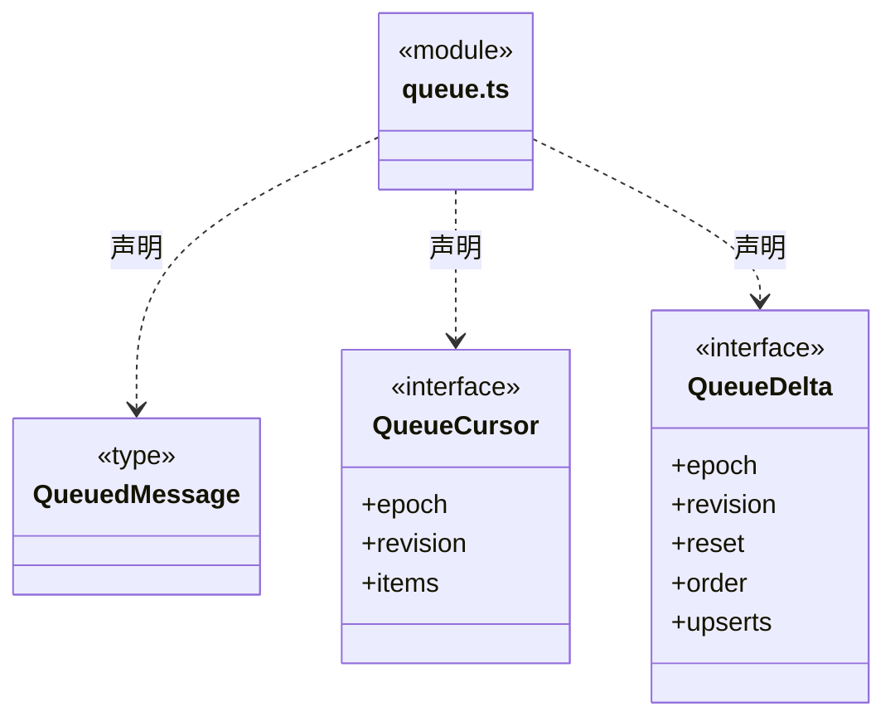
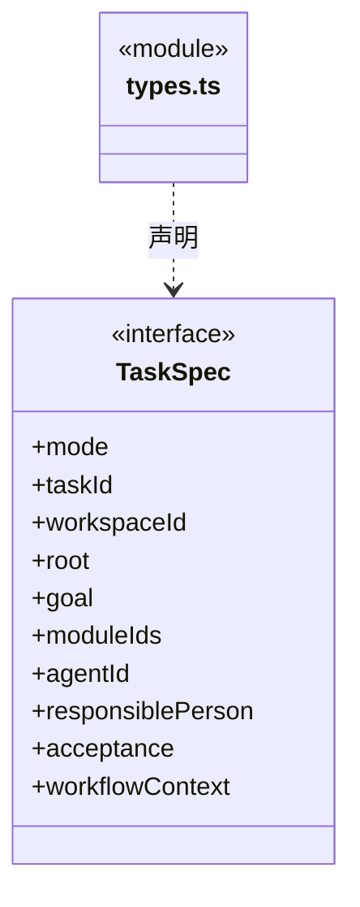

# src/backend/core/tasks 架构

## 目录定位

任务定义和待执行消息契约。区分 taskId 与 runId；当前不包含业务自动验收或 Workflow 状态机。

本文描述当前实现。通过分析目录边界后维护的 [源码架构脚本](../../../../scripts/source-architecture.mjs) 同步清单和声明；代码变更时仍须核对职责、关键成员与关系。

## 代码清单

| 文件 | 当前职责 |
| --- | --- |
| [queue.ts](queue.ts) | 待执行用户消息的校验结构与增量同步契约。 |
| [types.ts](types.ts) | 业务目标和冻结上下文的任务定义。 |

## 架构类图

### queue.ts

### types.ts

## 子目录导航

无子目录。

[返回上层](../ARCHITECTURE.md)。

每次修改本目录代码，同步维护文件头、关键契约说明及本图。未实现的治理、证据验收和自动编排能力不列入当前类图。
