# src/backend/core/tasks 架构

## 目录定位

任务计划、派发图、目标与安全等待。显式补充保留输入历史并强制重规划。执行核实契约区分领取、在途、结算与未知，工具分页固定证据基线；候选不等于验收，已关闭不复活。

本文描述当前实现。通过分析目录边界后维护的 [源码架构脚本](../../../../scripts/source-architecture.mjs) 同步清单和声明；代码变更时仍须核对职责、关键成员与关系。

## 代码清单

| 文件 | 当前职责 |
| --- | --- |
| [dispatch-commands.ts](dispatch-commands.ts) | 第一阶段成员注册与主会话派发的命令及回执契约。 |
| [dispatch-execution.ts](dispatch-execution.ts) | 声明成员任务执行的后端持久化记录，连接已派发任务与同一大脑内核的运行身份。 |
| [dispatch-invariants.ts](dispatch-invariants.ts) | 在派发事务提交和日志恢复时校验成员执行、任务图和邮箱的联合约束。 |
| [dispatch-scope-invariants.ts](dispatch-scope-invariants.ts) | 校验用户任务周期与执行实例、图任务及运行的跨对象生命周期。 |
| [dispatch-scope.ts](dispatch-scope.ts) | 定义一次用户任务的调度周期，与长期主会话和单次模型运行区分。 |
| [dispatch-storage.ts](dispatch-storage.ts) | 定义工作区成员注册、会话绑定及任务派发的原子持久化端口。 |
| [execution-context.ts](execution-context.ts) | 成员业务执行所需的可持久化知识快照，以及存储与调度共用的完整性校验。 |
| [execution-report.ts](execution-report.ts) | 成员执行异常核实的只读报告协议，供调度服务与界面共享。 |
| [graph-reducer.ts](graph-reducer.ts) | 把已提交的图事件原子转换为内存投影，并按游标输出增量读取结果。 |
| [graph-rules.ts](graph-rules.ts) | 任务图的纯领域校验，检查序列化形状、身份、派发父关系及依赖/等待无环。 |
| [graph-types.ts](graph-types.ts) | 任务派发图的可序列化领域契约，供调度、持久化和 Bridge 共同引用。 |
| [member-commands.ts](member-commands.ts) | 可信桌面入口启动、观察和停止成员任务，以及读取和确认结果信封的序列化契约。 |
| [member-events.ts](member-events.ts) | 成员运行的公开事件分页协议，供主对话和任务节点详情复用现有消息渲染。 |
| [progress-tools.ts](progress-tools.ts) | 内部 Loop 的任务计划、步骤证据和交付工具，状态通过注入的持久化回调保存。 |
| [progress.ts](progress.ts) | 单 Agent 执行计划及交付候选的领域状态，独立于 Pi、磁盘和界面。 |
| [queue.ts](queue.ts) | 待执行用户消息的校验结构与增量同步契约。 |
| [scope-continuation.ts](scope-continuation.ts) | 定义安全等待检查点、用户显式补充原目标的请求和一次性启动意图。 |
| [scope-goal.ts](scope-goal.ts) | 定义调度周期目标的原始输入、版本化计划、审阅证据和持久化转换规则。 |
| [scope-view.ts](scope-view.ts) | 定义主会话调度周期的公开摘要、选中详情和独立增量投影，供存储与界面共享。 |
| [types.ts](types.ts) | 业务目标和冻结上下文的任务定义。 |

## 架构类图

### dispatch-commands.ts

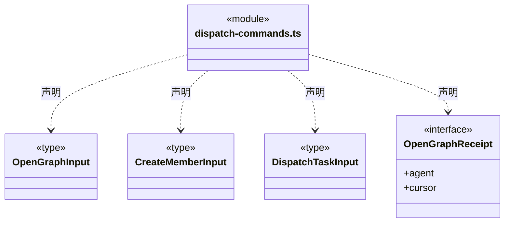

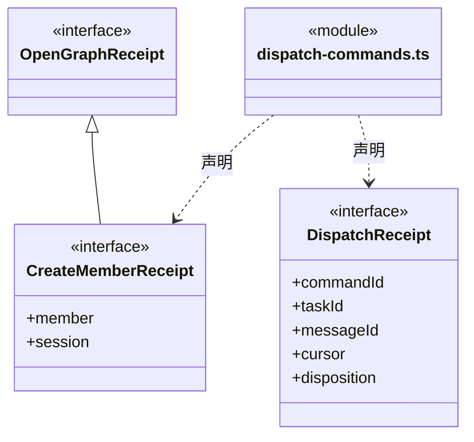

直接依赖：[../team/agent-types.ts](../team/agent-types.ts)、[graph-types.ts](graph-types.ts)。

### dispatch-execution.ts

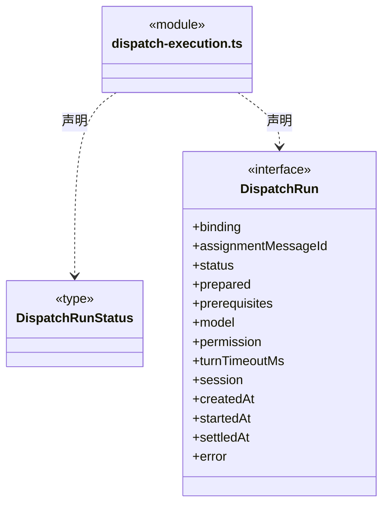

直接依赖：[../brain/member-run.ts](../brain/member-run.ts)、[../brain/llm/ports.ts](../brain/llm/ports.ts)、[../policy/types.ts](../policy/types.ts)、[execution-context.ts](execution-context.ts)、[graph-types.ts](graph-types.ts)。

### dispatch-invariants.ts

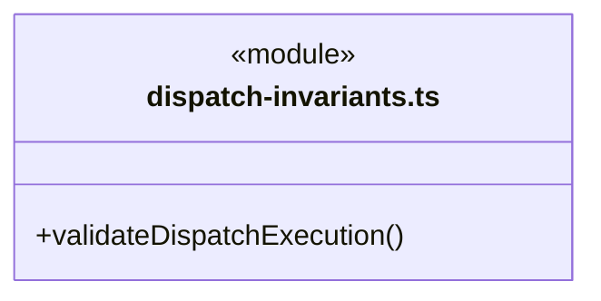

直接依赖：[../foundation/errors.ts](../foundation/errors.ts)、[../brain/llm/config.ts](../brain/llm/config.ts)、[execution-context.ts](execution-context.ts)、[dispatch-storage.ts](dispatch-storage.ts)、[dispatch-execution.ts](dispatch-execution.ts)、[graph-types.ts](graph-types.ts)。

### dispatch-scope-invariants.ts

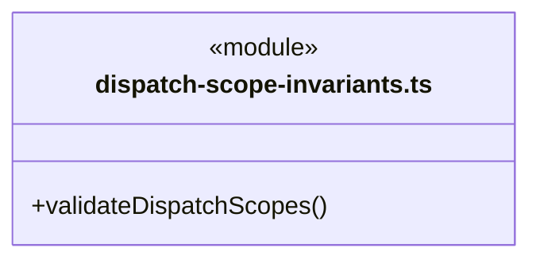

直接依赖：[../foundation/errors.ts](../foundation/errors.ts)、[dispatch-storage.ts](dispatch-storage.ts)、[dispatch-scope.ts](dispatch-scope.ts)、[scope-goal.ts](scope-goal.ts)、[scope-continuation.ts](scope-continuation.ts)。

### dispatch-scope.ts

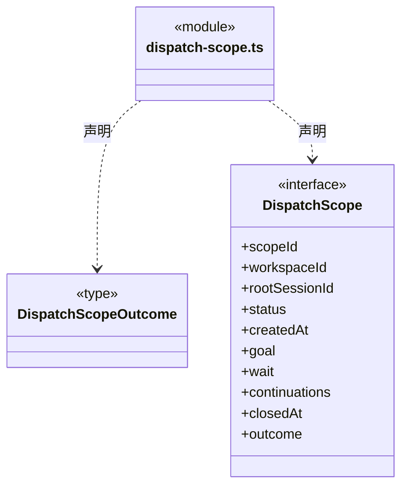

直接依赖：[scope-goal.ts](scope-goal.ts)、[scope-continuation.ts](scope-continuation.ts)。

### dispatch-storage.ts

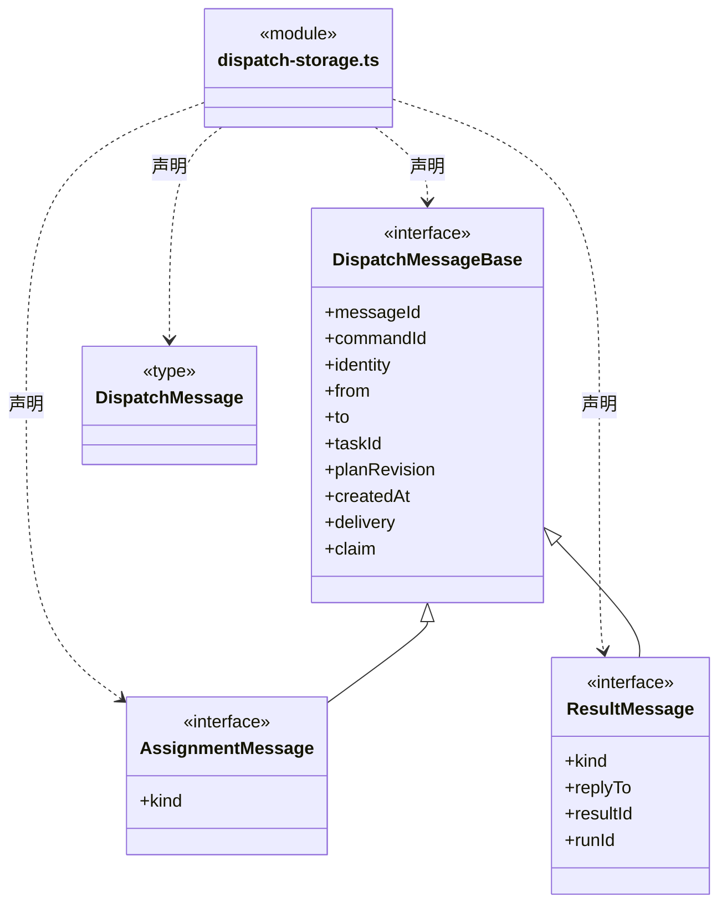

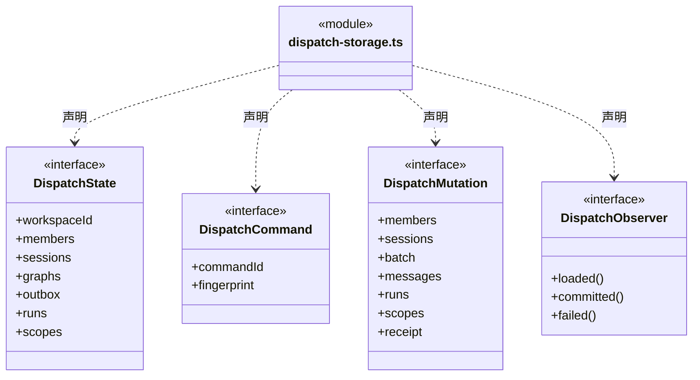

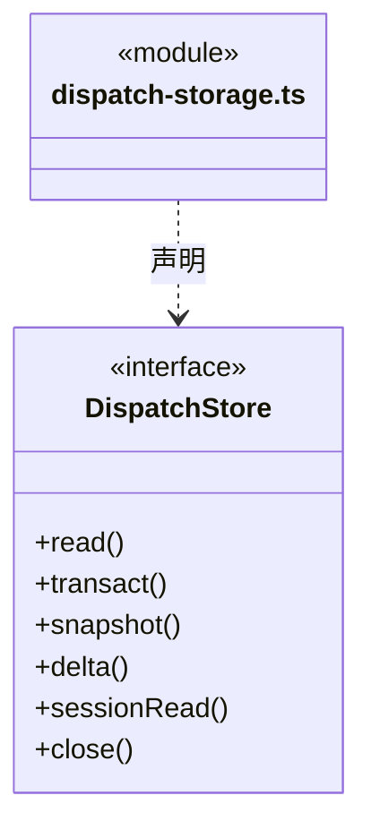

直接依赖：[../team/agent-types.ts](../team/agent-types.ts)、[graph-types.ts](graph-types.ts)、[dispatch-execution.ts](dispatch-execution.ts)、[dispatch-scope.ts](dispatch-scope.ts)、[scope-view.ts](scope-view.ts)。

### execution-context.ts

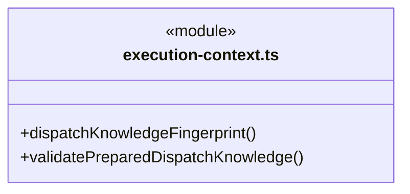

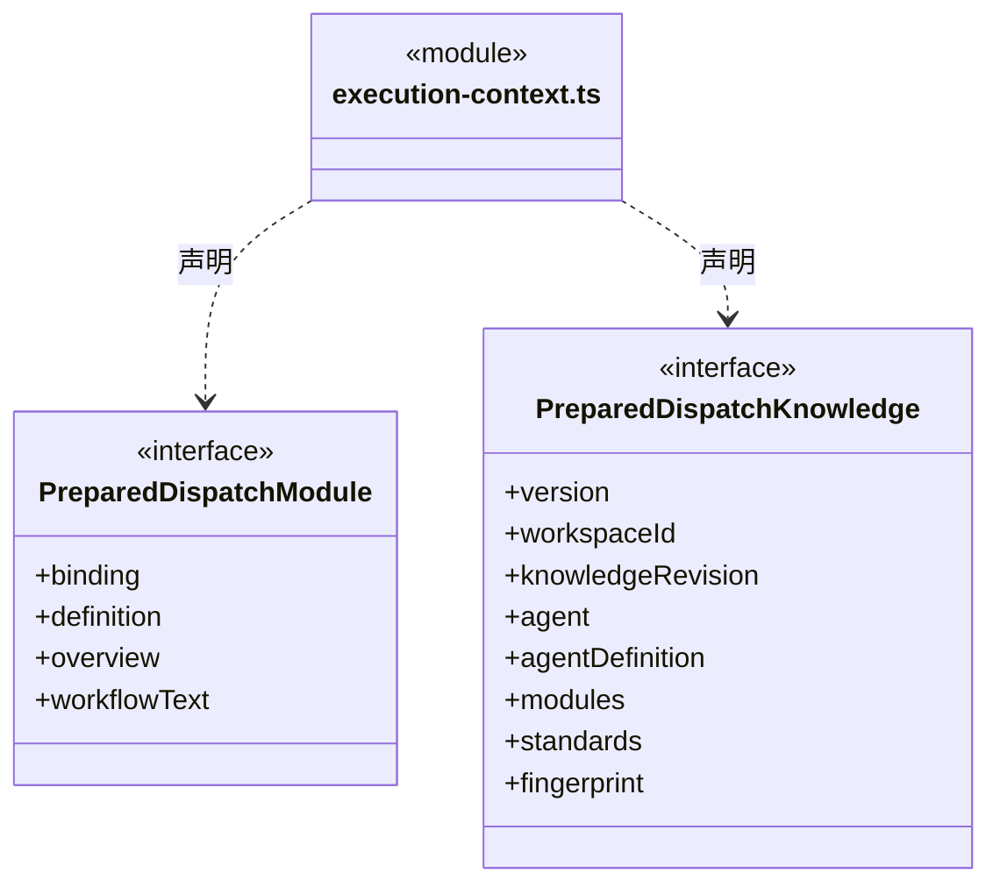

直接依赖：[../foundation/serialization.ts](../foundation/serialization.ts)、[../foundation/errors.ts](../foundation/errors.ts)、[../team/agent-types.ts](../team/agent-types.ts)、[graph-types.ts](graph-types.ts)。

### execution-report.ts

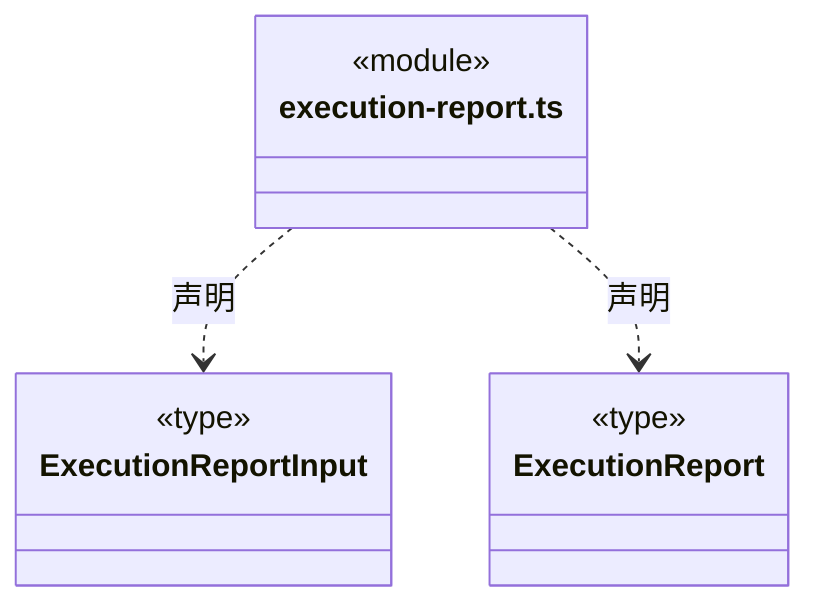

直接依赖：[member-commands.ts](member-commands.ts)、[dispatch-commands.ts](dispatch-commands.ts)。

### graph-reducer.ts

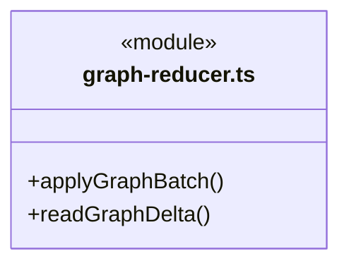

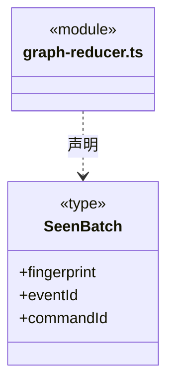

直接依赖：[../foundation/errors.ts](../foundation/errors.ts)、[graph-rules.ts](graph-rules.ts)、[graph-types.ts](graph-types.ts)。

### graph-rules.ts

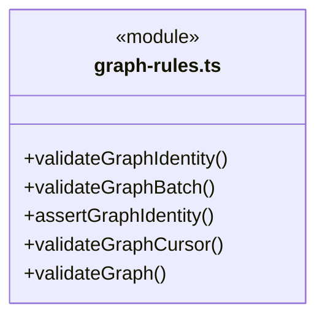

直接依赖：[../foundation/errors.ts](../foundation/errors.ts)、[graph-types.ts](graph-types.ts)。

### graph-types.ts

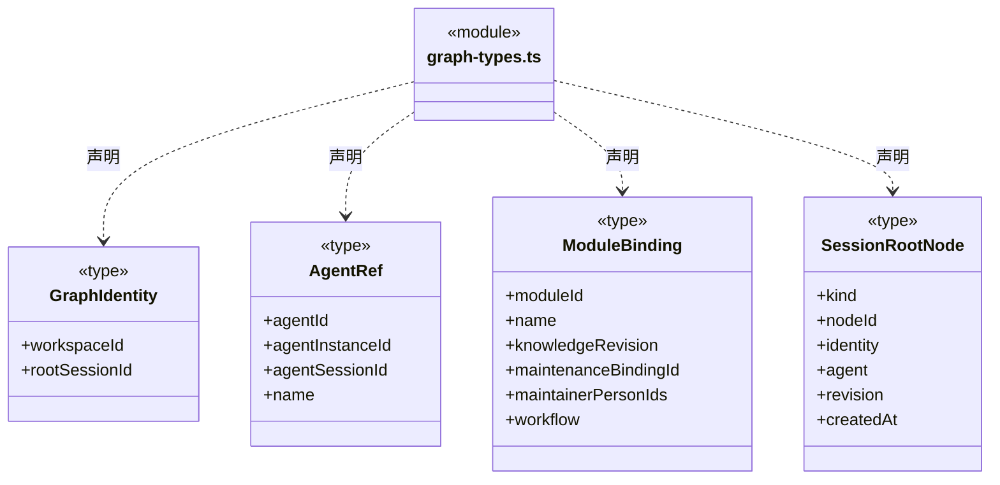

成员 1/2（同名节点为同一声明，跨图合并阅读）。

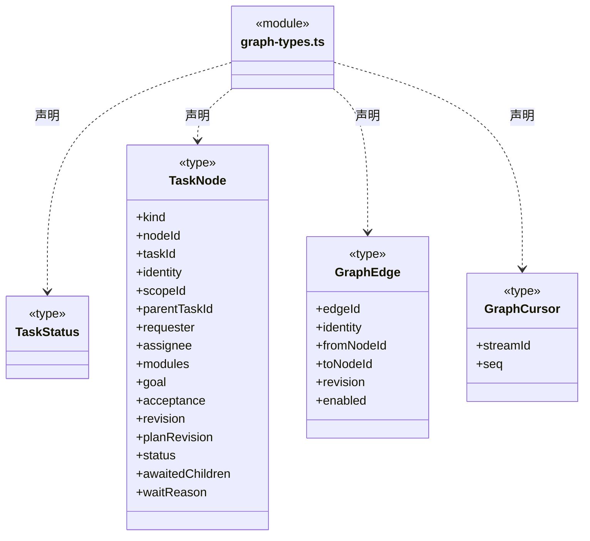

成员 2/2（同名节点为同一声明，跨图合并阅读）。

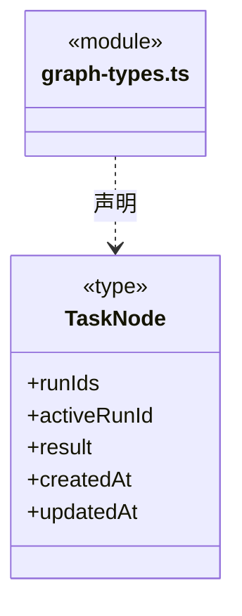

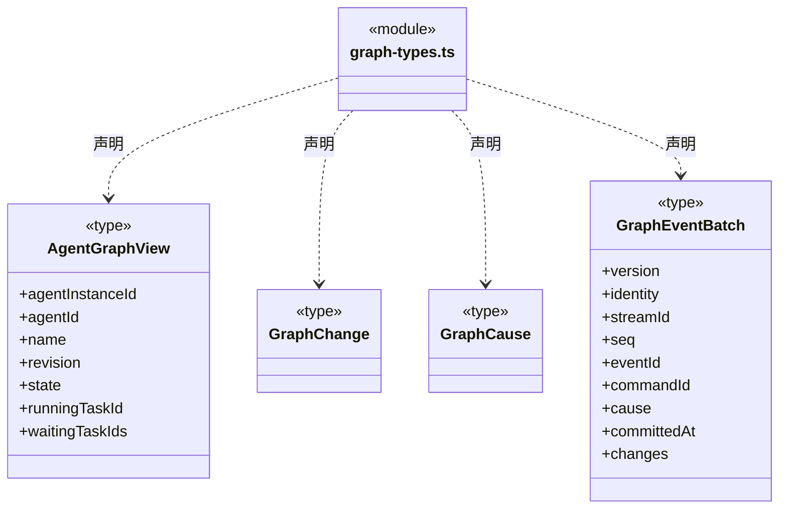

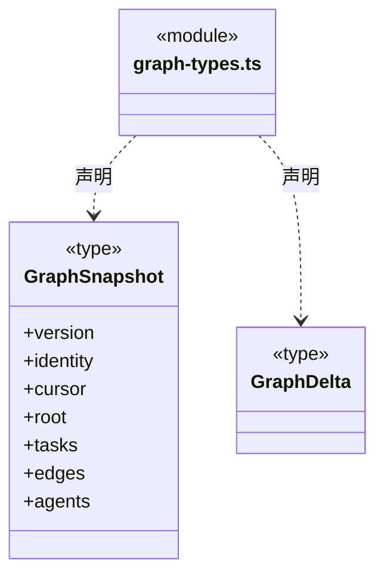


### member-commands.ts

```mermaid
classDiagram
class N_src_backend_core_tasks_member_commands_ts["member-commands.ts"] {
  <<module>>
}
class N_src_backend_core_tasks_member_commands_ts_MemberStartOptions["MemberStartOptions"] {
  <<type>>

}
N_src_backend_core_tasks_member_commands_ts ..> N_src_backend_core_tasks_member_commands_ts_MemberStartOptions : 声明
class N_src_backend_core_tasks_member_commands_ts_MemberStartReceipt["MemberStartReceipt"] {
  <<interface>>
  +taskId
  +runId
  +cursor
}
N_src_backend_core_tasks_member_commands_ts ..> N_src_backend_core_tasks_member_commands_ts_MemberStartReceipt : 声明
class N_src_backend_core_tasks_member_commands_ts_MemberExecutionView["MemberExecutionView"] {
  <<interface>>
  +task
  +runs
}
N_src_backend_core_tasks_member_commands_ts ..> N_src_backend_core_tasks_member_commands_ts_MemberExecutionView : 声明
```

直接依赖：[dispatch-commands.ts](dispatch-commands.ts)、[graph-types.ts](graph-types.ts)、[dispatch-execution.ts](dispatch-execution.ts)、[../brain/member-run.ts](../brain/member-run.ts)。

### member-events.ts

```mermaid
classDiagram
class N_src_backend_core_tasks_member_events_ts["member-events.ts"] {
  <<module>>
}
class N_src_backend_core_tasks_member_events_ts_MemberEventCursor["MemberEventCursor"] {
  <<interface>>
  +runId
  +seq
}
N_src_backend_core_tasks_member_events_ts ..> N_src_backend_core_tasks_member_events_ts_MemberEventCursor : 声明
class N_src_backend_core_tasks_member_events_ts_MemberEventsInput["MemberEventsInput"] {
  <<type>>

}
N_src_backend_core_tasks_member_events_ts ..> N_src_backend_core_tasks_member_events_ts_MemberEventsInput : 声明
class N_src_backend_core_tasks_member_events_ts_MemberRunView["MemberRunView"] {
  <<interface>>
  +task
  +runId
  +status
  +acceptance
  +unresolvedTools
  +taskProgress
}
N_src_backend_core_tasks_member_events_ts ..> N_src_backend_core_tasks_member_events_ts_MemberRunView : 声明
class N_src_backend_core_tasks_member_events_ts_MemberEventsRead["MemberEventsRead"] {
  <<type>>

}
N_src_backend_core_tasks_member_events_ts ..> N_src_backend_core_tasks_member_events_ts_MemberEventsRead : 声明
```

直接依赖：[../brain/types.ts](../brain/types.ts)、[types.ts](types.ts)、[progress.ts](progress.ts)、[member-commands.ts](member-commands.ts)。

### progress-tools.ts

```mermaid
classDiagram
class N_src_backend_core_tasks_progress_tools_ts["progress-tools.ts"] {
  <<module>>
  +progressTool()
}
```

```mermaid
classDiagram
class N_src_backend_core_tasks_progress_tools_ts["progress-tools.ts"] {
  <<module>>
}
class N_src_backend_core_tasks_progress_tools_ts_TaskProgressTools["TaskProgressTools"] {
  +list()
  +generation
  +invalidate()
  +record()
  +call()
  -save
  -state
  -evidence
  -tail
  -serial()
  -persist()
}
N_src_backend_core_tasks_progress_tools_ts ..> N_src_backend_core_tasks_progress_tools_ts_TaskProgressTools : 声明
```

直接依赖：[progress.ts](progress.ts)、[../tools/types.ts](../tools/types.ts)、[../tools/results.ts](../tools/results.ts)。

### progress.ts

```mermaid
classDiagram
class N_src_backend_core_tasks_progress_ts["progress.ts"] {
  <<module>>
}
class N_src_backend_core_tasks_progress_ts_TaskStep["TaskStep"] {
  <<interface>>
  +id
  +title
  +owner
  +state
  +evidence
}
N_src_backend_core_tasks_progress_ts ..> N_src_backend_core_tasks_progress_ts_TaskStep : 声明
class N_src_backend_core_tasks_progress_ts_TaskProgress["TaskProgress"] {
  <<interface>>
  +version
  +goal
  +acceptance
  +steps
  +state
  +reason
  +delivery
}
N_src_backend_core_tasks_progress_ts ..> N_src_backend_core_tasks_progress_ts_TaskProgress : 声明
```


### queue.ts

```mermaid
classDiagram
class N_src_backend_core_tasks_queue_ts["queue.ts"] {
  <<module>>
}
class N_src_backend_core_tasks_queue_ts_QueuedMessage["QueuedMessage"] {
  <<type>>

}
N_src_backend_core_tasks_queue_ts ..> N_src_backend_core_tasks_queue_ts_QueuedMessage : 声明
class N_src_backend_core_tasks_queue_ts_QueueCursor["QueueCursor"] {
  <<interface>>
  +epoch
  +revision
  +items
}
N_src_backend_core_tasks_queue_ts ..> N_src_backend_core_tasks_queue_ts_QueueCursor : 声明
class N_src_backend_core_tasks_queue_ts_QueueDelta["QueueDelta"] {
  <<interface>>
  +epoch
  +revision
  +reset
  +order
  +upserts
}
N_src_backend_core_tasks_queue_ts ..> N_src_backend_core_tasks_queue_ts_QueueDelta : 声明
```


### scope-continuation.ts

```mermaid
classDiagram
class N_src_backend_core_tasks_scope_continuation_ts["scope-continuation.ts"] {
  <<module>>
}
class N_src_backend_core_tasks_scope_continuation_ts_DispatchScopeWait["DispatchScopeWait"] {
  <<type>>

}
N_src_backend_core_tasks_scope_continuation_ts ..> N_src_backend_core_tasks_scope_continuation_ts_DispatchScopeWait : 声明
class N_src_backend_core_tasks_scope_continuation_ts_ScopeContinuationOptions["ScopeContinuationOptions"] {
  <<type>>

}
N_src_backend_core_tasks_scope_continuation_ts ..> N_src_backend_core_tasks_scope_continuation_ts_ScopeContinuationOptions : 声明
class N_src_backend_core_tasks_scope_continuation_ts_GoalContinuationRequest["GoalContinuationRequest"] {
  <<type>>

}
N_src_backend_core_tasks_scope_continuation_ts ..> N_src_backend_core_tasks_scope_continuation_ts_GoalContinuationRequest : 声明
class N_src_backend_core_tasks_scope_continuation_ts_ScopeContinuationLookup["ScopeContinuationLookup"] {
  <<type>>

}
N_src_backend_core_tasks_scope_continuation_ts ..> N_src_backend_core_tasks_scope_continuation_ts_ScopeContinuationLookup : 声明
```

```mermaid
classDiagram
class N_src_backend_core_tasks_scope_continuation_ts["scope-continuation.ts"] {
  <<module>>
}
class N_src_backend_core_tasks_scope_continuation_ts_ScopeContinuation["ScopeContinuation"] {
  <<type>>

}
N_src_backend_core_tasks_scope_continuation_ts ..> N_src_backend_core_tasks_scope_continuation_ts_ScopeContinuation : 声明
class N_src_backend_core_tasks_scope_continuation_ts_GoalContinuationReceipt["GoalContinuationReceipt"] {
  <<type>>

}
N_src_backend_core_tasks_scope_continuation_ts ..> N_src_backend_core_tasks_scope_continuation_ts_GoalContinuationReceipt : 声明
```


### scope-goal.ts

```mermaid
classDiagram
class N_src_backend_core_tasks_scope_goal_ts["scope-goal.ts"] {
  <<module>>
  +goalInputRevision()
  +goalNeedsReplan()
  +sameGoalValue()
  +validateScopeGoalTransition()
}
```

```mermaid
classDiagram
class N_src_backend_core_tasks_scope_goal_ts["scope-goal.ts"] {
  <<module>>
}
class N_src_backend_core_tasks_scope_goal_ts_DispatchScopeInput["DispatchScopeInput"] {
  <<interface>>
  +message
  +attachmentIds
}
N_src_backend_core_tasks_scope_goal_ts ..> N_src_backend_core_tasks_scope_goal_ts_DispatchScopeInput : 声明
class N_src_backend_core_tasks_scope_goal_ts_GoalPlanInput["GoalPlanInput"] {
  <<type>>

}
N_src_backend_core_tasks_scope_goal_ts ..> N_src_backend_core_tasks_scope_goal_ts_GoalPlanInput : 声明
class N_src_backend_core_tasks_scope_goal_ts_GoalReviewInput["GoalReviewInput"] {
  <<type>>

}
N_src_backend_core_tasks_scope_goal_ts ..> N_src_backend_core_tasks_scope_goal_ts_GoalReviewInput : 声明
class N_src_backend_core_tasks_scope_goal_ts_GoalEvidence["GoalEvidence"] {
  <<type>>

}
N_src_backend_core_tasks_scope_goal_ts ..> N_src_backend_core_tasks_scope_goal_ts_GoalEvidence : 声明
```

```mermaid
classDiagram
class N_src_backend_core_tasks_scope_goal_ts["scope-goal.ts"] {
  <<module>>
}
class N_src_backend_core_tasks_scope_goal_ts_DispatchScopeGoal["DispatchScopeGoal"] {
  <<type>>

}
N_src_backend_core_tasks_scope_goal_ts ..> N_src_backend_core_tasks_scope_goal_ts_DispatchScopeGoal : 声明
class N_src_backend_core_tasks_scope_goal_ts_ScopeGoalPlan["ScopeGoalPlan"] {
  <<type>>

}
N_src_backend_core_tasks_scope_goal_ts ..> N_src_backend_core_tasks_scope_goal_ts_ScopeGoalPlan : 声明
class N_src_backend_core_tasks_scope_goal_ts_ScopeGoalReview["ScopeGoalReview"] {
  <<type>>

}
N_src_backend_core_tasks_scope_goal_ts ..> N_src_backend_core_tasks_scope_goal_ts_ScopeGoalReview : 声明
```

直接依赖：[../foundation/errors.ts](../foundation/errors.ts)。

### scope-view.ts

```mermaid
classDiagram
class N_src_backend_core_tasks_scope_view_ts["scope-view.ts"] {
  <<module>>
  +emptyScopeSnapshot()
  +summarizeScope()
  +validateScopeSnapshot()
  +applyScopeBatch()
  +readScopeDelta()
  +readScopeDetail()
}
```

```mermaid
classDiagram
class N_src_backend_core_tasks_scope_view_ts["scope-view.ts"] {
  <<module>>
}
class N_src_backend_core_tasks_scope_view_ts_DispatchSessionReadInput["DispatchSessionReadInput"] {
  <<type>>

}
N_src_backend_core_tasks_scope_view_ts ..> N_src_backend_core_tasks_scope_view_ts_DispatchSessionReadInput : 声明
class N_src_backend_core_tasks_scope_view_ts_ScopeCursor["ScopeCursor"] {
  <<type>>

}
N_src_backend_core_tasks_scope_view_ts ..> N_src_backend_core_tasks_scope_view_ts_ScopeCursor : 声明
class N_src_backend_core_tasks_scope_view_ts_ScopeDetailStamp["ScopeDetailStamp"] {
  <<type>>

}
N_src_backend_core_tasks_scope_view_ts ..> N_src_backend_core_tasks_scope_view_ts_ScopeDetailStamp : 声明
class N_src_backend_core_tasks_scope_view_ts_ScopeSummary["ScopeSummary"] {
  <<type>>

}
N_src_backend_core_tasks_scope_view_ts ..> N_src_backend_core_tasks_scope_view_ts_ScopeSummary : 声明
```

```mermaid
classDiagram
class N_src_backend_core_tasks_scope_view_ts["scope-view.ts"] {
  <<module>>
}
class N_src_backend_core_tasks_scope_view_ts_ScopeSnapshot["ScopeSnapshot"] {
  <<interface>>
  +identity
  +cursor
  +scopes
}
N_src_backend_core_tasks_scope_view_ts ..> N_src_backend_core_tasks_scope_view_ts_ScopeSnapshot : 声明
class N_src_backend_core_tasks_scope_view_ts_ScopeEventBatch["ScopeEventBatch"] {
  <<interface>>
  +identity
  +streamId
  +seq
  +scopes
}
N_src_backend_core_tasks_scope_view_ts ..> N_src_backend_core_tasks_scope_view_ts_ScopeEventBatch : 声明
class N_src_backend_core_tasks_scope_view_ts_ScopeResetReason["ScopeResetReason"] {
  <<type>>

}
N_src_backend_core_tasks_scope_view_ts ..> N_src_backend_core_tasks_scope_view_ts_ScopeResetReason : 声明
class N_src_backend_core_tasks_scope_view_ts_ScopeDelta["ScopeDelta"] {
  <<type>>

}
N_src_backend_core_tasks_scope_view_ts ..> N_src_backend_core_tasks_scope_view_ts_ScopeDelta : 声明
```

```mermaid
classDiagram
class N_src_backend_core_tasks_scope_view_ts["scope-view.ts"] {
  <<module>>
}
class N_src_backend_core_tasks_scope_view_ts_ScopeDetailRead["ScopeDetailRead"] {
  <<type>>

}
N_src_backend_core_tasks_scope_view_ts ..> N_src_backend_core_tasks_scope_view_ts_ScopeDetailRead : 声明
class N_src_backend_core_tasks_scope_view_ts_DispatchSessionRead["DispatchSessionRead"] {
  <<interface>>
  +graph
  +scopes
  +detail
}
N_src_backend_core_tasks_scope_view_ts ..> N_src_backend_core_tasks_scope_view_ts_DispatchSessionRead : 声明
```

直接依赖：[../foundation/errors.ts](../foundation/errors.ts)、[dispatch-commands.ts](dispatch-commands.ts)、[dispatch-scope.ts](dispatch-scope.ts)、[graph-types.ts](graph-types.ts)、[graph-rules.ts](graph-rules.ts)、[scope-goal.ts](scope-goal.ts)。

### types.ts

```mermaid
classDiagram
class N_src_backend_core_tasks_types_ts["types.ts"] {
  <<module>>
}
class N_src_backend_core_tasks_types_ts_TaskSpec["TaskSpec"] {
  <<interface>>
  +mode
  +taskId
  +workspaceId
  +root
  +goal
  +moduleIds
  +agentId
  +responsiblePerson
  +acceptance
  +workflowContext
}
N_src_backend_core_tasks_types_ts ..> N_src_backend_core_tasks_types_ts_TaskSpec : 声明
```


### 本目录调用边界

```mermaid
classDiagram
class N_src_backend_core_tasks_dispatch_commands_ts["dispatch-commands.ts"] {
  <<module>>
}
class N_src_backend_core_tasks_graph_types_ts["graph-types.ts"] {
  <<module>>
}
class N_src_backend_core_tasks_dispatch_execution_ts["dispatch-execution.ts"] {
  <<module>>
}
class N_src_backend_core_tasks_execution_context_ts["execution-context.ts"] {
  <<module>>
}
class N_src_backend_core_tasks_dispatch_invariants_ts["dispatch-invariants.ts"] {
  <<module>>
}
N_src_backend_core_tasks_dispatch_commands_ts ..> N_src_backend_core_tasks_graph_types_ts : 导入依赖
N_src_backend_core_tasks_dispatch_execution_ts ..> N_src_backend_core_tasks_execution_context_ts : 导入依赖
N_src_backend_core_tasks_dispatch_execution_ts ..> N_src_backend_core_tasks_graph_types_ts : 导入依赖
N_src_backend_core_tasks_dispatch_invariants_ts ..> N_src_backend_core_tasks_execution_context_ts : 导入依赖
```

```mermaid
classDiagram
class N_src_backend_core_tasks_dispatch_invariants_ts["dispatch-invariants.ts"] {
  <<module>>
}
class N_src_backend_core_tasks_dispatch_storage_ts["dispatch-storage.ts"] {
  <<module>>
}
class N_src_backend_core_tasks_dispatch_execution_ts["dispatch-execution.ts"] {
  <<module>>
}
class N_src_backend_core_tasks_graph_types_ts["graph-types.ts"] {
  <<module>>
}
class N_src_backend_core_tasks_dispatch_scope_invariants_ts["dispatch-scope-invariants.ts"] {
  <<module>>
}
N_src_backend_core_tasks_dispatch_invariants_ts ..> N_src_backend_core_tasks_dispatch_storage_ts : 导入依赖
N_src_backend_core_tasks_dispatch_invariants_ts ..> N_src_backend_core_tasks_dispatch_execution_ts : 导入依赖
N_src_backend_core_tasks_dispatch_invariants_ts ..> N_src_backend_core_tasks_graph_types_ts : 导入依赖
N_src_backend_core_tasks_dispatch_scope_invariants_ts ..> N_src_backend_core_tasks_dispatch_storage_ts : 导入依赖
```

```mermaid
classDiagram
class N_src_backend_core_tasks_dispatch_scope_invariants_ts["dispatch-scope-invariants.ts"] {
  <<module>>
}
class N_src_backend_core_tasks_dispatch_scope_ts["dispatch-scope.ts"] {
  <<module>>
}
class N_src_backend_core_tasks_scope_goal_ts["scope-goal.ts"] {
  <<module>>
}
class N_src_backend_core_tasks_scope_continuation_ts["scope-continuation.ts"] {
  <<module>>
}
N_src_backend_core_tasks_dispatch_scope_invariants_ts ..> N_src_backend_core_tasks_dispatch_scope_ts : 导入依赖
N_src_backend_core_tasks_dispatch_scope_invariants_ts ..> N_src_backend_core_tasks_scope_goal_ts : 导入依赖
N_src_backend_core_tasks_dispatch_scope_invariants_ts ..> N_src_backend_core_tasks_scope_continuation_ts : 导入依赖
N_src_backend_core_tasks_dispatch_scope_ts ..> N_src_backend_core_tasks_scope_goal_ts : 导入依赖
```

```mermaid
classDiagram
class N_src_backend_core_tasks_dispatch_scope_ts["dispatch-scope.ts"] {
  <<module>>
}
class N_src_backend_core_tasks_scope_continuation_ts["scope-continuation.ts"] {
  <<module>>
}
class N_src_backend_core_tasks_dispatch_storage_ts["dispatch-storage.ts"] {
  <<module>>
}
class N_src_backend_core_tasks_graph_types_ts["graph-types.ts"] {
  <<module>>
}
class N_src_backend_core_tasks_dispatch_execution_ts["dispatch-execution.ts"] {
  <<module>>
}
N_src_backend_core_tasks_dispatch_scope_ts ..> N_src_backend_core_tasks_scope_continuation_ts : 导入依赖
N_src_backend_core_tasks_dispatch_storage_ts ..> N_src_backend_core_tasks_graph_types_ts : 导入依赖
N_src_backend_core_tasks_dispatch_storage_ts ..> N_src_backend_core_tasks_dispatch_execution_ts : 导入依赖
N_src_backend_core_tasks_dispatch_storage_ts ..> N_src_backend_core_tasks_dispatch_scope_ts : 导入依赖
```

```mermaid
classDiagram
class N_src_backend_core_tasks_dispatch_storage_ts["dispatch-storage.ts"] {
  <<module>>
}
class N_src_backend_core_tasks_scope_view_ts["scope-view.ts"] {
  <<module>>
}
class N_src_backend_core_tasks_execution_context_ts["execution-context.ts"] {
  <<module>>
}
class N_src_backend_core_tasks_graph_types_ts["graph-types.ts"] {
  <<module>>
}
class N_src_backend_core_tasks_execution_report_ts["execution-report.ts"] {
  <<module>>
}
class N_src_backend_core_tasks_member_commands_ts["member-commands.ts"] {
  <<module>>
}
class N_src_backend_core_tasks_dispatch_commands_ts["dispatch-commands.ts"] {
  <<module>>
}
N_src_backend_core_tasks_dispatch_storage_ts ..> N_src_backend_core_tasks_scope_view_ts : 导入依赖
N_src_backend_core_tasks_execution_context_ts ..> N_src_backend_core_tasks_graph_types_ts : 导入依赖
N_src_backend_core_tasks_execution_report_ts ..> N_src_backend_core_tasks_member_commands_ts : 导入依赖
N_src_backend_core_tasks_execution_report_ts ..> N_src_backend_core_tasks_dispatch_commands_ts : 导入依赖
```

```mermaid
classDiagram
class N_src_backend_core_tasks_graph_reducer_ts["graph-reducer.ts"] {
  <<module>>
}
class N_src_backend_core_tasks_graph_rules_ts["graph-rules.ts"] {
  <<module>>
}
class N_src_backend_core_tasks_graph_types_ts["graph-types.ts"] {
  <<module>>
}
class N_src_backend_core_tasks_member_commands_ts["member-commands.ts"] {
  <<module>>
}
class N_src_backend_core_tasks_dispatch_commands_ts["dispatch-commands.ts"] {
  <<module>>
}
N_src_backend_core_tasks_graph_reducer_ts ..> N_src_backend_core_tasks_graph_rules_ts : 导入依赖
N_src_backend_core_tasks_graph_reducer_ts ..> N_src_backend_core_tasks_graph_types_ts : 导入依赖
N_src_backend_core_tasks_graph_rules_ts ..> N_src_backend_core_tasks_graph_types_ts : 导入依赖
N_src_backend_core_tasks_member_commands_ts ..> N_src_backend_core_tasks_dispatch_commands_ts : 导入依赖
```

```mermaid
classDiagram
class N_src_backend_core_tasks_member_commands_ts["member-commands.ts"] {
  <<module>>
}
class N_src_backend_core_tasks_graph_types_ts["graph-types.ts"] {
  <<module>>
}
class N_src_backend_core_tasks_dispatch_execution_ts["dispatch-execution.ts"] {
  <<module>>
}
class N_src_backend_core_tasks_member_events_ts["member-events.ts"] {
  <<module>>
}
class N_src_backend_core_tasks_types_ts["types.ts"] {
  <<module>>
}
class N_src_backend_core_tasks_progress_ts["progress.ts"] {
  <<module>>
}
N_src_backend_core_tasks_member_commands_ts ..> N_src_backend_core_tasks_graph_types_ts : 导入依赖
N_src_backend_core_tasks_member_commands_ts ..> N_src_backend_core_tasks_dispatch_execution_ts : 导入依赖
N_src_backend_core_tasks_member_events_ts ..> N_src_backend_core_tasks_types_ts : 导入依赖
N_src_backend_core_tasks_member_events_ts ..> N_src_backend_core_tasks_progress_ts : 导入依赖
```

```mermaid
classDiagram
class N_src_backend_core_tasks_member_events_ts["member-events.ts"] {
  <<module>>
}
class N_src_backend_core_tasks_member_commands_ts["member-commands.ts"] {
  <<module>>
}
class N_src_backend_core_tasks_progress_tools_ts["progress-tools.ts"] {
  <<module>>
}
class N_src_backend_core_tasks_progress_ts["progress.ts"] {
  <<module>>
}
class N_src_backend_core_tasks_scope_view_ts["scope-view.ts"] {
  <<module>>
}
class N_src_backend_core_tasks_dispatch_commands_ts["dispatch-commands.ts"] {
  <<module>>
}
class N_src_backend_core_tasks_dispatch_scope_ts["dispatch-scope.ts"] {
  <<module>>
}
N_src_backend_core_tasks_member_events_ts ..> N_src_backend_core_tasks_member_commands_ts : 导入依赖
N_src_backend_core_tasks_progress_tools_ts ..> N_src_backend_core_tasks_progress_ts : 导入依赖
N_src_backend_core_tasks_scope_view_ts ..> N_src_backend_core_tasks_dispatch_commands_ts : 导入依赖
N_src_backend_core_tasks_scope_view_ts ..> N_src_backend_core_tasks_dispatch_scope_ts : 导入依赖
```

```mermaid
classDiagram
class N_src_backend_core_tasks_scope_view_ts["scope-view.ts"] {
  <<module>>
}
class N_src_backend_core_tasks_graph_types_ts["graph-types.ts"] {
  <<module>>
}
class N_src_backend_core_tasks_graph_rules_ts["graph-rules.ts"] {
  <<module>>
}
class N_src_backend_core_tasks_scope_goal_ts["scope-goal.ts"] {
  <<module>>
}
N_src_backend_core_tasks_scope_view_ts ..> N_src_backend_core_tasks_graph_types_ts : 导入依赖
N_src_backend_core_tasks_scope_view_ts ..> N_src_backend_core_tasks_graph_rules_ts : 导入依赖
N_src_backend_core_tasks_scope_view_ts ..> N_src_backend_core_tasks_scope_goal_ts : 导入依赖
```


## 子目录导航

无子目录。

[返回上层](../ARCHITECTURE.md)。

每次修改本目录代码，同步维护文件头、关键契约说明及本图。未实现的治理、证据验收和自动编排能力不列入当前类图。

## 设计契约 v1 与落地范围

以下内容区分已接通能力与后续设计；以各节的实现状态为准，不将目标图当作现状图。维护源：[CONTRACT.md](CONTRACT.md)；生成类图时同步附加，勿直接修改本附录。

### 任务图节点与事件 v1

状态：已实现图类型、纯结构校验、原子批次投影与游标增量读取，以及成员领取、启动、结算和结果信封的持久化契约与联合校验。实际启动、停止、恢复与结果读取由调度层实现；主调度后续派发与执行者等待唤醒仍按契约逐步接入；执行成员没有派发权。总说明见 [虚拟成员与任务派发图契约](../../../../docs/agent-dispatch-contract.md)。本模块不拥有进程、磁盘、在线模型或 UI。

`TaskProgressTools` 不将 `cbim_task_*`、`cbim_dispatch_*`、`cbim_goal_*` 或 `cbim_delivery_prepare` 的回执纳入业务完成证据。派发成功、读到候选或登记审阅只说明协作记录存在；步骤完成仍须关联当前运行真实且有效的业务工具回执，成员候选也不等于人工验收。

### 用户任务调度周期

`dispatch-scope.ts` 定义 `DispatchScope {scopeId, workspaceId, rootSessionId, status, createdAt, goal?, wait?, continuations?, closedAt?, outcome?}`。status 为 active/waiting/closed，outcome 为 completed/failed/cancelled/interrupted；它表达整轮用户任务的生命周期，completed 不替代业务验收。一轮包含多次主模型回合、成员执行和结果回注，不能因一次 LLM 返回就关闭。waiting 表示所有模型与成员工作已安全结算、目标尚未结束的持久检查点；用户可显式补充同一目标后继续，或取消/失败/中断关闭，不自动恢复模型。

`scope-goal.ts` 定义 `goal:{revision,input:{message,attachmentIds},plan?,review?,blocked?}`。新周期从 revision 1 开始；每次计划或审阅原子增加一个版本，派发不增加目标版本；最多 64 次决策。message 以非空白和最多 1,000,000 字符校验，保留原始空白与换行；attachmentIds 为最多 12 个 UUID，缺省输入规范化为空数组。原始 input 永远不可改写或移除；旧记录整个 goal 缺省，不能从旧 TaskSpec.goal、首轮消息或后续请求补造。

计划保存 objective、constraints、criteria、assignments、reason，以及可信运行、时间、知识基线与图游标。criteria 区分 evidence / human；assignments 将真实静态角色及模块集合映射到验收项，主角色治理可使用空模块集合。审阅保存 complete / replan / blocked / awaiting_user 决策、逐项 checks、superseded 关系、gaps、reason，以及当前计划版本、运行、知识、图游标和副作用日志界限。member-result 证据引用 taskId/runId/resultId/planRevision/toolCallIds；main-knowledge 仅引用当前可信审阅运行的 toolCallIds，不能传入其他运行路径。Schema 和提交/重放不变量要求版本逐次增加；重规划清除旧审阅，但不能删除、改名或降级既有 human 项。本步没有真人批准或显式用户目标修订协议，人工项不能由模型标记 satisfied。

`complete` 只表示模型提交了结构化完成申请。调度服务在主运行实际结束后复核日志和全周期状态，再决定是否允许 completed 关闭；原有成员候选仍保持 `acceptance:not_evaluated`。可信协调器可以单独写入 blocked 理由，保留最后计划和版本，之后不允许继续决策。旧快照保存在同一派发事务日志中，不另复制历史数组。

`DispatchState.scopes` 与 `DispatchMutation.scopes` 是 v1 日志的可选扩展；缺省为旧历史，不伪造迁移。`TaskNode.scopeId` 来自可信主调度入口，模型请求不允许填写。每个新周期任务固定一个非主执行实例；同一个静态角色对应多个任务时实例也不同。无合适自定义角色使用 `cbim:executor`，`cbim:main` 只作为图根调度，不接受新正式执行。

`dispatch-scope-invariants.ts` 在提交和恢复时验证：每主会话最多一个未关闭周期（active 或 waiting）；主根长期保留；执行实例固定周期和任务；关闭前没有 starting/running；未执行任务和派发信封原子取消，执行实例同批 released 并递增租约。已关闭周期及其任务不再修改，已释放实例和通道不能复活；候选、图节点、会话与证据历史仍保留，结果信封可在之后确认收件。每周期最多 500 个任务，以确保关闭所需的任务取消和实例状态变更不超过现有单批 1000 变更限制。

`DispatchScopeWait` 保存 waitId、原因、UTC createdAt、当前主 runId、goalRevision、graphCursor、knowledgeRevision，以及可信协调器传入的 mainRunIds。mainRunIds 非空、唯一、最多 32 个且包含当前运行，冻结跨等待的已消耗主轮预算；并非用户或模型提供的恢复授权。进入 waiting 必须匹配当前 awaiting_user 审阅及图/知识基线，不含 pending/active 任务、活动成员租约或同主会话在途运行。waiting 期间禁止改写目标、检查点、成员、任务及原生通道；关闭后保留 wait 历史。检查点结构和演进在日志重放时再次校验，不能以重新计算日志哈希绕过；canonical 工具日志与实际资源释放由调度服务核实。

`scope-continuation.ts` 定义等待检查点及 `GoalContinuationRequest / GoalContinuationReceipt / ScopeContinuation`。纯文本请求携带 workspaceId/rootSessionId/scopeId、waitId、预期 goal/input 版本、稳定 UUID commandId、`input:{message}` 和公开模型配置；不接受附件、原生路径、人工批准或权限额外字段。每次补充最多 64,000 字符，每目标累计最多 256,000 字符，超限拒绝，不 trim 或截断已接收原文。

`continuations` 只追加，每项保存 continuationId=commandId、acceptedAt、完整旧 wait、新 inputRevision、真实补充、可信 runId 和选定 options。`waiting→active` 只能与追加一个意图、移除当前 wait、goal.revision/inputRevision 各加 1 同事务发生，不能附带图、成员、运行或其他周期变更。原始 goal.input 不变，旧 plan 保留，review 清除。新计划/审阅的 inputRevision 由服务注入；历史字段缺省解释为 1，不补写历史。计划输入版本落后即 needsReplan，不能沿旧计划派工、审阅或完成；human 项仍必须保留，用户补充不等同人工签署。

补充前至少剩余三个目标版本（接收本次输入、随后 plan 和 review），既有 64 次总版本变更与 32 次主运行预算均不重置。新 runId 不得已在旧检查点出现，每个后续 wait.mainRunIds 必须包含此前所有检查点预算和补充运行。已消费 wait 和补充原文不可改写；closed/goal.blocked 不能恢复。新作用只发布 scope 摘要增量，不推进 graph cursor。

首次创建、审阅事实核验、关闭和恢复均由调度服务负责；Core 只约束目标结构和合法演进，不推断业务语义，也不停止运行。旧无周期显式入口仍兼容原记录，新自动流程必须提供可信 scope。

### 主会话目标周期的独立公开投影

`scope-view.ts` 定义 `ScopeCursor / ScopeSummary / ScopeSnapshot / ScopeEventBatch / ScopeDelta / ScopeDetailStamp / ScopeDetailRead` 及联合 `DispatchSessionRead`。周期变化从已提交 `DispatchMutation.scopes` 推导；不会写入 `GraphEventBatch`，也不会推进审阅证据引用的 graph cursor。两条流按相同主会话身份隔离，但序号不可互换。scope cursor 带 `kind:'scopes'`，streamId 为 `scopes:` 加对应持久化 graph streamId；首次无周期时序号 0。

每次含周期变化的持久化事务在对应会话内递增一次 scope seq。摘要仅含生命周期、目标/计划存在性、目标与输入版本、needsReplan、审阅决策、最长 240 字符的输入/目标/阻塞预览及 stamp。等待摘要仅公开 waitId、最长 240 字符 reason、goalRevision、createdAt；完整运行清单、补充历史和基线只在选中详情读取。stamp 绑定 scopeId、独立 streamId 与该周期最后更新 seq；可信 block、park 和 close 不增加 goal.revision，但会改变 stamp。review.decision=complete 只保留为完成申请，不派生 outcome；awaiting_user 也不等同于已经安全进入 waiting。旧 goal 缺省保持缺省。

`applyScopeBatch` 校验连续性并原子归并，未变化的摘要保留引用；重复批次证明最多保留 256 批，不能无条件接受旧序号。`readScopeDelta` 返回 reset/delta/noop，缺省、换流、超前或超出保留窗口时返回当前摘要快照，串会话游标拒绝。`readScopeDetail` 默认选择未关闭周期（active 或 waiting），否则最后创建的周期；显式 ID 不属于本会话时拒绝。stamp 相同时返回 noop，不复制完整目标；详情按公开字段白名单返回原始输入、计划、审阅、阻塞及完整等待检查点。

`dispatchSessionReadInput` 严格校验 `{identity, graphCursor?, scopeCursor?, selectedScopeId?, detailStamp?, limit?}`。`DispatchStore.sessionRead` 在同一已提交屏障返回 `{graph, scopes, detail}`。limit 为每条流完整批次上限，范围 1–500；分页 delta 可能尚未追到存储头部，选中 detail 已反映屏障的最新版本，消费者不能把 detail.stamp 与本页末尾 cursor 当成同一位置。完整同步前须继续请求后续页。

### 成员运行的公开事件流

`member-events.ts` 定义 `MemberEventsInput / MemberEventCursor / MemberRunView / MemberEventsRead`。输入同时指定工作区、主会话、业务任务和运行；cursor 绑定单个 run 的原始日志序号。首次读取或游标超前返回 reset；增量返回 delta；无新事件返回 noop。每页默认 200、最多 500 条，响应 cursor 只推进到本页最后一条，hasMore 时继续分页。

事件保持连续 seq：原生 Session 绑定替换为“成员会话已连接”公开状态，其余受限字段在后端删除，不能过滤整条记录导致断档。run 快照只含最小业务 TaskSpec、运行终态、未决工具及结构化计划；TaskSpec 包括本机工作区根路径，但没有 workflowContext、sessionFile 或冻结知识。noop 仍带 run，因为最后一个事件之后调度终态可能才完成。图事件 seq 与这里的运行 seq 是两条独立序列，运行 cursor.seq=0 表示空日志前缀；游标属于其他 run 时拒绝读取。

### 可信成员命令

`member-commands.ts` 只声明桌面调用的输入与公开回执；解析通过不代替调度的身份、任务状态或执行授权核验。

- `memberTaskInput` 用工作区、主会话和业务 taskId 定位，供观察、停止和任务内交互复用。
- `memberStartInput` 的 `commandId` 是幂等身份，`expectedRevision` 对应当前 `TaskNode.revision`，不是 `planRevision` 或步骤计划版本。`options.permission` 缺省为 `read`，`turnTimeoutMs` 以毫秒计，允许 1 秒至 1 小时；缺省超时由引擎决定。
- `memberMessageInput` 指定当前主会话内的 `agentSessionId`，不能用原生 sessionId 或其他主会话通道读取邮箱。
- `memberAcknowledgeInput` 只显式确认 result 信封的消费，不领取 assignment、不启动模型、不改变候选的验收状态。
- `MemberStartReceipt` 只证明启动意图已提交；实际运行和最终结果由 `MemberExecutionView`、任务图或成员事件流观察。公开回执不包含模型凭据、原生会话文件或冻结知识正文。

### 节点结构

以下 TypeScript 对应 `graph-types.ts` 的公开协议；字段均为可序列化数据，不能直接复用当前兼任会话 ID 的 `TaskSpec.taskId`。

```ts
type GraphIdentity = { workspaceId: string; rootSessionId: string };
type AgentRef = {
  agentId: string; agentInstanceId: string; agentSessionId: string;
  name: string; // 展示快照；身份仍以 ID 为准
};
type ModuleBinding = {
  moduleId: string; name: string;
  knowledgeRevision: string;
  maintenanceBindingId: string; // 已核实维护关系；不能从作者字段自动推断
  maintainerPersonIds: string[]; // 非空，来自真人花名册；不等于已认证登录人
  workflow: { kind: 'module'; id: string; version: string }
          | { kind: 'general'; id: string; version: string; reason: string };
};
type SessionRootNode = {
  kind: 'session-root'; nodeId: string; identity: GraphIdentity;
  agent: AgentRef; revision: number; createdAt: string;
};
type TaskStatus = 'planned' | 'queued' | 'running' | 'waiting'
  | 'result_ready' | 'blocked' | 'failed' | 'cancelled' | 'interrupted';
type TaskNode = {
  kind: 'task'; nodeId: string; taskId: string; identity: GraphIdentity;
  scopeId?: string; // 新自动流程绑定用户任务周期，创建后不可改；旧历史缺省
  parentTaskId?: string; // 缺省表示从主会话根派发
  requester: AgentRef;
  assignee: AgentRef; // 每个任务恰好一个责任成员
  modules: ModuleBinding[]; // 至少一个；多成员工作拆成多个 Task
  goal: string; acceptance: { id: string; text: string }[];
  revision: number; // 每次节点事实变化递增，用于条件更新
  planRevision: number; // 目标/范围/责任/验收变化才递增
  status: TaskStatus;
  awaitedChildren: { taskId: string; planRevision: number }[];
  // 保留旧协议字段；当前执行者不派发子任务，不生成递归执行子树
  waitReason?: string; // 等待、阻塞或中断的可展示原因
  runIds: string[]; activeRunId?: string;
  result?: {
    resultId: string; runId: string; planRevision: number;
    summary: string; evidenceRefs: string[]; limitations: string[];
    acceptance: 'not_evaluated';
  };
  createdAt: string; updatedAt: string; // UTC ISO 8601，由调度器生成
};
type GraphEdge = {
  edgeId: string; identity: GraphIdentity;
  fromNodeId: string; toNodeId: string;
  revision: number; enabled: boolean;
} & (
  | { kind: 'dispatch' }
  | { kind: 'dependency'; condition: {
      kind: 'result_ready'; planRevision: number;
      resultId?: string; // 放行时固定实际消费的结果，未满足前可缺省
    } }
);
```

`nodeId` 区分根锚点与任务：根为 `session:<rootSessionId>`，任务为 `task:<taskId>`。同 Agent 的多个任务有不同 taskId，但共享该成员实例身份；重试只追加 runId。AgentRef 由调度器从真实成员绑定填入，不允许模型冒充 requester。模块无维护关系时拒绝正式派发，返回缺口；普通对话与定位过程仍可继续。

派发边创建后不移动父节点、不删除历史。依赖边可在任务未运行时用带版本的修订禁用；旧边保留 `enabled:false`。失效结果须清除为当前有效结果，旧结果仍在事件历史中，不可因存在旧 result 字段就满足依赖。

### 图不变量与任务状态

- 每图恰好一个 SessionRootNode，根必须绑定主 Agent；根不是业务任务，也不计入任务完成率。
- 建图以 seq=1 的 graph.created 批次原子提交根和主成员投影；seq=0 只是内部空前缀，公开 Snapshot 始终有根。读取未建图返回 GRAPH_NOT_FOUND。
- 每个任务恰好一条入向 dispatch 边，父节点必须已存在且在同图；边的 parentTaskId 必须与节点字段一致。
- 每个模块的维护关系、Agent 身份及版本在派发前核实；未定位到模块不能伪造节点。Workflow 属于模块，不继承其他模块的流程。
- 启用的 dispatch 与 dependency 边合并检查有向无环；拒绝自环、缺失端点、跨工作区/跨图依赖。dependency 的两端必须是任务，方向为前置 → 后续。
- dependency.condition 固定前置计划版本；允许放行前须固定实际 resultId。v1 只支持有效交付候选作为前置，不宣称该候选已通过业务验收；结果修订使引用失效时必须复核消费方基线。
- 子任务返回通过消息解除 `awaitedChildren`；结果必须匹配所等的 taskId 与 planRevision，修订后的同 ID 结果不能静默唤醒旧计划。父子等待不添加反向 dependency 边，消息也不自动让父任务完成。
- 显示图无环不等于没有等待死锁。另建仅供检查的等待关系：等待方 → 未满足前置，以及父任务 → 正在等待的子任务。派发、登记等待、依赖或计划修订均检查该关系无环；拒绝“A 派 B，B 等 A 的结果，A 又等 B”。该检查图不加入可视化派发边。
- `planned → queued → running`；运行可进入 waiting、result_ready、failed、interrupted，取消须经过实际停止确认后才记 cancelled。
- waiting 在依赖满足且收到恢复调度后回 queued；依赖失败进入 blocked，不能因为收到“回复”就运行。blocked / failed / interrupted 的继续或重试须显式命令及当前版本，未知副作用先核实。
- result_ready 只表示可交接候选，不表示验收通过；新计划修订撤销旧候选的有效性，并重新核验已绑定该结果的下游基线。不能自动重放已经执行过的下游任务。
- 终态节点保留。上游取消不默认回滚磁盘、不隐式取消全部子树；取消范围必须显式给定并逐项追踪。

### 增量协议

```ts
type GraphCursor = GraphIdentity & { streamId: string; seq: number };
type AgentGraphView = {
  agentInstanceId: string; agentId: string; name: string; revision: number;
  state: 'idle' | 'working' | 'waiting' | 'communicating';
  // 状态与任务引用均是当前图局部投影；全局成员状态另走授权接口
  runningTaskId?: string; waitingTaskIds: string[];
};
type GraphChange =
  | { type: 'root.upserted'; root: SessionRootNode }
  | { type: 'task.upserted'; task: TaskNode }
  | { type: 'edge.upserted'; edge: GraphEdge }
  | { type: 'agent.upserted'; agent: AgentGraphView };
type GraphCause = 'graph.created' | 'task.created' | 'task.dispatched'
  | 'task.started' | 'task.waiting' | 'task.result_ready' | 'task.blocked'
  | 'task.failed' | 'task.cancelled' | 'task.interrupted' | 'task.revised'
  | 'task.reconciled' | 'dependency.changed' | 'message.accepted'
  | 'message.processed' | 'agent.state_changed';
type GraphEventBatch = {
  version: 1; identity: GraphIdentity; streamId: string; seq: number;
  eventId: string; commandId: string; cause: GraphCause;
  committedAt: string; changes: GraphChange[];
};
type GraphSnapshot = {
  version: 1; identity: GraphIdentity; cursor: GraphCursor;
  root: SessionRootNode; tasks: TaskNode[]; edges: GraphEdge[];
  agents: AgentGraphView[];
};
type GraphDelta =
  | { mode: 'noop'; cursor: GraphCursor }
  | { mode: 'delta'; from: GraphCursor; cursor: GraphCursor;
      batches: GraphEventBatch[]; hasMore: boolean }
  | { mode: 'reset'; reason: 'initial' | 'stream_changed' | 'cursor_ahead'
      | 'history_compacted'; snapshot: GraphSnapshot; cursor: GraphCursor };
```

seq 是**原子提交批次**的序号，从 1 开始连续；一次派发中的节点、边、成员状态在同一批次展示，不能拆开应用。changes 只包含变化对象，但 upsert 携带对象完整新快照，避免部分字段清空或乱序补丁产生歧义。同一批次同一对象最多一次 upsert；所有端点允许在本批次一起创建，按整个批次验证，不逐条暂时判缺失。

streamId 正常重启不变；只有明确重建或不兼容迁移才换流。重复 eventId / seq 不重复应用，断档先补读，不跳过；同 seq 不同内容是损坏或协议错误，不能当重复忽略。seq 和 revision 必须是非负安全整数；首节点 revision=1。

GraphDelta 不包含私有推理、模型凭据、完整工具正文、绝对文件路径或其他会话消息；evidenceRefs 指向需单独授权读取的记录。无变化只返回 noop，不重读全图或替换前端对象引用。成员状态按本图事实依 working > communicating > waiting > idle 投影，不能用本图 idle 声称成员在全工作区空闲。

### 已实现的节点与事件关系

```mermaid
classDiagram
class SessionRootNode {
  identity
  agent
}
class TaskNode {
  taskId
  assignee
  modules
  goal
  status
  planRevision
}
class GraphEdge {
  kind
  fromNodeId
  toNodeId
  condition
}
class GraphEventBatch {
  seq
  commandId
  changes
}
class GraphSnapshot {
  cursor
  tasks
  edges
  agents
}
class GraphDelta {
  mode
  cursor
}
SessionRootNode --> TaskNode : 派发锚点
GraphEdge --> TaskNode : 连接任务
GraphEventBatch --> TaskNode : 更新快照
GraphSnapshot o-- TaskNode : 投影
GraphSnapshot o-- GraphEdge : 投影
GraphDelta --> GraphEventBatch : 连续批次
GraphDelta --> GraphSnapshot : reset
```

`graph-types.ts` 定义公开契约，`graph-reducer.ts` 负责原子投影与增量读取，`graph-rules.ts` 检查结构、DAG 与等待约束。这些纯函数不签发权限、不运行 Agent、不自行把候选变成验收通过。内存投影保留已验证批次的重放证明，重复批次返回原对象；单独反序列化 Snapshot 后没有历史证明时拒绝旧批次，持久化从日志重放可重建证明。

### 成员运行、执行知识与邮箱

`execution-report.ts` 定义手动核实请求与只读 `ExecutionReport`。请求固定工作区、主会话、任务和可选运行；缺少 runId 只核实领取事实，不猜选最新日志。报告分别展示派发/日志状态、已授权工具回执和未验收候选；失败、取消与中断均不能解释为没有副作用。候选必须匹配所选 run，历史轮次不能借用后来结果。

报告使用任务版本、图游标、周期状态/目标版本及日志顺序号组成读取基线；读取期间状态变化返回 `changed_during_read` 与未知，不拼接不同时间的事实。工具摘要每页最多 100 条，下一页必须携带同基线 `{basis,offset}`；基线变化返回当前第一页并标记 `paginationReset`。`available:false` 时 `total:0` 只代表无法取得回执集合，不能显示成“没有执行工具”。已知截断尾行是 `incomplete`，完整可读前缀不能证明完成；无日志、损坏或绑定不符保持未知。报告不包含原始工具参数/结果、原生路径或私有知识，不修改任务、不授权重试、不代签业务验收。

`dispatch-storage.ts` 声明内部原子事务端口；`dispatch-execution.ts` 声明后端私有 `DispatchRun`；`execution-context.ts` 声明并校验 `PreparedDispatchKnowledge`；`dispatch-invariants.ts` 共同检查任务、成员、运行与信封的关系。主进程持久化适配器在追加和恢复日志时调用同一组校验，不复制领域规则。

```ts
type DispatchRunStatus = 'starting' | 'running' | 'completed'
  | 'failed' | 'cancelled' | 'interrupted';
interface DispatchRun {
  binding: MemberRunBinding; // workspace/team/agent/instance/channel/root/task/run/lease/plan
  assignmentMessageId: string;
  status: DispatchRunStatus;
  prepared: PreparedDispatchKnowledge;
  prerequisites?: Array<{taskId: string; planRevision: number;
    result: NonNullable<TaskNode['result']>}>;
  model: ResolvedLlm['profile']; // 无 apiKey，拒绝额外字段
  permission: ChatPermission;
  turnTimeoutMs?: number;
  session: { nativeSessionId: string; sessionFile?: string }; // 后端私有
  createdAt: string;
  startedAt?: string;
  settledAt?: string;
  error?: string;
}
```

运行绑定与输入在 starting 提交时冻结，运行期间不可改换角色、计划、知识、模型或权限。知识快照保存有效 Skill、Agent 定义、模块定义/概览/Workflow 和通用规范；结构、版本与稳定指纹共同验证，指纹不代替可信知识来源。prerequisites 在领取时完整对应当前入向 dependency，锁定来源 taskId、planRevision、resultId 和候选内容；旧记录或无依赖任务缺省为空。执行和结算继续使用冻结结果，不随上游的新结果漂移。原生会话路径只能从未知补为确定值，不能把已知路径换成另一个会话；它不出现在公开成员通道和任务图中。

- 领取：assignment pending → claimed，并保存 `claim:{runId,leaseEpoch}`、starting 与成员/任务活动占用。任务仍 queued，成员 communicating，不把准备阶段当实际执行。
- 启动：真实 ready 事实保存 startedAt，运行变 running，任务 running、成员 working。全工作区同一个 agentInstanceId 只有一个活动运行，包括不同根会话。
- 结算：保存 settledAt，清理活动占用，assignment processed 并保留 claim。运行 completed 且有有效候选时原子保存 task.result_ready 和反向 result 消息；无候选则 task.blocked，不能宣称业务完成。failed/cancelled/interrupted 映射为同名任务事实。
- 消息：相同 messageId 只可更新 delivery/claim。result 含 replyTo、resultId、runId、planRevision，仅引用候选，不复制正文；pending → processed 由可信接收入口确认，不创建假 run 或反向任务图边。
- 恢复：读取只是重建事实。调度接管未确定终态的 starting/running，原子改为 interrupted、释放占用、消费 assignment、提升成员 leaseEpoch。终态和旧租约不能被迟到回调修改，未知副作用不得自动重放。
- 兼容：DispatchState/Mutation 的 runs 可缺省，以兼容旧版本调用者和 v1 日志。真实存储 read() 始终返回数组；旧日志恢复为空运行集合，保留原哈希链。

```mermaid
classDiagram
class DispatchStore {
  <<interface>>
  read()
  transact(command, prepare)
}
class DispatchMutation {
  members
  sessions
  batch
  messages
  runs
}
class DispatchRun {
  binding
  status
  assignmentMessageId
  prepared
  session
}
class PreparedDispatchKnowledge {
  agent
  modules
  standards
  fingerprint
}
class DispatchMessage {
  <<union>>
  kind
  delivery
  claim
}
class DispatchInvariants {
  <<module>>
  validateDispatchExecution()
}
DispatchStore --> DispatchMutation : 原子提交
DispatchMutation --> DispatchRun : 执行事实
DispatchMutation --> DispatchMessage : 信封变化
DispatchRun --> PreparedDispatchKnowledge : 冻结输入
DispatchInvariants --> DispatchMutation : 校验联合投影
DispatchInvariants --> DispatchRun : 校验状态与身份
```
