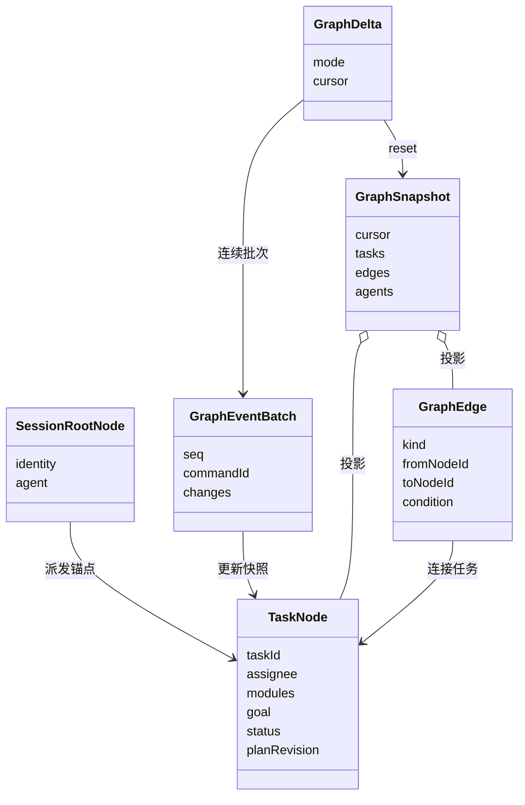

### 任务图节点与事件 v1

状态：已实现图类型、纯结构校验、原子批次投影与游标增量读取；执行状态机、结果交付及运行调度仍按下文契约逐步实现。总说明见 [虚拟成员与任务派发图契约](../../../../docs/agent-dispatch-contract.md)。本模块不拥有进程、磁盘、在线模型或 UI。

### 节点结构

以下 TypeScript 对应 `graph-types.ts` 的公开协议；字段均为可序列化数据，不能直接复用当前兼任会话 ID 的 `TaskSpec.taskId`。

```ts
type GraphIdentity = { workspaceId: string; rootSessionId: string };
type AgentRef = {
  agentId: string; agentInstanceId: string; agentSessionId: string;
  name: string; // 展示快照；身份仍以 ID 为准
};
type ModuleBinding = {
  moduleId: string; name: string;
  knowledgeRevision: string;
  maintenanceBindingId: string; // 已核实维护关系；不能从作者字段自动推断
  maintainerPersonIds: string[]; // 非空，来自真人花名册；不等于已认证登录人
  workflow: { kind: 'module'; id: string; version: string }
          | { kind: 'general'; id: string; version: string; reason: string };
};
type SessionRootNode = {
  kind: 'session-root'; nodeId: string; identity: GraphIdentity;
  agent: AgentRef; revision: number; createdAt: string;
};
type TaskStatus = 'planned' | 'queued' | 'running' | 'waiting'
  | 'result_ready' | 'blocked' | 'failed' | 'cancelled' | 'interrupted';
type TaskNode = {
  kind: 'task'; nodeId: string; taskId: string; identity: GraphIdentity;
  parentTaskId?: string; // 缺省表示从主会话根派发
  requester: AgentRef;
  assignee: AgentRef; // 每个任务恰好一个责任成员
  modules: ModuleBinding[]; // 至少一个；多成员工作拆成多个 Task
  goal: string; acceptance: { id: string; text: string }[];
  revision: number; // 每次节点事实变化递增，用于条件更新
  planRevision: number; // 目标/范围/责任/验收变化才递增
  status: TaskStatus;
  awaitedChildren: { taskId: string; planRevision: number }[];
  // 持久化等待的子任务及计划版本，不产生反向边
  waitReason?: string; // 等待、阻塞或中断的可展示原因
  runIds: string[]; activeRunId?: string;
  result?: {
    resultId: string; runId: string; planRevision: number;
    summary: string; evidenceRefs: string[]; limitations: string[];
    acceptance: 'not_evaluated';
  };
  createdAt: string; updatedAt: string; // UTC ISO 8601，由调度器生成
};
type GraphEdge = {
  edgeId: string; identity: GraphIdentity;
  fromNodeId: string; toNodeId: string;
  revision: number; enabled: boolean;
} & (
  | { kind: 'dispatch' }
  | { kind: 'dependency'; condition: {
      kind: 'result_ready'; planRevision: number;
      resultId?: string; // 放行时固定实际消费的结果，未满足前可缺省
    } }
);
```

`nodeId` 区分根锚点与任务：根为 `session:<rootSessionId>`，任务为 `task:<taskId>`。同 Agent 的多个任务有不同 taskId，但共享该成员实例身份；重试只追加 runId。AgentRef 由调度器从真实成员绑定填入，不允许模型冒充 requester。模块无维护关系时拒绝正式派发，返回缺口；普通对话与定位过程仍可继续。

派发边创建后不移动父节点、不删除历史。依赖边可在任务未运行时用带版本的修订禁用；旧边保留 `enabled:false`。失效结果须清除为当前有效结果，旧结果仍在事件历史中，不可因存在旧 result 字段就满足依赖。

### 图不变量与任务状态

- 每图恰好一个 SessionRootNode，根必须绑定主 Agent；根不是业务任务，也不计入任务完成率。
- 建图以 seq=1 的 graph.created 批次原子提交根和主成员投影；seq=0 只是内部空前缀，公开 Snapshot 始终有根。读取未建图返回 GRAPH_NOT_FOUND。
- 每个任务恰好一条入向 dispatch 边，父节点必须已存在且在同图；边的 parentTaskId 必须与节点字段一致。
- 每个模块的维护关系、Agent 身份及版本在派发前核实；未定位到模块不能伪造节点。Workflow 属于模块，不继承其他模块的流程。
- 启用的 dispatch 与 dependency 边合并检查有向无环；拒绝自环、缺失端点、跨工作区/跨图依赖。dependency 的两端必须是任务，方向为前置 → 后续。
- dependency.condition 固定前置计划版本；允许放行前须固定实际 resultId。v1 只支持有效交付候选作为前置，不宣称该候选已通过业务验收；结果修订使引用失效时必须复核消费方基线。
- 子任务返回通过消息解除 `awaitedChildren`；结果必须匹配所等的 taskId 与 planRevision，修订后的同 ID 结果不能静默唤醒旧计划。父子等待不添加反向 dependency 边，消息也不自动让父任务完成。
- 显示图无环不等于没有等待死锁。另建仅供检查的等待关系：等待方 → 未满足前置，以及父任务 → 正在等待的子任务。派发、登记等待、依赖或计划修订均检查该关系无环；拒绝“A 派 B，B 等 A 的结果，A 又等 B”。该检查图不加入可视化派发边。
- `planned → queued → running`；运行可进入 waiting、result_ready、failed、interrupted，取消须经过实际停止确认后才记 cancelled。
- waiting 在依赖满足且收到恢复调度后回 queued；依赖失败进入 blocked，不能因为收到“回复”就运行。blocked / failed / interrupted 的继续或重试须显式命令及当前版本，未知副作用先核实。
- result_ready 只表示可交接候选，不表示验收通过；新计划修订撤销旧候选的有效性，并重新核验已绑定该结果的下游基线。不能自动重放已经执行过的下游任务。
- 终态节点保留。上游取消不默认回滚磁盘、不隐式取消全部子树；取消范围必须显式给定并逐项追踪。

### 增量协议

```ts
type GraphCursor = GraphIdentity & { streamId: string; seq: number };
type AgentGraphView = {
  agentInstanceId: string; agentId: string; name: string; revision: number;
  state: 'idle' | 'working' | 'waiting' | 'communicating';
  // 状态与任务引用均是当前图局部投影；全局成员状态另走授权接口
  runningTaskId?: string; waitingTaskIds: string[];
};
type GraphChange =
  | { type: 'root.upserted'; root: SessionRootNode }
  | { type: 'task.upserted'; task: TaskNode }
  | { type: 'edge.upserted'; edge: GraphEdge }
  | { type: 'agent.upserted'; agent: AgentGraphView };
type GraphCause = 'graph.created' | 'task.created' | 'task.dispatched'
  | 'task.started' | 'task.waiting' | 'task.result_ready' | 'task.blocked'
  | 'task.failed' | 'task.cancelled' | 'task.interrupted' | 'task.revised'
  | 'task.reconciled' | 'dependency.changed' | 'message.accepted'
  | 'message.processed' | 'agent.state_changed';
type GraphEventBatch = {
  version: 1; identity: GraphIdentity; streamId: string; seq: number;
  eventId: string; commandId: string; cause: GraphCause;
  committedAt: string; changes: GraphChange[];
};
type GraphSnapshot = {
  version: 1; identity: GraphIdentity; cursor: GraphCursor;
  root: SessionRootNode; tasks: TaskNode[]; edges: GraphEdge[];
  agents: AgentGraphView[];
};
type GraphDelta =
  | { mode: 'noop'; cursor: GraphCursor }
  | { mode: 'delta'; from: GraphCursor; cursor: GraphCursor;
      batches: GraphEventBatch[]; hasMore: boolean }
  | { mode: 'reset'; reason: 'initial' | 'stream_changed' | 'cursor_ahead'
      | 'history_compacted'; snapshot: GraphSnapshot; cursor: GraphCursor };
```

seq 是**原子提交批次**的序号，从 1 开始连续；一次派发中的节点、边、成员状态在同一批次展示，不能拆开应用。changes 只包含变化对象，但 upsert 携带对象完整新快照，避免部分字段清空或乱序补丁产生歧义。同一批次同一对象最多一次 upsert；所有端点允许在本批次一起创建，按整个批次验证，不逐条暂时判缺失。

streamId 正常重启不变；只有明确重建或不兼容迁移才换流。重复 eventId / seq 不重复应用，断档先补读，不跳过；同 seq 不同内容是损坏或协议错误，不能当重复忽略。seq 和 revision 必须是非负安全整数；首节点 revision=1。

GraphDelta 不包含私有推理、模型凭据、完整工具正文、绝对文件路径或其他会话消息；evidenceRefs 指向需单独授权读取的记录。无变化只返回 noop，不重读全图或替换前端对象引用。成员状态按本图事实依 working > communicating > waiting > idle 投影，不能用本图 idle 声称成员在全工作区空闲。

### 目标结构类图（待实现，独立于上方当前代码图）



已新增 `graph-types.ts`（公开契约）、`graph-reducer.ts`（原子投影与增量读取）、`graph-rules.ts`（结构、DAG 与等待约束）。这些纯函数不签发权限、不运行 Agent、不自行把候选变成验收通过。内存投影保留已验证批次的重放证明，重复批次返回原对象；单独反序列化 Snapshot 后没有历史证明时拒绝旧批次，持久化从日志重放可重建证明。执行与恢复的行为测试仍需随对应服务接入。
