# src/backend/core/team 架构

## 目录定位

Team、小组、Agent 和父链 Skill 视图、实例及静态角色 Session 履历契约。主实例归主会话，业务实例归周期与任务；履历按角色聚合真实通道，释放或删定义后保留，旧记录不补造实例。另含稳定工作区岗位的严格DTO、采纳快照与不可变登记规则；岗位启用不等于执行许可。 负责岗位选择、冻结执行绑定、当前来源/能力/模型判定及只读分组发现均为纯契约；同角色多岗位独立。

本文描述当前实现。通过分析目录边界后维护的 [源码架构脚本](../../../../scripts/source-architecture.mjs) 同步清单和声明；代码变更时仍须核对职责、关键成员与关系。

## 代码清单

| 文件 | 当前职责 |
| --- | --- |
| [agent-types.ts](agent-types.ts) | 虚拟成员的角色配置、持久化实例及独立会话身份，供调度和存储共同使用。 |
| [automatic-execution.ts](automatic-execution.ts) | 定义用户选择的协作模式和自动兜底的冻结身份，供计划、任务与运行共用。 |
| [member-execution-binding.ts](member-execution-binding.ts) | 岗位负责人派发的纯选择与冻结身份契约，供目标、任务、运行和公开视图共用。 |
| [member-execution-rules.ts](member-execution-rules.ts) | 从同一岗位、责任与来源登记快照核实执行选择，供调度和存储共用。 |
| [model.ts](model.ts) | 团队：Team/小组/Agent、真人花名册与 Agent 自身和祖先 Skill的核心封装。 |
| [owner-execution-discovery.ts](owner-execution-discovery.ts) | 岗位执行选择的有界只读发现协议，供主工具和任务详情共用。 |
| [session-history-storage.ts](session-history-storage.ts) | 静态 Agent 会话历史的持久化索引契约，连接调度查询服务与本机磁盘适配。 |
| [session-history.ts](session-history.ts) | 定义按静态 Agent 归档的独立 Session、任务轮次及公开事件查询协议。 |
| [workspace-member-rules.ts](workspace-member-rules.ts) | 岗位登记的规范指纹、预览依据、不可变审计与单条事件投影；由可信服务与 Store 重放共同调用。 |
| [workspace-member.ts](workspace-member.ts) | 定义工作区长期岗位、采纳快照、版本化登记命令与公开查询协议，供 Main、Store 和桌面共用。 |

## 架构类图

### agent-types.ts

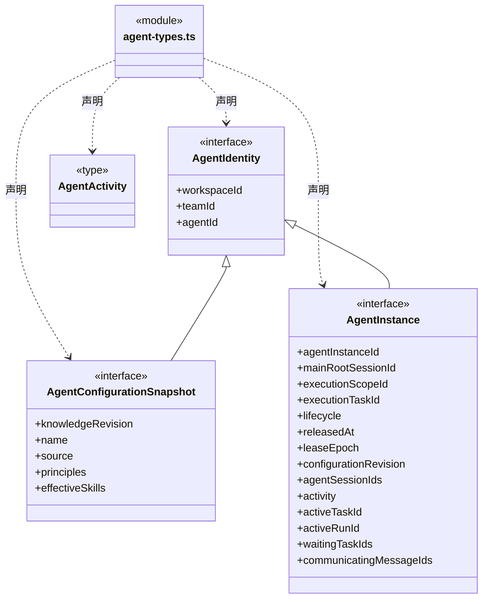

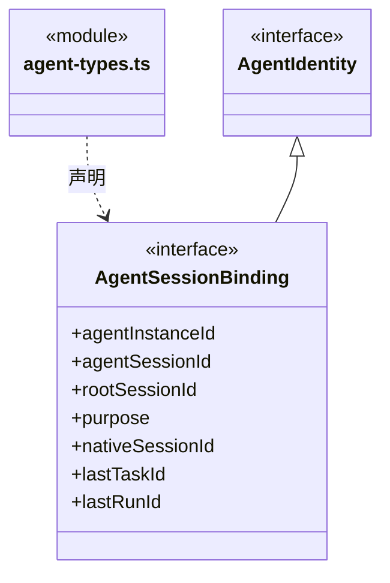


### automatic-execution.ts

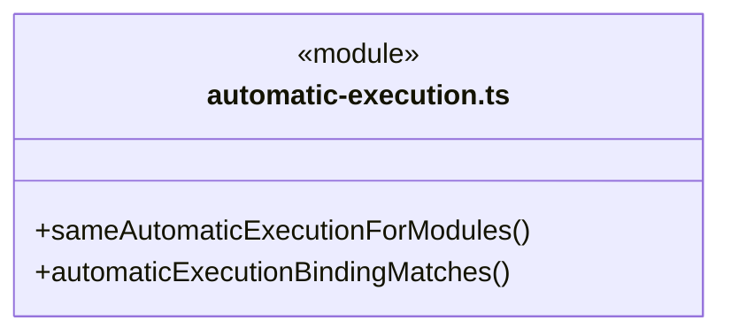

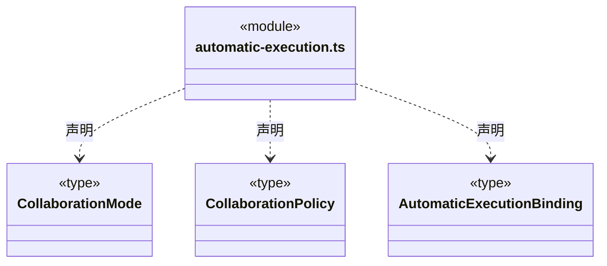

直接依赖：[../workspace/project-root.ts](../workspace/project-root.ts)。

### member-execution-binding.ts

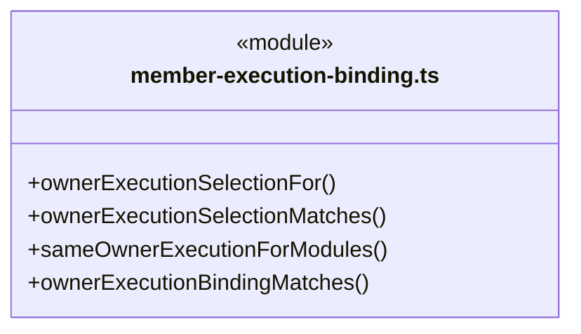

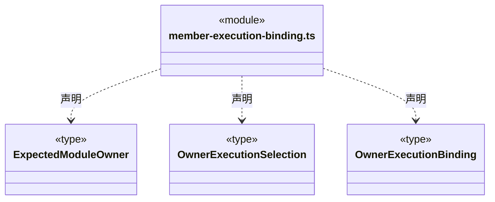

直接依赖：[../workspace/knowledge-source.ts](../workspace/knowledge-source.ts)。

### member-execution-rules.ts

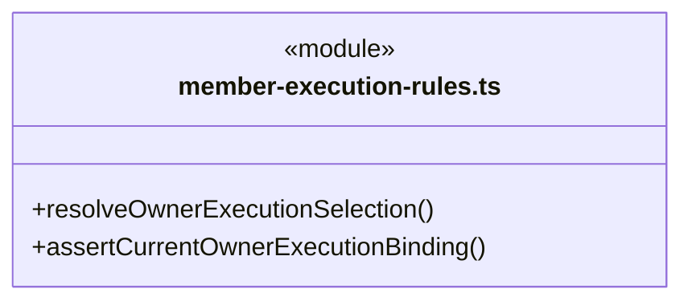

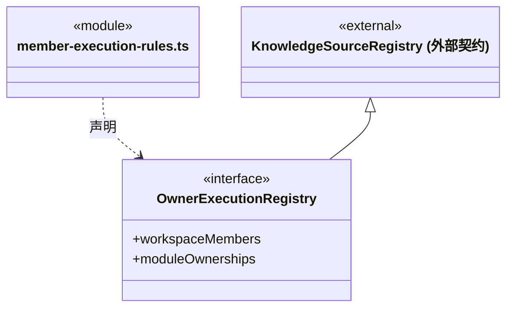

直接依赖：[../foundation/errors.ts](../foundation/errors.ts)、[workspace-member.ts](workspace-member.ts)、[workspace-member-rules.ts](workspace-member-rules.ts)、[../workspace/module-ownership.ts](../workspace/module-ownership.ts)、[../workspace/knowledge-source-rules.ts](../workspace/knowledge-source-rules.ts)、[member-execution-binding.ts](member-execution-binding.ts)。

### model.ts

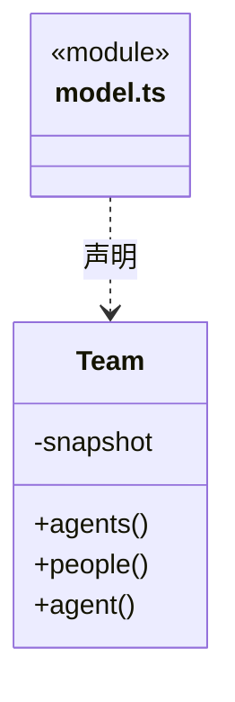

直接依赖：[../knowledge/snapshot.ts](../knowledge/snapshot.ts)、[../foundation/json.ts](../foundation/json.ts)、[../foundation/errors.ts](../foundation/errors.ts)、[../knowledge/types.ts](../knowledge/types.ts)。

### owner-execution-discovery.ts

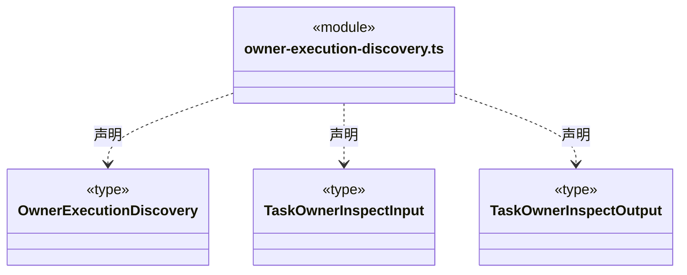

直接依赖：[member-execution-binding.ts](member-execution-binding.ts)、[workspace-member.ts](workspace-member.ts)、[../workspace/module-ownership.ts](../workspace/module-ownership.ts)、[../workspace/knowledge-source.ts](../workspace/knowledge-source.ts)。

### session-history-storage.ts

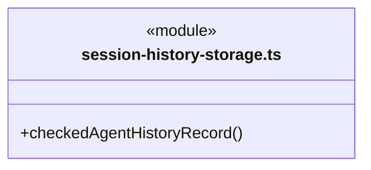

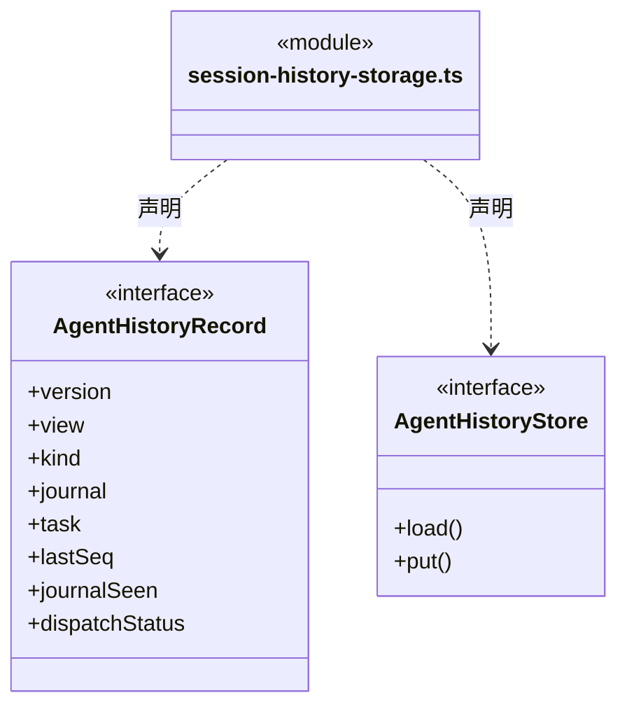

直接依赖：[../tasks/types.ts](../tasks/types.ts)、[session-history.ts](session-history.ts)。

### session-history.ts

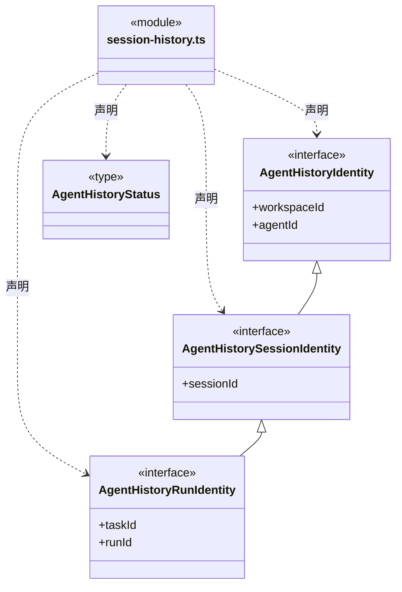

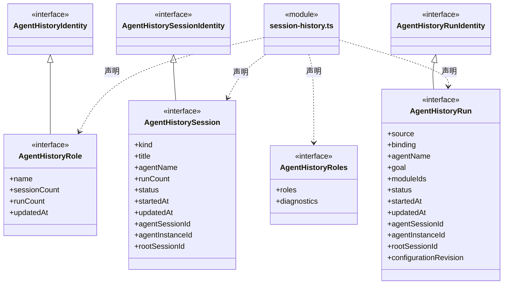

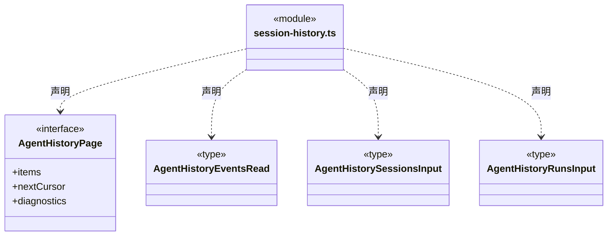

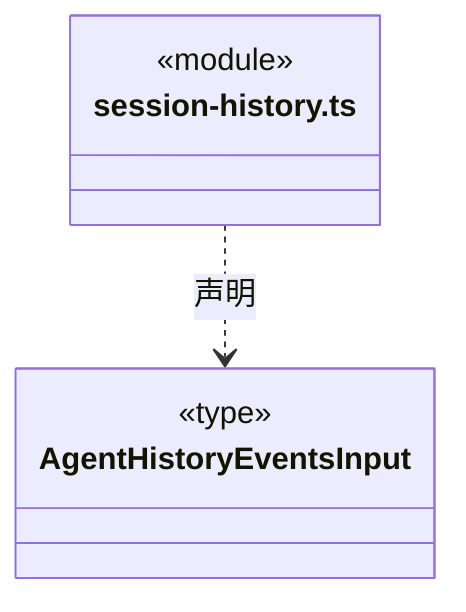

直接依赖：[../brain/types.ts](../brain/types.ts)、[../tasks/member-events.ts](../tasks/member-events.ts)。

### workspace-member-rules.ts

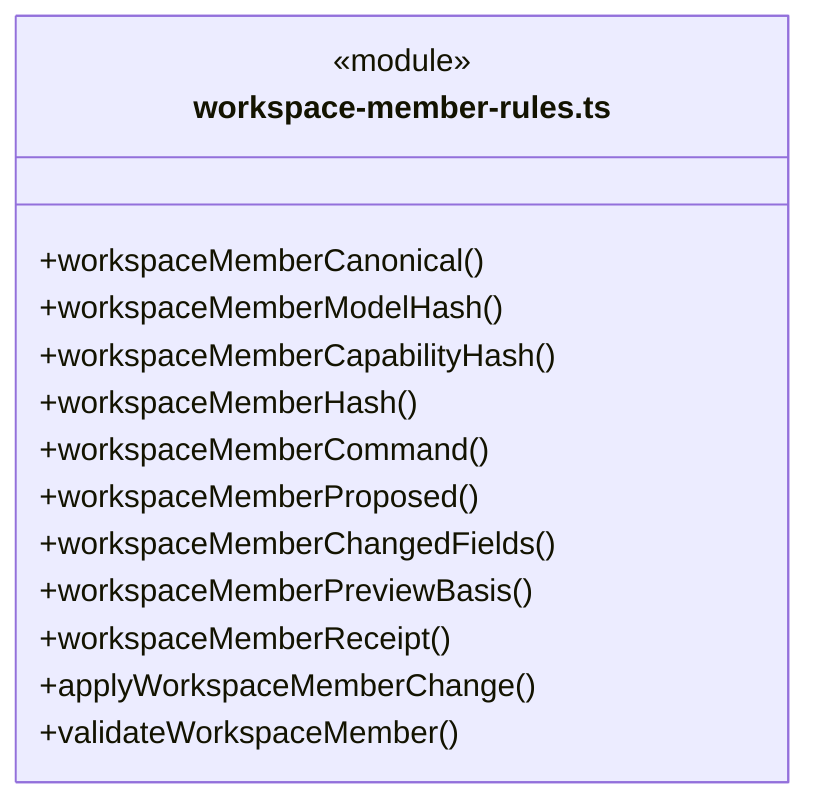

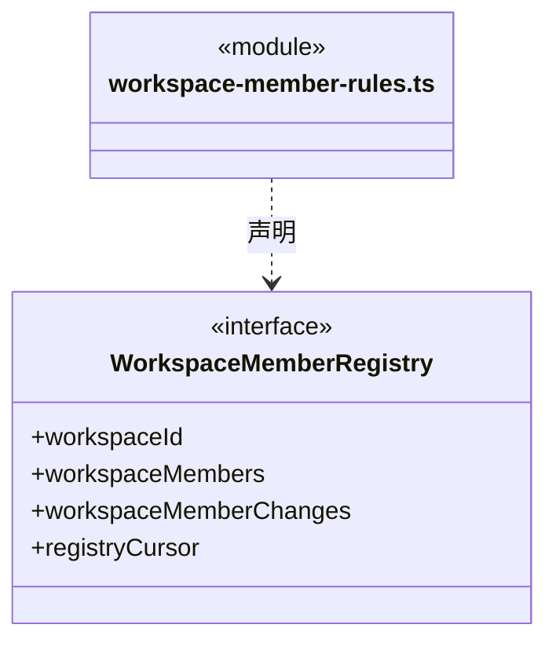

直接依赖：[../foundation/serialization.ts](../foundation/serialization.ts)、[../foundation/errors.ts](../foundation/errors.ts)、[../workspace/knowledge-source.ts](../workspace/knowledge-source.ts)、[workspace-member.ts](workspace-member.ts)。

### workspace-member.ts

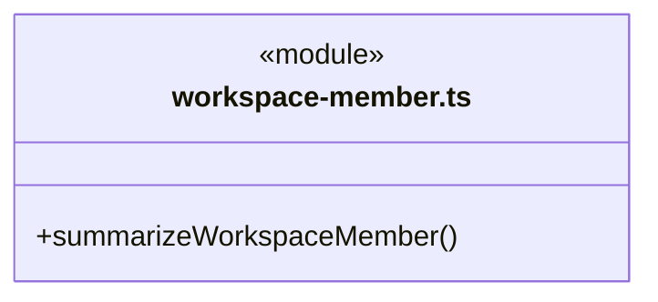

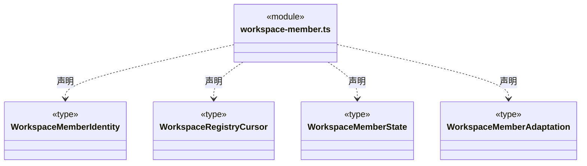

```mermaid
classDiagram
class N_src_backend_core_team_workspace_member_ts["workspace-member.ts"] {
  <<module>>
}
class N_src_backend_core_team_workspace_member_ts_WorkspaceMemberModelRef["WorkspaceMemberModelRef"] {
  <<type>>

}
N_src_backend_core_team_workspace_member_ts ..> N_src_backend_core_team_workspace_member_ts_WorkspaceMemberModelRef : 声明
class N_src_backend_core_team_workspace_member_ts_WorkspaceMemberModelSnapshot["WorkspaceMemberModelSnapshot"] {
  <<type>>

}
N_src_backend_core_team_workspace_member_ts ..> N_src_backend_core_team_workspace_member_ts_WorkspaceMemberModelSnapshot : 声明
class N_src_backend_core_team_workspace_member_ts_WorkspaceMemberRuntimePolicy["WorkspaceMemberRuntimePolicy"] {
  <<type>>

}
N_src_backend_core_team_workspace_member_ts ..> N_src_backend_core_team_workspace_member_ts_WorkspaceMemberRuntimePolicy : 声明
class N_src_backend_core_team_workspace_member_ts_WorkspaceMemberCapability["WorkspaceMemberCapability"] {
  <<type>>

}
N_src_backend_core_team_workspace_member_ts ..> N_src_backend_core_team_workspace_member_ts_WorkspaceMemberCapability : 声明
```

```mermaid
classDiagram
class N_src_backend_core_team_workspace_member_ts["workspace-member.ts"] {
  <<module>>
}
class N_src_backend_core_team_workspace_member_ts_WorkspaceMemberAdoption["WorkspaceMemberAdoption"] {
  <<type>>

}
N_src_backend_core_team_workspace_member_ts ..> N_src_backend_core_team_workspace_member_ts_WorkspaceMemberAdoption : 声明
class N_src_backend_core_team_workspace_member_ts_WorkspaceMember["WorkspaceMember"] {
  <<type>>

}
N_src_backend_core_team_workspace_member_ts ..> N_src_backend_core_team_workspace_member_ts_WorkspaceMember : 声明
class N_src_backend_core_team_workspace_member_ts_WorkspaceMemberChangeInput["WorkspaceMemberChangeInput"] {
  <<type>>

}
N_src_backend_core_team_workspace_member_ts ..> N_src_backend_core_team_workspace_member_ts_WorkspaceMemberChangeInput : 声明
class N_src_backend_core_team_workspace_member_ts_WorkspaceMemberPreviewInput["WorkspaceMemberPreviewInput"] {
  <<type>>

}
N_src_backend_core_team_workspace_member_ts ..> N_src_backend_core_team_workspace_member_ts_WorkspaceMemberPreviewInput : 声明
```

```mermaid
classDiagram
class N_src_backend_core_team_workspace_member_ts["workspace-member.ts"] {
  <<module>>
}
class N_src_backend_core_team_workspace_member_ts_WorkspaceMemberCommitInput["WorkspaceMemberCommitInput"] {
  <<type>>

}
N_src_backend_core_team_workspace_member_ts ..> N_src_backend_core_team_workspace_member_ts_WorkspaceMemberCommitInput : 声明
class N_src_backend_core_team_workspace_member_ts_WorkspaceMemberLookup["WorkspaceMemberLookup"] {
  <<type>>

}
N_src_backend_core_team_workspace_member_ts ..> N_src_backend_core_team_workspace_member_ts_WorkspaceMemberLookup : 声明
class N_src_backend_core_team_workspace_member_ts_WorkspaceMemberProposed["WorkspaceMemberProposed"] {
  <<type>>

}
N_src_backend_core_team_workspace_member_ts ..> N_src_backend_core_team_workspace_member_ts_WorkspaceMemberProposed : 声明
class N_src_backend_core_team_workspace_member_ts_WorkspaceMemberField["WorkspaceMemberField"] {
  <<type>>

}
N_src_backend_core_team_workspace_member_ts ..> N_src_backend_core_team_workspace_member_ts_WorkspaceMemberField : 声明
```

```mermaid
classDiagram
class N_src_backend_core_team_workspace_member_ts["workspace-member.ts"] {
  <<module>>
}
class N_src_backend_core_team_workspace_member_ts_WorkspaceMemberPreview["WorkspaceMemberPreview"] {
  <<type>>

}
N_src_backend_core_team_workspace_member_ts ..> N_src_backend_core_team_workspace_member_ts_WorkspaceMemberPreview : 声明
class N_src_backend_core_team_workspace_member_ts_WorkspaceMemberReceipt["WorkspaceMemberReceipt"] {
  <<type>>

}
N_src_backend_core_team_workspace_member_ts ..> N_src_backend_core_team_workspace_member_ts_WorkspaceMemberReceipt : 声明
class N_src_backend_core_team_workspace_member_ts_WorkspaceMemberChange["WorkspaceMemberChange"] {
  <<type>>

}
N_src_backend_core_team_workspace_member_ts ..> N_src_backend_core_team_workspace_member_ts_WorkspaceMemberChange : 声明
class N_src_backend_core_team_workspace_member_ts_WorkspaceMemberSummary["WorkspaceMemberSummary"] {
  <<type>>

}
N_src_backend_core_team_workspace_member_ts ..> N_src_backend_core_team_workspace_member_ts_WorkspaceMemberSummary : 声明
```

```mermaid
classDiagram
class N_src_backend_core_team_workspace_member_ts["workspace-member.ts"] {
  <<module>>
}
class N_src_backend_core_team_workspace_member_ts_WorkspaceMemberListInput["WorkspaceMemberListInput"] {
  <<type>>

}
N_src_backend_core_team_workspace_member_ts ..> N_src_backend_core_team_workspace_member_ts_WorkspaceMemberListInput : 声明
class N_src_backend_core_team_workspace_member_ts_WorkspaceMemberList["WorkspaceMemberList"] {
  <<type>>

}
N_src_backend_core_team_workspace_member_ts ..> N_src_backend_core_team_workspace_member_ts_WorkspaceMemberList : 声明
class N_src_backend_core_team_workspace_member_ts_WorkspaceMemberGetInput["WorkspaceMemberGetInput"] {
  <<type>>

}
N_src_backend_core_team_workspace_member_ts ..> N_src_backend_core_team_workspace_member_ts_WorkspaceMemberGetInput : 声明
class N_src_backend_core_team_workspace_member_ts_WorkspaceMemberCurrentDiff["WorkspaceMemberCurrentDiff"] {
  <<type>>

}
N_src_backend_core_team_workspace_member_ts ..> N_src_backend_core_team_workspace_member_ts_WorkspaceMemberCurrentDiff : 声明
```

```mermaid
classDiagram
class N_src_backend_core_team_workspace_member_ts["workspace-member.ts"] {
  <<module>>
}
class N_src_backend_core_team_workspace_member_ts_WorkspaceMemberDetail["WorkspaceMemberDetail"] {
  <<type>>

}
N_src_backend_core_team_workspace_member_ts ..> N_src_backend_core_team_workspace_member_ts_WorkspaceMemberDetail : 声明
```

直接依赖：[../workspace/knowledge-source.ts](../workspace/knowledge-source.ts)。

### 本目录调用边界

```mermaid
classDiagram
class N_src_backend_core_team_member_execution_rules_ts["member-execution-rules.ts"] {
  <<module>>
}
class N_src_backend_core_team_workspace_member_ts["workspace-member.ts"] {
  <<module>>
}
class N_src_backend_core_team_workspace_member_rules_ts["workspace-member-rules.ts"] {
  <<module>>
}
class N_src_backend_core_team_member_execution_binding_ts["member-execution-binding.ts"] {
  <<module>>
}
class N_src_backend_core_team_owner_execution_discovery_ts["owner-execution-discovery.ts"] {
  <<module>>
}
N_src_backend_core_team_member_execution_rules_ts ..> N_src_backend_core_team_workspace_member_ts : 导入依赖
N_src_backend_core_team_member_execution_rules_ts ..> N_src_backend_core_team_workspace_member_rules_ts : 导入依赖
N_src_backend_core_team_member_execution_rules_ts ..> N_src_backend_core_team_member_execution_binding_ts : 导入依赖
N_src_backend_core_team_owner_execution_discovery_ts ..> N_src_backend_core_team_member_execution_binding_ts : 导入依赖
```

```mermaid
classDiagram
class N_src_backend_core_team_owner_execution_discovery_ts["owner-execution-discovery.ts"] {
  <<module>>
}
class N_src_backend_core_team_workspace_member_ts["workspace-member.ts"] {
  <<module>>
}
class N_src_backend_core_team_session_history_storage_ts["session-history-storage.ts"] {
  <<module>>
}
class N_src_backend_core_team_session_history_ts["session-history.ts"] {
  <<module>>
}
class N_src_backend_core_team_workspace_member_rules_ts["workspace-member-rules.ts"] {
  <<module>>
}
N_src_backend_core_team_owner_execution_discovery_ts ..> N_src_backend_core_team_workspace_member_ts : 导入依赖
N_src_backend_core_team_session_history_storage_ts ..> N_src_backend_core_team_session_history_ts : 导入依赖
N_src_backend_core_team_workspace_member_rules_ts ..> N_src_backend_core_team_workspace_member_ts : 导入依赖
```


## 子目录导航

无子目录。

[返回上层](../ARCHITECTURE.md)。

每次修改本目录代码，同步维护文件头、关键契约说明及本图。未实现的治理、证据验收和自动编排能力不列入当前类图。

## 设计契约 v1 与落地范围

以下内容区分已接通能力与后续设计；以各节的实现状态为准，不将目标图当作现状图。维护源：[CONTRACT.md](CONTRACT.md)；生成类图时同步附加，勿直接修改本附录。

### 根标识与正式兜底

`automatic-execution.ts` 复用 workspace 的 `projectRootModuleId` 作为历史 `implicitProjectModuleId`。根始终可查询，但正式 no_modules 兜底仍只适用于真实模块为空的项目；有模块时不以根绕过负责人、维护关系或 Workflow。Auto 主会话直接工作与成员兜底是不同执行路径，不制造岗位或成员绑定。

### 负责人执行选择

`member-execution-binding.ts` 提供纯选择和冻结绑定，`member-execution-rules.ts` 从同一岗位、责任和来源登记核实新许可。请求不提交正文或来源证明；实际绑定保存岗位版本、原成员内容 hash、采纳来源、公开模型指纹和逐模块责任。静态 Agent 相同不能合并不同 memberId、执行实例、模型或适配。

`resolveOwnerExecutionSelection` 必须精确覆盖本次模块，所有模块有同一 active 岗位的明确责任，不隐式继承父模块。它核当前成员 revision、能力/模型指纹和逐模块 bindingId/revision，要求工作区 Agent/Module 的已采纳 sourceRef 仍是当前代次；内置执行者只按内容引用。A→B→A、登记元信息修改或模型重新采纳仍会使旧选择失效。`assertCurrentOwnerExecutionBinding` 不更新原绑定，只在新业务许可处重核；历史读取和已领取结算不调用它否定原事实。

历史缺省不补造；纯规则不读当前知识、模型或凭据，可信调用方仍须持知识和模型短锁核外部事实。`active` 不等于可执行，captureId 不等于来源代次。存量交接和跨周期复活不属于此协议。

### 虚拟成员与独立会话契约

已实现 `agent-types.ts` 的角色、成员及会话类型；调度层 `prepareMember` 与工作区持久化注册成员身份。每个主会话持有一个长期 `cbim:main` 调度实例；新的自动派发按用户任务周期，为每个业务 Task 创建独立执行实例，周期结束后释放。成员执行已接通原生大脑会话、占用、消息消费和状态循环。`Team` 仍是固定知识快照只读查询，不承载运行管理。

#### 职责与已有入口

静态 Agent 与动态 AgentInstance 分开：应用级索引由 `scheduler-engine/runtime/GlobalRuntimeManager` 统一观察，Team 不反向引用它。成员权威登记仍来自工作区派发事务。全局监管 epoch 仅隔离观察回调，不替代未来执行租约的 leaseEpoch；恢复出的历史活动不代表当前执行活跃。

- `Team.agents()`、`Team.agent()` 和 `Team.people()` 继续提供组织、角色定义、有效 Skill 与真人责任信息；角色定义不包含运行进程或可变会话状态。
- Team 根与小组是组织节点，只有叶子是 Agent。成员继承自身与所有祖先的 Skill，角色解析仍服从现有冲突校验。
- 默认主 Agent 是内置角色 `cbim:main`，与自定义成员使用同一大脑、工具策略和执行内核。主 Agent 的调度职责只在其主会话开放，不享有隐含的业务工具权限提升，也不是其它成员的父执行进程。
- 主 Agent 负责调度与团队/业务知识管理，可经受控知识服务 CRUD；不能承接正式业务执行。内置静态 `cbim:executor` 可以显式登记成岗位并分配模块责任后执行，不是缺少负责人时的自动回退。执行者保留自己的状态、Session、模型思考与环境探索，按目标模块工作并返回证据或缺口，不获得派发权。
- 本目录持有成员身份、配置快照、状态投影的领域契约。实例注册、邮箱排队、工作交接和生命周期由调度层实现；持久化与平台资源由 `main` 注入。

#### 身份、配置和通道

静态角色的长期履历由 `session-history.ts` 描述，按 `workspaceId + agentId → sessionId → taskId/runId` 查询。已登记 Session 使用真实 `agentSessionId`，运行仍保留执行时的实例与主会话引用。角色汇总不代表合并原生上下文，也不因执行实例 released 而删除历史。

旧日志只有明确的 `TaskSpec.agentId` 时归入 `legacy:<taskId>` 历史分组，保留实例与真实通道未知；无角色身份的旧记录报诊断，不从目录名、展示名称或最新实例猜测。静态定义删除后仍可按旧 ID 查询，不能要求当前 Team 知识解析成功。若同路径后来建立新定义，历史配置版本仍按原记录展示，不声称历史使用当前配置。

归档保存运行引用和摘要，完整事件继续由 canonical 日志保管；运行履历属于本机工作区数据，不写入正式 `.cbim/` 或人才资源包。团队图节点只提供只读入口，不创建执行实例、不确认结果、不恢复模型。

```ts
/** 角色身份来自知识库；teamId 是该工作区知识中的 Team 根标识。 */
interface AgentIdentity {
  workspaceId: string;
  teamId: string;
  agentId: string;
}

/** 本轮固定的角色配置；不含 API Key、进程句柄或可变知识视图。 */
interface AgentConfigurationSnapshot extends AgentIdentity {
  knowledgeRevision: string;
  name: string;
  source: 'builtin' | 'workspace';
  principles: string;
  effectiveSkills: Array<{
    skillId: string;
    ownerId: string;
    inherited: boolean;
    content: string;
  }>;
}

type AgentActivity = 'idle' | 'working' | 'waiting' | 'communicating';

/** 主角色每个主会话一个实例；新的执行实例按周期内任务创建，旧无周期记录保留兼容。 */
interface AgentInstance extends AgentIdentity {
  agentInstanceId: string;
  /** 仅新 cbim:main 实例使用；缺省表示历史共享主实例或普通自定义角色。 */
  mainRootSessionId?: string;
  executionScopeId?: string;
  executionTaskId?: string;
  lifecycle?: 'active' | 'released';
  releasedAt?: string;
  /** 运行接管的隔离代际；正常重启只更新代际，不改成员身份。 */
  leaseEpoch: number;
  configurationRevision: string;
  agentSessionIds: string[];
  activity: AgentActivity;
  activeTaskId?: string;
  activeRunId?: string;
  waitingTaskIds: string[];
  communicatingMessageIds: string[];
}

/** 持久化通道绑定；原生会话只能由该通道的成员使用。 */
interface AgentSessionBinding extends AgentIdentity {
  agentInstanceId: string;
  agentSessionId: string;
  rootSessionId: string;
  /** 缺省等同 task；创建后不能把任务通道改为主对话通道。 */
  purpose?: 'task' | 'conversation';
  nativeSessionId?: string;
  lastTaskId?: string;
  lastRunId?: string;
}
```

`agentId` 标识角色定义，`agentInstanceId` 标识动态实例，`agentSessionId` 标识其独立会话通道，三者不能互换。主实例跨用户任务周期保留；执行实例固定 `executionScopeId + executionTaskId`，同一角色在同一周期承担两项任务也创建两个实例。关闭周期递增 `leaseEpoch` 并标记 released，已释放实例及其原生通道不可由迟到回调复活。旧实例、任务和运行记录仍保留用于审计，不改写历史身份。

原生进程是成员的一次运行载体，不是成员身份。新的周期任务创建新实例；恢复先将不确定运行标为 interrupted，再关闭遗留活动周期并释放其执行实例，不能把旧任务恢复为活跃执行或自动重放副作用。

现有 `Team.agent()` 查询的是已通过知识校验的自定义 Agent；它并不自动返回 `cbim:main`。实施时由统一角色解析入口补充内置主角色来源，并把它绑定到目标工作区的 Team，不能伪造一条已经存在的知识定义或绕过自定义角色的校验。

`rootSessionId` 是主 Agent 对话视图与派发图的归属，不是全团队唯一 Session。一个角色可以为不同主对话持有不同 `agentSessionId`；同一根对话内也可显式创建隔离通道。不得仅凭 `agentId` 寻找“最近一次会话”并复用其上下文。

新主会话的 `mainRootSessionId` 在创建时固定，该实例所有通道属于此根；图根和普通对话共同引用这个 `agentInstanceId`。图根保留 `task` 用途通道作为派发信封的收发身份，不因此获得正式执行权；`conversationBinding` 为同实例登记 `conversation` 通道，不制造业务 Task。原生会话位置由真实运行日志核验，不混合旧主执行历史。

旧日志可能没有 `mainRootSessionId`，且多个图已经引用同一个主实例。恢复及绑定严格沿用这些图根已有的实例与任务通道，缺省 `purpose` 按 `task` 处理；不会自动改绑根、添加范围或重写原生历史。新根不再复用这个历史共享实例。此类旧图之间仍共享成员占用，是保留历史归属的兼容限制；后续若迁移须显式处理历史引用。

`lastTaskId` / `lastRunId` 只用于核对历史和恢复位置，不授权把上一任务的目标、模块、工具权限、模型配置或未决审批带入下一任务。原生会话路径是后端内部资源，不放进前端成员 DTO。

#### 活动状态来自可核对事实

| 状态 | 判定依据 | 不代表什么 |
| --- | --- | --- |
| `working` | 实例正在执行某个 `runId`，包括思考和工具调用 | 业务任务已通过验收 |
| `communicating` | 无活动执行，正在交付或消费有 `messageId` 的任务/结果消息 | 网络请求已被对端接收或任务已完成 |
| `waiting` | 无活动执行/交付，已有任务显式等待依赖结果或必要回复 | 成员执行线程一直占用大脑 |
| `idle` | 上述事实均不存在 | 历史任务全部成功 |

多个事实同时存在时，活动摘要按 `working > communicating > waiting > idle` 投影，详细等待和通信集合仍保留。运行中等待用户批准属于当前执行的进度，不凭此伪造另一个成员的回复。实例恢复失败、模型不可用等健康问题单独报告，不混入这四种工作状态。

每个活动实例串行执行，实例占用即使只读也不能双跑；不同实例只读可并行，可能写入的运行仍独占工作区。依赖未完成的任务不领取运行槽。主 Agent 不接收正式执行派发；旧主执行图可阅读，但新启动被拒绝。旧无 scope 的显式登记和派发保留原实例复用规则，不作为新自动流程的生命周期。

#### 对调度层的约束

1. 所有入口统一经过成员解析与任务分析，包括用户对话、其它 Agent 的任务消息和结果回复。普通寒暄不强制制造业务派发，但需要执行的任务必须先定位业务模块及维护责任。
2. 一项执行任务固定一个接收成员、多个模块绑定与任务目标；真实人类责任、角色成员与维护模块的身份分别保存。角色名不能替代真人责任人标识。
3. 新任务按当前知识版本准备角色配置；已有运行继续使用其固定配置。知识改变不应静默改写运行中的身份、Skill 或权限。
4. 接收派发、接受结果与最终业务验收是不同事实。接收方返回结果只说明结果已交付，不能直接把发送方任务或整张图标为验收通过。
5. 重复 `messageId` 不重复入队，重复 `commandId` 返回已提交结果。同一任务重试保留 `taskId`，新的执行尝试使用新的 `runId`。

#### 当前依赖方向

```mermaid
classDiagram
class TeamKnowledge["Team（现有只读查询）"]
class MemberContracts["成员身份 / 配置 / 状态契约"] {
  <<contract>>
}
class MemberScheduler["调度层成员实例与邮箱"] {
  <<boundary>>
}
class BrainPort["大脑执行端口"] {
  <<boundary>>
}
MemberScheduler ..> TeamKnowledge : 查询配置与继承
MemberScheduler ..> MemberContracts : 持有实例并投影状态
MemberScheduler ..> BrainPort : 绑定成员通道并执行
```

本图表达跨目录契约边界，具体文件类图见各目录 `ARCHITECTURE.md`。Team 不导入调度器、大脑实现或平台存储；成员共享类型放在独立契约文件，避免 `model.ts` 与运行管理器相互依赖。任务节点与增量事件见 [任务契约](../tasks/CONTRACT.md)，执行通道边界见 [大脑契约](../brain/CONTRACT.md)。

### 项目岗位登记与明确采纳

`workspace-member.ts` 定义独立的稳定 `memberId`、岗位元信息、状态及采纳快照，与既有 `AgentInstance`/执行通道分开。相同静态执行能力可以登记多个岗位，主调度角色不能登记为业务岗位。本片只登记，不创建任务或运行，也不切换现有派发身份。`active` 仅表示登记启用；暂停可恢复，退休不可改写或复活，均不删除历史。

采纳保存真实原则及有效继承 Skill。`captureId` 是一次采纳身份，不是静态来源删除重建的代次。能力指纹覆盖完整能力内容但排除整库知识 revision；模型指纹覆盖明确选择的完整公开配置，包括名称、能力和价格，不含密钥、默认选择或凭据可用性。公共 DTO 不导入大脑或后端哈希实现，严格 schema 不裁剪、变换或补默认字段。

`workspace-member-rules.ts` 规范化指纹和预览依据，并从单条不可变变更派生当前岗位。编辑只改显式字段，不顺带采纳外部变化；同一模型引用的配置更新必须用 `adopt:model`，能力采纳不能改绑另一角色。状态变化不读取来源、不能修改快照；当前来源差异是每次查询得到的独立观察，不把岗位启用状态当作来源仍相同或可执行的证明。

单能力最多 1 MiB、256 项有效 Skill；累计最多 256 个岗位（含退休）、4096 条审计、32 MiB，单事件最多 2 MiB。超限拒绝新写入，不裁剪正文或删除旧审计。列表只含摘要，默认分页由服务确定、最大 100，后续页绑定登记游标且必须前进；详情单独返回原快照与当前差异。原命令回执仅保留真实结果引用和指纹，后续版本不重写旧回执。
### 岗位能力的来源采纳

`WorkspaceMemberAdoption.sourceRef` 可选保存受控 workspace Agent 代次或真实 builtin 内容引用。旧采纳缺省保持缺省；改名、岗位说明、状态和模型采纳原样保留原 sourceRef，不能暗补或删除。register/capability adopt 才可通过可信 sourceSelection 采纳当前来源；相同能力字节但来源代次变化仍构成实质变更。captureId 始终只是该次能力采纳 ID，不被重解释为代次。

预览 sourceSelection 的 workspace、逻辑源、expectedRef、definitionHash 和 visible 纳入原 basis，新捕获随机 generationId 与观察的全库 knowledgeRevision 不进入依据；仅无关知识编辑不作废同能力预览，来源删除重建或定义变化仍使原依据失效。实际事件保存完整观察 revision，提交仍在同知识锁下核当前快照。实际 next、完整 sourceRef 和能力正文进入原 memberHash。builtin 内容 hash 必须等于真实能力规范 hash，不能伪造工作区 generation。sourceStatus 在详情中与本岗位 workspace/agent/已采纳引用严格绑定；读取不自动采纳，旧回执不补新字段。


### 自动与团队协作模式

automatic-execution.ts 定义独立 AutomaticExecutionBinding 与 CollaborationPolicy。它们不扩展或伪造 WorkspaceMember：兜底没有 memberId/sourceRef/责任审计，模型引用和能力指纹来自可信周期及实际快照。岗位契约保持原义；缺省模式为 Team。
