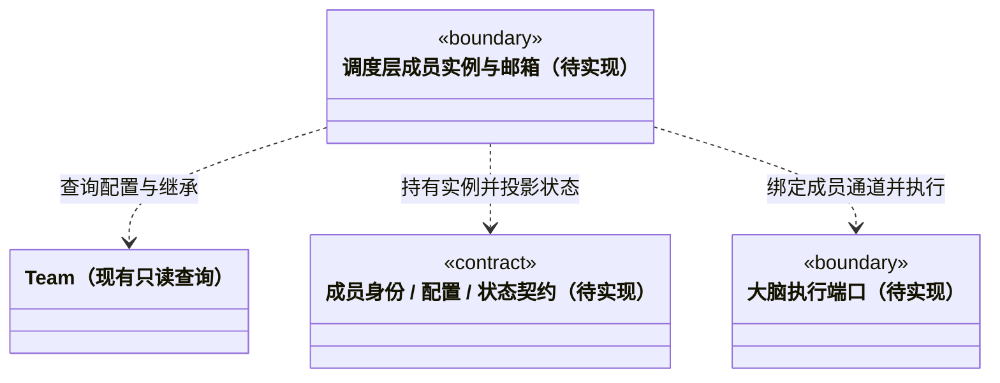

### 虚拟成员与独立会话契约

已实现 `agent-types.ts` 的角色、成员及会话类型；调度层 `prepareMember` 与工作区持久化现在能注册稳定成员身份和每主会话独立通道。`Team` 仍是固定知识快照只读查询。已能可靠保存派发消息，但尚无原生大脑 Session、执行槽、消息消费或状态执行循环；下文涉及这些生命周期的部分仍为目标契约。

#### 职责与已有入口

静态 Agent 与动态 AgentInstance 分开：应用级索引由 `scheduler-engine/runtime/GlobalRuntimeManager` 统一观察，Team 不反向引用它。成员权威登记仍来自工作区派发事务。全局监管 epoch 仅隔离观察回调，不替代未来执行租约的 leaseEpoch；恢复出的历史活动不代表当前执行活跃。

- `Team.agents()`、`Team.agent()` 和 `Team.people()` 继续提供组织、角色定义、有效 Skill 与真人责任信息；角色定义不包含运行进程或可变会话状态。
- Team 根与小组是组织节点，只有叶子是 Agent。成员继承自身与所有祖先的 Skill，角色解析仍服从现有冲突校验。
- 默认主 Agent 是内置角色 `cbim:main`，与自定义成员使用同一大脑、工具策略和调度入口。主 Agent 的默认指引不同，但不享有隐含的权限提升，也不是其它成员的父执行进程。
- 本目录持有成员身份、配置快照、状态投影的领域契约。实例注册、邮箱排队、工作交接和生命周期由调度层实现；持久化与平台资源由 `main` 注入。

#### 身份、配置和通道

```ts
/** 角色身份来自知识库；teamId 是该工作区知识中的 Team 根标识。 */
interface AgentIdentity {
  workspaceId: string;
  teamId: string;
  agentId: string;
}

/** 本轮固定的角色配置；不含 API Key、进程句柄或可变知识视图。 */
interface AgentConfigurationSnapshot extends AgentIdentity {
  knowledgeRevision: string;
  name: string;
  source: 'builtin' | 'workspace';
  principles: string;
  effectiveSkills: Array<{
    skillId: string;
    ownerId: string;
    inherited: boolean;
    content: string;
  }>;
}

type AgentActivity = 'idle' | 'working' | 'waiting' | 'communicating';

/** 一个工作区内一个角色只有一个持久化成员实例；实例可以管理多个隔离通道。 */
interface AgentInstance extends AgentIdentity {
  agentInstanceId: string;
  /** 运行接管的隔离代际；正常重启只更新代际，不改成员身份。 */
  leaseEpoch: number;
  configurationRevision: string;
  agentSessionIds: string[];
  activity: AgentActivity;
  activeTaskId?: string;
  activeRunId?: string;
  waitingTaskIds: string[];
  communicatingMessageIds: string[];
}

/** 持久化通道绑定；原生会话只能由该通道的成员使用。 */
interface AgentSessionBinding extends AgentIdentity {
  agentInstanceId: string;
  agentSessionId: string;
  rootSessionId: string;
  nativeSessionId?: string;
  lastTaskId?: string;
  lastRunId?: string;
}
```

`agentId` 标识角色定义，`agentInstanceId` 标识该工作区中持久化的成员实例，`agentSessionId` 标识可恢复的独立会话通道，三者不能互换。正常重启、执行失败或运行接管都不更换 `agentInstanceId`；接管由持久化租约递增 `leaseEpoch`，旧代际的回调、消息确认和停止请求必须被拒绝。`leaseEpoch` 是非负安全整数，由租约权威端生成，不接受模型指定。

原生进程是成员的一次运行载体，不是成员身份。只有明确移除后新建成员等身份生命周期操作才考虑新的 `agentInstanceId`；此类操作需要单独处理历史归属，不能当作故障恢复捷径。

现有 `Team.agent()` 查询的是已通过知识校验的自定义 Agent；它并不自动返回 `cbim:main`。实施时由统一角色解析入口补充内置主角色来源，并把它绑定到目标工作区的 Team，不能伪造一条已经存在的知识定义或绕过自定义角色的校验。

`rootSessionId` 是主 Agent 对话视图与派发图的归属，不是全团队唯一 Session。一个角色可以为不同主对话持有不同 `agentSessionId`；同一根对话内也可显式创建隔离通道。不得仅凭 `agentId` 寻找“最近一次会话”并复用其上下文。

`lastTaskId` / `lastRunId` 只用于核对历史和恢复位置，不授权把上一任务的目标、模块、工具权限、模型配置或未决审批带入下一任务。原生会话路径是后端内部资源，不放进前端成员 DTO。

#### 活动状态来自可核对事实

| 状态 | 判定依据 | 不代表什么 |
| --- | --- | --- |
| `working` | 实例正在执行某个 `runId`，包括思考和工具调用 | 业务任务已通过验收 |
| `communicating` | 无活动执行，正在交付或消费有 `messageId` 的任务/结果消息 | 网络请求已被对端接收或任务已完成 |
| `waiting` | 无活动执行/交付，已有任务显式等待依赖结果或必要回复 | 成员执行线程一直占用大脑 |
| `idle` | 上述事实均不存在 | 历史任务全部成功 |

多个事实同时存在时，活动摘要按 `working > communicating > waiting > idle` 投影，详细等待和通信集合仍保留。运行中等待用户批准属于当前执行的进度，不凭此伪造另一个成员的回复。实例恢复失败、模型不可用等健康问题单独报告，不混入这四种工作状态。

首版每个活动实例串行执行，不同成员可并行；多个会话通道在同一成员实例中公平排队。任务进入等待时结束当前执行片段并释放成员执行槽，后续依赖消息再唤醒它，避免 A 等 B、B 又排队等 A 的槽位死锁。同一成员给自己分派任务同样经过任务记录与邮箱，不额外制造一个“子 Agent”。

#### 对调度层的约束

1. 所有入口统一经过成员解析与任务分析，包括用户对话、其它 Agent 的任务消息和结果回复。普通寒暄不强制制造业务派发，但需要执行的任务必须先定位业务模块及维护责任。
2. 一项执行任务固定一个接收成员、多个模块绑定与任务目标；真实人类责任、角色成员与维护模块的身份分别保存。角色名不能替代真人责任人标识。
3. 新任务按当前知识版本准备角色配置；已有运行继续使用其固定配置。知识改变不应静默改写运行中的身份、Skill 或权限。
4. 接收派发、接受结果与最终业务验收是不同事实。接收方返回结果只说明结果已交付，不能直接把发送方任务或整张图标为验收通过。
5. 重复 `messageId` 不重复入队，重复 `commandId` 返回已提交结果。同一任务重试保留 `taskId`，新的执行尝试使用新的 `runId`。

#### 下一阶段依赖方向



本图是待实现的契约关系，不加入上方当前代码类图。Team 不导入调度器、大脑实现或平台存储；成员共享类型放在独立契约文件，避免 `model.ts` 与运行管理器相互依赖。任务节点与增量事件见 [任务契约](../tasks/CONTRACT.md)，执行通道边界见 [大脑契约](../brain/CONTRACT.md)。
