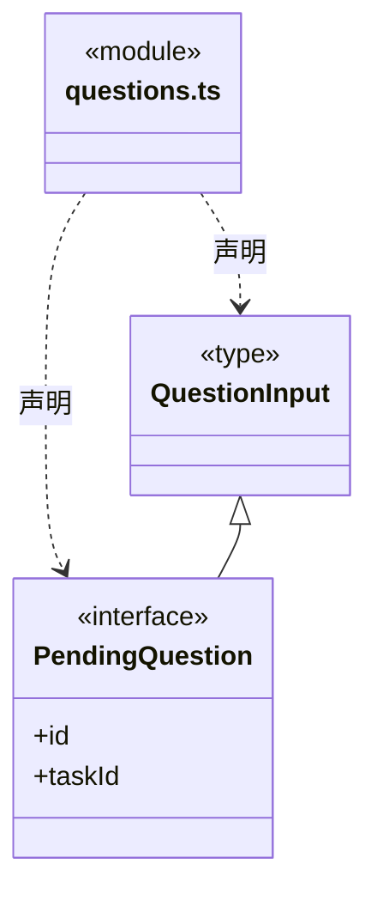
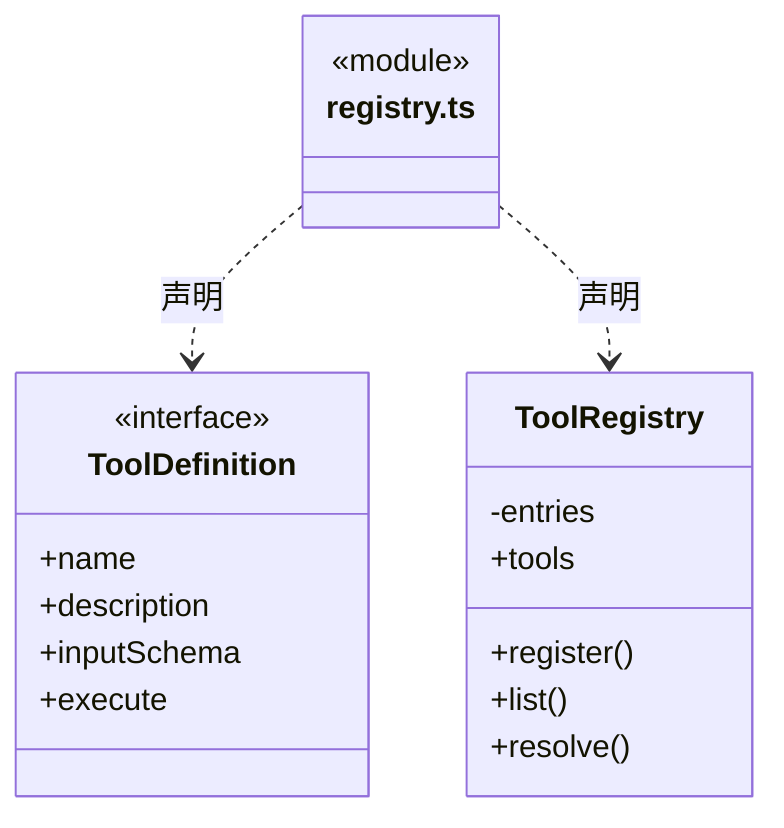
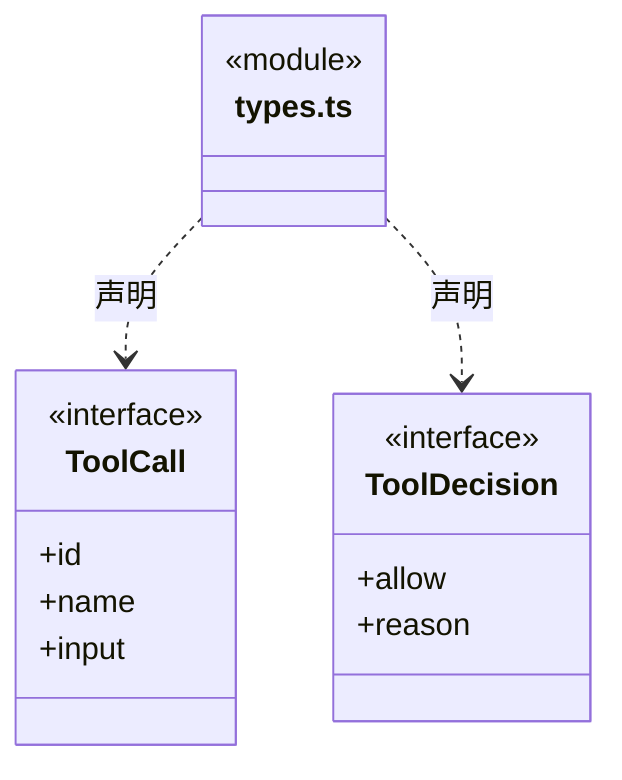

# src/backend/core/tools 架构

## 目录定位

通用工具 Schema、注册表、调用决策和结构化提问契约。注册与发现不授予执行权限。

本文描述当前实现。通过分析目录边界后维护的 [源码架构脚本](../../../../scripts/source-architecture.mjs) 同步清单和声明；代码变更时仍须核对职责、关键成员与关系。

## 代码清单

| 文件 | 当前职责 |
| --- | --- |
| [questions.ts](questions.ts) | 结构化用户问题的 Schema 和待答快照。 |
| [registry.ts](registry.ts) | 内部工具定义、名称查找及参数 Schema 转换。 |
| [types.ts](types.ts) | 引擎无关的工具调用及策略返回契约。 |

## 架构类图

### questions.ts

### registry.ts

直接依赖：[../foundation/errors.ts](../foundation/errors.ts)。

### types.ts

## 子目录导航

无子目录。

[返回上层](../ARCHITECTURE.md)。

每次修改本目录代码，同步维护文件头、关键契约说明及本图。未实现的治理、证据验收和自动编排能力不列入当前类图。
