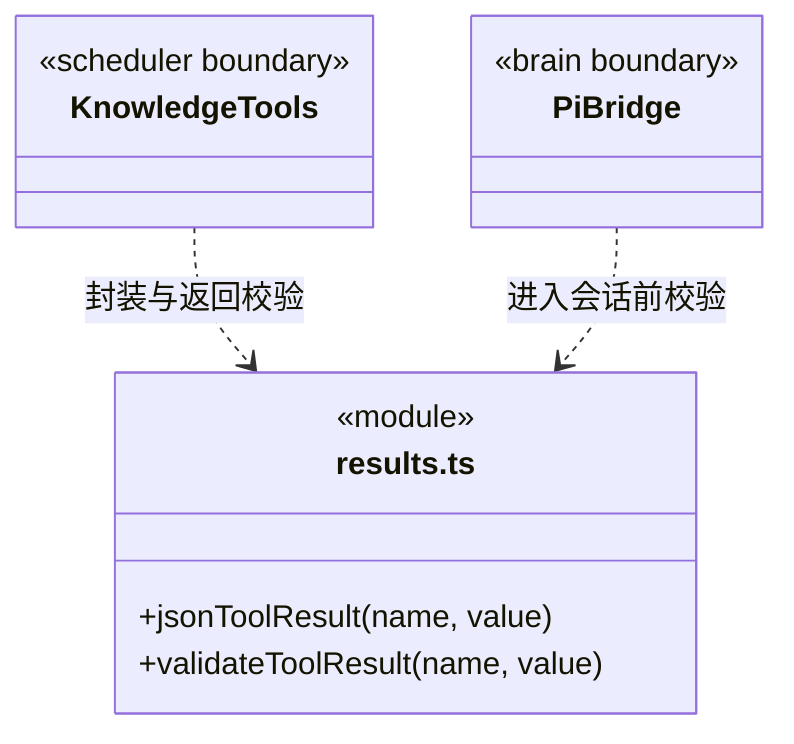

### 当前工具结果边界

`results.ts` 是内部工具结果的共同协议边界。`jsonToolResult` 将明确的领域值编码为文本块，拒绝 `undefined`、循环对象和不可序列化值；显式 `null` 可以正常返回。

`validateToolResult` 校验实际 JSON 传输快照：`content` 必须为数组；文本块必须有字符串 `text`；图片块必须有非空 `data` 和图片 `mimeType`；可选 `isError` 必须为布尔值。校验失败抛出 `TOOL_RESULT_INVALID`，错误不携带原始返回内容。

知识适配器在返回时校验，Pi 执行桥在结果进入原生会话前再次校验。桥将失败转为带错误码的合法工具错误，已消费的单次授权不因结果错误而恢复，也不重放可能已发生副作用的操作。有效的结果结构不代表业务成功，业务状态和验收仍由对应领域负责。

历史会话修复属于显式维护，不在模型调用或结果校验中静默修改旧记录。
### 原生工具的单一可信分类

`native-tools.ts` 保存当前引擎实际支持的原生工具描述，供 Pi 注册、正式成员能力预检、授权分类和 Workflow canonical 评价共用。`nativeToolDescriptor` 返回独立描述，未知名称及对象继承属性不属于注册工具；`nativeToolNames(false)` 只包含只读工具。

表中 read/grep/find/ls 属于 read，write/edit 属于 business-write，bash 属于 command。该清单不发放权限、不执行工具、不决定路径是否可访问；路径守卫、ask 审批与工作区身份仍由策略执行。任务评价只能核对实际成功调用，不能凭名称声明业务验证或完整文件覆盖。
