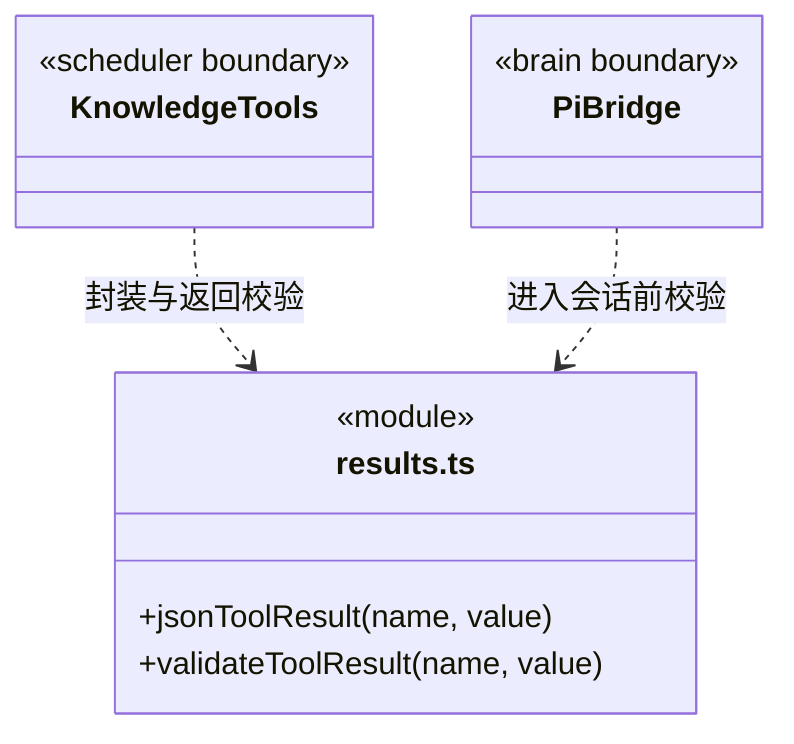

### 当前工具结果边界

`results.ts` 是内部工具结果的共同协议边界。`jsonToolResult` 将明确的领域值编码为文本块，拒绝 `undefined`、循环对象和不可序列化值；显式 `null` 可以正常返回。

`validateToolResult` 校验实际 JSON 传输快照：`content` 必须为数组；文本块必须有字符串 `text`；图片块必须有非空 `data` 和图片 `mimeType`；可选 `isError` 必须为布尔值。校验失败抛出 `TOOL_RESULT_INVALID`，错误不携带原始返回内容。

知识适配器在返回时校验，Pi 执行桥在结果进入原生会话前再次校验。桥将失败转为带错误码的合法工具错误，已消费的单次授权不因结果错误而恢复，也不重放可能已发生副作用的操作。有效的结果结构不代表业务成功，业务状态和验收仍由对应领域负责。

历史会话修复属于显式维护，不在模型调用或结果校验中静默修改旧记录。
