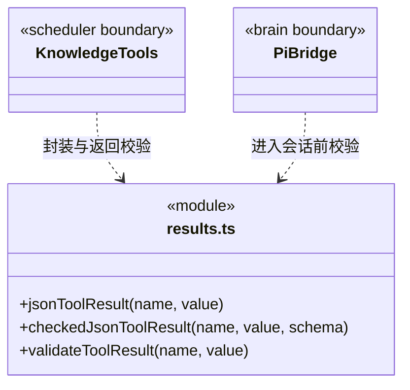

### 结构化提问的纯契约

`questions.ts` 统一 `questionToolName`、严格嵌套问题输入、桌面答案输入与排他的 answers/cancelled 输出。模型不能夹带身份、批准或范围字段；桌面只提交原选项索引或其它文字。`questionResultForInput` 独立保存已解析原题，核对回答数量、顺序、原题文字及补充的选项关系，不裁剪、填默认值或修剪输出 wire。

没有 supplement 的答案可能来自选项或其它文字，不能反推选择来源、认证身份、工具授权或人工验收。工具成功和取消事实保留在日志，但不成为业务完成证据。取消元数据 `during_wait` 只用于尚未完成的交互；其它工具的 `preflight_only` 及既有领域事务语义不改变。

### 当前工具结果边界

`results.ts` 是内部工具结果的共同协议边界。`jsonToolResult` 将明确的领域值编码为文本块，拒绝 `undefined`、循环对象和不可序列化值；显式 `null` 可以正常返回。

知识注册工具通过 `checkedJsonToolResult` 验证业务输出：领域 `execute` 只调用一次，原值只进行一次 JSON 序列化；用该编码的独立解析副本执行输出 Schema 校验，并与未交给校验器的原快照作结构比较。Zod 裁剪、默认值、类型转换、原地修改或增加 `undefined` 字段都不能补成成功；对象键顺序不改变 JSON 事实。通过后直接发送原编码文本，不重新编码领域值或 Schema 结果，因此 `toJSON` 不能在验证后偷偷改变发送内容。

业务输出失败为 `TOOL_OUTPUT_INVALID`，错误仅提供掩去动态键的结构位置和校验类别，不包含输出正文、凭据或原始异常。它明确表示操作可能已发生，要求核实既有记录、不自动重试；不会撤销事务、返还单次批准或再调用领域操作。合法的 `invalid`、`not_found`、校验问题和已提交清理警告由各领域 Schema 保留，不被转换为执行成功或回滚。

`validateToolResult` 校验实际 JSON 传输快照：`content` 必须为数组；文本块必须有字符串 `text`；图片块必须有非空 `data` 和图片 `mimeType`；可选 `isError` 必须为布尔值。校验失败抛出 `TOOL_RESULT_INVALID`，错误不携带原始返回内容。

知识适配器在返回时校验，Pi 执行桥在结果进入原生会话前再次校验。桥将失败转为带错误码的合法工具错误，已消费的单次授权不因结果错误而恢复，也不重放可能已发生副作用的操作。有效的结果结构不代表业务成功，业务状态和验收仍由对应领域负责。

历史会话修复属于显式维护，不在模型调用或结果校验中静默修改旧记录。

### 实际注册表与按需发现

`ToolRegistry` 只登记合法 `cbim_` 名称，并强制声明正整数版本、副作用、输出 Schema、取消语义和恢复说明。解析输入与执行分离；只有本注册表实际解析出的定义可以调用 `invokeResolved`，不能借同名外来对象执行。`list` 保持引擎需要的紧凑输入清单；`catalog/describe` 仅查询该知识注册表，不能执行工具或凭元数据授权。

`contracts.ts` 保存取消/恢复和发现输出的纯协议。知识目录返回 `family:knowledge` 与实际名称、可选描述、版本、副作用；详情按名称返回有限输入/输出 JSON Schema 和取消/恢复说明。自描述通过有限 Schema 引用表达，不递归嵌套整个注册表，不公开 `execute`、凭据、原生工具或派发工具。原始定义/人员诊断允许保留任意 JSON 事实（包括自有 `__proto__` 键），不裁剪成看似合格的业务对象。
### 原生工具的单一可信分类

`native-tools.ts` 保存当前引擎实际支持的原生工具描述，供 Pi 注册、正式成员能力预检、授权分类和 Workflow canonical 评价共用。`nativeToolDescriptor` 返回独立描述，未知名称及对象继承属性不属于注册工具；`nativeToolNames(false)` 只包含只读工具。

表中 read/grep/find/ls 属于 read，write/edit 属于 business-write，bash 属于 command。该清单不发放权限、不执行工具、不决定路径是否可访问；路径守卫、ask 审批与工作区身份仍由策略执行。任务评价只能核对实际成功调用，不能凭名称声明业务验证或完整文件覆盖。

### 工具范围与外部资料身份

`scope-schema.ts` 是授权策略、工具回执和证据解析共用的纯范围协议。原 workspace/knowledge/unknown 分支保留 `{kind,workspaceId}` 形状；repository 分支严格保存 workspaceId、connectorId、repositoryId、connectionId 与 list/get 操作，不接受 URL、凭据或调用方声明的授权。仓库身份来自本轮可信捕获描述，不从模型输入直接创建能力。

成功的 repository read 表示所绑定仓库操作收到真实回执，不能降格为 workspace read，也不能冒充本地文件、任务交付或成员检查点的证据。共享解析保留这种身份供主运行历史与 canonical 核实；下游业务证据仍分别检查来源边界。

### 共享回执结构与当前证据资格

`receipt-schema.ts` 提供报告、执行进度公开输出共同使用的 `toolReceiptSchema` 与副作用枚举。它保持历史报告原结构：空 effects、空 toolName 和缺省 resultHash 仍可读取，不能因此补造成功结果或执行范围；各字段的真实归属、日志链及业务用途由调用层核实。

进度工具在此结构之上要求真实 workspaceId/taskId/runId、相同作用域工作区、明确 succeeded、非空工具名与实际 resultHash。内部维护、目标调度、治理和 repository 资料不作为业务交付证据。Schema 通过仅说明返回协议合法，不授予执行、验收或重试权。

`checkedJsonToolResult` 也供主调度八工具与成员七工具使用。保存后输出异常不会回滚领域记录；工具包装必须在调用端口前独立冻结请求、绑定和必要前态，不能将端口可能改动的原对象同时作为核验依据。
