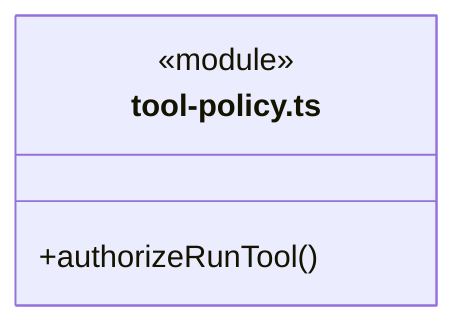
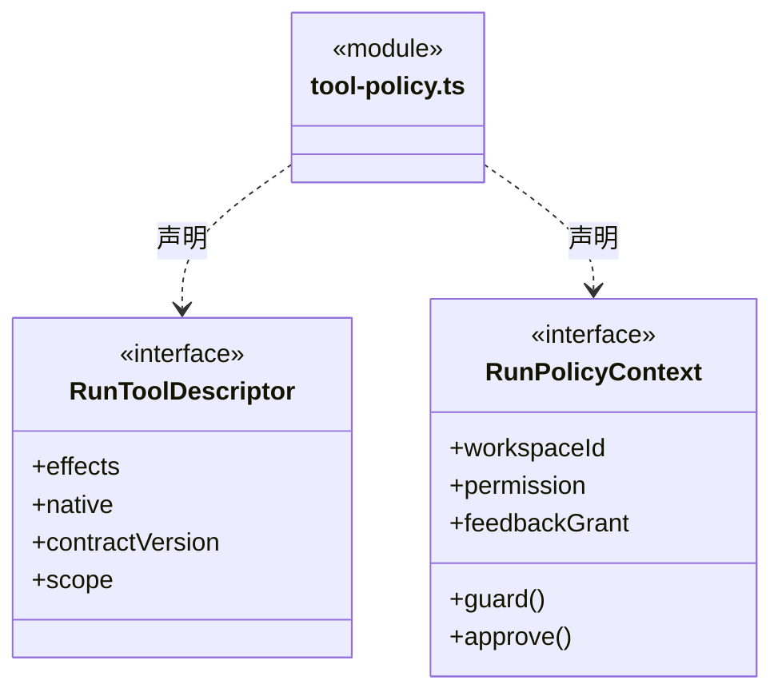
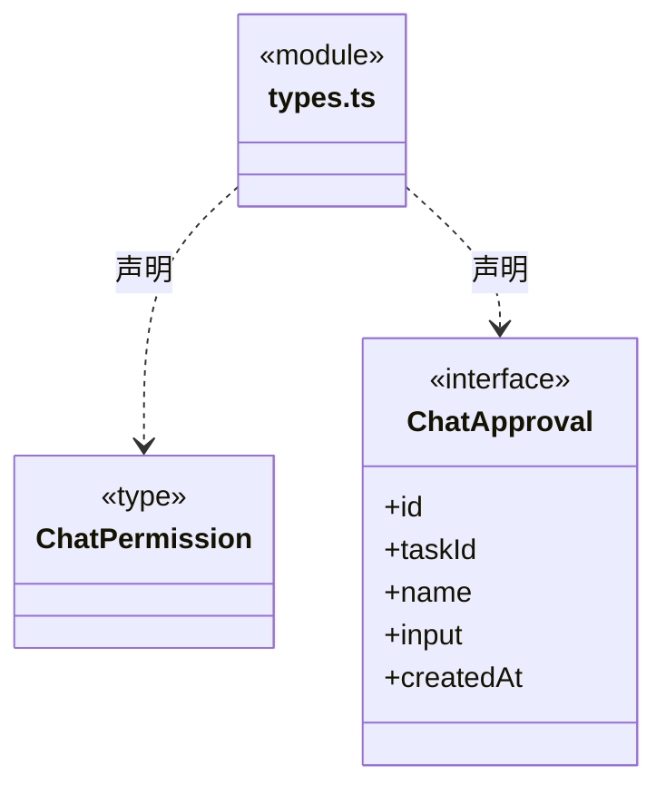
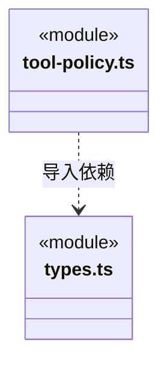

# src/backend/core/tools/policy 架构

## 目录定位

工具统一授权策略：read/ask/execute 决策及协议；业务写入和知识写入共用策略，不能豁免平台边界，也不等于操作系统隔离。

本文描述当前实现。通过分析目录边界后维护的 [源码架构脚本](../../../../../scripts/source-architecture.mjs) 同步清单和声明；代码变更时仍须核对职责、关键成员与关系。

## 代码清单

| 文件 | 当前职责 |
| --- | --- |
| [tool-policy.ts](tool-policy.ts) | 内部 Loop 的统一工具授权策略，同时处理业务文件与正式知识写入。 |
| [types.ts](types.ts) | 对话权限模式和单次人工确认契约。 |

## 架构类图

### tool-policy.ts

直接依赖：[types.ts](types.ts)、[../types.ts](../types.ts)、[../scope-schema.ts](../scope-schema.ts)、[../../governance/module-governance-tools.ts](../../governance/module-governance-tools.ts)、[../../workspace/module-ownership-tool-policy.ts](../../workspace/module-ownership-tool-policy.ts)、[../../team/workspace-member-tools.ts](../../team/workspace-member-tools.ts)、[../../../../logic/feedback/index.ts](../../../../logic/feedback/index.ts)。

### types.ts

### 本目录调用边界

## 子目录导航

无子目录。

[返回上层](../ARCHITECTURE.md)。

每次修改本目录代码，同步维护文件头、关键契约说明及本图。未实现的治理、证据验收和自动编排能力不列入当前类图。
