# src/backend/core/workspace 架构

## 目录定位

领域工程、Module、Workflow与稳定岗位责任协议。来源代次和写前屏障由纯规则投影；内容指纹、来源身份、负责人关系分别核实。同负责人明确采纳递增关系版本，不迁移任务；旧缺省记录不补造来源。Workflow验证不自行读文件或签发业务验收。 model.ts 是知识读取模块的私有实现，外部通过 knowledge/read-models 访问；项目根定义仍为独立纯公开契约。 executionScope只收窄原权限，全模块一致冻结，预算合并取小。 主调度的负责人发现按所选模块真实分组，缺口不推测继承或默认负责者。

本文描述当前实现。通过分析目录边界后维护的 [源码架构脚本](../../../../scripts/source-architecture.mjs) 同步清单和声明；代码变更时仍须核对职责、关键成员与关系。

## 代码清单

| 文件 | 当前职责 |
| --- | --- |
| [artifact-scope.ts](artifact-scope.ts) | Workflow 可选完整产物观察范围的叶子契约，供知识冻结、运行采集和公开报告共用。 |
| [code-check.ts](code-check.ts) | 代码 Workflow 的冻结命令与成功判据，供知识校验、执行和证据重算共用。 |
| [csv-validation-schema.ts](csv-validation-schema.ts) | 定义冻结 CSV 表格要求并直接检查有界 UTF-8 字节，供知识声明与可信文件端口共用。 |
| [execution-scope.ts](execution-scope.ts) | 模块 Workflow 的可冻结执行范围及任务合并规则，供知识准备、运行门禁与平台装配共用。 |
| [json-validation-schema.ts](json-validation-schema.ts) | JSON 产物验证的有界声明和纯结构校验，供冻结 Workflow、运行时及知识入口共用。 |
| [knowledge-source-rules.ts](knowledge-source-rules.ts) | 来源代次日志的纯投影、游标、依据和幂等命令规则，供知识协调器与 DispatchStore 共同使用。 |
| [knowledge-source.ts](knowledge-source.ts) | 受控知识来源代次、读取状态和原日志握手的纯协议，供岗位、责任、Store 与桌面共用。 |
| [module-outline.ts](module-outline.ts) | 模块正文的固定章节和可复制模板，供知识校验与桌面编辑共同使用。 |
| [module-ownership-rules.ts](module-ownership-rules.ts) | 负责人登记的规范依据、命令指纹、不可变审计与关系头投影，供 Main 与 Store 重放共同调用。 |
| [module-ownership-tool-policy.ts](module-ownership-tool-policy.ts) | 模块责任控制面四项工具的纯名称、效果及业务工作分类，供授权与周期收口共用。 |
| [module-ownership-tools.ts](module-ownership-tools.ts) | 主运行负责人四工具的严格输入、业务输出和可信端口协议。 |
| [module-ownership.ts](module-ownership.ts) | 单模块负责人控制面的严格公开协议，供岗位、责任服务、持久化及桌面共用。 |
| [png-validation-schema.ts](png-validation-schema.ts) | 冻结静态 PNG 的精确尺寸、通道要求和资源上限，供知识声明、运行端口与公开结果共用。 |
| [project-root.ts](project-root.ts) | 提供所有项目共有的内置根模块身份和只读说明，供知识查询与视图共用。 |
| [workflow-contract.ts](workflow-contract.ts) | 定义模块 Workflow 正文中可选执行条件的严格协议，供知识治理、资源包与执行准备共同解析。 |

## 架构类图

### artifact-scope.ts

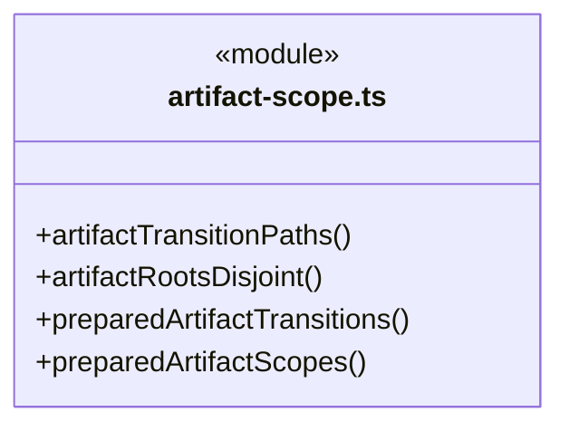

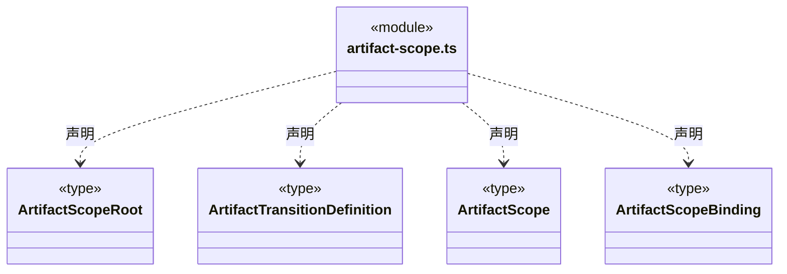


### code-check.ts

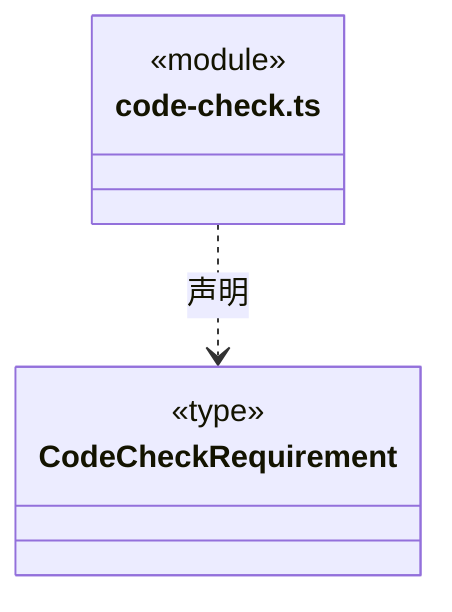

直接依赖：[artifact-scope.ts](artifact-scope.ts)。

### csv-validation-schema.ts

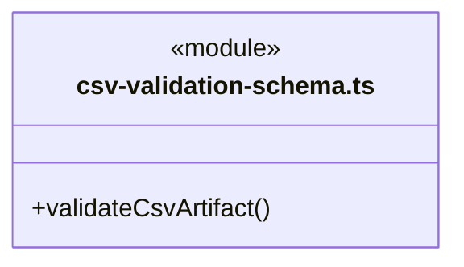

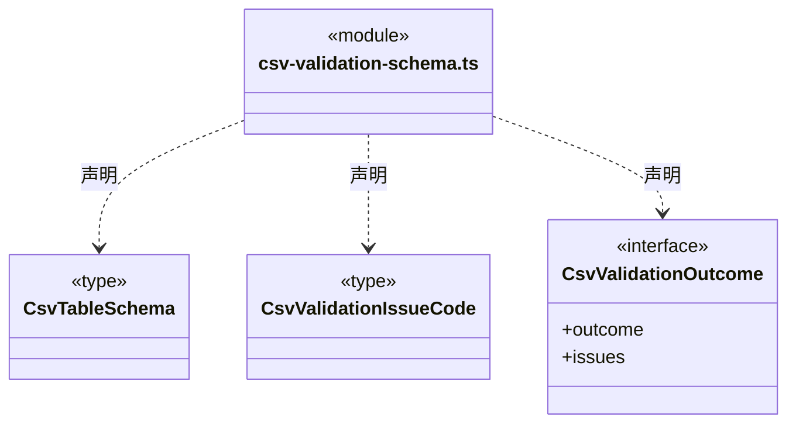

直接依赖：[../foundation/errors.ts](../foundation/errors.ts)。

### execution-scope.ts

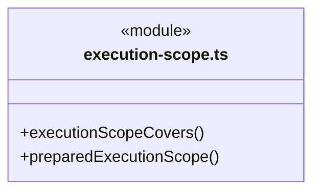

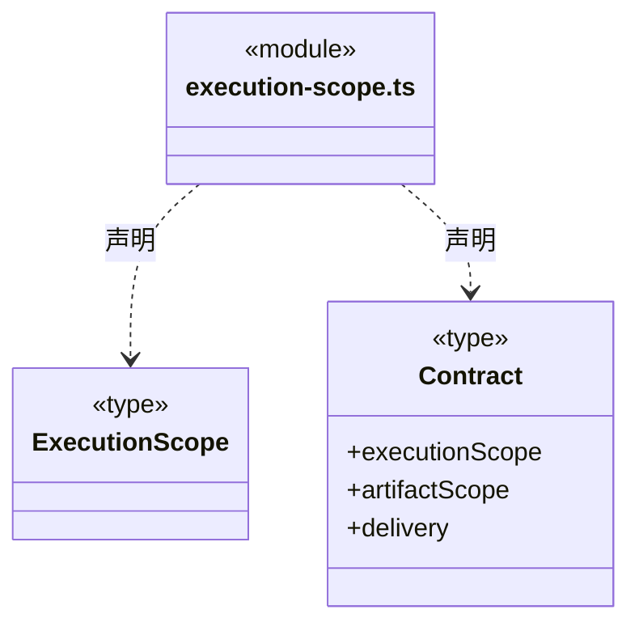

直接依赖：[artifact-scope.ts](artifact-scope.ts)。

### json-validation-schema.ts

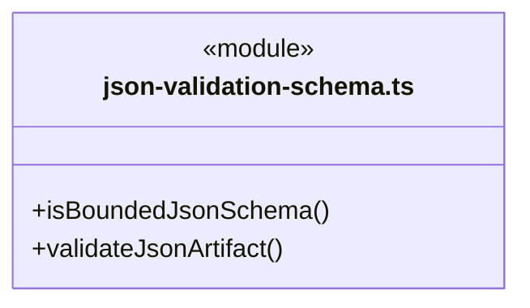

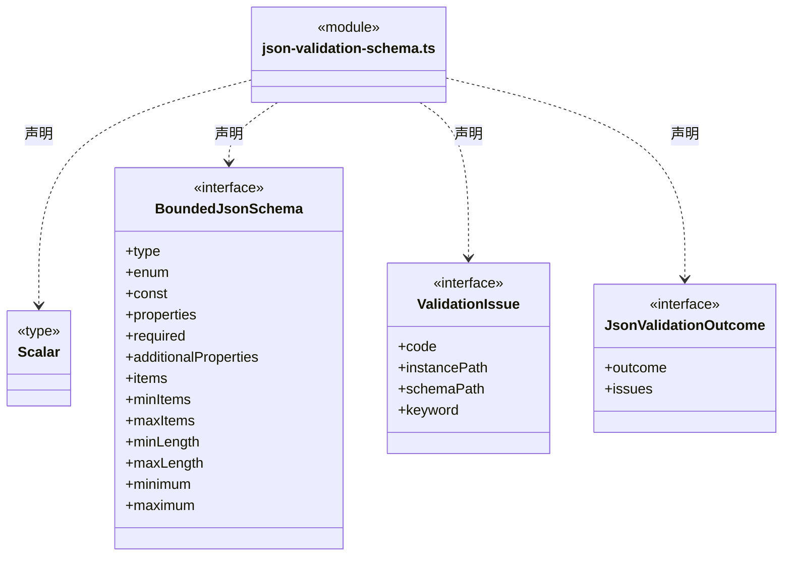

直接依赖：[../foundation/json.ts](../foundation/json.ts)、[../foundation/errors.ts](../foundation/errors.ts)。

### knowledge-source-rules.ts

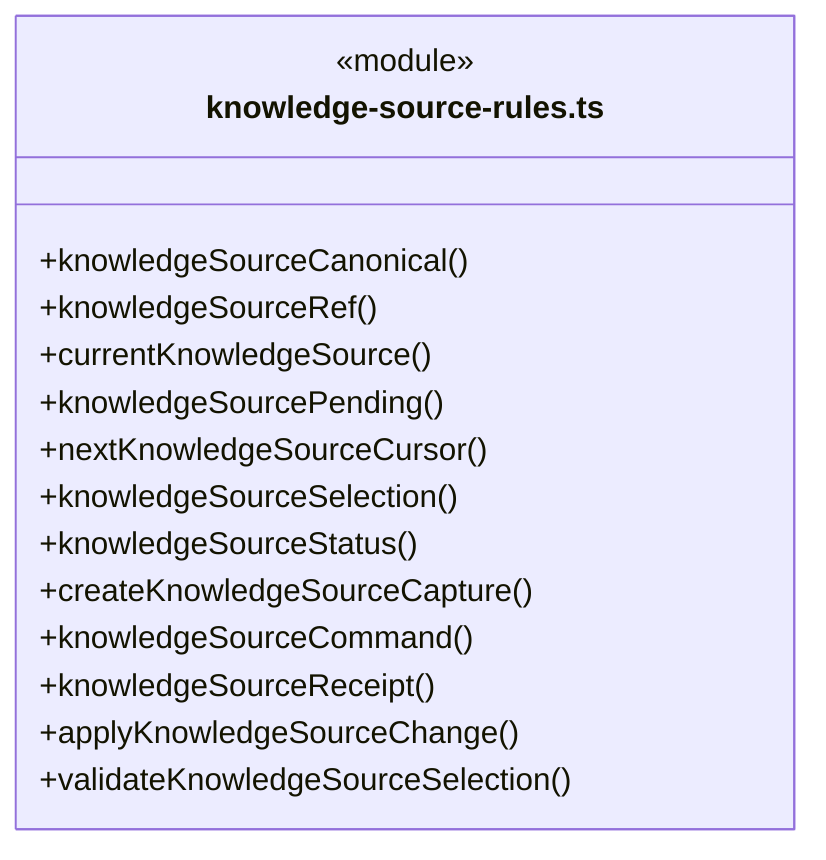

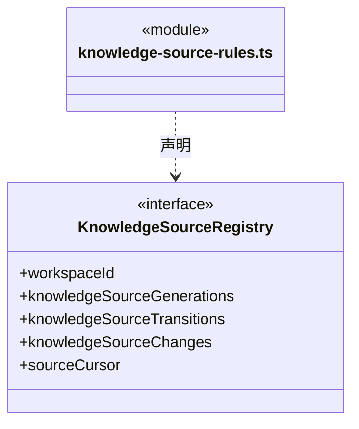

直接依赖：[../foundation/utility/index.ts](../foundation/utility/index.ts)、[../foundation/serialization.ts](../foundation/serialization.ts)、[../foundation/errors.ts](../foundation/errors.ts)、[knowledge-source.ts](knowledge-source.ts)。

### knowledge-source.ts

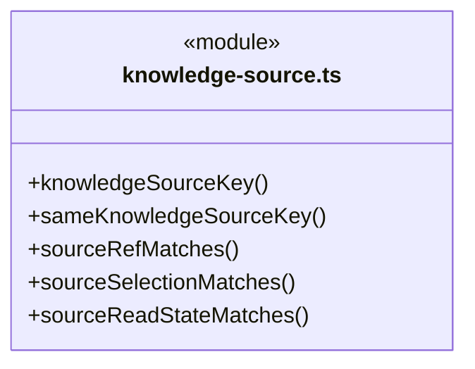

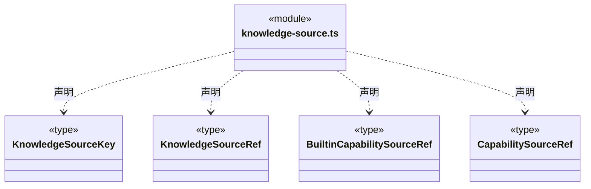

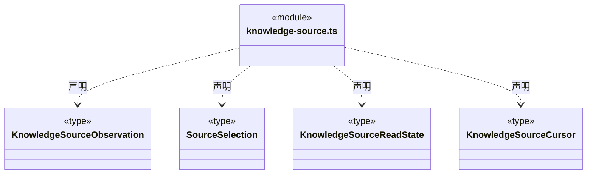

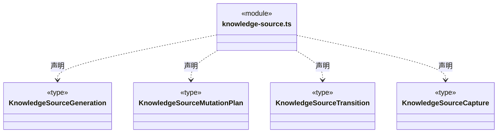

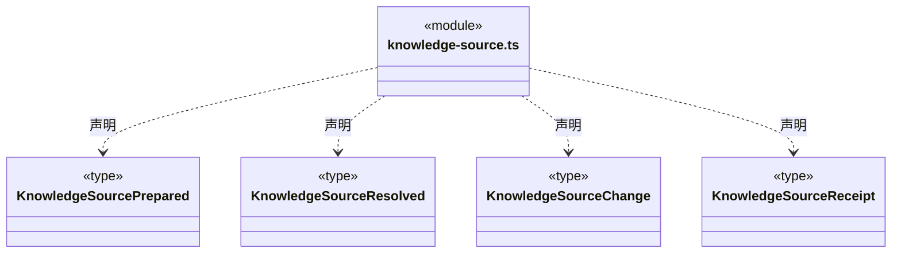


### module-outline.ts

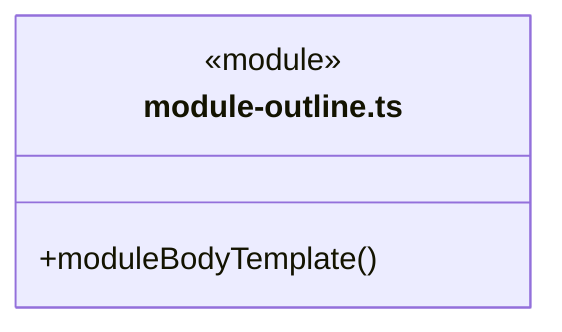


### module-ownership-rules.ts

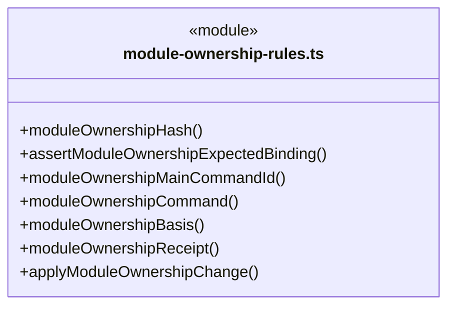

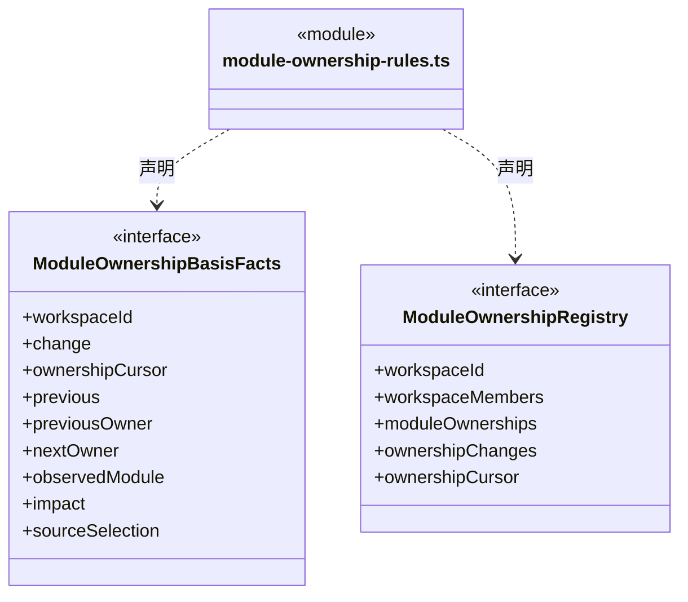

直接依赖：[../foundation/serialization.ts](../foundation/serialization.ts)、[../foundation/errors.ts](../foundation/errors.ts)、[../team/workspace-member-rules.ts](../team/workspace-member-rules.ts)、[../team/workspace-member.ts](../team/workspace-member.ts)、[module-ownership.ts](module-ownership.ts)、[knowledge-source.ts](knowledge-source.ts)。

### module-ownership-tool-policy.ts

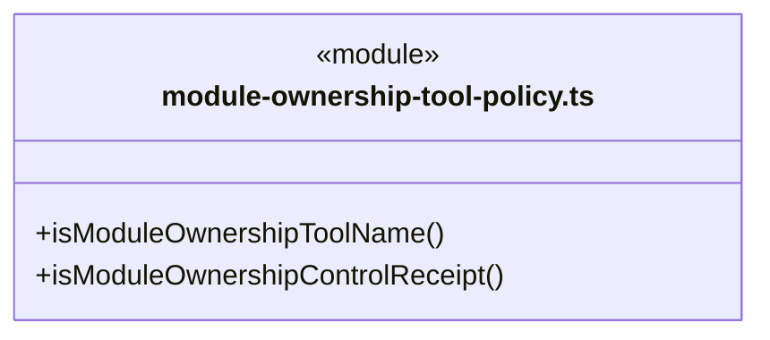

```mermaid
classDiagram
class N_src_backend_core_workspace_module_ownership_tool_policy_ts["module-ownership-tool-policy.ts"] {
  <<module>>
}
class N_src_backend_core_workspace_module_ownership_tool_policy_ts_ModuleOwnershipToolName["ModuleOwnershipToolName"] {
  <<type>>

}
N_src_backend_core_workspace_module_ownership_tool_policy_ts ..> N_src_backend_core_workspace_module_ownership_tool_policy_ts_ModuleOwnershipToolName : 声明
```

直接依赖：[../tools/types.ts](../tools/types.ts)。

### module-ownership-tools.ts

```mermaid
classDiagram
class N_src_backend_core_workspace_module_ownership_tools_ts["module-ownership-tools.ts"] {
  <<module>>
}
class N_src_backend_core_workspace_module_ownership_tools_ts_ModuleOwnerInspectInput["ModuleOwnerInspectInput"] {
  <<type>>

}
N_src_backend_core_workspace_module_ownership_tools_ts ..> N_src_backend_core_workspace_module_ownership_tools_ts_ModuleOwnerInspectInput : 声明
class N_src_backend_core_workspace_module_ownership_tools_ts_ModuleOwnerPreviewInput["ModuleOwnerPreviewInput"] {
  <<type>>

}
N_src_backend_core_workspace_module_ownership_tools_ts ..> N_src_backend_core_workspace_module_ownership_tools_ts_ModuleOwnerPreviewInput : 声明
class N_src_backend_core_workspace_module_ownership_tools_ts_ModuleOwnerCommitInput["ModuleOwnerCommitInput"] {
  <<type>>

}
N_src_backend_core_workspace_module_ownership_tools_ts ..> N_src_backend_core_workspace_module_ownership_tools_ts_ModuleOwnerCommitInput : 声明
class N_src_backend_core_workspace_module_ownership_tools_ts_ModuleOwnerReceiptInput["ModuleOwnerReceiptInput"] {
  <<type>>

}
N_src_backend_core_workspace_module_ownership_tools_ts ..> N_src_backend_core_workspace_module_ownership_tools_ts_ModuleOwnerReceiptInput : 声明
```

```mermaid
classDiagram
class N_src_backend_core_workspace_module_ownership_tools_ts["module-ownership-tools.ts"] {
  <<module>>
}
class N_src_backend_core_workspace_module_ownership_tools_ts_ModuleOwnerRunBinding["ModuleOwnerRunBinding"] {
  <<interface>>
  +workspaceId
  +instanceId
  +rootSessionId
  +scopeId
  +agentInstanceId
  +agentSessionId
  +runId
}
N_src_backend_core_workspace_module_ownership_tools_ts ..> N_src_backend_core_workspace_module_ownership_tools_ts_ModuleOwnerRunBinding : 声明
class N_src_backend_core_workspace_module_ownership_tools_ts_ModuleOwnershipToolsPort["ModuleOwnershipToolsPort"] {
  <<interface>>
  +inspect()
  +preview()
  +commit()
  +receipt()
}
N_src_backend_core_workspace_module_ownership_tools_ts ..> N_src_backend_core_workspace_module_ownership_tools_ts_ModuleOwnershipToolsPort : 声明
```

直接依赖：[module-ownership.ts](module-ownership.ts)、[../team/workspace-member.ts](../team/workspace-member.ts)、[../team/owner-execution-discovery.ts](../team/owner-execution-discovery.ts)。

### module-ownership.ts

```mermaid
classDiagram
class N_src_backend_core_workspace_module_ownership_ts["module-ownership.ts"] {
  <<module>>
  +isModuleOwnershipSourceAdoption()
  +summarizeModuleOwnershipChange()
}
```

```mermaid
classDiagram
class N_src_backend_core_workspace_module_ownership_ts["module-ownership.ts"] {
  <<module>>
}
class N_src_backend_core_workspace_module_ownership_ts_ModuleOwnershipIdentity["ModuleOwnershipIdentity"] {
  <<type>>

}
N_src_backend_core_workspace_module_ownership_ts ..> N_src_backend_core_workspace_module_ownership_ts_ModuleOwnershipIdentity : 声明
class N_src_backend_core_workspace_module_ownership_ts_ModuleOwnershipCursor["ModuleOwnershipCursor"] {
  <<type>>

}
N_src_backend_core_workspace_module_ownership_ts ..> N_src_backend_core_workspace_module_ownership_ts_ModuleOwnershipCursor : 声明
class N_src_backend_core_workspace_module_ownership_ts_ObservedModule["ObservedModule"] {
  <<type>>

}
N_src_backend_core_workspace_module_ownership_ts ..> N_src_backend_core_workspace_module_ownership_ts_ObservedModule : 声明
class N_src_backend_core_workspace_module_ownership_ts_ModuleOwnership["ModuleOwnership"] {
  <<type>>

}
N_src_backend_core_workspace_module_ownership_ts ..> N_src_backend_core_workspace_module_ownership_ts_ModuleOwnership : 声明
```

```mermaid
classDiagram
class N_src_backend_core_workspace_module_ownership_ts["module-ownership.ts"] {
  <<module>>
}
class N_src_backend_core_workspace_module_ownership_ts_ModuleOwnershipExpected["ModuleOwnershipExpected"] {
  <<type>>

}
N_src_backend_core_workspace_module_ownership_ts ..> N_src_backend_core_workspace_module_ownership_ts_ModuleOwnershipExpected : 声明
class N_src_backend_core_workspace_module_ownership_ts_ModuleOwnershipChangeInput["ModuleOwnershipChangeInput"] {
  <<type>>

}
N_src_backend_core_workspace_module_ownership_ts ..> N_src_backend_core_workspace_module_ownership_ts_ModuleOwnershipChangeInput : 声明
class N_src_backend_core_workspace_module_ownership_ts_ModuleOwnershipMainActor["ModuleOwnershipMainActor"] {
  <<type>>

}
N_src_backend_core_workspace_module_ownership_ts ..> N_src_backend_core_workspace_module_ownership_ts_ModuleOwnershipMainActor : 声明
class N_src_backend_core_workspace_module_ownership_ts_ModuleOwnershipActor["ModuleOwnershipActor"] {
  <<type>>

}
N_src_backend_core_workspace_module_ownership_ts ..> N_src_backend_core_workspace_module_ownership_ts_ModuleOwnershipActor : 声明
```

```mermaid
classDiagram
class N_src_backend_core_workspace_module_ownership_ts["module-ownership.ts"] {
  <<module>>
}
class N_src_backend_core_workspace_module_ownership_ts_ModuleOwnershipPreviewInput["ModuleOwnershipPreviewInput"] {
  <<type>>

}
N_src_backend_core_workspace_module_ownership_ts ..> N_src_backend_core_workspace_module_ownership_ts_ModuleOwnershipPreviewInput : 声明
class N_src_backend_core_workspace_module_ownership_ts_ModuleOwnershipCommitInput["ModuleOwnershipCommitInput"] {
  <<type>>

}
N_src_backend_core_workspace_module_ownership_ts ..> N_src_backend_core_workspace_module_ownership_ts_ModuleOwnershipCommitInput : 声明
class N_src_backend_core_workspace_module_ownership_ts_ModuleOwnershipLookup["ModuleOwnershipLookup"] {
  <<type>>

}
N_src_backend_core_workspace_module_ownership_ts ..> N_src_backend_core_workspace_module_ownership_ts_ModuleOwnershipLookup : 声明
class N_src_backend_core_workspace_module_ownership_ts_ModuleOwnershipImpact["ModuleOwnershipImpact"] {
  <<type>>

}
N_src_backend_core_workspace_module_ownership_ts ..> N_src_backend_core_workspace_module_ownership_ts_ModuleOwnershipImpact : 声明
```

```mermaid
classDiagram
class N_src_backend_core_workspace_module_ownership_ts["module-ownership.ts"] {
  <<module>>
}
class N_src_backend_core_workspace_module_ownership_ts_ModuleOwnershipPreview["ModuleOwnershipPreview"] {
  <<type>>

}
N_src_backend_core_workspace_module_ownership_ts ..> N_src_backend_core_workspace_module_ownership_ts_ModuleOwnershipPreview : 声明
class N_src_backend_core_workspace_module_ownership_ts_ModuleOwnershipReceipt["ModuleOwnershipReceipt"] {
  <<type>>

}
N_src_backend_core_workspace_module_ownership_ts ..> N_src_backend_core_workspace_module_ownership_ts_ModuleOwnershipReceipt : 声明
class N_src_backend_core_workspace_module_ownership_ts_ModuleOwnershipChange["ModuleOwnershipChange"] {
  <<type>>

}
N_src_backend_core_workspace_module_ownership_ts ..> N_src_backend_core_workspace_module_ownership_ts_ModuleOwnershipChange : 声明
class N_src_backend_core_workspace_module_ownership_ts_ModuleOwnershipReadBasis["ModuleOwnershipReadBasis"] {
  <<type>>

}
N_src_backend_core_workspace_module_ownership_ts ..> N_src_backend_core_workspace_module_ownership_ts_ModuleOwnershipReadBasis : 声明
```

```mermaid
classDiagram
class N_src_backend_core_workspace_module_ownership_ts["module-ownership.ts"] {
  <<module>>
}
class N_src_backend_core_workspace_module_ownership_ts_ModuleSourceObservation["ModuleSourceObservation"] {
  <<type>>

}
N_src_backend_core_workspace_module_ownership_ts ..> N_src_backend_core_workspace_module_ownership_ts_ModuleSourceObservation : 声明
class N_src_backend_core_workspace_module_ownership_ts_ModuleOwnershipView["ModuleOwnershipView"] {
  <<type>>

}
N_src_backend_core_workspace_module_ownership_ts ..> N_src_backend_core_workspace_module_ownership_ts_ModuleOwnershipView : 声明
class N_src_backend_core_workspace_module_ownership_ts_ModuleOwnershipListInput["ModuleOwnershipListInput"] {
  <<type>>

}
N_src_backend_core_workspace_module_ownership_ts ..> N_src_backend_core_workspace_module_ownership_ts_ModuleOwnershipListInput : 声明
class N_src_backend_core_workspace_module_ownership_ts_ModuleOwnershipGetInput["ModuleOwnershipGetInput"] {
  <<type>>

}
N_src_backend_core_workspace_module_ownership_ts ..> N_src_backend_core_workspace_module_ownership_ts_ModuleOwnershipGetInput : 声明
```

```mermaid
classDiagram
class N_src_backend_core_workspace_module_ownership_ts["module-ownership.ts"] {
  <<module>>
}
class N_src_backend_core_workspace_module_ownership_ts_ModuleOwnershipByMemberInput["ModuleOwnershipByMemberInput"] {
  <<type>>

}
N_src_backend_core_workspace_module_ownership_ts ..> N_src_backend_core_workspace_module_ownership_ts_ModuleOwnershipByMemberInput : 声明
class N_src_backend_core_workspace_module_ownership_ts_ModuleOwnershipPage["ModuleOwnershipPage"] {
  <<type>>

}
N_src_backend_core_workspace_module_ownership_ts ..> N_src_backend_core_workspace_module_ownership_ts_ModuleOwnershipPage : 声明
class N_src_backend_core_workspace_module_ownership_ts_ModuleOwnershipChangeSummary["ModuleOwnershipChangeSummary"] {
  <<type>>

}
N_src_backend_core_workspace_module_ownership_ts ..> N_src_backend_core_workspace_module_ownership_ts_ModuleOwnershipChangeSummary : 声明
class N_src_backend_core_workspace_module_ownership_ts_ModuleOwnershipDetail["ModuleOwnershipDetail"] {
  <<type>>

}
N_src_backend_core_workspace_module_ownership_ts ..> N_src_backend_core_workspace_module_ownership_ts_ModuleOwnershipDetail : 声明
```

直接依赖：[knowledge-source.ts](knowledge-source.ts)、[../team/workspace-member.ts](../team/workspace-member.ts)。

### png-validation-schema.ts

```mermaid
classDiagram
class N_src_backend_core_workspace_png_validation_schema_ts["png-validation-schema.ts"] {
  <<module>>
}
class N_src_backend_core_workspace_png_validation_schema_ts_PngImageSchema["PngImageSchema"] {
  <<type>>

}
N_src_backend_core_workspace_png_validation_schema_ts ..> N_src_backend_core_workspace_png_validation_schema_ts_PngImageSchema : 声明
class N_src_backend_core_workspace_png_validation_schema_ts_PngValidationIssueCode["PngValidationIssueCode"] {
  <<type>>

}
N_src_backend_core_workspace_png_validation_schema_ts ..> N_src_backend_core_workspace_png_validation_schema_ts_PngValidationIssueCode : 声明
class N_src_backend_core_workspace_png_validation_schema_ts_PngValidationOutcome["PngValidationOutcome"] {
  <<interface>>
  +outcome
  +issues
}
N_src_backend_core_workspace_png_validation_schema_ts ..> N_src_backend_core_workspace_png_validation_schema_ts_PngValidationOutcome : 声明
```


### project-root.ts

```mermaid
classDiagram
class N_src_backend_core_workspace_project_root_ts["project-root.ts"] {
  <<module>>
}
```

### workflow-contract.ts

```mermaid
classDiagram
class N_src_backend_core_workspace_workflow_contract_ts["workflow-contract.ts"] {
  <<module>>
  +parseWorkflowContract()
}
```

```mermaid
classDiagram
class N_src_backend_core_workspace_workflow_contract_ts["workflow-contract.ts"] {
  <<module>>
}
class N_src_backend_core_workspace_workflow_contract_ts_WorkflowToolName["WorkflowToolName"] {
  <<type>>

}
N_src_backend_core_workspace_workflow_contract_ts ..> N_src_backend_core_workspace_workflow_contract_ts_WorkflowToolName : 声明
class N_src_backend_core_workspace_workflow_contract_ts_JsonValidationRequirement["JsonValidationRequirement"] {
  <<type>>

}
N_src_backend_core_workspace_workflow_contract_ts ..> N_src_backend_core_workspace_workflow_contract_ts_JsonValidationRequirement : 声明
class N_src_backend_core_workspace_workflow_contract_ts_ArtifactValidationRequirement["ArtifactValidationRequirement"] {
  <<type>>

}
N_src_backend_core_workspace_workflow_contract_ts ..> N_src_backend_core_workspace_workflow_contract_ts_ArtifactValidationRequirement : 声明
class N_src_backend_core_workspace_workflow_contract_ts_WorkflowContract["WorkflowContract"] {
  <<type>>

}
N_src_backend_core_workspace_workflow_contract_ts ..> N_src_backend_core_workspace_workflow_contract_ts_WorkflowContract : 声明
```

直接依赖：[code-check.ts](code-check.ts)、[../foundation/errors.ts](../foundation/errors.ts)、[../foundation/json.ts](../foundation/json.ts)、[json-validation-schema.ts](json-validation-schema.ts)、[csv-validation-schema.ts](csv-validation-schema.ts)、[png-validation-schema.ts](png-validation-schema.ts)、[artifact-scope.ts](artifact-scope.ts)、[execution-scope.ts](execution-scope.ts)。

### 本目录调用边界

```mermaid
classDiagram
class N_src_backend_core_workspace_code_check_ts["code-check.ts"] {
  <<module>>
}
class N_src_backend_core_workspace_artifact_scope_ts["artifact-scope.ts"] {
  <<module>>
}
class N_src_backend_core_workspace_execution_scope_ts["execution-scope.ts"] {
  <<module>>
}
class N_src_backend_core_workspace_knowledge_source_rules_ts["knowledge-source-rules.ts"] {
  <<module>>
}
class N_src_backend_core_workspace_knowledge_source_ts["knowledge-source.ts"] {
  <<module>>
}
class N_src_backend_core_workspace_module_ownership_rules_ts["module-ownership-rules.ts"] {
  <<module>>
}
class N_src_backend_core_workspace_module_ownership_ts["module-ownership.ts"] {
  <<module>>
}
N_src_backend_core_workspace_code_check_ts ..> N_src_backend_core_workspace_artifact_scope_ts : 导入依赖
N_src_backend_core_workspace_execution_scope_ts ..> N_src_backend_core_workspace_artifact_scope_ts : 导入依赖
N_src_backend_core_workspace_knowledge_source_rules_ts ..> N_src_backend_core_workspace_knowledge_source_ts : 导入依赖
N_src_backend_core_workspace_module_ownership_rules_ts ..> N_src_backend_core_workspace_module_ownership_ts : 导入依赖
```

```mermaid
classDiagram
class N_src_backend_core_workspace_module_ownership_rules_ts["module-ownership-rules.ts"] {
  <<module>>
}
class N_src_backend_core_workspace_knowledge_source_ts["knowledge-source.ts"] {
  <<module>>
}
class N_src_backend_core_workspace_module_ownership_tools_ts["module-ownership-tools.ts"] {
  <<module>>
}
class N_src_backend_core_workspace_module_ownership_ts["module-ownership.ts"] {
  <<module>>
}
class N_src_backend_core_workspace_workflow_contract_ts["workflow-contract.ts"] {
  <<module>>
}
class N_src_backend_core_workspace_code_check_ts["code-check.ts"] {
  <<module>>
}
N_src_backend_core_workspace_module_ownership_rules_ts ..> N_src_backend_core_workspace_knowledge_source_ts : 导入依赖
N_src_backend_core_workspace_module_ownership_tools_ts ..> N_src_backend_core_workspace_module_ownership_ts : 导入依赖
N_src_backend_core_workspace_module_ownership_ts ..> N_src_backend_core_workspace_knowledge_source_ts : 导入依赖
N_src_backend_core_workspace_workflow_contract_ts ..> N_src_backend_core_workspace_code_check_ts : 导入依赖
```

```mermaid
classDiagram
class N_src_backend_core_workspace_workflow_contract_ts["workflow-contract.ts"] {
  <<module>>
}
class N_src_backend_core_workspace_json_validation_schema_ts["json-validation-schema.ts"] {
  <<module>>
}
class N_src_backend_core_workspace_csv_validation_schema_ts["csv-validation-schema.ts"] {
  <<module>>
}
class N_src_backend_core_workspace_png_validation_schema_ts["png-validation-schema.ts"] {
  <<module>>
}
class N_src_backend_core_workspace_artifact_scope_ts["artifact-scope.ts"] {
  <<module>>
}
N_src_backend_core_workspace_workflow_contract_ts ..> N_src_backend_core_workspace_json_validation_schema_ts : 导入依赖
N_src_backend_core_workspace_workflow_contract_ts ..> N_src_backend_core_workspace_csv_validation_schema_ts : 导入依赖
N_src_backend_core_workspace_workflow_contract_ts ..> N_src_backend_core_workspace_png_validation_schema_ts : 导入依赖
N_src_backend_core_workspace_workflow_contract_ts ..> N_src_backend_core_workspace_artifact_scope_ts : 导入依赖
```

```mermaid
classDiagram
class N_src_backend_core_workspace_workflow_contract_ts["workflow-contract.ts"] {
  <<module>>
}
class N_src_backend_core_workspace_execution_scope_ts["execution-scope.ts"] {
  <<module>>
}
N_src_backend_core_workspace_workflow_contract_ts ..> N_src_backend_core_workspace_execution_scope_ts : 导入依赖
```


## 子目录导航

无子目录。

[返回上层](../ARCHITECTURE.md)。

每次修改本目录代码，同步维护文件头、关键契约说明及本图。未实现的治理、证据验收和自动编排能力不列入当前类图。

## 设计契约 v1 与落地范围

以下内容区分已接通能力与后续设计；以各节的实现状态为准，不将目标图当作现状图。维护源：[CONTRACT.md](CONTRACT.md)；生成类图时同步附加，勿直接修改本附录。

### 静态模块视图的单向边界

`model.ts` 中的 BusinessWorkspace 只依赖知识快照公开类型、只读解析辅助、Foundation 与 `project-root.ts`，不依赖 Team 视图、知识写入端口或调度编排。跨域组合在 Scheduler，固定快照视图不缓存后续版本，也不取得实际工程的生命周期。依赖矩阵和状态归属见 [知识契约](../knowledge/CONTRACT.md#快照契约领域视图与查询编排)；Workflow 协议、责任与来源登记各有原领域契约，不因目录同名合并职责。

### 始终存在的项目根范围

`project-root.ts` 提供只读内置 `cbim:project`；`BusinessWorkspace.modules()` 返回独立 projectRoot（children 为真实根模块），保留原 modules/roots/index 语义。即使搜索无匹配或已有子模块，根仍可查询。`module()` 返回 builtin 定义、内联说明及空 Workflow，不伪造文件、维护关系、版本或正式责任。这里只描述范围，不修改知识和派发资格。

### Workflow 的可选程序条件

`workflow-contract.ts` 是不依赖知识实现的纯协议模块。`parseWorkflowContract(markdown)` 读取正文中最多一个顶层 `cbim-workflow` 围栏块；支持标准反引号或波浪线围栏、0–3 空格缩进、CRLF。普通代码块中的示例、引用块及缩进代码不激活条件。无声明返回 `undefined`，现有自然语言方法保持不变；已声明但重复、未闭合、附加标记、JSON 重复字段、未知版本或字段均抛出 `WORKFLOW_CONTRACT_INVALID`，不得降级成无约束。

版本 1 至少声明一项：`beforeEffects:{requirePlan:true}` 或 `delivery` 的非空 `requiredToolEvidence` / `requiredValidations`。两类要求各最多 16 项，ID 是 1–80 位字母、数字、下划线或连字符且在模块内不能跨类重复；条件块最多 64 KiB UTF-8。原生工具名限 `read/write/edit/grep/find/ls/bash`；另支持 `cbim_scoped_read/cbim_scoped_node/cbim_file_write_controlled`，不接知识写入、调度、任意表达式或模型提供的 path/hash/pass。

`requiredValidations` 每项固定 `{id,validator,artifactPath,schema}`，通过验证器判别联合分别约束 JSON 与 CSV 参数；已支持 `json-schema-v1`、`csv-table-v1` 和 `png-raster-v1`。路径为明确工作区业务文件；运行时仍拒绝链接、越界和受保护知识路径。`json-validation-schema.ts` 仅解释有界 JSON Schema 子集：每节点显式 type，标量 enum/const，对象 properties/required/布尔 additionalProperties，数组 items/长度，以及字符串长度和数值上下界。对象/数组 enum/const、引用、组合、pattern、format、自定义代码和未知关键字均不支持；不会编译用户脚本、转换类型、补默认值或删字段。未知或超界声明在知识提交、资源模板和执行准备中同样拒绝。

单 Schema ≤32 KiB、深度≤16、节点≤512、单层属性≤64、标量枚举≤64；文件≤1 MiB，JSON 嵌套≤64、节点≤100000，诊断最多32条且不包含原值。纯校验器从可信平台同一次读取的 Uint8Array 严格解析 UTF-8 与无重复字段的 JSON，返回 passed 或 rejected；无效 JSON 也是实际检查事实。结构通过只证明该份字节符合该项声明，不是专业语义全验收。模块声明缺省仍保持原 Workflow 行为和旧 proof 形状。

约定与自然语言一起保存在所属模块原 `workflow.md`，没有独立运行存储；正文版本、知识指纹和业务模板均覆盖它。纯 Schema 只声明条件，不提供工具、不授予权限，也不证明工具结果符合专业目标或覆盖整个模块。执行侧负责准备时冻结、工具放行及交付时核验真实条件；`bash` 名称出现不改变其影响范围未知的事实。知识变化仍须核实，不能凭此条件替换旧运行的冻结基线。

### 已废弃的真人维护声明

`maintenance.ts` 仅保留旧记录的类型说明。新模块不生成 maintenance，新任务不生成 maintenanceBindingId / maintainerPersonIds；旧文件与历史字段保持原样，不再读取花名册或核对真人状态、组和确认时间。模块 Schema 将旧 maintenance 作为可选历史对象接受，不赋予资格。

Team 派工仍由岗位 memberId、模块负责人、能力与模型来源、权限及 Workflow 决定。authors 不赋予责任；知识解析与任务冻结仍核对身份、知识版本、模块与流程，不自动刷新旧任务。新旧任务均由 [任务图契约](../tasks/CONTRACT.md) 和 [上下文装配](../../scheduler-engine/context/CONTRACT.md) 约束。

### 单模块岗位负责人控制面

`module-ownership.ts` 定义单模块唯一负责人关系、严格请求/回执、正反查询与有界审计摘要。负责人引用长期 `memberId`，不是静态 `agentId` 或执行 `agentInstanceId`。首次指定创建稳定 `bindingId`；更换、解除、再次指定保留该身份并连续升版，解除保存 `ownerMemberId:null`，不删除原关系或审计。只有 active 岗位可成为新负责人；暂停保留关系，有引用的岗位不能退休。登记不创建或修改派发任务、执行实例、知识文件或模型运行。

`observedModule` 仅保存知识版本、真实定义哈希及观察时间。查询的 observed/same/changed/missing/invalid/unavailable 只描述当前读取；同路径同字节不证明来源代次连续，观察差异不自动采纳。没有关系时不能声明 same；源已缺失仍可按原关系明确解除。该控制面不改变现有任务的执行身份，也不把旧任务按角色 ID 反推为岗位任务。

`module-ownership-rules.ts` 与纯 DTO 分开，后端规范哈希不进入浏览器。预览 basis 绑定明确输入、当前责任游标、原关系指纹、相关岗位版本摘要、观察内容及真实关联任务 digest，不包含新观察时钟。提交按单模块原版本、独立 ownershipCursor 和 basis 一起核验；主调用命令由工作区、实际主根/周期/运行/通道/工具调用稳定派生，模型不能提供 actor。原回执来自不可变事件，不随之后岗位改名或状态变化重写。

列表每页最多 100 项；继续分页必须携带同一 read basis。详情返回一个关系及最近 20 条审计摘要，并声明总数和截断；完整审计留在 Store。最多 1,024 个关系、4,096 条事件，单事件 16 KiB、累计 16 MiB，达到上限拒绝新提交，不裁剪历史。只读结果的 readOnly 不代表派发许可、专业验收或人工认证。

`module-ownership-tools.ts` 定义主运行专用的四项严格输入、输出及可信端口，不包含桌面 actor 或模型可填写的工作区/周期身份。inspect 支持明确模块列表、按岗位反查，以及 members:true 的岗位摘要发现；模型每页最多 20 项，继续页绑定真实游标，不返回已采纳能力正文或凭据。preview/commit 的 basis 只是版本依据，不是新权限。

四工具输出在唯一 JSON wire 上校验，保留输入的独立快照，单次最多 128 KiB。新查询、预览和提交核当前工作区实例，原命令回执允许同主根的旧实例/旧周期历史；未查到返回 unknown，不依据当前负责人反推原命令成功。原提交已发生但回包损坏时保留原 commandId，不回滚、不自动重新提交。

### 受控来源代次与明确采纳

`knowledge-source.ts` 是不含 Node、知识实现或任务类型的叶子协议。workspace 来源引用固定 workspace、agent/module 逻辑 ID 和不可复用 generationId；内置执行者使用独立 builtin 内容引用。`observed_existing` 只表示从真实采集开始追踪，不证明更早历史，也不能发现未经受控事务的离线同字节删除重建。旧 captureId、知识 revision、内容 hash 不升级为代次。

`knowledge-source-rules.ts` 只投影可信输入的 capture/prepared/resolved 审计。prepared 保留旧头；只有原 journal 的 committed 结算才退休旧代次和建立新代次，rolled_back 不应用计划。普通内容编辑可以是空生命周期变化。所有代次和事件保留，回滚计划中的预分配 ID 也不能再用；未知 pending 不能被新请求覆盖。纯规则不自行读取或证明磁盘 journal。

来源上限为 4,096 个代次、8,192 个事件、每计划 512 个逻辑对象、单事件 512 KiB、累计 16 MiB。prepare 同时预留一个 terminal 事件和 16 KiB 最坏 UTF-8 容量；pending 时不接受新的 capture 或来源写，避免成功写知识后才发现结算容量不足。终态严格绑定原 transition、请求与 journal 指纹，原回执不可随当前来源变动。

责任 `sourceRef` 是明确采纳，`sourceSelection` 是服务重建的预览依据，不是请求可自报的证明。首次捕获 UUID/时钟不进入 basis；原关系指纹、实际来源选择及观察、当前岗位版本和任务影响仍进入。新增 `adopt_source` 请求不带 nextOwner，只能沿原非空 owner/binding 明确采纳不同来源；当前 owner 须 active。原普通同 owner 变更仍拒绝，解除保留原观察和引用，允许来源已经缺失。每次采纳推进原责任 revision，旧记录不改写。

公开 sourceStatus 区分 untracked、needs_adoption、current、retired、pending 及 missing/invalid/unverifiable；current 必须精确匹配已采纳引用，所有 ref 与逻辑对象/工作区绑定。来源 current 和岗位 active 都不等于实际派发许可；本片尚未把执行任务切换为负责人岗位。

责任读取依据增加可选 sourceCursor，新查询固定来源流，旧缺省只保持原读取格式、不补默认字段。翻页须比较完整依据，防止定义字节与知识 hash 恰好恢复相同时，把旧 current 与新 retired 混在一页链中。

## 原治理与责任保存核实（Step39）

影响观察的负责人分支核实原不可变责任事件及精确原命令回执，完整 request/actor 与原调用匹配；当前关系头、岗位名称或今日 owner 不参与原成功推断。旧实例可只读原命令，不改任务、成员或责任头，也不签发存量交接资格。

## 完整产物观察范围（R07-A）

Workflow 顶层可选 `artifactScope` 只声明有界完整观察范围，沿原正文与知识指纹冻结；不是已接通的交付出口条件。没有声明的旧任务不补字段。全部模块合计最多16个不重叠根，目录包含全部后代；大小写别名、通配符、路径跳转、设备名称和 `.cbim` 拒绝，模型不能在采集参数中缩小范围。


## R07-A 完整产物清单运行与复核

artifactScope 是 Workflow 顶层可选观察声明，不是交付条件。准备执行知识时核合并范围不重叠、无大小写别名及上限；声明与原正文共同进入冻结指纹，不能在采集参数中替换或裁剪。

## R07-B1 完整集合共同验收

Workflow的delivery.requireCompleteManifest:true必须同时有本模块artifactScope；范围观察与交付要求独立。任一模块要求完整出口，本轮全部已声明范围进入同一清单，不剔除其它模块范围。无要求的旧记录及观察模式仍用原出口。

## R07-B2 原删除与移动证明

artifactScope.transitions 可明确声明 delete(path) 或 move(from,to)，全轮最多4项，源/目标须在所属模块根内且互不重叠；大小写别名、知识目录及 .git 拒绝。必须同时 requireCompleteManifest:true；原声明随 Workflow 和范围指纹冻结，工具仅选模块/序号，不接任意路径。旧无声明记录不回填。

### CSV 表格验证声明

`csv-validation-schema.ts` 解释 `csv-table-v1`：精确有序表头，string/integer/number 列，字符串码点长度与枚举、有限数值范围、数据行数和按原字符串组合的唯一键。整数须为安全十进制整数；不修剪空白、补值、转换坏值或执行公式。逗号分隔、双引号及双写转义、CRLF/LF 和引号内换行；UTF-8 可有 BOM，裸 CR、NUL、无效 UTF-8 与坏引号拒绝。空行不跳过。

单声明≤32 KiB，文件≤1 MiB、数据行≤10000、列≤32、字段≤4096 Unicode 码点；预算超限抛错，不截断作证。诊断最多16项，只含行/列位置和规则，不返回单元格或唯一键正文。未达到声明条件返回真实 rejected；相同文件字节不能替代冻结规则身份。JSON 的既有语义和哈希保持兼容。

### PNG 冻结条件

png-validation-schema.ts只定义png-raster-v1的精确像素宽高、rgb/rgba原始采样通道及上限；声明判别联合不能混用JSON/CSV参数。8位非交错子集，宽高各4096、总像素1048576、文件1 MiB、1024块；Node解压留在平台层。PNG类型及参数按现有非JSON算法共同进入schemaHash，旧JSON/CSV不重写。

## 冻结范围成员执行

executionScope v1/windows-lpac-node-v1 显式固定最多32个读/写根；写根必须由读根包含，路径最多512字符、无通配符/别名/私有目录。可选node固定100–30000ms、128–1024MiB和1–8进程。全部实际模块必须共同声明；合并显式根、预算取最小值，任一模块不允许Node则任务无Node能力。产物根/验证读及删除移动两端写须属于本模块范围。隔离模式不能要求native证据；旧缺省保持历史语义。

### 模块正文结构

module-outline.ts 提供 moduleSections 与 moduleBodyTemplate，作为知识规则及桌面编辑的纯结构契约。模板中的说明须按事实填写；有 sources 时包含既定虚拟节点，不推导真实代码依赖或签署验收。

### 责任预期错误分类

assertModuleOwnershipExpectedBinding 由预览和事务共同使用：首次预期 null 遇到同岗位返回 OWNERSHIP_NO_CHANGE，遇到已有其它责任头返回 OWNERSHIP_ALREADY_EXISTS，并给出 inspect/expectedBinding 指引；非空预期过期仍返回 OWNERSHIP_BINDING_STALE。不自动覆盖预期或生成新关系，原命令回执查询优先。

moduleOwnerInspect 的 moduleIds 分支可接收 matches：当前知识 revision、每模块已启用 memberId 或 null 以及主模型分析理由。该输入只表达本计划选择，不创建责任；显式/父级关系优先，不同岗位分组，输出保留完整原选择与缺口。


### JSON 排序复用边界

本目录既有对象排序通过后端 utility 的 orderJsonValue 组合，字符序和省略 undefined 的原策略显式传入；原 JSON.stringify、字段选择、身份核验和哈希仍留在消费者。手工拼接 JSON 字符串的协议不直接替换，避免改变数字键次序或空值字节。
