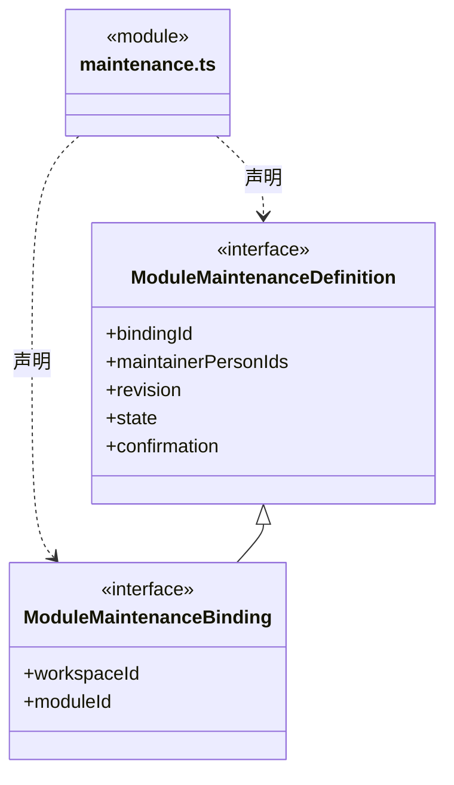
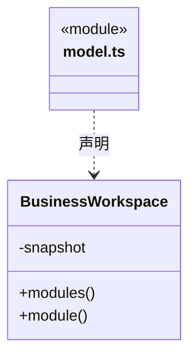
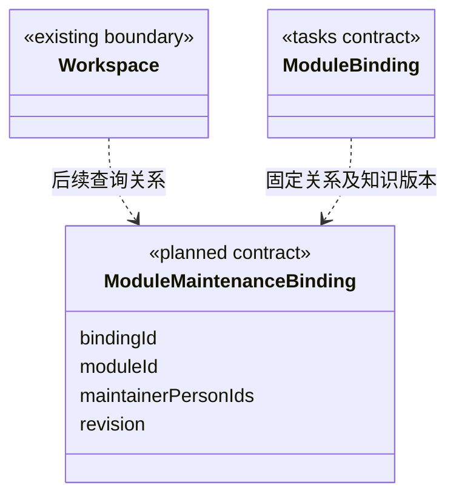

# src/backend/core/workspace 架构

## 目录定位

领域工程、Module、本模块 Workflow 的只读视图及显式维护关系类型；作者与维护人分开，与 main/workspace 生命周期分开。

本文描述当前实现。通过分析目录边界后维护的 [源码架构脚本](../../../../scripts/source-architecture.mjs) 同步清单和声明；代码变更时仍须核对职责、关键成员与关系。

## 代码清单

| 文件 | 当前职责 |
| --- | --- |
| [maintenance.ts](maintenance.ts) | 模块长期维护责任的知识契约，区别于 Task 的执行 Agent 与历史作者。 |
| [model.ts](model.ts) | 业务工作区：领域工程与模块注册表、模块知识和仅本模块 Workflow的核心封装。 |

## 架构类图

### maintenance.ts




### model.ts



直接依赖：[../knowledge/snapshot.ts](../knowledge/snapshot.ts)、[../foundation/json.ts](../foundation/json.ts)、[../foundation/errors.ts](../foundation/errors.ts)、[../knowledge/types.ts](../knowledge/types.ts)。


## 子目录导航

无子目录。

[返回上层](../ARCHITECTURE.md)。

每次修改本目录代码，同步维护文件头、关键契约说明及本图。未实现的治理、证据验收和自动编排能力不列入当前类图。

## 设计契约 v1 与落地范围

以下内容区分已接通能力与后续设计；以各节的实现状态为准，不将目标图当作现状图。维护源：[CONTRACT.md](CONTRACT.md)；生成类图时同步附加，勿直接修改本附录。

### 派发所需的模块维护关系

已实现 `maintenance.ts`、ModuleSchema 的可选 `maintenance` 字段及知识校验。派发解析器可核实真人引用、active 状态及明确声明；现有模块没有该字段仍可打开，正式派发时报告缺口。ModuleSchema 的 authors 仍是作者，不自动代表维护责任。

任务派发把每个 moduleId 解析为实际模块、维护关系与本次 Workflow。关系保存在该模块的 module.json，workspaceId/moduleId 从实际所属快照与路径注入，不接受重复自报。知识层负责 Schema 和引用校验，调度只读；不将 agentInstanceId 固化进长期知识。

```ts
type ModuleMaintenanceBinding = {
  bindingId: string;
  workspaceId: string;
  moduleId: string;
  maintainerPersonIds: [string, ...string[]];
  revision: number;
  state: 'active' | 'retired';
  confirmation: {
    recordId: string;
    source: 'local_user'; // 当前没有账户认证，不冒充花名册中的已登录真人
    confirmedAt: string; // UTC ISO 8601
  };
};
```

bindingId 稳定标识关系，revision 描述变更，knowledgeRevision 标识读取它的完整知识快照；任务 ModuleBinding 固定 bindingId、真人责任列表和快照版本。真人 ID 必须存在于本工作区花名册；不存在、已退休或未经显式确认的关系不满足正式派发条件。引用有效不等于核验了真实身份或代表负责人批准本次架构变更。

负责执行的 Agent 与负责维护模块的真人是不同责任维度。Task.assignee 不能覆盖长期维护人；更换维护关系是知识变更，要通过现有授权、预览提交、校验与索引更新流程。旧 authors 不自动迁移为已确认关系，实施时先返回明确缺口，再由本机用户确认映射。

每个 Task 模块绑定只从该模块可用的 Workflow 中选择本次流程；共享 Workflow 也必须由本模块显式挂载。无专属流程时可按策略采用有版本及原因的 general 流程，不推断父模块继承。跨模块任务保存多份独立 ModuleBinding，不能以一个流程文本覆盖其他模块的限制。



上图保留领域关系设计；实际代码清单与类图见上方当前结构。维护字段现可经已有知识文件 preview/commit 读写并参与事务和索引更新；语义对象 CRUD 字段清单和维护关系编辑界面尚未扩展。旧 authors 不自动迁移。已测试缺失真人、退休关系、日期/标识错误及本模块 Workflow 范围。详见 [任务图契约](../tasks/CONTRACT.md) 和 [上下文装配](../../scheduler-engine/context/CONTRACT.md)。
