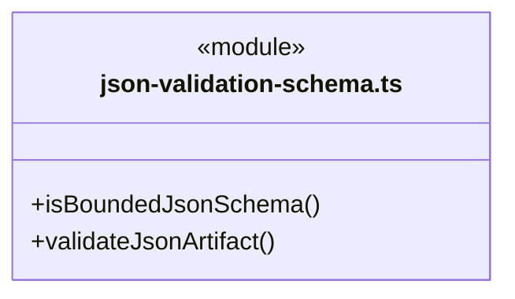
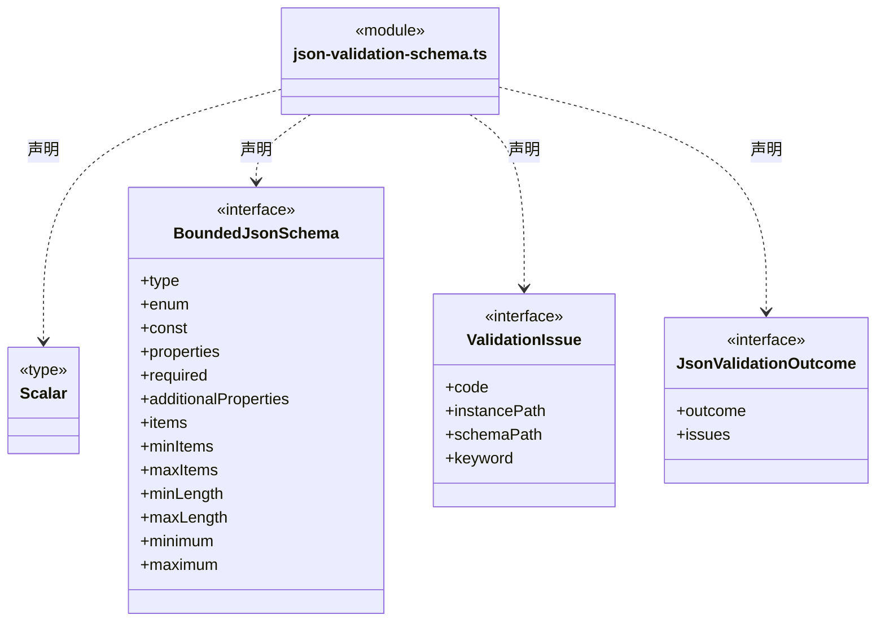
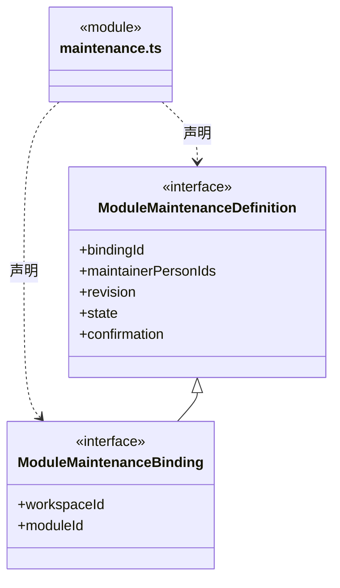
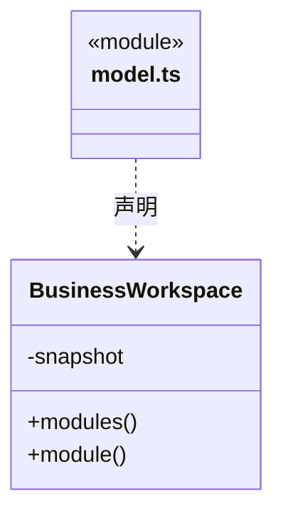
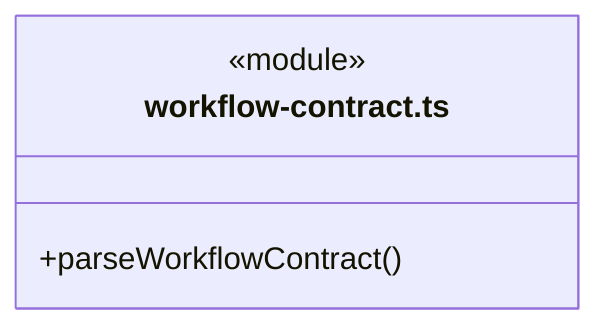
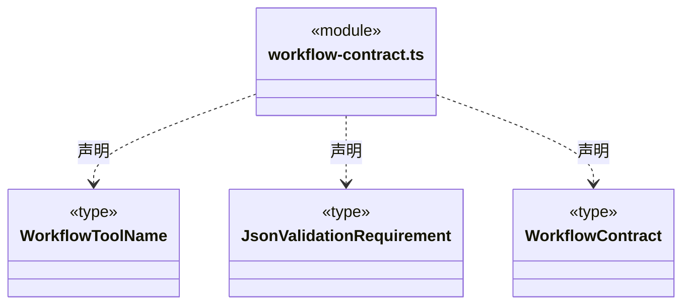
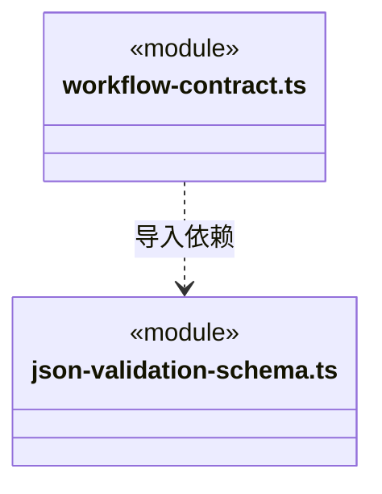
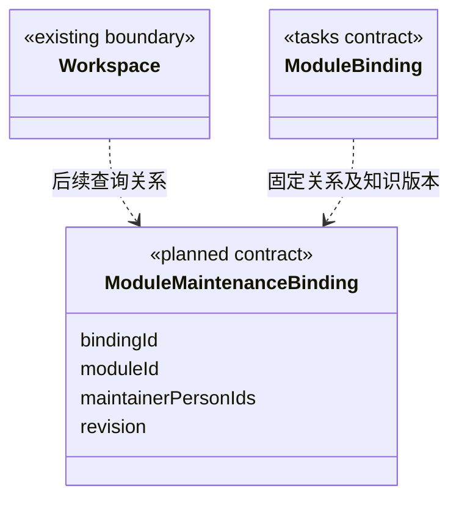

# src/backend/core/workspace 架构

## 目录定位

领域工程、Module、本模块Workflow与显式维护关系。可选执行条件含工具回执和指定JSON文件结构；有界Schema白名单及纯字节校验拒绝引用/脚本/转换，不自行读文件或签发业务验收。作者与维护人分开，与main/workspace生命周期分开。

本文描述当前实现。通过分析目录边界后维护的 [源码架构脚本](../../../../scripts/source-architecture.mjs) 同步清单和声明；代码变更时仍须核对职责、关键成员与关系。

## 代码清单

| 文件 | 当前职责 |
| --- | --- |
| [json-validation-schema.ts](json-validation-schema.ts) | JSON 产物验证的有界声明和纯结构校验，供冻结 Workflow、运行时及知识入口共用。 |
| [maintenance.ts](maintenance.ts) | 模块长期维护责任的知识契约，区别于 Task 的执行 Agent 与历史作者。 |
| [model.ts](model.ts) | 业务工作区：领域工程与模块注册表、模块知识和仅本模块 Workflow的核心封装。 |
| [workflow-contract.ts](workflow-contract.ts) | 定义模块 Workflow 正文中可选执行条件的严格协议，供知识治理、资源包与执行准备共同解析。 |

## 架构类图

### json-validation-schema.ts





直接依赖：[../foundation/json.ts](../foundation/json.ts)、[../foundation/errors.ts](../foundation/errors.ts)。

### maintenance.ts




### model.ts



直接依赖：[../knowledge/snapshot.ts](../knowledge/snapshot.ts)、[../foundation/json.ts](../foundation/json.ts)、[../foundation/errors.ts](../foundation/errors.ts)、[../knowledge/types.ts](../knowledge/types.ts)。

### workflow-contract.ts





直接依赖：[../foundation/errors.ts](../foundation/errors.ts)、[../foundation/json.ts](../foundation/json.ts)、[json-validation-schema.ts](json-validation-schema.ts)。

### 本目录调用边界




## 子目录导航

无子目录。

[返回上层](../ARCHITECTURE.md)。

每次修改本目录代码，同步维护文件头、关键契约说明及本图。未实现的治理、证据验收和自动编排能力不列入当前类图。

## 设计契约 v1 与落地范围

以下内容区分已接通能力与后续设计；以各节的实现状态为准，不将目标图当作现状图。维护源：[CONTRACT.md](CONTRACT.md)；生成类图时同步附加，勿直接修改本附录。

### Workflow 的可选程序条件

`workflow-contract.ts` 是不依赖知识实现的纯协议模块。`parseWorkflowContract(markdown)` 读取正文中最多一个顶层 `cbim-workflow` 围栏块；支持标准反引号或波浪线围栏、0–3 空格缩进、CRLF。普通代码块中的示例、引用块及缩进代码不激活条件。无声明返回 `undefined`，现有自然语言方法保持不变；已声明但重复、未闭合、附加标记、JSON 重复字段、未知版本或字段均抛出 `WORKFLOW_CONTRACT_INVALID`，不得降级成无约束。

版本 1 至少声明一项：`beforeEffects:{requirePlan:true}` 或 `delivery` 的非空 `requiredToolEvidence` / `requiredValidations`。两类要求各最多 16 项，ID 是 1–80 位字母、数字、下划线或连字符且在模块内不能跨类重复；条件块最多 64 KiB UTF-8。原生工具名仍限 `read/write/edit/grep/find/ls/bash`，不接知识写入、调度、任意表达式或模型提供的 path/hash/pass。

`requiredValidations` 每项固定 `{id,validator:'json-schema-v1',artifactPath,schema}`。路径为明确工作区业务文件；运行时仍拒绝链接、越界和受保护知识路径。`json-validation-schema.ts` 仅解释有界 JSON Schema 子集：每节点显式 type，标量 enum/const，对象 properties/required/布尔 additionalProperties，数组 items/长度，以及字符串长度和数值上下界。对象/数组 enum/const、引用、组合、pattern、format、自定义代码和未知关键字均不支持；不会编译用户脚本、转换类型、补默认值或删字段。未知或超界声明在知识提交、资源模板和执行准备中同样拒绝。

单 Schema ≤32 KiB、深度≤16、节点≤512、单层属性≤64、标量枚举≤64；文件≤1 MiB，JSON 嵌套≤64、节点≤100000，诊断最多32条且不包含原值。纯校验器从可信平台同一次读取的 Uint8Array 严格解析 UTF-8 与无重复字段的 JSON，返回 passed 或 rejected；无效 JSON 也是实际检查事实。结构通过只证明该份字节符合该项声明，不是专业语义全验收。模块声明缺省仍保持原 Workflow 行为和旧 proof 形状。

约定与自然语言一起保存在所属模块原 `workflow.md`，没有独立运行存储；正文版本、知识指纹和业务模板均覆盖它。纯 Schema 只声明条件，不提供工具、不授予权限，也不证明工具结果符合专业目标或覆盖整个模块。执行侧负责准备时冻结、工具放行及交付时核验真实条件；`bash` 名称出现不改变其影响范围未知的事实。知识变化仍须核实，不能凭此条件替换旧运行的冻结基线。

### 派发所需的模块维护关系

已实现 `maintenance.ts`、ModuleSchema 的可选 `maintenance` 字段及知识校验。派发解析器可核实真人引用、active 状态及明确声明；现有模块没有该字段仍可打开，正式派发时报告缺口。ModuleSchema 的 authors 仍是作者，不自动代表维护责任。

任务派发把每个 moduleId 解析为实际模块、维护关系与本次 Workflow。关系保存在该模块的 module.json，workspaceId/moduleId 从实际所属快照与路径注入，不接受重复自报。知识层负责 Schema 和引用校验，调度只读；不将 agentInstanceId 固化进长期知识。

```ts
type ModuleMaintenanceBinding = {
  bindingId: string;
  workspaceId: string;
  moduleId: string;
  maintainerPersonIds: [string, ...string[]];
  revision: number;
  state: 'active' | 'retired';
  confirmation: {
    recordId: string;
    source: 'local_user'; // 当前没有账户认证，不冒充花名册中的已登录真人
    confirmedAt: string; // UTC ISO 8601
  };
};
```

bindingId 稳定标识关系，revision 描述变更，knowledgeRevision 标识读取它的完整知识快照；任务 ModuleBinding 固定 bindingId、真人责任列表和快照版本。真人 ID 必须存在于本工作区花名册；不存在、已退休或未经显式确认的关系不满足正式派发条件。引用有效不等于核验了真实身份或代表负责人批准本次架构变更。

负责执行的 Agent 与负责维护模块的真人是不同责任维度。Task.assignee 不能覆盖长期维护人；更换维护关系是知识变更，要通过现有授权、预览提交、校验与索引更新流程。旧 authors 不自动迁移为已确认关系，实施时先返回明确缺口，再由本机用户确认映射。

每个 Task 模块绑定只从该模块可用的 Workflow 中选择本次流程；共享 Workflow 也必须由本模块显式挂载。无专属流程时可按策略采用有版本及原因的 general 流程，不推断父模块继承。跨模块任务保存多份独立 ModuleBinding，不能以一个流程文本覆盖其他模块的限制。



上图保留领域关系设计；实际代码清单与类图见上方当前结构。维护字段现可经已有知识文件 preview/commit 读写并参与事务和索引更新；语义对象 CRUD 字段清单和维护关系编辑界面尚未扩展。旧 authors 不自动迁移。已测试缺失真人、退休关系、日期/标识错误及本模块 Workflow 范围。详见 [任务图契约](../tasks/CONTRACT.md) 和 [上下文装配](../../scheduler-engine/context/CONTRACT.md)。
