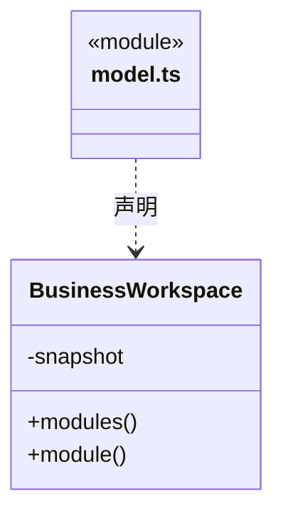

# src/backend/core/workspace 架构

## 目录定位

领域工程、Module 与本模块 Workflow 的只读视图；与 main/workspace 的本机生命周期分开。

本文描述当前实现。通过分析目录边界后维护的 [源码架构脚本](../../../../scripts/source-architecture.mjs) 同步清单和声明；代码变更时仍须核对职责、关键成员与关系。

## 代码清单

| 文件 | 当前职责 |
| --- | --- |
| [model.ts](model.ts) | 业务工作区：领域工程与模块注册表、模块知识和仅本模块 Workflow的核心封装。 |

## 架构类图

### model.ts

直接依赖：[../knowledge/snapshot.ts](../knowledge/snapshot.ts)、[../foundation/json.ts](../foundation/json.ts)、[../foundation/errors.ts](../foundation/errors.ts)、[../knowledge/types.ts](../knowledge/types.ts)。

## 子目录导航

无子目录。

[返回上层](../ARCHITECTURE.md)。

每次修改本目录代码，同步维护文件头、关键契约说明及本图。未实现的治理、证据验收和自动编排能力不列入当前类图。
