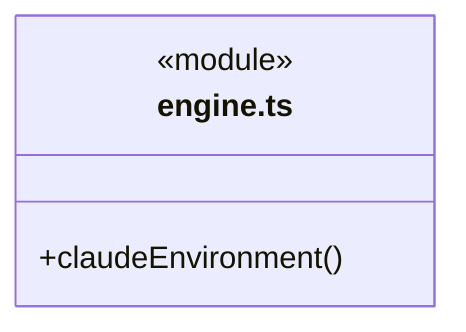
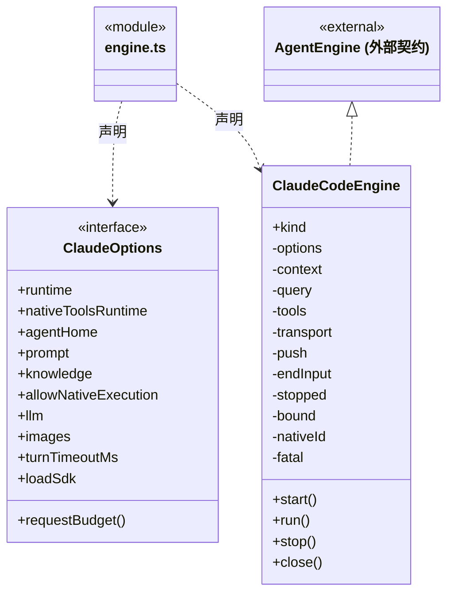
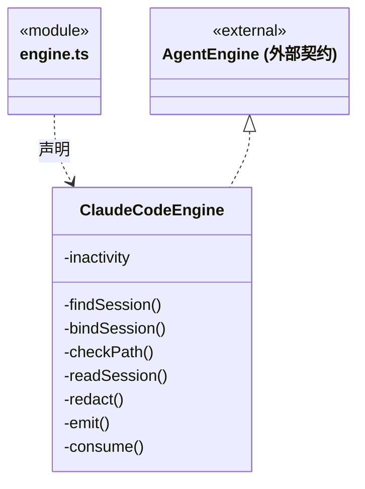
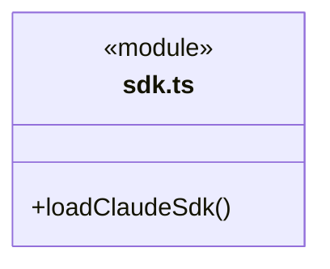
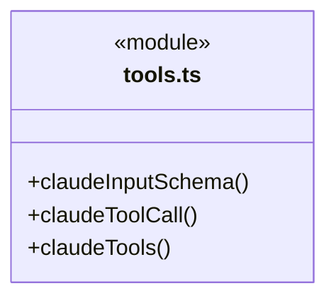
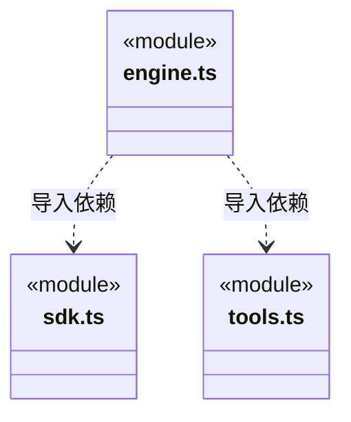

# src/backend/engines/claude 架构

## 目录定位

Claude Agent SDK 适配、内部工具门禁与真实原生会话生命周期；环境和账号归 CBIM，工具复用上层契约，不提供对外 MCP。原生工具开关只读可信能力的 disableNativeTools 策略，不认识具体业务工具槽位。 SDK 入口可由签名 E 包提供，仍限制适配器支持的版本，账号/历史目录不随缓存迁移。

本文描述当前实现。通过分析目录边界后维护的 [源码架构脚本](../../../../scripts/source-architecture.mjs) 同步清单和声明；代码变更时仍须核对职责、关键成员与关系。

## 代码清单

| 文件 | 当前职责 |
| --- | --- |
| [engine.ts](engine.ts) | Claude Code 的 AgentEngine 适配器，管理 SDK 与原生会话；目标返工沿合成系统资料输入，不带入新授权。 |
| [sdk.ts](sdk.ts) | 从 CBIM 自带资源或开发依赖加载固定版本的 Claude Agent SDK。 |
| [tools.ts](tools.ts) | Claude 原生工具和内部 SDK 工具适配为 CBIM 授权与回执协议。 |

## 架构类图

### engine.ts

成员 1/2（同名节点为同一声明，跨图合并阅读）。

成员 2/2（同名节点为同一声明，跨图合并阅读）。

直接依赖：[../../core/foundation/utility/index.ts](../../core/foundation/utility/index.ts)、[../run-inactivity.ts](../run-inactivity.ts)、[../../core/execution/types.ts](../../core/execution/types.ts)、[../../core/models/ports.ts](../../core/models/ports.ts)、[../../core/models/request-budget.ts](../../core/models/request-budget.ts)、[../../core/execution/engine-tools.ts](../../core/execution/engine-tools.ts)、[../../core/execution/engine-instructions.ts](../../core/execution/engine-instructions.ts)、[../transport/request-budget-transport.ts](../transport/request-budget-transport.ts)、[sdk.ts](sdk.ts)、[../../core/execution/engine-runtime.ts](../../core/execution/engine-runtime.ts)、[tools.ts](tools.ts)。

### sdk.ts

直接依赖：[../../core/execution/engine-runtime.ts](../../core/execution/engine-runtime.ts)。

### tools.ts

直接依赖：[../../core/tools/outcome.ts](../../core/tools/outcome.ts)、[../../core/execution/types.ts](../../core/execution/types.ts)、[../../core/execution/engine-tools.ts](../../core/execution/engine-tools.ts)。

### 本目录调用边界

## 子目录导航

无子目录。

[返回上层](../ARCHITECTURE.md)。

每次修改本目录代码，同步维护文件头、关键契约说明及本图。未实现的治理、证据验收和自动编排能力不列入当前类图。

## 设计契约 v1 与落地范围

以下内容区分已接通能力与后续设计；以各节的实现状态为准，不将目标图当作现状图。维护源：[CONTRACT.md](CONTRACT.md)；生成类图时同步附加，勿直接修改本附录。

# Claude Code 适配契约

## 无进展超时

`ClaudeCodeEngine.run` 使用共享 [无进展计时器](../CONTRACT.md#按执行进展续期)。SDK 文本/推理/参数的非空增量（包括子任务）和工具 Hook 的实际开始/完成续期，普通 status 消息不续期。连续静默时关闭 Query 并保存具体原因；迟到 result 不能覆盖已发生的超时，显式停止仍为取消。

engine.ts 使用固定 Claude Agent SDK Query，sdk.ts 只解析 CBIM 自带 claude-runtime 或开发依赖；SDK 与平台二进制独立随包，不访问 Cindy 的安装或账号。settingSources 为空，strictMcpConfig 开启，插件清单为空；继承的 Claude/Anthropic 凭据与启动注入被移除。真实模型、地址及推理开关取冻结快照。Pi 专属工作上下文/压缩阈值不映射成 Claude 保证。

工具经 tools.ts 的 PreToolUse 调用同一 beforeTool，先保存授权及 started，再允许执行。内部 SDK MCP 不监听端口；每次内部调用用真实 tool_use_id 绑定准确原参数并消耗一次性许可，模型不能提供该身份。原生 Read/Write/Edit/Bash/Glob/Grep 映射到现有规范名称。scopedExecutionTools 存在时不提供任何原生文件/命令工具。初始化必须确认 hooks_applied 与 hook_on_failure_supported，失败默认阻断；实际活动目录与准备目录逐名核对。

Claude 原生工具可在 SSE 终态到达前启动。PreToolUse 必须先等待本轮实际请求全部可靠结算，再进入业务授权；结算失败或停止会关闭 Query 并阻止副作用，不能只靠暂存终态帧作工具屏障。已有调用与已知用量不重放或撤销。

Anthropic API 不接受顶层 anyOf/oneOf。目录将联合输入投影为对象字段和共同必填项；投影前把原 Schema 留在不冲突的 definitions 节点，本地引用同步迁移到原图，避免删除顶层分支后指针悬空，也不通过无限展开破坏递归。原 CBIM 参数校验仍在可信入口严格执行；这不放宽领域授权。MCP 不发布不兼容的联合 outputSchema，实际结果仍经原端口及通用结果校验。私有推理不进入公开事件，工具结果保存后才返回模型。

首轮在 SDK result 时核实实际 JSONL 路径、身份及工作区，再发布 session.bound；不预造会话文件。成员 ready 允许此首轮延迟绑定，结算时核实同一原生身份。续执行在启动前核实原文件并复核检查点，主会话切换由上层选择目标引擎文件。停止先中止内部工具及请求传输，再中断/关闭 Query；未知工具仍由 Runtime 保留。只认真实 result，不把正文当完成；当前没有 steer。

SDK 0.3.322 的实际 schema 运行依赖是 zod/v4 与 zod/v4/core。工程保留 zod 3.25.76 的双版本入口，对该 SDK 显式允许这一已核实组合；未全局升级业务 Zod 3 Schema。复制运行资源时包含 SDK peer 与本平台二进制依赖。

### 通用能力注入

工具从 EngineContext.capabilities 的通用工具目录注册；可信能力 disableNativeTools=true 时关闭全部原生文件和命令，不依赖某个业务工具槽位。业务指引作为可信装配说明传入，授权、原调用身份、结果保存与停止顺序保持原协议。

### 失败后的核实

内部调用沿共同端口返回统一错误结构；原生 PostToolUseFailure 保留错误并用相同 outcome 记录日志及 additionalContext。没有领域回执时明确 null，不把异常当回滚或授权重放。

### 凭据文本替换

精确字符串替换使用后端 utility 的 redactLiteral，仍由引擎选择凭据及触发路径。Pi 保留 api-key 条件，Claude 无凭据时保留事件引用；JSON 编码后替换与异常路径保持原顺序，不新增凭据搜集、正则或解码规则。
