# src/backend/engines/codex 架构

## 目录定位

Codex App Server 的受管进程、双向 RPC、真实 thread/turn、Responses 代理与动态工具；固定 CLI 和私有账号目录，内置执行关闭，工具经宿主授权、预算结算及同一回执；宿主原生工具目录按可信能力的 disableNativeTools 策略收窄。

本文描述当前实现。通过分析目录边界后维护的 [源码架构脚本](../../../../scripts/source-architecture.mjs) 同步清单和声明；代码变更时仍须核对职责、关键成员与关系。

## 代码清单

| 文件 | 当前职责 |
| --- | --- |
| [binary.ts](binary.ts) | 解析 CBIM 随包的固定 Codex 原生 App Server，不启动用户 PATH 中的客户端。 |
| [engine.ts](engine.ts) | 通过 Codex App Server 驱动 AgentEngine，管理进程、线程、轮次和 CBIM 动态工具。 |
| [model-proxy.ts](model-proxy.ts) | 将 Codex 的 Responses 请求约束为本轮冻结模型、输出上限和已注册工具目录。 |
| [rpc.ts](rpc.ts) | Codex App Server 的双向 JSONL 通信，分别关联宿主请求、原生请求和通知。 |
| [session.ts](session.ts) | 核实 Codex 实际 rollout 的路径、原生身份、工作区与持久化动态工具目录。 |
| [tools.ts](tools.ts) | 把 Codex dynamic tool 请求路由到 CBIM 知识/执行工具及已有宿主文件操作。 |

## 架构类图

### binary.ts

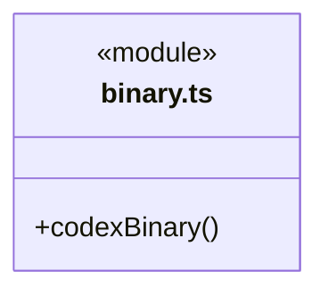

### engine.ts

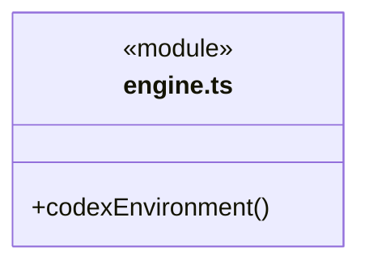

成员 1/2（同名节点为同一声明，跨图合并阅读）。

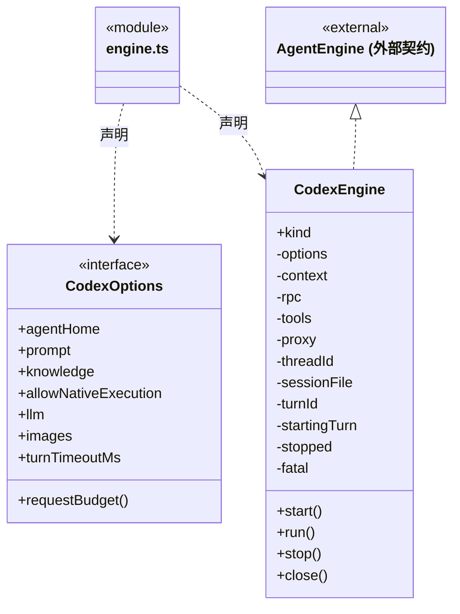

成员 2/2（同名节点为同一声明，跨图合并阅读）。

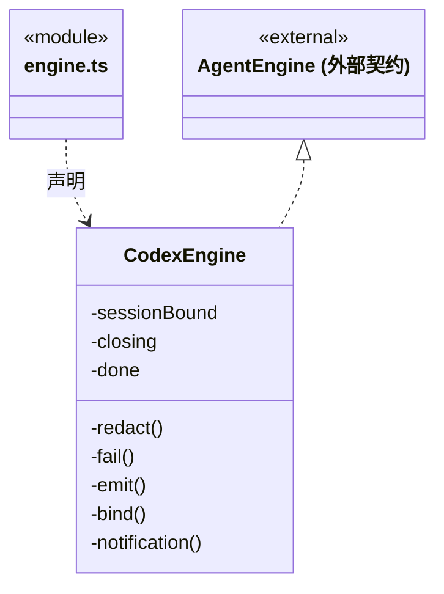

直接依赖：[../../core/execution/types.ts](../../core/execution/types.ts)、[../../core/models/ports.ts](../../core/models/ports.ts)、[../../core/models/request-budget.ts](../../core/models/request-budget.ts)、[../../core/execution/engine-tools.ts](../../core/execution/engine-tools.ts)、[../../core/execution/engine-instructions.ts](../../core/execution/engine-instructions.ts)、[../native-tools.ts](../native-tools.ts)、[binary.ts](binary.ts)、[rpc.ts](rpc.ts)、[tools.ts](tools.ts)、[model-proxy.ts](model-proxy.ts)、[session.ts](session.ts)。

### model-proxy.ts

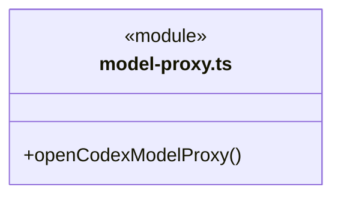

直接依赖：[../../core/models/ports.ts](../../core/models/ports.ts)、[../../core/models/request-budget.ts](../../core/models/request-budget.ts)、[../transport/request-budget-transport.ts](../transport/request-budget-transport.ts)、[../transport/request-budget-usage.ts](../transport/request-budget-usage.ts)、[tools.ts](tools.ts)。

### rpc.ts

成员 1/2（同名节点为同一声明，跨图合并阅读）。

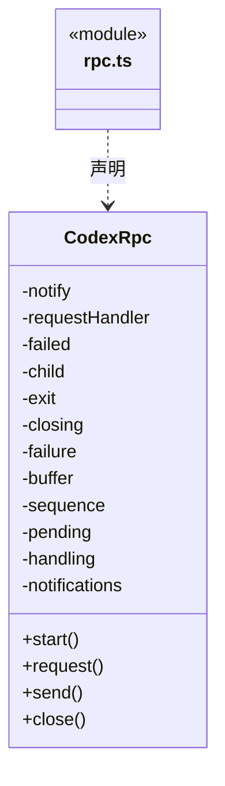

成员 2/2（同名节点为同一声明，跨图合并阅读）。

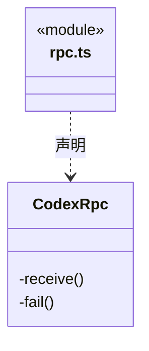

### session.ts

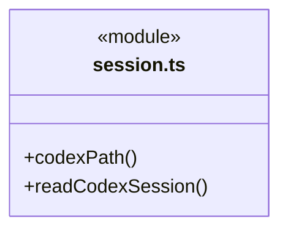

### tools.ts

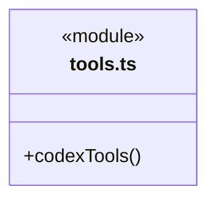

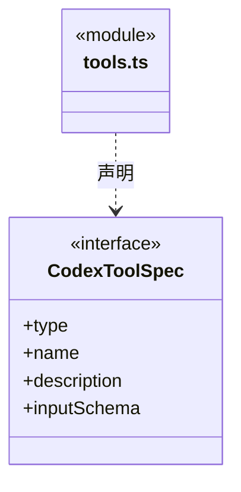

直接依赖：[../../core/tools/outcome.ts](../../core/tools/outcome.ts)、[../../core/execution/types.ts](../../core/execution/types.ts)、[../../core/execution/engine-tools.ts](../../core/execution/engine-tools.ts)、[../../core/tools/native-tools.ts](../../core/tools/native-tools.ts)、[../../core/tools/results.ts](../../core/tools/results.ts)。

### 本目录调用边界

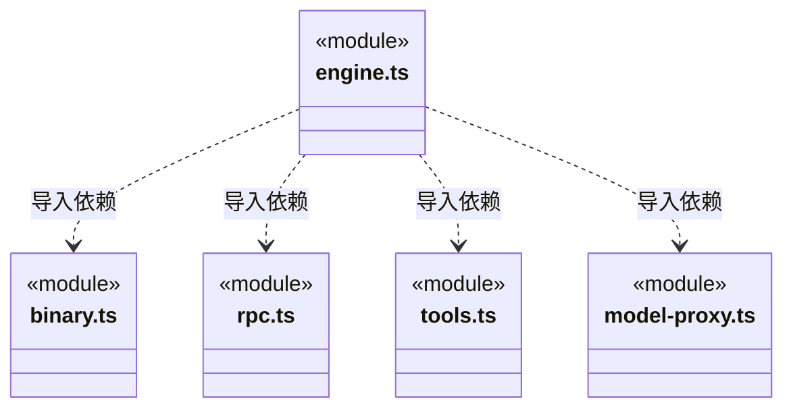

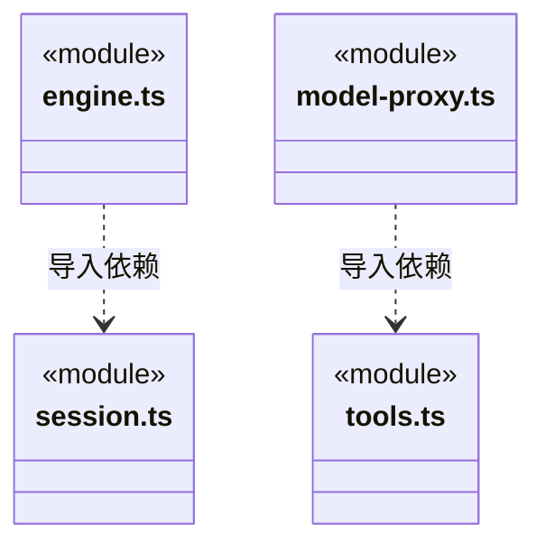

## 子目录导航

无子目录。

[返回上层](../ARCHITECTURE.md)。

每次修改本目录代码，同步维护文件头、关键契约说明及本图。未实现的治理、证据验收和自动编排能力不列入当前类图。

## 设计契约 v1 与落地范围

以下内容区分已接通能力与后续设计；以各节的实现状态为准，不将目标图当作现状图。维护源：[CONTRACT.md](CONTRACT.md)；生成类图时同步附加，勿直接修改本附录。

# Codex 适配边界

`CodexEngine` 实现公共 `AgentEngine`。固定 `@openai/codex@0.167.0` 及平台二进制通过 stdio App Server 运行；不使用 PATH 客户端、外部账号、用户 Codex HOME 或 Cindy 的运行进程。依赖方向为装配 → 引擎 → 公共契约，业务调度不进入 RPC 层。

## 生命周期与原生身份

`CodexRpc` 区分宿主请求、服务端工具请求和顺序通知，响应关联不等待工具授权。协议失败/超时终止原进程，不能重发操作；close 等待进程及已收到处理排空。主会话和成员分别持有自己的 Codex HOME。

新建 thread 由服务端分配 ID，实际回执经 `session.bound` 落盘。成员只在首次 starting→running 采纳该 ID，不能用逻辑 agentSessionId 伪造原生线程。恢复必须核对私有 sessions 目录、完整 JSONL、metadata.id/cwd、文件名及当前工具是否已注册；在 thread/resume 前再次核实完整成员恢复证明。恢复会追加 thread_settings_applied，因此动作后核对实际线程/文件身份，不再将原生自己的追加误当作旧证明损坏。跨引擎主会话恢复目标引擎自己的 ID/文件，并只转交公开历史资料。

thread/start 回执可能先给出 ID/路径，再延迟写入原生文件。正常完成仍及时绑定；失败、取消或超时统一经 `CodexEngine.close`：停止工具、关闭代理、等待 RPC 进程退出与回调排空，再按原回执路径校验并补登记。Runtime 在 close 之后才封存本轮日志，因而不会向旧终态追加登记。成功文件绑定和 close 屏障均去重，重复关闭不追加事件。

只对真实存在且通过上述身份/路径校验的文件登记；不扫描其他 rollout、不伪造路径、不修改原生内容。路径必须是私有 sessions 的真实后代（包含 Windows 分隔符校验）。未落盘保持缺省，无效文件拒绝绑定；运行时仍保留首个执行故障，不用登记成功把中断解释成任务完成。旧已封存日志缺少登记时不会被自动回写；界面提供原运行核实和新对话入口。

## 工具与权限

启动时关闭原生 shell、编辑、web、MCP、插件、hooks、记忆和额外实验功能；不加载工程 AGENTS 指令。内部 cbim 工具与宿主文件操作注册为 dynamicTools。后者复用固定 Pi SDK 的独立操作，不运行 Pi 循环。

每次请求核对 threadId、turnId、callId 和唯一调用身份；先等本轮已发请求可靠结算，再走 Runtime.beforeTool，保存结果后回包。原生 `request_user_input` 不发布给模型且不处理其宿主请求，用户交互统一走已有 CBIM 工具。冻结范围成员只注册范围端口，不注册文件/命令旁路。只读模式不发布写入/命令工具；原生线程可保存全工具注册信息，但每次实际请求按当前权限投影，并在调用端再次核对。

## 请求与统计

`model-proxy` 固定供应商目标、模型、当前工具及 max_output_tokens；真实密钥只在父进程。只转发 /responses，远端专用压缩接口未接入时明确失败。启用请求预算则复用共享 reserve/issue/report/unknown 账本。无论是否启用预算，完整 SSE/usage 通过共享解析器核实，断流不补零、不自动重试。

本轮用量来自实际 HTTP 响应求和，不取恢复线程的历史累计数。仅完整成功轮次发布 run-usage；价格来自本轮冻结配置，未知价格保留未知。模型结束仅表示执行回合结束，不是业务验收。

## 当前边界

支持排队、停止、文本/图片输入、工具调用和同引擎恢复；没有实现运行内插入确认。恢复时新增工具名称需要新建对话，因为 App Server 恢复接口不接受替换 dynamicTools。原生文件含引擎自行保存的私有内容，公开 CBIM 事件只投影助手正文和工具回执，不转发私有推理。测试使用真实二进制与本机确定性模型，不等于线上模型或整包桌面验收。

### 通用能力注入

工具从 EngineContext.capabilities 的通用工具目录注册；可信能力 disableNativeTools=true 时关闭全部原生文件和命令，不依赖某个业务工具槽位。业务指引作为可信装配说明传入，授权、原调用身份、结果保存与停止顺序保持原协议。

### 失败后的核实

动态内部工具与宿主原生工具均保留原调用身份；异常转换为统一 outcome JSON，success=false，未知不允许自动重试。成功元数据与原文本并存，不替代业务验收。关闭仍排空原在途调用。
