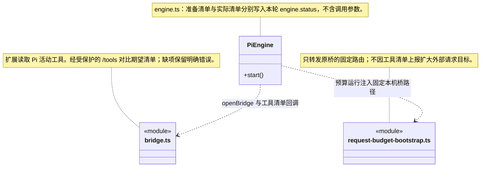
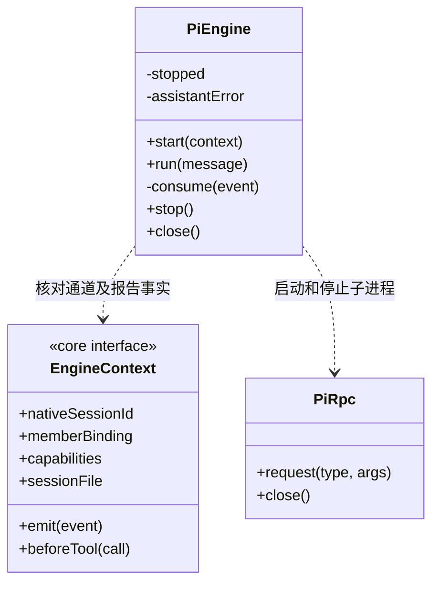

### 无进展超时

`PiEngine.run` 使用共享 [无进展计时器](../CONTRACT.md#按执行进展续期)。`message_update` 的非空 text/thinking/toolcall 增量、统一消息和工具事件续期；推理内容不入日志，自动重试、摘要重试和普通状态通知不续期。只有连续静默超过原 `turnTimeoutMs` 才报明确的 Pi 无进展错误，运行总时长可以跨过原 30 分钟上限。

### 第三方来源与许可

`runtime-config.ts` 保留 Cindy 来源说明；Apache-2.0 许可位于根目录 [legal/cindy-LICENSE](../../../../legal/cindy-LICENSE)，由 Forge 的 `legal` 资源目录随包分发。迁移许可位置不改变 Pi 启动配置或运行权限。

### 公开文字与工具的因果关联

`message_end` 的 assistant 正文仅保存公开 text、原计量和该原生消息内的 `toolCallIds`，不保存 thinking 或参数。HTTP `/gate` 与 stdout 事件是独立到达通道，门禁可能先于已生成文字写入 canonical；日志继续保留真实收到的顺序，界面用明确 ID 还原本段正文与调用的关系。旧日志不补造关联；这份元数据不改变工具批准、执行或回执核实。

### 宿主工具装配与实际活动清单

`PiEngine` 启动桥后记录 `engine.status` / `metric:tool-catalog` / `stage:prepared` 的期望内部工具名；受控扩展在 `before_agent_start` 从 `pi.getActiveTools()` 取真实活动名称，经随机令牌保护的 `/tools` 上报。桥比较当前内部注册项，记录 active／expected／missing，缺项返回 `TOOL_CATALOG_MISMATCH`，由扩展错误和运行日志保留。该核对不是模型文字推断，也不使用只覆盖知识族的 catalog。

上报仅接受有界、唯一的工具名称列表；不带参数、模型消息、设备码或凭据，不授予工具许可或重新注册缺项。原生工具可作为额外活动项记录，实际调用继续走 `/gate` 和一次性 `/call`。启用逐请求预算时，`request-budget-bootstrap.ts` 同样只放行本轮桥 origin 上无查询／fragment 的 `/tools` 固定路径，原随机令牌由桥继续检查；其他地址仍拒绝。通用桥不认识 GitHub 连接或反馈业务规则；未来其他工具装配故障复用同一名称核对机制。

### 主调度提示与负责人门禁

Pi 主角色提示与上层真实工具保持一致：未配置自定义负责岗位的模块由主 Agent 在当前会话直接实现；只有明确配置的自定义岗位才查询选择并派发。内置 `cbim:executor` 已退役，不能登记为岗位或作为缺省派发。提示只说明边界，实际资格仍由任务服务判定，不将提示文字视为执行授权。

### 冻结 JSON/CSV/PNG 验证工具接入

`cbim_validation_run` 仅在本轮实际 `EngineContext.capabilities` 中的 `validation` 能力 存在时注册，经同一 `/gate` 与一次性 `/call` 传递真实调用 ID。主运行、无验证要求或缺平台能力的运行不会得到此工具；不存在按名字临时创建能力的分支。提示明确路径和 Schema 来自冻结要求，`rejected` 与工具调用失败不同，工具成功也不等于结构通过，更不构成业务或人工验收。

### 成员文件基线工具接入

Pi 仅在可信 `EngineContext.capabilities` 中的 `artifacts` 能力 存在时注册采集工具，并经既有 `/gate`、一次性 `/call` 许可透传原生 toolCallId。采集结果沿标准工具完成事件进入 canonical 日志，不能由工具名、模型正文或独立桥接事件自行签发基线。主调度没有此端口；没有新增路径、命令或恢复权限。

`memberCheckpointTools` 同样只按实际端口注册，透传可信调用 ID；指引明确一次 checkpoint/一次 resume，以及命令、动态目录、额外知识查询或未知操作不属于当前可恢复白名单。暂存后正常结束而非发送 abort；引擎不自行发布 checkpointed 或释放调度占用。

专用续执行在启动 Pi 之前及 `get_state` 载入核实后、配置与本轮输入之前调用 `assertMemberResume`，再次核实原 canonical、业务文件、知识和原生字节。Runtime 在 Pi 准备与 running 事务结束后再通过 `assertMemberResumeInputs` 核业务文件、知识与旧日志，随后才发送 prompt。沿原 sessionId/sessionFile 启动同通道的新 run，旧 native 不能悄悄修复或改写后当作原检查点；已核实载入后允许本轮配置合法追加。该复核不是操作系统原子隔离；后续工具仍受新一轮门禁与批准。

### 当前成员结果接续

普通用户输入及 `user-continuation` 显式文本补充保持 RPC `prompt` 的 `started` 行为。成员回传与 `human_decisions` 分别使用 `customType:'cbim-member-results'` / `cbim-human-decisions` 的一次性首条输入处理器，保存可信来源 details，通过 `triggerTurn:true` 发起生成，原 prompt 返回 `handled`。后续用户 steer 不被拦截。成员正文说明候选尚未验收；人工正文说明这是系统转交的本机已保存意见，仅针对所述条件和所选成果，不是用户自由消息、新目标或工具提权，须重新规划和核实。输入加普通文字前缀，避免意见被解析为斜杠命令。

`PiEngine.run` 按来源核验 started/handled，并继续等待真实 `agent_settled`，不会把 handled 当成完成。异步 custom 启动的 `extension_error` 会终止等待并由运行日志保留中断，不超时后盲目重放。没有 source 的普通对话完全保留用户消息语义。回注不重复发送上一轮附件。

`KnowledgeBridge.call(name,args,signal,toolCallId?)` 第四参是工具门禁已批准的真实原生调用 ID；`openBridge` 核对调用 ID、名称和原始参数，并消耗一次性许可后透传。调度据此构造幂等命令键，不从模型参数获取可信派发身份。

### 当前成员通道与取消处理

`PiEngine.start(context)` 同时检查受管 `sessionFile` 路径和原生会话身份：成员使用已登记 `nativeSessionId`，普通主会话续聊使用原日志 `session.bound.sessionId`，不能用逻辑通道 ID 代替。`get_state` 返回的 sessionId 必须与期望身份一致，错误文件即使位于同一工作区也在模型调用前拒绝；活动流或待处理消息不为空时拒绝覆盖。首次普通聊天没有文件时仍以 taskId 新建。旧恢复记录缺少原生 ID 时，在创建工具桥和子进程之前明确拒绝，保留原历史供核实，不猜测或重写旧记录。

每个实例只服务一次运行。`start` 完成时已保存原生会话绑定，但尚未发送本轮提示；调用方即使遇到启动失败也必须调用 `close`，释放可能已经创建的工具桥或子进程。`run` 超时抛出结果待核实的错误，不自动重发提示；`close` 关闭进程并排空已接收事件，无论事件处理是否成功都会关闭工具桥。

`stop()` 先记录本轮停止意图再发送 RPC abort。`consume()` 只有在已经停止且供应商错误文本精确匹配标准取消消息时，将该条消息归一为 aborted；真实模型错误不被取消意图吞掉。`run()` 等待 agent_settled，工具结果未知仍由 LoopRuntime 最终标记 interrupted，不把停止视为回滚。

### 成员求助工具接入

Pi 的工具桥合并知识、执行进度及当前成员专属求助工具；后者仅在 `EngineContext.capabilities` 中的 `member-help` 能力 存在时注册。调用透传真实 `toolCallId`，复用 `/gate` 与 `/call` 一次性授权，不创建第二套权限通道。成员指引要求先核实已结束的操作，求助暂存后立即结束本轮；不允许继续调用工具或把求助当成成功交付。主调度仍通过可信 custom 回传接收求助数据，正文不升格为用户授权。
### 原生工具能力与执行约定

Pi 的 `--tools` 参数使用 `core/tools/native-tools.ts` 的同一注册表。只读模式仅提供 read/grep/find/ls，ask/execute 才提供 write/edit/bash；可提供不等于某次调用已批准。成员启动前的 Workflow 能力检查读取相同清单，不能从模型提示词或声明推断能力。

Workflow 计划与交付门禁位于共享 Runtime 和任务工具，Pi 仍经既有 gate/call 协议执行，不额外绕过批准或扩大主调度原生工具范围。bash 的成功工具事实不等于命令语义已验证，其影响范围仍为 unknown。
# 原生插入的发送边界

`PiEngine.steer` 使用原运行模型和权限，并接收可信停止信号。`get_state` 返回后再次检查停止、关闭和 streaming；此检查至 `steer` 命令发送之间不再等待其它异步操作。停止在发送前发生时不发新消息；发送之后只有原回复的 `disposition:queued` 确认接收，迟到取消不把它改称未接收。发送后的错误、超时或不明确回复统一保留 `QUEUE_INSERT_UNKNOWN`，不泄露底层回包或重发。

## 受控文件桥

Pi 仅发现正式成员实际装配的受控写工具，桥保留原 toolCallId 和取消 signal 进入 Runtime helper；不提供补偿工具，不替换原 native write/edit。只有已可靠落盘 applied 的严格唯一 wire 可返回成功。桥关闭不等于文件工人已退出，Runtime 另行 drain 实际平台会话。

检查点提示以实际注册工具为准：本运行有剩余额度时可申请一个，正常关闭后由调度核实并保存；续执行仍可在剩余额度内保存下一段，Pi 不自建预约、不选择历史段恢复。

## 逐请求预算（R06）

显式逐请求模式在 Pi 启动前安装 fetch 转发，保留原供应商 URL 的兼容判断，父进程固定目标路径及模型并持有真实 API key。undici 初始化不能覆盖访问器；握手未完成则不发 prompt。三种 SSE 的完整 usage 严格解析，终态直到结算保存后才交付；断流/取消/错误不推断免费，失败屏障阻止下一请求和工具。close 先取消实际 IO 并排空账本结算，再结束进程与工具桥。这是固定 Pi 供应商出口，不是 OS 网络沙箱或供应商最终账单。

## R07-A 完整产物清单运行与复核

Pi 只从 EngineContext.capabilities 的 manifests 能力 注册完整采集及本轮查询，与旧选定文件工具独立；真实 toolCallId 透传，仍经过逐请求预算及 beforeTool。主会话、无冻结范围或缺真实端口不获得清单工具。

## R07-B2 原删除与移动证明

EngineContext.capabilities 的 artifact-transitions 能力 只在冻结要求和真实端口齐备时注册。Pi 沿现有 gate/call 将原 toolCallId、参数和取消信号转入可信运行；不发 shell 替代，不把原生 write/edit 或模型正文升级为操作证明。工具失败后允许范围由 Runtime 屏障控制。

引擎提示同一工具可检查 JSON 结构或 CSV 表头、类型、行数与唯一键，实际种类取自冻结要求。模型只明确选择 baselineId 或 manifestId，不传表格正文、列规则或通过结论；CSV 复用原 gate/call 身份与取消边界。

PNG继续复用cbim_validation_run及同一gate/call身份。提示明确实际完整解码、尺寸/通道条件与不受支持格式；模型不能自行传路径、图片规则或passed，普通read/bash成功不能替代指定验证。

## 冻结范围成员执行

可信 capabilities 中存在 disableNativeTools 策略时 --tools 仅含 cbim_*，全部原生文件与命令未注册；即使伪造名称也不能通过Runtime。范围工具携原callId与AbortSignal，不通过自定义shell执行。

### 共享业务能力

工具路由与业务提示分别由上层 engine-tools.ts、engine-instructions.ts 提供。KnowledgeBridge/KnowledgeToolSchema 仅保留兼容别名；Pi 的 RPC、HTTP 一次性许可和 bootstrap 仍留在本目录。请求预算代理及 SSE 用量解析归 ../llm/，另一引擎不依赖 Pi 实现。

### 通用能力注入

工具从 EngineContext.capabilities 的通用工具目录注册；可信能力 disableNativeTools=true 时关闭全部原生文件和命令，不依赖某个业务工具槽位。业务指引作为可信装配说明传入，授权、原调用身份、结果保存与停止顺序保持原协议。

### 统一失败文本

内部工具保持原领域文本及 details.outcome；异常由共同端口生成 JSON 错误正文。原生 tool_result 失败在扩展内按同一固定 outcome 模板包装，真实门禁拒绝与执行后未知分开。没有新增网络路由，不扩大逐请求预算的桥白名单；回包不调用原工具或自动查询。
