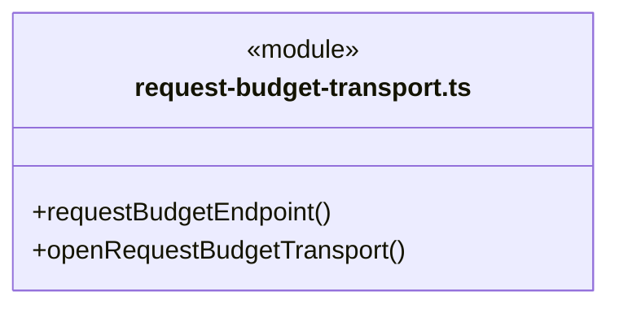
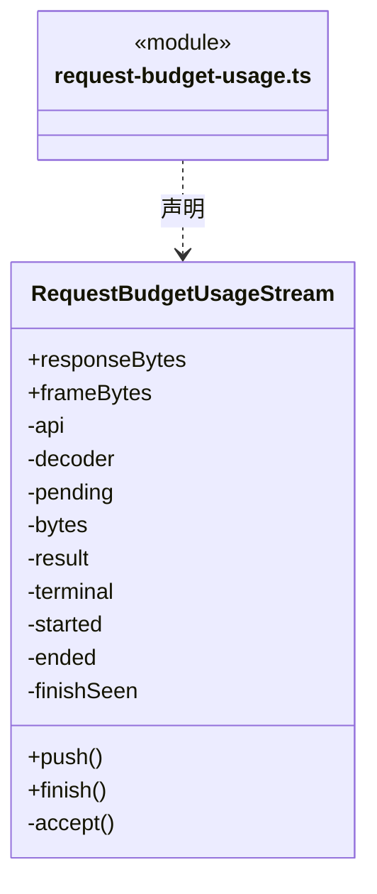
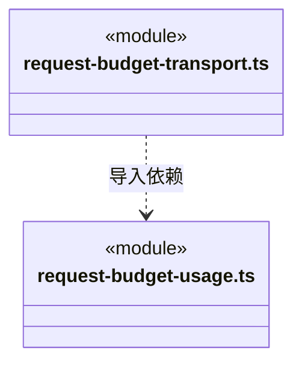

# src/backend/engines/transport 架构

## 目录定位

引擎 HTTP 请求预算与计量适配。通过 Core 的 ModelRequestBudgetPort 预占、结算或记录未知结果；网络实现与稳定模型端口分离，保留各引擎错误和取消语义。

本文描述当前实现。通过分析目录边界后维护的 [源码架构脚本](../../../../scripts/source-architecture.mjs) 同步清单和声明；代码变更时仍须核对职责、关键成员与关系。

## 代码清单

| 文件 | 当前职责 |
| --- | --- |
| [request-budget-transport.ts](request-budget-transport.ts) | 每运行创建只接受随机令牌的本机供应商代理，逐 HTTP 尝试预留并结算预算。 |
| [request-budget-usage.ts](request-budget-usage.ts) | 严格读取三种受支持 SSE 协议的请求用量，并暂存终态帧供可靠结算后交付。 |

## 架构类图

### request-budget-transport.ts

直接依赖：[../../core/models/ports.ts](../../core/models/ports.ts)、[../../core/models/request-budget.ts](../../core/models/request-budget.ts)、[request-budget-usage.ts](request-budget-usage.ts)、[../../core/budget/model-request-budget-rules.ts](../../core/budget/model-request-budget-rules.ts)、[../../core/foundation/errors.ts](../../core/foundation/errors.ts)、[../../core/team/workspace-member-rules.ts](../../core/team/workspace-member-rules.ts)。

### request-budget-usage.ts

直接依赖：[../../core/budget/model-request-budget.ts](../../core/budget/model-request-budget.ts)。

### 本目录调用边界

## 子目录导航

无子目录。

[返回上层](../ARCHITECTURE.md)。

每次修改本目录代码，同步维护文件头、关键契约说明及本图。未实现的治理、证据验收和自动编排能力不列入当前类图。
