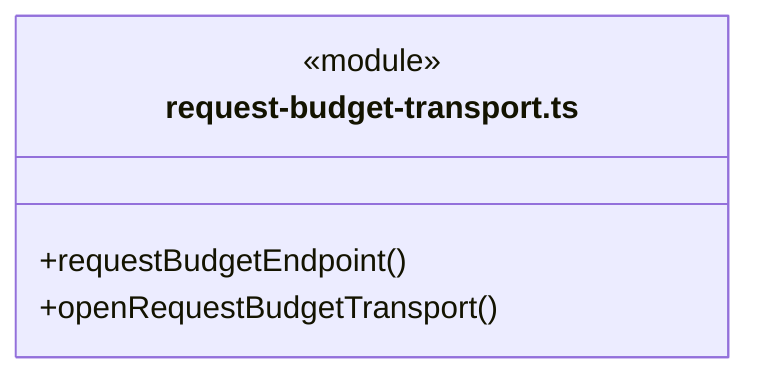
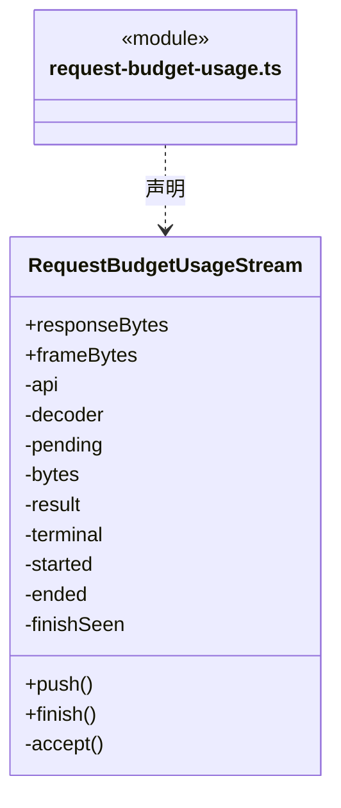
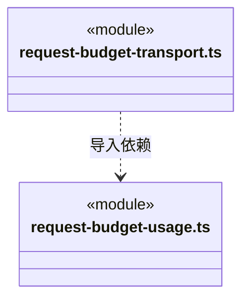

# src/backend/engines/transport 架构

## 目录定位

引擎 HTTP 请求预算与计量适配。通过 Core 的 ModelRequestBudgetPort 预占、结算或记录未知结果；网络实现与稳定模型端口分离，保留各引擎错误和取消语义。

本文描述当前实现。通过分析目录边界后维护的 [源码架构脚本](../../../../scripts/source-architecture.mjs) 同步清单和声明；代码变更时仍须核对职责、关键成员与关系。

## 代码清单

| 文件 | 当前职责 |
| --- | --- |
| [request-budget-transport.ts](request-budget-transport.ts) | 每运行创建只接受随机令牌的本机供应商代理，逐 HTTP 尝试预留并结算预算。 |
| [request-budget-usage.ts](request-budget-usage.ts) | 严格读取三种受支持 SSE 协议的请求用量，并暂存终态帧供可靠结算后交付。 |

## 架构类图

### request-budget-transport.ts

直接依赖：[../../../logic/models/index.ts](../../../logic/models/index.ts)、[../../../logic/budget/rules/request-budget.ts](../../../logic/budget/rules/request-budget.ts)、[request-budget-usage.ts](request-budget-usage.ts)、[../../../logic/budget/rules/model-request-budget-rules.ts](../../../logic/budget/rules/model-request-budget-rules.ts)、[../../../core/errors.ts](../../../core/errors.ts)、[../../../logic/team/rules/workspace-member-rules.ts](../../../logic/team/rules/workspace-member-rules.ts)。

### request-budget-usage.ts

直接依赖：[../../../logic/budget/rules/model-request-budget.ts](../../../logic/budget/rules/model-request-budget.ts)、[../../../core/errors.ts](../../../core/errors.ts)。

### 本目录调用边界

## 子目录导航

无子目录。

[返回上层](../ARCHITECTURE.md)。

每次修改本目录代码，同步维护文件头、关键契约说明及本图。未实现的治理、证据验收和自动编排能力不列入当前类图。

## 设计契约 v1 与落地范围

以下内容区分已接通能力与后续设计；以各节的实现状态为准，不将目标图当作现状图。维护源：[CONTRACT.md](CONTRACT.md)；生成类图时同步附加，勿直接修改本附录。

# 模型流中断诊断

`RequestBudgetUsageStream` 只暂存可靠终态，不将 response.incomplete 或 response.failed 当作完成。已知 max_output_tokens、content_filter 和通用未完成/失败分别返回固定的 Fault；错误正文由本地定义，不透传供应商任意信息。预算传输保留这些可信诊断，同时保持原未知预留、阻断后续请求及工具的规则。

输出上限提示建议核实已有工具回执后继续、按需要分段生成或调整模型输出上限，不自动提高上限、拼接工具参数、重试或重放写入。未知原因明确未知；旧日志中已丢失的供应商原因无法追溯补造。工具恢复与会话绑定仍由各引擎负责，此解析器不执行文件事务，也不保证正在进行的磁盘写入具备原子性。
