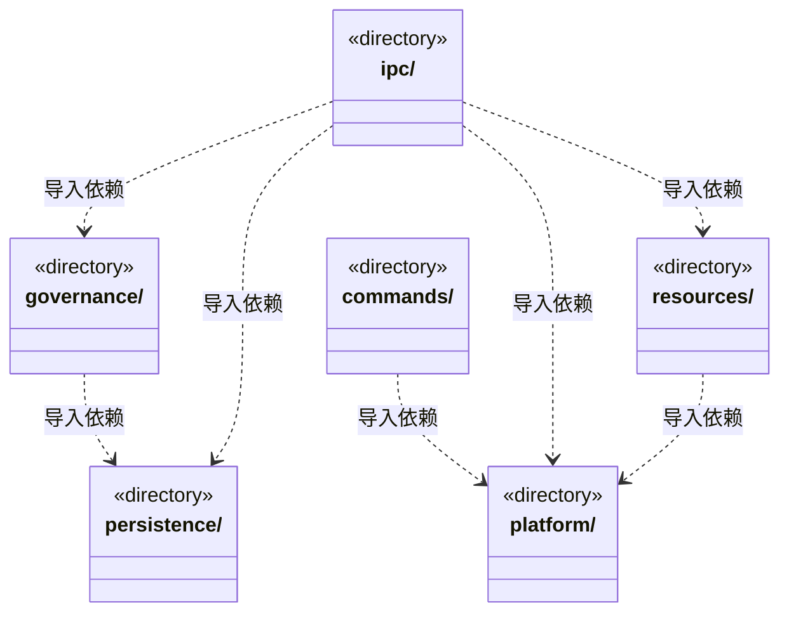
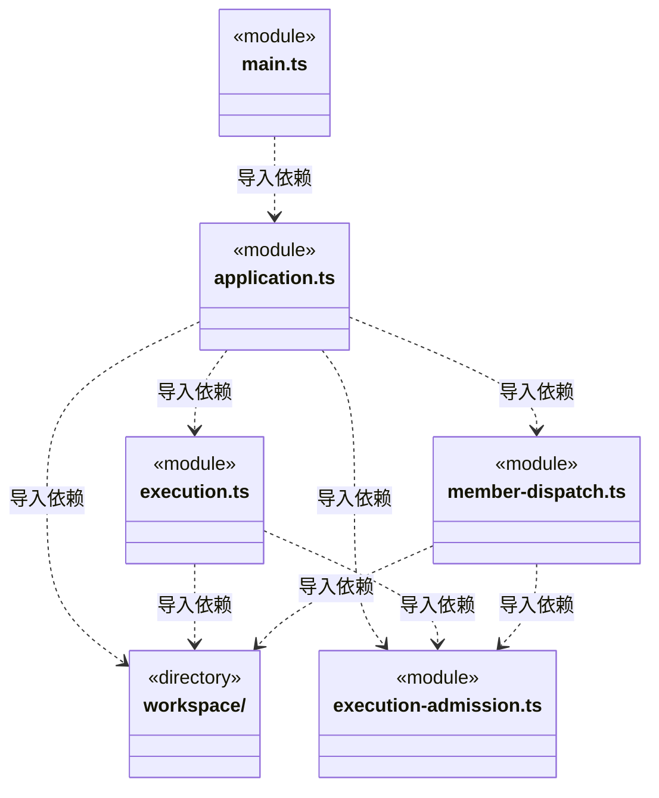
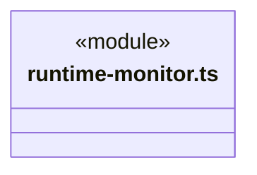
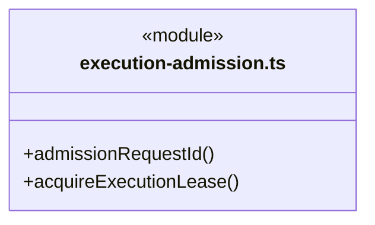
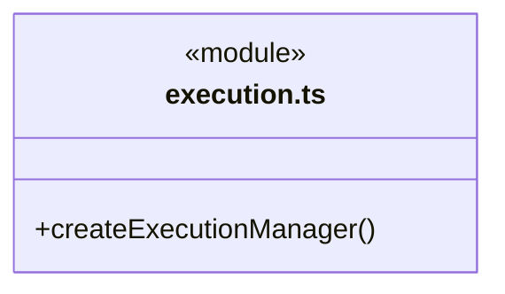
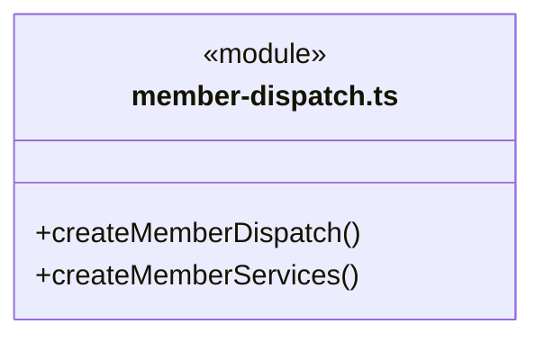

# src/backend/main 架构

## 目录定位

Electron 入口与应用装配。应用单例持有全局准入和持久策略，主/成员共享许可；工作区代际退役撤销等待，已有运行真实退出才释放。注入可信身份及证据，重启不执行历史票据或等待周期。 可信桌面提交注入本机明确操作来源，选定文件核实共用只读租约与平台端口。

本文描述当前实现。通过分析目录边界后维护的 [源码架构脚本](../../../scripts/source-architecture.mjs) 同步清单和声明；代码变更时仍须核对职责、关键成员与关系。

## 代码清单

| 文件 | 当前职责 |
| --- | --- |
| [application.ts](application.ts) | 单次运行授权、版本化队列增量和结构化问题按工作区路由；排队时冻结附件内容与模型身份。Application：登记及重命名工作区、装配模型供应商与服务，并统一派发主 Agent 对话、附件快照、工具审批和历史操作。 |
| [execution-admission.ts](execution-admission.ts) | 把应用级并发准入与本工作区文件/实例租约组合为主轮和成员轮共用的同步领取入口。 |
| [execution.ts](execution.ts) | 主进程执行装配，将工作区、已解析模型、原生锁与平台访问策略注入调度引擎。 |
| [main.ts](main.ts) | 本机后端的 Electron 装配入口，管理窗口、固定 IPC、原生文件选择、附件预览与打包验证；前端只通过 bridge/preload 请求服务。 |
| [member-dispatch.ts](member-dispatch.ts) | 为已运行工作区装配成员派发、大脑执行及目标审阅的可信日志读取端口。 |
| [runtime-monitor.ts](runtime-monitor.ts) | 把工作区派发/周期事务、两套运行日志和对话队列接入全局监管，同时维护静态 Agent 的持久化历史归档。 |

## 架构类图

各图中的同名节点表示同一目录边界；跨组及完整直接依赖如下（无边不代表继承）：

- `application.ts` → `ipc`：导入。
- `application.ts` → `persistence`：导入。
- `application.ts` → `execution.ts`：导入。
- `application.ts` → `member-dispatch.ts`：导入。
- `application.ts` → `execution-admission.ts`：导入。
- `application.ts` → `runtime-monitor.ts`：导入。
- `application.ts` → `workspace`：导入。
- `application.ts` → `platform`：导入。
- `application.ts` → `resources`：导入。
- `commands` → `platform`：导入。
- `commands` → `application.ts`：导入。
- `execution.ts` → `persistence`：导入。
- `execution.ts` → `workspace`：导入。
- `execution.ts` → `platform`：导入。
- `execution.ts` → `execution-admission.ts`：导入。
- `execution.ts` → `resources`：导入。
- `execution.ts` → `governance`：导入。
- `governance` → `workspace`：导入。
- `governance` → `persistence`：导入。
- `ipc` → `persistence`：导入。
- `ipc` → `workspace`：导入。
- `ipc` → `resources`：导入。
- `ipc` → `platform`：导入。
- `ipc` → `governance`：导入。
- `main.ts` → `platform`：导入。
- `main.ts` → `application.ts`：导入。
- `main.ts` → `persistence`：导入。
- `member-dispatch.ts` → `workspace`：导入。
- `member-dispatch.ts` → `persistence`：导入。
- `member-dispatch.ts` → `platform`：导入。
- `member-dispatch.ts` → `execution-admission.ts`：导入。
- `persistence` → `workspace`：导入。
- `resources` → `platform`：导入。
- `runtime-monitor.ts` → `workspace`：导入。
- `runtime-monitor.ts` → `persistence`：导入。
- `workspace` → `platform`：导入。
- `workspace` → `persistence`：导入。
- `workspace` → `governance`：导入。

### execution-admission.ts 公开入口

### execution.ts 公开入口

### member-dispatch.ts 公开入口

## 子目录导航

- [commands/](commands/ARCHITECTURE.md)：CLI 入口，复用应用和调度，不拥有第二套领域规则。
- [governance/](governance/ARCHITECTURE.md)：工作区模块知识治理服务、可信桌面操作与独立主运行端口。登记保护、决定及实施只属桌面；模型仅可读取、观察、提案和核查回执；反馈来源在批准与实施前串行复核，未知不重放。
- [ipc/](ipc/ARCHITECTURE.md)：应用 action 路由。公开准入游标读取和版本化设置，不开放许可领取/撤销。报告、核实和业务重规划保持独立；启动额度不足明确未受理，桌面发送方在 Electron 接入处核验。 人工提交参数不接受 actor，保存不启动模型；查询保留历史身份。
- [persistence/](persistence/ARCHITECTURE.md)：本机持久化适配：知识事务、运行日志、对话附件、模型配置。保留原数据路径与格式，目录调整不迁移用户数据。
- [platform/](platform/ARCHITECTURE.md)：本机路径、系统锁、凭据加密、终端与工具访问检查。业务文件及受管原生会话各用固定根、有界读取与前后身份核实，拒绝链接、越界和 Windows 备用数据流；原生历史不完整则拒绝恢复，不修补原文件或承诺外部原子隔离。
- [resources/](resources/ARCHITECTURE.md)：链接器、人才和完整业务模板共用的本地/远端资源仓库。静态发布与导入同时核对源仓库和目标知识版本，显式提交复用知识事务；资源定义不等于可执行工具。
- [workspace/](workspace/ARCHITECTURE.md)：本机工作区登记、运行实例与可信桌面静态架构编辑。持锁打开、监听、关闭，知识事务委托 persistence/knowledge；模块维护确认和真人条目同事务，不变更动态任务图。

[返回上层](../ARCHITECTURE.md)。

每次修改本目录代码，同步维护文件头、关键契约说明及本图。未实现的治理、证据验收和自动编排能力不列入当前类图。

## 设计契约 v1 与落地范围

以下内容区分已接通能力与后续设计；以各节的实现状态为准，不将目标图当作现状图。维护源：[CONTRACT.md](CONTRACT.md)；生成类图时同步附加，勿直接修改本附录。

# 主进程运行装配契约

## 模块知识保护与桌面治理

每个 `Workspace` 装配独立 `ModuleGovernanceService` 和用户数据账本；`Application.governance(id)` 只返回已就绪实例。桌面登记和人工决定由 IPC 注入本机明确操作标记，模型工具、普通知识参数和资源内容不能签发批准。正式实施另走显式 apply，仍由原 KnowledgeStore 串行事务写入；服务关闭随知识队列排空，不恢复未完成意图。

`createExecutionManager` 仅为已登记主对话实例提供 `ExecutionServices.governanceTools` 工厂；实际 createEngine 得到 runId 后才绑定四个窄端口。端口不缓存到共享 KnowledgeTools，执行成员及未装配 CLI 没有治理工具。主模型只读依据、保存观察/提案和查询原回执；作用域为当前 knowledge，但不授予知识写或业务执行权限。来源和稳定命令来自可信主绑定与工具调用 ID，输出有界，停止后的未知结果仍只查询原命令。

## 本机资源仓库连接生命周期

`Application.repositoryConnections` 是应用唯一的桌面连接服务，使用 `ResourceRepositories` 当前真实共享闭包和工作区知识事务端口；用户目录保存授权与命令回执，知识目录只保存可移植的链接器定义。初始化读取授权但不自动共享或联网，工作区关闭/重开先取消该工作区在途核验；应用退出先拒绝新连接操作、排空读写，再关闭共享服务。原回执查询不创建运行、调用模型或恢复旧工作区实例。

`createExecutionManager` 仅为 chat 主运行调用 `prepareTools`，把本轮固定的已授权只读端口注入 `ExecutionServices.repositoryTools`。能力捕获不访问 HTTP；实际模型调用才读取，执行成员、未装配的 CLI 和没有就绪连接的主轮不注册两项仓库工具。端口不从 ChatOptions 或模型参数取得授权，不改变主角色业务写入/命令禁令。

## 正式成员的 Workflow 能力装配

`member-dispatch.prepare` 从与 Pi 实际注册相同的 `core/tools/native-tools` 清单，按本轮 permission 返回 availableTools；密钥和实际模型留在可信工厂。执行服务在 claim/run 之前预检冻结的模块约定。创建 Runtime 时注入全部 `preparedWorkflowContracts(run.prepared)`，普通主聊天不接此业务执行门禁，也不因此获得业务写入或命令权限。

## 本机显式人工决定

`member-dispatch` 为 `WorkspaceDispatchService.humanDecisions` 复用工作区固定的 canonical 日志、`ArtifactFiles` 与业务只读占用。没有选择基线时不读业务文件；明确选择的全部候选共用一次文件计量上限，不取得模型运行槽位。工作区退役、关闭或读取期间变化拒绝新的记录，回执查询不重新核实或启动执行。

人工决定只在可信桌面 IPC 路由注入本机 explicit_submit 标记，不从渲染参数或模型工具接受 actor/proof/文件哈希；该标记不代表已登录身份。单独保存 waiting 周期的记录，不调用执行管理器，也不消费等待、继续队列或更改权限。

## 文件基线采集与只读复核

`member-dispatch` 为每个成员运行注入 `ArtifactFiles`、固定知识版本及 `recheckDispatchExecutionContext` 实时复核闭包。普通主会话没有采集端口。平台路径仅从可信同轮工具来源解析，不接受前端或模型提交哈希；文件读取不返回正文。

历史报告复用同一平台限额，由 `MemberExecutionManager` 按明确运行交独立报告服务。只有显式指定 baselineId 才临时取得 `WorkspaceExecutionLease` 读占用，未指定仅列日志引用；报告不获取模型名额、不唤醒调度、不修复日志，也不将知识事务与文件系统观察宣称为跨存储原子快照。

## 应用级执行准入

成员检查点的私有 native 读取由 `NativeSessionFiles` 固定在本工作区 dispatch/runs/pi/sessions 内。结算在真实 close 之后记录指纹；续执行使用原 run 的固定配置，并通过 `assertMemberResume` 在领取后 Runtime/Pi 准备窗口再次复核全部冻结证明。该闭包不接客户端路径或模型声明，也不刷新原 proof 来掩盖知识、业务文件或 native 变化。关闭及启动恢复沿原安全规则封存 active 周期，不自动重放预约。

`Application` 持有唯一 `GlobalRunAdmission`，与只读 `GlobalRuntimeManager` 分开。`AdmissionSettings` 在恢复工作区之前安装已保存策略；默认额度 4，策略调整不停止已有运行。每次工作区装配产生本进程正整数 `ownerEpoch`，关闭、重开或初始化失败先退役旧代际并撤销等待票，实际运行名额仍由原释放函数归还。

`execution-admission.ts` 将全局资格与 `WorkspaceExecutionLease` 同步组合。请求键由主/成员来源加稳定命令 SHA-256 摘要组成，满足身份长度与字符约束；撤票只传 `AdmissionIdentity`，不夹带请求权限和来源字段。所有桌面主轮与成员轮使用同一服务，测试或独立装配未传服务时仍沿用已有工作区租约。

主普通聊天在 `LoopRuntime.acquireLease` 成功之后才调用 `beforeRun` 打开目标周期，额度不足不会创建 scope、运行日志或模型请求。主轮始终只领取业务只读租约；知识写仍经过内部知识服务事务与用户权限。成员在派发存储事务内、领取信封和记录 run 之前取得全局及本地资格；准备、原生锁或持久化失败释放已取得资源。成员的未知终态仍保留原有占用规则，不能为了展示空闲而假释放。

成员准备知识、解析模型和最终重查基线后都重新核对批次及工作区代际。装配 `isCurrent` 在工作区退役时立即失效，手动成员启动同样受约束；不依赖稍后才执行的 manager.close。若停止发生在已经开始的持久提交期间，保留真实启动意图并结算取消，但不创建模型。代际同时发出 AbortSignal，成员启动信号贯穿尚未登记 active 的原生准备阶段；异常启动继续按 interrupted 留证，不伪装为未执行。

`CAPACITY_BUSY` 只表示直接请求在受理前被全局额度或公平顺序拒绝，不留下自动重试票。显式补充、只读核实和业务重规划在此门禁之后才保存受理意图；已保存命令仍优先查原回执。已受理协作的成员和结果回注使用 `CAPACITY_WAITING`，票据只含身份和权限，不含用户正文或凭据。回调由原 `AutoCollaboration` 批次持有，不由 IPC 或模型传入；释放只通知原协调器重新核实，不能直接重放运行。

本地租约释放通知全局资格变化；单纯读取监管或准入快照不触发执行。退出先撤票，再停止与排空主/成员运行及历史服务。等待票不持久化，重启继续沿用安全等待占位和历史中断处理，不依据旧票恢复模型。

## 目标周期消耗读取

`dispatch.scopeUsage` 接受明确 workspaceId/rootSessionId/scopeId，将请求交给 `WorkspaceDispatchService.usage`。服务复用工作区装配已有的主/成员 canonical 日志端口，文件路径由后端可信身份解析，不接受客户端路径或用量正文。返回白名单统计、来源身份和安全诊断，不暴露日志正文、原生路径或密钥。读取不会创建运行、领取名额、批准任务或更新知识；本步没有预算配置或计费扣款。
`Application.budgetSettings` 在恢复工作区前初始化，`budget.settings` / `budget.configure` 只读写未来周期的默认软限额。工作区给派发服务注入可靠设置读取闭包；新周期在创建事务中复制策略，当前和 waiting 周期保持原值。成员与主调度共享同一 ScopeBudgetService 和可信日志端口，不能从 IPC 参数、统计界面缓存或重建监管索引签发额度许可。
