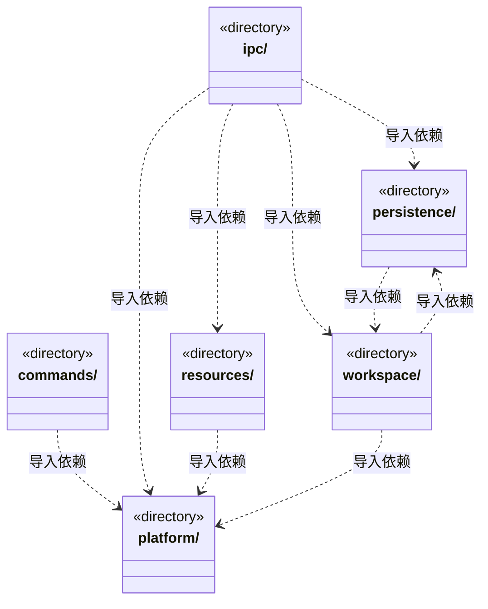
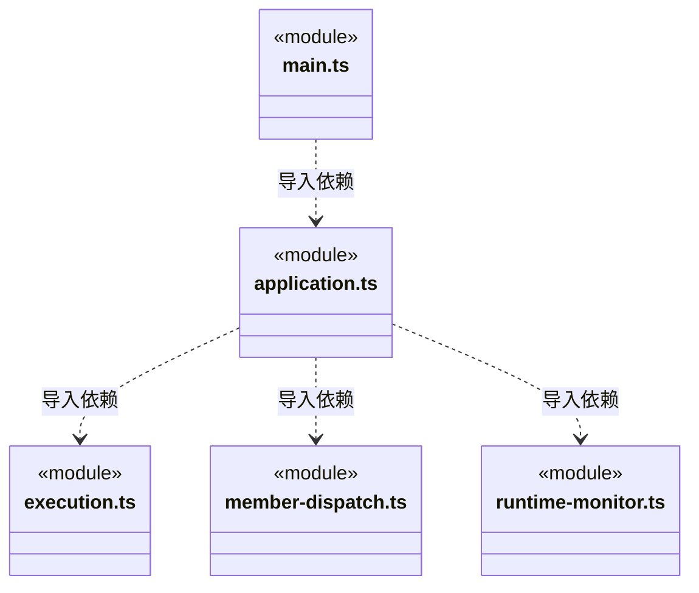
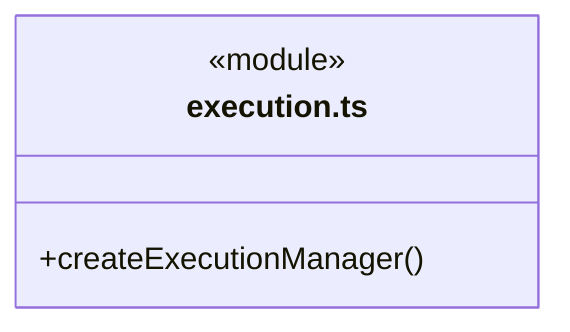
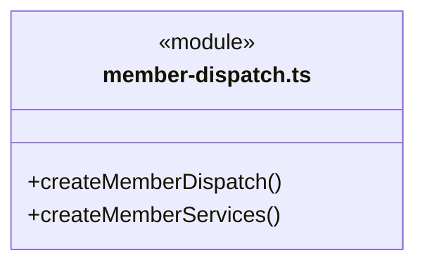

# src/backend/main 架构

## 目录定位

Electron 入口与应用装配。注入实例、周期和证据日志端口，身份不符使用稳定错误码；只读核实与启动分开。恢复等待占位不执行模型，退出排空执行、保留停泊目标后关闭存储。

本文描述当前实现。通过分析目录边界后维护的 [源码架构脚本](../../../scripts/source-architecture.mjs) 同步清单和声明；代码变更时仍须核对职责、关键成员与关系。

## 代码清单

| 文件 | 当前职责 |
| --- | --- |
| [application.ts](application.ts) | 单次运行授权、版本化队列增量和结构化问题按工作区路由；排队时冻结附件内容与模型身份。Application：登记及重命名工作区、装配模型供应商与服务，并统一派发主 Agent 对话、附件快照、工具审批和历史操作。 |
| [execution.ts](execution.ts) | 主进程执行装配，将工作区、已解析模型、原生锁与平台访问策略注入调度引擎。 |
| [main.ts](main.ts) | 本机后端的 Electron 装配入口，管理窗口、固定 IPC、原生文件选择、附件预览与打包验证；前端只通过 bridge/preload 请求服务。 |
| [member-dispatch.ts](member-dispatch.ts) | 为已运行工作区装配成员派发、大脑执行及目标审阅的可信日志读取端口。 |
| [runtime-monitor.ts](runtime-monitor.ts) | 把工作区派发事务、两套运行日志和对话队列接入全局监管，同时维护静态 Agent 的持久化历史归档。 |

## 架构类图

各图中的同名节点表示同一目录边界；跨组及完整直接依赖如下（无边不代表继承）：

- `application.ts` → `ipc`：导入。
- `application.ts` → `persistence`：导入。
- `application.ts` → `execution.ts`：导入。
- `application.ts` → `member-dispatch.ts`：导入。
- `application.ts` → `runtime-monitor.ts`：导入。
- `application.ts` → `workspace`：导入。
- `application.ts` → `platform`：导入。
- `application.ts` → `resources`：导入。
- `commands` → `platform`：导入。
- `commands` → `application.ts`：导入。
- `execution.ts` → `persistence`：导入。
- `execution.ts` → `workspace`：导入。
- `execution.ts` → `platform`：导入。
- `ipc` → `persistence`：导入。
- `ipc` → `workspace`：导入。
- `ipc` → `resources`：导入。
- `ipc` → `platform`：导入。
- `main.ts` → `platform`：导入。
- `main.ts` → `application.ts`：导入。
- `main.ts` → `persistence`：导入。
- `member-dispatch.ts` → `workspace`：导入。
- `member-dispatch.ts` → `persistence`：导入。
- `member-dispatch.ts` → `platform`：导入。
- `persistence` → `workspace`：导入。
- `resources` → `platform`：导入。
- `runtime-monitor.ts` → `workspace`：导入。
- `runtime-monitor.ts` → `persistence`：导入。
- `workspace` → `platform`：导入。
- `workspace` → `persistence`：导入。

### execution.ts 公开入口

### member-dispatch.ts 公开入口

## 子目录导航

- [commands/](commands/ARCHITECTURE.md)：CLI 入口，复用应用和调度，不拥有第二套领域规则。
- [ipc/](ipc/ARCHITECTURE.md)：应用action路由。目标补充使用稳定命令，执行核实按明确任务/运行只读；普通聊天、审批与补充分开。sessionRead返回同屏障图/目标增量，桌面发送方在Electron接入处核验。
- [persistence/](persistence/ARCHITECTURE.md)：本机持久化适配：知识事务、运行日志、对话附件、模型配置。保留原数据路径与格式，目录调整不迁移用户数据。
- [platform/](platform/ARCHITECTURE.md)：本机路径、系统锁、凭据加密、命令终端及原生工具访问检查。路径策略不是操作系统沙箱。
- [resources/](resources/ARCHITECTURE.md)：链接器、人才和完整业务模板共用的本地/远端资源仓库。静态发布与导入同时核对源仓库和目标知识版本，显式提交复用知识事务；资源定义不等于可执行工具。
- [workspace/](workspace/ARCHITECTURE.md)：本机工作区登记、运行实例与可信桌面静态架构编辑。持锁打开、监听、关闭，知识事务委托 persistence/knowledge；模块维护确认和真人条目同事务，不变更动态任务图。

[返回上层](../ARCHITECTURE.md)。

每次修改本目录代码，同步维护文件头、关键契约说明及本图。未实现的治理、证据验收和自动编排能力不列入当前类图。
