# src/backend/main/assembly 架构

## 目录定位

应用装配：连接 IPC、调度、运行与平台服务并管理应用生命周期。准入和工具能力在这里注入；不把装配目录当新的领域模型。 Application 可拆开初始化与恢复；主/成员工厂共用宿主的 EngineRuntimeResolver，界面与模型不能指定 E 路径。

本文描述当前实现。通过分析目录边界后维护的 [源码架构脚本](../../../../scripts/source-architecture.mjs) 同步清单和声明；代码变更时仍须核对职责、关键成员与关系。

## 代码清单

| 文件 | 当前职责 |
| --- | --- |
| [application.ts](application.ts) | 单次运行授权、版本化队列增量和结构化问题按工作区路由；排队时冻结附件内容与模型身份。Application：登记及重命名工作区、装配模型供应商与服务，并统一派发主 Agent 对话、附件快照、工具审批和历史操作。 |
| [execution-admission.ts](execution-admission.ts) | 把应用级并发准入与本工作区文件/实例租约组合为主轮和成员轮共用的同步领取入口。 |
| [execution.ts](execution.ts) | 主进程执行装配，将工作区、已解析模型、原生锁与平台访问策略注入调度引擎。 |
| [member-dispatch.ts](member-dispatch.ts) | 为已运行工作区装配成员派发、大脑执行、目标审阅、岗位及模块负责人服务；复用工作区恢复前创建的唯一 DispatchStore，来源、责任、岗位与执行保持独立审计投影。 |
| [runtime-monitor.ts](runtime-monitor.ts) | 把工作区派发/周期事务、两套运行日志和对话队列接入全局监管，同时维护静态 Agent 的持久化历史归档。 |

## 架构类图

### application.ts

成员 1/4（同名节点为同一声明，跨图合并阅读）。

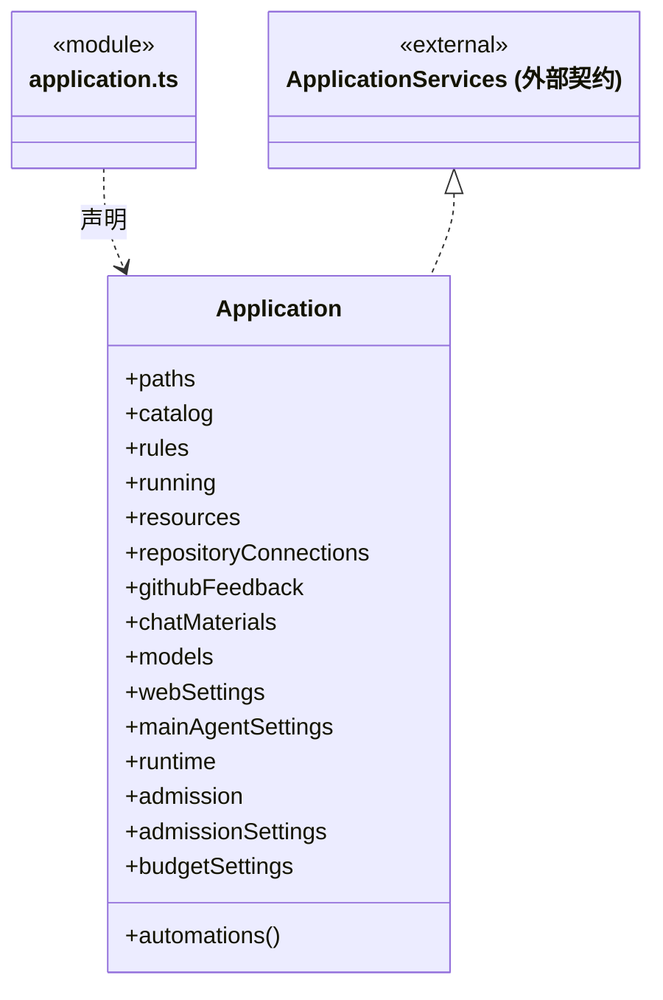

成员 2/4（同名节点为同一声明，跨图合并阅读）。

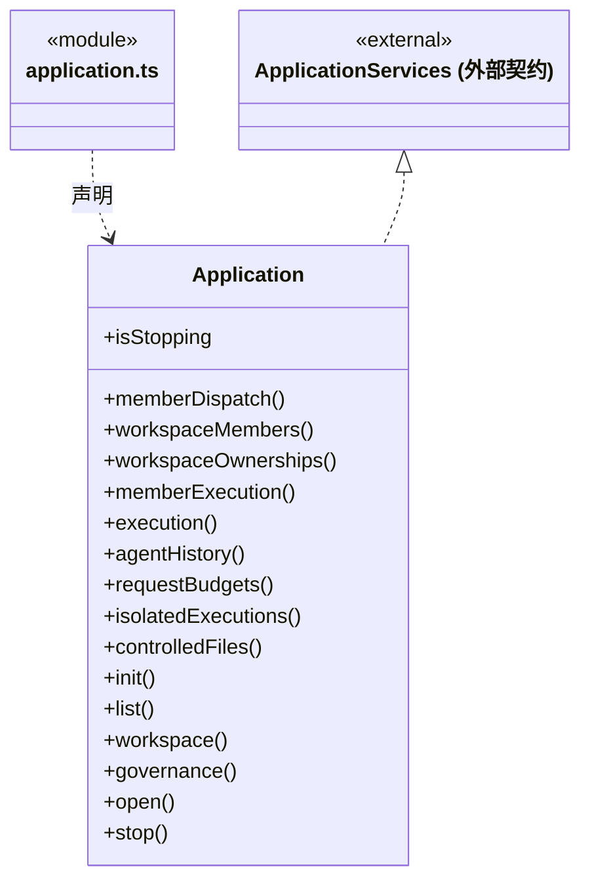

成员 3/4（同名节点为同一声明，跨图合并阅读）。

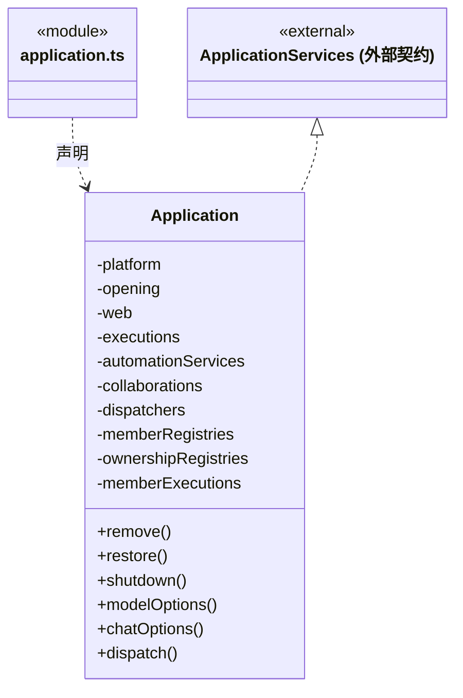

成员 4/4（同名节点为同一声明，跨图合并阅读）。

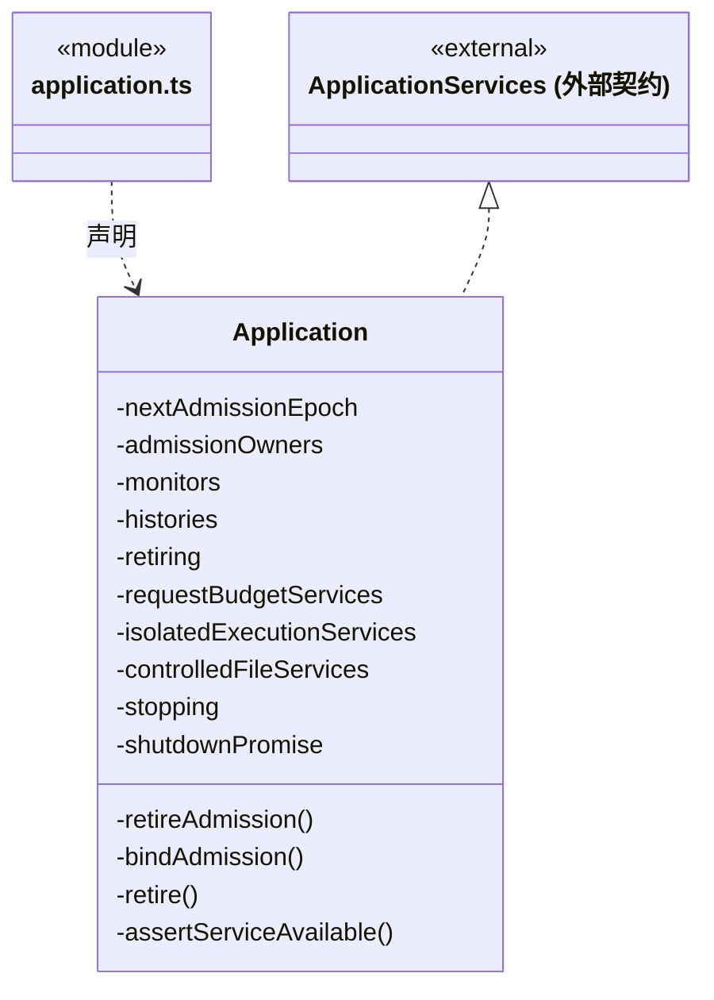

直接依赖：[../../../bridge/contracts/ipc-call.ts](../../../bridge/contracts/ipc-call.ts)、[../settings/web-settings.ts](../settings/web-settings.ts)、[../web/web-service.ts](../web/web-service.ts)、[../automation/service.ts](../automation/service.ts)、[../platform/files/controlled-file-protocol.ts](../platform/files/controlled-file-protocol.ts)、[../../scheduler-engine/budget/model-request-budget-service.ts](../../scheduler-engine/budget/model-request-budget-service.ts)、[../file-operations/controlled-files.ts](../file-operations/controlled-files.ts)、[../file-operations/isolated-executions.ts](../file-operations/isolated-executions.ts)、[../ipc/dispatch.ts](../ipc/dispatch.ts)、[../ipc/services.ts](../ipc/services.ts)、[../models/llm-profiles.ts](../models/llm-profiles.ts)、[../models/main-agent-settings.ts](../models/main-agent-settings.ts)、[../settings/admission-settings.ts](../settings/admission-settings.ts)、[../settings/budget-settings.ts](../settings/budget-settings.ts)、[../feedback/github-feedback.ts](../feedback/github-feedback.ts)、[execution.ts](execution.ts)、[../../core/execution/engine-runtime.ts](../../core/execution/engine-runtime.ts)、[member-dispatch.ts](member-dispatch.ts)、[../dispatch-storage/dispatch-store.ts](../dispatch-storage/dispatch-store.ts)、[../../scheduler-engine/dispatch/dispatch-service.ts](../../scheduler-engine/dispatch/dispatch-service.ts)、[../../scheduler-engine/members/member-execution.ts](../../scheduler-engine/members/member-execution.ts)、[../../scheduler-engine/admission/workspace-lease.ts](../../scheduler-engine/admission/workspace-lease.ts)、[../../scheduler-engine/dispatch/auto-collaboration.ts](../../scheduler-engine/dispatch/auto-collaboration.ts)、[../../scheduler-engine/runtime/global-runtime.ts](../../scheduler-engine/runtime/global-runtime.ts)、[../../scheduler-engine/admission/run-admission.ts](../../scheduler-engine/admission/run-admission.ts)、[execution-admission.ts](execution-admission.ts)、[runtime-monitor.ts](runtime-monitor.ts)、[../materials/chat-inputs.ts](../materials/chat-inputs.ts)、[../materials/chat-material-imports.ts](../materials/chat-material-imports.ts)、[../history/assembly.ts](../history/assembly.ts)、[../../scheduler-engine/history/agent-history.ts](../../scheduler-engine/history/agent-history.ts)、[../../scheduler-engine/conversation/execution-manager.ts](../../scheduler-engine/conversation/execution-manager.ts)、[../workspace/catalog.ts](../workspace/catalog.ts)、[../platform/paths.ts](../platform/paths.ts)、[../../core/foundation/files.ts](../../core/foundation/files.ts)、[../../core/foundation/errors.ts](../../core/foundation/errors.ts)、[../../core/knowledge/knowledge.ts](../../core/knowledge/knowledge.ts)、[../workspace/workspace.ts](../workspace/workspace.ts)、[../resources/resource-repository.ts](../resources/resource-repository.ts)、[../resources/repository-connections.ts](../resources/repository-connections.ts)、[../registry/workspace-members.ts](../registry/workspace-members.ts)、[../registry/module-ownerships.ts](../registry/module-ownerships.ts)。

### execution-admission.ts

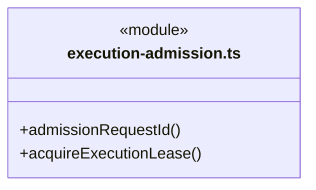

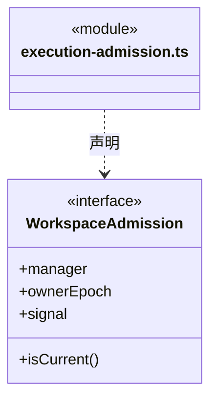

直接依赖：[../../core/foundation/errors.ts](../../core/foundation/errors.ts)、[../../core/foundation/serialization.ts](../../core/foundation/serialization.ts)、[../../core/runtime/admission.ts](../../core/runtime/admission.ts)、[../../scheduler-engine/admission/run-admission.ts](../../scheduler-engine/admission/run-admission.ts)、[../../scheduler-engine/admission/workspace-lease.ts](../../scheduler-engine/admission/workspace-lease.ts)、[../../scheduler-engine/admission/admission-wait.ts](../../scheduler-engine/admission/admission-wait.ts)。

### execution.ts

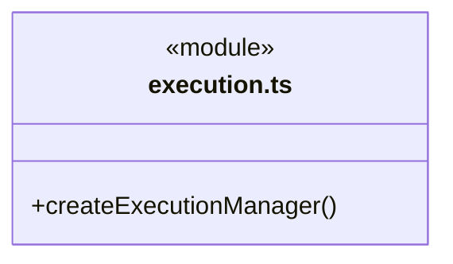

直接依赖：[../../core/connectors/web-tools.ts](../../core/connectors/web-tools.ts)、[../run-storage/run-storage.ts](../run-storage/run-storage.ts)、[../materials/chat-inputs.ts](../materials/chat-inputs.ts)、[../models/llm-profiles.ts](../models/llm-profiles.ts)、[../workspace/workspace.ts](../workspace/workspace.ts)、[../platform/locking.ts](../platform/locking.ts)、[../platform/tool-guard.ts](../platform/tool-guard.ts)、[../../core/foundation/serialization.ts](../../core/foundation/serialization.ts)、[../../core/foundation/errors.ts](../../core/foundation/errors.ts)、[../../scheduler-engine/conversation/execution-manager.ts](../../scheduler-engine/conversation/execution-manager.ts)、[../../scheduler-engine/assembly/loop-engine.ts](../../scheduler-engine/assembly/loop-engine.ts)、[../../core/execution/engine-runtime.ts](../../core/execution/engine-runtime.ts)、[../../scheduler-engine/admission/workspace-lease.ts](../../scheduler-engine/admission/workspace-lease.ts)、[../../scheduler-engine/dispatch/auto-collaboration.ts](../../scheduler-engine/dispatch/auto-collaboration.ts)、[../../scheduler-engine/dispatch/dispatch-service.ts](../../scheduler-engine/dispatch/dispatch-service.ts)、[execution-admission.ts](execution-admission.ts)、[../feedback/github-feedback.ts](../feedback/github-feedback.ts)、[../resources/repository-connections.ts](../resources/repository-connections.ts)、[../governance/main-governance-tools.ts](../governance/main-governance-tools.ts)、[../registry/main-workspace-member-tools.ts](../registry/main-workspace-member-tools.ts)、[../registry/main-module-ownership-tools.ts](../registry/main-module-ownership-tools.ts)、[../registry/module-ownerships.ts](../registry/module-ownerships.ts)、[../registry/workspace-members.ts](../registry/workspace-members.ts)、[../../scheduler-engine/budget/model-request-budget-service.ts](../../scheduler-engine/budget/model-request-budget-service.ts)。

### member-dispatch.ts

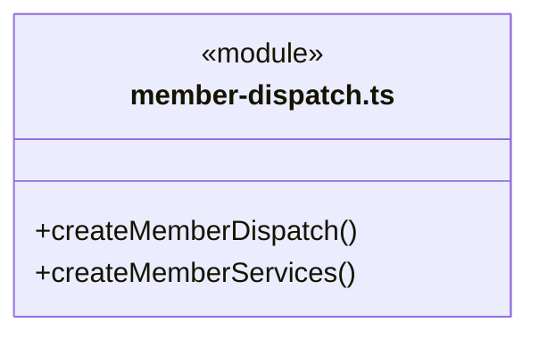

直接依赖：[../workspace/workspace.ts](../workspace/workspace.ts)、[../../scheduler-engine/dispatch/dispatch-service.ts](../../scheduler-engine/dispatch/dispatch-service.ts)、[../../core/dispatch/dispatch-storage.ts](../../core/dispatch/dispatch-storage.ts)、[../models/llm-profiles.ts](../models/llm-profiles.ts)、[../../scheduler-engine/admission/workspace-lease.ts](../../scheduler-engine/admission/workspace-lease.ts)、[../../scheduler-engine/members/member-execution.ts](../../scheduler-engine/members/member-execution.ts)、[../../scheduler-engine/assembly/loop-engine.ts](../../scheduler-engine/assembly/loop-engine.ts)、[../../core/execution/engine-runtime.ts](../../core/execution/engine-runtime.ts)、[../../scheduler-engine/context/execution-context.ts](../../scheduler-engine/context/execution-context.ts)、[../platform/files/artifact-files.ts](../platform/files/artifact-files.ts)、[../platform/files/code-check-runner.ts](../platform/files/code-check-runner.ts)、[../platform/files/output-manifest-files.ts](../platform/files/output-manifest-files.ts)、[../platform/native-session-files.ts](../platform/native-session-files.ts)、[../../core/tasks/member-checkpoint.ts](../../core/tasks/member-checkpoint.ts)、[../../scheduler-engine/members/member-checkpoint-verifier.ts](../../scheduler-engine/members/member-checkpoint-verifier.ts)、[../run-storage/run-storage.ts](../run-storage/run-storage.ts)、[../platform/tool-guard.ts](../platform/tool-guard.ts)、[../platform/files/scoped-execution-files.ts](../platform/files/scoped-execution-files.ts)、[../../core/workspace/execution-scope.ts](../../core/workspace/execution-scope.ts)、[../../core/workspace/artifact-scope.ts](../../core/workspace/artifact-scope.ts)、[../../core/foundation/identity.ts](../../core/foundation/identity.ts)、[../../core/foundation/errors.ts](../../core/foundation/errors.ts)、[execution-admission.ts](execution-admission.ts)、[../../core/budget/scope-budget.ts](../../core/budget/scope-budget.ts)、[../../core/tasks/execution-context.ts](../../core/tasks/execution-context.ts)、[../../core/tools/native-tools.ts](../../core/tools/native-tools.ts)、[../registry/workspace-members.ts](../registry/workspace-members.ts)、[../registry/module-ownerships.ts](../registry/module-ownerships.ts)、[../../core/models/ports.ts](../../core/models/ports.ts)、[../../core/tasks/member-commands.ts](../../core/tasks/member-commands.ts)、[../../core/team/workspace-member-rules.ts](../../core/team/workspace-member-rules.ts)、[../file-operations/controlled-files.ts](../file-operations/controlled-files.ts)、[../file-operations/isolated-executions.ts](../file-operations/isolated-executions.ts)、[../file-operations/artifact-transitions.ts](../file-operations/artifact-transitions.ts)、[../platform/files/controlled-file-protocol.ts](../platform/files/controlled-file-protocol.ts)、[../evidence/knowledge-effect-reader.ts](../evidence/knowledge-effect-reader.ts)、[../evidence/persistent-effect-reader.ts](../evidence/persistent-effect-reader.ts)、[../../scheduler-engine/budget/model-request-budget-service.ts](../../scheduler-engine/budget/model-request-budget-service.ts)、[../dispatch-storage/request-budget-store.ts](../dispatch-storage/request-budget-store.ts)、[../../core/tasks/dispatch-execution.ts](../../core/tasks/dispatch-execution.ts)。

### runtime-monitor.ts

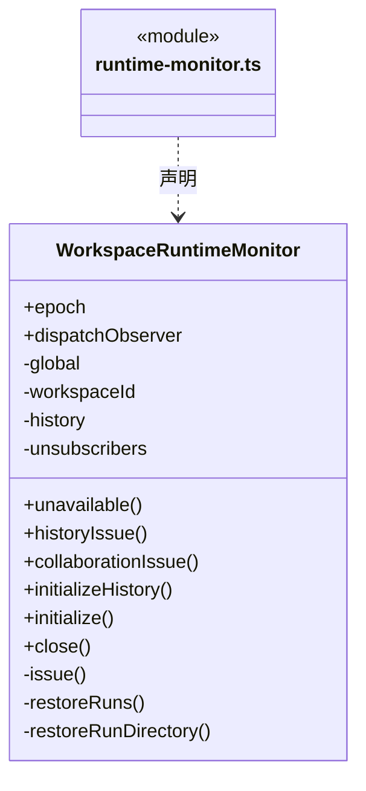

直接依赖：[../workspace/workspace.ts](../workspace/workspace.ts)、[../run-storage/run-storage.ts](../run-storage/run-storage.ts)、[../../core/foundation/identity.ts](../../core/foundation/identity.ts)、[../../core/dispatch/dispatch-storage.ts](../../core/dispatch/dispatch-storage.ts)、[../../scheduler-engine/dispatch/dispatch-service.ts](../../scheduler-engine/dispatch/dispatch-service.ts)、[../../scheduler-engine/conversation/execution-manager.ts](../../scheduler-engine/conversation/execution-manager.ts)、[../../scheduler-engine/members/member-execution.ts](../../scheduler-engine/members/member-execution.ts)、[../../scheduler-engine/runtime/global-runtime.ts](../../scheduler-engine/runtime/global-runtime.ts)、[../../scheduler-engine/history/agent-history.ts](../../scheduler-engine/history/agent-history.ts)。

### 本目录调用边界

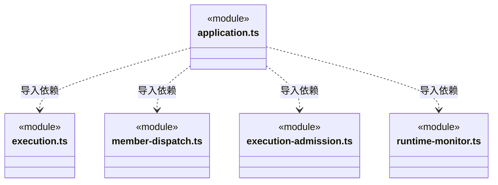

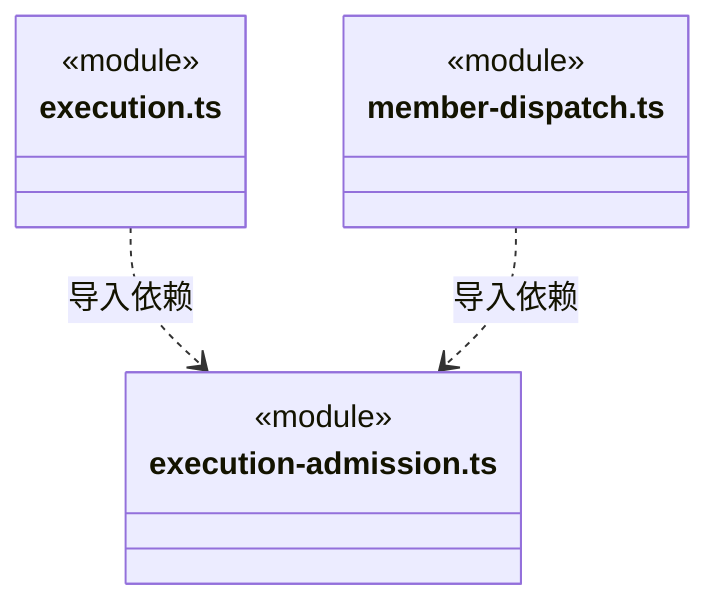

## 子目录导航

无子目录。

[返回上层](../ARCHITECTURE.md)。

每次修改本目录代码，同步维护文件头、关键契约说明及本图。未实现的治理、证据验收和自动编排能力不列入当前类图。
