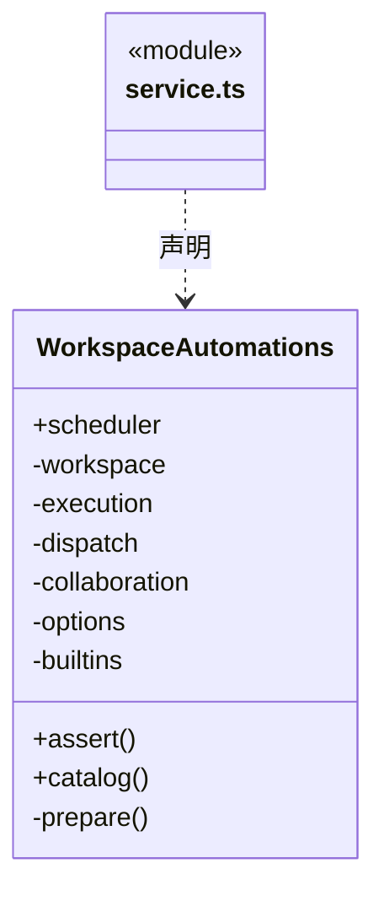
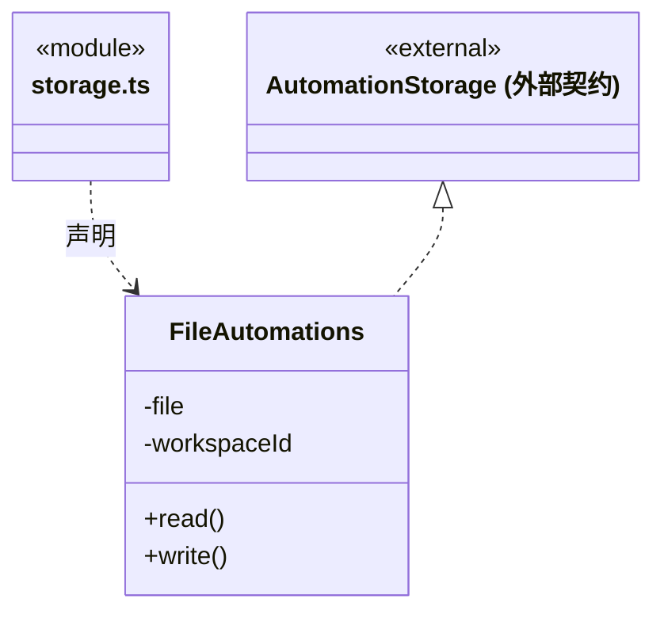
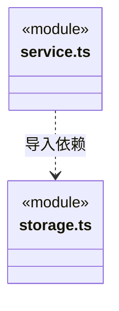

# src/backend/main/automation 架构

## 目录定位

自动化应用服务及文件存储：计划、执行请求与持久化属于同一应用职责，领域调度契约仍在 Core。

本文描述当前实现。通过分析目录边界后维护的 [源码架构脚本](../../../../scripts/source-architecture.mjs) 同步清单和声明；代码变更时仍须核对职责、关键成员与关系。

## 代码清单

| 文件 | 当前职责 |
| --- | --- |
| [service.ts](service.ts) | 将工作区知识、已采纳岗位和真实协作接入自动化端口，提供桌面目录与实例校验。 |
| [storage.ts](storage.ts) | 在工作区私有用户目录保存自动化定义与有界运行历史。 |

## 架构类图

### service.ts

直接依赖：[../workspace/workspace.ts](../workspace/workspace.ts)、[../../scheduler-engine/conversation/execution-manager.ts](../../scheduler-engine/conversation/execution-manager.ts)、[../../scheduler-engine/dispatch/auto-collaboration.ts](../../scheduler-engine/dispatch/auto-collaboration.ts)、[../../scheduler-engine/dispatch/dispatch-service.ts](../../scheduler-engine/dispatch/dispatch-service.ts)、[../../scheduler-engine/automation/scheduler.ts](../../scheduler-engine/automation/scheduler.ts)、[storage.ts](storage.ts)、[../../core/automation/contracts.ts](../../core/automation/contracts.ts)、[../../core/knowledge/read-models/index.ts](../../core/knowledge/read-models/index.ts)、[../../core/knowledge/builtins.ts](../../core/knowledge/builtins.ts)、[../../core/foundation/errors.ts](../../core/foundation/errors.ts)、[../../core/team/member-execution-binding.ts](../../core/team/member-execution-binding.ts)。

### storage.ts

直接依赖：[../../core/foundation/files/index.ts](../../core/foundation/files/index.ts)、[../../core/foundation/errors.ts](../../core/foundation/errors.ts)、[../../core/automation/contracts.ts](../../core/automation/contracts.ts)。

### 本目录调用边界

## 子目录导航

无子目录。

[返回上层](../ARCHITECTURE.md)。

每次修改本目录代码，同步维护文件头、关键契约说明及本图。未实现的治理、证据验收和自动编排能力不列入当前类图。
