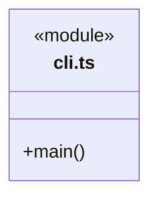
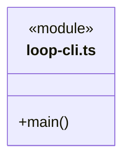

# src/backend/main/commands 架构

## 目录定位

CLI 入口，复用应用和调度，不拥有第二套领域规则。

本文描述当前实现。通过分析目录边界后维护的 [源码架构脚本](../../../../scripts/source-architecture.mjs) 同步清单和声明；代码变更时仍须核对职责、关键成员与关系。

## 代码清单

| 文件 | 当前职责 |
| --- | --- |
| [cli.ts](cli.ts) | 只连接已运行工作区的知识查询/校验命令，不启动工作区服务。 |
| [loop-cli.ts](loop-cli.ts) | 主进程命令入口：Pi Loop 开发 CLI：创建任务、显式恢复、中断和输出执行事件。 |

## 架构类图

### cli.ts

直接依赖：[../platform/paths.ts](../platform/paths.ts)、[../../core/foundation/serialization.ts](../../core/foundation/serialization.ts)、[../integrations/mcp/discovery.ts](../integrations/mcp/discovery.ts)。

### loop-cli.ts

直接依赖：[../platform/paths.ts](../platform/paths.ts)、[../application.ts](../application.ts)。

## 子目录导航

无子目录。

[返回上层](../ARCHITECTURE.md)。

每次修改本目录代码，同步维护文件头、关键契约说明及本图。未实现的治理、证据验收和自动编排能力不列入当前类图。
