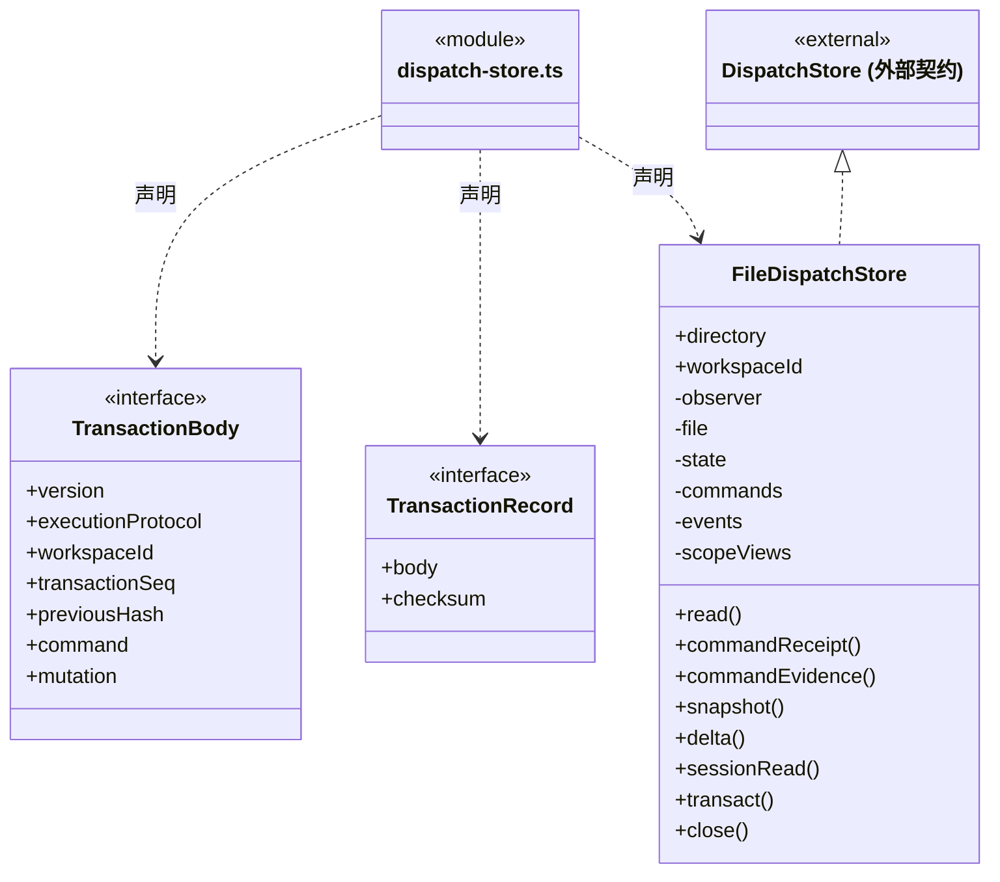
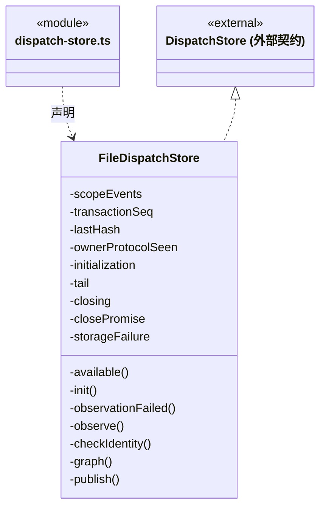
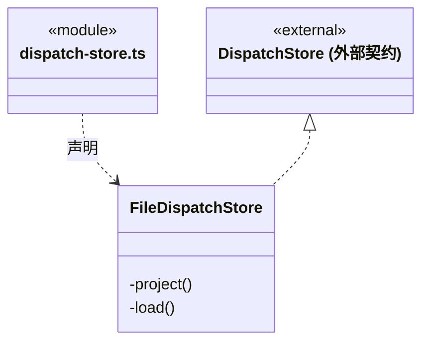
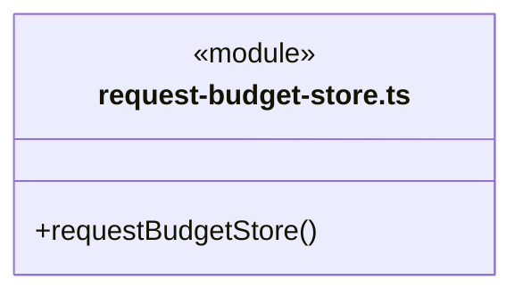

# src/backend/main/dispatch-storage 架构

## 目录定位

当前派发图、命令、领取及任务状态的文件存储实现。保留共享事务与 DispatchStore，未按目录拆开一致性边界；这仍是依赖密集的共享实现。

本文描述当前实现。通过分析目录边界后维护的 [源码架构脚本](../../../../scripts/source-architecture.mjs) 同步清单和声明；代码变更时仍须核对职责、关键成员与关系。

## 代码清单

| 文件 | 当前职责 |
| --- | --- |
| [dispatch-store.ts](dispatch-store.ts) | 将岗位、模块责任、来源代次和受控文件阶段，以及执行实例、会话、任务图和信封可靠保存到同一工作区日志。 |
| [request-budget-store.ts](request-budget-store.ts) | 将工作区唯一 DispatchStore 适配为请求预算专用的两项读写能力。 |

## 架构类图

### dispatch-store.ts

成员 1/3（同名节点为同一声明，跨图合并阅读）。



成员 2/3（同名节点为同一声明，跨图合并阅读）。



成员 3/3（同名节点为同一声明，跨图合并阅读）。



直接依赖：[../../../core/errors.ts](../../../core/errors.ts)、[../../../core/platform/node/serialization.ts](../../../core/platform/node/serialization.ts)、[../../../logic/tasks/rules/graph-reducer.ts](../../../logic/tasks/rules/graph-reducer.ts)、[../../../logic/tasks/rules/dispatch-invariants.ts](../../../logic/tasks/rules/dispatch-invariants.ts)、[../../../logic/tasks/rules/dispatch-scope-invariants.ts](../../../logic/tasks/rules/dispatch-scope-invariants.ts)、[../../../logic/tasks/rules/workspace-member-invariants.ts](../../../logic/tasks/rules/workspace-member-invariants.ts)、[../../../logic/tasks/rules/module-ownership-invariants.ts](../../../logic/tasks/rules/module-ownership-invariants.ts)、[../../../logic/tasks/rules/effect-observation-invariants.ts](../../../logic/tasks/rules/effect-observation-invariants.ts)、[../../../logic/file-operations/rules/controlled-file-invariants.ts](../../../logic/file-operations/rules/controlled-file-invariants.ts)、[../../../logic/budget/rules/model-request-budget-invariants.ts](../../../logic/budget/rules/model-request-budget-invariants.ts)、[../../../logic/dispatch/rules/dispatch-storage.ts](../../../logic/dispatch/rules/dispatch-storage.ts)、[../../../logic/tasks/rules/graph-types.ts](../../../logic/tasks/rules/graph-types.ts)、[../../../logic/tasks/rules/scope-view.ts](../../../logic/tasks/rules/scope-view.ts)、[../../../logic/tasks/rules/dispatch-scope.ts](../../../logic/tasks/rules/dispatch-scope.ts)、[../../../logic/tasks/rules/knowledge-source-invariants.ts](../../../logic/tasks/rules/knowledge-source-invariants.ts)、[../../../logic/tasks/rules/owner-execution-invariants.ts](../../../logic/tasks/rules/owner-execution-invariants.ts)。

### request-budget-store.ts



直接依赖：[../../../logic/dispatch/rules/dispatch-storage.ts](../../../logic/dispatch/rules/dispatch-storage.ts)、[../../../logic/budget/rules/model-request-budget-storage.ts](../../../logic/budget/rules/model-request-budget-storage.ts)。


## 子目录导航

无子目录。

[返回上层](../ARCHITECTURE.md)。

每次修改本目录代码，同步维护文件头、关键契约说明及本图。未实现的治理、证据验收和自动编排能力不列入当前类图。

## 设计契约 v1 与落地范围

以下内容区分已接通能力与后续设计；以各节的实现状态为准，不将目标图当作现状图。维护源：[CONTRACT.md](CONTRACT.md)；生成类图时同步附加，勿直接修改本附录。

# dispatch-storage 持久化契约

### 新旧负责人执行协议

FileDispatchStore 在自身 transaction body 写入 `executionProtocol:module_owner_v1`，调用者 mutation 不可设置。旧完整日志前缀按旧执行规则回放，第一次新协议之后不得退回旧写法；未知协议或降级后缀即使哈希链一致也拒绝。不重写旧字节、回执或尚未绑定的历史。新 live 事务始终校验新业务绑定，旧已存在 run 的状态收束可以保留缺省字段。

新协议不是权限证明或来源 generation，只选择持久不变量的版本。岗位、责任、来源与运行事实仍由各自完整规则核验；原命令查询优先和 fsync 后发布保持原行为。新任务/新领取缺绑定或绑定过期时，图、运行、邮箱及日志原字节全部不变；在途运行后发生岗位暂停或换人不回滚该运行的原身份和公开模型。真实 Store 回归覆盖旧前缀→新结算、原回执、幂等、降级后缀和同 Agent 多岗位独立实例。

### 任务派发图持久化职责

已实现 `FileDispatchStore`：工作区单写入者串行事务、哈希链追加日志、fsync 后发布、幂等回执、成员/通道/图/执行意图/结果信封原子恢复，以及内存 Snapshot/Delta。日志位于应用用户目录的工作区 dispatch/dispatch.jsonl，不写入目标项目 .cbim。成员运行、领取、启动、结算与消息确认共用事务，跨对象约束交给 Core 的 `dispatch-invariants.ts`；本存储不启动模型或自动重试。`RunJournal.seq` 与整图序号仍分别维护。

成员运行日志保存并校验成员、通道、任务与预分配 runId 的绑定；旧日志可无此字段，不把 completed 直接视作结果就绪。

主对话日志另从 `run.started.conversationBinding` 恢复 `ConversationAgentBinding`：只允许 `chat / cbim:main`，工作区与日志任务一致，根会话等于原聊天 taskId，字段及标识由 Core 严格校验。该绑定与成员任务绑定互斥，但可与可信回注来源并存；不创建正式业务任务，也不影响主对话原有 `sessionFile` 恢复链。旧日志缺省时不按角色名补造主实例或改写历史，首次显式续聊的绑定只保存在新轮次。登记实例与图根的一致性由调度保证，本读取层不自行选择实例或合并聊天、任务通道。

主会话接续时，`RunJournal` 从 `run.started.source` 恢复经过校验的 `RunInputSource`：批次 ID、结果消息集合和任务集合必须符合 Core 契约，来源只能存在于带 resumeFrom 的普通 chat 运行中，不能与成员运行绑定混用。日志保留回注尝试，供调度按 continuationId / messageIds 去重；读取本身不确认信封、不启动模型，也不把来源字段视为业务验收。旧用户日志 source 仍为空，不由文本猜测补造。

本目录负责图提交的可靠落盘、幂等检查、快照、增量读取与恢复。Core 定义节点、边及状态约束；调度层核验成员、模块岗位责任、权限、依赖与状态迁移。本目录不替模型分析目标，不自行决定派给哪个成员。

### 图身份与存储端口

```ts
interface GraphIdentity {
  workspaceId: string;
  rootSessionId: string;
}

interface GraphCursor extends GraphIdentity {
  streamId: string;
  seq: number;
}

interface GraphEventBatch {
  version: 1;
  identity: GraphIdentity;
  streamId: string;
  seq: number;
  eventId: string;
  commandId: string;
  cause: GraphCause;
  committedAt: string;
  changes: GraphChange[];
}
```

- `workspaceId + rootSessionId` 唯一定位主 Agent 会话的派发图。新的派发由主根发出；执行实例使用自己的 `agentSessionId`，不得把接收会话替换为图根会话，执行成员不递归派工。
- `streamId` 在创建图时产生并持久化，正常进程重启不更换；它区别图流重建或迁移后的序号空间。
- `seq` 是原子提交批次序号，从 1 递增；0 仅为内部空前缀。graph.created 在 seq=1 原子保存根及主成员投影，公开快照始终有根。一个命令引起的多个节点、边、成员状态变化属于同一批次。不能用时间戳排序，也不能把一个批次拆成多个可见中间状态。
- `eventId` 唯一标识已提交批次；`commandId` 关联请求与幂等结果。`cause` 是 Core 定义的 `GraphCause` 事实枚举，由可信调度上下文形成。用户或成员的可信发送者身份另记内部命令审计，不由模型冒充发送人。
- `committedAt` 为 UTC ISO 8601 时间。`GraphChange` 只包含本批次发生变化的对象完整新快照；不包含私有推理、密钥、原始凭据或执行进程环境。

当前存储端口位于 Core 的 `dispatch-storage.ts`：

```ts
interface DispatchStore {
  read(): Promise<DispatchState>;
  snapshot(identity: GraphIdentity): Promise<GraphSnapshot>;
  delta(identity: GraphIdentity, cursor?: GraphCursor, limit?: number): Promise<GraphDelta>;
  transact<T>(command: DispatchCommand,
    prepare: (state: DispatchState) => Promise<DispatchMutation<T>>): Promise<T>;
  close(): Promise<void>;
}
```

`DispatchCommand` 含 commandId 与规范化请求 fingerprint，`DispatchMutation` 包含成员、Session、图批次、assignment/result 消息、runs、scopes 和回执。只有调度层生成 mutation；模型或前端不能直接提交它。公开图查询不返回 read() 的全工作区状态、冻结知识正文或私有原生会话路径。`runs/scopes` 是 v1 日志的可选兼容扩展；旧记录按空集合恢复，不重写历史记录与校验和，`read()` 总是返回数组。

成员唯一键按生命周期区分：主实例使用 `mainRootSessionId`，周期执行实例使用 `executionScopeId + executionTaskId`，旧无周期角色使用 agentId。已有实例的范围和通道用途不可重绑；释放只标记历史记录，不删除节点或证据。周期、执行实例和任务的联合约束由 `validateDispatchScopes` 核验，关闭与取消、租约递增、实例 released 在同一 fsync 事务里保存。已释放实例、通道与闭周期任务拒绝迟到写入。

`DispatchRun` 保存 `MemberRunBinding`、assignmentMessageId、starting/running/终态、完整知识快照、冻结前置候选 prerequisites、无密钥模型参数、ChatPermission、可选超时和原生会话定位。首次领取检查 prerequisites 与全部入向依赖及锁定的 resultId 一致，此后不拿上游最新结果覆盖冻结输入。已有运行的身份与输入不得改变；sessionFile 只允许从未知补为确定值，不能重新绑定。私有路径只能存在 runs 中，公开 AgentSessionBinding 拒绝该字段。

### 原子提交与幂等

一次派发至少需要原子保存：新任务、派发/依赖边、接收方待投递消息和该命令的提交回执。结果返回同样将有效结果记录、请求方待投递消息和图状态变化一起提交，避免出现“图上已派发，但成员永远收不到任务”。只有携带有效候选的 completed 运行可提交 result_ready；无候选时任务 blocked，运行仍诚实记录 completed。模型自动 staged 结果/等待及递归恢复不在当前实现范围。内部事务没有可见对象变化时不分配 graph seq；例如单独确认结果消息不会发布空图批次。

提交顺序：

1. 在工作区唯一写入者及串行提交边界中核验图身份。
2. 在整个工作区内按 `commandId` 查找已提交命令；指纹包含操作、可信发送者和完整输入（含图身份）。同 ID、同指纹返回原回执，不再次投递；跨图复用同 ID 或改变请求内容均返回 `COMMAND_ID_CONFLICT`。这个检查先于预期版本检查，避免正常重试被后来版本错误拒绝。
3. 对未提交的新命令核验对象版本与状态前置条件；节点及边必须引用同一张图，DAG 约束由调度验证并在同一提交快照上成立。
4. 将完整事务记录追加并 `fsync`，可靠保存后才更新内存投影、返回成功并发布增量。
5. 显式执行入口消费已提交 outbox。模型副作用发生前须可靠保存 starting 意图；执行的成功、失败或中断不能因消息重投而重复启动。

事务记录应包含完整 `GraphEventBatch` 和关联的邮箱/执行数据，采用可识别完整提交边界的日志格式。不能先修改图文件、再独立写消息文件。派生快照不是另一份权威状态；快照缺失时必须能从提交日志恢复。

写失败不更新可发布投影，不返回成功；当前写入链停止接受后续相关变更，直到明确恢复。调度调用方收到超时或连接中断时，可以使用原 `commandId` 查回执，不能换 ID 直接重复派发。

### 快照、增量与事件发布

`GraphSnapshot` 包含 `version:1、identity、cursor、root、tasks、edges、agents`，其对象内容必须对应同一个已提交 `cursor.seq`。读取旧游标必须返回完整批次，`limit` 按批次数计数，不按对象数截断；单批次大小由命令入口限制。

增量返回采用 `mode: 'noop' | 'delta' | 'reset'`，完整公开形状见 [Bridge 契约](../../../bridge/contracts/CONTRACT.md)。无变化时不重复读取和传输全图正文。订阅只发布已落盘批次；消费者掉线或丢包后，用最后成功应用的游标补读。

正常重启从持久化头恢复同一 `streamId` 与最后 `seq`，不回到 0。目前恢复并保留全部已提交图批次，未实现日志压缩或历史裁剪。若后续引入压缩，须先可靠生成带游标快照并建立保留区间；过期游标再按协议返回 `reset`。身份不匹配始终拒绝，不能用 reset 悄悄切换工作区或会话。

### 联合读取图与周期目标

`FileDispatchStore.sessionRead` 先等待原事务队列，再同步读取 graph delta、scope summary delta 与选中 scope detail，不在三份响应之间执行异步读取。此接口不创建根/周期、不读知识、不启动成员、不确认信封；原 `snapshot / delta` 接口保持兼容。

周期投影只由已落盘 `scopes` 变更派生，和正常重放共用 `publish`。每主会话独立编号，不受其他会话事务、图事件或幂等回执重发影响。scope 摘要保存在内存，事件和重放证明最多保留 256 批；超窗客户端 reset 到摘要快照。原 `dispatch.jsonl` 不变，不另建权威记录；正常重启重建相同 streamId、seq 和详情 stamp。单独 plan/review/block/close 不制造图批次，因此不会让已保存的审阅证据自行过期。

公开请求可选择本会话历史周期；缺省优先 active，再选最后创建的周期。无目标旧记录不补造。列表仅传小摘要，完整原始输入/计划/审阅在所选 stamp 变化时才返回；每秒无变化轮询只返回三份游标/noop。原始业务文本本身不做自动敏感内容识别，详情不包含运行私有路径、冻结知识或邮箱。

### 执行、邮箱与恢复

每个成员的 Session 通道按消息 ID 去重。同一信封只能更新 delivery/claim，来源、接收方、任务、版本及创建命令固定。assignment 为 pending → claimed → processed；claim 保存 runId 与 leaseEpoch 并在消费后保留。尚未领取的取消可以 pending → processed，不伪造运行。result 为 pending → processed，没有 claim；可信确认入口核验图与接收方，不凭确认操作创建新的业务 run。`ack` 不等于任务成功或业务验收。

在启动任何可能产生副作用的执行之前，先原子保存 starting、信封领取与 task/member 的 activeRunId。此时任务仍 queued、成员 communicating；收到真实启动事实后才记录 startedAt，转为 task.running/member.working。成员在所有根会话间共用一个活动执行槽。终态必须原子保存 settledAt、清除活动占用并消费信封；迟到回调不能改写已结算运行或旧租约。

恢复顺序：校验日志与身份 → 重建图、执行记录和邮箱投影 → 调度核对活动执行 → 保存中断事实并发布恢复状态。存储读取本身不会重启任何模型。调度接管未知 starting/running 时将任务与运行标为 interrupted，释放占用、消费信封并增加成员 leaseEpoch；文件写入、命令或外部操作结果不得盲目重放。

主 Agent 接收执行结果后可追加后续任务，执行成员没有递归派发权；结果不生成“任务 → 根”的反向依赖边。已实现的结果信封使用 `taskId/replyTo/messageId` 关联，与 `runId` 的执行尝试身份分开。恢复先核实并结算旧 starting/running，再将遗留 active 周期标为 interrupted 并释放执行实例；不自动重放模型、队列或未知副作用。

### 错误语义与迁移边界

| 情况 | 行为 |
| --- | --- |
| 工作区或根会话身份不同 | `GRAPH_IDENTITY_MISMATCH`，拒绝读取或提交 |
| 图不存在 | `GRAPH_NOT_FOUND`；读取不能自动创建图 |
| 对象预期版本过期 | `GRAPH_REVISION_CONFLICT`；调用方须重新查询当前图或任务，不自动合并，也不附带当前对象快照 |
| 同命令 ID 不同内容或发送者 | `COMMAND_ID_CONFLICT`，不产生新批次 |
| 写入失败 | `GRAPH_STORAGE_FAILED`，不发布未提交变化 |
| 日志中间损坏、序号断裂或身份不一致 | `GRAPH_LOG_CORRUPT`，拒绝伪装成空图或完成；仅可忽略明确未提交的崩溃尾部 |
| 未知协议版本 | `GRAPH_VERSION_UNSUPPORTED`，不猜测解析 |
| 未确认的执行结果 | 保留中断/待核实状态，不自动重试副作用 |

现有 `loop` 对话 `taskId`、`RunJournal` 及 `TaskProgress` 保留原意。引入 `rootSessionId` 和图任务 ID 时需要显式适配关联，不能根据名称相同直接等同；旧历史没有派发证据时不补造任务、消息或团队协作过程。
### 岗位登记沿用同一日志与提交屏障

`FileDispatchStore` 使用原 `dispatch.jsonl` 追加单条 `workspaceMemberChanges`，不再保存第二份权威岗位文件。`projectWorkspaceMemberMutation` 核验不可变审计后派生当前岗位及独立登记游标；登记 mutation 只能包含审计和回执，不能同事务修改任何执行数据。正文只保存在审计 `next`，当前岗位是内存投影，回执只含紧凑引用。没有图或周期变化时，其既有增量游标不推进。

加载和新提交使用同一领域校验；即使重算外层日志校验和，伪造版本、源快照指纹、actor、命令、回执或直接岗位头仍拒绝。旧 v1 日志没有登记字段时按空数组/null 恢复，不写迁移记录、不修改旧字节。正常重开恢复相同岗位 ID、原采纳、全部审计与登记游标。

`commandReceipt(commandId)` 从已恢复的命令索引等待提交屏障后返回深拷贝，不调用事务回调、知识或模型端口；未找到不是“肯定未受理”的证明。岗位命令仍遵循先查原指纹的幂等规则。fsync 或写入结果未确认时封闭当前 Store，不能返回过时投影；重新打开只按原完整日志核实，不自动重放登记。

### 模块负责人沿用同一事务与历史前缀

`ownershipChanges` 也只写入原 dispatch.jsonl；`projectModuleOwnershipMutation` 从原不可变事件派生责任当前头和 ownershipCursor，不另建责任账本。岗位 registryCursor、图游标和周期摘要不会因单独责任提交推进；控制面不修改执行状态。责任指派和岗位退休共享同一队列，两种竞争顺序都按先提交的真实状态拒绝后者，不能出现退休岗位被新指派或仍有引用却退休。

每条责任事件在当时前缀核验 source actor、模块/岗位版本、任务影响 digest、basis、完整原命令指纹和回执；后续 main scope 关闭不影响已保存事件的合法性。旧日志缺省空责任投影，不重写旧字节。相同命令从原索引返回回执，不再次执行准备或来源读取；写入/同步结果未知时沿原 Store 封闭语义，重开只按日志恢复，不能自动重做责任操作。
### 原 Dispatch 日志中的来源屏障

来源 capture/prepared/resolved 直接追加至同一 dispatch.jsonl，当前代次和过渡状态只由历史派生，不保存第二份来源账本。Store 先执行 `projectKnowledgeSourceMutation`，再把精确 capture 许可交给两个登记门禁；所有规则及原命令/回执核验完成后才可靠落盘并发布。来源游标不推进任务图、岗位登记或责任游标；仅明确 capture+consumer 同批才同时推进对应登记流。

prepared/resolved 为来源独立事务，原 journal 指纹属于内部可信协议，不接收知识正文。旧无来源字段日志保持字节与回执不变，首次读取只返回空来源集合/null 游标。重开重放相同前缀与严格校验；source 的命令查询沿原只读索引，无自动知识重做。知识协调器持知识 serial 后调用 Store，Store 回调不得反向排队知识；两日志并非跨存储 ACID，无法核实的 pending 仍保留屏障。
# 原命令前态证据（Step35 已实现协议）

`commandEvidence` 只从原 commands 索引派生事实：实时提交可靠 fsync 后、历史重放完成原校验后，用同一 publish 路径保存提交前 graph.root.revision 和前后图游标。无前图不补默认版本；旧 journal 不改格式或字节，也不保存第二账本。查询等待现有提交屏障返回隔离副本，不能调用 prepare/transact 或再扫描日志。

原 `commandReceipt` 仍只含 fingerprint/receipt；新增证据不自动扩散给旧消费者。IO 未确认或损坏不能返回 absent。应用报告只接已打开且初始化完成的工作区，不以查询触发 open/init/recover；内部完整回执不可直接返回 UI/模型。
# 影响处置附录（Step36 协议实施中）

FileDispatchStore 在原 journal 的完整校验与 durable publish 中投影 effectDispositions；旧缺省保持缺省。单次只有一条处置和它的严格回执，不能混入 graph/scopes/runs/登记审计；原 commandReceipt/commandEvidence 继续负责幂等和只读查询。记录不创建运行、推进图或周期游标，不重读今天文件来改判旧决定。写入失败沿原存储封闭规则处理，重开只核原帧；不增加第二份恢复账本。中文接口与实际字段随 Core 契约同步，整体功能验收由正式步骤记录。

## 受控文件阶段附录（Step37）

`controlledFileChanges` 沿原 dispatch.jsonl 保存，`projectControlledFileMutation` 同时用于实时提交及历史重放。每次严格单条 append，prepared/executing/terminal 各有固定命令，两个终态共用一把原命令键；补偿是新 operation，不覆盖原写。原 commands 索引继续保存阶段原回执，可靠 sync 后才 publish；写入结果未确认则封闭当前实例，重开只核已存在的完整帧，不重启文件子进程或自动补终态。

旧日志缺省不补 controlledFileChanges 数组，附录不推进图、周期、岗位或来源游标。Store 内不读 blob/业务文件、不等待平台进程、模型或知识队列，公共报告须经 Core 显式白名单投影。真实 before/执行结果由 Main 的受控会话产生；Store 不声称文件写具有断电原子性，也不从今天字节猜原 applied。

## 逐请求预算（R06）

请求预算附录与现有领域共用唯一 dispatch.jsonl 与 fsync 屏障；追加和重放调用相同严格投影，初次申请的决定在事务内读取全部预留。写后未确认时封住本实例；加载只按实际日志恢复，不补造释放或重新请求。

## 原隔离执行核实与清理

FileIsolationRecords是独立私有fsync追加链，绑定原run/call、完整运行身份、原scope/input摘要和平台资源；只追加合法prepared/started/settled/cleaned或cleanup_requested/cleanup_complete阶段。读取不建目录、不修尾、不重放；每条链256KiB/32帧，每run256调用；损坏拒绝，写入未知封闭实例。目录受工作区独占锁及当前本地用户信任边界保护，不防同用户恶意重写整个私有数据库。


### 请求预算的窄视图适配

request-budget-store.ts 把唯一 DispatchStore 的 read/transact 适配为 RequestBudgetStore。字段投影和隔离副本在原 transact 的 prepare 回调内产生，不能先读余额再另起扣减事务；预算回调不能夹带 scopes 等其它 mutation 键。适配器不创建文件、队列或锁，不修改存储格式。幂等原回执、原子不变量、可靠 fsync、失败封闭及重开恢复继续由 FileDispatchStore 负责，跨领域事务不拆成多次写入。

## 全量 IPC 契约衔接

ChatInputs 的公开连接器列表与附件预览在 JSON 投影处核实字段；损坏数据拒绝返回，不把 any 当作可靠响应。保存快照、取消、文件读取和续接附件证明不改变。
