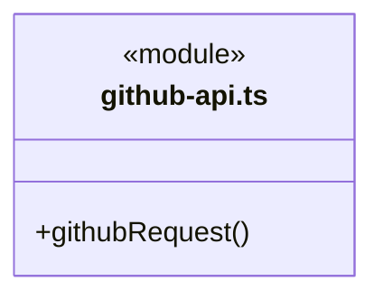
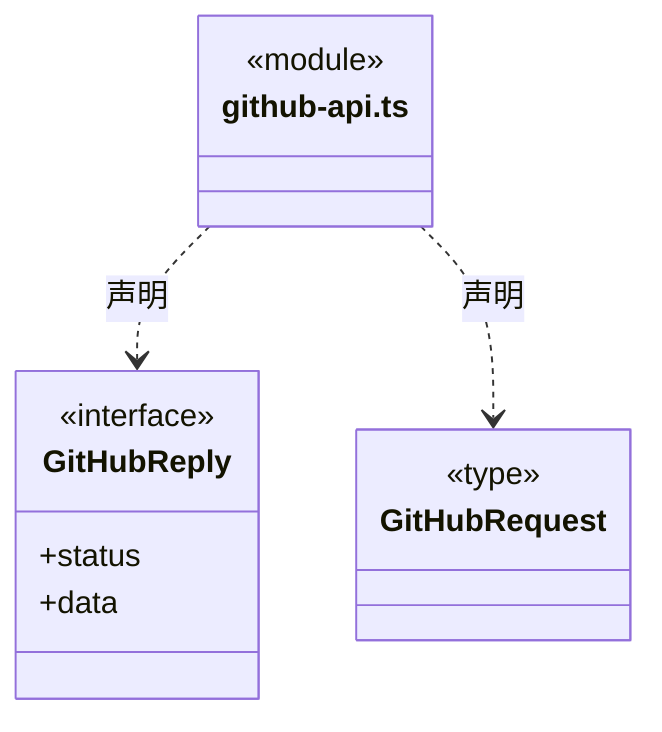
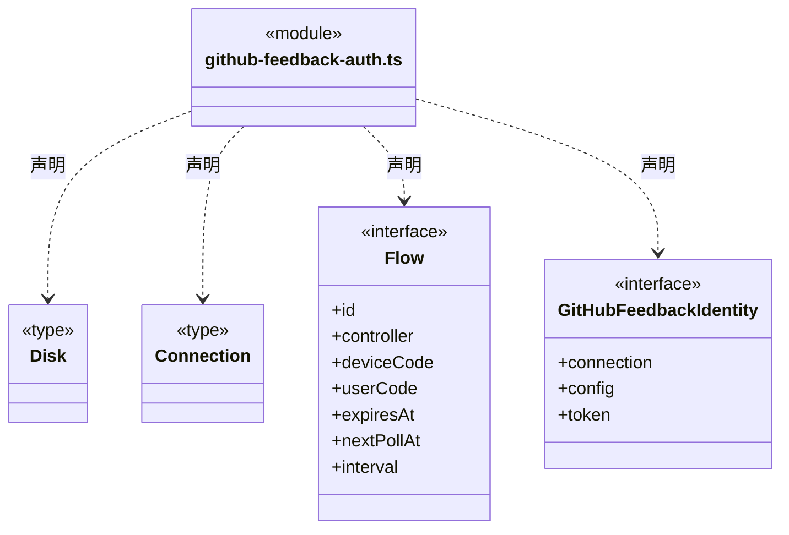
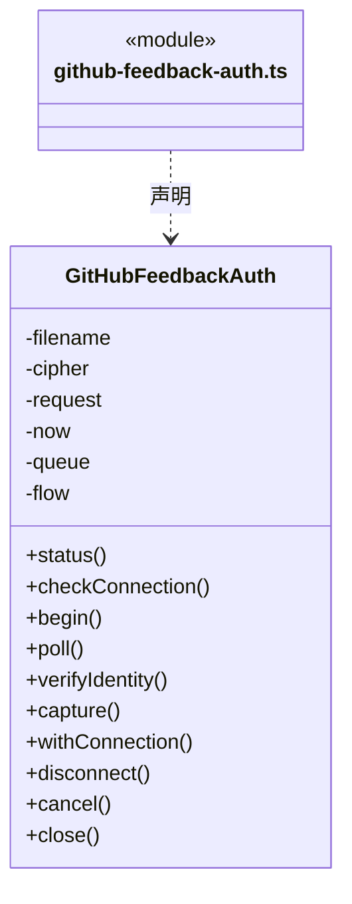
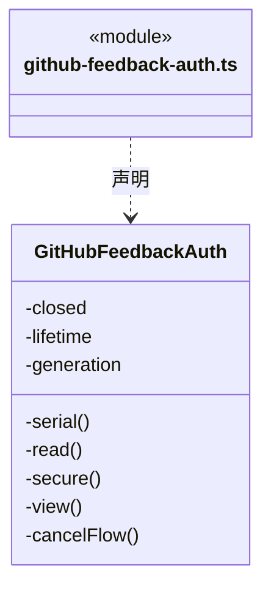
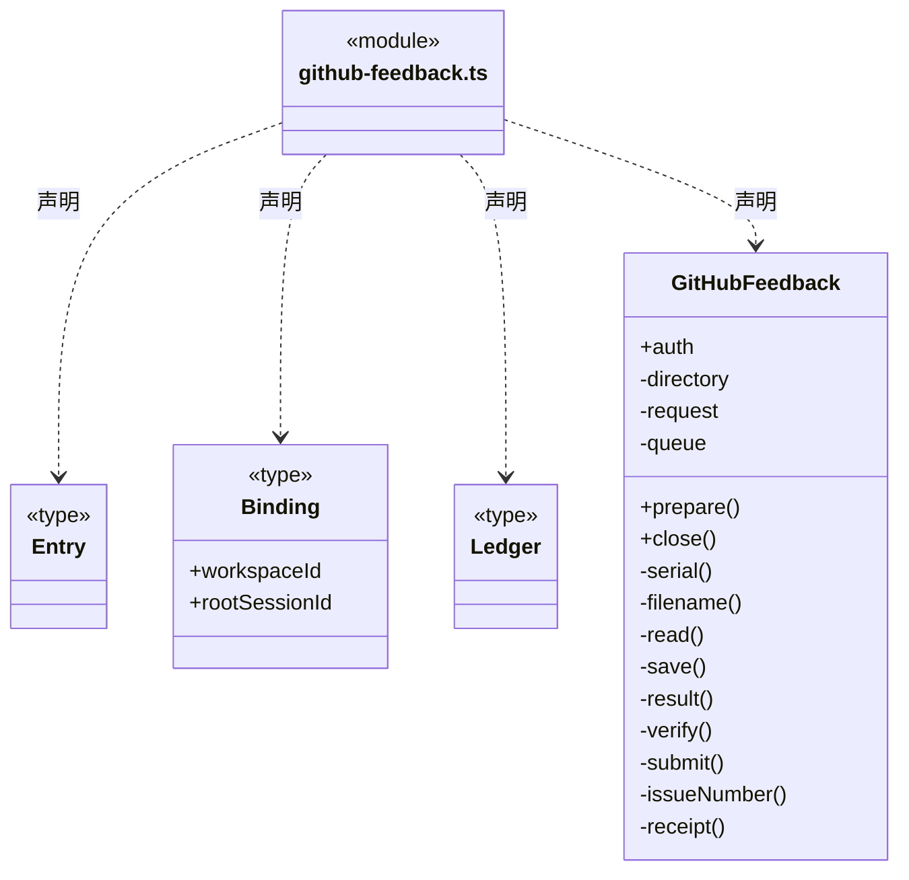
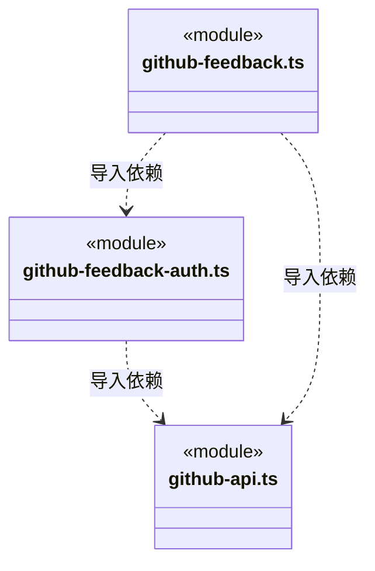

# src/backend/main/feedback 架构

## 目录定位

GitHub 反馈的登录、请求和持久化服务，公开字段与端口在 Core/connectors。

本文描述当前实现。通过分析目录边界后维护的 [源码架构脚本](../../../../scripts/source-architecture.mjs) 同步清单和声明；代码变更时仍须核对职责、关键成员与关系。

## 代码清单

| 文件 | 当前职责 |
| --- | --- |
| [github-api.ts](github-api.ts) | 主进程直连 GitHub 的有界 JSON 传输，供设备授权和反馈提交共用。 |
| [github-feedback-auth.ts](github-feedback-auth.ts) | 桌面 GitHub Device Flow、账号／仓库绑定和本机加密凭据管理。 |
| [github-feedback.ts](github-feedback.ts) | 将本机会话的结构化反馈直接写入已连接 GitHub 仓库，保存私有原提交凭证。 |

## 架构类图

### github-api.ts

直接依赖：[../../core/foundation/errors.ts](../../core/foundation/errors.ts)、[../../../foundations/utility/index.ts](../../../foundations/utility/index.ts)。

### github-feedback-auth.ts

成员 1/2（同名节点为同一声明，跨图合并阅读）。

成员 2/2（同名节点为同一声明，跨图合并阅读）。

直接依赖：[../../../foundations/files/index.ts](../../../foundations/files/index.ts)、[../../core/foundation/errors.ts](../../core/foundation/errors.ts)、[../../core/foundation/serialization.ts](../../core/foundation/serialization.ts)、[../platform/locking.ts](../platform/locking.ts)、[../../core/models/ports.ts](../../core/models/ports.ts)、[../../core/connectors/github-feedback.ts](../../core/connectors/github-feedback.ts)、[github-api.ts](github-api.ts)。

### github-feedback.ts

直接依赖：[../../../foundations/files/index.ts](../../../foundations/files/index.ts)、[../../core/foundation/serialization.ts](../../core/foundation/serialization.ts)、[../../core/foundation/errors.ts](../../core/foundation/errors.ts)、[../../core/models/ports.ts](../../core/models/ports.ts)、[../../core/connectors/github-feedback.ts](../../core/connectors/github-feedback.ts)、[../platform/locking.ts](../platform/locking.ts)、[github-feedback-auth.ts](github-feedback-auth.ts)、[github-api.ts](github-api.ts)。

### 本目录调用边界

## 子目录导航

无子目录。

[返回上层](../ARCHITECTURE.md)。

每次修改本目录代码，同步维护文件头、关键契约说明及本图。未实现的治理、证据验收和自动编排能力不列入当前类图。

## 设计契约 v1 与落地范围

以下内容区分已接通能力与后续设计；以各节的实现状态为准，不将目标图当作现状图。维护源：[CONTRACT.md](CONTRACT.md)；生成类图时同步附加，勿直接修改本附录。

# GitHub HTTP 适配边界

github-api 继续拥有固定地址白名单、方法、令牌、20 秒期限、2 MiB 原字节上限、JSON 解码和错误脱敏。响应体通过 utility.readBoundedBytes 收集，基础库不决定目标地址、授权或重试，不记录请求内容。

reader 取消不依赖 fetch 转发信号；中断、超限或坏 JSON 均沿原 GITHUB_NETWORK 对外出口报告未取得可靠回包，不泄漏底层 reason 或自动重发写请求。工具证据、设备授权、连接持久化与业务反馈仍由本目录原服务拥有，基础库读取完成不等同于反馈业务成功。
