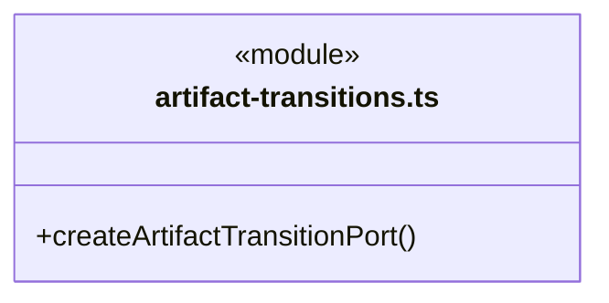
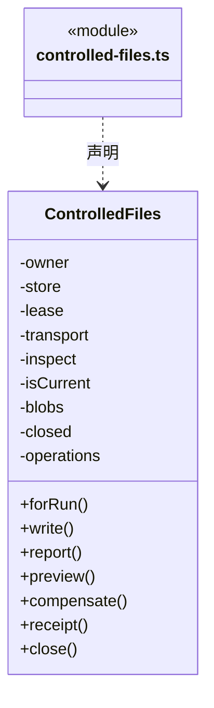
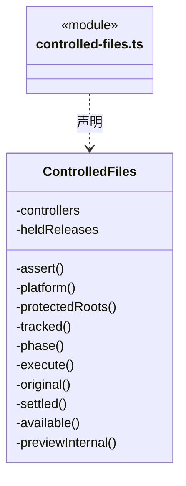
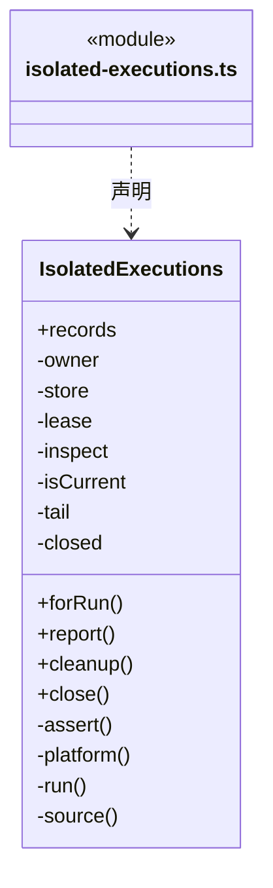
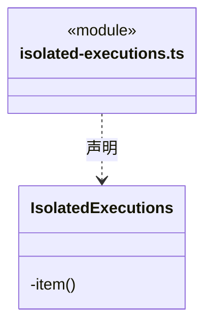

# src/backend/main/file-operations 架构

## 目录定位

受控文件操作与隔离执行的应用服务，连接冻结授权、工作区身份与 platform 实现；不把底层完成当业务验收。

本文描述当前实现。通过分析目录边界后维护的 [源码架构脚本](../../../../scripts/source-architecture.mjs) 同步清单和声明；代码变更时仍须核对职责、关键成员与关系。

## 代码清单

| 文件 | 当前职责 |
| --- | --- |
| [artifact-transitions.ts](artifact-transitions.ts) | 把已打开工作区的真实文件 utility 能力装配为成员删除/移动端口，不暴露平台句柄到 Core。 |
| [controlled-files.ts](controlled-files.ts) | 已打开工作区的受控写入与桌面补偿服务，连接运行许可、私有备份、独占子进程和唯一 DispatchStore。 |
| [isolated-executions.ts](isolated-executions.ts) | 正式成员隔离记录的可信装配，以及原运行的桌面核实／显式清理服务。 |

## 架构类图

### artifact-transitions.ts

直接依赖：[../../core/foundation/errors.ts](../../core/foundation/errors.ts)、[../../core/execution/capabilities/run-artifact-transition.ts](../../core/execution/capabilities/run-artifact-transition.ts)、[../platform/files/controlled-file-protocol.ts](../platform/files/controlled-file-protocol.ts)、[../workspace/workspace.ts](../workspace/workspace.ts)。

### controlled-files.ts

成员 1/2（同名节点为同一声明，跨图合并阅读）。

成员 2/2（同名节点为同一声明，跨图合并阅读）。

直接依赖：[../../core/foundation/errors.ts](../../core/foundation/errors.ts)、[../../core/foundation/serialization.ts](../../core/foundation/serialization.ts)、[../workspace/workspace.ts](../workspace/workspace.ts)、[../../core/dispatch/dispatch-storage.ts](../../core/dispatch/dispatch-storage.ts)、[../../core/tasks/dispatch-execution.ts](../../core/tasks/dispatch-execution.ts)、[../../core/execution/types.ts](../../core/execution/types.ts)、[../../core/execution/capabilities/run-controlled-file.ts](../../core/execution/capabilities/run-controlled-file.ts)、[../../core/file-operations/controlled-file-operation.ts](../../core/file-operations/controlled-file-operation.ts)、[../../core/file-operations/controlled-file-event.ts](../../core/file-operations/controlled-file-event.ts)、[../../core/file-operations/controlled-file-rules.ts](../../core/file-operations/controlled-file-rules.ts)、[../../core/file-operations/controlled-file-invariants.ts](../../core/file-operations/controlled-file-invariants.ts)、[../platform/files/controlled-file-blobs.ts](../platform/files/controlled-file-blobs.ts)、[../platform/files/controlled-file-protocol.ts](../platform/files/controlled-file-protocol.ts)、[../../scheduler-engine/admission/workspace-lease.ts](../../scheduler-engine/admission/workspace-lease.ts)。

### isolated-executions.ts

成员 1/2（同名节点为同一声明，跨图合并阅读）。

成员 2/2（同名节点为同一声明，跨图合并阅读）。

直接依赖：[../../core/foundation/serialization.ts](../../core/foundation/serialization.ts)、[../../core/foundation/errors.ts](../../core/foundation/errors.ts)、[../../core/dispatch/dispatch-storage.ts](../../core/dispatch/dispatch-storage.ts)、[../../core/tasks/dispatch-execution.ts](../../core/tasks/dispatch-execution.ts)、[../../core/execution/types.ts](../../core/execution/types.ts)、[../../core/workspace/execution-scope.ts](../../core/workspace/execution-scope.ts)、[../../core/file-operations/scoped-execution.ts](../../core/file-operations/scoped-execution.ts)、[../../core/file-operations/isolated-execution-recovery.ts](../../core/file-operations/isolated-execution-recovery.ts)、[../platform/isolation/isolation-record.ts](../platform/isolation/isolation-record.ts)、[../platform/isolation/isolation-records.ts](../platform/isolation/isolation-records.ts)、[../platform/isolation/isolation-recovery-win32.ts](../platform/isolation/isolation-recovery-win32.ts)、[../workspace/workspace.ts](../workspace/workspace.ts)、[../../scheduler-engine/admission/workspace-lease.ts](../../scheduler-engine/admission/workspace-lease.ts)。

## 子目录导航

无子目录。

[返回上层](../ARCHITECTURE.md)。

每次修改本目录代码，同步维护文件头、关键契约说明及本图。未实现的治理、证据验收和自动编排能力不列入当前类图。
